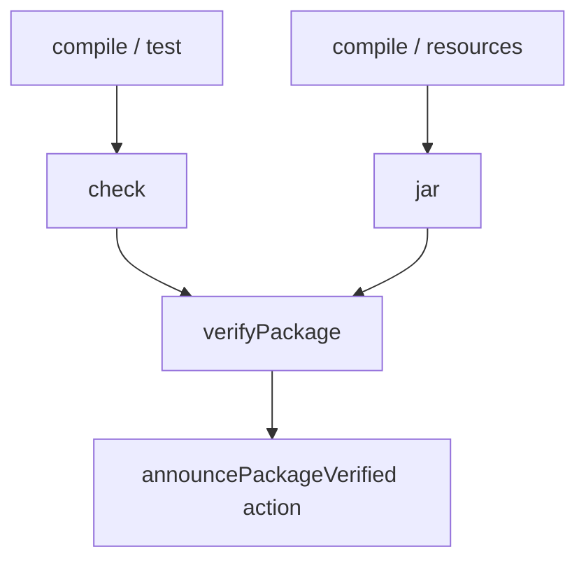

# Cấu hình khai báo và cấu hình theo mệnh lệnh

Khi viết cấu hình build, ta có thể mô tả **điều mình muốn build đạt được** hoặc viết ra **từng thao tác để tạo ra kết quả đó**. Hai cách tiếp cận này thường được gọi là cấu hình khai báo (declarative configuration) và cấu hình theo mệnh lệnh (imperative configuration).

Trong Gradle, cả hai phong cách đều có thể xuất hiện trong cùng một build script. Khối `plugins` khai báo plugin cần dùng; khối `dependencies` mô tả các thư viện mà project cần; task graph mô tả quan hệ giữa các công việc. Ở chiều khác, Groovy DSL và Kotlin DSL là ngôn ngữ có thể thực thi logic như điều kiện, vòng lặp, gọi hàm và tạo task action. Một task cũng có thể chứa các lệnh cụ thể trong `doLast` hoặc trong lớp task riêng.

Hiểu sự khác nhau giữa hai phong cách giúp build script dễ đọc, dễ bảo trì và để Gradle quản lý công việc hiệu quả. Phần lớn cấu hình nên mô tả rõ mô hình, dependency và đầu vào/đầu ra. Các thao tác thực sự cần xử lý theo từng bước có thể được viết thành task action phù hợp.

## 1. Cấu hình khai báo là gì?

Cấu hình khai báo tập trung mô tả trạng thái mong muốn, thành phần cần có hoặc quan hệ cần được duy trì. Người viết khai báo mục tiêu và các thuộc tính; công cụ build sử dụng mô hình đó để xác định cách thực hiện.

Ví dụ ngoài Gradle:

- Trong SQL, câu lệnh `SELECT` mô tả dữ liệu cần truy vấn; cơ sở dữ liệu lựa chọn kế hoạch thực thi.
- Trong một manifest Kubernetes, người vận hành mô tả số replica và image mong muốn; Kubernetes controller liên tục điều chỉnh trạng thái thực tế theo mô tả.
- Trong cấu hình dependency của Gradle, build khai báo thư viện và phiên bản cần dùng; Gradle phân giải dependency graph.

Một cấu hình khai báo thường có các đặc điểm:

- Nêu **cái gì cần có** hoặc **quan hệ nào cần tồn tại**.
- Tách mục tiêu khỏi các bước thực thi chi tiết.
- Dễ đọc như một mô hình hoặc danh sách thuộc tính.
- Cho phép công cụ phân tích quan hệ và lựa chọn cách thực hiện phù hợp.
- Thường dễ kiểm tra, so sánh và tái sử dụng hơn khi mô hình được thiết kế tốt.

Khai báo không có nghĩa là không có xử lý bên dưới. Công cụ vẫn phải thực hiện công việc, nhưng người viết cấu hình không cần tự điều khiển từng bước của thuật toán.

## 2. Cấu hình theo mệnh lệnh là gì?

Cấu hình theo mệnh lệnh mô tả các thao tác cần thực hiện theo trình tự hoặc theo điều kiện cụ thể. Thay vì chỉ khai báo trạng thái mong muốn, người viết chỉ dẫn chương trình làm việc như thế nào.

Ví dụ, giả sử cần thực hiện một chuỗi thao tác build theo thứ tự. Cách viết theo mệnh lệnh có thể mô tả trực tiếp các bước:

```groovy
tasks.register('showBuildSteps') {
    doLast {
        def steps = [
            'Identify the application',
            'Collect the version',
            'Print the build information'
        ]

        steps.each { step ->
            println step
        }
    }
}
```

Trong task action trên, chương trình lần lượt:

1. Tạo danh sách các bước cần thực hiện.
2. Duyệt qua từng phần tử.
3. In từng bước theo thứ tự.

Người viết kiểm soát trực tiếp các thao tác và thứ tự của chúng. Cách này linh hoạt, nhưng nếu nhiều task cùng tự xử lý file, dependency và trạng thái theo những cách khác nhau, build có thể khó hiểu và khó tối ưu.

Cấu hình theo mệnh lệnh phù hợp khi thực sự cần một thuật toán hoặc một quy trình thao tác riêng. Nó trở nên khó bảo trì khi được dùng để tự làm lại những khả năng mà Gradle đã cung cấp dưới dạng task hoặc model có sẵn.

## 3. Gradle sử dụng kết hợp hai phong cách

Gradle không phải hệ thống cấu hình thuần khai báo. Build script viết bằng Groovy DSL hoặc Kotlin DSL là code được Gradle đánh giá trong quá trình cấu hình. DSL cung cấp các khối và API có ý nghĩa với build, nhưng bên trong vẫn có thể thực thi logic lập trình.

Ví dụ một build script:

```groovy
plugins {
    id 'java'
}

group = 'com.example'
version = '1.2.0'

repositories {
    mavenCentral()
}

dependencies {
    implementation 'org.apache.commons:commons-lang3:3.14.0'
    testImplementation 'org.junit.jupiter:junit-jupiter:5.10.2'
}

tasks.named('test') {
    useJUnitPlatform()
}
```

Các phần trên chủ yếu khai báo:

- Plugin Java cần được áp dụng.
- Group và version của project.
- Repository dùng để phân giải dependency.
- Dependency nào cần có trong các configuration.
- Test task sử dụng JUnit Platform.

Gradle đọc các khai báo đó để tạo mô hình project, cấu hình classpath và chuẩn bị task. Người viết không tự tải từng JAR, giải nén, sắp xếp classpath hay gọi JUnit bằng từng lệnh thủ công.

Ở cấp task, ta cũng có thể khai báo mục tiêu và quan hệ:

```groovy
tasks.register('releaseCandidate') {
    group = 'distribution'
    description = 'Verifies and assembles the release candidate.'
    dependsOn(tasks.named('check'))
    dependsOn(tasks.named('jar'))
}
```

Đoạn này mô tả một mục tiêu `releaseCandidate` phụ thuộc vào `check` và `jar`. Gradle xây dựng task graph từ quan hệ đó. Task lifecycle không cần tự viết code để biên dịch, kiểm thử hay tạo JAR.

Khi cần một thao tác riêng, task có thể có action:

```groovy
tasks.register('printReleaseMessage') {
    dependsOn(tasks.named('releaseCandidate'))

    doLast {
        println 'Release candidate is ready.'
    }
}
```

Ở đây có cả hai phong cách:

- `dependsOn` khai báo quan hệ cần thiết trong task graph.
- `doLast` chứa hành động cụ thể được thực hiện khi task chạy.

Sự kết hợp này là bình thường. Điều quan trọng là đặt mỗi phần vào đúng vai trò.

## 4. So sánh hai phong cách trong Gradle

| Tiêu chí | Khai báo (declarative) | Theo mệnh lệnh (imperative) |
|---|---|---|
| Trọng tâm | Mô tả trạng thái, thành phần hoặc quan hệ mong muốn | Mô tả các bước phải thực hiện |
| Cách đọc | Đọc như mô hình cấu hình | Đọc như một chương trình hoặc thuật toán |
| Kiểm soát thứ tự | Thông qua dependency và ordering trong task graph | Thường điều khiển thứ tự ngay trong code action |
| Khả năng phân tích | Gradle hiểu model, task dependency và một số input/output được khai báo | Gradle chỉ biết những gì task và action mô tả; logic ẩn có thể khó theo dõi |
| Tái sử dụng | Dễ chia sẻ model, convention plugin và cấu hình chung | Có thể tái sử dụng bằng hàm, lớp hoặc plugin nhưng cần quản lý logic |
| Rủi ro thường gặp | Mô hình khai báo thiếu hoặc cấu hình mâu thuẫn | Side effect ẩn, trạng thái ngầm, input/output không được khai báo |
| Ví dụ | `dependencies`, `sourceSets`, `dependsOn`, task properties | `if`, `for`, ghi file, gọi process trong task action |

Không có quy tắc rằng khai báo luôn đúng hoặc mệnh lệnh luôn sai. Một task xử lý dữ liệu phức tạp có thể cần code mệnh lệnh. Ngược lại, dependency và cấu hình plugin nên được biểu diễn bằng model của Gradle thay vì tự thực hiện thủ công.

## 5. Phân biệt cấu hình build với thực thi task

Một điểm quan trọng khi đọc Gradle DSL là phân biệt **configuration phase** và **execution phase**.

Gradle thường xử lý build theo ba giai đoạn lớn:

1. **Initialization:** xác định build và project nào tham gia.
2. **Configuration:** đánh giá settings và build scripts, áp dụng plugin, cấu hình project và task, xây dựng task graph cần thiết.
3. **Execution:** thực hiện các task action theo task graph.

Ví dụ:

```groovy
tasks.register('showMessage') {
    println 'This line runs while the task is configured.'

    doLast {
        println 'This line runs when the task executes.'
    }
}
```

Dòng `println` trực tiếp trong closure cấu hình task chạy trong giai đoạn cấu hình khi closure được đánh giá. Nội dung bên trong `doLast` là task action và chỉ chạy khi task được thực thi.

Nếu đặt thao tác đọc file, gọi mạng hoặc tạo thư mục trực tiếp trong phần cấu hình, các side effect đó có thể xảy ra ngay cả khi người dùng chỉ muốn xem task hoặc chạy một task không liên quan. Chúng cũng có thể làm tăng thời gian cấu hình và gây khó khăn cho configuration cache.

Thông thường, phần cấu hình nên mô tả task, input, output, dependency và điều kiện. Công việc thực sự nên được đặt trong task action hoặc được giao cho task type phù hợp.

### Điều kiện tại thời điểm cấu hình và thời điểm thực thi

Một `if` trong build script được đánh giá khi đoạn code đó chạy, thường là trong configuration phase:

```groovy
if (project.hasProperty('includePreview')) {
    tasks.register('previewInfo') {
        doLast {
            println 'Preview task was registered.'
        }
    }
}
```

Nếu property không có khi cấu hình build, task có thể không được đăng ký trong lần build đó.

Nếu muốn task đã được đăng ký nhưng chỉ thực thi khi một điều kiện đúng, có thể dùng `onlyIf`:

```groovy
def shouldPublishPreview = providers.gradleProperty('publishPreview')
    .map { it == 'true' }
    .orElse(false)

tasks.register('publishPreview') {
    onlyIf {
        shouldPublishPreview.get()
    }

    doLast {
        println 'Publishing preview artifact.'
    }
}
```

Ở ví dụ này, task được đăng ký trong configuration phase; điều kiện `onlyIf` được kiểm tra trước khi task action thực hiện. Nếu điều kiện không thỏa, task bị skip.

Chọn đúng thời điểm đánh giá giúp task graph dễ dự đoán và tránh thực hiện side effect trong lúc cấu hình.

## 6. Ví dụ: khai báo dependency thay vì tự tải thư viện

Giả sử ứng dụng cần Apache Commons Lang. Cách khai báo với Gradle:

```groovy
repositories {
    mavenCentral()
}

dependencies {
    implementation 'org.apache.commons:commons-lang3:3.14.0'
}
```

Gradle phân giải dependency graph, tải artifact cần thiết và tạo classpath tương ứng. Người viết build không cần tự viết code tải URL, giải nén JAR và thêm từng đường dẫn vào compiler.

Một cách theo mệnh lệnh để tự làm những thao tác đó có thể gồm:

1. Gọi HTTP tới Maven repository.
2. Tải file JAR.
3. Tạo thư mục lưu trữ.
4. Giải nén hoặc đặt file vào thư mục.
5. Tự cập nhật classpath.

Cách tự làm vừa phải xử lý nhiều trường hợp lỗi, xác minh checksum, dependency transitive, cache và phiên bản. Nó cũng bỏ qua mô hình dependency mà Gradle đã cung cấp. Vì vậy, dependency nên được khai báo qua `dependencies` và repository.

Ví dụ này cho thấy một nguyên tắc: nếu Gradle có một model chuyên biệt cho một loại thông tin, hãy dùng model đó thay vì tự viết thủ tục thao tác ở cấp thấp.

## 7. Ví dụ: dùng task type khai báo thay vì tự sao chép file

Giả sử cần sao chép cấu hình mẫu vào thư mục phân phối. Có thể viết action mệnh lệnh bằng các thao tác file trực tiếp:

```groovy
abstract class CopyConfigTask extends DefaultTask {
    @InputFile
    abstract RegularFileProperty getSourceFile()

    @OutputFile
    abstract RegularFileProperty getDestinationFile()

    @TaskAction
    void copyConfig() {
        def source = sourceFile.get().asFile
        def destination = destinationFile.get().asFile
        destination.parentFile.mkdirs()
        java.nio.file.Files.copy(
            source.toPath(),
            destination.toPath(),
            java.nio.file.StandardCopyOption.REPLACE_EXISTING
        )
    }
}

tasks.register('copyDefaultConfigImperatively', CopyConfigTask) {
    sourceFile.set(layout.projectDirectory.file('config/default.yml'))
    destinationFile.set(layout.buildDirectory.file('distribution/config/default.yml'))
}
```

Trong task action, code trực tiếp tạo thư mục và gọi API file để sao chép. Tuy nhiên, task vẫn khai báo `@InputFile` và `@OutputFile`, nên Gradle có thể theo dõi dữ liệu nguồn và kết quả. Gradle còn có task type `Copy`, mô tả rõ nguồn và đích bằng cấu hình chuyên biệt:

```groovy
tasks.register('copyDefaultConfig', Copy) {
    from('config/default.yml')
    into(layout.buildDirectory.dir('distribution/config'))
}
```

Với task type `Copy`, nguồn và đích được khai báo thông qua API task. Gradle có thể hiểu rõ hơn input/output của công việc và quản lý trạng thái task theo implementation có sẵn. Đây là cách nên ưu tiên cho một thao tác copy tiêu chuẩn.

Khi cần lọc nội dung, đổi tên tệp hoặc xử lý dữ liệu đặc thù, vẫn có thể cấu hình thêm các thuộc tính của `Copy` hoặc viết task riêng. Hãy bắt đầu từ khả năng có sẵn rồi chỉ bổ sung code mệnh lệnh khi yêu cầu thực sự cần.

## 8. Ví dụ: task graph khai báo và task action thực hiện

Một pipeline build nhỏ có thể được tổ chức như sau:

```groovy
plugins {
    id 'java'
}

tasks.register('verifyPackage') {
    group = 'verification'
    description = 'Runs checks and creates the Java archive.'

    dependsOn(tasks.named('check'))
    dependsOn(tasks.named('jar'))
}

tasks.register('announcePackageVerified') {
    group = 'distribution'
    description = 'Reports that package verification has completed.'

    dependsOn(tasks.named('verifyPackage'))

    doLast {
        println 'Package verification completed.'
    }
}
```

Phần khai báo mô tả:

- Plugin Java được áp dụng.
- `verifyPackage` phụ thuộc vào `check` và `jar`.
- `announcePackageVerified` phụ thuộc vào `verifyPackage`.

Phần mệnh lệnh trong `doLast` in thông báo sau khi các prerequisite hoàn thành. Đây là ví dụ đơn giản để minh họa hai vai trò. Trong build sản xuất, nếu cần ghi marker thành tệp output được Gradle theo dõi chính xác, nên định nghĩa task type có `@OutputFile` và input tương ứng thay vì chỉ ghi file qua một closure không mô tả đầy đủ metadata.

Sơ đồ task graph khái niệm:



Task graph biểu diễn công việc và quan hệ. Task action chứa cách thực hiện một công việc cụ thể. Tách hai lớp này làm cho build script dễ hiểu hơn.

## 9. Khi nào nên chọn phong cách khai báo?

Ưu tiên khai báo khi cấu hình thuộc những nhóm Gradle đã có model rõ ràng:

- Plugin cần áp dụng qua `plugins`.
- Dependency và repository qua `dependencies` và `repositories`.
- Source set, toolchain và compiler options qua API tương ứng.
- Quan hệ giữa task qua `dependsOn`, `mustRunAfter`, `shouldRunAfter` hoặc `finalizedBy`.
- Input/output của task qua property và annotation phù hợp.
- Task type có sẵn như `Copy`, `Zip`, `Jar`, `Test`, `JavaCompile`.

Các khai báo này giúp người đọc hiểu build đang mô tả điều gì. Gradle cũng có cơ hội phân tích model và quản lý task theo cơ chế sẵn có.

Khai báo đặc biệt hữu ích khi nhiều project dùng chung quy tắc. Có thể đưa cấu hình lặp lại vào convention plugin hoặc plugin nội bộ để các module áp dụng cùng một model, thay vì sao chép nhiều đoạn logic điều kiện vào từng build script.

## 10. Khi nào cần phong cách theo mệnh lệnh?

Phong cách theo mệnh lệnh phù hợp khi công việc thực sự là một chuỗi thao tác hoặc thuật toán riêng mà model có sẵn chưa mô tả được, ví dụ:

- Đọc một định dạng dữ liệu đặc thù và chuyển đổi nó.
- Tạo chỉ mục hoặc báo cáo từ nhiều nguồn dữ liệu.
- Gọi một công cụ ngoài với tham số được tính toán.
- Thực hiện bước kiểm tra nội dung có logic riêng.
- Điều phối một quy trình nội bộ có các nhánh điều kiện.

Trong các trường hợp này, hãy đóng gói logic vào task type hoặc task action có trách nhiệm rõ ràng. Khai báo input/output, dependency và điều kiện chạy để Gradle hiểu tác động của công việc.

Tránh những cách làm sau:

- Đọc và ghi file trực tiếp ở configuration phase khi chỉ cần làm việc đó lúc task chạy.
- Tự tải dependency bằng HTTP thay vì dùng dependency management.
- Tự gọi compiler bằng shell trong khi Gradle đã có `JavaCompile`.
- Dùng vòng lặp thay đổi task graph theo trạng thái máy cá nhân không được mô tả.
- Đặt mọi thao tác vào một task lớn khiến khó tái sử dụng và xác định nguyên nhân lỗi.
- Đọc biến môi trường hoặc thời gian hệ thống trong action nhưng không khai báo giá trị đó là input khi nó ảnh hưởng output.

## 11. Ảnh hưởng đến incremental build và build cache

Phong cách khai báo có thể giúp Gradle hiểu cấu trúc công việc tốt hơn, nhưng chỉ viết theo phong cách khai báo không tự động làm task có thể incremental hoặc cache được. Gradle cần metadata input/output chính xác và task action đáp ứng các điều kiện tương ứng.

Ví dụ custom task khai báo input/output:

```groovy
abstract class GenerateVersionFile extends DefaultTask {
    @Input
    abstract Property<String> getVersionName()

    @OutputFile
    abstract RegularFileProperty getOutputFile()

    @TaskAction
    void generate() {
        def output = outputFile.get().asFile
        output.parentFile.mkdirs()
        output.text = "version=${versionName.get()}\n"
    }
}

tasks.register('generateVersionFile', GenerateVersionFile) {
    versionName.set(project.version.toString())
    outputFile.set(layout.buildDirectory.file('generated/version.properties'))
}
```

Task này khai báo rõ:

- `versionName` là input ảnh hưởng nội dung.
- `outputFile` là output do task tạo.
- `@TaskAction` thực hiện thao tác ghi file.

Khi version không đổi và output hợp lệ, Gradle có thể đánh dấu task `UP-TO-DATE`. Nếu version đổi, input thay đổi và task cần thực hiện lại. Để sử dụng build cache, task còn cần đáp ứng yêu cầu cacheability và tạo output xác định theo input đã khai báo.

Ngược lại, một `doLast` đọc thêm file hoặc biến môi trường không khai báo có thể tạo output khác nhau mà Gradle không nhận biết đúng. Vì vậy, task action mệnh lệnh cần được bao quanh bởi một contract input/output khai báo rõ ràng.

## 12. Cấu hình theo mệnh lệnh không đồng nghĩa với cấu hình động tùy tiện

Một số build script dùng `if`, `for` hoặc function để tránh lặp. Điều đó không tự động khiến build trở nên xấu. Code lập trình có thể cần thiết để tạo cấu hình có hệ thống.

Ví dụ lặp qua danh sách module để áp dụng cùng một quy tắc:

```groovy
subprojects {
    group = 'com.example.learning'
}
```

Đây là code thực thi trong configuration phase, nhưng nó áp dụng một quy tắc cấu hình có chủ đích cho các project con. Cần xem xét scope và tác động của nó, không đánh giá chỉ dựa vào việc có vòng lặp hoặc closure.

Điều nên tránh là logic cấu hình phụ thuộc vào trạng thái ngẫu nhiên của máy hoặc thực hiện side effect khó kiểm soát. Ví dụ, gọi mạng để quyết định task nào được đăng ký, đọc file cá nhân không commit hoặc thay đổi cấu hình dựa trên thời điểm hiện tại có thể làm build khó tái lập.

Nếu cấu hình có nhiều điều kiện và được dùng ở nhiều project, hãy cân nhắc đưa logic vào convention plugin hoặc plugin build nội bộ. Cách đó tạo một nơi quản lý quy tắc, có thể kiểm soát phiên bản và tái sử dụng.

## 13. Một số nhầm lẫn thường gặp

| Nhầm lẫn | Cách hiểu chính xác |
|---|---|
| Gradle DSL là khai báo thuần túy | Build script là code được đánh giá; DSL cung cấp API và model có ý nghĩa với Gradle. |
| Có `doLast` là build script sai | `doLast` phù hợp cho task action nhỏ; cần quản lý input/output và trách nhiệm của task. |
| Có `if` hoặc vòng lặp là không được dùng | Logic có thể cần thiết; điều quan trọng là thời điểm chạy, tính xác định và tác động tới build model. |
| Khai báo dependency chỉ là viết danh sách thư viện | Gradle dùng dependency declaration để phân giải graph, version, configuration và classpath. |
| `dependsOn` là một lệnh chạy task trước | Đây là quan hệ dependency đưa task vào graph và yêu cầu prerequisite hoàn tất trước task phụ thuộc. |
| Viết task action là đủ để Gradle tối ưu | Task cần khai báo input/output chính xác và đáp ứng điều kiện incremental/cache. |
| Declarative luôn tốt hơn imperative | Nên dùng model khai báo khi có; dùng code mệnh lệnh cho thuật toán hoặc thao tác đặc thù. |

## 14. Cách tổ chức build script dễ đọc

Một build script có thể được tổ chức theo thứ tự giúp người đọc hiểu mô hình trước, sau đó mới xem các thao tác riêng:

1. Khai báo plugin và phiên bản plugin.
2. Khai báo thông tin project như group và version.
3. Khai báo repository và dependency.
4. Cấu hình source set, toolchain và compiler options.
5. Cấu hình task có sẵn bằng `tasks.named(...)`.
6. Đăng ký lifecycle task và khai báo quan hệ dependency/order.
7. Đăng ký custom task type hoặc task action cho công việc riêng.
8. Tập trung logic dùng chung vào convention plugin khi nhiều project cần cùng quy tắc.

Với task mới, ưu tiên `tasks.register(...)` và cấu hình lazy thay vì tạo task sớm khi chưa cần. Khi tham chiếu task đã tồn tại, dùng `tasks.named(...)` để tránh buộc Gradle cấu hình task ngay lập tức.

Build script nên cho thấy project cần plugin nào, dependency nào, task nào và các task liên hệ với nhau ra sao. Người đọc không nên phải chạy từng đoạn script trong đầu để phát hiện một side effect ẩn trước khi hiểu được mô hình build.

## 15. Kết luận

Cấu hình khai báo mô tả thành phần, thuộc tính và quan hệ mà build cần có. Cấu hình theo mệnh lệnh mô tả những thao tác hoặc thuật toán cụ thể để tạo ra kết quả. Gradle kết hợp cả hai: DSL giúp khai báo plugin, dependency, source set và task graph; task action thực hiện các công việc cần code.

Khi viết build, hãy dùng model và task type có sẵn cho những nhu cầu phổ biến. Đưa logic riêng vào task action hoặc task type có input/output rõ ràng. Giữ side effect trong execution phase, khai báo dependency theo nhu cầu dữ liệu và tránh để cấu hình phụ thuộc vào trạng thái máy không được kiểm soát. Cách tổ chức này giúp build dễ hiểu, dễ tái lập và tận dụng được cơ chế quản lý task của Gradle.
