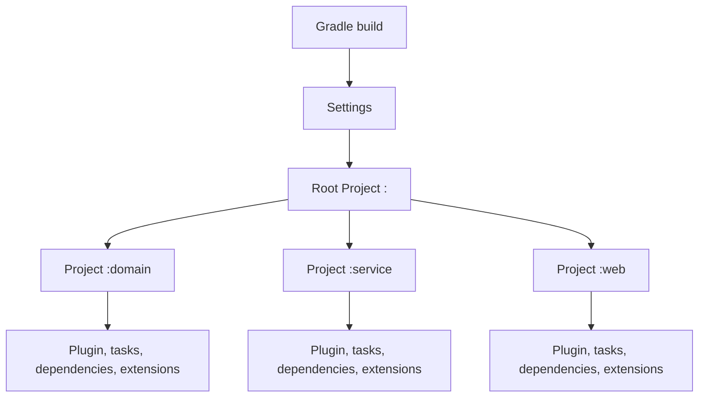

# Mô hình dự án, thuộc tính và các giá trị mặc định

Khi đọc một file `build.gradle`, ta thường thấy những khai báo như `group`, `version`, `repositories`, `dependencies`, `tasks` hoặc khối `java { ... }`. Những tên này không phải các dòng cấu hình rời rạc. Chúng là những phần của **mô hình dự án (Project model)** mà Gradle tạo ra trong quá trình cấu hình build.

Mô hình dự án cung cấp nơi để plugin và build script mô tả danh tính của project, thư mục làm việc, task, dependency, repository và các tùy chọn chuyên biệt. Mỗi project có các thuộc tính mặc định; plugin có thể bổ sung model và đặt thêm quy ước. Khi cần thay đổi một giá trị mặc định, lập trình viên cần biết giá trị đó đến từ Gradle core, từ plugin hay từ cấu hình riêng của project.

## 1. Mô hình dự án là gì?

Gradle biểu diễn một build bằng các đối tượng có trách nhiệm riêng. Ba đối tượng quan trọng là:

| Đối tượng | Vai trò |
|---|---|
| `Gradle` | Đại diện cho tiến trình build và cung cấp thông tin ở cấp build, listener và lifecycle |
| `Settings` | Mô tả cấu trúc build: root project, các project con và các build được liên kết |
| `Project` | Đại diện cho một project trong build; chứa thuộc tính, plugin, task, dependency, repository và extension của project đó |

File `settings.gradle` hoặc `settings.gradle.kts` được đánh giá trong ngữ cảnh `Settings`. File `build.gradle` hoặc `build.gradle.kts` của mỗi project được đánh giá trong ngữ cảnh `Project` tương ứng.

Với một build đơn giản, thường có một root project. Với build nhiều module, root project chứa nhiều project con. Mỗi project có một đối tượng `Project` riêng và có thể có build script riêng.



Sơ đồ minh họa một build nhiều project. Các project cùng thuộc một build có thể tham chiếu lẫn nhau bằng project dependency. Root project là một project thực sự, không chỉ là thư mục chứa các project con.

## 2. Khai báo cấu trúc build bằng Settings

### 2.1. Root project và project con

Gradle đọc `settings.gradle` để xác định những project tham gia build. Ví dụ:

```groovy
rootProject.name = 'shop-platform'

include 'domain', 'service', 'web'
```

Khai báo này tạo root project có tên `shop-platform` và ba project con với các path `:domain`, `:service` và `:web`. Theo quy ước mặc định, Gradle tìm thư mục project con tương ứng dưới root directory.

Một cấu trúc thư mục thường gặp:

```text
shop-platform/
├── settings.gradle
├── build.gradle
├── domain/
│   └── build.gradle
├── service/
│   └── build.gradle
└── web/
    └── build.gradle
```

`include` thêm project vào build; nó không tự áp dụng Java plugin hay tạo dependency giữa các project. Những việc đó được cấu hình riêng trong build script.

### 2.2. Đặt tên và đường dẫn project

Tên root project mặc định thường lấy từ tên thư mục root nếu `rootProject.name` không được đặt. Nên đặt tên rõ ràng trong `settings.gradle` để tên build không thay đổi chỉ vì thư mục checkout được đổi tên.

Project con có thể được đặt ở vị trí khác với thư mục mặc định:

```groovy
rootProject.name = 'shop-platform'

include 'domain', 'service'
project(':service').projectDir = file('apps/order-service')
```

Trong ví dụ này, Gradle vẫn nhận diện project bằng path `:service`, nhưng nội dung project nằm trong `apps/order-service`. Project path là định danh trong build; project directory là vị trí vật lý của build script và nội dung project.

Đối với project lồng nhau, path có thể có nhiều thành phần, ví dụ `:backend:order`. Khi include project lồng nhau, Gradle dùng path để định danh quan hệ trong cây project. Không nên suy luận rằng path và đường dẫn vật lý luôn giống nhau nếu build đã tùy chỉnh `projectDir`.

### 2.3. Project dependency

Sau khi các project đã được include, một project có thể phụ thuộc vào project khác:

```groovy
// service/build.gradle
plugins {
    id 'java'
}

dependencies {
    implementation project(':domain')
}
```

Khai báo trên cho biết `service` sử dụng output và dependency phù hợp được công bố bởi project `domain`. Gradle có thể xác định task cần thiết của project được phụ thuộc và đưa artifact của nó vào dependency graph.

`include` và `project(...)` có ý nghĩa khác nhau: `include` xác định project nào thuộc build; `project(...)` khai báo quan hệ dependency giữa các project.

## 3. Các thuộc tính nhận diện một Project

Mỗi đối tượng `Project` có những thuộc tính giúp xác định project đang cấu hình.

| Thuộc tính | Ý nghĩa |
|---|---|
| `name` | Tên project, thường lấy từ phần cuối của project path |
| `path` | Định danh project trong build, ví dụ `:` hoặc `:service` |
| `rootProject` | Đối tượng root project của build hiện tại |
| `rootDir` | Thư mục gốc của build hiện tại |
| `projectDir` | Thư mục vật lý của project đang xét |
| `buildDir` | Thư mục build truyền thống của project; API này đã được thay thế dần bằng layout API |
| `group` | Nhóm định danh artifact hoặc project |
| `version` | Phiên bản project/artifact |
| `description` | Mô tả ngắn của project |

Trong cấu hình mới, nên dùng `layout.buildDirectory` để làm việc với thư mục đầu ra thay vì dựa vào API `buildDir` cũ:

```groovy
tasks.register('showProjectInfo') {
    doLast {
        println "name        = ${project.name}"
        println "path        = ${project.path}"
        println "rootDir     = ${project.rootDir}"
        println "projectDir  = ${project.projectDir}"
        println "buildDir    = ${project.layout.buildDirectory.get().asFile}"
        println "group       = ${project.group}"
        println "version     = ${project.version}"
        println "description = ${project.description}"
    }
}
```

Chạy task trong project tương ứng:

```bash
./gradlew :service:showProjectInfo
```

Tên task và path project được ghép lại bằng dấu `:`. Nếu task nằm ở root project, có thể gọi `./gradlew showProjectInfo`.

## 4. Giá trị mặc định của Project

Không phải thuộc tính nào cũng cần được gán ngay trong build script. Gradle cung cấp một số giá trị mặc định để project có thể tham gia build ngay cả khi cấu hình còn tối giản.

### 4.1. Các giá trị mặc định thường gặp

| Thuộc tính hoặc quy ước | Giá trị mặc định thường gặp | Ý nghĩa |
|---|---|---|
| Tên root project | Tên thư mục root nếu không đặt `rootProject.name` | Giúp nhận diện build |
| Tên project con | Tên project theo path/include | Có thể khác thư mục vật lý khi cấu hình `projectDir` |
| `group` | Chuỗi rỗng (`''`) | Chưa gán group định danh |
| `version` | `unspecified` | Chưa gán phiên bản project |
| `description` | `null` | Chưa có mô tả |
| `projectDir` | Thư mục theo quy ước project | Có thể thay đổi trong Settings |
| Thư mục build | Thư mục `build` trong project theo layout mặc định | Nơi chứa đầu ra được tạo trong build |

Các giá trị này có thể được in ra để quan sát. Đặc biệt, `version` mặc định là `unspecified`; nếu artifact được phát hành ra ngoài, nên gán phiên bản có ý nghĩa thay vì để giá trị mặc định đó đi theo sản phẩm.

### 4.2. Gradle core và plugin cung cấp các mặc định khác nhau

Gradle core cung cấp mô hình project, task container, dependency configurations API và các API cơ bản. Tuy nhiên, các quy ước như `src/main/java`, task `compileJava`, `test`, `jar` hoặc configuration `implementation` đến từ Java plugin và các plugin liên quan.

Ví dụ:

```groovy
plugins {
    id 'java'
}
```

Sau khi áp dụng Java plugin, project có các source set và task Java theo quy ước. Các thư mục nguồn mặc định gồm:

```text
src/main/java
src/main/resources
src/test/java
src/test/resources
```

Nếu không áp dụng Java plugin, Gradle core không tự biến một thư mục `src/main/java` thành source set Java và không tự tạo các task `compileJava`, `test` hay `jar` theo quy ước Java plugin.

Plugin cũng có thể cung cấp extension với giá trị mặc định. Ví dụ Java plugin cung cấp extension `java`, nơi cấu hình toolchain, source compatibility và các tùy chọn liên quan. Những giá trị mặc định đó là quy ước của plugin, không phải tất cả đều là thuộc tính nền tảng của `Project`.

### 4.3. Thư mục đầu ra mặc định

Gradle dùng thư mục `build/` trong project làm nơi chứa các file được tạo. Java plugin tiếp tục chia nhỏ thư mục này cho từng loại đầu ra, ví dụ:

```text
service/
└── build/
    ├── classes/
    │   └── java/main/
    ├── resources/
    │   └── main/
    ├── reports/
    │   └── tests/test/
    ├── test-results/
    └── libs/
        └── service-1.0.0.jar
```

Đường dẫn cụ thể phụ thuộc plugin và cấu hình. Không nên hard-code đường dẫn đầu ra trong task tự viết nếu có thể dùng layout API:

```groovy
def generatedFile = layout.buildDirectory.file('generated/info.txt')
```

Layout API trả về provider, giúp cấu hình đường dẫn theo cách lười và có thể thay đổi thư mục build tập trung mà không phải sửa mọi task.

## 5. Thuộc tính project và các nguồn giá trị

### 5.1. Project property là gì?

Project property là một giá trị cấu hình có tên mà build script có thể đọc để điều khiển hành vi build. Ví dụ:

- `releaseVersion`: phiên bản phát hành.
- `targetEnvironment`: môi trường mục tiêu.
- `enableIntegrationTests`: có chạy nhóm integration test hay không.
- `artifactLabel`: nhãn dùng khi tạo artifact.

Project property phù hợp với các giá trị cấu hình không nhạy cảm cần truyền từ máy lập trình viên hoặc CI vào build. Nó giúp build script không phải gắn cứng các giá trị có thể thay đổi theo môi trường.

### 5.2. Khai báo trong gradle.properties

Một file `gradle.properties` ở root project có thể chứa các cặp key-value:

```properties
releaseVersion=1.4.0
targetEnvironment=dev
enableIntegrationTests=false
```

Trong build script, có thể đọc project property qua Provider API:

```groovy
def releaseVersion = providers.gradleProperty('releaseVersion')
    .getOrElse('0.1.0-SNAPSHOT')

def targetEnvironment = providers.gradleProperty('targetEnvironment')
    .getOrElse('dev')
```

`providers.gradleProperty(...)` trả về `Provider<String>`. Provider biểu diễn một giá trị có thể được cung cấp sau và được đánh giá khi cần. `getOrElse(...)` cho phép cung cấp giá trị mặc định khi property không tồn tại.

Với cách này, build script có thể chạy ngay cả khi người dùng chưa khai báo property. Khi CI truyền giá trị phát hành, build sẽ dùng giá trị được cung cấp thay cho mặc định.

### 5.3. Truyền property từ dòng lệnh

Có thể ghi đè project property bằng tham số `-P`:

```bash
./gradlew build -PreleaseVersion=2.0.0 -PtargetEnvironment=staging
```

Đây là cách thuận tiện để thử cấu hình hoặc truyền giá trị từ pipeline. Cần giữ cách viết thống nhất giữa tên property trong command line và tên mà build script đọc.

Gradle cũng hỗ trợ project property qua system property có tiền tố `org.gradle.project.`:

```bash
./gradlew build -Dorg.gradle.project.releaseVersion=2.0.0
```

Ngoài ra, CI có thể cung cấp project property qua biến môi trường theo quy ước `ORG_GRADLE_PROJECT_`:

```text
ORG_GRADLE_PROJECT_releaseVersion=2.0.0
ORG_GRADLE_PROJECT_targetEnvironment=staging
```

Khi dùng biến môi trường, Gradle ánh xạ phần tên sau tiền tố thành tên project property. Cách này hữu ích trong CI vì không phải ghi giá trị cấu hình vào file trong repository.

### 5.4. Thứ tự ưu tiên của gradle.properties

Gradle có thể đọc `gradle.properties` từ nhiều vị trí. Khi cùng một property được khai báo ở nhiều nơi, nguồn có độ ưu tiên cao hơn sẽ quyết định giá trị cuối cùng. Với các file `gradle.properties`, thứ tự ưu tiên từ cao xuống thấp là:

1. `gradle.properties` trong Gradle User Home, thường là `~/.gradle/gradle.properties`.
2. `gradle.properties` ở root project.
3. `gradle.properties` trong thư mục cài đặt Gradle.

Các project property được truyền bằng `-P` hoặc system property `org.gradle.project.*` có thể ghi đè giá trị từ các file này; tham số dòng lệnh `-P` là cách rõ ràng để chủ động chọn giá trị cho một lần chạy.

Điều này có ý nghĩa thực tế khi một máy lập trình viên có file `~/.gradle/gradle.properties` đặt `targetEnvironment=local`. Nếu root project cũng khai báo `targetEnvironment=dev`, giá trị ở Gradle User Home có thể được sử dụng trên máy đó. Một thành viên khác không có thiết lập cá nhân sẽ dùng giá trị ở root project. Khi điều tra sự khác biệt local/CI, cần kiểm tra cả Gradle User Home và cấu hình CI, không chỉ file trong repository.

### 5.5. Phân biệt project property với system property

Project property và JVM system property là hai loại cấu hình khác nhau:

| Loại | Cách truyền | Cách đọc thường dùng |
|---|---|---|
| Gradle project property | `-Pname=value` | `providers.gradleProperty('name')` |
| JVM system property | `-Dname=value` | `providers.systemProperty('name')` hoặc `System.getProperty('name')` |
| Biến môi trường | `NAME=value` trước khi chạy Gradle | `providers.environmentVariable('NAME')` hoặc `System.getenv('NAME')` |

Lưu ý: `-Dorg.gradle.project.name=value` là một system property đặc biệt mà Gradle ánh xạ thành project property `name`. Còn `-Dname=value` thông thường là JVM system property tên `name`.

Khi một giá trị cần ảnh hưởng đến task output, nên đưa nó vào property đầu vào của task thay vì đọc trực tiếp từ môi trường trong `@TaskAction`. Việc đó giúp Gradle nhận biết thay đổi và quyết định đúng về `UP-TO-DATE` hoặc build cache.

## 6. Extra properties và extension properties

### 6.1. Extra properties

Gradle cho phép thêm giá trị tùy ý vào đối tượng project bằng extra properties. Trong Groovy DSL:

```groovy
ext {
    serviceLabel = 'order-service'
    supportLegacyMode = false
}

println "Service: ${project.ext.serviceLabel}"
```

Extra properties hữu ích cho một giá trị nhỏ được chia sẻ trong phạm vi build script. Tuy nhiên, chúng không thay thế một mô hình cấu hình có kiểu và có tài liệu rõ ràng. Nếu một plugin hoặc convention plugin cần cung cấp một nhóm tùy chọn lâu dài, nên tạo extension phù hợp thay vì tích lũy nhiều extra property không có cấu trúc.

### 6.2. Extension do plugin cung cấp

Extension là đối tượng cấu hình mà plugin thêm vào project. Ví dụ, Java plugin tạo extension `java`:

```groovy
plugins {
    id 'java'
}

java {
    toolchain {
        languageVersion = JavaLanguageVersion.of(21)
    }
}
```

Trong ví dụ, `java` là extension do plugin cung cấp. Khối `toolchain` cấu hình một phần model của Java plugin. Khi áp dụng Spring Boot plugin, project có thể có extension `springBoot`; plugin khác cũng có thể cung cấp extension riêng.

Extension giúp cấu hình được tổ chức theo chức năng. Người đọc có thể nhận ra `java { ... }` là cấu hình Java plugin thay vì một thuộc tính tùy ý của project.

### 6.3. Phân biệt các loại property

Các khái niệm có tên gần nhau nhưng nguồn gốc và mục đích khác nhau:

| Khái niệm | Nguồn tạo ra | Ví dụ |
|---|---|---|
| Thuộc tính Project | Gradle core | `name`, `path`, `group`, `version` |
| Gradle project property | File, dòng lệnh, system property đặc biệt hoặc environment variable theo quy ước | `releaseVersion` |
| Extra property | Build script thêm vào project | `ext.serviceLabel` |
| Extension property | Plugin tạo extension và các thuộc tính có kiểu | `java.toolchain.languageVersion` |
| Task property | Task type khai báo input/output/configuration | `targetEnvironment` của một task tự viết |

Khi đọc một dòng như `version = '1.0.0'`, hãy xác định đó là thuộc tính Project. Khi đọc `providers.gradleProperty('releaseVersion')`, đó là cách lấy một Gradle project property. Khi đọc `java { ... }`, đó là extension của plugin. Phân biệt đúng nguồn giúp tránh nhầm lẫn khi một tên thuộc tính xuất hiện ở nhiều phạm vi.

## 7. Thiết lập giá trị mặc định và cho phép ghi đè

### 7.1. Mặc định là gì?

Giá trị mặc định là giá trị được dùng khi người dùng không cung cấp cấu hình riêng. Ví dụ, build có thể dùng môi trường `dev` khi không có `targetEnvironment`, hoặc dùng phiên bản snapshot khi không có `releaseVersion`.

Trong Gradle, có thể kết hợp Provider với `orElse`:

```groovy
def targetEnvironment = providers.gradleProperty('targetEnvironment')
    .orElse('dev')

def releaseVersion = providers.gradleProperty('releaseVersion')
    .orElse('0.1.0-SNAPSHOT')
```

Người dùng không cần cung cấp hai property này để build script có thể cấu hình. Nếu truyền `-PtargetEnvironment=staging`, giá trị staging sẽ được sử dụng.

### 7.2. Mặc định trong task property

Với task tự viết, có thể đặt convention cho property. Ví dụ:

```groovy
import org.gradle.api.DefaultTask
import org.gradle.api.provider.Property
import org.gradle.api.tasks.Input
import org.gradle.api.tasks.TaskAction

abstract class PrintEnvironment extends DefaultTask {
    @Input
    abstract Property<String> getTargetEnvironment()

    PrintEnvironment() {
        targetEnvironment.convention('dev')
    }

    @TaskAction
    void printEnvironment() {
        logger.lifecycle("Target environment: ${targetEnvironment.get()}")
    }
}
```

Convention cung cấp giá trị mặc định khi chưa có giá trị tường minh. Build script vẫn có thể ghi đè:

```groovy
tasks.register('printEnvironment', PrintEnvironment) {
    targetEnvironment.set(
        providers.gradleProperty('targetEnvironment').orElse('dev')
    )
}
```

Đặt convention trong task type có ích khi nhiều project sử dụng cùng task và cần chung một mặc định. Đặt provider trong build script có ích khi giá trị phụ thuộc cấu hình của project hoặc môi trường chạy. Cần tránh đặt hai nguồn mặc định mâu thuẫn khiến người đọc khó biết giá trị nào đang có hiệu lực.

### 7.3. Mặc định không có nghĩa là giá trị đúng cho mọi môi trường

Một mặc định tiện lợi khi phát triển local có thể nguy hiểm nếu vô tình dùng trong phát hành. Ví dụ, `targetEnvironment=dev` có thể hợp lý khi chạy task tạo cấu hình để thử nghiệm. Nhưng pipeline production nên truyền rõ `targetEnvironment=prod` và kiểm tra giá trị này.

Với những giá trị bắt buộc, không nên tự tạo mặc định giả. Có thể yêu cầu property phải tồn tại:

```groovy
def releaseVersion = providers.gradleProperty('releaseVersion')
    .orNull

if (releaseVersion == null || releaseVersion.trim().isEmpty()) {
    throw new GradleException('Missing required property: releaseVersion')
}
```

Đoạn mã này phù hợp khi build phát hành cần phiên bản do pipeline hoặc người dùng cung cấp. Nếu build local có thể chạy mà không cần phiên bản phát hành, nên đặt kiểm tra trong task hoặc bước phát hành thay vì làm mọi task của project thất bại ngay khi cấu hình.

### 7.4. Không lưu bí mật vào project properties được commit

Các giá trị như tên môi trường, phiên bản hoặc feature flag thường không phải bí mật. Token, mật khẩu và khóa riêng là dữ liệu nhạy cảm; không nên ghi chúng vào `gradle.properties` được commit lên Git hoặc đưa vào log.

CI nên cấp bí mật qua secret store và expose cho bước cần thiết. Nếu bí mật chỉ dùng để xác thực thao tác publish, hãy giới hạn nó trong task hoặc bước publish và không đưa nó vào artifact. Cũng cần tránh in toàn bộ environment hoặc system properties trong log khi chẩn đoán build.

## 8. Cấu hình chung cho nhiều project

Với build nhiều module, có những giá trị cần thống nhất như group, version, repository hoặc Java toolchain. Root project có thể cấu hình chúng cho các project con.

Ví dụ:

```groovy
// build.gradle ở root project
allprojects {
    group = 'com.example.shop'
    version = providers.gradleProperty('releaseVersion')
        .getOrElse('1.0.0-SNAPSHOT')
}

subprojects {
    repositories {
        mavenCentral()
    }
}
```

`allprojects` áp dụng cấu hình cho root project và các project con. `subprojects` chỉ áp dụng cho project con. Trong ví dụ, mọi project có cùng group và version; repository Maven Central được khai báo cho các project con.

Với build lớn, nên cân nhắc convention plugin để đóng gói cấu hình dùng chung. Convention plugin giúp định nghĩa quy ước theo vai trò, chẳng hạn plugin cho Java library hoặc Spring Boot service. Cách này giữ build script của từng module ngắn và làm rõ module nào áp dụng chính sách nào.

Không nên đưa mọi cấu hình vào `allprojects` hoặc `subprojects` chỉ vì có thể làm vậy. Cấu hình toàn cục quá rộng có thể khiến một module nhận plugin, repository hoặc dependency không cần thiết. Hãy chọn phạm vi cấu hình theo trách nhiệm thực tế của project.

## 9. Ví dụ hoàn chỉnh: project nhiều module với thuộc tính và mặc định

Giả sử build có một module `domain` và một module `service`. Root project quản lý group, version và repository; module `service` phụ thuộc vào `domain`.

```text
shop-platform/
├── settings.gradle
├── gradle.properties
├── build.gradle
├── domain/
│   └── build.gradle
└── service/
    └── build.gradle
```

`settings.gradle`:

```groovy
rootProject.name = 'shop-platform'
include 'domain', 'service'
```

`gradle.properties`:

```properties
releaseVersion=1.4.0
targetEnvironment=dev
```

Root `build.gradle`:

```groovy
allprojects {
    group = 'com.example.shop'
    version = providers.gradleProperty('releaseVersion')
        .getOrElse('1.0.0-SNAPSHOT')
}

subprojects {
    repositories {
        mavenCentral()
    }
}
```

`domain/build.gradle`:

```groovy
plugins {
    id 'java-library'
}

java {
    toolchain {
        languageVersion = JavaLanguageVersion.of(21)
    }
}
```

`service/build.gradle`:

```groovy
plugins {
    id 'java'
}

dependencies {
    implementation project(':domain')
}

tasks.register('printBuildSettings') {
    doLast {
        def environment = providers.gradleProperty('targetEnvironment')
            .getOrElse('dev')

        println "Project: ${project.path}"
        println "Group: ${project.group}"
        println "Version: ${project.version}"
        println "Environment: ${environment}"
        println "Output directory: ${layout.buildDirectory.get().asFile}"
    }
}
```

Chạy các lệnh:

```bash
# Xem thông tin cấu hình của service
./gradlew :service:printBuildSettings

# Ghi đè môi trường và phiên bản cho lần chạy này
./gradlew :service:printBuildSettings -PtargetEnvironment=staging -PreleaseVersion=2.0.0

# Build các project theo task graph
./gradlew build
```

Ví dụ cho thấy mỗi thành phần có một trách nhiệm:

- `settings.gradle` xác định root project và các project con.
- `gradle.properties` cung cấp giá trị cấu hình ban đầu.
- Root `build.gradle` đặt group/version và repository dùng chung.
- Plugin bổ sung các task, configuration, source set và extension cần cho từng loại project.
- Module `service` khai báo dependency tới `domain` và có task đọc project property với mặc định.
- Tham số `-P` ghi đè giá trị mặc định cho một lần chạy.

## 10. Một số lệnh và cách kiểm tra mô hình

Khi cần hiểu project model của một build, các lệnh sau hữu ích:

```bash
# Liệt kê project trong build
./gradlew projects

# Liệt kê task có sẵn
./gradlew tasks --all

# Xem thông tin chi tiết của một task
./gradlew help --task build

# Xem dependency graph
./gradlew :service:dependencies

# Chạy task in thông tin project
./gradlew :service:printBuildSettings
```

`projects` giúp xác nhận cấu trúc được tạo từ `settings.gradle`. `tasks --all` cho thấy plugin đã thêm những task nào. `dependencies` cho biết các dependency configuration được phân giải ra sao. Những lệnh này giúp đối chiếu mô hình mà ta nghĩ build đang có với mô hình Gradle thực sự cấu hình.

## 11. Liên hệ với mô hình project của Maven

Gradle và Maven đều có mô hình project, thuộc tính và giá trị mặc định, nhưng cách thể hiện khác nhau.

| Khía cạnh | Gradle | Maven |
|---|---|---|
| Mô hình project | Đối tượng `Project` trong build | Project Object Model (POM) |
| Cấu hình chính | `build.gradle` hoặc `build.gradle.kts` | `pom.xml` |
| Danh tính artifact | `group`, `name`/artifact và `version` | `groupId`, `artifactId`, `version` |
| Thuộc tính tùy chỉnh | Gradle project properties, extension và task properties | `<properties>` trong POM |
| Cấu hình nhiều module | `settings.gradle` với `include` | Parent POM với `<modules>` |
| Giá trị mặc định | Gradle core và plugin conventions | POM inheritance, Super POM và plugin defaults |

Ví dụ thuộc tính Maven:

```xml
<properties>
    <maven.compiler.release>21</maven.compiler.release>
    <project.build.sourceEncoding>UTF-8</project.build.sourceEncoding>
    <app.environment>dev</app.environment>
</properties>
```

Maven cung cấp các thuộc tính chuẩn như `${project.groupId}`, `${project.artifactId}` và `${project.version}` để tham chiếu thông tin project. Một số giá trị có thể được kế thừa từ parent POM hoặc Super POM. Khi cần thay đổi mặc định, hãy kiểm tra nguồn kế thừa và cấu hình plugin liên quan.

Trong Gradle, model linh hoạt hơn thông qua đối tượng Project, plugin và extension. Trong Maven, POM có cấu trúc XML và các giá trị được hợp nhất qua cơ chế inheritance/profile. Dù dùng công cụ nào, vẫn cần xác định giá trị đến từ cấu hình hiện tại, từ parent/convention hay từ mặc định của công cụ.

## 12. Cách suy nghĩ khi đọc cấu hình build

Khi gặp một giá trị trong build script, hãy lần lượt xác định:

1. Nó thuộc đối tượng nào: `Settings`, `Project`, extension, task hay project property?
2. Thành phần nào tạo ra nó: Gradle core, plugin, convention plugin hay build script của project?
3. Nếu không khai báo, giá trị mặc định là gì?
4. Có nguồn nào ghi đè giá trị đó như command line, Gradle User Home, root `gradle.properties` hoặc CI environment không?
5. Giá trị có ảnh hưởng đến task output không, và nếu có thì nó đã được mô hình hóa thành input chưa?

Ví dụ, `version` là thuộc tính của Project; `java.toolchain.languageVersion` thuộc extension của Java plugin; `releaseVersion` có thể là Gradle project property; `targetEnvironment` trong một task có thể là task input. Những giá trị này có thể cùng xuất hiện trong một build nhưng được quản lý bởi các phần khác nhau của model.

Hiểu mô hình dự án và các giá trị mặc định giúp ta biết cấu hình nào thực sự có hiệu lực, tại sao hai máy có thể cho kết quả khác nhau và nên đặt một giá trị ở cấp project, plugin, task hay môi trường CI. Đây là nền tảng để xây dựng cấu hình build dễ đọc, nhất quán và có thể kiểm soát khi dự án phát triển thành nhiều module.
