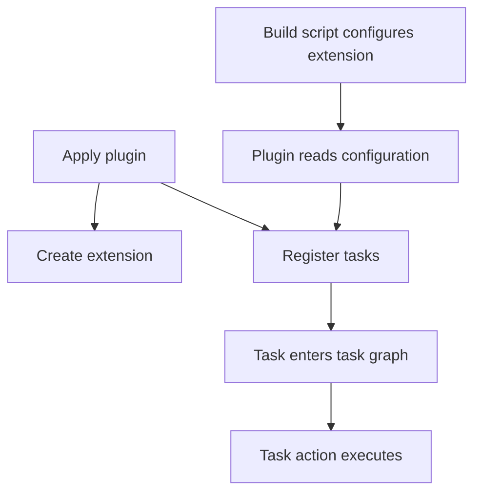

# Plugin build là gì và vì sao cần tách khỏi mã ứng dụng

Trong một dự án Java, mã ứng dụng mô tả chức năng mà sản phẩm cung cấp cho người dùng. Build logic mô tả cách lấy mã nguồn, biên dịch, kiểm thử, đóng gói, kiểm tra và phân phối sản phẩm đó. Khi dự án lớn dần, build logic có thể chứa nhiều quy tắc và công cụ riêng. Gradle plugin giúp đóng gói những quy tắc này thành một thành phần có thể áp dụng và tái sử dụng.

Plugin build có thể tạo task, cung cấp extension để cấu hình, thêm dependency cho chính build logic, kết nối task vào lifecycle và áp dụng quy ước cho project. Tách plugin khỏi mã ứng dụng giúp trách nhiệm rõ ràng, giảm cấu hình lặp, dễ kiểm thử và cho phép thay đổi quy trình build mà không làm lẫn thư viện dùng khi chạy sản phẩm.

## 1. Plugin build là gì?

Gradle plugin là một thành phần mở rộng Gradle. Khi được áp dụng vào một `Project` hoặc một loại đối tượng Gradle phù hợp, plugin có thể thay đổi cách project được cấu hình và những công việc mà build có thể thực hiện.

Một plugin thường thực hiện một hoặc nhiều việc sau:

- Đăng ký task mới, chẳng hạn tạo mã nguồn, kiểm tra cấu hình, chạy công cụ phân tích hoặc đóng gói artifact.
- Tạo extension để người dùng khai báo cấu hình ở build script.
- Áp dụng plugin khác và kết nối các quy tắc liên quan.
- Thiết lập convention như source set, thư mục, compiler options hoặc quy tắc kiểm thử.
- Khai báo dependency mà bản thân build logic cần để thực hiện công việc.
- Nối task vào các task lifecycle như `check`, `assemble` hoặc `build`.

Ví dụ, khi một project khai báo:

```kotlin
plugins {
    java
}
```

Java Plugin bổ sung mô hình source set, các cấu hình dependency và task phổ biến như `compileJava`, `compileTestJava`, `test`, `jar`, `check` và `build`. Người viết build không cần tự định nghĩa từng task biên dịch và kiểm thử cơ bản.

Plugin không phải một lớp Java được ứng dụng gọi trong lúc xử lý nghiệp vụ. Nó là mã chạy trong môi trường Gradle để cấu hình và điều phối quá trình build. Một plugin có thể dùng thư viện Java bên trong để thực hiện công việc, nhưng vai trò của nó thuộc về build system.

## 2. Plugin, task và extension có quan hệ như thế nào?

Ba khái niệm này thường xuất hiện cùng nhau:

| Thành phần | Vai trò |
|---|---|
| Plugin | Đóng gói quy tắc mở rộng Gradle và áp dụng chúng vào project. |
| Task | Đại diện cho một đơn vị công việc có thể được đưa vào task graph và thực thi. |
| Extension | Cung cấp một vùng cấu hình có tên để người dùng điều chỉnh hành vi plugin. |

Ví dụ plugin phân tích mã nguồn có thể tạo extension `quality` với các thuộc tính như mức nghiêm ngặt, đường dẫn cấu hình và quy tắc loại trừ. Plugin đọc các thuộc tính đó rồi đăng ký task `checkCodeQuality`. Task thực hiện phân tích và báo lỗi nếu mã nguồn vi phạm quy tắc.



Plugin thường đăng ký task theo cách lazy để Gradle chỉ tạo task instance khi cần. Các task nên khai báo input/output rõ ràng để Gradle có thể xây dựng task graph, kiểm tra trạng thái và tối ưu build.

## 3. Cách áp dụng plugin trong Gradle

Gradle hỗ trợ nhiều cách áp dụng plugin. Cách phổ biến trong build hiện đại là `plugins` DSL.

### 3.1. Core plugin

Core plugin được Gradle cung cấp sẵn. Ví dụ:

```kotlin
plugins {
    java
    application
}
```

Java Plugin cung cấp quy trình biên dịch, kiểm thử và đóng gói Java. Application Plugin bổ sung cách chạy ứng dụng và cấu hình phân phối phù hợp. Các core plugin không cần khai báo version trong `plugins` block.

### 3.2. Plugin bên thứ ba

Plugin bên thứ ba thường được khai báo bằng plugin ID và version:

```kotlin
plugins {
    id("com.example.code-quality") version "1.4.0"
}
```

Plugin ID xác định plugin cần áp dụng; version xác định bản plugin được dùng. Việc khóa version giúp các máy phát triển và CI phân giải cùng một bản plugin, giảm khác biệt do cập nhật ngoài ý muốn.

Ví dụ trên dùng ID minh họa. Trong dự án thật, cần dùng plugin ID, version và repository do nhà cung cấp plugin công bố.

### 3.3. Khai báo nơi phân giải plugin

Gradle phân giải plugin thông qua repository dành cho plugin. Có thể cấu hình nơi tìm plugin trong `settings.gradle.kts`:

```kotlin
pluginManagement {
    repositories {
        gradlePluginPortal()
        mavenCentral()
        maven {
            url = uri("https://repo.example.com/gradle-plugins")
        }
    }
}
```

`pluginManagement` thuộc settings script và được dùng để điều khiển việc phân giải plugin cho build. Repository cần chứa plugin marker hoặc metadata mà cơ chế phân giải plugin có thể sử dụng. Một số plugin được phát hành qua Gradle Plugin Portal; plugin nội bộ có thể được phân phối qua Maven repository riêng.

Với plugin được quản lý version tập trung, có thể khai báo trong `pluginManagement` hoặc dùng version catalog theo khả năng và cấu trúc dự án. Mục tiêu là để nhóm có một nơi rõ ràng quản lý version, repository và chính sách plugin.

### 3.4. Khai báo plugin nhưng chưa áp dụng

Trong root build script, đôi khi cần khai báo plugin để các subproject sử dụng cùng version nhưng chưa áp dụng vào root project:

```kotlin
plugins {
    id("com.example.code-quality") version "1.4.0" apply false
}
```

`apply false` yêu cầu Gradle phân giải plugin nhưng không áp dụng nó cho project hiện tại. Subproject có thể áp dụng plugin đó khi cần. Cách này hữu ích để quản lý version thống nhất trong multi-project build.

## 4. Plugin khác gì thư viện ứng dụng?

Đây là ranh giới quan trọng nhất khi tổ chức build logic.

| Tiêu chí | Plugin build | Thư viện ứng dụng |
|---|---|---|
| Mục đích | Thay đổi hoặc mở rộng cách Gradle cấu hình và chạy build. | Cung cấp chức năng mà mã ứng dụng sử dụng. |
| Thời điểm chạy | Trong quá trình cấu hình hoặc thực thi build. | Khi chương trình hoặc service chạy, hoặc khi ứng dụng được kiểm thử. |
| Nơi khai báo | Plugin DSL, build logic hoặc plugin management. | Dependency configuration như `implementation`, `api`, `runtimeOnly`. |
| Classpath | Classpath của build logic/plugin. | Compile/runtime classpath của source set ứng dụng. |
| Artifact | Plugin JAR hoặc build logic được phân phối để Gradle sử dụng. | JAR/library được đóng gói hoặc phân phối cùng sản phẩm. |
| Người tiêu thụ | Gradle build của project. | Mã nguồn ứng dụng hoặc thành phần khác phụ thuộc vào thư viện. |

Ví dụ, một ứng dụng Spring có thể khai báo:

```kotlin
plugins {
    java
    id("org.springframework.boot") version "3.3.0"
}

dependencies {
    implementation("org.springframework:spring-context:6.1.0")
    testImplementation("org.junit.jupiter:junit-jupiter:5.10.0")
}
```

Trong ví dụ:

- `java` và `org.springframework.boot` là plugin được Gradle áp dụng để thiết lập build.
- `spring-context` là thư viện ứng dụng được đưa vào classpath của mã chính.
- JUnit Jupiter là thư viện kiểm thử được đưa vào test classpath.

Plugin Spring Boot có thể tạo task đóng gói executable archive hoặc cung cấp convention cho ứng dụng. Thư viện Spring Context cung cấp API mà mã ứng dụng import và gọi. Hai dependency phục vụ hai mục đích khác nhau.

Không nên đặt plugin artifact vào `implementation` chỉ vì nó là một JAR. Làm vậy không tự áp dụng plugin vào Gradle project; nó chỉ đưa artifact vào classpath của source set tương ứng. Ngược lại, không nên đặt thư viện nghiệp vụ của ứng dụng vào classpath plugin chỉ để mã ứng dụng có thể import nó. Hãy khai báo mỗi thành phần ở đúng môi trường sử dụng.

## 5. Vì sao nên tách build logic khỏi mã ứng dụng?

### 5.1. Giữ ranh giới trách nhiệm rõ ràng

Mã ứng dụng nên tập trung vào domain, API, xử lý dữ liệu và chức năng sản phẩm. Build logic nên tập trung vào compiler, test, đóng gói, kiểm tra chất lượng, tạo tài liệu, đóng dấu phiên bản và phát hành.

Nếu hai nhóm logic trộn lẫn, người đọc khó biết một dependency phục vụ runtime hay chỉ phục vụ build. Thay đổi plugin có thể vô tình ảnh hưởng đến classpath ứng dụng; thay đổi mã nghiệp vụ có thể khiến build script phình to hoặc khó bảo trì.

Tách biệt giúp xác định rõ:

- Dependency nào được đóng gói cùng ứng dụng.
- Dependency nào chỉ cần để Gradle chạy plugin.
- Quy tắc nào áp dụng cho mọi module.
- Task nào tạo artifact và task nào sử dụng artifact đó.
- Thành phần nào cần kiểm thử ở cấp build logic.

### 5.2. Tái sử dụng quy ước giữa nhiều project

Trong multi-project build, nhiều module có thể cùng cần Java toolchain, compiler release, test logging, kiểm tra định dạng hoặc cách tạo JAR. Nếu mỗi module sao chép cùng một cấu hình, các bản sao có thể lệch nhau theo thời gian.

Một convention plugin nội bộ có thể áp dụng Java Plugin và đặt các quy tắc chung. Module chỉ cần áp dụng plugin đó:

```kotlin
plugins {
    id("company.java-library-conventions")
}
```

Khi nhóm thay đổi Java version, compiler options hoặc quy tắc test, thay đổi được thực hiện ở một nơi và áp dụng nhất quán cho các module sử dụng convention plugin.

### 5.3. Quản lý version và nâng cấp độc lập

Plugin có vòng đời version riêng. Nhóm có thể nâng cấp plugin build, thay đổi cách cấu hình task hoặc cập nhật công cụ phân tích mà không phải thay đổi public API của ứng dụng.

Ngược lại, thư viện ứng dụng có thể được nâng cấp theo nhu cầu chức năng hoặc bảo mật của sản phẩm. Hai luồng nâng cấp tách biệt giúp xác định nguyên nhân khi build thay đổi hoặc ứng dụng thay đổi hành vi.

### 5.4. Kiểm thử build logic độc lập

Plugin có thể được kiểm thử bằng Gradle TestKit. TestKit cho phép tạo một Gradle project thử nghiệm, áp dụng plugin, chạy build và kiểm tra output, task outcome hoặc file được tạo.

Ví dụ một test có thể xác nhận:

- Plugin áp dụng được vào project mẫu.
- Extension nhận đúng giá trị cấu hình.
- Task cần thiết được đăng ký.
- Task thất bại với thông báo dễ hiểu khi cấu hình thiếu.
- Task tạo output đúng và không chạy lại khi input không đổi nếu thiết kế hỗ trợ up-to-date checking.

Kiểm thử plugin riêng giúp phát hiện lỗi build logic trước khi áp dụng vào toàn bộ repository.

## 6. Các loại plugin và lựa chọn phù hợp

Gradle hỗ trợ nhiều cách tổ chức plugin. Chọn loại phù hợp phụ thuộc phạm vi tái sử dụng, mức độ phức tạp và cách phân phối.

| Loại | Đặc điểm | Khi phù hợp |
|---|---|---|
| Core plugin | Plugin do Gradle cung cấp. | Dùng các khả năng chuẩn như Java, application, base, publishing. |
| Community/third-party plugin | Plugin do bên ngoài phát hành. | Tích hợp công cụ như framework, code quality, coverage hoặc container build. |
| Script plugin | Một file script được áp dụng từ build script khác. | Chia sẻ một đoạn cấu hình nhỏ trong repository; phù hợp với trường hợp đơn giản. |
| Precompiled script plugin | Một build script được biên dịch thành plugin với plugin ID. | Tạo convention plugin nhanh bằng Kotlin DSL hoặc Groovy DSL. |
| Binary plugin | Plugin được viết bằng Java, Kotlin hoặc Groovy và đóng gói thành artifact. | Build logic phức tạp, cần API có kiểu, kiểm thử và phân phối rõ ràng. |

### 6.1. Script plugin

Một script plugin thường được lưu trong file `.gradle` hoặc `.gradle.kts` và áp dụng từ build script khác. Ví dụ:

```kotlin
apply(from = "gradle/common-settings.gradle.kts")
```

Cách này dễ bắt đầu, nhưng script plugin không cung cấp ranh giới API và khả năng tổ chức mạnh như binary hoặc precompiled plugin. Khi logic lớn dần, việc truyền cấu hình, quản lý dependency và kiểm thử trở nên khó khăn. Nên dùng script plugin cho phần chia sẻ nhỏ, đơn giản và có phạm vi rõ.

### 6.2. Precompiled script plugin

Precompiled script plugin là build script được biên dịch thành plugin. Ví dụ file trong `build-logic`:

```text
build-logic/
└── src/main/kotlin/
    └── company.java-library-conventions.gradle.kts
```

File có thể chứa:

```kotlin
plugins {
    `java-library`
}

java {
    toolchain {
        languageVersion.set(JavaLanguageVersion.of(21))
    }
}

tasks.withType<JavaCompile>().configureEach {
    options.release.set(17)
}
```

Tên file tạo ra plugin ID theo quy tắc của precompiled script plugin; trong ví dụ này là `company.java-library-conventions`. Project khác có thể áp dụng bằng ID đó.

Để dùng convention plugin từ included build, khai báo build logic trong settings:

```kotlin
pluginManagement {
    includeBuild("build-logic")
}
```

Build `build-logic` cần được cấu hình như một Gradle plugin build, thường áp dụng plugin `kotlin-dsl` hoặc cấu hình tương ứng. Khi tổ chức repository, nên đặt plugin source, dependency và version trong build logic riêng để build chính chỉ cần áp dụng plugin ID.

### 6.3. Binary plugin

Binary plugin là plugin được triển khai bằng ngôn ngữ JVM và đóng gói như artifact. Một plugin tối thiểu có thể triển khai `Plugin<Project>`:

```kotlin
class CompanyJavaConventionsPlugin : Plugin<Project> {
    override fun apply(project: Project) {
        project.pluginManager.apply("java-library")

        project.extensions.configure(JavaPluginExtension::class.java) {
            toolchain.languageVersion.set(JavaLanguageVersion.of(21))
        }

        project.tasks.withType(JavaCompile::class.java).configureEach {
            options.release.set(17)
        }
    }
}
```

Trong project plugin, lớp triển khai cần được đăng ký với plugin ID thông qua plugin development configuration hoặc metadata phù hợp. Khi được phát hành, project khác có thể phân giải và áp dụng plugin như plugin bên thứ ba.

Binary plugin phù hợp khi logic cần nhiều lớp, helper, model, validation hoặc test. Nó cũng cho phép dùng ngôn ngữ JVM và công cụ kiểm thử quen thuộc để phát triển build logic.

## 7. Nơi đặt build logic: buildSrc hay included build?

Có hai cách phổ biến để tổ chức build logic dùng chung trong một repository.

### 7.1. `buildSrc`

Thư mục `buildSrc` ở root build được Gradle nhận diện tự động. Mã nguồn và dependency trong đó được build thành một phần build logic và có thể dùng trong build script của project.

Ví dụ:

```text
repository/
├── build.gradle.kts
├── settings.gradle.kts
├── buildSrc/
│   ├── build.gradle.kts
│   └── src/main/kotlin/
└── app/
    └── build.gradle.kts
```

`buildSrc` tiện cho build nhỏ hoặc repository đã sử dụng cơ chế này. Tuy nhiên, thay đổi trong `buildSrc` có thể ảnh hưởng đến classpath của các build script và dẫn đến việc cấu hình lại rộng hơn. Khi build logic lớn dần, nên cân nhắc tách thành included build.

### 7.2. Included build `build-logic`

Included build là một Gradle build riêng được kết nối với build chính. Ví dụ:

```text
repository/
├── settings.gradle.kts
├── app/
├── service/
└── build-logic/
    ├── settings.gradle.kts
    ├── build.gradle.kts
    └── src/main/kotlin/
        └── company.java-library-conventions.gradle.kts
```

Build chính có thể include build logic:

```kotlin
pluginManagement {
    includeBuild("build-logic")
}
```

Trong `build-logic`, có thể dùng `kotlin-dsl` để phát triển precompiled script plugin, khai báo plugin dependency và kiểm thử. Included build có cấu hình và dependency riêng, nhờ đó build logic được quản lý như một project thực thụ.

### 7.3. So sánh hai cách

| Tiêu chí | `buildSrc` | Included build `build-logic` |
|---|---|---|
| Bắt đầu | Tự động được Gradle nhận diện ở root. | Cần include trong settings. |
| Phạm vi | Gắn chặt với root build. | Là build riêng có thể được tổ chức và tái sử dụng độc lập hơn. |
| Quản lý dependency | Có build file riêng trong `buildSrc`. | Có build file và settings riêng. |
| Khả năng mở rộng | Đơn giản nhưng dễ phình khi build logic lớn. | Phù hợp hơn khi có nhiều plugin, convention và test. |
| Tái sử dụng | Chủ yếu trong build chứa nó. | Có thể được include từ nhiều build hoặc phát hành như plugin. |

Không cần chuyển mọi dự án nhỏ sang included build ngay lập tức. Hãy chọn cấu trúc theo độ lớn và mức tái sử dụng của build logic. Khi logic đã có nhiều plugin, dependency, test và version riêng, included build thường tạo ranh giới dễ quản lý hơn.

## 8. Dependency của plugin thuộc classpath nào?

Gradle có nhiều classpath và dependency configuration. Cần xác định thư viện được dùng ở đâu trước khi khai báo.

| Dependency được dùng bởi | Nơi khai báo thường gặp |
|---|---|
| Mã ứng dụng chính | `implementation`, `api`, `compileOnly`, `runtimeOnly` trong source set phù hợp. |
| Mã kiểm thử ứng dụng | `testImplementation`, `testRuntimeOnly` và cấu hình test liên quan. |
| Plugin được áp dụng qua `plugins` DSL | Plugin được phân giải qua plugin management và plugin repositories. |
| Mã triển khai plugin trong build logic | Dependency của project `buildSrc` hoặc included build `build-logic`. |
| Công cụ bên ngoài được task gọi | Có thể được quản lý qua configuration riêng, toolchain hoặc dependency/tool resolution phù hợp. |

Ví dụ một convention plugin cần dùng thư viện hỗ trợ JSON để đọc cấu hình build. Dependency đó thuộc build logic, không tự động trở thành dependency runtime của ứng dụng. Ngược lại, nếu ứng dụng cần thư viện JSON để xử lý request, dependency đó phải được khai báo trong application project.

Việc tách classpath cũng có ý nghĩa về bảo mật và xung đột version. Plugin chạy trong tiến trình Gradle và có thể ảnh hưởng đến toàn bộ build. Một thư viện ứng dụng chạy trong runtime của sản phẩm có vòng đời và quyền hạn khác. Không nên kéo dependency của plugin vào ứng dụng hoặc kéo thư viện ứng dụng vào plugin nếu không có nhu cầu rõ ràng.

## 9. Plugin nên cấu hình task theo cách lazy

Gradle khuyến khích dùng API lazy configuration để tránh tạo và cấu hình mọi task ngay lập tức. Khi viết plugin, nên đăng ký task bằng `tasks.register` thay vì tạo trực tiếp bằng `tasks.create` trong trường hợp thông thường.

Ví dụ:

```kotlin
abstract class VerifyMetadataTask : DefaultTask() {
    @get:InputFile
    abstract val metadataFile: RegularFileProperty

    @TaskAction
    fun verify() {
        val file = metadataFile.get().asFile
        if (!file.isFile) {
            throw GradleException("Metadata file does not exist: $file")
        }
    }
}

class MetadataPlugin : Plugin<Project> {
    override fun apply(project: Project) {
        val verifyTask = project.tasks.register(
            "verifyMetadata",
            VerifyMetadataTask::class.java
        ) {
            metadataFile.set(
                project.layout.projectDirectory.file("metadata.json")
            )
        }

        project.tasks.named("check").configure {
            dependsOn(verifyTask)
        }
    }
}
```

Trong ví dụ, task được đăng ký qua provider; file được khai báo là input; task chỉ đọc file trong `@TaskAction`; và `check` phụ thuộc task xác minh metadata. Đây là cấu trúc giúp Gradle hiểu task graph và input của công việc.

Với plugin tổng quát, không nên giả định task `check` luôn tồn tại. Nếu plugin có thể được áp dụng vào nhiều loại project, cần kiểm tra plugin nền đã được áp dụng hoặc đăng ký liên kết khi plugin tương ứng xuất hiện. Ví dụ, chỉ nối vào `check` sau khi Java Plugin hoặc Base Plugin phù hợp được áp dụng.

## 10. Thiết kế extension để cấu hình plugin

Extension giúp người dùng cấu hình plugin bằng DSL thay vì sửa mã triển khai plugin. Ví dụ:

```kotlin
abstract class QualityExtension {
    abstract val failOnWarning: Property<Boolean>
    abstract val configFile: RegularFileProperty
}

class QualityPlugin : Plugin<Project> {
    override fun apply(project: Project) {
        val quality = project.extensions.create(
            "quality",
            QualityExtension::class.java
        )

        quality.failOnWarning.convention(false)
        quality.configFile.convention(
            project.layout.projectDirectory.file("quality.yml")
        )

        project.tasks.register("checkQuality") {
            inputs.property("failOnWarning", quality.failOnWarning)
            inputs.file(quality.configFile)

            doLast {
                project.logger.lifecycle(
                    "Quality checks enabled; failOnWarning=${quality.failOnWarning.get()}"
                )
            }
        }
    }
}
```

Người dùng có thể cấu hình extension trong build script:

```kotlin
quality {
    failOnWarning.set(true)
    configFile.set(layout.projectDirectory.file("config/quality.yml"))
}
```

Trong plugin thực tế, task nên nhận các property cần dùng thông qua task property riêng thay vì giữ tham chiếu trực tiếp đến toàn bộ `Project` trong action. Ví dụ trên minh họa khái niệm extension và input; khi phát triển plugin production, nên chuyển cấu hình thành các provider/task property phù hợp và giữ task action độc lập với project model.

## 11. Versioning và phân phối plugin nội bộ

Plugin dùng trong một repository có thể được tổ chức dưới dạng included build. Nếu nhiều repository cần dùng chung, có thể phát hành plugin như artifact lên Maven repository nội bộ hoặc một plugin repository phù hợp.

Một quy trình phân phối thường gồm:

1. Đặt plugin ID ổn định và có namespace của tổ chức.
2. Quản lý version plugin theo quy tắc release.
3. Build và kiểm thử plugin độc lập.
4. Publish plugin artifact cùng plugin marker/metadata cần thiết.
5. Cấu hình repository phân giải trong `pluginManagement`.
6. Pin version plugin trong các build tiêu thụ.
7. Có chính sách nâng cấp, tương thích Gradle/JDK và xử lý security update.

Plugin marker giúp Gradle tìm implementation artifact dựa trên plugin ID và version khi sử dụng `plugins` DSL. Nếu phân phối qua repository Maven nội bộ, cần cấu hình publish plugin đúng cách để marker và implementation artifact đều được cung cấp.

Không nên dùng version động như `latest.release` cho plugin build quan trọng trong CI. Nếu version tự thay đổi, cùng một commit có thể tạo task graph hoặc artifact khác nhau giữa hai lần build. Pin version và nâng cấp có kiểm soát giúp truy nguyên thay đổi.

## 12. Bảo mật và độ tin cậy của build plugin

Plugin được chạy trong tiến trình Gradle với quyền truy cập của người dùng hoặc agent CI đang thực thi build. Plugin có thể đọc file, truy cập biến môi trường, gọi mạng và khởi chạy tiến trình nếu mã triển khai làm điều đó. Vì vậy, plugin là một phần của chuỗi cung ứng phần mềm và cần được quản lý như dependency có quyền thực thi.

Một số nguyên tắc quan trọng:

- Chỉ sử dụng plugin từ nguồn đáng tin cậy và kiểm tra nhà phát hành.
- Pin version plugin và cập nhật theo quy trình review.
- Hạn chế repository plugin không cần thiết.
- Dùng dependency verification hoặc cơ chế kiểm soát artifact phù hợp với chính sách tổ chức.
- Không ghi token, mật khẩu hoặc secret vào log, task input output không an toàn hay artifact.
- Hạn chế quyền của CI agent và tách job build khỏi job deploy khi có thể.
- Kiểm thử plugin trước khi áp dụng rộng cho toàn bộ repository.
- Theo dõi tương thích plugin với Gradle Wrapper và JDK đang dùng.

Một plugin lỗi có thể làm hỏng cấu hình build của nhiều module hoặc nhiều repository. Việc kiểm thử và versioning riêng giúp giảm phạm vi ảnh hưởng khi nâng cấp.

## 13. Quy trình đưa build logic vào plugin riêng

Khi một build script bắt đầu chứa nhiều cấu hình lặp hoặc task tùy chỉnh, có thể thực hiện theo trình tự:

1. **Xác định logic thuộc build:** phân biệt quy tắc compile/test/package với chức năng nghiệp vụ của ứng dụng.
2. **Tìm phần lặp:** xác định cấu hình được sao chép giữa các module hoặc task dùng chung.
3. **Chọn ranh giới plugin:** nhóm các quy tắc có cùng mục tiêu vào một plugin, tránh plugin quá tổng quát hoặc ôm nhiều trách nhiệm không liên quan.
4. **Tạo extension:** chỉ mở những tham số mà project tiêu thụ thực sự cần cấu hình.
5. **Đăng ký task lazy:** dùng task provider và khai báo input/output rõ ràng.
6. **Nối vào lifecycle:** kết nối task với `check`, `assemble` hoặc task phù hợp theo mục tiêu.
7. **Đặt build logic riêng:** dùng precompiled script plugin hoặc binary plugin trong `build-logic` khi cần mở rộng.
8. **Kiểm thử plugin:** dùng Gradle TestKit hoặc test phù hợp để kiểm tra plugin trong project mẫu.
9. **Áp dụng từng bước:** chuyển một module trước, xác nhận hành vi rồi mở rộng sang các module khác.
10. **Quản lý version:** pin version, ghi lại thay đổi và cập nhật theo quy trình review.

Một cấu trúc repository sau khi tách có thể như sau:

```text
repository/
├── settings.gradle.kts
├── build.gradle.kts
├── build-logic/
│   ├── settings.gradle.kts
│   ├── build.gradle.kts
│   └── src/main/kotlin/
│       ├── company.java-library-conventions.gradle.kts
│       └── company.quality-conventions.gradle.kts
├── app/
│   ├── build.gradle.kts
│   └── src/
└── service/
    ├── build.gradle.kts
    └── src/
```

Root settings kết nối `build-logic`; các module áp dụng plugin theo nhu cầu. Mã nguồn ứng dụng tiếp tục nằm trong source set của từng module, còn các quy tắc biên dịch, kiểm thử và kiểm tra chung được quản lý ở build logic.

## 14. Những nhầm lẫn thường gặp

| Nhầm lẫn | Cách hiểu đúng |
|---|---|
| Plugin build là thư viện ứng dụng. | Plugin mở rộng Gradle; thư viện ứng dụng được mã nguồn sản phẩm sử dụng. |
| Thêm plugin JAR vào `implementation` sẽ áp dụng plugin. | `implementation` chỉ thêm dependency vào application classpath; plugin phải được phân giải và áp dụng qua cơ chế plugin. |
| Mọi dependency trong build logic sẽ được đóng gói vào ứng dụng. | Dependency của build logic và dependency của source set ứng dụng thuộc classpath khác nhau. |
| Plugin chỉ có thể tạo task. | Plugin còn có thể tạo extension, convention, dependency configuration và kết nối lifecycle. |
| `buildSrc` là nơi duy nhất để viết plugin nội bộ. | Có thể dùng `buildSrc`, included build, precompiled script plugin hoặc binary plugin. |
| Plugin đã áp dụng thì task luôn chạy. | Plugin đăng ký task; task chỉ chạy khi nằm trong task graph và không bị bỏ qua/up-to-date. |
| Tách plugin chỉ nhằm giảm số dòng build script. | Tách plugin còn tạo ranh giới trách nhiệm, khả năng kiểm thử, versioning và phân phối. |
| Plugin version mới luôn tương thích với mọi Gradle. | Plugin có yêu cầu tương thích Gradle/JDK riêng; cần kiểm tra và khóa version phù hợp. |

## 15. Những điểm cần nhớ khi thiết kế plugin build

- Plugin là mã mở rộng Gradle, được chạy trong môi trường build để cấu hình project và thực hiện công việc build.
- Task là đơn vị công việc; extension là giao diện cấu hình; plugin kết nối chúng thành quy tắc có thể tái sử dụng.
- Plugin dependency và application dependency thuộc các classpath khác nhau, nên phải khai báo ở đúng nơi.
- Convention plugin giúp nhiều module chia sẻ Java toolchain, compiler options, test rules và quy trình đóng gói.
- Precompiled script plugin phù hợp với convention gọn; binary plugin phù hợp với logic lớn cần API và kiểm thử riêng.
- `buildSrc` thuận tiện cho build nhỏ; included build `build-logic` phù hợp hơn khi build logic cần được phát triển và mở rộng độc lập.
- Task nên được đăng ký lazy và khai báo input/output để hỗ trợ task graph, incremental build và cache.
- Plugin cần được pin version, kiểm thử và lấy từ repository đáng tin cậy vì nó có quyền thực thi trong build process.

Plugin build là nơi đóng gói cách dự án được xây dựng, kiểm tra và phân phối. Khi tách build logic khỏi mã ứng dụng, nhóm có thể quản lý công cụ và quy tắc build như một thành phần riêng, tái sử dụng giữa các module, kiểm thử độc lập và nâng cấp có kiểm soát. Ranh giới này giúp mã ứng dụng giữ tập trung vào chức năng sản phẩm, trong khi build system có cấu trúc rõ để phát triển cùng quy mô dự án.
