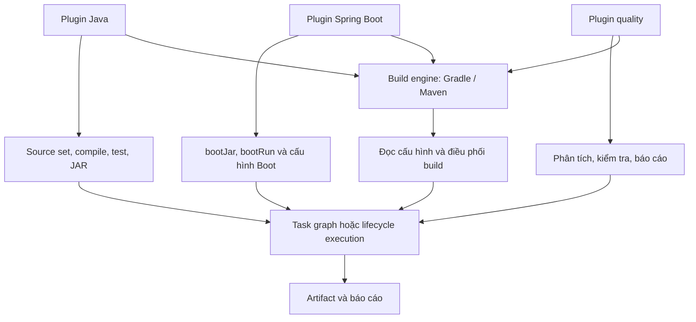
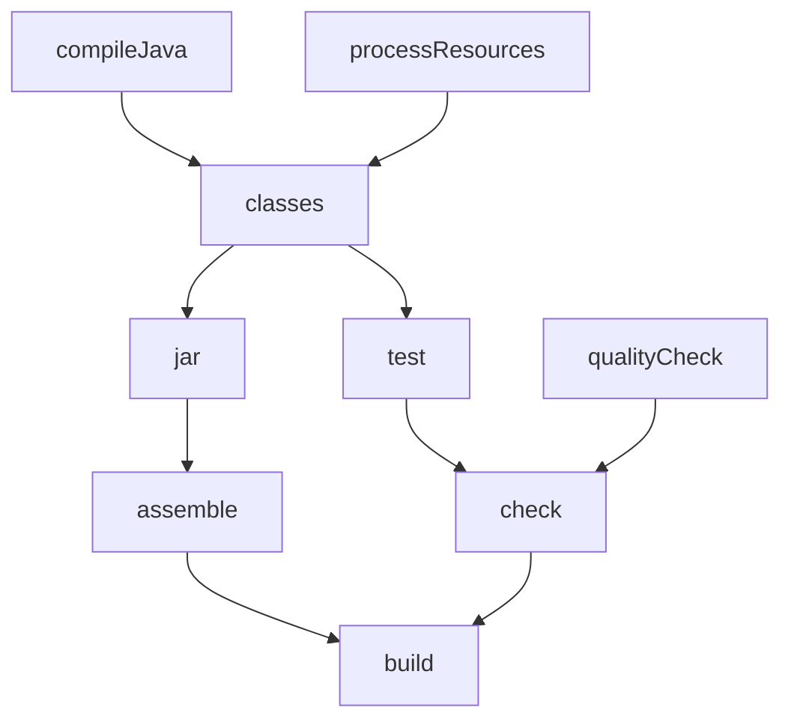
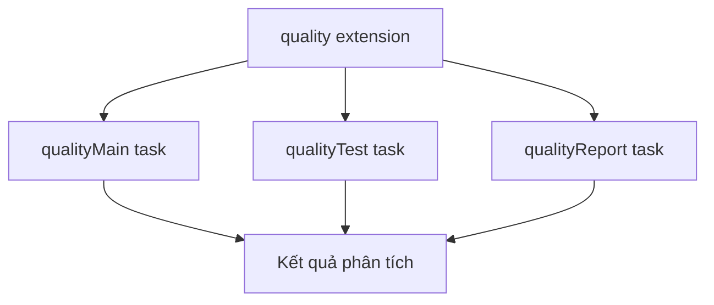

# Plugin cung cấp tác vụ, quy ước và cấu hình như thế nào

Gradle và Maven cung cấp cơ chế điều phối build, nhưng bản thân build engine không cần biết chi tiết của mọi công nghệ mà một dự án có thể sử dụng. Dự án Java có thể cần biên dịch mã nguồn, xử lý tài nguyên, chạy test, đóng gói JAR/WAR, tạo tài liệu, kiểm tra chất lượng hoặc tạo container image. **Plugin** bổ sung những hiểu biết và hành vi chuyên biệt đó vào build tool.

Một plugin thường làm ba việc liên quan với nhau: đăng ký các tác vụ (task hoặc goal), áp dụng quy ước để dự án có cấu trúc và hành vi mặc định dễ dự đoán, và cung cấp cấu hình để người dùng điều chỉnh hành vi ấy. Nhờ vậy, build script có thể mô tả điều dự án cần ở mức cao hơn, thay vì tự viết lại toàn bộ chuỗi lệnh cho từng loại công việc.

## 1. Plugin là gì và vì sao build tool cần plugin?

Build engine chịu trách nhiệm đọc cấu hình, lập kế hoạch và thực thi công việc. Tuy nhiên, nó không thể mặc định rằng mọi dự án đều là ứng dụng Java, thư viện Kotlin, ứng dụng Spring Boot hay dự án frontend. Plugin là phần mở rộng bổ sung các quy tắc cho một loại công việc hoặc công nghệ.

Ví dụ trong Gradle:

- Plugin `java` bổ sung source set Java và các task như `compileJava`, `processResources`, `test`, `jar`, `check`, `assemble` và `build`.
- Plugin `application` bổ sung cấu hình cho ứng dụng Java có main class, cùng các task phục vụ chạy và phân phối ứng dụng.
- Plugin Spring Boot bổ sung cấu hình và task liên quan đến việc đóng gói, chạy ứng dụng Spring Boot, ví dụ `bootJar` và `bootRun` khi plugin và điều kiện tương ứng được áp dụng.
- Plugin kiểm tra chất lượng có thể thêm task phân tích mã nguồn, kiểm tra style hoặc báo cáo.

Với Maven, các plugin cung cấp goal và liên kết chúng với lifecycle phase. Ví dụ, Maven Compiler Plugin biên dịch mã nguồn, Surefire Plugin chạy unit test, còn Maven JAR Plugin tạo JAR ở phase package theo cấu hình lifecycle mặc định hoặc cấu hình dự án.

Plugin giúp tái sử dụng cách làm đã được đóng gói. Một nhóm có thể dùng cùng plugin cho nhiều module và chỉ cấu hình những khác biệt cần thiết. Khi plugin được cập nhật, các module có thể nhận được sửa lỗi hoặc hành vi mới mà không phải sao chép logic build vào từng file.

### 1.1. Plugin bổ sung năng lực cho build

Có thể hình dung mối quan hệ như sau:



Sơ đồ mô tả ý tưởng tổng quát. Một plugin có thể đăng ký task, cấu hình task do plugin khác tạo, thêm dependency configuration hoặc cung cấp extension. Không phải plugin nào cũng làm tất cả những việc đó.

### 1.2. Plugin không phải dependency của ứng dụng

Plugin và thư viện mà ứng dụng sử dụng đều có thể được tải từ repository, nhưng chúng phục vụ những thời điểm và mục đích khác nhau:

| Thành phần | Mục đích | Ví dụ |
|---|---|---|
| Build plugin | Mở rộng cách build được cấu hình hoặc thực thi | Gradle Java plugin, Spring Boot Gradle plugin |
| Application dependency | Cung cấp class/API cho mã nguồn hoặc runtime của ứng dụng | Jackson, Spring Web, JDBC driver |
| Build tool | Điều phối cấu hình và thực thi build | Gradle, Maven |
| JDK/toolchain | Cung cấp compiler và môi trường Java | JDK 17, JDK 21 |

Trong Gradle, `plugins { ... }` áp dụng plugin cho build. Khối `dependencies { ... }` khai báo thư viện trên các configuration như `implementation` hoặc `testImplementation`. Hai khối này không thay thế nhau.

Trong Maven, dependency của ứng dụng thường được khai báo dưới `<dependencies>`, còn plugin build nằm dưới `<build><plugins>`. Plugin có thể có dependency riêng để chạy chính plugin đó; các dependency ấy không tự động trở thành thư viện runtime của ứng dụng.

## 2. Ba khả năng chính: task, quy ước và cấu hình

### 2.1. Task hoặc goal: công việc có thể thực hiện

Plugin cung cấp các đơn vị công việc để build tool có thể thực thi.

Trong Gradle, đơn vị công việc là **task**. Ví dụ, Java plugin đăng ký task biên dịch, xử lý tài nguyên, chạy test và đóng gói. Các task có đầu vào, đầu ra và quan hệ phụ thuộc. Khi người dùng gọi `./gradlew build`, Gradle lập task graph từ task yêu cầu và các quan hệ được cấu hình.

Trong Maven, đơn vị thực thi của plugin là **goal**. Một goal được gọi trực tiếp hoặc được gắn với một phase của lifecycle. Ví dụ, goal `compiler:compile` của Maven Compiler Plugin thường được thực hiện ở phase `compile` của default lifecycle; goal `surefire:test` chạy unit test ở phase `test`.

Plugin giúp người dùng gọi công việc theo tên có ý nghĩa. Người phát triển không cần tự viết lệnh gọi `javac`, tự quét file `.java`, tự tạo classpath và tự đóng gói JAR cho mỗi dự án.

### 2.2. Quy ước (convention): mặc định hợp lý cho một loại dự án

Quy ước là những lựa chọn mặc định mà plugin áp dụng để các dự án có thể tuân theo một cấu trúc chung.

Ví dụ, Java plugin của Gradle sử dụng các source set quen thuộc như `main` và `test`, cùng các thư mục mặc định:

```text
src/
├── main/
│   ├── java/
│   └── resources/
└── test/
    ├── java/
    └── resources/
```

Khi dùng cấu trúc mặc định, build script không cần liệt kê từng file nguồn. Plugin hiểu `src/main/java` là nơi chứa mã nguồn chính và `src/test/java` là nơi chứa mã nguồn kiểm thử theo quy ước của Java plugin.

Plugin cũng có thể đặt quan hệ task mặc định. Ví dụ, `build` của Java plugin gom các công việc assembly và verification; `check` gom các bước kiểm tra. Nhờ đó, người dùng chỉ cần gọi task lifecycle thay vì tự liệt kê từng task thành phần.

Quy ước giúp giảm cấu hình lặp lại, nhưng không có nghĩa mọi dự án phải giữ nguyên mọi mặc định. Khi cấu trúc dự án khác đi, có thể cấu hình source set hoặc extension tương ứng. Cần thay đổi theo API plugin cung cấp, không giả định mọi plugin đều có cùng quy tắc.

### 2.3. Extension hoặc tham số cấu hình: điều chỉnh hành vi

Plugin thường cung cấp một điểm cấu hình để người dùng thay đổi hành vi mặc định.

Trong Gradle, **extension** là một đối tượng cấu hình được plugin thêm vào project. Java plugin có extension `java`, cho phép cấu hình toolchain và các thành phần liên quan đến Java. Plugin Spring Boot có extension riêng để cấu hình các tính năng của nó.

Ví dụ:

```groovy
plugins {
    id 'java'
}

java {
    toolchain {
        languageVersion = JavaLanguageVersion.of(21)
    }
}
```

Plugin Java cung cấp extension `java`; build script cấu hình toolchain qua extension này. Nếu không áp dụng plugin Java hoặc plugin nào tạo extension tương ứng, khối `java { ... }` sẽ không có đối tượng cấu hình để sử dụng.

Trong Maven, plugin thường cung cấp các parameter cho từng goal. Người dùng cấu hình các parameter trong `<configuration>` của plugin, hoặc cung cấp giá trị qua property mà plugin hỗ trợ. Maven không dùng mô hình extension giống Gradle; nó dùng POM, plugin parameter, execution và lifecycle binding.

## 3. Gradle plugin được áp dụng như thế nào?

Gradle có plugin cốt lõi (core plugin) và plugin bên ngoài (community hoặc third-party plugin). Core plugin được phân phối cùng Gradle; plugin bên ngoài thường được lấy từ plugin repository hoặc cơ chế phân giải plugin đã cấu hình.

### 3.1. Áp dụng core plugin

Một ví dụ đơn giản:

```groovy
plugins {
    id 'java'
}
```

Khi Gradle áp dụng plugin `java`, plugin thêm các thành phần Java vào project. Có thể xem task được cung cấp bằng:

```bash
./gradlew tasks --all
```

Một số task thường thấy sau khi áp dụng Java plugin:

| Task | Vai trò |
|---|---|
| `compileJava` | Biên dịch mã nguồn Java chính |
| `processResources` | Xử lý tài nguyên chính |
| `classes` | Gom các đầu ra cần cho source set main |
| `compileTestJava` | Biên dịch mã nguồn test |
| `test` | Chạy test thuộc source set test |
| `jar` | Tạo JAR của project |
| `check` | Chạy các bước verification được gắn vào lifecycle |
| `assemble` | Tập hợp artifact |
| `build` | Lifecycle task kết hợp kiểm tra và assembly |

Danh sách task thực tế phụ thuộc plugin, Gradle version và cấu hình project. Lệnh `tasks --all` giúp khám phá task có sẵn, nhưng không phải báo cáo đầy đủ task graph của một lần build cụ thể.

### 3.2. Áp dụng plugin bên ngoài bằng plugin DSL

Plugin bên ngoài thường được khai báo bằng id và version:

```groovy
plugins {
    id 'java'
    id 'org.springframework.boot' version '3.3.5'
}
```

Ví dụ dùng Spring Boot Gradle plugin để minh họa cú pháp. Dự án thật cần chọn phiên bản plugin tương thích với Gradle, JDK và Spring Boot đang dùng. Plugin DSL cho phép Gradle xác định plugin ngay trong giai đoạn cấu hình build.

Với plugin bên ngoài, Gradle cần biết nơi phân giải plugin. Có thể khai báo repository trong `settings.gradle`:

```groovy
pluginManagement {
    repositories {
        gradlePluginPortal()
        mavenCentral()
    }
}
```

`pluginManagement` là nơi cấu hình việc tìm plugin và có thể quản lý phiên bản plugin cho build. Repository dùng để resolve plugin không hoàn toàn đồng nghĩa với `repositories { ... }` dùng để resolve dependency của ứng dụng.

### 3.3. Quản lý version plugin tập trung

Trong build nhiều module, không nên để mỗi module tự chọn một phiên bản plugin khác nhau nếu toàn hệ thống cần dùng cùng phiên bản. Có thể quản lý phiên bản tại settings hoặc root build.

Ví dụ trong `settings.gradle`:

```groovy
pluginManagement {
    plugins {
        id 'org.springframework.boot' version '3.3.5'
    }
    repositories {
        gradlePluginPortal()
        mavenCentral()
    }
}
```

Root `build.gradle` có thể khai báo plugin để sẵn sàng cho subproject mà chưa áp dụng tại root:

```groovy
plugins {
    id 'org.springframework.boot' version '3.3.5' apply false
}
```

Subproject áp dụng plugin khi cần:

```groovy
plugins {
    id 'java'
    id 'org.springframework.boot'
}
```

`apply false` có nghĩa plugin được đưa vào phạm vi phân giải plugin của build nhưng không được áp dụng cho project hiện tại. Module cần chức năng mới áp dụng plugin. Cách tổ chức này giúp thống nhất version và tránh bật một plugin có hành vi không cần thiết ở mọi project.

Với dự án lớn, version catalog cũng có thể quản lý plugin alias trong `gradle/libs.versions.toml`, sau đó sử dụng alias trong `plugins { ... }`. Chọn một cơ chế quản lý phiên bản nhất quán để tránh cùng một plugin được khai báo nhiều nơi với các version khác nhau.

### 3.4. Cách Gradle plugin thay đổi project

Về mặt triển khai, plugin Gradle thường thực thi một lớp triển khai giao diện `Plugin<Project>` và định nghĩa hành vi trong phương thức `apply`.

Mô hình đơn giản:

```groovy
class GreetingPlugin implements Plugin<Project> {
    void apply(Project project) {
        project.tasks.register('greet') {
            group = 'example'
            description = 'Prints a greeting.'
            doLast {
                println 'Hello from a Gradle plugin'
            }
        }
    }
}
```

Đây là đoạn minh họa ý tưởng triển khai plugin bằng Groovy; một plugin có thể được đóng gói trong build logic riêng và cần metadata để Gradle tìm plugin theo id. Trong plugin production, nên dùng task type có kiểu dữ liệu rõ, khai báo input/output và tránh thực hiện công việc nặng ngay trong giai đoạn cấu hình.

Khi `apply` được gọi, plugin có thể:

- Thêm extension vào `project.extensions` để người dùng cấu hình.
- Đăng ký task qua `project.tasks.register(...)`.
- Tạo dependency configuration để phân giải thư viện phục vụ plugin hoặc task.
- Cấu hình task do plugin khác tạo.
- Đăng ký callback để phản ứng khi một plugin khác được áp dụng.
- Thiết lập quy ước source set, compiler, test hoặc artifact.

Plugin không nên thực thi compile, test hoặc tải dữ liệu lớn ngay trong `apply`. Việc đó làm chậm configuration phase và khiến ngay cả lệnh chỉ cần xem task cũng phải thực hiện công việc không cần thiết. Thay vào đó, plugin đăng ký task; Gradle chỉ thực thi task khi task được đưa vào graph.

## 4. Plugin đăng ký task và kết nối task graph

Task do plugin cung cấp vẫn tham gia task graph theo cùng nguyên tắc như task do người dùng tự viết. Plugin quyết định task nào tồn tại và các prerequisite mặc định; người dùng có thể cấu hình thêm theo API được hỗ trợ.

### 4.1. Task có tên, nhóm và mô tả

Một task được đăng ký thường có tên để gọi từ command line, nhóm để hiển thị trong danh sách task và mô tả để người dùng hiểu mục đích.

```groovy
tasks.register('printBuildInfo') {
    group = 'help'
    description = 'Prints basic information about this build.'

    doLast {
        println "Project: ${project.name}"
        println "Version: ${project.version}"
    }
}
```

Sau khi task được đăng ký, có thể gọi:

```bash
./gradlew printBuildInfo
```

Plugin có thể tạo task tương tự, nhưng thường dùng task type riêng để biểu diễn rõ dữ liệu đầu vào, đầu ra và hành vi.

### 4.2. Task type và cấu hình task

Một task type mô tả loại công việc có thể tái sử dụng. Ví dụ, Java plugin cung cấp task type biên dịch Java; plugin kiểm tra style có thể cung cấp task type phân tích source. Plugin thường đăng ký nhiều task cùng type với cấu hình khác nhau.

Người dùng có thể cấu hình task do plugin tạo:

```groovy
tasks.named('test') {
    useJUnitPlatform()
}
```

Ở đây `test` là task được Java plugin hoặc plugin liên quan tạo ra; build script cấu hình cách chạy test. `tasks.named(...)` lấy tham chiếu đến task đã đăng ký mà không cần tạo lại task mới.

Không nên giả định tên task luôn tồn tại trong mọi project. Nếu plugin tạo task có điều kiện hoặc chưa được áp dụng, `tasks.named('test')` có thể không tìm thấy task. Cần xác định plugin nào chịu trách nhiệm tạo task và áp dụng nó trước khi cấu hình.

### 4.3. Plugin gắn task vào lifecycle

Một plugin thường không chỉ tạo task riêng mà còn kết nối task vào lifecycle để người dùng gọi được qua lệnh tổng quát.

Ví dụ, Java plugin kết nối các task compile, test và archive với các task lifecycle. Plugin quality có thể gắn task phân tích vào `check`, để `./gradlew check` chạy cả test lẫn quality checks nếu cấu hình plugin yêu cầu.



Đây là đồ thị khái quát. Task graph thực tế còn phụ thuộc các plugin đã áp dụng và cách chúng kết nối task. Khi một task được gắn vào lifecycle, lệnh lifecycle sẽ kéo task đó vào graph thông qua quan hệ phụ thuộc.

### 4.4. Configuration avoidance

Gradle khuyến khích đăng ký task bằng `tasks.register(...)` và tham chiếu bằng `tasks.named(...)`. Cách này giúp trì hoãn việc cấu hình task cho đến khi cần, giảm công việc khi build có nhiều task nhưng chỉ chạy một phần nhỏ.

Ví dụ:

```groovy
def reportTask = tasks.register('createReport') {
    group = 'reporting'
    description = 'Creates a project report.'
    // Khai báo input/output và action của task.
}

tasks.register('verifyReport') {
    dependsOn(reportTask)
}
```

Giữ `TaskProvider` khi nối task giúp Gradle quản lý cấu hình trì hoãn. Không nên gọi `.get()` hoặc truy cập mọi task quá sớm nếu không cần thiết. Plugin tốt nên hỗ trợ configuration avoidance để build lớn vẫn cấu hình hiệu quả.

## 5. Extension và quy ước giúp cấu hình ở mức cao

Nếu plugin chỉ tạo task, người dùng vẫn có thể phải chỉnh nhiều thuộc tính trực tiếp trên từng task. Extension gom các lựa chọn có liên quan vào một điểm cấu hình dễ đọc.

### 5.1. Extension là API cấu hình của plugin

Ví dụ giả định plugin kiểm tra mã nguồn cung cấp extension `quality`:

```groovy
quality {
    toolVersion = '1.2.3'
    configFile = layout.projectDirectory.file('config/quality.yml')
    ignoreFailures = false
}
```

Đây là cú pháp minh họa cho một plugin giả định; tên extension và property thực tế phải theo tài liệu của plugin được sử dụng. Người dùng cấu hình mục tiêu và chính sách ở một nơi, còn plugin chuyển các giá trị đó thành cấu hình cho task tương ứng.

### 5.2. Extension có thể cấu hình nhiều task

Giả sử extension có `toolVersion`, `configFile` và `ignoreFailures`. Plugin có thể tạo một hoặc nhiều task, rồi ánh xạ các giá trị extension vào task đó. Khi người dùng đổi `configFile`, các task phân tích hoặc kiểm tra có thể cùng nhận một đường dẫn cấu hình.

Mô hình:



Nhờ extension, người dùng không phải cấu hình lặp lại các giá trị chung ở nhiều task. Plugin cũng có thể đặt convention mặc định, nhưng vẫn cho phép người dùng override theo nhu cầu.

### 5.3. Convention và override

Một plugin thường chọn giá trị mặc định phù hợp với loại dự án. Ví dụ:

- Source directory mặc định là `src/main/java`.
- Encoding mặc định theo cấu hình build/plugin hoặc toolchain.
- Task test đọc source set `test`.
- Task archive lấy version từ project.
- Báo cáo được ghi vào thư mục output của build.

Người dùng có thể thay đổi qua extension hoặc API task. Khi override, cần dùng đúng API được plugin hỗ trợ. Việc ghi đè trực tiếp vào internal property hoặc phụ thuộc vào thứ tự cấu hình không được plugin công bố có thể làm build dễ vỡ khi nâng phiên bản plugin.

### 5.4. Convention plugin cho quy ước nội bộ của tổ chức

Trong repository nhiều module, nhóm có thể tạo plugin nội bộ để chia sẻ quy tắc build. Ví dụ, plugin `company.java-library` có thể áp dụng Java Library plugin, đặt toolchain, encoding, test framework và các quality checks chung.

Khi ấy các module chỉ cần:

```groovy
plugins {
    id 'company.java-library'
}
```

Plugin nội bộ đóng gói quy ước của tổ chức. Nếu baseline Java hoặc cách chạy test thay đổi, nhóm cập nhật plugin chung thay vì sửa hàng chục build script. Cần thiết kế plugin theo từng loại project rõ ràng; không nên tạo một plugin khổng lồ áp dụng mọi quy tắc cho mọi module bất kể module có dùng chúng hay không.

## 6. Plugin có thể bổ sung dependency configuration và repository

Một số plugin cần thư viện để thực hiện công việc. Ví dụ, plugin sinh mã có thể cần compiler hoặc generator runtime; plugin kiểm tra chất lượng có thể cần engine phân tích. Plugin có thể tạo configuration riêng để resolve những dependency này.

Trong Gradle, cần phân biệt:

- Dependency của plugin/build logic.
- Dependency mà task cần để thực hiện công việc.
- Dependency của ứng dụng ở compile/runtime/test classpath.

Không phải thư viện mà plugin tải về đều được đưa vào artifact của ứng dụng. Plugin có thể dùng một classpath riêng để chạy generator hoặc tool phân tích mà không làm dependency đó xuất hiện trong runtime của sản phẩm.

Ví dụ cấu hình dependency của ứng dụng:

```groovy
dependencies {
    implementation 'com.fasterxml.jackson.core:jackson-databind:2.17.2'
    testImplementation 'org.junit.jupiter:junit-jupiter:5.10.2'
}
```

Đây là application dependencies. Plugin Java tạo các configuration như `implementation` và `testImplementation` để Gradle hiểu phạm vi sử dụng của chúng. Nếu không áp dụng plugin cung cấp configuration tương ứng, build script có thể không nhận diện được configuration đó.

Với Maven, plugin dependency được khai báo trong phần cấu hình plugin, khác với dependency ở cấp project:

```xml
<build>
    <plugins>
        <plugin>
            <groupId>org.apache.maven.plugins</groupId>
            <artifactId>maven-surefire-plugin</artifactId>
            <version>3.2.5</version>
            <configuration>
                <useModulePath>false</useModulePath>
            </configuration>
        </plugin>
    </plugins>
</build>
```

Ví dụ minh họa cách cấu hình plugin Surefire; phiên bản và tham số thực tế cần phù hợp với dự án. Dependency của ứng dụng vẫn nằm trong `<dependencies>` riêng.

## 7. Maven plugin: goal, parameter, execution và lifecycle

Maven cũng dùng plugin để mở rộng build, nhưng mô hình chính là plugin goal được gắn vào lifecycle phase.

### 7.1. Goal là công việc do plugin cung cấp

Maven plugin có thể cung cấp nhiều goal. Ví dụ:

- `maven-compiler-plugin:compile` biên dịch mã nguồn chính.
- `maven-compiler-plugin:testCompile` biên dịch mã nguồn kiểm thử.
- `maven-surefire-plugin:test` chạy unit test.
- `maven-jar-plugin:jar` tạo JAR.
- `maven-clean-plugin:clean` xóa output build.

Một goal có thể được gọi trực tiếp theo cú pháp `plugin-prefix:goal` nếu Maven nhận diện được prefix:

```bash
./mvnw compiler:compile
```

Trong công việc thông thường, ta thường gọi lifecycle phase như `compile`, `test`, `package`, `verify` thay vì gọi từng goal riêng. Maven chạy những goal đã được bind vào các phase trước và phase được yêu cầu.

### 7.2. Lifecycle binding

Maven có các lifecycle. Với `default` lifecycle, packaging type như `jar` hoặc `war` quy định các plugin goal mặc định được gắn vào phase tương ứng. Vì vậy, khi chạy:

```bash
./mvnw package
```

Maven chạy các phase trước `package` và các goal đã được bind vào chúng, chẳng hạn compile và test theo cấu hình lifecycle của packaging type.

Một plugin có thể được gắn vào phase cụ thể bằng `<execution>`:

```xml
<build>
    <plugins>
        <plugin>
            <groupId>org.apache.maven.plugins</groupId>
            <artifactId>maven-checkstyle-plugin</artifactId>
            <version>3.3.1</version>
            <executions>
                <execution>
                    <id>check-source-style</id>
                    <phase>verify</phase>
                    <goals>
                        <goal>check</goal>
                    </goals>
                </execution>
            </executions>
        </plugin>
    </plugins>
</build>
```

Ví dụ gắn goal `check` vào phase `verify`. Khi chạy `mvn verify`, Maven thực hiện goal này trong lifecycle. Nếu chỉ gọi `mvn package`, phase `verify` chưa được thực hiện nên goal gắn ở đó không chạy.

### 7.3. Cấu hình parameter của plugin

Plugin Maven thường cung cấp parameter cho goal. Có thể cấu hình trong POM:

```xml
<plugin>
    <groupId>org.apache.maven.plugins</groupId>
    <artifactId>maven-compiler-plugin</artifactId>
    <version>3.13.0</version>
    <configuration>
        <release>17</release>
        <encoding>UTF-8</encoding>
    </configuration>
</plugin>
```

Các giá trị trong `<configuration>` được ánh xạ đến parameter mà plugin hỗ trợ. Plugin sẽ dùng chúng khi goal tương ứng được thực thi. Nếu cấu hình sai tên parameter hoặc đặt nó ở sai phạm vi, Maven có thể bỏ qua, báo lỗi hoặc không tạo ra hành vi mong muốn tùy plugin.

### 7.4. `pluginManagement` và `plugins`

Trong Maven parent POM, `<pluginManagement>` thường dùng để quản lý version và cấu hình mặc định cho plugin trong các module. Việc đưa một plugin vào `pluginManagement` tự nó không có nghĩa mọi goal của plugin sẽ tự động được thực thi. Plugin cần được khai báo/áp dụng trong `<build><plugins>` của project hoặc được bind bởi lifecycle mặc định.

Ví dụ parent POM quản lý version:

```xml
<build>
    <pluginManagement>
        <plugins>
            <plugin>
                <groupId>org.apache.maven.plugins</groupId>
                <artifactId>maven-compiler-plugin</artifactId>
                <version>3.13.0</version>
                <configuration>
                    <release>17</release>
                </configuration>
            </plugin>
        </plugins>
    </pluginManagement>
</build>
```

Module cần khai báo plugin trong `<build><plugins>` để sử dụng cấu hình được quản lý:

```xml
<build>
    <plugins>
        <plugin>
            <groupId>org.apache.maven.plugins</groupId>
            <artifactId>maven-compiler-plugin</artifactId>
        </plugin>
    </plugins>
</build>
```

Trong thực tế, một số plugin được bind sẵn bởi default lifecycle theo packaging type, nhưng quản lý version và cấu hình tường minh vẫn giúp build dễ dự đoán hơn.

## 8. So sánh cách Gradle và Maven dùng plugin

Hai công cụ có chung mục tiêu mở rộng build nhưng cách biểu diễn khác nhau:

| Khía cạnh | Gradle | Maven |
|---|---|---|
| Đơn vị công việc | Task | Goal |
| Cách kết nối công việc | Task graph và quan hệ dependency/order | Goal được bind vào lifecycle phase hoặc gọi trực tiếp |
| Áp dụng plugin | `plugins { id ... }` hoặc cơ chế apply phù hợp | Khai báo trong `<build><plugins>` hoặc lifecycle binding mặc định |
| Điểm cấu hình | Extension và task properties | POM properties và plugin `<configuration>` parameters |
| Quy ước | Plugin có thể tạo source set, task và convention | Packaging/lifecycle/plugin cung cấp cấu trúc và goal binding mặc định |
| Quản lý cấu hình chung | `pluginManagement`, version catalog, convention plugin | Parent POM và `<pluginManagement>` |
| Chạy công việc tổng quát | Gọi task như `build`, `check`, `assemble` | Gọi phase như `package`, `verify`, `install` |

Không nên dịch một-một `task` thành `phase` hoặc `extension` thành Maven property. Khi chuyển từ Gradle sang Maven hoặc ngược lại, hãy hiểu ý nghĩa công việc cần thực hiện rồi tìm cơ chế tương đương trong công cụ kia.

## 9. Plugin bên ngoài và cách quản lý nguồn cung cấp

Plugin bên ngoài thường được phân phối qua repository. Vì plugin có thể thực thi mã trong quá trình build, việc chọn nguồn và phiên bản plugin ảnh hưởng đến độ tin cậy, tính ổn định và bảo mật của build.

### 9.1. Chọn plugin phù hợp

Trước khi thêm plugin, cần xác định:

- Plugin giải quyết công việc gì và có thật sự cần thiết không?
- Plugin hỗ trợ phiên bản Gradle/Maven và JDK nào?
- Plugin có được duy trì và có tài liệu/API rõ ràng không?
- Plugin có tạo task hoặc thay đổi lifecycle theo cách ảnh hưởng đến build hiện tại không?
- Plugin cần quyền truy cập mạng, credential hoặc công cụ ngoài nào?
- Plugin có thể được cấu hình tập trung cho các module không?

Không nên thêm nhiều plugin chồng lấn cùng thực hiện một chức năng nếu chúng có thể tạo task trùng, cấu hình mâu thuẫn hoặc chạy quality gate hai lần.

### 9.2. Pin version và kiểm soát thay đổi

Nên chỉ định phiên bản plugin rõ ràng và quản lý tập trung. Nếu dùng version động hoặc không kiểm soát, build có thể nhận plugin khác ở những thời điểm khác nhau. Khi nâng plugin, cần đọc release notes, kiểm tra yêu cầu tương thích và chạy lại các task quan trọng.

Với Gradle, `pluginManagement` có thể quy định repository và version. Với Maven, `<pluginManagement>` ở parent POM có thể quản lý phiên bản plugin. CI nên dùng cùng Wrapper và cùng source-controlled plugin version với local.

### 9.3. Plugin có thể tác động đến toàn bộ build

Plugin không chỉ là một lệnh chạy độc lập. Khi được áp dụng, plugin có thể thay đổi task graph, tạo configuration, thêm dependency, cấu hình compiler hoặc sửa cách đóng gói. Một thay đổi plugin version có thể làm số task chạy thay đổi hoặc thay đổi nội dung artifact.

Vì vậy, khi một task mới xuất hiện trong `build`, hãy tìm plugin nào tạo task và plugin đã gắn task đó vào lifecycle ra sao. Dùng `./gradlew tasks --all` để khám phá tên task, sau đó xem tài liệu hoặc build script để hiểu quan hệ của nó.

## 10. Tạo plugin nội bộ khi quy ước được dùng lặp lại

Nếu nhiều module cùng sao chép một đoạn build script để cấu hình toolchain, test, compiler hoặc quality check, đó có thể là dấu hiệu nên đóng gói quy ước thành convention plugin.

### 10.1. Khi nào nên tạo plugin?

Plugin nội bộ hữu ích khi:

- Nhiều project có cùng cấu hình và cần được cập nhật đồng bộ.
- Một nhóm muốn định nghĩa rõ loại project như Java library, Spring Boot service hoặc integration-test module.
- Build script của các module bắt đầu lặp lại nhiều logic cấu hình.
- Tổ chức cần một điểm duy nhất để áp dụng quality gate hoặc quy tắc đóng gói.

Nếu một đoạn cấu hình chỉ dùng một lần và rất nhỏ, tạo plugin riêng có thể làm hệ thống phức tạp hơn lợi ích nhận được. Chỉ nên đóng gói khi có quy ước ổn định và phạm vi sử dụng rõ.

### 10.2. Plugin trong `buildSrc` hoặc included build

Gradle hỗ trợ nhiều cách tổ chức build logic dùng chung. `buildSrc` là một build đặc biệt được Gradle tự nhận diện và biên dịch để cung cấp logic cho build chính. Với hệ thống lớn hơn, một included build như `build-logic` có thể tổ chức convention plugin riêng, quản lý dependency và version độc lập hơn.

Ví dụ cấu trúc:

```text
repository/
├── settings.gradle
├── build.gradle
├── build-logic/
│   ├── settings.gradle
│   └── convention/
│       ├── build.gradle
│       └── src/main/groovy/
│           └── company.java-library.gradle
└── modules/
    ├── domain/
    │   └── build.gradle
    └── service/
        └── build.gradle
```

`settings.gradle` của build chính có thể khai báo included build:

```groovy
pluginManagement {
    includeBuild('build-logic')
    repositories {
        gradlePluginPortal()
        mavenCentral()
    }
}
```

Convention plugin trong `build-logic` có thể áp dụng Java Library plugin và cấu hình chung. Module sau đó dùng plugin id nội bộ:

```groovy
plugins {
    id 'company.java-library'
}
```

Đây là mô hình khái quát; tên plugin, khai báo plugin marker và build logic thực tế cần được cấu hình đúng theo loại plugin Gradle đang tạo. Included build giúp tách build logic ra khỏi source code ứng dụng và cho phép phát triển, kiểm thử, quản lý dependency của build logic có cấu trúc.

### 10.3. Thiết kế plugin nội bộ có trách nhiệm rõ ràng

Một convention plugin tốt nên:

- Áp dụng đúng plugin nền tảng mà loại project cần.
- Đặt các convention mặc định có lý do rõ ràng.
- Cung cấp extension khi người dùng cần cấu hình có chủ đích.
- Đăng ký task bằng API hỗ trợ configuration avoidance.
- Khai báo input/output và dependency chính xác.
- Tránh phụ thuộc vào tên task hoặc internal API không ổn định của plugin khác khi có API công khai.
- Không áp dụng hành vi runtime hoặc deployment cho mọi project nếu không thuộc trách nhiệm của plugin.
- Có tài liệu về plugin id, cấu hình và task mà nó cung cấp.

Không nên tạo plugin chỉ để gom các dòng cấu hình mà không xác định ranh giới trách nhiệm. Nếu plugin trở thành nơi chứa mọi quy tắc không liên quan, người dùng khó biết vì sao một task hoặc dependency xuất hiện trong project.

## 11. Cách khám phá plugin đang cung cấp điều gì

Khi tham gia một dự án có nhiều plugin, hãy tìm hiểu theo từng lớp.

### Bước 1: Xem plugin được áp dụng ở đâu

Tìm khối `plugins { ... }` trong `settings.gradle`, root `build.gradle` và build script của module. Với build logic nội bộ, xem `buildSrc` hoặc included build. Với Maven, xem `<build><plugins>`, `<pluginManagement>` ở parent POM và các execution được cấu hình.

### Bước 2: Liệt kê task hoặc xem lifecycle binding

Gradle:

```bash
./gradlew tasks --all
```

Maven:

```bash
./mvnw help:effective-pom
```

`help:effective-pom` hiển thị POM sau khi kết hợp parent, profile và cấu hình được kế thừa. Nó hữu ích để xem plugin/version/configuration cuối cùng mà Maven nhận được. Plugin Help của Maven cũng có thể mô tả goal và parameter của một plugin cụ thể.

### Bước 3: Xem extension hoặc parameter

Đọc tài liệu plugin để biết extension, property, task type và tham số được hỗ trợ. Với Gradle, có thể tìm phần cấu hình plugin trong build script và xem task được cấu hình ở đâu. Với Maven, xem `<configuration>` và `<executions>` trong effective POM.

### Bước 4: Xác định plugin gắn task/goal vào điểm nào

Với Gradle, xem task có được nối vào `check`, `build`, `assemble` hoặc task khác qua `dependsOn`/cấu hình plugin không. Với Maven, xem goal được gắn vào phase nào. Điều này giải thích vì sao một lệnh tổng quát kích hoạt công việc tưởng như không được gọi trực tiếp.

### Bước 5: Kiểm tra tác động khi thay version

Khi nâng plugin, so sánh task được tạo, task graph, dependency, output archive và báo cáo. Nếu plugin thay đổi convention mặc định, một cấu hình cũ có thể không còn phù hợp hoặc cần migration.

## 12. Những lỗi thường gặp khi sử dụng plugin

| Triệu chứng | Nguyên nhân có thể | Hướng xử lý |
|---|---|---|
| `Plugin with id ... was not found` | Sai plugin id, repository chưa khai báo, version không tồn tại hoặc plugin không được resolve | Kiểm tra id/version và `pluginManagement.repositories` |
| Không tìm thấy extension như `java {}` | Plugin cung cấp extension chưa được áp dụng | Áp dụng plugin phù hợp trước khi cấu hình extension |
| Không tìm thấy task khi dùng `tasks.named(...)` | Task chưa được plugin đăng ký hoặc tên task khác | Kiểm tra plugin, task list và điều kiện tạo task |
| Task không chạy khi gọi lifecycle | Plugin chưa gắn task vào lifecycle hoặc task được gọi riêng | Kiểm tra `dependsOn`/lifecycle binding hoặc gọi task cụ thể |
| Plugin chạy hai lần hoặc cấu hình mâu thuẫn | Plugin bị áp dụng lặp hoặc nhiều plugin cùng cấu hình một thành phần | Xem nơi apply plugin và quy tắc phối hợp |
| Build thay đổi sau khi nâng plugin | Version mới thay convention, task, dependency hoặc output | Đọc migration/release notes và kiểm tra graph/artifact |
| Plugin không resolve được trong CI | Repository, proxy, network hoặc credential khác local | So sánh repository và quyền truy cập; không đưa secret vào log |
| Plugin tạo task quá sớm hoặc build cấu hình chậm | Plugin thực hiện công việc nặng trong configuration phase | Đăng ký task trì hoãn và chuyển công việc vào task action |

Một lỗi phổ biến là áp dụng plugin ở root rồi giả định mọi subproject đều nhận được plugin. Gradle không tự động áp dụng mọi plugin của root cho tất cả subproject. Có thể khai báo plugin ở root với `apply false`, rồi áp dụng ở từng module cần dùng; hoặc dùng convention plugin để định nghĩa chính sách áp dụng cho nhóm project phù hợp.

Trong Maven, một lỗi tương tự là đặt plugin trong `<pluginManagement>` rồi kỳ vọng goal được chạy. `pluginManagement` chủ yếu quản lý version và cấu hình mặc định; cần khai báo plugin trong `<plugins>` hoặc dựa vào binding mặc định của lifecycle để goal được thực thi.

## 13. Những nguyên tắc khi mở rộng build bằng plugin

- Dùng plugin để tái sử dụng hành vi build có trách nhiệm rõ, không biến build script thành nơi chứa mọi logic ứng dụng.
- Chọn plugin theo loại project và nhu cầu thật sự.
- Pin version plugin và quản lý version tập trung.
- Đọc tài liệu về extension, task/goal, default convention và lifecycle binding trước khi override.
- Phân biệt plugin dependency với application dependency.
- Dùng task provider và configuration avoidance trong Gradle khi đăng ký/cấu hình task.
- Khai báo input/output và quan hệ prerequisite theo luồng dữ liệu.
- Không thực hiện compile, tải file hoặc gọi dịch vụ ngoài ngay trong configuration phase nếu công việc thuộc task execution.
- Kiểm tra tác động của plugin lên task graph và artifact khi nâng version.
- Tách convention plugin nội bộ khi nhiều module lặp lại cùng một cấu hình ổn định.

Plugin là cầu nối giữa build engine tổng quát và nhu cầu cụ thể của từng loại dự án. Plugin đăng ký task hoặc goal để thực hiện công việc, áp dụng quy ước để giảm cấu hình lặp lại, và cung cấp extension hoặc parameter để người dùng điều chỉnh hành vi. Khi hiểu ba vai trò này, người phát triển có thể đọc build script dễ hơn, biết vì sao một task xuất hiện, cấu hình đúng điểm mở rộng và tổ chức build logic dùng chung mà vẫn giữ task graph cùng ranh giới module rõ ràng.
