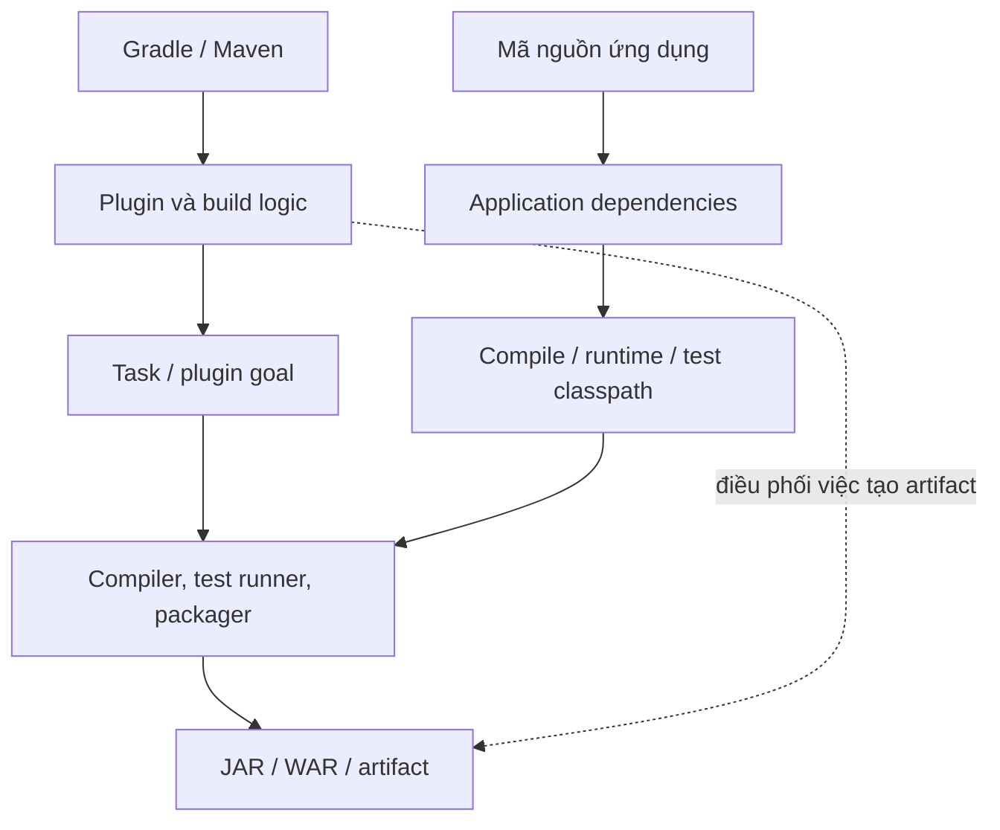

# Phân biệt phụ thuộc plugin với phụ thuộc của ứng dụng

Một dự án Java thường khai báo cả plugin của công cụ build lẫn thư viện mà ứng dụng sử dụng. Hai loại thành phần này đều có thể được tải từ repository và đều có thể kéo theo những thư viện khác, nhưng chúng phục vụ hai môi trường và hai mục đích khác nhau.

**Plugin dependency** cung cấp mã thực thi cho Gradle hoặc Maven để mở rộng quy trình build: tạo task, thêm goal, xử lý tài nguyên, biên dịch, kiểm thử, đóng gói hoặc phát hành. **Application dependency** cung cấp lớp và chức năng mà mã ứng dụng hoặc mã kiểm thử cần dùng khi biên dịch và chạy.

Phân biệt đúng hai nhóm giúp bạn khai báo dependency vào đúng classpath, tránh đưa công cụ build vào sản phẩm ứng dụng, hiểu vì sao một thư viện có thể được tải nhưng mã Java không nhìn thấy nó, và điều tra chính xác khi build trên máy cá nhân khác với CI.

## 1. Hai nhóm dependency phục vụ hai môi trường khác nhau

Hãy hình dung một ứng dụng Spring Boot dùng Gradle. Ứng dụng có thể cần Spring Web để xử lý HTTP và JUnit để chạy test. Trong khi đó, Gradle cần Java plugin để hiểu source set, biên dịch mã Java và tạo JAR; dự án có thể cần Spring Boot Gradle plugin để tạo executable archive hoặc bổ sung task chạy ứng dụng.

Các thành phần này tham gia ở những lớp khác nhau:



| Tiêu chí | Phụ thuộc plugin | Phụ thuộc ứng dụng |
|---|---|---|
| Mục đích | Mở rộng hoặc cấu hình công cụ build | Cung cấp API và chức năng cho ứng dụng hoặc test |
| Được sử dụng bởi | Gradle/Maven và build logic | Mã nguồn ứng dụng, mã kiểm thử hoặc chương trình khi chạy |
| Classpath chính | Plugin/buildscript classpath hoặc plugin classloader | Compile, runtime, test classpath của project |
| Khai báo thường gặp trong Gradle | `plugins {}` hoặc build logic/plugin classpath | `dependencies { implementation ... }` và các configuration khác |
| Khai báo thường gặp trong Maven | `build/plugins` hoặc `pluginManagement` | Phần tử `<dependencies>` cấp project |
| Ví dụ | Java plugin, Spring Boot Gradle plugin, Maven Compiler Plugin | Spring Web, Jackson, JDBC driver, JUnit |
| Có tự động được đóng gói vào JAR ứng dụng không? | Không | Tùy cấu hình đóng gói và loại dependency |

Một plugin có thể cần thư viện riêng để hoạt động. Những thư viện đó là dependency của plugin và thuộc môi trường thực thi build. Chúng không tự động trở thành dependency của ứng dụng.

Ngược lại, ứng dụng có thể khai báo một thư viện để sử dụng API của nó. Việc khai báo đó không làm Gradle hoặc Maven có thêm task hay goal mới. Muốn mở rộng công cụ build, project phải áp dụng plugin hoặc cấu hình build logic tương ứng.

## 2. Gradle: plugin được phân giải và áp dụng như thế nào?

Gradle có một cơ chế khai báo plugin riêng. Với các plugin được hỗ trợ bởi Plugins DSL, phần `plugins {}` thường là cách khai báo rõ ràng và dễ quản lý nhất.

Ví dụ:

```groovy
plugins {
    id 'java'
    id 'org.springframework.boot' version '3.3.5'
}
```

Ở đây:

- `java` là plugin lõi do Gradle cung cấp.
- `org.springframework.boot` là plugin bên ngoài có version được khai báo.
- Gradle phân giải plugin theo cơ chế plugin resolution, tải implementation cần thiết rồi áp dụng plugin vào project.

Khai báo plugin không giống khai báo thư viện trong `dependencies {}`. Plugin có thể bổ sung task, extension, configuration và convention cho project. Ví dụ, Java plugin tạo các task như `compileJava`, `test`, `jar` và các source set mặc định.

### 2.1. Repository tìm plugin khác repository tìm dependency của project

Gradle cho phép cấu hình nơi tìm plugin trong `pluginManagement` của settings script:

```groovy
// settings.gradle
pluginManagement {
    repositories {
        gradlePluginPortal()
        mavenCentral()
        // Có thể thêm repository plugin nội bộ nếu tổ chức yêu cầu.
    }
}
```

Trong khi đó, repository dùng để phân giải dependency của project thường được khai báo ở build script:

```groovy
// build.gradle
repositories {
    mavenCentral()
}
```

Hai nhóm repository có mục đích phân giải khác nhau. `pluginManagement.repositories` phục vụ plugin resolution; `repositories` trong project phục vụ dependency resolution của các configuration như `compileClasspath` và `runtimeClasspath`.

Không nên cho rằng một thư viện có thể được tải từ `mavenCentral()` ở project thì plugin tương ứng chắc chắn được tìm thấy trong cùng cấu hình. Hãy kiểm tra đúng khu vực repository khi gặp lỗi không tìm thấy plugin hoặc không tìm thấy application dependency.

### 2.2. Plugin marker và implementation artifact

Khi sử dụng Plugins DSL, Gradle thường phân giải plugin thông qua tọa độ plugin marker gắn với plugin ID và version. Marker chỉ ra implementation artifact cần thiết để cung cấp plugin. Vì vậy, plugin ID trong `plugins {}` không nhất thiết trùng với group và artifact name của thư viện implementation.

Thông thường, người dùng chỉ cần khai báo plugin ID và version. Gradle xử lý bước tìm marker và implementation theo quy ước của plugin repository. Với plugin nội bộ hoặc plugin có cách phân phối đặc biệt, settings có thể cần cấu hình `pluginManagement` hoặc `resolutionStrategy` để ánh xạ plugin ID sang module implementation phù hợp.

Điểm cần nhớ: plugin ID là định danh để áp dụng plugin; nó không phải một dependency mà bạn đặt vào `implementation` của ứng dụng.

### 2.3. Plugin version catalog

Với dự án quản lý version bằng Gradle version catalog, plugin có thể được khai báo trong `gradle/libs.versions.toml`:

```toml
[versions]
spring-boot = "3.3.5"

[plugins]
spring-boot = { id = "org.springframework.boot", version.ref = "spring-boot" }
```

Build script sử dụng alias:

```kotlin
plugins {
    alias(libs.plugins.spring.boot)
    java
}
```

Catalog giúp quản lý version và alias tập trung. Nó không biến plugin thành application dependency; Gradle vẫn phân giải và áp dụng plugin theo Plugins DSL.

## 3. Gradle: application dependency nằm trong project configurations

Application dependency được khai báo trong `dependencies {}` của project. Configuration xác định dependency có mặt ở giai đoạn nào và được tiêu thụ ra sao.

Ví dụ:

```groovy
plugins {
    id 'java'
    id 'org.springframework.boot' version '3.3.5'
}

repositories {
    mavenCentral()
}

dependencies {
    implementation 'org.springframework.boot:spring-boot-starter-web:3.3.5'

    testImplementation 'org.junit.jupiter:junit-jupiter:5.11.3'
    testRuntimeOnly 'org.junit.platform:junit-platform-launcher:1.11.3'
}

tasks.named('test') {
    useJUnitPlatform()
}
```

Trong ví dụ, Spring Boot Gradle plugin là plugin build; `spring-boot-starter-web` là dependency của ứng dụng; JUnit là dependency phục vụ test. Các configuration phổ biến của Java plugin gồm:

| Configuration | Vai trò |
|---|---|
| `implementation` | Dependency dùng khi biên dịch và chạy mã chính; không được công khai như API dependency của Java library consumer. |
| `api` | Dependency được công khai qua API của project dùng `java-library` và cần có trên compile classpath của consumer. |
| `compileOnly` | Có trên compile classpath nhưng không được đưa vào runtime classpath thông qua configuration này. |
| `runtimeOnly` | Chỉ cần khi chạy, không dùng để biên dịch mã chính. |
| `testImplementation` | Dependency dùng để biên dịch test. |
| `testRuntimeOnly` | Dependency chỉ cần khi chạy test. |
| `annotationProcessor` | Annotation processor chạy trong quá trình biên dịch mã chính. |
| `testAnnotationProcessor` | Annotation processor dùng khi biên dịch mã kiểm thử. |

Các configuration này thuộc mô hình dependency của project. Chúng không phải nơi khai báo Gradle plugin.

### 3.1. Dependency có mặt trên classpath nào?

Build tool xây dựng các classpath khác nhau theo tác vụ:

```text
compileClasspath
    → dependency cần để biên dịch mã chính

runtimeClasspath
    → output mã chính và dependency cần khi chạy

testCompileClasspath
    → output mã chính cùng dependency cần để biên dịch test

testRuntimeClasspath
    → output mã chính, output test và dependency cần để chạy test
```

Ví dụ, nếu một thư viện chỉ được khai báo bằng `runtimeOnly`, mã Java không thể mặc nhiên import lớp của thư viện đó trong lúc biên dịch. Thư viện chỉ được đưa vào runtime classpath theo configuration tương ứng.

Đây là lý do một dependency có thể tải thành công nhưng compiler vẫn báo `package ... does not exist`: dependency có thể được khai báo sai configuration, hoặc đang được khai báo ở một project khác.

### 3.2. Dependency bắc cầu của ứng dụng

Application dependency có thể kéo theo dependency bắc cầu (transitive dependency). Ví dụ:

```text
Ứng dụng
└── spring-boot-starter-web
    ├── spring-web
    ├── spring-webmvc
    └── spring-boot-starter-json
        └── jackson-databind
```

Khi khai báo starter, Gradle phân giải metadata để tìm các artifact mà starter cần. Những artifact này có thể tham gia compile hoặc runtime classpath tùy metadata và configuration.

Plugin cũng có dependency bắc cầu riêng, nhưng chúng thuộc classpath của plugin. Không nên suy luận rằng dependency bắc cầu của plugin sẽ xuất hiện trên runtime classpath của ứng dụng.

## 4. Gradle: dependency của build script và plugin classpath

Gradle còn có cơ chế `buildscript {}` để khai báo dependency cho chính build script. Đây là cơ chế thường gặp trong các dự án cũ hoặc build logic đặc biệt.

Ví dụ:

```groovy
buildscript {
    repositories {
        gradlePluginPortal()
        mavenCentral()
    }
    dependencies {
        classpath 'org.springframework.boot:spring-boot-gradle-plugin:3.3.5'
    }
}

apply plugin: 'org.springframework.boot'
```

Dependency trong `buildscript.dependencies.classpath` được đưa vào classpath dùng để đánh giá build script và nạp plugin theo cách khai báo này. Nó không trở thành `implementation` của ứng dụng.

Với project mới, nên ưu tiên Plugins DSL khi plugin hỗ trợ:

```groovy
plugins {
    id 'org.springframework.boot' version '3.3.5'
}
```

Không cần khai báo cùng một plugin bằng cả Plugins DSL và `buildscript {}` nếu không có lý do cụ thể. Việc trộn hai cách có thể làm cấu hình khó hiểu và gây ra vấn đề classpath hoặc version.

### 4.1. Build logic dùng thư viện riêng

Build script hoặc plugin nội bộ có thể cần thư viện để thực hiện logic build. Ví dụ, một convention plugin nội bộ cần thư viện xử lý YAML để đọc cấu hình build. Dependency đó thuộc project build logic, không thuộc ứng dụng đang được build.

Các cách tổ chức build logic có thể gồm:

- Plugin được viết trong `buildSrc`.
- Included build dùng `includeBuild(...)` trong settings và cung cấp convention plugin.
- Plugin được đóng gói và phân phối như một module riêng.

Trong `buildSrc` hoặc included build, dependency được khai báo trong build script của chính build logic. Khi plugin được áp dụng, mã plugin có thể sử dụng các thư viện đó trong môi trường thực thi plugin. Những thư viện này không tự động được đưa vào application classpath.

Ví dụ cấu trúc khái niệm:

```text
repository/
├── settings.gradle
├── app/
│   ├── build.gradle
│   └── src/main/java/
└── build-logic/
    ├── settings.gradle
    └── convention/
        ├── build.gradle
        └── src/main/kotlin/
            └── JavaConventionsPlugin.kt
```

`build-logic/convention` là project xây dựng plugin. Dependency của project này phục vụ quá trình biên dịch và chạy plugin. `app` vẫn khai báo thư viện mà mã ứng dụng cần trong `app/build.gradle`.

## 5. Maven: project dependencies và plugin dependencies

Maven cũng phân biệt dependency của project với dependency của plugin.

### 5.1. Dependency của ứng dụng trong `dependencies`

Trong `pom.xml`, dependency của project được khai báo ở phần tử `<dependencies>` cấp project:

```xml
<dependencies>
    <dependency>
        <groupId>org.springframework.boot</groupId>
        <artifactId>spring-boot-starter-web</artifactId>
        <version>3.3.5</version>
    </dependency>

    <dependency>
        <groupId>org.junit.jupiter</groupId>
        <artifactId>junit-jupiter</artifactId>
        <version>5.11.3</version>
        <scope>test</scope>
    </dependency>
</dependencies>
```

Dependency đầu phục vụ mã ứng dụng. JUnit có scope `test`, nên phục vụ compile và runtime của test theo Maven dependency model, không phải dependency runtime production thông thường.

Một số scope Maven thường gặp:

| Scope | Mục đích khái quát |
|---|---|
| `compile` | Scope mặc định; có mặt khi biên dịch, kiểm thử và chạy theo dependency model. |
| `provided` | Cần khi biên dịch và kiểm thử nhưng môi trường chạy dự kiến cung cấp, ví dụ Servlet API trong một số kiểu triển khai. |
| `runtime` | Không cần khi biên dịch mã chính nhưng cần khi chạy hoặc kiểm thử. |
| `test` | Chỉ phục vụ biên dịch và chạy test. |
| `system` | Dùng JAR từ đường dẫn cục bộ được khai báo; thường nên tránh vì làm giảm tính di động. |
| `import` | Dùng trong dependency management để nhập BOM với packaging `pom`. |

Scope là quy tắc của dependency project. Nó không phải cách chỉ định dependency cho Maven plugin.

### 5.2. Plugin trong `build/plugins`

Plugin Maven được khai báo dưới `<build><plugins>`:

```xml
<build>
    <plugins>
        <plugin>
            <groupId>org.apache.maven.plugins</groupId>
            <artifactId>maven-compiler-plugin</artifactId>
            <version>3.13.0</version>
            <configuration>
                <release>21</release>
            </configuration>
        </plugin>
    </plugins>
</build>
```

Maven Compiler Plugin cung cấp goal biên dịch mã Java và được cấu hình để dùng release 21. Đây là plugin build, không phải thư viện mà lớp ứng dụng import.

Việc khai báo plugin và version rõ ràng giúp build kiểm soát công cụ thực thi. Nếu không khai báo version, Maven có thể dựa vào version được quản lý hoặc cơ chế mặc định của môi trường và super POM; dự án nên quản lý version plugin có chủ đích để tránh khác biệt ngoài dự kiến.

### 5.3. Dependency riêng của plugin trong phần tử `<plugin><dependencies>`

Một plugin có thể cần thư viện bổ sung để thực thi. Khi đó, dependency được khai báo bên trong chính phần tử `<plugin>`:

```xml
<build>
    <plugins>
        <plugin>
            <groupId>org.example.build</groupId>
            <artifactId>report-maven-plugin</artifactId>
            <version>1.2.0</version>

            <dependencies>
                <dependency>
                    <groupId>org.example.tools</groupId>
                    <artifactId>report-renderer</artifactId>
                    <version>2.4.0</version>
                </dependency>
            </dependencies>
        </plugin>
    </plugins>
</build>
```

Các tọa độ `org.example.*` trong ví dụ là minh họa cho một plugin và thư viện giả định. `report-renderer` được thêm vào môi trường thực thi của `report-maven-plugin`, để plugin có thể dùng nó khi chạy goal. Nó không tự động trở thành dependency của mã ứng dụng.

### 5.4. `pluginManagement` không giống `plugins`

Maven có thể quản lý version và cấu hình plugin tập trung trong `<pluginManagement>`:

```xml
<build>
    <pluginManagement>
        <plugins>
            <plugin>
                <groupId>org.apache.maven.plugins</groupId>
                <artifactId>maven-compiler-plugin</artifactId>
                <version>3.13.0</version>
                <configuration>
                    <release>21</release>
                </configuration>
            </plugin>
        </plugins>
    </pluginManagement>
</build>
```

`pluginManagement` cung cấp cấu hình mặc định cho plugin khi plugin được sử dụng trong project hoặc project con theo cơ chế kế thừa. Chỉ đặt plugin trong `pluginManagement` không đồng nghĩa với việc plugin đó luôn được thực thi. Phần `<plugins>` mới là nơi khai báo plugin được dùng trực tiếp trong build của project; một số plugin còn có binding mặc định theo packaging lifecycle.

## 6. Plugin classpath và application classpath

Điểm phân biệt quan trọng nhất là **môi trường mà dependency được nạp vào**.

### 6.1. Plugin classpath

Plugin classpath chứa mã plugin và các thư viện plugin cần để thực thi. Khi Gradle áp dụng plugin hoặc Maven gọi plugin goal, công cụ build nạp implementation cùng dependency phù hợp vào môi trường thực thi của plugin.

Ví dụ, một plugin tạo báo cáo có thể dùng thư viện để đọc bytecode hoặc render HTML. Các thư viện đó cần thiết cho plugin hoạt động, dù ứng dụng không hề import chúng.

### 6.2. Application classpath

Application classpath chứa các lớp và thư viện mà ứng dụng hoặc test cần dùng. Với Gradle, compile/runtime/test classpath được tạo từ dependency configurations và output của source set. Với Maven, classpath được xác định theo dependency model và scope tương ứng.

Ví dụ, nếu `OrderService.java` import `com.fasterxml.jackson.databind.ObjectMapper`, thư viện cung cấp lớp này phải có trên compile classpath của project. Chỉ thêm một plugin có sử dụng Jackson không làm lớp `ObjectMapper` xuất hiện trong compile classpath của ứng dụng.

### 6.3. Một plugin có thể thao tác với dependency của ứng dụng

Plugin có thể đọc project model, kiểm tra dependency, tạo source, thêm configuration hoặc điều chỉnh cách đóng gói. Điều đó không làm hai loại classpath trở thành một.

Ví dụ, một plugin phân tích dependency có thể đọc dependency graph của ứng dụng để tạo báo cáo. Nó dùng API của Gradle hoặc Maven để truy vấn project, còn thư viện dùng nội bộ để tạo báo cáo thuộc plugin classpath. Plugin có thể ghi báo cáo ra `build/reports/`, nhưng thư viện xử lý báo cáo không tự động được đóng gói vào JAR ứng dụng.

Một số plugin chủ động cấu hình dependency hoặc source set cho ứng dụng. Khi đó, dependency chỉ xuất hiện trong application classpath vì plugin đã thêm nó vào project configuration theo thiết kế. Hãy kiểm tra cấu hình và tài liệu plugin thay vì giả định mọi dependency của plugin đều được thêm vào project.

## 7. Annotation processor không đồng nghĩa với build plugin

Annotation processor là một trường hợp dễ gây nhầm lẫn vì nó là mã thực thi trong quá trình biên dịch. Processor có thể đọc annotation, phân tích kiểu và sinh thêm mã Java. Tuy nhiên, nó không phải Gradle plugin hay Maven plugin.

Trong Gradle, processor thường được khai báo ở configuration riêng:

```groovy
dependencies {
    compileOnly 'org.projectlombok:lombok:1.18.34'
    annotationProcessor 'org.projectlombok:lombok:1.18.34'

    testCompileOnly 'org.projectlombok:lombok:1.18.34'
    testAnnotationProcessor 'org.projectlombok:lombok:1.18.34'
}
```

Trong Maven, processor có thể được cấu hình qua `annotationProcessorPaths` của Maven Compiler Plugin:

```xml
<plugin>
    <groupId>org.apache.maven.plugins</groupId>
    <artifactId>maven-compiler-plugin</artifactId>
    <version>3.13.0</version>
    <configuration>
        <annotationProcessorPaths>
            <path>
                <groupId>org.projectlombok</groupId>
                <artifactId>lombok</artifactId>
                <version>1.18.34</version>
            </path>
        </annotationProcessorPaths>
    </configuration>
</plugin>
```

Processor được nạp trong quá trình compile để xử lý annotation. Nó có classpath riêng theo cấu hình compiler. Không nên nhầm processor với plugin điều khiển toàn bộ build. Một thư viện annotation API đôi khi cần có mặt trên compile classpath, trong khi phần processor cần ở processor path; vai trò cụ thể tùy thư viện.

## 8. Dependency của plugin và dependency bắc cầu

Cả plugin lẫn application dependency đều có thể kéo theo dependency bắc cầu, nhưng các graph được phân giải trong phạm vi khác nhau.

```text
Build logic
└── Plugin P
    ├── Plugin library A
    └── Plugin library B

Application project
└── Library X
    ├── Runtime library Y
    └── API library Z
```

Nếu plugin P nâng version và đổi thư viện A, điều đó có thể ảnh hưởng đến việc thực thi build, nhưng không tự động đổi dependency graph của ứng dụng. Nếu application library X nâng version và đổi dependency Y, điều đó ảnh hưởng đến compile/runtime graph của project theo metadata và configuration.

Một số trường hợp có thể giao nhau:

- Plugin có thể phân tích dependency graph của project.
- Plugin có thể thêm dependency vào một project configuration.
- Plugin có thể tạo mã nguồn tham chiếu đến thư viện ứng dụng.
- Plugin đóng gói có thể thay đổi cách dependency runtime được đưa vào archive.

Những thay đổi đó là hành vi do plugin thực hiện theo cấu hình của nó. Chúng không phải quy tắc mặc định rằng plugin dependencies sẽ được đưa vào application artifact.

## 9. Tác động đến artifact và lúc chạy ứng dụng

Thông thường, JAR ứng dụng chứa bytecode và resource của project. Một JAR thư viện thông thường không tự đóng gói toàn bộ dependency bên ngoài. Với ứng dụng cần archive tự chạy, plugin đóng gói có thể tạo executable/fat JAR và đưa runtime dependencies vào archive theo quy tắc riêng.

Ví dụ với Spring Boot Gradle plugin:

```groovy
plugins {
    id 'java'
    id 'org.springframework.boot' version '3.3.5'
}

dependencies {
    implementation 'org.springframework.boot:spring-boot-starter-web:3.3.5'
}
```

Spring Boot plugin cung cấp logic build để tạo executable archive. Starter Web là application dependency; plugin sử dụng dependency model của project để xác định runtime libraries cần đóng gói theo định dạng executable JAR. Chính plugin là công cụ tạo archive, còn thư viện Spring Web là thành phần ứng dụng cần khi chạy.

Nếu loại bỏ plugin build khỏi cấu hình, mã nguồn ứng dụng vẫn có thể khai báo Spring Web, nhưng các task đặc thù do plugin cung cấp có thể không còn. Nếu loại bỏ application dependency, plugin vẫn có thể được phân giải và áp dụng, nhưng mã ứng dụng có thể không biên dịch hoặc chạy được vì thiếu API cần thiết.

## 10. Quản lý version và tính tái lập

Build có thể thay đổi khi version của plugin hoặc application dependency thay đổi. Vì thế, cả hai nhóm đều cần được quản lý có chủ đích.

### 10.1. Khóa version plugin

Trong Gradle Plugins DSL:

```groovy
plugins {
    id 'java'
    id 'org.springframework.boot' version '3.3.5'
}
```

Trong Maven:

```xml
<plugin>
    <groupId>org.apache.maven.plugins</groupId>
    <artifactId>maven-compiler-plugin</artifactId>
    <version>3.13.0</version>
</plugin>
```

Quản lý version plugin giúp kiểm soát logic build và giảm nguy cơ mỗi môi trường chọn một bản khác nhau.

### 10.2. Quản lý version application dependency

Trong Gradle, có thể dùng version catalog, platform/BOM, dependency constraints hoặc dependency locking để quản lý phiên bản. Trong Maven, có thể dùng `<dependencyManagement>` hoặc BOM để quản lý version thống nhất giữa các module.

Dependency locking giúp ghi lại phiên bản được phân giải; nó không thay thế khai báo dependency. BOM hoặc dependency management giúp quản lý version; nó không tự động biến mọi dependency thành plugin.

### 10.3. Wrapper và toolchain giải quyết những phần khác

Gradle Wrapper hoặc Maven Wrapper giúp thống nhất phiên bản build tool. Java toolchain hoặc Maven Toolchains giúp kiểm soát JDK được dùng cho công việc biên dịch hoặc thực thi. Chúng không thay thế quản lý version plugin và application dependency.

Để build ổn định, cần xem các yếu tố này như những đầu vào riêng biệt: phiên bản công cụ build, plugin, dependency ứng dụng, JDK/toolchain, cấu hình và môi trường.

## 11. Chẩn đoán khi dependency được tải nhưng project vẫn lỗi

Một số lỗi thường gặp xuất phát từ việc khai báo đúng artifact nhưng sai nơi.

| Triệu chứng | Khả năng nguyên nhân | Hướng kiểm tra |
|---|---|---|
| Gradle báo không tìm thấy plugin ID | Plugin repository, plugin version hoặc marker/implementation resolution sai | Kiểm tra `pluginManagement.repositories`, `plugins {}` và log plugin resolution. |
| Maven không tìm thấy plugin hoặc goal | Plugin tọa độ/version/repository sai hoặc plugin chưa được khai báo phù hợp | Kiểm tra `<build><plugins>`, `pluginManagement` và log Maven. |
| Compiler không tìm thấy class dù một plugin đã tải thư viện đó | Thư viện chỉ nằm trên plugin/buildscript classpath | Khai báo thư viện ở project dependency configuration hoặc Maven `<dependencies>` nếu mã ứng dụng cần dùng. |
| Build script không tìm thấy lớp của thư viện | Dependency được khai báo trong project `implementation` thay vì build logic classpath | Đưa thư viện vào build logic hoặc plugin dependency đúng phạm vi. |
| Ứng dụng chạy local nhưng thiếu class khi chạy artifact | Dependency không có trên runtime classpath hoặc packaging không đưa runtime dependency vào archive | Kiểm tra runtime dependency graph và cách đóng gói. |
| Plugin chạy được nhưng test thiếu JUnit | JUnit không được khai báo trong test configurations/scope | Kiểm tra `testImplementation`, `testRuntimeOnly` hoặc Maven scope `test`. |
| Nâng plugin làm build lỗi dù app dependencies không đổi | Plugin version thay đổi task, API build, classpath plugin hoặc yêu cầu Gradle/JDK | Đọc release notes và kiểm tra tương thích Gradle/JDK. |

### 11.1. Kiểm tra dependency của ứng dụng trong Gradle

Xem compile và runtime classpath:

```bash
./gradlew dependencies --configuration compileClasspath
./gradlew dependencies --configuration runtimeClasspath
./gradlew dependencies --configuration testRuntimeClasspath
```

Để biết lý do một dependency được chọn:

```bash
./gradlew dependencyInsight --dependency jackson-databind --configuration runtimeClasspath
```

Các lệnh này xem dependency graph của project configuration. Chúng không phải cách tổng quát để xem toàn bộ plugin implementation classpath.

Với dependency được khai báo bằng cơ chế `buildscript {}`, có thể xem buildscript classpath bằng:

```bash
./gradlew buildEnvironment
```

Đối với plugin khai báo bằng Plugins DSL, hãy kiểm tra `plugins {}`, `pluginManagement`, version catalog và log phân giải plugin. Không nên chỉ dựa vào `dependencies --configuration runtimeClasspath` để kết luận plugin có được phân giải hay không.

### 11.2. Kiểm tra dependency và plugin trong Maven

Xem dependency graph của project:

```bash
./mvnw dependency:tree
```

Xem POM hiệu lực, bao gồm cấu hình plugin được kế thừa:

```bash
./mvnw help:effective-pom
```

Mô tả plugin và goal:

```bash
./mvnw help:describe -Dplugin=org.apache.maven.plugins:maven-compiler-plugin
```

Để phân giải plugin và dependency của plugin, Maven Dependency Plugin cung cấp goal `resolve-plugins`:

```bash
./mvnw dependency:resolve-plugins
```

`dependency:tree` chủ yếu hiển thị dependency graph của project. Nó không thay thế việc xem plugin dependencies. Khi cần chi tiết quá trình phân giải, có thể chạy Maven với `-X` và đọc log liên quan đến plugin realm/class realm.

## 12. Một số hiểu nhầm thường gặp

### “Plugin cũng chỉ là một thư viện ứng dụng”

Không. Plugin được nạp bởi công cụ build để bổ sung logic build. Application dependency được đưa vào classpath của mã ứng dụng hoặc test theo scope/configuration. Cả hai có thể được tải dưới dạng JAR nhưng được dùng trong môi trường khác nhau.

### “Thêm plugin có sử dụng thư viện X thì ứng dụng có thể import X”

Không mặc nhiên. Thư viện X có thể chỉ tồn tại trên plugin classpath. Nếu mã ứng dụng cần import X, project phải khai báo dependency tương ứng trên compile classpath.

### “Thêm dependency vào `implementation` sẽ cài plugin đó”

Không. `implementation` khai báo dependency của project. Muốn dùng plugin Gradle, hãy áp dụng nó bằng Plugins DSL hoặc cơ chế build logic phù hợp. Muốn dùng Maven plugin, khai báo plugin trong build configuration.

### “Plugin dependency sẽ được đóng gói cùng JAR ứng dụng”

Thông thường không. Plugin chạy trong môi trường build. Application runtime dependency mới là nhóm mà task đóng gói ứng dụng xem xét theo cấu hình. Plugin có thể tạo archive đặc biệt hoặc thay đổi packaging, nhưng đó là hành vi được cấu hình rõ ràng.

### “`pluginManagement` và `dependencyManagement` là cùng một thứ”

Trong Gradle, `pluginManagement` điều khiển cách phân giải plugin. Trong Maven, `pluginManagement` quản lý cấu hình/version plugin, còn `dependencyManagement` quản lý version và metadata dependency của project. Cần xét đúng hệ build khi dùng những tên gọi này.

### “Annotation processor là plugin build”

Annotation processor chạy trong quá trình biên dịch và được cấu hình qua processor path. Nó không đồng nghĩa với plugin Gradle hoặc Maven, dù đều có thể thực thi mã trong quá trình build.

## 13. Thực hành: đặt đúng loại dependency

Hãy dùng một project Java Gradle đơn giản và thực hiện các bước sau:

1. Áp dụng Java plugin bằng `plugins { id 'java' }`.
2. Thêm một thư viện mà mã ứng dụng thật sự cần vào `implementation`.
3. Thêm JUnit vào `testImplementation` và test launcher vào `testRuntimeOnly`.
4. Chạy `./gradlew dependencies --configuration compileClasspath` và nhận diện thư viện ứng dụng.
5. Chạy `./gradlew dependencies --configuration testRuntimeClasspath` để xem dependency phục vụ test.
6. Thêm một plugin build phù hợp và quan sát task mới bằng `./gradlew tasks --all`.
7. Chạy `./gradlew buildEnvironment` nếu project có buildscript classpath dependency; so sánh phạm vi với runtime classpath của ứng dụng.
8. Chạy `./gradlew clean build` và xem plugin thực hiện những bước nào để tạo artifact.

Nếu có project Maven, hãy thực hiện tương tự:

1. Khai báo thư viện ứng dụng trong `<dependencies>`.
2. Khai báo plugin trong `<build><plugins>` với version rõ ràng.
3. Nếu plugin cần thư viện riêng, khai báo trong `<plugin><dependencies>`.
4. Chạy `./mvnw dependency:tree` để xem dependency graph của project.
5. Chạy `./mvnw help:effective-pom` để xem plugin configuration hiệu lực.
6. Chạy `./mvnw dependency:resolve-plugins` để xem việc phân giải plugin và dependency của plugin.
7. Chạy `./mvnw clean verify` để thực hiện quy trình build đến bước xác minh.

Sau khi thực hành, hãy tự trả lời:

- Nếu plugin classpath có thư viện Jackson nhưng application compile classpath không có, lớp ứng dụng có import `ObjectMapper` được không?
- Dependency được khai báo trong Gradle `implementation` có tự động tạo task mới không?
- Trong Maven, dependency đặt trong `<plugin><dependencies>` được sử dụng bởi thành phần nào?
- Vì sao plugin có thể tạo executable JAR mà các thư viện runtime của ứng dụng vẫn được quản lý bằng application dependencies?
- Annotation processor khác plugin build ở điểm nào?
- Khi gặp lỗi không tìm thấy plugin, nên kiểm tra repository và cấu hình nào trước?

## 14. Kết luận

Phụ thuộc plugin và phụ thuộc ứng dụng cùng là đầu vào của build nhưng phục vụ hai môi trường khác nhau. Plugin dependency cung cấp mã cho Gradle hoặc Maven để cấu hình và thực thi quy trình build. Application dependency cung cấp API và chức năng cho mã chính, mã kiểm thử hoặc ứng dụng lúc chạy.

Trong Gradle, plugin thường được khai báo bằng `plugins {}` và được phân giải qua plugin management; application dependency nằm trong project configurations như `implementation`, `runtimeOnly` và `testImplementation`. Dependency của build script hoặc convention plugin thuộc build logic. Trong Maven, plugin được khai báo trong `build/plugins`, còn dependency của plugin có thể nằm bên trong `<plugin><dependencies>`; dependency ứng dụng nằm ở `<dependencies>` cấp project.

Khi cần tìm một thư viện, hãy xác định thành phần nào cần sử dụng nó: build tool, plugin, compiler/annotation processor, mã ứng dụng hay test. Sau đó khai báo dependency trong đúng classpath và kiểm tra bằng lệnh tương ứng. Cách phân biệt này giúp cấu hình rõ ràng, artifact gọn đúng mục đích và build dễ tái lập giữa local với CI.
