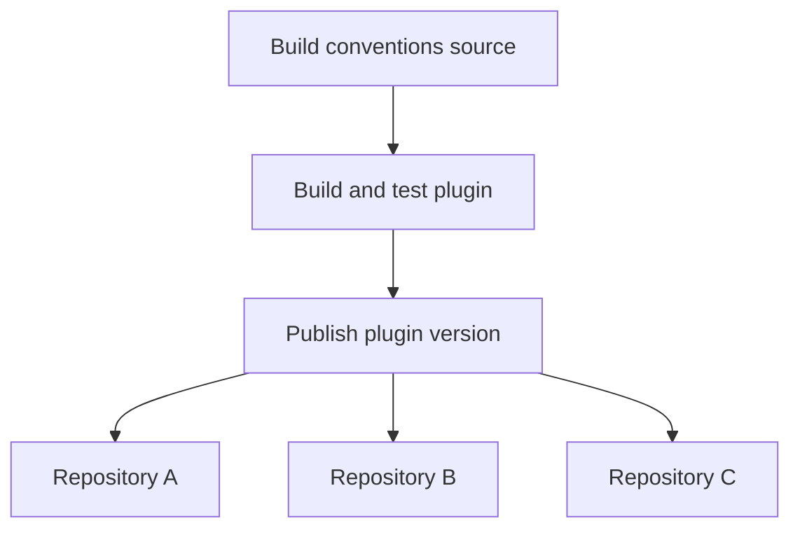

# Tái sử dụng quy ước build giữa nhiều dự án

Khi một tổ chức có nhiều dự án Java, các build thường lặp lại những quy tắc giống nhau: phiên bản Java, encoding, cách chạy test, quy tắc kiểm tra mã nguồn, cách tạo JAR, cấu hình repository và cách đặt tên artifact. Nếu mỗi dự án tự khai báo những quy tắc này, chúng dễ dần khác nhau. Một dự án dùng JDK 21, dự án khác vẫn dùng JDK cũ; một nơi bật test platform, nơi khác quên cấu hình; một nhóm sửa compiler options nhưng phải tìm và cập nhật nhiều build script.

Gradle hỗ trợ đóng gói những quy tắc chung thành **convention plugin** (plugin quy ước). Mỗi dự án áp dụng plugin phù hợp để nhận cùng một bộ cấu hình đã được quản lý tập trung. Khi cần thay đổi quy ước, nhóm cập nhật một nơi và kiểm soát cách các dự án tiếp nhận phiên bản mới.

Tái sử dụng quy ước build không có nghĩa mọi dự án phải có cấu hình giống hệt nhau. Mục tiêu là thống nhất những chính sách thực sự dùng chung, đồng thời để mỗi dự án khai báo phần đặc thù của nó một cách rõ ràng.

## 1. Vì sao cần quy ước build dùng chung?

Giả sử một tổ chức có các project `inventory-api`, `inventory-core`, `billing-service` và `notification-service`. Mỗi project đều cần Java toolchain ở cùng một phiên bản, UTF-8 cho mã nguồn, tùy chọn compiler và kiểm thử thống nhất, quy tắc kiểm tra chất lượng trước khi build, cách đóng gói artifact có thể dự đoán và các dependency/plugin dùng chung theo phiên bản đã thống nhất.

Nếu cấu hình được sao chép trực tiếp vào từng `build.gradle`, nhóm gặp một số vấn đề:

- **Trùng lặp:** cùng một đoạn cấu hình xuất hiện ở nhiều nơi.
- **Drift cấu hình:** các bản sao dần khác nhau khi dự án thay đổi theo thời gian.
- **Cập nhật tốn công:** một chính sách mới phải được sửa thủ công ở nhiều repository hoặc module.
- **Khó kiểm soát:** khó biết project nào đã áp dụng quy tắc mới và project nào vẫn dùng cấu hình cũ.
- **Khó giải thích:** build script của module chứa nhiều chi tiết hạ tầng không liên quan trực tiếp đến chức năng của module.

Ví dụ, hai project có thể vô tình dùng Java khác nhau dù cấu hình gần giống:

```groovy
// inventory-api/build.gradle
java {
    toolchain {
        languageVersion = JavaLanguageVersion.of(21)
    }
}

tasks.withType(JavaCompile).configureEach {
    options.encoding = 'UTF-8'
}
```

```groovy
// billing-service/build.gradle
java {
    toolchain {
        languageVersion = JavaLanguageVersion.of(17)
    }
}

tasks.withType(JavaCompile).configureEach {
    options.encoding = 'UTF-8'
}
```

Khi quy tắc được chuyển thành convention plugin, mỗi project chủ động áp dụng một plugin có tên và ý nghĩa rõ ràng.

## 2. Convention là gì và khác cấu hình riêng như thế nào?

**Convention** là quy ước mặc định mà nhóm thống nhất cho một loại project. Ví dụ:

- `java-library-conventions`: quy tắc cho các thư viện Java.
- `java-application-conventions`: quy tắc cho ứng dụng Java.
- `spring-service-conventions`: quy tắc chung cho các dịch vụ Spring Boot.
- `quality-conventions`: quy tắc kiểm tra chất lượng mã nguồn.
- `publishing-conventions`: cấu hình xuất bản artifact theo chính sách của tổ chức.

Một convention plugin có thể áp dụng plugin Gradle cần thiết, cấu hình toolchain, task, dependency chung và các thuộc tính mặc định. Project áp dụng nó vẫn có thể cấu hình thêm những chi tiết riêng được cho phép.

| Nội dung | Nên đặt ở đâu? | Ví dụ |
|---|---|---|
| Quy tắc áp dụng cho mọi thư viện Java | Convention plugin thư viện | Toolchain, encoding, test task |
| Quy tắc riêng của một dịch vụ | Build script của dịch vụ hoặc plugin chuyên biệt | Port, image name, task đặc thù |
| Phiên bản plugin dùng chung | Plugin management hoặc build logic có quản lý phiên bản | Spring Boot plugin version |
| Phiên bản thư viện dùng chung | Version catalog, platform hoặc dependency constraints | JUnit, Jackson |
| Chính sách của toàn build | Settings plugin hoặc settings file | Repository policy, project inclusion |
| Thiết lập máy cá nhân | User-level Gradle configuration khi thực sự cần | Cache location, local credentials |

Không phải mọi giá trị giống nhau đều cần một plugin. Version catalog phù hợp để quản lý alias và phiên bản dependency; platform hoặc dependency constraints phù hợp để quản lý tương thích dependency; convention plugin phù hợp để đóng gói hành vi và cấu hình build. Chọn đúng cơ chế giúp tránh biến một plugin thành nơi chứa mọi loại dữ liệu.

## 3. Các cách chia sẻ cấu hình trong Gradle

Gradle có nhiều cơ chế để dùng lại logic build:

| Cơ chế | Phạm vi sử dụng | Khi phù hợp |
|---|---|---|
| Copy cấu hình vào từng project | Từng project | Chỉ với cấu hình rất nhỏ, tạm thời; không phù hợp làm quy tắc lâu dài |
| Script plugin | Trong một build hoặc từ script được áp dụng | Chia sẻ đoạn cấu hình đơn giản, có phạm vi rõ |
| `buildSrc` | Một build | Build nhỏ hoặc logic build nội bộ đơn giản |
| Included build như `build-logic` | Một build, có ranh giới build riêng | Bộ convention plugin có cấu trúc, phát triển độc lập với project chính |
| Binary plugin được publish | Nhiều build/repository | Tổ chức cần chia sẻ plugin qua nhiều repository hoặc phiên bản |
| Settings plugin | Giai đoạn cấu hình settings | Quy tắc ở cấp toàn build như project/repository policy |

Với một build nhiều module, included build `build-logic` là lựa chọn phổ biến để tổ chức convention plugin. Khi nhiều repository độc lập cần dùng chung cùng một plugin, có thể phát triển plugin thành artifact và publish lên plugin repository hoặc Maven repository nội bộ.

## 4. Tổ chức convention plugin bằng included build `build-logic`

Included build là một build Gradle riêng được đưa vào build chính. Nó có settings, build script và source riêng, nhưng có thể cung cấp plugin cho build sử dụng nó.

Một cấu trúc minh họa:

```text
workspace/
├── settings.gradle.kts
├── build.gradle.kts
├── gradle/
│   └── libs.versions.toml
├── build-logic/
│   ├── settings.gradle.kts
│   ├── build.gradle.kts
│   └── src/main/kotlin/
│       ├── com.example.java-library-conventions.gradle.kts
│       └── com.example.java-application-conventions.gradle.kts
├── inventory-core/
│   └── build.gradle.kts
└── inventory-api/
    └── build.gradle.kts
```

Trong `settings.gradle.kts` của build chính, đưa build logic vào `pluginManagement`:

```kotlin
pluginManagement {
    includeBuild("build-logic")
    repositories {
        gradlePluginPortal()
        mavenCentral()
    }
}

dependencyResolutionManagement {
    repositories {
        mavenCentral()
    }
}

rootProject.name = "inventory-system"
include(":inventory-core", ":inventory-api")
```

`pluginManagement { includeBuild("build-logic") }` cho Gradle biết build logic được phát triển cùng workspace và có thể cung cấp plugin cho build chính. Plugin trong included build được nhận diện thông qua plugin ID mà nó cung cấp.

### Cấu hình build logic

Trong `build-logic/build.gradle.kts`, áp dụng plugin `kotlin-dsl` để viết precompiled script plugin bằng Kotlin DSL:

```kotlin
plugins {
    `kotlin-dsl`
}

repositories {
    gradlePluginPortal()
    mavenCentral()
}
```

`kotlin-dsl` cung cấp hỗ trợ để biên dịch và phát triển Kotlin-based Gradle plugin trong build logic. Khi convention plugin cần áp dụng plugin bên ngoài, build logic phải có dependency tới implementation của plugin đó trên classpath của nó.

Ví dụ, nếu convention plugin cần áp dụng Spring Boot Gradle Plugin và Dependency Management Plugin, có thể khai báo dependency trong build logic:

```kotlin
dependencies {
    implementation("org.springframework.boot:spring-boot-gradle-plugin:3.3.5")
    implementation("io.spring.gradle:dependency-management-plugin:1.1.6")
}
```

Các phiên bản trên chỉ là ví dụ tương thích với dòng Spring Boot 3.3.x. Dự án thực tế cần chọn phiên bản phù hợp với Java, Gradle và Spring Boot đang sử dụng, đồng thời quản lý phiên bản tập trung.

Settings của included build có thể cấu hình repository riêng cho build logic:

```kotlin
// build-logic/settings.gradle.kts
pluginManagement {
    repositories {
        gradlePluginPortal()
        mavenCentral()
    }
}

dependencyResolutionManagement {
    repositories {
        gradlePluginPortal()
        mavenCentral()
    }
}

rootProject.name = "build-logic"
```

Build logic là một build riêng nên cần quan tâm tới repository và dependency của chính nó. Cấu hình repository của root build không tự động thay thế toàn bộ cấu hình repository trong included build.

## 5. Tạo precompiled script convention plugin

Precompiled script plugin là một Gradle plugin được tạo từ một script Kotlin DSL hoặc Groovy DSL đặt trong source directory của build logic. Tên file xác định plugin ID.

Tạo file:

```text
build-logic/src/main/kotlin/com.example.java-library-conventions.gradle.kts
```

Nội dung:

```kotlin
plugins {
    `java-library`
}

group = "com.example.learning"

java {
    toolchain {
        languageVersion.set(JavaLanguageVersion.of(21))
    }
}

tasks.withType<JavaCompile>().configureEach {
    options.encoding = "UTF-8"
    options.release.set(21)
}

tasks.withType<Test>().configureEach {
    useJUnitPlatform()
}
```

Plugin ID của file này là `com.example.java-library-conventions`. Quy ước được gom vào một nơi:

- Áp dụng Java Library Plugin.
- Chọn Java toolchain 21.
- Dùng UTF-8 cho compiler.
- Đặt release target cho bytecode.
- Cấu hình các `Test` task dùng JUnit Platform.

Khi một module thư viện áp dụng convention plugin, nó nhận các quy tắc này:

```kotlin
// inventory-core/build.gradle.kts
plugins {
    id("com.example.java-library-conventions")
}

dependencies {
    // Dependency riêng của inventory-core.
}
```

Build script của module ngắn hơn và thể hiện rõ loại project. Người đọc biết `inventory-core` tuân theo chính sách Java library của tổ chức, sau đó chỉ cần xem phần cấu hình riêng của module.

### Tạo convention cho ứng dụng

Một ứng dụng có thể cần Java Application Plugin thay vì Java Library Plugin. Tạo file:

```text
build-logic/src/main/kotlin/com.example.java-application-conventions.gradle.kts
```

```kotlin
plugins {
    application
}

java {
    toolchain {
        languageVersion.set(JavaLanguageVersion.of(21))
    }
}

tasks.withType<JavaCompile>().configureEach {
    options.encoding = "UTF-8"
    options.release.set(21)
}

tasks.withType<Test>().configureEach {
    useJUnitPlatform()
}
```

Module ứng dụng áp dụng plugin tương ứng:

```kotlin
plugins {
    id("com.example.java-application-conventions")
}

application {
    mainClass.set("com.example.inventory.Application")
}
```

Convention plugin thiết lập chính sách chung; module vẫn cung cấp thông tin riêng như main class.

## 6. Chia convention plugin theo loại project và trách nhiệm

Một plugin duy nhất chứa tất cả quy tắc của mọi project thường trở nên khó hiểu. Nên chia theo loại project hoặc trách nhiệm.

```text
build-logic/src/main/kotlin/
├── com.example.java-base-conventions.gradle.kts
├── com.example.java-library-conventions.gradle.kts
├── com.example.java-application-conventions.gradle.kts
├── com.example.spring-service-conventions.gradle.kts
├── com.example.testing-conventions.gradle.kts
└── com.example.publishing-conventions.gradle.kts
```

Các plugin có thể được phân lớp:

- `java-base-conventions`: cấu hình chung thực sự áp dụng cho mọi project Java.
- `java-library-conventions`: áp dụng Java Library Plugin và chính sách thư viện.
- `java-application-conventions`: áp dụng Application Plugin và quy tắc ứng dụng.
- `spring-service-conventions`: áp dụng Spring Boot và các quy tắc dịch vụ.
- `testing-conventions`: cấu hình test framework hoặc test suites dùng chung.
- `publishing-conventions`: cấu hình publication, metadata và repository theo chính sách.

Một convention plugin có thể áp dụng convention plugin khác. Ví dụ:

```kotlin
// com.example.java-library-conventions.gradle.kts
plugins {
    id("com.example.java-base-conventions")
    `java-library`
}
```

Khi chia plugin, hãy tránh tạo quá nhiều lớp chỉ để đổi tên một cấu hình nhỏ. Plugin nên đại diện cho một chính sách hoặc loại project có ý nghĩa với người sử dụng.

## 7. Version catalog và convention plugin giải quyết hai việc khác nhau

Version catalog thường nằm trong `gradle/libs.versions.toml`. Nó quản lý alias và phiên bản dependency/plugin để build script không phải lặp lại tọa độ và version ở nhiều nơi.

Ví dụ:

```toml
[versions]
junit = "5.10.2"
jackson = "2.17.1"

[libraries]
junit-jupiter = { module = "org.junit.jupiter:junit-jupiter", version.ref = "junit" }
jackson-databind = { module = "com.fasterxml.jackson.core:jackson-databind", version.ref = "jackson" }
```

Module có thể dùng alias:

```kotlin
dependencies {
    testImplementation(libs.junit.jupiter)
    implementation(libs.jackson.databind)
}
```

Version catalog trả lời câu hỏi: **dùng dependency hoặc plugin nào, theo alias và phiên bản nào?**

Convention plugin trả lời câu hỏi: **project cần áp dụng những plugin, task và quy tắc build nào?**

Hai cơ chế bổ sung cho nhau. Ví dụ, convention plugin có thể cấu hình test framework và dependency configuration; version catalog cung cấp alias/version của thư viện test. Với included build `build-logic`, version catalog của root build không tự động xuất hiện như catalog của included build. Nếu muốn dùng chung catalog, cần import hoặc cấu hình catalog cho build logic một cách tường minh, hoặc quản lý plugin/dependency version qua một cơ chế chung khác.

Khi cần quản lý tương thích của một nhóm dependency, có thể cân nhắc Gradle platform hoặc dependency constraints. Đây cũng là trách nhiệm khác với convention plugin: platform quản lý version alignment; convention plugin thiết lập cách project sử dụng build.

## 8. Chia sẻ plugin qua nhiều repository

Included build rất phù hợp khi các module cùng nằm trong một build hoặc cùng một workspace. Nếu các dự án nằm ở nhiều repository độc lập, mỗi repository không thể đơn giản tham chiếu thư mục `build-logic` của repository khác mà không tạo phụ thuộc vào vị trí checkout.

Trong trường hợp đó, có thể đóng gói convention thành binary plugin và publish lên nơi lưu trữ nội bộ.



Các repository tiêu thụ cấu hình plugin repository trong `settings.gradle.kts`:

```kotlin
pluginManagement {
    repositories {
        maven {
            url = uri("https://repo.example.com/gradle-plugins")
        }
        gradlePluginPortal()
    }
}
```

Project sau đó khai báo plugin ID và version theo cơ chế publish của plugin:

```kotlin
plugins {
    id("com.example.java-library-conventions") version "1.4.0"
}
```

Ví dụ trên minh họa việc tiêu thụ một plugin đã được publish và có plugin marker tương ứng. Cách publish cụ thể phụ thuộc plugin setup, repository và quy trình xác thực của tổ chức.

Khi phát hành convention plugin dùng chung, nên có plugin ID ổn định và mô tả rõ phạm vi áp dụng, phiên bản có thể nhận diện và truy vết, release notes, quy trình kiểm tra tương thích với Gradle/JDK được hỗ trợ, quy tắc deprecation và cách nâng phiên bản có kiểm soát ở từng repository tiêu thụ.

Không nên âm thầm thay đổi hành vi của cùng một version plugin đã publish. Nếu cần thay đổi quy tắc, phát hành version mới để project có thể nâng cấp có chủ đích và rollback khi cần.

## 9. `buildSrc` và included build `build-logic`

`buildSrc` là một cơ chế đặc biệt của Gradle: Gradle tự nhận diện thư mục `buildSrc` ở root build và biên dịch nội dung của nó để cung cấp class/plugin cho build chính.

```text
project/
├── buildSrc/
│   ├── build.gradle.kts
│   └── src/main/kotlin/
│       └── JavaConventionsPlugin.kt
├── settings.gradle.kts
└── service-a/build.gradle.kts
```

`buildSrc` có thể phù hợp với build nhỏ, nơi chỉ có ít logic build dùng nội bộ. Khi logic phát triển lớn hơn, included build như `build-logic` tạo ranh giới rõ ràng hơn:

| Tiêu chí | `buildSrc` | Included build `build-logic` |
|---|---|---|
| Cách nhận diện | Gradle tự nhận diện thư mục đặc biệt | Khai báo `includeBuild(...)` trong settings plugin management |
| Ranh giới | Gắn chặt với root build | Là build riêng có settings và build script riêng |
| Tổ chức plugin | Có thể chứa plugin và helper | Có thể chứa nhiều plugin trong source tree riêng |
| Khả năng phát triển độc lập | Ít tách biệt hơn | Có ranh giới dependency/build rõ hơn |
| Phù hợp | Logic nội bộ nhỏ, đơn giản | Bộ convention plugin phát triển và mở rộng lâu dài |

Không cần chuyển `buildSrc` chỉ vì project có vài dòng helper. Hãy cân nhắc chuyển khi logic build có nhiều plugin, dependency riêng, cần cấu trúc hoặc kiểm soát phát triển độc lập. Cả hai cơ chế đều cần quản lý dependency và tránh phụ thuộc ngầm vào project chính.

## 10. Script plugin, precompiled script plugin và binary plugin

Ba khái niệm này thường được nhắc đến khi tổ chức build logic.

### Script plugin

Script plugin là một file script được áp dụng từ build script hoặc script khác. Nó có thể giúp gom một đoạn cấu hình đơn giản:

```groovy
apply from: "$rootDir/gradle/java-common.gradle"
```

Script plugin phù hợp với cấu hình nhỏ hoặc build cũ đang sử dụng cơ chế này. Tuy nhiên, khi cần một plugin có ID ổn định, type-safe accessors, cấu trúc kiểm thử và khả năng publish, precompiled script plugin hoặc binary plugin thường dễ quản lý hơn.

### Precompiled script plugin

Precompiled script plugin được biên dịch từ file `.gradle.kts` hoặc `.gradle` trong source set của build logic. Tên file xác định plugin ID. Đây là cách thuận tiện để viết convention plugin mà không cần tự triển khai một lớp plugin cho những cấu hình thông thường.

### Binary plugin

Binary plugin được triển khai bằng Kotlin, Groovy hoặc Java thông qua Gradle Plugin API. Nó phù hợp khi cần logic phức tạp hơn, API tùy chỉnh, task type riêng, validation hoặc kiểm thử plugin chuyên sâu.

Có thể bắt đầu với precompiled script plugin. Khi logic phát triển cần API hoặc cấu trúc nâng cao, chuyển một phần sang binary plugin là một bước tiến tự nhiên.

## 11. Tránh cấu hình chéo project quá rộng

Trong multi-project build, các khối `allprojects {}` và `subprojects {}` có thể áp dụng cấu hình lên nhiều project từ root build script. Chúng hữu ích trong một số tình huống, nhưng khi chứa nhiều logic, người đọc khó biết project nào thực sự nhận quy tắc nào.

Ví dụ cấu hình chéo project:

```groovy
subprojects {
    apply plugin: 'java'

    tasks.withType(JavaCompile).configureEach {
        options.encoding = 'UTF-8'
    }
}
```

Mọi subproject đều bị tác động khi root script cấu hình. Điều này có thể không phù hợp với project chỉ chứa tài liệu, project nền tảng hoặc module có loại plugin khác.

Convention plugin cho phép project opt-in bằng plugin ID:

```kotlin
plugins {
    id("com.example.java-library-conventions")
}
```

Từ build script, người đọc thấy ngay project chọn quy ước nào. Plugin có thể kiểm tra plugin cần thiết, cấu hình task qua API phù hợp và phát triển độc lập.

Không phải mọi khối `subprojects` đều cần xóa. Nếu quy tắc thực sự thuộc phạm vi toàn build, cấu hình ở root hoặc settings có thể hợp lý. Nhưng với quy ước theo loại project, convention plugin thường làm ý định rõ ràng hơn và tránh áp dụng nhầm lên những module không phù hợp.

## 12. Thiết kế convention plugin dễ bảo trì

Một convention plugin tốt nên có phạm vi hẹp, tên dễ hiểu và hành vi dự đoán được.

### Đặt tên theo chính sách hoặc loại project

Tên như `java-library-conventions` cho biết loại project và bộ quy tắc. Tránh tên quá chung như `common`, `default` hoặc `everything` vì người sử dụng không biết plugin sẽ thay đổi điều gì.

### Không che giấu cấu hình riêng của module

Plugin nên cung cấp mặc định chung. Module vẫn cần khai báo thông tin riêng như main class, application ID, tên image, entry point hoặc dependency riêng. Nếu convention plugin chứa nhiều điều kiện dựa trên tên module, cấu trúc thư mục hoặc biến môi trường bí mật, chính sách trở nên khó hiểu.

### Dùng API lazy configuration

Ưu tiên `tasks.register(...)`, `tasks.named(...)` và `configureEach` khi cấu hình task. Tránh eager realization không cần thiết và tránh truy cập mọi task/project sớm chỉ để sửa một thuộc tính.

Ví dụ:

```kotlin
tasks.withType<JavaCompile>().configureEach {
    options.encoding = "UTF-8"
}
```

`configureEach` áp dụng cấu hình khi task phù hợp được cấu hình, hỗ trợ configuration avoidance. Cách này phù hợp hơn việc duyệt và cấu hình ngay mọi task được tạo trong project.

### Tránh side effect trong configuration phase

Không nên tải file, gọi dịch vụ từ xa hoặc ghi output chỉ vì project áp dụng plugin. Convention plugin nên cấu hình task và provider; task action mới thực hiện công việc khi được yêu cầu.

### Khai báo input/output cho task riêng

Nếu convention plugin đăng ký custom task, task cần mô tả đầy đủ input, output và dependency. Khi đó các project sử dụng plugin có thể hưởng lợi từ incremental build, up-to-date checking và build cache nếu task đáp ứng các điều kiện liên quan.

### Để module có đường mở rộng rõ ràng

Convention plugin nên cho phép module cấu hình các thuộc tính riêng thông qua Gradle extension, task property hoặc API chuẩn của plugin được áp dụng. Tránh bắt module sửa trực tiếp các chi tiết nội bộ của plugin.

## 13. Quản lý phiên bản và nâng cấp quy ước

Khi convention plugin được dùng bởi nhiều project, thay đổi plugin có thể ảnh hưởng nhiều build. Vì vậy, cần quản lý vòng đời phiên bản như một sản phẩm nội bộ.

Một quy trình nâng cấp có thể gồm:

1. Thay đổi convention plugin trong build logic.
2. Kiểm tra plugin với các loại project đại diện.
3. Cập nhật tài liệu hoặc release notes về hành vi thay đổi.
4. Publish version mới nếu plugin được chia sẻ giữa repository.
5. Nâng version trong một số project thử nghiệm.
6. Quan sát kết quả CI và xử lý các khác biệt.
7. Mở rộng nâng cấp sang các project còn lại.

Nếu thay đổi phá vỡ cấu hình cũ, có thể giữ plugin cũ trong một khoảng thời gian, phát cảnh báo deprecation và hướng dẫn migration. Không nên sửa trực tiếp một plugin đã publish mà không đổi version vì project tiêu thụ sẽ khó tái lập build.

Với included build, plugin code được lấy từ cùng workspace và thường thay đổi cùng repository. Điều này tiện cho một multi-project build, nhưng vẫn cần kiểm soát thay đổi qua code review và CI.

## 14. Kiểm thử và quan sát convention plugin

Convention plugin cũng là code và cần được kiểm tra. Tối thiểu, nhóm nên xác nhận:

- Plugin có thể được resolve và áp dụng bằng đúng ID.
- Plugin áp dụng đúng plugin nền tảng.
- Toolchain, compiler options và test configuration có giá trị mong muốn.
- Task được đăng ký với dependency đúng.
- Các project khác loại không bị áp dụng nhầm quy tắc.
- Task custom có input/output và hành vi đúng khi dữ liệu thay đổi.
- Cấu hình có tương thích với phiên bản Gradle và JDK mà tổ chức hỗ trợ.

Có thể dùng Gradle TestKit để kiểm thử plugin bằng cách tạo một project tạm, áp dụng plugin và chạy các task cần xác minh. TestKit giúp kiểm tra hành vi plugin trong một Gradle build thật thay vì chỉ kiểm tra một hàm riêng.

Đối với convention plugin đơn giản trong included build, cũng có thể tạo các fixture project đại diện trong quy trình kiểm tra để xác nhận những loại module khác nhau áp dụng plugin đúng cách.

Khi điều tra một project, các lệnh sau có thể giúp nhận diện plugin và task:

```bash
./gradlew tasks --all
./gradlew help --info
./gradlew build --dry-run
```

`tasks --all` liệt kê task được cung cấp; `help --info` cung cấp thông tin cấu hình; `--dry-run` cho thấy task graph dự kiến. Các lệnh này hỗ trợ quan sát, nhưng kiểm tra cấu hình thực tế vẫn cần đọc plugin và build script tương ứng.

## 15. Ví dụ tổng thể: nhiều module dùng cùng quy ước

Giả sử một build có hai module: `inventory-core` là thư viện và `inventory-api` là ứng dụng. Cả hai cùng dùng Java 21, UTF-8 và JUnit Platform, nhưng mỗi module có loại plugin và dependency riêng.

```text
inventory-system/
├── settings.gradle.kts
├── build-logic/
│   ├── settings.gradle.kts
│   ├── build.gradle.kts
│   └── src/main/kotlin/
│       ├── com.example.java-base-conventions.gradle.kts
│       ├── com.example.java-library-conventions.gradle.kts
│       └── com.example.java-application-conventions.gradle.kts
├── inventory-core/
│   └── build.gradle.kts
└── inventory-api/
    └── build.gradle.kts
```

Settings của root:

```kotlin
pluginManagement {
    includeBuild("build-logic")
    repositories {
        gradlePluginPortal()
        mavenCentral()
    }
}

rootProject.name = "inventory-system"
include(":inventory-core", ":inventory-api")
```

Convention chung:

```kotlin
// com.example.java-base-conventions.gradle.kts
plugins {
    java
}

java {
    toolchain {
        languageVersion.set(JavaLanguageVersion.of(21))
    }
}

tasks.withType<JavaCompile>().configureEach {
    options.encoding = "UTF-8"
    options.release.set(21)
}

tasks.withType<Test>().configureEach {
    useJUnitPlatform()
}
```

Convention cho thư viện:

```kotlin
// com.example.java-library-conventions.gradle.kts
plugins {
    id("com.example.java-base-conventions")
    `java-library`
}
```

Convention cho ứng dụng:

```kotlin
// com.example.java-application-conventions.gradle.kts
plugins {
    id("com.example.java-base-conventions")
    application
}
```

Module thư viện:

```kotlin
// inventory-core/build.gradle.kts
plugins {
    id("com.example.java-library-conventions")
}

dependencies {
    // API và implementation dependencies riêng của thư viện.
}
```

Module ứng dụng:

```kotlin
// inventory-api/build.gradle.kts
plugins {
    id("com.example.java-application-conventions")
}

application {
    mainClass.set("com.example.inventory.api.InventoryApiApplication")
}

dependencies {
    implementation(project(":inventory-core"))
    // Dependency riêng của ứng dụng.
}
```

Kết quả là chính sách Java chung được quản lý ở `build-logic`, còn module thể hiện loại project và cấu hình riêng. Nếu nhóm cần đổi Java toolchain hoặc encoding, có thể cập nhật convention chung và kiểm tra tác động trên các module sử dụng nó.

## 16. Những nhầm lẫn thường gặp

| Nhầm lẫn | Cách hiểu chính xác |
|---|---|
| Version catalog thay thế convention plugin | Catalog quản lý alias/version; convention plugin đóng gói hành vi và quy tắc build. |
| Convention plugin là nơi chứa mọi cấu hình của mọi module | Plugin nên chứa quy tắc chung theo loại project hoặc trách nhiệm; module vẫn giữ cấu hình đặc thù. |
| `buildSrc` và included build là một | Cả hai đều chia sẻ build logic, nhưng included build có ranh giới build riêng và được khai báo tường minh. |
| Chỉ cần một file `common.gradle` là đủ cho mọi tổ chức | Script plugin có thể hữu ích, nhưng bộ quy ước lớn cần plugin ID, cấu trúc, phiên bản và kiểm thử rõ ràng. |
| Mọi project đều phải áp dụng cùng một convention plugin | Chỉ project thuộc loại phù hợp mới nên opt-in; ứng dụng, thư viện và project tài liệu có thể cần quy tắc khác nhau. |
| Sửa plugin dùng chung không ảnh hưởng module khác | Module áp dụng plugin có thể nhận thay đổi hành vi; cần kiểm tra tương thích và quản lý version. |
| Có convention plugin thì không cần build script ở module | Module vẫn cần khai báo dependency, main class và cấu hình đặc thù của nó. |
| `subprojects {}` luôn sai | Cấu hình chéo project vẫn có chỗ dùng; convention plugin thường rõ ràng hơn cho quy tắc theo loại module. |

## 17. Lộ trình đưa quy ước dùng chung vào một tổ chức

Có thể triển khai từng bước:

1. **Kiểm kê build hiện tại:** so sánh plugin, Java toolchain, compiler options, test, dependency và publishing giữa các project.
2. **Xác định phần thực sự chung:** phân biệt chính sách bắt buộc với lựa chọn riêng của từng module.
3. **Chọn cơ chế phù hợp:** version catalog cho version, platform cho dependency alignment, convention plugin cho cấu hình và task, settings plugin cho quy tắc cấp build.
4. **Tạo build logic:** bắt đầu với included build `build-logic` trong multi-project build hoặc binary plugin nếu cần chia sẻ giữa repository.
5. **Chia plugin theo loại project:** library, application, service, testing hoặc publishing.
6. **Di chuyển một module thử nghiệm:** áp dụng plugin và giữ lại phần cấu hình riêng cần thiết.
7. **Kiểm tra hành vi:** xem task graph, compiler options, test configuration và output.
8. **Mở rộng dần:** chuyển các module tương tự và ghi nhận ngoại lệ có lý do.
9. **Quản lý phiên bản:** publish version mới hoặc cập nhật build logic theo quy trình review.
10. **Duy trì tài liệu:** mô tả plugin ID, phạm vi áp dụng, quy tắc mặc định và cách mở rộng.

Đừng bắt đầu bằng việc gom mọi dòng trùng lặp vào một plugin lớn. Trước tiên hãy hiểu vì sao các project có cấu hình giống nhau và chúng có thực sự cùng loại hay không. Một quy tắc chỉ giống nhau về giá trị chưa chắc cùng thuộc một trách nhiệm.

## 18. Nguyên tắc cần ghi nhớ

Convention plugin giúp tổ chức tái sử dụng quy tắc build mà không phải sao chép cấu hình vào từng module. Trong cùng một build, included build `build-logic` là cách rõ ràng để phát triển nhiều convention plugin. Với nhiều repository độc lập, có thể publish binary plugin để từng project khai báo plugin ID và version cần dùng.

Hãy dùng version catalog cho alias và version dependency, platform hoặc constraints cho dependency alignment, convention plugin cho hành vi build và settings plugin cho quy tắc cấp toàn build. Chia plugin theo loại project hoặc trách nhiệm, giữ cấu hình riêng ở module, dùng API lazy configuration và kiểm tra plugin như một phần của build infrastructure.

Khi các quy ước được quản lý tập trung, nhóm có thể nâng chuẩn build theo từng phiên bản, theo dõi project nào đã áp dụng và giảm sự khác biệt ngoài ý muốn giữa các module. Điều đó giúp build dễ bảo trì hơn trong khi vẫn giữ được khả năng mở rộng cho từng dự án.
