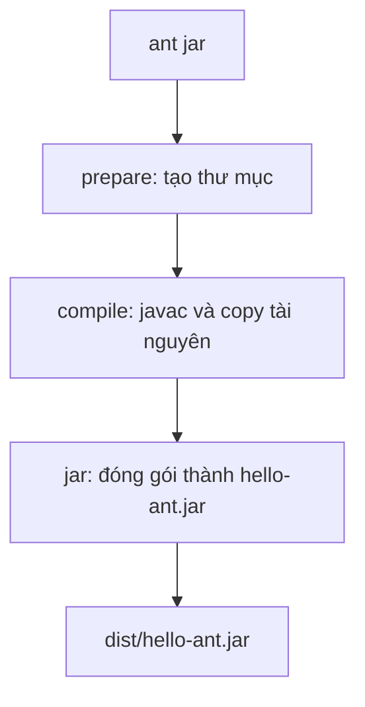

# Apache Ant là gì và bài toán tự động hóa quy trình dựng phần mềm

Khi một chương trình Java còn nhỏ, ta có thể mở IDE, bấm nút Run và gần như không cần quan tâm đến những bước phía sau. Nhưng khi dự án có nhiều lớp, thư viện ngoài, tài nguyên, kiểm thử và yêu cầu đóng gói, việc tạo ra một bản chạy được sẽ gồm nhiều thao tác liên tiếp. Nếu mỗi lần dựng phần mềm đều phải nhớ và thực hiện thủ công các lệnh đó, quy trình rất dễ sai khác giữa máy của các thành viên, giữa môi trường phát triển và máy chủ CI, hoặc giữa hai lần phát hành.

Apache Ant ra đời để giải quyết bài toán này: mô tả các bước dựng phần mềm thành một quy trình có thể chạy lại bằng lệnh, có thứ tự rõ ràng và được lưu cùng mã nguồn. Để hiểu Ant, trước hết cần hiểu chính xác quy trình dựng phần mềm đang phải giải quyết vấn đề gì.

## 1. Bài toán dựng phần mềm

### 1.1. Dựng phần mềm không chỉ là biên dịch mã nguồn

Với một ứng dụng Java thông thường, để chuyển mã nguồn thành sản phẩm có thể chạy hoặc phân phối, ta thường phải thực hiện một chuỗi công việc như:

1. Xóa kết quả cũ nếu cần, tránh để file cũ làm sai lệch kết quả mới.
2. Tạo các thư mục đầu ra cho file `.class`, tài nguyên và gói phát hành.
3. Xác định các thư viện mà mã nguồn cần sử dụng.
4. Biên dịch các file `.java` thành bytecode `.class`.
5. Sao chép tài nguyên như file cấu hình, mẫu hoặc dữ liệu tĩnh vào đúng vị trí.
6. Biên dịch và chạy kiểm thử.
7. Đóng gói các lớp và tài nguyên thành JAR, WAR hoặc một định dạng phân phối khác.
8. Có thể tiếp tục tạo tài liệu, tạo checksum, sao chép sản phẩm hoặc triển khai lên môi trường đích.

Các bước này có quan hệ với nhau. Chẳng hạn, không thể đóng gói các lớp vừa biên dịch nếu bước biên dịch chưa hoàn tất. Kiểm thử thường cần mã đã biên dịch và các thư viện kiểm thử. Việc triển khai chỉ nên diễn ra sau khi sản phẩm đã được tạo và các bước xác minh cần thiết đã thành công.

Vì vậy, **build (dựng phần mềm)** là quy trình biến mã nguồn cùng tài nguyên, thư viện và cấu hình đầu vào thành kết quả đầu ra có thể kiểm tra, chạy hoặc phân phối. Biên dịch chỉ là một công đoạn trong quy trình đó.

### 1.2. Điều gì xảy ra nếu thực hiện mọi thứ bằng tay?

Giả sử một thành viên phải tự gõ các lệnh `javac`, tự tạo thư mục, tự sao chép tài nguyên rồi gọi lệnh đóng gói JAR. Quy trình này có thể hoạt động trong lần đầu, nhưng nhanh chóng bộc lộ các vấn đề:

| Vấn đề | Hậu quả thực tế |
|---|---|
| Phải nhớ nhiều lệnh và thứ tự chạy | Dễ bỏ sót bước hoặc chạy đóng gói trước khi biên dịch xong |
| Mỗi người tự chọn đường dẫn và classpath | Máy của người này chạy được nhưng máy người khác báo thiếu thư viện |
| Các bước lặp lại mỗi lần sửa mã | Tốn thời gian và tạo thêm cơ hội thao tác nhầm |
| Không có một quy trình được lưu trong dự án | Thành viên mới khó biết phải dựng ứng dụng như thế nào |
| Máy phát triển và máy CI chạy các lệnh khác nhau | Kết quả kiểm thử và phát hành có thể không nhất quán |
| Kết quả cũ còn sót lại | Một bản build có thể vô tình chứa file được tạo từ lần chạy trước |

Ví dụ, một người có thể biên dịch bằng JDK đang được IDE cấu hình, trong khi máy CI dùng một JDK khác. Một người khác có thể quên thêm thư viện vào classpath. Khi dự án lớn dần, việc ghi nhớ và truyền đạt quy trình bằng tin nhắn hoặc tài liệu rời rạc không còn đáng tin cậy.

Vấn đề cốt lõi không phải là thiếu một lệnh biên dịch. Vấn đề là **các thao tác cần thiết chưa được mô tả thành một quy trình thống nhất, có thể thực thi và kiểm soát**.

### 1.3. Một quy trình build tự động cần có gì?

Một quy trình build hữu ích thường cần đáp ứng các yêu cầu sau:

- **Có thể lặp lại:** thành viên trong nhóm và máy CI có thể gọi cùng một quy trình thay vì tự ghép các lệnh.
- **Có thứ tự:** bước chuẩn bị chạy trước bước biên dịch; bước đóng gói chạy sau khi các đầu vào cần thiết đã sẵn sàng.
- **Có quan hệ phụ thuộc:** khi yêu cầu một kết quả cuối, hệ thống biết những công việc nào phải được thực hiện trước.
- **Có cấu hình tập trung:** đường dẫn, tên sản phẩm và các giá trị thường thay đổi được khai báo rõ ràng.
- **Có phản hồi lỗi:** khi một bước bắt buộc thất bại, quy trình phải báo lỗi để người dùng biết sản phẩm chưa được tạo thành công.
- **Có thể dùng ngoài IDE:** quy trình chạy được từ terminal và có thể được gọi trong CI/CD.

Tự động hóa không có nghĩa là mọi dự án phải có quy trình giống nhau. Mỗi dự án có thể cần các bước riêng; điều quan trọng là những bước đó được mô tả rõ và có thể chạy lại theo cách nhất quán.

## 2. Apache Ant là gì?

**Apache Ant** là một công cụ tự động hóa quá trình build, được viết bằng Java và thuộc hệ sinh thái dự án Apache. Ant cho phép nhóm phát triển mô tả các công việc cần thực hiện trong một file XML, thường có tên `build.xml`, rồi chạy các công việc đó thông qua chương trình Ant.

Thay vì phải tự nhớ hàng loạt lệnh biên dịch, sao chép và đóng gói, người phát triển có thể yêu cầu Ant chạy một mục tiêu đã được định nghĩa, ví dụ:

```bash
ant compile
ant jar
ant clean
```

Mỗi mục tiêu mô tả một phần công việc. Ant đọc file build, xác định mục tiêu được yêu cầu cùng các mục tiêu phụ thuộc, sau đó thực hiện các tác vụ theo thứ tự.

Ant là **công cụ thực thi quy trình build do dự án mô tả**. Ant không tự đoán toàn bộ cấu trúc dự án hay tự quyết định dự án cần làm những bước nào. Người viết `build.xml` chủ động khai báo các bước và mối quan hệ giữa chúng.

## 3. Những thành phần cơ bản của Ant

Một file `build.xml` thường được tổ chức từ các thành phần sau:

| Thành phần | Ý nghĩa |
|---|---|
| `project` | Phần tử gốc mô tả một dự án Ant, có thể đặt tên, thư mục gốc và mục tiêu mặc định |
| `target` | Một mục tiêu gồm một hoặc nhiều công việc có liên quan, chẳng hạn `clean`, `compile` hoặc `jar` |
| `task` | Một thao tác cụ thể bên trong target, chẳng hạn tạo thư mục, biên dịch hoặc sao chép file |
| `depends` | Khai báo target cần chạy trước target hiện tại |
| `property` | Khai báo một giá trị có tên để tái sử dụng trong file build |
| `path` và `fileset` | Mô tả classpath hoặc tập hợp file cần dùng cho một thao tác |

### 3.1. Project và target

`project` bao bọc toàn bộ cấu hình build. Thuộc tính `default` cho biết target nào sẽ được chạy khi người dùng gọi `ant` mà không chỉ rõ tên target.

```xml
<project name="hello-ant" default="jar" basedir=".">

    <target name="prepare">
        <!-- Các thao tác chuẩn bị thư mục sẽ đặt ở đây. -->
    </target>

    <target name="compile" depends="prepare">
        <!-- Các thao tác biên dịch sẽ đặt ở đây. -->
    </target>

    <target name="jar" depends="compile">
        <!-- Các thao tác đóng gói sẽ đặt ở đây. -->
    </target>

</project>
```

Trong ví dụ này, `jar` là target mặc định. Target `jar` phụ thuộc vào `compile`, còn `compile` phụ thuộc vào `prepare`. Khi chạy target `jar`, Ant thực hiện các target phụ thuộc trước rồi mới thực hiện nội dung của `jar`.

### 3.2. Task

Task là thao tác cụ thể mà Ant thực hiện. Một số task thường gặp gồm:

| Task | Công việc |
|---|---|
| `mkdir` | Tạo thư mục |
| `delete` | Xóa file hoặc thư mục |
| `javac` | Biên dịch mã nguồn Java |
| `copy` | Sao chép file |
| `jar` | Tạo file JAR |
| `java` | Chạy một lớp Java |
| `echo` | In thông báo ra đầu ra của Ant |

Task thường nằm bên trong target. Một target có thể chứa nhiều task và Ant thực hiện chúng theo thứ tự xuất hiện trong target đó.

```xml
<target name="prepare">
    <mkdir dir="build"/>
    <mkdir dir="dist"/>
    <echo message="Da chuan bi thu muc build va dist."/>
</target>
```

Khi gọi `ant prepare`, Ant lần lượt tạo hai thư mục rồi in thông báo.

### 3.3. Property

Property đặt tên cho các giá trị được dùng nhiều lần. Nhờ vậy, nếu thư mục đầu ra thay đổi, người viết build chỉ cần điều chỉnh giá trị khai báo thay vì sửa nhiều đường dẫn rải rác.

```xml
<property name="src.dir" location="src/main/java"/>
<property name="build.dir" location="build"/>
<property name="classes.dir" location="${build.dir}/classes"/>
<property name="dist.dir" location="dist"/>
```

Giá trị của property được tham chiếu bằng cú pháp `${ten-property}`. Ví dụ `${classes.dir}` là đường dẫn thư mục chứa các file `.class` sau khi biên dịch.

Property cũng có thể nhận giá trị từ dòng lệnh. Ví dụ `ant -Dbuild.dir=out jar` truyền giá trị `out` cho property `build.dir` nếu property đó chưa được thiết lập trước đó. Trong cách dùng thông thường, Ant property có tính chất chỉ thiết lập một lần; vì vậy thứ tự khai báo và truyền giá trị cần được hiểu rõ.

### 3.4. Depends và thứ tự thực hiện

Thuộc tính `depends` giúp mô tả quan hệ giữa các target. Nó tránh việc người dùng phải nhớ và gọi từng target theo đúng thứ tự.

```xml
<target name="clean">
    <delete dir="build"/>
    <delete dir="dist"/>
</target>

<target name="compile" depends="prepare">
    <!-- Biên dịch sau khi thư mục đã được chuẩn bị. -->
</target>

<target name="jar" depends="compile">
    <!-- Đóng gói sau khi biên dịch. -->
</target>
```

Nếu chạy `ant jar`, Ant đi theo chuỗi phụ thuộc `prepare` → `compile` → `jar`. Target `clean` không tự động chạy vì không được khai báo là phụ thuộc. Nếu muốn xóa kết quả cũ trước khi build, ta có thể gọi `ant clean jar` hoặc thiết kế một target khác phụ thuộc vào `clean` theo đúng nhu cầu của dự án.

Điểm cần nhớ: `depends` mô tả thứ tự phụ thuộc giữa các target; nó không tự phân tích mã Java để suy ra mọi quan hệ phụ thuộc của ứng dụng.

## 4. Ví dụ: mô tả một quy trình Java bằng Ant

Giả sử dự án có cấu trúc đơn giản:

```text
hello-ant/
├── build.xml
├── lib/
│   └── (các thư viện JAR nếu có)
├── src/
│   └── main/
│       ├── java/
│       │   └── com/example/App.java
│       └── resources/
│           └── app.properties
├── build/
└── dist/
```

Ta muốn tự động hóa ba việc chính:

1. Chuẩn bị thư mục đầu ra.
2. Biên dịch mã nguồn Java và sao chép tài nguyên.
3. Đóng gói kết quả thành một file JAR.

Một file `build.xml` minh họa có thể viết như sau:

```xml
<?xml version="1.0" encoding="UTF-8"?>
<project name="hello-ant" default="jar" basedir=".">

    <!-- Các đường dẫn được khai báo tập trung. -->
    <property name="src.dir" location="src/main/java"/>
    <property name="resources.dir" location="src/main/resources"/>
    <property name="build.dir" location="build"/>
    <property name="classes.dir" location="${build.dir}/classes"/>
    <property name="dist.dir" location="dist"/>
    <property name="jar.file" location="${dist.dir}/hello-ant.jar"/>

    <!-- Các thư viện JAR trong lib được đưa vào classpath biên dịch. -->
    <path id="compile.classpath">
        <fileset dir="lib" includes="**/*.jar" erroronmissingdir="false"/>
    </path>

    <!-- Xóa kết quả cũ. Target này chỉ chạy khi được gọi trực tiếp
         hoặc được một target khác khai báo trong depends. -->
    <target name="clean">
        <delete dir="${build.dir}"/>
        <delete dir="${dist.dir}"/>
    </target>

    <!-- Tạo các thư mục cần cho những bước tiếp theo. -->
    <target name="prepare">
        <mkdir dir="${classes.dir}"/>
        <mkdir dir="${dist.dir}"/>
    </target>

    <!-- Biên dịch Java và chép tài nguyên vào cùng thư mục đầu ra. -->
    <target name="compile" depends="prepare">
        <javac srcdir="${src.dir}"
               destdir="${classes.dir}"
               encoding="UTF-8"
               includeantruntime="false">
            <classpath refid="compile.classpath"/>
        </javac>

        <copy todir="${classes.dir}">
            <fileset dir="${resources.dir}" erroronmissingdir="false"/>
        </copy>
    </target>

    <!-- Đóng gói các lớp và tài nguyên thành JAR. -->
    <target name="jar" depends="compile">
        <jar destfile="${jar.file}" basedir="${classes.dir}"/>
    </target>

</project>
```

Đây là ví dụ minh họa cách tổ chức target và task; để chạy thành công, máy cần có môi trường Java phù hợp và dự án phải có mã nguồn hợp lệ. Nếu mã nguồn sử dụng thư viện ngoài, các file JAR tương ứng cần có trong `lib` hoặc classpath phải được cấu hình theo cách khác. Ví dụ cũng tạo một JAR chứa lớp và tài nguyên; để chạy bằng `java -jar`, dự án cần khai báo thêm `Main-Class` trong manifest và bảo đảm các thư viện runtime được cung cấp đúng cách.

### 4.1. Điều gì xảy ra khi chạy `ant jar`?

Vì `jar` là target mặc định, ta có thể chạy:

```bash
ant
```

Hoặc chỉ rõ target:

```bash
ant jar
```

Ant đọc `build.xml`, nhận thấy `jar` phụ thuộc vào `compile`, còn `compile` phụ thuộc vào `prepare`. Trình tự thực hiện là:



Người dùng chỉ cần yêu cầu kết quả cuối. Ant tự thực hiện những target đã khai báo là phụ thuộc. Nếu một task bắt buộc thất bại, build sẽ báo lỗi và dừng ở bước không thể tiếp tục theo cấu hình thông thường; khi đó không nên xem sản phẩm đầu ra là một bản build thành công.

### 4.2. Một số lệnh Ant thường dùng

Chạy các lệnh trong thư mục có `build.xml`:

```bash
# Xem phiên bản Ant
ant -version

# Liệt kê các target có mô tả
ant -p

# Chạy target mặc định của project
ant

# Chỉ chạy target compile
ant compile

# Xóa kết quả cũ
ant clean

# Chạy clean rồi tạo JAR
ant clean jar

# Dùng một file build có đường dẫn khác
ant -f path/to/build.xml jar
```

Tên target phải khớp với tên được khai báo trong file build. Khi cần truyền cấu hình, có thể dùng tham số dạng `-Dten=value`, ví dụ `ant -Dbuild.dir=out jar`.

## 5. Ant giúp tự động hóa quy trình như thế nào?

Khi quy trình được mô tả trong `build.xml` và file này được quản lý cùng mã nguồn, nhóm phát triển có một cách thực hiện build thống nhất:

- Thành viên mới có thể xem các target để biết dự án hỗ trợ những thao tác nào.
- Thành viên trong nhóm gọi cùng một lệnh thay vì tự ghi nhớ danh sách lệnh riêng.
- Máy CI có thể chạy Ant từ terminal để biên dịch, kiểm thử và tạo gói phát hành.
- Khi quy trình thay đổi, nhóm cập nhật file build và có thể xem lại thay đổi thông qua hệ thống quản lý phiên bản.
- Các giá trị dùng chung như thư mục đầu ra và classpath có thể được khai báo tập trung.

Ví dụ, một bước CI có thể gọi `ant clean jar`. Nếu dự án có target kiểm thử, pipeline có thể gọi target đó trước target đóng gói hoặc tạo một target tổng hợp có quan hệ phụ thuộc phù hợp. Nhờ vậy, quy trình trên máy lập trình và quy trình trên CI có thể dùng chung định nghĩa build.

Ant cũng có thể được mở rộng bằng task bổ sung hoặc tích hợp công cụ khác. Do đó, quy trình không bị giới hạn ở việc gọi trình biên dịch Java; nó có thể bao gồm xử lý file, tạo tài liệu, chạy chương trình, gọi lệnh bên ngoài hoặc thực hiện các bước phục vụ phát hành.

Tuy nhiên, một file build chỉ giúp quy trình rõ ràng và lặp lại khi các đầu vào cần thiết cũng được kiểm soát. Muốn kết quả ổn định, nhóm vẫn cần thống nhất phiên bản JDK, thư viện, công cụ ngoài và cấu hình môi trường. Ant không tự bảo đảm mọi máy có cùng môi trường hoặc tự làm cho mọi sản phẩm giống hệt nhau từng byte.

## 6. Ant làm gì và không tự làm gì?

Ant chịu trách nhiệm thực thi những công việc mà file build mô tả. Cần phân biệt điều đó với một số nhiệm vụ khác trong hệ sinh thái build:

| Nội dung | Vai trò của Ant |
|---|---|
| Xác định các bước build | Người phát triển định nghĩa bằng target và task trong file XML |
| Thực hiện biên dịch, sao chép, đóng gói | Ant cung cấp task tương ứng và thực thi chúng |
| Điều phối thứ tự công việc | Ant dùng quan hệ `depends` giữa các target và thứ tự task trong target |
| Quản lý classpath | Có thể khai báo bằng `path`, `fileset` và cấu hình của task |
| Tự tìm và tải mọi dependency theo tọa độ thư viện | Không phải chức năng quản lý dependency mặc định của Ant; dự án có thể kết hợp công cụ khác hoặc tự cung cấp thư viện |
| Tự suy ra quy trình chuẩn từ cấu trúc dự án | Ant không áp đặt một vòng đời build cố định; dự án tự mô tả quy trình |

Đặc điểm này khiến Ant linh hoạt với các dự án có quy trình đặc thù hoặc cấu trúc lâu đời. Đổi lại, người viết build phải chủ động mô tả nhiều chi tiết hơn và chịu trách nhiệm duy trì chúng.

## 7. Khi nào cần hiểu về Ant?

Ant vẫn hữu ích khi làm việc với dự án Java cũ, dự án có `build.xml`, quy trình build tùy chỉnh hoặc hệ thống CI đang gọi các target Ant. Ngay cả khi một dự án sử dụng công cụ build khác, việc hiểu Ant giúp người phát triển đọc được quy trình tự động hóa đã tồn tại và biết cách lần theo lỗi từ target đến task.

Một số dấu hiệu cho thấy dự án đang dùng Ant:

- Có file `build.xml` ở thư mục gốc hoặc trong một thư mục con.
- Tài liệu hướng dẫn yêu cầu chạy lệnh `ant`.
- CI gọi các lệnh như `ant clean`, `ant test` hoặc `ant deploy`.
- File XML chứa các phần tử `<project>`, `<target>` và các task như `<javac>`, `<copy>`, `<jar>`.

Khi đọc một dự án Ant, nên bắt đầu từ thuộc tính `default` của `project`, tìm target tương ứng, rồi lần theo `depends` để hiểu thứ tự các công việc. Sau đó đọc các task bên trong từng target và xác định file đầu vào, thư mục đầu ra cùng classpath mà chúng sử dụng.

## 8. Kết luận

Apache Ant giải quyết bài toán tự động hóa các thao tác dựng phần mềm bằng cách cho phép dự án mô tả quy trình trong file XML và chạy quy trình đó qua các target. Target nhóm các công việc; task thực hiện thao tác cụ thể; property giúp tái sử dụng cấu hình; còn `depends` biểu diễn thứ tự giữa các mục tiêu.

Điều quan trọng nhất khi học Ant là nhìn build như một chuỗi công việc có đầu vào, đầu ra và quan hệ phụ thuộc. Khi chuỗi đó được mô tả rõ trong `build.xml`, việc biên dịch, sao chép tài nguyên và đóng gói có thể được gọi bằng một lệnh nhất quán trên máy lập trình hoặc trong CI. Đây chính là nền tảng của tự động hóa quy trình dựng phần mềm.
