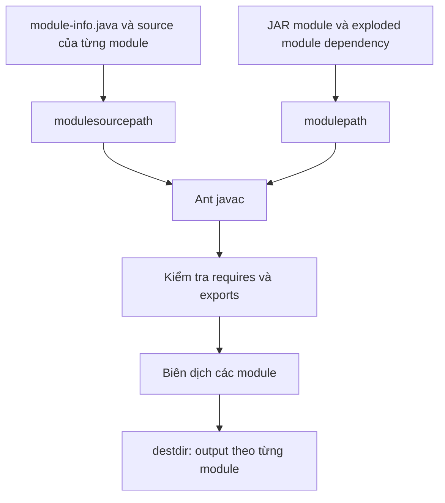

# Biên dịch Java module bằng modulepath và modulesourcepath

Từ Java 9, nền tảng Java có hệ thống module (Java Platform Module System, JPMS). Một ứng dụng có thể được chia thành các module có tên, mỗi module khai báo những package được cung cấp ra bên ngoài và những module mà nó cần sử dụng. Khi biên dịch một dự án theo cấu trúc này, compiler phải biết hai nhóm vị trí: nơi chứa các module đã được biên dịch hoặc đóng gói để làm dependency, và nơi chứa mã nguồn của các module đang được biên dịch.

Apache Ant hỗ trợ hai khái niệm đó trong task `<javac>` bằng `modulepath` và `modulesourcepath`. **`modulepath` chỉ nơi tìm các module phụ thuộc; `modulesourcepath` chỉ nơi tìm mã nguồn của nhiều module.** Hai thuộc tính có vai trò khác nhau, và cần được cấu hình đúng với cấu trúc thư mục của dự án.

## 1. Java module và module-info.java

Một module Java là một đơn vị có tên, được mô tả bằng file `module-info.java`. File này nằm ở gốc thư mục mã nguồn của module và khai báo tên module cùng những quan hệ phụ thuộc hoặc khả năng truy cập.

Ví dụ một module tên `com.acme.model`:

```text
src/
└── com.acme.model/
    ├── module-info.java
    └── com/
        └── acme/
            └── model/
                └── Person.java
```

Nội dung `module-info.java`:

```java
module com.acme.model {
    exports com.acme.model;
}
```

Khai báo trên có nghĩa:

- Tên module là `com.acme.model`.
- Package `com.acme.model` được export để module khác có thể sử dụng các kiểu public trong package đó.
- Những package khác của module, nếu có, không tự động trở thành API công khai cho module khác.

Một module khác có thể khai báo phụ thuộc:

```java
module com.acme.service {
    requires com.acme.model;
    exports com.acme.service;
}
```

`requires com.acme.model` cho biết module `com.acme.service` cần module `com.acme.model`. Compiler phải tìm được module được yêu cầu và phải thấy package cần dùng được export phù hợp.

### 1.1. Một số chỉ thị thường gặp trong module-info.java

| Chỉ thị | Ý nghĩa |
|---|---|
| `module name { ... }` | Khai báo module có tên |
| `requires other.module;` | Khai báo phụ thuộc vào module khác |
| `requires transitive other.module;` | Khai báo phụ thuộc và truyền khả năng đọc module đó tới module phụ thuộc vào module hiện tại |
| `requires static other.module;` | Khai báo dependency cần khi biên dịch nhưng có thể không bắt buộc ở runtime theo ngữ nghĩa của `static` |
| `exports package.name;` | Cho phép module khác truy cập các kiểu public trong package |
| `exports package.name to other.module;` | Chỉ export package cho các module được chỉ định |
| `opens package.name;` | Cho phép truy cập reflective sâu vào package theo quy tắc module |
| `uses service.Type;` | Khai báo module sử dụng một service |
| `provides service.Type with impl.Type;` | Khai báo implementation cung cấp cho một service |

Trong bài này, các chỉ thị quan trọng nhất khi biên dịch là `requires` và `exports`: `requires` xác định dependency module, còn `exports` xác định package nào module khác được phép sử dụng.

## 2. Phân biệt modulepath và modulesourcepath

Hai thuộc tính của Ant tương ứng với hai tùy chọn compiler của `javac`:

| Ant `<javac>` | Tùy chọn `javac` | Mục đích |
|---|---|---|
| `modulepath` | `--module-path` hoặc `-p` | Tìm các module đã có sẵn để làm dependency của lần biên dịch |
| `modulesourcepath` | `--module-source-path` | Tìm mã nguồn của các module được biên dịch cùng nhau |

Có thể hình dung:

```text
                 javac của Ant
                       |
          +------------+------------+
          |                         |
          v                         v
     modulepath               modulesourcepath
          |                         |
          v                         v
  Module đã biên dịch       Source của các module
  hoặc JAR module            đang được biên dịch
          |                         |
          +------------+------------+
                       |
                       v
               Kiểm tra requires,
               exports và biên dịch
                       |
                       v
                 destdir output
```

`modulepath` không phải nơi khai báo thư mục source của nhiều module. `modulesourcepath` cũng không phải nơi chứa các JAR dependency đã đóng gói. Nếu nhầm hai vai trò, compiler có thể báo không tìm thấy module hoặc không tìm thấy mã nguồn module.

### 2.1. Module path chứa những gì?

Module path có thể chứa:

- Modular JAR có `module-info.class`.
- Thư mục exploded module, tức thư mục chứa module đã biên dịch và file descriptor `module-info.class`.
- JAR không có descriptor module nhưng được xử lý như automatic module khi đặt trên module path.

Một JAR không có `module-info.class` có thể trở thành automatic module. Tên module tự động có thể được lấy từ thuộc tính `Automatic-Module-Name` trong manifest hoặc suy ra từ tên file JAR. Tên suy ra từ tên file có thể kém ổn định khi đổi tên archive; nếu cần dùng lâu dài như dependency module, nên kiểm tra tên module thực tế và ưu tiên metadata tên module ổn định hoặc một bản modular phù hợp.

### 2.2. Module source path chứa những gì?

Module source path chứa các thư mục mã nguồn được tổ chức theo module. Mỗi module thường có thư mục riêng, bên trong có `module-info.java` và cây thư mục package.

Ví dụ:

```text
src/
├── com.acme.model/
│   ├── module-info.java
│   └── com/acme/model/Person.java
└── com.acme.service/
    ├── module-info.java
    └── com/acme/service/PersonService.java
```

Khi dùng pattern `src/*`, dấu `*` đại diện cho tên từng module trong module source path. Đây là quy ước của `--module-source-path`, không phải wildcard để tìm bất kỳ file `.java` nào trong mọi thư mục.

## 3. Yêu cầu về JDK và phiên bản Ant

Java module thuộc JPMS, được đưa vào nền tảng từ Java 9. Vì vậy, cần dùng JDK có hỗ trợ module compilation để biên dịch mã nguồn chứa `module-info.java`.

Trong task `<javac>` của Ant, các thuộc tính sau được hỗ trợ từ Ant 1.9.7:

- `modulepath` và `modulepathref`.
- `modulesourcepath` và `modulesourcepathref`.
- Các phần tử lồng `<modulepath>` và `<modulesourcepath>`.

Nếu dùng Ant cũ hơn, các thuộc tính này có thể không được nhận diện. Hãy kiểm tra phiên bản bằng:

```bash
ant -version
java -version
javac -version
```

Nên bảo đảm `ant`, `java` và `javac` đến từ môi trường JDK phù hợp. Nếu Ant được khởi động bằng một Java runtime khác với JDK compiler dự kiến, hãy kiểm tra `JAVA_HOME`, `PATH` và cách task `<javac>` chọn compiler.

## 4. Biên dịch một module với modulepath

Nếu dự án chỉ có một module source cần biên dịch, có thể dùng `srcdir` như task javac truyền thống và khai báo `modulepath` cho các module phụ thuộc.

Giả sử cấu trúc:

```text
single-module-app/
├── build.xml
├── lib/
│   └── com.acme.logging.jar
└── src/
    └── com.acme.app/
        ├── module-info.java
        └── com/acme/app/Main.java
```

`module-info.java`:

```java
module com.acme.app {
    requires com.acme.logging;
}
```

Module `com.acme.logging` nằm trong `lib/com.acme.logging.jar`. Ta khai báo module path trong Ant:

```xml
<?xml version="1.0" encoding="UTF-8"?>
<project name="single-module-app" default="compile" basedir=".">

    <property name="src.dir" location="src/com.acme.app"/>
    <property name="lib.dir" location="lib"/>
    <property name="mods.dir" location="build/mods"/>

    <path id="application.modulepath">
        <pathelement location="${lib.dir}/com.acme.logging.jar"/>
    </path>

    <target name="compile">
        <mkdir dir="${mods.dir}/com.acme.app"/>

        <javac srcdir="${src.dir}"
               destdir="${mods.dir}/com.acme.app"
               modulepathref="application.modulepath"
               source="17"
               target="17"
               includeantruntime="false"
               encoding="UTF-8"/>
    </target>

</project>
```

Khi chạy:

```bash
ant compile
```

Ant gọi compiler với source tree của module `com.acme.app`, đưa JAR `com.acme.logging.jar` vào module path và ghi kết quả vào thư mục exploded module `build/mods/com.acme.app`. Với một module, `srcdir` là thư mục source của module; `modulepath` cung cấp các module mà `requires` tham chiếu.

Các giá trị `source` và `target` trong ví dụ là 17 để minh họa dự án dùng Java 17. Hãy chọn mức ngôn ngữ phù hợp với JDK và phiên bản Ant của dự án. Với các phiên bản Ant hỗ trợ thuộc tính `release` của javac, có thể ưu tiên `release` để biên dịch theo API của một phiên bản Java mục tiêu.

### 4.1. Khai báo modulepath trực tiếp

Với một dependency, có thể viết:

```xml
<javac srcdir="src/com.acme.app"
       destdir="build/mods/com.acme.app"
       modulepath="lib/com.acme.logging.jar"
       source="17"
       target="17"
       includeantruntime="false"/>
```

### 4.2. Khai báo modulepath bằng nested element

Nếu cần nhiều module dependency, nested `<modulepath>` dễ mở rộng hơn:

```xml
<javac srcdir="src/com.acme.app"
       destdir="build/mods/com.acme.app"
       source="17"
       target="17"
       includeantruntime="false">
    <modulepath>
        <pathelement location="lib/com.acme.logging.jar"/>
        <pathelement location="lib/com.acme.metrics.jar"/>
    </modulepath>
</javac>
```

Có thể khai báo Path riêng với `id` rồi dùng `modulepathref`, như ví dụ đầy đủ ở trên, nếu nhiều target cần cùng module path.

## 5. Biên dịch nhiều module cùng lúc bằng modulesourcepath

Khi repository có nhiều module source và muốn compiler xử lý chúng trong cùng một lượt, dùng `modulesourcepath`. Thuộc tính này cho compiler biết mẫu thư mục chứa mã nguồn của các module.

Ví dụ dự án có hai module:

```text
multi-module-app/
├── build.xml
├── lib/
│   └── com.acme.logging.jar
├── src/
│   ├── com.acme.model/
│   │   ├── module-info.java
│   │   └── com/acme/model/Person.java
│   └── com.acme.service/
│       ├── module-info.java
│       └── com/acme/service/PersonService.java
└── build/
```

Module descriptor của `com.acme.model`:

```java
module com.acme.model {
    exports com.acme.model;
}
```

Module descriptor của `com.acme.service`:

```java
module com.acme.service {
    requires com.acme.model;
    requires com.acme.logging;
    exports com.acme.service;
}
```

Ở đây `com.acme.service` cần module source `com.acme.model` và module đã đóng gói `com.acme.logging`. Cấu hình Ant:

```xml
<?xml version="1.0" encoding="UTF-8"?>
<project name="multi-module-app" default="compile-modules" basedir=".">

    <property name="src.root" location="src"/>
    <property name="mods.dir" location="build/mods"/>
    <property name="lib.dir" location="lib"/>

    <path id="external.modulepath">
        <pathelement location="${lib.dir}/com.acme.logging.jar"/>
    </path>

    <target name="compile-modules">
        <mkdir dir="${mods.dir}"/>

        <javac modulesourcepath="${src.root}/*"
               destdir="${mods.dir}"
               modulepathref="external.modulepath"
               source="17"
               target="17"
               includeantruntime="false"
               encoding="UTF-8"/>
    </target>

</project>
```

Chạy:

```bash
ant compile-modules
```

Ant chuyển `modulesourcepath` cho compiler để tìm source của các module dưới `src`. Dấu `*` được thay bằng tên module tương ứng. Compiler đọc các file `module-info.java`, phân tích `requires` và biên dịch các module nguồn trong cùng lượt. `modulepathref` cung cấp module bên ngoài `com.acme.logging`.

### 5.1. Vì sao không dùng srcdir trong ví dụ nhiều module?

`srcdir` truyền thống mô tả một cây source thông thường. Khi biên dịch nhiều module có tên, compiler cần biết ranh giới giữa các module source để đọc đúng `module-info.java` và quan hệ module. `modulesourcepath` diễn đạt cấu trúc đó.

Trong Ant, `srcdir` không bắt buộc nếu đã khai báo `modulesourcepath`. Nếu vừa dùng `srcdir` vừa dùng `modulesourcepath`, hãy xác định rõ dự án cần thêm source root nào; tránh cấu hình hai đường dẫn với giả định chúng có cùng ý nghĩa.

### 5.2. Thư mục đầu ra theo module

Với `destdir="build/mods"`, compiler tạo các thư mục đầu ra riêng cho từng module, ví dụ:

```text
build/
└── mods/
    ├── com.acme.model/
    │   ├── module-info.class
    │   └── com/acme/model/Person.class
    └── com.acme.service/
        ├── module-info.class
        └── com/acme/service/PersonService.class
```

Mỗi thư mục con là một exploded module: nó chứa `module-info.class` và các class thuộc module đó. Thư mục `build/mods` là nơi chứa các module đã biên dịch; khi một bước khác cần dùng chúng như dependency, có thể đưa thư mục này vào module path theo cấu trúc module tương ứng.

## 6. Dùng modulepathref và modulesourcepathref

Khi buildfile có nhiều target hoặc nhiều task dùng cùng module path, nên khai báo Path có `id` rồi tham chiếu lại.

Ví dụ khai báo module path:

```xml
<path id="external.modulepath">
    <pathelement location="lib/com.acme.logging.jar"/>
    <pathelement location="lib/com.acme.metrics.jar"/>
</path>
```

Tham chiếu bằng thuộc tính `modulepathref`:

```xml
<javac srcdir="src/com.acme.app"
       destdir="build/mods/com.acme.app"
       modulepathref="external.modulepath"
       source="17"
       target="17"
       includeantruntime="false"/>
```

Hoặc dùng nested element:

```xml
<javac srcdir="src/com.acme.app"
       destdir="build/mods"
       source="17"
       target="17"
       includeantruntime="false">
    <modulepath refid="external.modulepath"/>
</javac>
```

Với module source path, có thể khai báo Path riêng:

```xml
<path id="all.module.sources">
    <pathelement location="src/*"/>
</path>
```

Sau đó dùng:

```xml
<javac modulesourcepathref="all.module.sources"
       destdir="build/mods"
       source="17"
       target="17"
       includeantruntime="false"/>
```

Hoặc nested `<modulesourcepath refid="all.module.sources"/>`. Trong ví dụ, Path chứa pattern `src/*` theo quy tắc module source path; không phải một danh sách JAR.

## 7. Hiểu pattern của modulesourcepath

`modulesourcepath` là một path-like structure. Với cấu trúc module source đều đặn, có thể dùng dấu `*` làm vị trí tên module.

Ví dụ:

```xml
<javac modulesourcepath="src/*"
       destdir="build/mods"
       source="17"
       target="17"
       includeantruntime="false"/>
```

Compiler diễn giải `*` là phần tên module trong cấu trúc source. Với module `com.acme.model`, thư mục tương ứng là `src/com.acme.model`; với `com.acme.service`, thư mục tương ứng là `src/com.acme.service`.

Pattern module source path cũng có thể dùng các lựa chọn trong dấu ngoặc nhọn để biểu diễn nhiều vị trí source có cấu trúc đều đặn. Ví dụ tài liệu Ant mô tả các pattern có dạng:

```xml
<javac modulesourcepath="${src}/*/{gen,classes}"
       destdir="${build}"
       source="17"
       target="17"
       includeantruntime="false"/>
```

Ý nghĩa của pattern này phụ thuộc cấu trúc source thật của dự án. Dấu `*` là marker tên module; các lựa chọn trong `{...}` giúp mô tả những nhánh thư mục thay thế. Không nên nhầm nó với wildcard FileSet `**/*.java`.

Nếu các module không có cấu trúc đồng nhất, hãy dùng nhiều source path cụ thể hoặc tổ chức lại cây source để pattern dễ hiểu. Một `modulesourcepath` rõ ràng giúp compiler xác định đúng module source và giảm lỗi do quét nhầm thư mục.

## 8. Phân biệt modulepath với classpath

Java vẫn hỗ trợ classpath truyền thống. Khi biên dịch ứng dụng không dùng module descriptor, dependency thường được đặt trong `classpath`. Với mã nguồn thuộc named module, dependency được khai báo bằng `requires` và phải được tìm thấy theo quy tắc module path.

| Tiêu chí | `classpath` | `modulepath` |
|---|---|---|
| Đối tượng | Class và tài nguyên trên classpath; mã thường thuộc unnamed module | Named module hoặc automatic module |
| Cách khai báo dependency | Mã nguồn tham chiếu class có trên classpath | `module-info.java` khai báo `requires` |
| Kiểm soát truy cập package | Không có ranh giới module JPMS giữa các JAR trên classpath | Package phải được module export phù hợp |
| Cách cấu hình Ant | `<classpath>` hoặc `classpathref` trong task | `<modulepath>` hoặc `modulepathref` trong `<javac>` |
| Tùy chọn javac | `--class-path` hoặc `-classpath` | `--module-path` hoặc `-p` |

Một JAR thông thường có thể được đặt trên classpath và trở thành một phần của unnamed module. Nếu đặt JAR không có `module-info.class` lên module path, Java có thể coi nó là automatic module. Hai cách này có ngữ nghĩa khác nhau; không nên chuyển dependency từ classpath sang module path mà không kiểm tra tên module và khả năng truy cập package.

### 8.1. Khi nào dùng classpath, khi nào dùng modulepath?

- Dự án chưa dùng `module-info.java` và chưa chuyển sang JPMS: thường dùng classpath.
- Module khai báo `requires`: cung cấp module được yêu cầu trên module path hoặc trong tập module source đang biên dịch.
- Module phụ thuộc vào JAR chưa modular: có thể dùng automatic module trên module path hoặc giữ dependency ở classpath tùy cách thiết kế và khả năng tương thích.
- Cần biên dịch nhiều module source trong cùng lượt: dùng `modulesourcepath` cho source và `modulepath` cho dependency module đã có sẵn.

## 9. Biên dịch từng module riêng biệt

Không phải dự án nào cũng cần biên dịch tất cả module cùng lúc. Một lựa chọn khác là biên dịch module nền trước, sau đó đưa output của nó lên module path khi biên dịch module phụ thuộc.

Giả sử có hai module:

```text
src/
├── com.acme.model/
└── com.acme.service/
```

Ta có thể chia thành hai target:

```xml
<property name="src.root" location="src"/>
<property name="mods.dir" location="build/mods"/>

<target name="compile-model">
    <mkdir dir="${mods.dir}/com.acme.model"/>
    <javac srcdir="${src.root}/com.acme.model"
           destdir="${mods.dir}/com.acme.model"
           source="17"
           target="17"
           includeantruntime="false"/>
</target>

<target name="compile-service" depends="compile-model">
    <mkdir dir="${mods.dir}/com.acme.service"/>
    <javac srcdir="${src.root}/com.acme.service"
           destdir="${mods.dir}/com.acme.service"
           source="17"
           target="17"
           includeantruntime="false">
        <modulepath>
            <pathelement location="${mods.dir}"/>
        </modulepath>
    </javac>
</target>
```

Trong cách này, module `com.acme.model` được biên dịch trước. Thư mục output của nó trở thành một exploded module trên module path khi biên dịch `com.acme.service`.

Cách biên dịch từng module riêng có thể hữu ích khi các module có chu kỳ build rõ ràng hoặc cần cache output độc lập. Đổi lại, buildfile phải quản lý thứ tự target và output của từng module. Nếu muốn compiler phân tích nhiều module source trong cùng lượt, `modulesourcepath` thường diễn đạt mục tiêu trực tiếp hơn.

## 10. Lỗi thường gặp khi dùng modulepath và modulesourcepath

| Thông báo hoặc hiện tượng | Nguyên nhân có thể có | Hướng xử lý |
|---|---|---|
| `module not found: ...` | Module được `requires` không nằm trong module path hoặc tập module source | Kiểm tra `modulepath`, `modulesourcepath`, tên module và đường dẫn JAR |
| `package ... is not visible` | Package cần dùng không được module cung cấp export | Kiểm tra `exports` trong `module-info.java` của module cung cấp |
| `package ... is declared in module ..., which does not export it` | Module có package nhưng không export package cho module gọi | Thêm `exports` phù hợp hoặc dùng API công khai khác |
| Không tìm thấy `module-info.java` hoặc module source | Pattern `modulesourcepath` không khớp cấu trúc thư mục | Kiểm tra vị trí thư mục module, tên module và pattern có `*` |
| Ant báo không nhận diện thuộc tính `modulepath` | Phiên bản Ant quá cũ | Dùng Ant 1.9.7 trở lên và kiểm tra task javac đang được nạp |
| Compiler báo lỗi cú pháp module | Dùng JDK/compiler cũ hoặc mức source không hỗ trợ module | Dùng JDK 9+ và cấu hình mức source phù hợp |
| Module chạy được khi compile nhưng lỗi lúc runtime | Runtime module path khác compile module path hoặc thiếu dependency | Đồng bộ module path khi chạy và kiểm tra module descriptor |
| `FindException` hoặc lỗi đọc module | JAR/module descriptor hỏng, module path chứa archive không hợp lệ hoặc module trùng tên | Kiểm tra JAR, `module-info.class`, tên module và các phần tử trên module path |
| `ResolutionException` hoặc split package | Nhiều module chứa cùng package hoặc đồ thị module không thể giải quyết | Xác định module sở hữu package và điều chỉnh ranh giới module |

### 10.1. Lỗi module not found

Giả sử `module-info.java` có:

```java
module com.acme.service {
    requires com.acme.logging;
}
```

Nhưng Ant không đưa `com.acme.logging.jar` vào `modulepath`. Compiler sẽ không tìm thấy module được yêu cầu. Hãy kiểm tra:

1. File JAR có tồn tại ở vị trí đã khai báo không?
2. JAR có phải modular JAR hoặc automatic module hợp lệ không?
3. Tên module thực tế có đúng `com.acme.logging` không?
4. Path đã được truyền đúng vào thuộc tính `modulepath` hoặc `modulepathref` chưa?
5. Có vô tình đặt JAR chỉ trong `classpath` trong khi source dùng `requires` không?

Có thể dùng công cụ `jar` để xem module descriptor:

```bash
jar --describe-module --file lib/com.acme.logging.jar
```

Lệnh này giúp kiểm tra tên module và thông tin module mà JAR công bố. Với JAR không có descriptor tường minh, kết quả có thể cho biết module tự động được suy ra.

### 10.2. Lỗi package không được export

Nếu module dependency có package `com.acme.logging.internal` nhưng chỉ export `com.acme.logging.api`, module gọi không được phép sử dụng package nội bộ đó theo quy tắc truy cập module.

Hãy xem `module-info.java` của module cung cấp. Chỉ export package thật sự là API cần chia sẻ. Việc thêm `exports` cho package nội bộ chỉ để làm hết lỗi compile có thể làm lộ implementation detail và tạo phụ thuộc khó bảo trì.

### 10.3. Pattern module source path không khớp

Nếu cấu trúc thật là:

```text
src/modules/com.acme.model/module-info.java
src/modules/com.acme.service/module-info.java
```

thì pattern `src/*` không trỏ đến đúng vị trí. Cần dùng:

```xml
<javac modulesourcepath="src/modules/*"
       destdir="build/mods"
       source="17"
       target="17"
       includeantruntime="false"/>
```

Luôn đối chiếu pattern với vị trí thật của thư mục module, không chỉ với thư mục gốc repository.

## 11. Kiểm tra lệnh compiler mà Ant thực hiện

Khi cần biết Ant đã truyền module path và module source path ra sao, có thể tăng mức log:

```bash
ant -verbose compile-modules
ant -debug compile-modules
```

Mức log chi tiết giúp xem các file source được chọn, compiler được sử dụng và thông tin task. Tùy compiler adapter và cách Ant gọi javac, cách hiển thị lệnh có thể khác nhau.

Để đối chiếu trực tiếp với JDK, hai tùy chọn javac tương ứng là:

```text
--module-path
--module-source-path
```

Ví dụ khái niệm với source root `src` và module dependency trong `lib`:

```bash
javac --module-path lib --module-source-path 'src/*' -d build/mods \
  src/com.acme.model/module-info.java \
  src/com.acme.model/com/acme/model/Person.java \
  src/com.acme.service/module-info.java \
  src/com.acme.service/com/acme/service/PersonService.java
```

Trên Windows PowerShell, có thể viết:

```powershell
javac --module-path lib --module-source-path "src/*" -d build/mods src/com.acme.model/module-info.java src/com.acme.model/com/acme/model/Person.java src/com.acme.service/module-info.java src/com.acme.service/com/acme/service/PersonService.java
```

Khi chạy trực tiếp trong shell, cần giữ pattern module source path như một đối số để shell không tự mở rộng `*` thành danh sách thư mục. Trong Ant, truyền giá trị cho thuộc tính `modulesourcepath` giúp task quản lý path theo cơ chế của Ant.

## 12. Quy trình tổ chức build module trong Ant

Một quy trình thực tế có thể chia thành các bước:

1. Xác định cấu trúc module source và vị trí `module-info.java`.
2. Kiểm tra mỗi module khai báo `requires` và `exports` đúng.
3. Phân loại dependency thành module source đang biên dịch cùng lượt và module đã đóng gói.
4. Đưa module đã đóng gói vào `modulepath`.
5. Đưa cây source của nhiều module vào `modulesourcepath`.
6. Chọn `destdir` làm thư mục output chung; compiler tạo output riêng cho từng module.
7. Chạy target compile và đọc thông báo module resolution nếu có lỗi.
8. Dùng cùng tập module và phiên bản dependency phù hợp khi chạy hoặc đóng gói ứng dụng.

Sơ đồ tổng quát:



## 13. Nguyên tắc cấu hình dễ bảo trì

- Dùng JDK 9 trở lên cho mã nguồn JPMS và Ant 1.9.7 trở lên để dùng các thuộc tính module path trong task javac.
- Dùng `modulepath` cho module dependency đã có sẵn; dùng `modulesourcepath` cho cây source của nhiều module.
- Đặt `module-info.java` ở gốc source của từng module.
- Đặt tên thư mục module nhất quán với tên module được khai báo trong descriptor để dễ đọc và dễ tìm.
- Khai báo `requires` đúng với dependency thật; không đưa mọi JAR vào module path một cách tùy tiện.
- Export package công khai cần thiết, hạn chế export package nội bộ.
- Tái sử dụng Path qua `id`, `modulepathref` và `modulesourcepathref` khi nhiều target cần cùng cấu hình.
- Chọn `destdir` riêng cho output module để tránh trộn class của nhiều module vào một thư mục chung.
- Đồng bộ dependency và module path giữa compile, test và runtime.
- Kiểm tra tên module của automatic module trước khi dùng trong `requires`.

## 14. Kết luận

Trong Apache Ant, `modulepath` và `modulesourcepath` phục vụ hai phần khác nhau của quá trình biên dịch Java module. `modulepath` tương ứng với `--module-path`, cung cấp các module dependency đã có sẵn. `modulesourcepath` tương ứng với `--module-source-path`, giúp compiler tìm source của nhiều module theo cấu trúc thư mục có tên module.

Với một module source, có thể dùng `srcdir` kết hợp `modulepath`. Với nhiều module source cần biên dịch cùng lượt, dùng `modulesourcepath` và đặt output trong `destdir`; thêm `modulepath` khi các module đó phụ thuộc vào JAR hoặc module đã biên dịch bên ngoài. Khi cấu hình đúng ranh giới source, dependency và module descriptor, Ant có thể điều phối compiler kiểm tra quan hệ `requires`/`exports` và tạo output riêng cho từng module một cách nhất quán.

## Tài liệu tham khảo

- [Apache Ant — Javac Task](https://ant.apache.org/manual/Tasks/javac.html)
- [Oracle — The javac Command](https://docs.oracle.com/en/java/javase/26/docs/specs/man/javac.html)
- [Oracle — Java Platform Module System](https://docs.oracle.com/javase/9/docs/api/java/lang/module/package-summary.html)
