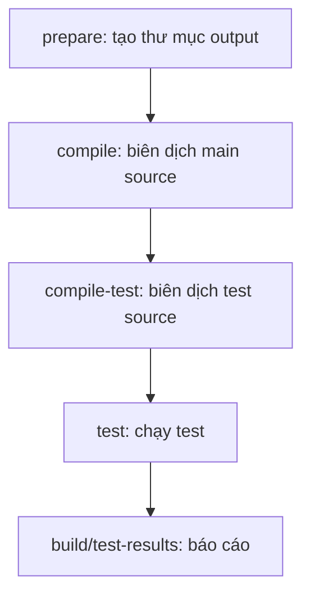

# Thiết kế target compile-test và test với đầu ra riêng

Trong một dự án Java, mã nguồn ứng dụng và mã nguồn kiểm thử phục vụ hai mục đích khác nhau. Mã ứng dụng được đóng gói để chạy hoặc phân phối; mã kiểm thử được biên dịch để xác minh hành vi của ứng dụng. Nếu đưa tất cả file `.class` vào cùng một thư mục, build sẽ khó phân biệt sản phẩm chính với mã test, classpath dễ bị cấu hình nhầm và việc đóng gói có thể vô tình chứa cả test.

Apache Ant cho phép thiết kế quy trình thành các target riêng: `compile` biên dịch mã ứng dụng, `compile-test` biên dịch mã kiểm thử vào thư mục khác, và `test` chạy các test đã biên dịch. Cấu trúc này giúp mỗi bước có đầu vào, đầu ra và dependency rõ ràng; đồng thời cho phép chạy riêng từng giai đoạn khi phát triển hoặc khi điều tra lỗi.

## 1. Vì sao cần tách đầu ra của mã ứng dụng và mã kiểm thử?

Một dự án Java thường có hai nhóm mã nguồn:

- **Main source:** mã triển khai chức năng của ứng dụng.
- **Test source:** mã kiểm thử, fixture và lớp hỗ trợ chỉ phục vụ quá trình xác minh.

Ví dụ cấu trúc thư mục phổ biến:

```text
hello-ant/
├── build.xml
├── lib/
│   ├── main/
│   │   └── json-parser.jar
│   └── test/
│       ├── junit.jar
│       └── hamcrest.jar
├── src/
│   ├── main/
│   │   └── java/
│   │       └── com/acme/Calculator.java
│   └── test/
│       └── java/
│           └── com/acme/CalculatorTest.java
└── build/
    ├── classes/
    ├── test-classes/
    └── test-results/
```

Ta quy ước ba thư mục đầu ra:

| Thư mục | Nội dung | Được dùng ở bước nào? |
|---|---|---|
| `build/classes` | Class đã biên dịch từ `src/main/java` | Chạy ứng dụng, biên dịch test, đóng gói sản phẩm |
| `build/test-classes` | Class đã biên dịch từ `src/test/java` | Chạy kiểm thử |
| `build/test-results` | Báo cáo kết quả test, chẳng hạn XML hoặc văn bản | Xem kết quả, lưu artifact CI |

Tách thư mục có những lợi ích sau:

- File test không bị lẫn với class ứng dụng.
- JAR phát hành có thể lấy riêng nội dung từ `build/classes`.
- Test classpath có thể bổ sung JUnit và các thư viện test mà runtime ứng dụng không cần.
- Có thể xóa hoặc tạo lại kết quả kiểm thử mà không phải thay đổi cấu trúc mã nguồn.
- Các target thể hiện rõ thứ tự công việc và dễ được gọi riêng trong CI.

## 2. Phân biệt compile, compile-test và test

Ba target có nhiệm vụ khác nhau:

| Target | Công việc | Đầu ra chính |
|---|---|---|
| `compile` | Biên dịch mã ứng dụng | `build/classes` |
| `compile-test` | Biên dịch mã test sau khi mã ứng dụng đã sẵn sàng | `build/test-classes` |
| `test` | Chạy các test đã biên dịch | Báo cáo trong `build/test-results` và trạng thái build |

Luồng phụ thuộc thường là:



Trong Ant, quan hệ này được thể hiện bằng `depends`:

```xml
<target name="compile" depends="prepare">
    <!-- Biên dịch mã ứng dụng. -->
</target>

<target name="compile-test" depends="compile">
    <!-- Biên dịch mã kiểm thử. -->
</target>

<target name="test" depends="compile-test">
    <!-- Chạy các test đã biên dịch. -->
</target>
```

Khi gọi `ant test`, Ant chạy các target phụ thuộc trước theo thứ tự cần thiết. Người dùng không phải tự gọi từng target bằng tay. Nếu chỉ muốn kiểm tra lỗi biên dịch của test, có thể gọi `ant compile-test`; nếu muốn chạy test, gọi `ant test`.

## 3. Chuẩn bị property và các thư mục đầu ra

Đầu tiên, khai báo các đường dẫn dùng chung ở đầu `build.xml`:

```xml
<property name="src.main.dir" location="src/main/java"/>
<property name="src.test.dir" location="src/test/java"/>

<property name="build.dir" location="build"/>
<property name="classes.dir" location="${build.dir}/classes"/>
<property name="test.classes.dir" location="${build.dir}/test-classes"/>
<property name="test.results.dir" location="${build.dir}/test-results"/>

<property name="lib.main.dir" location="lib/main"/>
<property name="lib.test.dir" location="lib/test"/>
```

Các property giúp đường dẫn được quản lý tập trung. Nếu thư mục `build` thay đổi, các thư mục đầu ra dẫn xuất sẽ thay đổi theo.

Target `prepare` tạo các thư mục cần thiết:

```xml
<target name="prepare">
    <mkdir dir="${classes.dir}"/>
    <mkdir dir="${test.classes.dir}"/>
    <mkdir dir="${test.results.dir}"/>
</target>
```

Task `mkdir` có thể tạo cả những thư mục cha chưa tồn tại. Vì vậy, không cần tạo `build` riêng trước khi tạo các thư mục con.

Target `clean` xóa toàn bộ kết quả của lượt build trước:

```xml
<target name="clean">
    <delete dir="${build.dir}"/>
</target>
```

Sau khi chạy `ant clean`, cả class ứng dụng, class test và báo cáo cũ đều bị xóa. Khi gọi target `prepare` tiếp theo, Ant tạo lại các thư mục rỗng.

## 4. Khai báo classpath riêng cho main và test

Mã ứng dụng và mã kiểm thử thường không cần cùng một tập thư viện. Mã ứng dụng cần dependency runtime/compile của ứng dụng; mã test cần thêm thư viện kiểm thử.

Ta có thể khai báo các Path sau:

```xml
<!-- Dependency cần để biên dịch mã ứng dụng. -->
<path id="main.compile.classpath">
    <fileset dir="${lib.main.dir}" includes="*.jar"/>
</path>

<!-- Dependency cần để biên dịch test: class ứng dụng và thư viện main. -->
<path id="test.compile.classpath">
    <pathelement location="${classes.dir}"/>
    <fileset dir="${lib.main.dir}" includes="*.jar"/>
    <fileset dir="${lib.test.dir}" includes="*.jar"/>
</path>

<!-- Runtime test: test classes, main classes và toàn bộ dependency cần chạy test. -->
<path id="test.runtime.classpath">
    <pathelement location="${test.classes.dir}"/>
    <pathelement location="${classes.dir}"/>
    <fileset dir="${lib.main.dir}" includes="*.jar"/>
    <fileset dir="${lib.test.dir}" includes="*.jar"/>
</path>
```

Ý nghĩa:

- `main.compile.classpath` được dùng khi biên dịch mã chính.
- `test.compile.classpath` cho phép compiler tìm class ứng dụng và các API của JUnit khi biên dịch test.
- `test.runtime.classpath` cho phép runner tìm class test, class ứng dụng và các thư viện cần thiết khi thực thi test.

Nếu dự án có nhiều dependency, nên quản lý chúng bằng Path có `id` để tránh lặp lại cấu hình. Hãy chỉ đưa thư viện test vào classpath test; không nên đưa JUnit vào classpath runtime của ứng dụng nếu ứng dụng không cần thư viện đó.

## 5. Target compile: biên dịch mã ứng dụng

Target `compile` nhận source từ `src/main/java` và ghi class vào `build/classes`:

```xml
<target name="compile" depends="prepare">
    <javac srcdir="${src.main.dir}"
           destdir="${classes.dir}"
           encoding="UTF-8"
           includeantruntime="false">
        <classpath refid="main.compile.classpath"/>
    </javac>
</target>
```

Các thuộc tính quan trọng:

- `srcdir`: thư mục chứa mã nguồn cần biên dịch.
- `destdir`: thư mục nhận file `.class`.
- `encoding`: encoding của file nguồn; ví dụ dùng UTF-8.
- `includeantruntime="false"`: không tự đưa thư viện runtime của Ant vào classpath biên dịch ứng dụng.
- Nested `<classpath>`: các dependency mà compiler cần để tìm class được tham chiếu.

Khi chạy `ant compile`, target `prepare` chạy trước để tạo output directory, sau đó `javac` biên dịch các file Java trong source tree. File `.class` được ghi vào `build/classes`, giữ cấu trúc package bên dưới thư mục này.

Ví dụ, source:

```text
src/main/java/com/acme/Calculator.java
```

sẽ tạo:

```text
build/classes/com/acme/Calculator.class
```

## 6. Target compile-test: biên dịch test vào thư mục riêng

Test source thường tham chiếu đến class ứng dụng và các API của framework test. Vì vậy, classpath biên dịch test phải có:

1. `build/classes` để tìm class của ứng dụng.
2. Các thư viện main cần thiết để phân giải dependency của ứng dụng.
3. JUnit hoặc framework kiểm thử và các thư viện phụ trợ mà test sử dụng.

Target `compile-test`:

```xml
<target name="compile-test" depends="compile">
    <javac srcdir="${src.test.dir}"
           destdir="${test.classes.dir}"
           encoding="UTF-8"
           includeantruntime="false">
        <classpath refid="test.compile.classpath"/>
    </javac>
</target>
```

Điểm quan trọng là `destdir` trỏ đến `${test.classes.dir}`, tức `build/test-classes`, không phải `build/classes`. Target phụ thuộc vào `compile`, nên mã ứng dụng được biên dịch trước khi compiler xử lý test.

Ví dụ test source:

```java
package com.acme;

import org.junit.Test;

import static org.junit.Assert.assertEquals;

public class CalculatorTest {

    @Test
    public void addsTwoNumbers() {
        Calculator calculator = new Calculator();
        assertEquals(5, calculator.add(2, 3));
    }
}
```

Sau khi `ant compile-test`, file test được tạo tại:

```text
build/test-classes/com/acme/CalculatorTest.class
```

Trong khi đó, `Calculator.class` vẫn nằm ở `build/classes/com/acme/Calculator.class`. Hai nhóm class được tách biệt nhưng test classpath có thể nhìn thấy cả hai.

### 6.1. Vì sao compile-test phải chạy sau compile?

Test thường import và khởi tạo các lớp của ứng dụng. Nếu chưa có class ứng dụng, compiler có thể báo `cannot find symbol` hoặc `package ... does not exist`.

Quan hệ:

```xml
<target name="compile-test" depends="compile">
    ...
</target>
```

đảm bảo target compile chạy trước. Không cần lặp lại task `javac` của main trong target test; chỉ cần khai báo dependency giữa các target.

## 7. Target test: chạy các test đã biên dịch

Sau khi test source được biên dịch, target `test` sử dụng runner để thực thi các lớp kiểm thử. Với Ant, một lựa chọn truyền thống là task `<junit>`.

Task này là optional task. Môi trường Ant cần có thành phần `ant-junit` tương ứng và thư viện JUnit tương thích; các JAR cần thiết cho test cũng phải có trong runtime classpath. Ví dụ dưới đây minh họa cách dùng classic Ant JUnit task với các test theo JUnit 4.

```xml
<target name="test" depends="compile-test">
    <mkdir dir="${test.results.dir}"/>

    <junit fork="true"
           printsummary="yes"
           haltonerror="true"
           haltonfailure="true">
        <classpath refid="test.runtime.classpath"/>

        <formatter type="plain"/>
        <formatter type="xml"/>

        <batchtest todir="${test.results.dir}">
            <fileset dir="${test.classes.dir}">
                <include name="**/*Test.class"/>
            </fileset>
        </batchtest>
    </junit>
</target>
```

Giải thích:

- `fork="true"`: chạy test trong JVM con, tách biệt với JVM đang chạy Ant.
- `printsummary="yes"`: in phần tổng kết test ra log.
- `haltonfailure="true"`: làm target/build thất bại khi có assertion/test failure.
- `haltonerror="true"`: làm target/build thất bại khi test phát sinh error theo cách runner phân loại.
- `<classpath>`: cung cấp class test, class ứng dụng và các thư viện cần thiết cho test runner.
- `<formatter type="plain"/>`: tạo kết quả dạng văn bản dễ đọc.
- `<formatter type="xml"/>`: tạo báo cáo XML để công cụ CI có thể đọc.
- `<batchtest>`: chạy nhiều test class được chọn từ FileSet.
- `todir`: thư mục lưu báo cáo test.
- `includes`: chỉ chọn những class có tên khớp `**/*Test.class`.

Khi gọi `ant test`, Ant thực hiện `compile`, `compile-test`, sau đó chạy test. Nếu test thất bại và `haltonfailure` được bật, lượt build kết thúc với trạng thái thất bại, giúp CI không đánh dấu nhầm job thành công.

### 7.1. Chạy một test class cụ thể

Khi điều tra lỗi, đôi khi chỉ muốn chạy một test class thay vì toàn bộ bộ test. Có thể tạo target riêng:

```xml
<target name="test-one" depends="compile-test">
    <junit fork="true" printsummary="yes" haltonerror="true" haltonfailure="true">
        <classpath refid="test.runtime.classpath"/>
        <formatter type="plain"/>

        <test name="com.acme.CalculatorTest"/>
    </junit>
</target>
```

Chạy:

```bash
ant test-one
```

Tên test phải là tên lớp đầy đủ gồm package. Target này hữu ích khi muốn lặp lại một test đang lỗi mà không phải chạy toàn bộ suite.

### 7.2. Chạy test theo pattern

Nếu tên test tuân theo quy ước, FileSet có thể chọn nhiều test class:

```xml
<batchtest todir="${test.results.dir}">
    <fileset dir="${test.classes.dir}">
        <include name="**/*Test.class"/>
        <exclude name="**/Abstract*Test.class"/>
    </fileset>
</batchtest>
```

FileSet làm việc trên thư mục class đã biên dịch, không phải thư mục source. Do đó, `dir` phải là `build/test-classes`. Nếu trỏ nhầm đến `src/test/java`, pattern `.class` sẽ không tìm thấy các test class đã biên dịch.

## 8. Buildfile hoàn chỉnh: compile, compile-test và test

Ví dụ dưới đây kết hợp các property, Path và target đã trình bày. Cấu trúc dự án giả định có thư viện ứng dụng trong `lib/main`, JUnit và các thư viện test trong `lib/test`.

```xml
<?xml version="1.0" encoding="UTF-8"?>
<project name="hello-ant-test" default="test" basedir=".">

    <!-- Source directories. -->
    <property name="src.main.dir" location="src/main/java"/>
    <property name="src.test.dir" location="src/test/java"/>

    <!-- Separate output directories. -->
    <property name="build.dir" location="build"/>
    <property name="classes.dir" location="${build.dir}/classes"/>
    <property name="test.classes.dir" location="${build.dir}/test-classes"/>
    <property name="test.results.dir" location="${build.dir}/test-results"/>

    <!-- Dependency directories. -->
    <property name="lib.main.dir" location="lib/main"/>
    <property name="lib.test.dir" location="lib/test"/>

    <!-- Compile classpath for application source. -->
    <path id="main.compile.classpath">
        <fileset dir="${lib.main.dir}" includes="*.jar"/>
    </path>

    <!-- Compile classpath for test source. -->
    <path id="test.compile.classpath">
        <pathelement location="${classes.dir}"/>
        <fileset dir="${lib.main.dir}" includes="*.jar"/>
        <fileset dir="${lib.test.dir}" includes="*.jar"/>
    </path>

    <!-- Runtime classpath for tests. -->
    <path id="test.runtime.classpath">
        <pathelement location="${test.classes.dir}"/>
        <pathelement location="${classes.dir}"/>
        <fileset dir="${lib.main.dir}" includes="*.jar"/>
        <fileset dir="${lib.test.dir}" includes="*.jar"/>
    </path>

    <target name="clean">
        <delete dir="${build.dir}"/>
    </target>

    <target name="prepare">
        <mkdir dir="${classes.dir}"/>
        <mkdir dir="${test.classes.dir}"/>
        <mkdir dir="${test.results.dir}"/>
    </target>

    <target name="compile" depends="prepare">
        <javac srcdir="${src.main.dir}"
               destdir="${classes.dir}"
               encoding="UTF-8"
               includeantruntime="false">
            <classpath refid="main.compile.classpath"/>
        </javac>
    </target>

    <target name="compile-test" depends="compile">
        <javac srcdir="${src.test.dir}"
               destdir="${test.classes.dir}"
               encoding="UTF-8"
               includeantruntime="false">
            <classpath refid="test.compile.classpath"/>
        </javac>
    </target>

    <target name="test" depends="compile-test">
        <junit fork="true"
               printsummary="yes"
               haltonerror="true"
               haltonfailure="true">
            <classpath refid="test.runtime.classpath"/>
            <formatter type="plain"/>
            <formatter type="xml"/>

            <batchtest todir="${test.results.dir}">
                <fileset dir="${test.classes.dir}">
                    <include name="**/*Test.class"/>
                </fileset>
            </batchtest>
        </junit>
    </target>

</project>
```

Với buildfile này, target mặc định là `test`. Các lệnh thường dùng:

```bash
# Xóa mọi output và báo cáo cũ
ant clean

# Chỉ biên dịch mã ứng dụng
ant compile

# Biên dịch main và test, chưa chạy test
ant compile-test

# Biên dịch và chạy toàn bộ test được chọn
ant test

# Làm sạch rồi chạy lại toàn bộ quy trình
ant clean test
```

## 9. Vì sao đầu ra riêng giúp tránh lỗi?

Nếu main và test cùng ghi vào `build/classes`, các vấn đề sau có thể xuất hiện:

- Test class có thể bị đưa nhầm vào JAR phát hành nếu task `jar` đóng gói toàn bộ thư mục.
- Thư viện JUnit có thể bị thêm vào classpath ứng dụng ngoài ý muốn.
- Một file test cũ còn sót lại có thể được runner phát hiện dù source test đã bị xóa.
- Khó xác định class đến từ mã ứng dụng hay mã test khi điều tra lỗi.
- Việc dọn output hoặc đóng gói riêng từng loại sản phẩm trở nên phức tạp.

Khi tách `build/classes` và `build/test-classes`, các target có thể dùng classpath chính xác theo mục đích. Target đóng gói chỉ cần lấy nội dung từ `build/classes`, còn target test dùng cả hai thư mục.

Ví dụ target tạo JAR chỉ chứa mã ứng dụng:

```xml
<target name="jar" depends="compile">
    <mkdir dir="dist"/>
    <jar destfile="dist/hello-ant.jar" basedir="${classes.dir}"/>
</target>
```

Task `jar` không đọc `build/test-classes`, vì vậy test code không bị đưa vào artifact ứng dụng.

## 10. Tổ chức báo cáo test riêng

Kết quả test cũng nên được tách khỏi class output. Ví dụ:

```text
build/
├── classes/
├── test-classes/
└── test-results/
    ├── TEST-com.acme.CalculatorTest.xml
    └── TEST-com.acme.UserServiceTest.xml
```

Báo cáo XML có thể được CI đọc để hiển thị số test thành công, thất bại, lỗi và thời gian chạy. Báo cáo plain hữu ích khi đọc trực tiếp log hoặc khi task được cấu hình tạo file văn bản.

Nên lưu báo cáo test làm artifact của CI ngay cả khi test thất bại, vì chúng giúp người phát triển xem test nào đã chạy và nguyên nhân thất bại. Việc lưu artifact là trách nhiệm của pipeline; target Ant chỉ tạo file báo cáo trong thư mục đã cấu hình.

### 10.1. Không xóa báo cáo trước khi CI thu thập

Target `clean` xóa toàn bộ thư mục `build`, bao gồm cả báo cáo cũ. Trong pipeline, thứ tự thường là:

1. Chạy `ant clean test` để tạo output và báo cáo mới.
2. Dù test thành công hay thất bại, pipeline thu thập `build/test-results` nếu thư mục tồn tại.
3. Chỉ sau khi đã lưu artifact, job mới có thể xóa workspace theo chính sách của CI.

Nếu script gọi `ant clean` lần nữa ngay sau test trước khi CI thu thập báo cáo, các file XML vừa tạo sẽ bị xóa.

## 11. Cấu hình JUnit và giới hạn của task junit

Task `<junit>` là một optional task của Ant. Để sử dụng, môi trường cần có phần hỗ trợ Ant JUnit và thư viện JUnit tương thích. Khi thiếu task hoặc thiếu thư viện, Ant có thể báo lỗi không tìm thấy task, runner hoặc class của JUnit.

Ví dụ trong bài dùng classic Ant JUnit task và test theo phong cách JUnit 4. Hãy bảo đảm các JAR cần thiết, ví dụ JUnit và dependency phụ trợ tương ứng, nằm trong `lib/test` hoặc được cung cấp qua classpath thích hợp.

JUnit 5 sử dụng JUnit Platform. Với dự án JUnit 5, cần tích hợp runner/launcher tương thích, chẳng hạn dùng task hoặc công cụ build hỗ trợ JUnit Platform; không nên giả định cấu hình classic `<junit>` ở trên tự động chạy mọi test Jupiter.

Nếu dự án không dùng JUnit, target `compile-test` vẫn có thể biên dịch mã test theo framework khác; target `test` cần gọi runner phù hợp với framework đó. Mô hình tách output và target dependency vẫn giữ nguyên.

## 12. Lỗi thường gặp và cách xử lý

| Hiện tượng | Nguyên nhân có thể có | Hướng xử lý |
|---|---|---|
| `compile-test` báo không tìm thấy class ứng dụng | Test classpath thiếu `build/classes` hoặc target compile chưa chạy | Kiểm tra `depends="compile"` và `test.compile.classpath` |
| Không tìm thấy `org.junit...` khi biên dịch test | JUnit không có trong test compile classpath | Thêm JUnit và dependency cần thiết vào `lib/test` hoặc Path tương ứng |
| Test chạy nhưng báo `ClassNotFoundException` | Runtime test classpath thiếu test/main class hoặc thư viện | Kiểm tra `test.runtime.classpath` |
| Test class không được tìm thấy | FileSet trỏ sai thư mục hoặc pattern không khớp | Trỏ đến `build/test-classes` và kiểm tra tên class kết thúc bằng `Test.class` |
| Test fail nhưng build vẫn thành công | `haltonfailure` chưa bật hoặc script che mã thoát của Ant | Bật `haltonfailure="true"` và bảo toàn exit code |
| Test cũ vẫn được chạy | Output test cũ còn trong `build/test-classes` | Chạy `ant clean test` hoặc xóa riêng thư mục test output trước khi biên dịch lại |
| JAR phát hành chứa test class | Task jar đóng gói cả thư mục output dùng chung | Tách output và chỉ đóng gói `build/classes` |
| `junit` task không được nhận diện | Thiếu thành phần optional Ant JUnit hoặc cấu hình task | Cài/cấu hình ant-junit và kiểm tra môi trường Ant |
| Test JUnit 5 không chạy qua cấu hình classic | Runner không hỗ trợ JUnit Platform theo cách đang cấu hình | Dùng tích hợp JUnit Platform phù hợp |
| Báo cáo XML không xuất hiện | Không có test được chọn, test task không chạy hoặc thư mục báo cáo sai | Kiểm tra FileSet, target dependency và `todir` |

### 12.1. Test compile lỗi nhưng main compile thành công

Điều này thường cho thấy lỗi nằm ở test source hoặc test compile classpath. Hãy kiểm tra:

1. `src/test/java` có đúng thư mục source không?
2. `destdir` có trỏ đến `build/test-classes` không?
3. `test.compile.classpath` có chứa `build/classes` không?
4. JUnit và các dependency test có được khai báo không?
5. Test có import package hoặc class không tồn tại không?

Không cần thêm thư viện test vào `main.compile.classpath` chỉ để làm `compile-test` chạy được. Hãy sửa đúng classpath của test.

### 12.2. Test compile thành công nhưng test runtime lỗi

Nếu test đã biên dịch nhưng runner không tìm thấy class, hãy xem `test.runtime.classpath`. Compile classpath và runtime classpath có thể khác nhau; việc compiler tìm thấy một class không tự động làm cho JVM test tìm thấy class đó khi chạy.

Đảm bảo runtime classpath chứa:

- `build/test-classes`.
- `build/classes`.
- Dependency runtime của ứng dụng.
- JUnit runner và các dependency test cần thiết.

### 12.3. Test fail nhưng CI vẫn xanh

Nếu Ant in thông báo test thất bại nhưng job CI vẫn được đánh dấu thành công, có thể target không truyền lỗi ra ngoài hoặc script đã chạy thêm một lệnh thành công và làm mất mã thoát ban đầu.

Hãy dùng `haltonfailure="true"` và bảo đảm script/CI giữ nguyên exit code của lệnh Ant. Trong Bash, tránh để `tee` che mã thoát của Ant khi dùng pipeline; trong PowerShell, đọc `$LASTEXITCODE` ngay sau chương trình native.

## 13. Một số lệnh kiểm tra hữu ích

```bash
# Xem các target có mô tả trong buildfile
ant -p

# Xóa output cũ rồi biên dịch ứng dụng
ant clean compile

# Biên dịch test nhưng chưa chạy
ant compile-test

# Chạy test với log chi tiết hơn
ant -verbose test

# Ghi log build vào file
ant -logfile build-test.log clean test
```

Khi kiểm tra một target riêng, hãy nhớ target đó có thể kéo theo dependency. Ví dụ `ant test` vẫn chạy `compile-test`, rồi `compile`, rồi `prepare` nếu các quan hệ `depends` được khai báo như trong ví dụ.

## 14. Nguyên tắc thiết kế target compile-test và test

- Dùng source directory riêng cho main và test.
- Ghi class main vào `build/classes` và class test vào `build/test-classes`.
- Lưu báo cáo vào thư mục riêng như `build/test-results`.
- Khai báo `compile-test depends="compile"` để test chỉ được biên dịch sau main.
- Khai báo `test depends="compile-test"` để runner chỉ chạy sau khi test compile thành công.
- Dùng compile classpath riêng cho main và test; test classpath bổ sung framework kiểm thử.
- Dùng runtime test classpath có cả test classes và main classes.
- Chỉ đóng gói output main vào artifact ứng dụng.
- Cấu hình runner để test thất bại làm build thất bại.
- Giữ báo cáo test để CI có thể thu thập sau khi chạy.
- Chạy clean khi cần bảo đảm không còn class hoặc báo cáo cũ.
- Chọn runner phù hợp với phiên bản framework test, đặc biệt khi dùng JUnit 5.

## 15. Kết luận

Thiết kế target `compile-test` và `test` với đầu ra riêng giúp tách rõ mã ứng dụng, mã kiểm thử và báo cáo. Target `compile` ghi class chính vào `build/classes`; `compile-test` phụ thuộc vào `compile` và ghi class test vào `build/test-classes`; `test` phụ thuộc vào `compile-test`, sử dụng runtime test classpath để chạy test và ghi báo cáo vào `build/test-results`.

Khi các target và classpath được tổ chức như vậy, người phát triển có thể biên dịch hoặc chạy test theo từng giai đoạn, tránh đóng gói nhầm test code, đồng thời cung cấp báo cáo và trạng thái thất bại rõ ràng cho CI. Đây là nền tảng để một quy trình Ant kiểm thử Java có thể lặp lại và dễ bảo trì.

## Tài liệu tham khảo

- [Apache Ant — Javac Task](https://ant.apache.org/manual/Tasks/javac.html)
- [Apache Ant — JUnit Task](https://ant.apache.org/manual/Tasks/junit.html)
- [JUnit 4 Documentation](https://junit.org/junit4/)
- [JUnit 5 User Guide](https://junit.org/junit5/docs/current/user-guide/)
