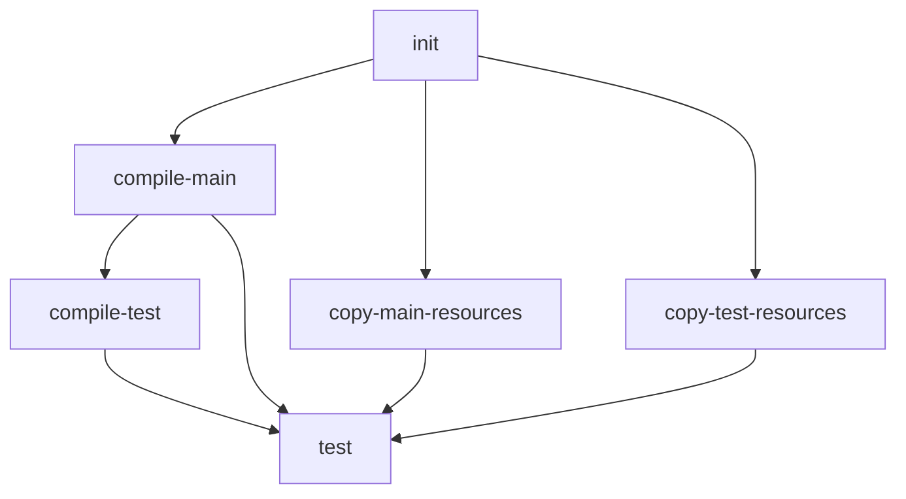

# Chạy JUnit Platform và JUnit Jupiter bằng task `junitlauncher` trong Apache Ant

JUnit 5 tổ chức việc chạy kiểm thử Java trên JUnit Platform. JUnit Platform cung cấp cơ chế khám phá và thực thi test; JUnit Jupiter cung cấp mô hình test quen thuộc với các annotation như `@Test`, `@BeforeEach`, `@ParameterizedTest` và `@DisplayName`. Apache Ant tích hợp với nền tảng này qua task `junitlauncher`.

`junitlauncher` nhận classpath kiểm thử, chọn các lớp test hoặc một lớp cụ thể, gọi JUnit Platform Launcher và có thể ghi báo cáo kết quả. Task này không biên dịch Java source và không tự copy resource; các bước đó vẫn được tổ chức bằng `javac` và `copy` trong những target riêng.

## 1. Phân biệt JUnit Platform và JUnit Jupiter

JUnit 5 không phải một JAR duy nhất. Nó gồm nhiều thành phần có trách nhiệm khác nhau:

| Thành phần | Vai trò |
|---|---|
| JUnit Platform | Nền tảng để IDE, build tool và launcher khám phá/chạy test |
| JUnit Platform Launcher | API điều phối việc khám phá và thực thi test engine |
| JUnit Jupiter API | Annotation và assertion API mà test source sử dụng |
| JUnit Jupiter Engine | Engine thực thi test được viết theo mô hình Jupiter |
| JUnit Platform Test Engine | Giao diện chung để các engine tích hợp với Platform |

Khi viết test bằng JUnit Jupiter, source cần JUnit Jupiter API lúc biên dịch; khi chạy, JUnit Platform cần launcher và Jupiter Engine để tìm và thực thi các test đó. Nếu chỉ có API mà thiếu engine, test có thể biên dịch được nhưng không có engine phù hợp để thực thi.

`junitlauncher` là task Ant kết nối với JUnit Platform. Nó khác task `junit` cũ vốn thường được dùng với JUnit 3/4. Để chạy test JUnit 4 qua JUnit Platform, dự án cần thêm JUnit Vintage Engine; bài này tập trung vào JUnit Jupiter.

## 2. Điều kiện cần có

Trước khi cấu hình buildfile, hãy kiểm tra các thành phần sau:

- Apache Ant 1.10.3 trở lên, phiên bản có task `junitlauncher`.
- JAR triển khai task `ant-junitlauncher` được Ant nạp. Trong bản phân phối Ant đầy đủ, kiểm tra thư mục `ANT_HOME/lib`; nếu dùng bản tối giản, cần bổ sung JAR task tương ứng vào Ant runtime classpath.
- JUnit Platform Launcher và JUnit Jupiter Engine trên test runtime classpath.
- JUnit Jupiter API trên compile classpath của test source.
- Các dependency bắc cầu mà phiên bản JUnit đã chọn yêu cầu.

Có thể kiểm tra phiên bản Ant bằng:

```bash
ant -version
```

Ví dụ trong bài dùng JUnit 5.10.2 cùng JUnit Platform 1.10.2. Khi chọn phiên bản khác, hãy dùng các artifact thuộc cùng dòng release tương thích. Không trộn tùy tiện Jupiter Engine của một phiên bản với Platform Launcher của một phiên bản không tương thích.

### Dùng một JAR standalone cho môi trường học tập

Cách đơn giản để thiết lập classpath là dùng `junit-platform-console-standalone`. JAR này đóng gói các thành phần cần thiết của JUnit Platform cùng Jupiter Engine và các dependency liên quan. Ví dụ đặt file:

```text
lib/test/junit-platform-console-standalone-1.10.2.jar
```

JAR standalone cũng chứa Jupiter API nên có thể dùng cho cả bước biên dịch test và runtime. Trong dự án cần quản lý dependency chi tiết, có thể dùng các artifact riêng như `junit-jupiter-api`, `junit-jupiter-engine`, `junit-platform-launcher` và các dependency bắc cầu tương ứng.

Không nhầm JAR của task Ant với JAR JUnit. `ant-junitlauncher` cung cấp task cho Ant; các JUnit JAR cung cấp launcher, API và engine để chạy test.

## 3. Viết một test Jupiter đơn giản

Giả sử ứng dụng có lớp `Calculator`:

```java
package com.example;

public class Calculator {
    public int add(int left, int right) {
        return left + right;
    }
}
```

Test Jupiter có thể viết như sau trong `src/test/java/com/example/CalculatorTest.java`:

```java
package com.example;

import org.junit.jupiter.api.Test;

import static org.junit.jupiter.api.Assertions.assertEquals;

class CalculatorTest {
    @Test
    void addsTwoNumbers() {
        Calculator calculator = new Calculator();
        assertEquals(5, calculator.add(2, 3));
    }
}
```

JUnit Jupiter cho phép lớp test và method test không cần khai báo `public` trong trường hợp thông thường. Annotation `org.junit.jupiter.api.Test` xác định test method; assertion kiểm tra kết quả mong đợi. Tên lớp kết thúc bằng `Test` để dễ chọn bằng pattern FileSet ở bước chạy.

Có thể dùng các annotation khác như `@BeforeEach` để chuẩn bị dữ liệu trước mỗi test, `@AfterEach` để dọn dữ liệu, `@Nested` để nhóm test và `@ParameterizedTest` để chạy một test với nhiều bộ dữ liệu. Những tính năng này do Jupiter Engine cung cấp, không phải do Ant tự triển khai.

## 4. Cấu hình classpath kiểm thử

Classpath phải chứa test classes, main classes, resource và các JUnit JAR cần thiết. Ví dụ:

```xml
<property name="main.classes.dir" location="build/classes/main"/>
<property name="test.classes.dir" location="build/classes/test"/>
<property name="main.resources.dir" location="build/resources/main"/>
<property name="test.resources.dir" location="build/resources/test"/>
<property name="junit.standalone.jar"
          location="lib/test/junit-platform-console-standalone-1.10.2.jar"/>

<path id="test.classpath">
    <pathelement location="${test.classes.dir}"/>
    <pathelement location="${test.resources.dir}"/>
    <pathelement location="${main.classes.dir}"/>
    <pathelement location="${main.resources.dir}"/>
    <pathelement location="${junit.standalone.jar}"/>
</path>
```

Các phần tử đầu tiên là nơi chứa class và resource của test; tiếp theo là đầu ra của ứng dụng; cuối cùng là JUnit runtime. Nếu test cần thư viện ứng dụng khác, thêm các JAR đó vào path.

Thứ tự classpath có ý nghĩa khi hai thư mục có resource cùng tên. Đặt `test.resources.dir` trước `main.resources.dir` cho phép test dùng file cấu hình test thay cho resource production cùng đường dẫn tương đối. Chỉ dùng cách ghi đè này khi có chủ đích.

Với dependency tách riêng, có thể khai báo classpath compile và runtime khác nhau. Compile classpath cần Jupiter API và dependency mà test source tham chiếu; runtime classpath cần Jupiter Engine, Platform Launcher, test classes/resources, main classes/resources và dependency ứng dụng.

## 5. Chạy một lớp test với nested element `test`

Khi muốn chạy một lớp cụ thể, dùng nested element `<test>` với tên đầy đủ của lớp Java (fully qualified class name):

```xml
<target name="test-one" depends="compile-test">
    <junitlauncher haltOnFailure="true">
        <classpath refid="test.classpath"/>
        <test name="com.example.CalculatorTest"/>
    </junitlauncher>
</target>
```

`name` phải khớp package và tên lớp đã biên dịch. Nếu lớp là `com.example.service.InventoryServiceTest`, giá trị tương ứng là `com.example.service.InventoryServiceTest`. Không truyền đường dẫn file `.java` hoặc `.class` vào thuộc tính `name`.

Nested `test` phù hợp khi cần chạy một hoặc một vài lớp cụ thể, ví dụ test nhanh cho một module hoặc điều tra lỗi của một test class.

## 6. Tự động chọn nhiều lớp bằng `testclasses`

Khi cần chạy một nhóm test, dùng nested element `<testclasses>` với FileSet trỏ đến thư mục chứa `.class` đã biên dịch:

```xml
<target name="test" depends="compile-test">
    <junitlauncher haltOnFailure="true">
        <classpath refid="test.classpath"/>
        <testclasses>
            <fileset dir="${test.classes.dir}">
                <include name="**/*Test.class"/>
                <include name="**/*Tests.class"/>
            </fileset>
        </testclasses>
    </junitlauncher>
</target>
```

FileSet chọn file class theo đường dẫn tương đối từ `test.classes.dir`. Pattern `**/*Test.class` tìm test class ở mọi package con nếu tên kết thúc bằng `Test`; pattern thứ hai bổ sung quy ước tên `Tests`. Hãy thống nhất naming convention của dự án để các test không bị bỏ sót.

`testclasses` cần thư mục output đã được biên dịch. Nếu chỉ trỏ đến `src/test/java`, task không có file `.class` để nạp. Vì vậy, target chạy test phải phụ thuộc vào target `compile-test` hoặc một target tương đương bảo đảm test classes đã tồn tại.

Không nên chọn mọi file `**/*.class` một cách thiếu chọn lọc. Thư mục test có thể chứa lớp trợ giúp, nested class hoặc fixture không phải test class. Pattern cụ thể làm phạm vi thực thi dễ dự đoán hơn.

## 7. Ghi báo cáo và log kết quả

JUnit Platform có thể gửi kết quả đến các listener. Task `junitlauncher` hỗ trợ listener `legacy-xml`, cho phép ghi báo cáo XML theo định dạng tương thích với báo cáo JUnit truyền thống. Ví dụ:

```xml
<junitlauncher haltOnFailure="true">
    <classpath refid="test.classpath"/>
    <testclasses outputdir="build/reports/junit">
        <fileset dir="${test.classes.dir}">
            <include name="**/*Test.class"/>
        </fileset>
    </testclasses>
    <listener type="legacy-xml"
              sendSysOut="true"
              sendSysErr="true"/>
</junitlauncher>
```

`outputdir` chỉ định nơi ghi báo cáo của `testclasses`. Listener `legacy-xml` ghi kết quả theo định dạng XML để các công cụ CI có thể thu thập và hiển thị. `sendSysOut` và `sendSysErr` yêu cầu đưa nội dung stdout/stderr của test vào báo cáo khi listener hỗ trợ.

Có thể thêm listener vào task chạy một lớp cụ thể hoặc nhóm test tùy cấu hình task. Hãy giữ thư mục report tách khỏi class output để task `jar` không vô tình đóng gói báo cáo kiểm thử.

## 8. Kiểm soát trạng thái thất bại của build

Trong CI, test thất bại phải làm build có trạng thái thất bại. Ví dụ đặt `haltOnFailure="true"` trên `junitlauncher` để yêu cầu task dừng khi phát hiện test failure:

```xml
<target name="test" depends="compile-test">
    <junitlauncher haltOnFailure="true">
        <classpath refid="test.classpath"/>
        <testclasses>
            <fileset dir="${test.classes.dir}"
                     includes="**/*Test.class"/>
        </testclasses>
    </junitlauncher>
</target>
```

Nếu dự án muốn chạy tiếp các target khác để thu thập báo cáo dù có test failure, hãy chọn chính sách dừng phù hợp và vẫn bảo đảm build cuối cùng được đánh dấu thất bại. Không được cấu hình để lỗi test bị bỏ qua rồi CI báo xanh.

Phân biệt test failure với lỗi hạ tầng:

- **Test failure:** assertion không đạt hoặc test được đánh dấu thất bại. Đây là kết quả kiểm thử cần làm build thất bại.
- **Test error:** test gặp exception hoặc lỗi thực thi ngoài assertion. Thường cũng phải làm build thất bại.
- **Infrastructure error:** không nạp được engine, thiếu class, sai classpath hoặc không tìm thấy test class. Đây là lỗi cấu hình/build, không phải kết quả test thành công.

Khi task không chạy được do thiếu JUnit Engine, hãy sửa classpath hoặc dependency trước; không xem việc không phát hiện test là build thành công.

## 9. Tách compile, resource copy và test execution

`junitlauncher` chỉ chạy test đã biên dịch. Một buildfile rõ ràng tách các bước thành target:

1. `compile-main`: biên dịch mã ứng dụng vào `build/classes/main`.
2. `copy-main-resources`: copy resource ứng dụng vào `build/resources/main`.
3. `compile-test`: biên dịch test source vào `build/classes/test`, dùng main classes và JUnit API trên classpath.
4. `copy-test-resources`: copy fixture và cấu hình test vào `build/resources/test`.
5. `test`: chạy JUnit Platform bằng `junitlauncher` với test runtime classpath.

Đồ thị phụ thuộc thường có dạng:



Target `test` là điểm vào độc lập: gọi `ant test` sẽ tự chạy các target cần thiết trước khi JUnit Platform thực thi test.

## 10. Ví dụ `build.xml` hoàn chỉnh

Giả sử project có cấu trúc:

```text
project/
├── build.xml
├── src/
│   ├── main/java/com/example/Calculator.java
│   ├── main/resources/config/app.properties
│   ├── test/java/com/example/CalculatorTest.java
│   └── test/resources/test-data.json
└── lib/test/
    └── junit-platform-console-standalone-1.10.2.jar
```

Buildfile:

```xml
<?xml version="1.0" encoding="UTF-8"?>
<project name="jupiter-ant-demo" default="test" basedir=".">

    <property name="src.main.java" location="src/main/java"/>
    <property name="src.main.resources" location="src/main/resources"/>
    <property name="src.test.java" location="src/test/java"/>
    <property name="src.test.resources" location="src/test/resources"/>

    <property name="build.dir" location="build"/>
    <property name="main.classes.dir" location="${build.dir}/classes/main"/>
    <property name="test.classes.dir" location="${build.dir}/classes/test"/>
    <property name="main.resources.dir" location="${build.dir}/resources/main"/>
    <property name="test.resources.dir" location="${build.dir}/resources/test"/>
    <property name="reports.dir" location="${build.dir}/reports/junit"/>
    <property name="junit.jar"
              location="lib/test/junit-platform-console-standalone-1.10.2.jar"/>

    <path id="test.compile.classpath">
        <pathelement location="${main.classes.dir}"/>
        <pathelement location="${junit.jar}"/>
    </path>

    <path id="test.runtime.classpath">
        <pathelement location="${test.classes.dir}"/>
        <pathelement location="${test.resources.dir}"/>
        <pathelement location="${main.classes.dir}"/>
        <pathelement location="${main.resources.dir}"/>
        <pathelement location="${junit.jar}"/>
    </path>

    <target name="clean">
        <delete dir="${build.dir}"/>
    </target>

    <target name="init">
        <mkdir dir="${main.classes.dir}"/>
        <mkdir dir="${test.classes.dir}"/>
        <mkdir dir="${main.resources.dir}"/>
        <mkdir dir="${test.resources.dir}"/>
        <mkdir dir="${reports.dir}"/>
    </target>

    <target name="compile-main" depends="init">
        <javac srcdir="${src.main.java}"
               destdir="${main.classes.dir}"
               encoding="UTF-8"
               includeantruntime="false"/>
    </target>

    <target name="copy-main-resources" depends="init">
        <copy todir="${main.resources.dir}">
            <fileset dir="${src.main.resources}"/>
        </copy>
    </target>

    <target name="compile-test" depends="compile-main">
        <javac srcdir="${src.test.java}"
               destdir="${test.classes.dir}"
               encoding="UTF-8"
               includeantruntime="false">
            <classpath refid="test.compile.classpath"/>
        </javac>
    </target>

    <target name="copy-test-resources" depends="init">
        <copy todir="${test.resources.dir}">
            <fileset dir="${src.test.resources}"/>
        </copy>
    </target>

    <target name="test"
            depends="compile-test,copy-main-resources,copy-test-resources">
        <junitlauncher haltOnFailure="true">
            <classpath refid="test.runtime.classpath"/>
            <testclasses outputdir="${reports.dir}">
                <fileset dir="${test.classes.dir}">
                    <include name="**/*Test.class"/>
                </fileset>
            </testclasses>
            <listener type="legacy-xml"
                      sendSysOut="true"
                      sendSysErr="true"/>
        </junitlauncher>
    </target>

</project>
```

Trong ví dụ, `junit-platform-console-standalone` cung cấp Platform Launcher, Jupiter Engine và API cần thiết. `javac` dùng JAR này để biên dịch test; `junitlauncher` dùng cùng JAR khi chạy. Test runtime classpath đặt test output trước main output để resource test có thể ưu tiên resource production cùng tên.

Chạy toàn bộ nhóm test theo pattern:

```bash
ant test
```

Chạy riêng một test class bằng target `test-one` được khai báo ở phần trước, hoặc tạo một target riêng chứa nested `<test name="..."/>`. Báo cáo XML được ghi vào `build/reports/junit`.

## 11. Chạy test theo nhóm và mở rộng engine

Khi dự án có nhiều loại test, có thể tổ chức các target riêng và chọn FileSet khác nhau:

```xml
<target name="test-unit" depends="compile-test">
    <junitlauncher haltOnFailure="true">
        <classpath refid="test.runtime.classpath"/>
        <testclasses>
            <fileset dir="${test.classes.dir}">
                <include name="**/*Test.class"/>
                <exclude name="**/*IntegrationTest.class"/>
            </fileset>
        </testclasses>
    </junitlauncher>
</target>

<target name="test-integration" depends="compile-test">
    <junitlauncher haltOnFailure="true">
        <classpath refid="test.runtime.classpath"/>
        <testclasses>
            <fileset dir="${test.classes.dir}">
                <include name="**/*IntegrationTest.class"/>
            </fileset>
        </testclasses>
    </junitlauncher>
</target>
```

FileSet quyết định lớp nào được đưa vào discovery. JUnit Platform sau đó khám phá các test method và container bên trong những lớp đó. Việc tách unit test và integration test theo naming convention giúp CI chạy nhanh các test thường xuyên và dành môi trường phù hợp cho test tích hợp.

JUnit Platform có thể chạy nhiều engine trong cùng một lần gọi. Nếu muốn chạy JUnit 4 cũ song song với Jupiter, cần thêm JUnit Vintage Engine và các dependency JUnit 4 tương ứng vào runtime classpath. Nếu chỉ dùng Jupiter, không cần thêm Vintage Engine.

## 12. Những lỗi thường gặp

| Triệu chứng | Nguyên nhân có thể | Cách xử lý |
|---|---|---|
| Ant báo không biết task `junitlauncher` | Ant quá cũ hoặc thiếu JAR triển khai task | Dùng Ant 1.10.3+ và bảo đảm ant-junitlauncher được nạp vào Ant runtime |
| Test compile được nhưng không tìm thấy engine | Có Jupiter API nhưng thiếu Jupiter Engine | Thêm Jupiter Engine và các dependency runtime phù hợp |
| Không tìm thấy `org.junit.platform.launcher` | Thiếu Platform Launcher hoặc phiên bản JUnit không tương thích | Thêm Launcher và căn chỉnh phiên bản với Jupiter release line |
| Không phát hiện test class | FileSet không khớp `.class`, sai output directory hoặc lớp chưa được biên dịch | Kiểm tra `compile-test`, `dir` và include pattern |
| Test class không nạp được | Thiếu main classes, test classes hoặc dependency trên classpath | Kiểm tra runtime classpath và thứ tự các path element |
| Test không tìm thấy file JSON/properties | Test resource chưa copy hoặc thiếu test resource directory trên classpath | Thêm target copy và đưa output resource vào classpath |
| JUnit 4 test không chạy | Chỉ có Jupiter Engine | Thêm Vintage Engine nếu cần chạy test JUnit 4 qua Platform |
| Build không thất bại khi test fail | Chính sách halt/failure chưa phù hợp | Cấu hình `haltOnFailure` và xác minh exit status của Ant/CI |
| Không có XML report | Chưa cấu hình `legacy-xml` listener hoặc `outputdir` | Thêm listener và thư mục báo cáo cho `testclasses` |
| Local chạy được nhưng CI lỗi | CI thiếu Ant task JAR hoặc dependency trong classpath | Kiểm tra Ant installation và dependency path trên CI |

Khi debug, hãy kiểm tra theo thứ tự: Ant version và task availability; JUnit JARs; test compile output; FileSet chọn test class; runtime classpath; sau đó mới đến nội dung test và report listener.

## 13. Quy tắc tổ chức buildfile

- Dùng Ant 1.10.3 trở lên và bảo đảm task `junitlauncher` được nạp.
- Giữ JUnit Jupiter API, Jupiter Engine và Platform Launcher cùng một dòng phiên bản tương thích.
- Đặt JUnit API trên compile classpath của test; đặt engine và launcher trên runtime classpath.
- Tách target biên dịch test khỏi target thực thi test.
- Dùng `<test>` cho lớp cụ thể và `<testclasses>` cho nhóm lớp được chọn bằng FileSet.
- Chọn file `.class` trong thư mục output đã biên dịch; không trỏ FileSet đến source `.java`.
- Đưa main classes, test classes, main resources và test resources vào runtime classpath đúng thứ tự.
- Dùng listener báo cáo nếu CI cần XML report; giữ report ngoài thư mục đóng gói production.
- Để test failure làm build thất bại theo chính sách CI của dự án.
- Chỉ thêm Vintage Engine khi cần chạy test JUnit 3/4 qua JUnit Platform.

## 14. Bài tập tự kiểm tra

**Bài 1.** JUnit Jupiter API và Jupiter Engine khác nhau thế nào?

**Đáp án:** API cung cấp annotation/assertion để biên dịch test source; Engine khám phá và thực thi các test Jupiter lúc chạy.

**Bài 2.** Vì sao `testclasses` phải quét thư mục `build/classes/test` thay vì `src/test/java`?

**Đáp án:** `testclasses` chọn các class đã biên dịch để JUnit Platform nạp. Source `.java` cần được biên dịch trước bằng `javac`.

**Bài 3.** Khi nào dùng `<test name="..."/>` thay cho `<testclasses>`?

**Đáp án:** Dùng `test` khi muốn chạy một lớp test cụ thể theo fully qualified class name; dùng `testclasses` khi muốn chọn một nhóm lớp bằng FileSet.

**Bài 4.** Vì sao có thể compile test thành công nhưng chạy không tìm thấy Jupiter Engine?

**Đáp án:** Compile classpath có thể chỉ chứa Jupiter API. Runtime classpath vẫn cần Jupiter Engine và JUnit Platform Launcher.

**Bài 5.** Muốn chạy JUnit 4 test qua JUnit Platform, cần bổ sung gì?

**Đáp án:** Cần JUnit Vintage Engine cùng các dependency JUnit 4 phù hợp trên runtime classpath.

## Kết luận

Task `junitlauncher` cho phép Apache Ant thực thi test thông qua JUnit Platform. Với JUnit Jupiter, test source dùng Jupiter API, còn runtime cần Jupiter Engine và Platform Launcher. Dùng nested `test` để chạy một lớp hoặc `testclasses` để chọn nhiều lớp đã biên dịch; cấu hình classpath, resource và listener báo cáo rõ ràng giúp test chạy ổn định trong local và CI. Việc tách compile, resource copy và test execution thành các target riêng giữ buildfile dễ hiểu và giúp lỗi kiểm thử được phản ánh đúng vào kết quả build.

