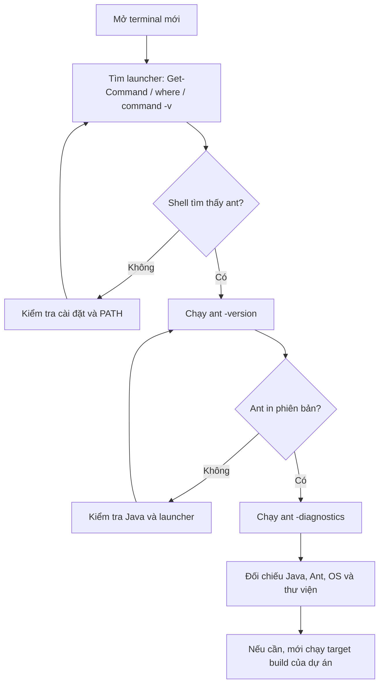

# Xác minh môi trường bằng ant -version và ant -diagnostics

Sau khi cài Apache Ant, bước tiếp theo là xác nhận terminal đang gọi đúng chương trình Ant và Ant đang chạy bằng môi trường Java dự kiến. Một máy có thể đã cài Ant nhưng lệnh `ant` vẫn không chạy vì thư mục thực thi chưa nằm trong `PATH`. Một máy khác có thể chạy được Ant nhưng lại sử dụng phiên bản Java hoặc bộ thư viện khác với cấu hình mà dự án yêu cầu.

Hai lệnh thường dùng để kiểm tra là `ant -version` và `ant -diagnostics`. Lệnh thứ nhất xác nhận Ant có thể khởi động và cho biết phiên bản đang được gọi. Lệnh thứ hai cung cấp báo cáo kỹ thuật chi tiết hơn về môi trường mà tiến trình Ant nhìn thấy. Hiểu đúng hai kết quả này giúp phân biệt lỗi cài đặt Ant, lỗi cấu hình Java và lỗi riêng của dự án.

## 1. Vì sao cần xác minh môi trường sau khi cài đặt?

Ant là chương trình chạy trên Java. Để sử dụng Ant từ terminal, máy cần tìm được launcher của Ant và có một môi trường Java tương thích để khởi động nó. Với một dự án Java, môi trường này còn ảnh hưởng đến các bước build như biên dịch mã nguồn, chạy chương trình và gọi những công cụ phụ trợ.

Một cấu hình thường có các thành phần sau:

| Thành phần | Vai trò |
|---|---|
| Apache Ant | Chương trình đọc file build và thực thi target, task được khai báo |
| `ANT_HOME` | Đường dẫn đến thư mục cài đặt Ant, thường chứa `bin/` và `lib/` |
| `PATH` | Danh sách thư mục mà hệ điều hành tìm kiếm khi người dùng gõ lệnh như `ant` hoặc `java` |
| Java runtime | JVM dùng để khởi động chính tiến trình Ant |
| `JAVA_HOME` | Thường trỏ đến thư mục gốc của bộ cài JDK được chọn cho các công cụ Java |
| Ant libraries | Các thư viện Ant và thư viện bổ sung mà tiến trình Ant nạp khi chạy |
| Build configuration | File `build.xml`, classpath, phiên bản mã nguồn và các thiết lập riêng của dự án |

Các thành phần trên liên quan với nhau nhưng không đồng nghĩa. Ví dụ, `ANT_HOME` xác định nơi cài Ant; nó không phải là thư mục cài Java. `JAVA_HOME` thường trỏ đến thư mục gốc của JDK; nó không phải thư mục `bin` bên trong JDK. `PATH` giúp shell tìm launcher, còn launcher sẽ khởi động Ant bằng Java mà nó xác định được.

Nếu chưa kiểm tra, ta có thể gặp những tình huống như:

- Ant đã cài nhưng shell báo không tìm thấy lệnh `ant`.
- Máy có nhiều bản Ant và terminal đang gọi một bản cũ hơn dự kiến.
- Ant khởi động bằng một JDK khác với JDK mà IDE đang sử dụng.
- Java chạy được nhưng không có compiler cần thiết cho target biên dịch.
- Ant nạp một bộ thư viện hoặc task bổ sung khác với cấu hình của dự án.
- Lệnh kiểm tra môi trường thành công nhưng build vẫn thất bại do lỗi trong `build.xml`, mã nguồn hoặc dependency.

Vì vậy, xác minh môi trường là bước kiểm tra khả năng khởi động và thông tin runtime trước khi phân tích sâu một lỗi build.

## 2. Kiểm tra nhanh bằng ant -version

### 2.1. Mục đích của lệnh

Chạy lệnh sau trong terminal:

```bash
ant -version
```

Tùy phiên bản Ant, kết quả có dạng tương tự:

```text
Apache Ant(TM) version 1.10.x compiled on ...
```

Đây là thông tin minh họa; số phiên bản và phần ngày biên dịch phụ thuộc bản Ant được cài. Nếu terminal in ra thông tin phiên bản, điều đó cho biết shell đã tìm thấy launcher và launcher đã khởi động đủ để Ant in thông tin phiên bản.

`-version` là tùy chọn dòng lệnh của Ant. Nó yêu cầu Ant in thông tin phiên bản rồi kết thúc. Lệnh này không yêu cầu Ant chạy target `compile`, `test`, `jar` hay target mặc định của dự án. Do đó, có thể dùng nó để kiểm tra cài đặt mà không cần đặt mình trong một dự án có `build.xml`.

### 2.2. Cách đọc kết quả

Khi đọc kết quả, hãy chú ý:

1. **Có nhận diện được Ant hay không:** nếu lệnh in thông tin phiên bản, launcher đã được tìm thấy và chạy được.
2. **Phiên bản nào đang được sử dụng:** đối chiếu số phiên bản với yêu cầu của dự án hoặc môi trường nhóm đã thống nhất.
3. **Bản cài có đúng dự kiến không:** nếu máy có nhiều bản Ant, phiên bản in ra giúp phát hiện terminal có thể đang gọi nhầm bản.

Lệnh thành công chỉ xác nhận Ant khởi động được. Nó chưa chứng minh rằng JDK có compiler phù hợp, dependency của dự án đã đầy đủ, file `build.xml` hợp lệ hay toàn bộ quy trình build chạy thành công.

### 2.3. Nếu lệnh không chạy được

Thông báo lỗi khác nhau theo hệ điều hành và shell, nhưng thường thuộc một trong các trường hợp sau:

| Hiện tượng | Ý nghĩa có thể có | Hướng kiểm tra |
|---|---|---|
| `ant` không được nhận diện hoặc không tìm thấy lệnh | Shell không tìm thấy launcher Ant | Kiểm tra Ant đã được cài chưa và thư mục `bin` của Ant đã nằm trong `PATH` chưa |
| Báo không thể tìm thấy Java hoặc không khởi động được JVM | Launcher không tìm được Java phù hợp hoặc cấu hình Java sai | Kiểm tra `JAVA_HOME`, `PATH` và lệnh `java -version` |
| Ant chạy nhưng in ra phiên bản khác dự kiến | Có thể có nhiều bản Ant trên máy hoặc thứ tự `PATH` chưa đúng | Xác định đường dẫn launcher đang được gọi |
| Lỗi liên quan đến thư viện hoặc class loading khi khởi động | Cấu hình thư viện Ant hoặc môi trường Java có thể không phù hợp | Thu thập báo cáo bằng `ant -diagnostics` nếu lệnh đã khởi động đủ để thực hiện tùy chọn này |

Nếu shell không tìm thấy lệnh `ant`, `ant -diagnostics` cũng không thể giải quyết vấn đề vì chính launcher Ant chưa được gọi. Trước hết cần xác định vị trí cài đặt và cấu hình đường dẫn thực thi.

## 3. Xác định shell đang gọi chương trình nào

Khi một máy cài nhiều phiên bản Ant, chỉ nhìn vào việc lệnh `ant` chạy được là chưa đủ. Cần biết chính xác file thực thi nào được shell chọn.

### 3.1. Windows PowerShell

Trong PowerShell, dùng:

```powershell
Get-Command ant -All
```

Lệnh này liệt kê các lệnh có tên `ant` mà PowerShell có thể phân giải, bao gồm những kết quả phù hợp trong môi trường hiện tại. Có thể kiểm tra riêng các biến môi trường:

```powershell
$env:ANT_HOME
$env:JAVA_HOME
$env:Path -split ';'
```

`ANT_HOME` và `JAVA_HOME` có thể không được thiết lập; khi đó launcher có thể được tìm thấy thông qua `PATH` và Java cũng có thể được tìm thấy qua `PATH`. Điều quan trọng là xác định cách launcher thực tế đang được gọi.

### 3.2. Windows Command Prompt

Trong Command Prompt (`cmd.exe`), dùng:

```bat
where ant
echo %ANT_HOME%
echo %JAVA_HOME%
echo %PATH%
```

`where ant` liệt kê các file có tên phù hợp được tìm thấy theo cơ chế tìm kiếm lệnh của Windows. Nếu có nhiều kết quả, hãy chú ý thứ tự và đường dẫn của từng kết quả. Kết quả đầu tiên thường là ứng viên được gọi khi nhập `ant` trong cửa sổ đó.

### 3.3. Linux và macOS

Trong shell như Bash hoặc Zsh, dùng:

```bash
command -v ant
type -a ant
printf '%s\n' "$ANT_HOME"
printf '%s\n' "$JAVA_HOME"
printf '%s\n' "$PATH" | tr ':' '\n'
```

`command -v` cho biết cách shell phân giải lệnh `ant`; `type -a` có thể cho thấy nhiều định nghĩa hoặc vị trí cùng tên. Nếu kết quả là alias, function hoặc script bọc lệnh, cần kiểm tra nó trước khi kết luận launcher nào đang chạy.

### 3.4. Vì sao cần kiểm tra đường dẫn?

Giả sử máy có hai bản cài:

```text
C:\tools\apache-ant-1.10.14\bin\ant.bat
C:\tools\apache-ant-1.10.16\bin\ant.bat
```

Nếu thư mục của bản `1.10.14` đứng trước thư mục của bản `1.10.16` trong `PATH`, shell có thể tiếp tục gọi bản cũ dù bản mới đã được cài. Cập nhật `ANT_HOME` nhưng quên cập nhật `PATH` cũng có thể tạo ra trạng thái không nhất quán.

Trên Linux hoặc macOS, tình huống tương tự có thể xảy ra khi Ant được cài từ package manager và đồng thời có một bản cài thủ công trong thư mục riêng. Lệnh `command -v ant` và `type -a ant` giúp xác định thứ tự phân giải hiện tại.

Sau khi biết launcher đang được gọi, chạy lại `ant -version` để xác nhận phiên bản của chính launcher đó.

## 4. Kiểm tra Java mà Ant có thể sử dụng

### 4.1. Kiểm tra Java từ terminal

Chạy:

```bash
java -version
```

Lệnh này hiển thị phiên bản Java mà shell tìm được khi gọi `java`. Đây là bước kiểm tra độc lập hữu ích, nhưng cần nhớ rằng launcher Ant có thể sử dụng Java theo `JAVA_HOME` hoặc một cấu hình riêng. Vì vậy, `java -version` là thông tin đối chiếu; báo cáo của chính tiến trình Ant sẽ cho biết rõ hơn môi trường Ant đang nhìn thấy.

Kiểm tra `JAVA_HOME`:

```text
JAVA_HOME = thư mục gốc của JDK
```

Ví dụ về hình dạng đường dẫn:

```text
Windows: C:\Program Files\Java\jdk-21
Linux:   /usr/lib/jvm/jdk-21
macOS:   /Library/Java/JavaVirtualMachines/jdk-21.jdk/Contents/Home
```

Đây chỉ là ví dụ về hình dạng đường dẫn. Đường dẫn thật phụ thuộc cách cài JDK trên máy. `JAVA_HOME` thường trỏ đến thư mục chứa các thư mục con như `bin`, `conf` và `lib`; không đặt nó trỏ thẳng vào `bin`.

Nếu muốn shell tìm thấy lệnh Java qua `PATH`, thư mục `bin` bên trong JDK thường cần được thêm vào `PATH`:

```text
%JAVA_HOME%\bin       (Windows)
$JAVA_HOME/bin        (Linux/macOS)
```

### 4.2. Phân biệt Java chạy Ant và Java của dự án

Một điểm dễ nhầm là phiên bản Java được dùng để chạy Ant không nhất thiết là phiên bản bytecode mà dự án muốn tạo ra.

- **Java chạy Ant:** JVM khởi động tiến trình Ant. Đây là môi trường cần xem khi đọc `ant -diagnostics`.
- **Java dùng để biên dịch:** compiler và các tùy chọn mà target `javac` sử dụng. Dự án có thể cấu hình source, target, release hoặc chọn executable/compiler riêng.
- **Java chạy ứng dụng:** JVM được dùng khi thực thi sản phẩm sau build. Nó có thể là một môi trường khác với máy build.

Ví dụ, Ant có thể chạy trên JDK mới hơn nhưng dự án được cấu hình biên dịch theo mức tương thích Java thấp hơn. Ngược lại, Ant có thể khởi động được trên một runtime nhưng target biên dịch thất bại vì không có compiler hoặc vì cấu hình compiler không phù hợp.

Do đó, đừng kết luận dự án hỗ trợ một phiên bản Java chỉ dựa trên dòng `java.version` trong báo cáo Ant. Hãy đối chiếu với cấu hình biên dịch của dự án và yêu cầu runtime thực tế.

## 5. Kiểm tra chi tiết bằng ant -diagnostics

### 5.1. Mục đích của lệnh

Sau khi `ant -version` xác nhận Ant khởi động được, chạy:

```bash
ant -diagnostics
```

Tùy chọn `-diagnostics` yêu cầu Ant in báo cáo chứa thông tin kỹ thuật có ích khi chẩn đoán hoặc báo cáo sự cố. Báo cáo có thể dài hơn nhiều so với kết quả `-version`, bởi Ant cần cung cấp thêm thông tin về phiên bản, Java runtime, hệ điều hành, đường dẫn, classpath, thư viện và các thành phần mà môi trường hiện tại nhận diện được.

Đây là tùy chọn chẩn đoán của chương trình Ant. Nó không phải tên target trong `build.xml`, cũng không phải một task mà dự án phải tự khai báo. Khi gọi tùy chọn này, mục tiêu là thu thập thông tin môi trường; Ant không thực hiện target build mặc định chỉ vì ta chạy `ant -diagnostics`.

### 5.2. Những nhóm thông tin thường gặp

Nội dung cụ thể và cách trình bày thay đổi theo phiên bản Ant, phiên bản Java và hệ điều hành. Báo cáo thường cung cấp một số nhóm thông tin sau:

| Nhóm | Thông tin cần quan tâm | Ý nghĩa khi chẩn đoán |
|---|---|---|
| Ant version | Phiên bản và thông tin build của Ant | Xác nhận tiến trình đang dùng bản Ant nào |
| Ant installation/library | Vị trí cài đặt hoặc các thư viện Ant được nạp | Phát hiện nhiều bản cài, thư viện bổ sung hoặc classpath bất thường |
| Java runtime | Phiên bản Java, Java home và thông tin JVM | Xác định Java thực sự đang chạy tiến trình Ant |
| Operating system | Tên, phiên bản hoặc kiến trúc hệ điều hành | Phát hiện khác biệt giữa máy phát triển và máy CI |
| System properties | Một số thuộc tính hệ thống mà JVM cung cấp | Kiểm tra các giá trị như thư mục làm việc, Java home và classpath |
| XML/parser support | Thông tin parser hoặc khả năng xử lý XML | Hữu ích khi điều tra lỗi đọc file build hoặc thành phần XML |
| Optional tasks/libraries | Các task hoặc thư viện bổ sung mà Ant nhận diện được | Hỗ trợ tìm nguyên nhân thiếu task hoặc thiếu thư viện tích hợp |

Không phải mọi phiên bản đều in cùng một tập trường hoặc cùng nhãn. Hãy đọc theo nhóm thông tin và đối chiếu với phiên bản đang dùng, thay vì phụ thuộc vào một dòng cố định trong báo cáo.

### 5.3. Ví dụ rút gọn về cách đọc báo cáo

Một báo cáo minh họa có thể chứa các thông tin tương tự:

```text
------- Ant diagnostics report -------
Apache Ant(TM) version 1.10.x

Java version:       21.x
Java home:          C:\Program Files\Java\jdk-21
OS name:            Windows 11
OS architecture:    amd64

Ant installation:   C:\tools\apache-ant
Ant libraries:      ...
XML parser:         ...
System properties:  ...
--------------------------------------
```

Đây là ví dụ rút gọn để minh họa các loại thông tin có thể xuất hiện, không phải định dạng đầu ra cố định. Khi đọc báo cáo thực tế, hãy lần lượt xác định:

1. Ant version có đúng bản mong đợi không?
2. Java version và Java home có trỏ đến JDK dự kiến không?
3. OS name và architecture có phù hợp với môi trường chạy không?
4. Ant installation và các thư viện được nạp có thuộc đúng bản cài không?
5. Có thông tin nào cho thấy classpath, parser hoặc task bổ sung bị thiếu hay trùng lặp không?

Nếu Ant được gọi từ terminal nhưng IDE có cấu hình Ant riêng, hãy so sánh thông tin tương ứng giữa hai môi trường. Chúng có thể khác nhau dù cùng mở một thư mục dự án.

### 5.4. Lưu báo cáo để chia sẻ khi cần

Khi cần gửi thông tin cho người hỗ trợ hoặc đính kèm vào báo cáo lỗi, có thể chuyển đầu ra vào file:

```bash
ant -diagnostics > ant-diagnostics.txt 2>&1
```

Lệnh này lưu cả đầu ra thông thường và thông báo lỗi vào `ant-diagnostics.txt` trong thư mục làm việc hiện tại trên các shell phổ biến như Bash, PowerShell và Command Prompt. Nếu muốn lưu ở vị trí khác, thay tên file bằng đường dẫn phù hợp với shell đang dùng.

Trước khi chia sẻ báo cáo, hãy đọc nội dung và che thông tin nhạy cảm nếu xuất hiện. Báo cáo chẩn đoán có thể chứa tên người dùng hệ điều hành, đường dẫn thư mục cá nhân, classpath, tham số JVM hoặc các thuộc tính hệ thống. Những thông tin này có thể tiết lộ cấu trúc máy hoặc cấu hình nội bộ. Không gửi nguyên văn một báo cáo công khai nếu chưa kiểm tra nội dung.

## 6. Đọc hai lệnh cùng nhau

`ant -version` và `ant -diagnostics` phục vụ hai mức kiểm tra khác nhau:

| Lệnh | Câu hỏi chính | Kết quả mong đợi |
|---|---|---|
| `ant -version` | Launcher Ant có chạy được và đang là phiên bản nào? | In thông tin phiên bản rồi kết thúc |
| `ant -diagnostics` | Tiến trình Ant đang chạy trong môi trường kỹ thuật nào? | In báo cáo chẩn đoán chi tiết |

Một quy trình kiểm tra thực tế có thể đi theo thứ tự:



Thứ tự này giúp thu hẹp phạm vi sự cố. Nếu shell chưa tìm thấy Ant, chưa cần phân tích `build.xml`. Nếu Ant đã in phiên bản nhưng Java home sai, hãy giải quyết môi trường Java trước khi kết luận lỗi nằm trong dự án. Nếu báo cáo môi trường phù hợp, bước tiếp theo mới là chạy target thực tế để thu thập lỗi build.

## 7. Xử lý các tình huống thường gặp

### 7.1. Ant đã cài nhưng terminal báo không tìm thấy lệnh

Nguyên nhân thường là thư mục `bin` của Ant chưa nằm trong `PATH`, hoặc terminal đang dùng một môi trường chưa được cập nhật sau khi thay đổi biến môi trường.

Các bước xử lý:

1. Xác định thư mục gốc cài đặt Ant, nơi có các thư mục con như `bin` và `lib`.
2. Nếu dùng `ANT_HOME`, đặt nó trỏ đến thư mục gốc đó.
3. Thêm thư mục `bin` của Ant vào `PATH`.
4. Mở terminal mới để nhận biến môi trường mới.
5. Chạy `Get-Command ant -All`, `where ant` hoặc `command -v ant` tùy shell.
6. Chạy lại `ant -version`.

Không đặt `ANT_HOME` trỏ thẳng đến thư mục `bin`. Cũng không thêm đường dẫn đến file `ant.bat` hoặc `ant` như thể đó là một thư mục trong `PATH`; hãy thêm thư mục chứa launcher.

### 7.2. Ant chạy nhưng dùng sai phiên bản

Kiểm tra tất cả vị trí có lệnh `ant` bằng công cụ tra cứu tương ứng với shell. Nếu có nhiều kết quả, xem thứ tự tìm kiếm và xác định bản nào đứng trước.

Sau đó:

- Sắp xếp lại `PATH` để thư mục `bin` của bản mong muốn được ưu tiên.
- Cập nhật `ANT_HOME` nếu dự án hoặc script cài đặt dựa vào biến này.
- Kiểm tra script, alias hoặc function có tên `ant` nếu shell phân giải lệnh qua một lớp bọc.
- Mở terminal mới và xác nhận lại bằng `ant -version`.

Chỉ sửa một trong hai biến `ANT_HOME` hoặc `PATH` có thể chưa đủ nếu chúng vẫn trỏ đến hai bản cài khác nhau.

### 7.3. Ant chạy bằng JDK không đúng

Nếu `ant -diagnostics` cho thấy Java version hoặc Java home khác với mong đợi, hãy kiểm tra:

- `JAVA_HOME` có trỏ đến đúng thư mục gốc JDK không?
- `PATH` có chứa `JAVA_HOME/bin` theo đúng thứ tự ưu tiên không?
- Có nhiều bản Java cùng được cài và một bản khác đang đứng trước không?
- IDE có cấu hình JDK hoặc Ant runtime riêng không?
- Có script khởi động hoặc biến cấu hình nào chọn một executable Java khác không?

Sau khi chỉnh sửa, mở terminal mới và chạy lại cả `java -version`, `ant -version` và `ant -diagnostics`. Dòng `Java home` trong báo cáo Ant là thông tin quan trọng để xác nhận JVM thực tế của tiến trình Ant.

### 7.4. Diagnostics thành công nhưng target javac thất bại

Điều này không mâu thuẫn. `ant -diagnostics` xác nhận Ant có thể khởi động và thu thập thông tin môi trường. Nó không biên dịch mã nguồn của dự án.

Khi task `javac` thất bại, hãy xem thông báo lỗi và cấu hình target liên quan:

- JDK đang dùng có cung cấp compiler cần thiết không?
- `srcdir` và `destdir` có đúng không?
- Classpath có chứa các thư viện mà mã nguồn cần không?
- Các tùy chọn `source`, `target` hoặc `release` có phù hợp với compiler không?
- Nếu task được cấu hình chạy compiler ngoài bằng `fork`, executable được chỉ định có tồn tại và thuộc JDK dự kiến không?
- Mã nguồn có lỗi biên dịch thực sự không?

Không nên thay đổi `PATH` hoặc cài lại Ant chỉ vì một lỗi cú pháp Java hay lỗi dependency trong target. Hãy dùng thông tin diagnostics để xác nhận môi trường rồi điều tra cấu hình build và thông báo lỗi cụ thể.

### 7.5. Thiếu task hoặc thư viện bổ sung

Ant cung cấp nhiều task tích hợp, nhưng một số chức năng mở rộng cần thư viện bổ sung hoặc task do dự án tự định nghĩa. Nếu build báo không nhận diện được một task, hãy xác định task đó đến từ Ant core, thư viện optional hay một phần cấu hình riêng của dự án.

Trong báo cáo diagnostics, kiểm tra thông tin thư viện và classpath mà Ant nhận diện được. Tiếp đó đối chiếu với cách dự án nạp thư viện, chẳng hạn `lib`, `taskdef`, `typedef` hoặc cấu hình classpath trong `build.xml`. Một thư viện tồn tại trên máy nhưng không được nạp vào classloader phù hợp vẫn có thể dẫn đến lỗi không tìm thấy task.

## 8. Checklist xác minh trước khi chạy build

Trước khi chạy target của một dự án Ant, có thể ghi nhận các thông tin sau:

| Nội dung | Cách xác nhận | Kết quả cần ghi nhận |
|---|---|---|
| Launcher được shell chọn | `Get-Command ant -All`, `where ant` hoặc `command -v ant` | Đường dẫn và thứ tự launcher |
| Phiên bản Ant | `ant -version` | Phiên bản thực tế |
| Java được shell chọn | `java -version` | Phiên bản Java theo PATH hiện tại |
| Java chạy tiến trình Ant | `ant -diagnostics` | Java version và Java home trong báo cáo |
| Thư mục cài Ant và thư viện | `ant -diagnostics` | Vị trí Ant, các thư viện được nhận diện |
| Hệ điều hành và kiến trúc | `ant -diagnostics` | OS name, version hoặc architecture được báo cáo |
| Cấu hình dự án | Đọc `build.xml` và các file cấu hình được tham chiếu | Target, classpath, compiler và đầu vào liên quan |

Checklist này giúp ghi lại môi trường khi so sánh máy cá nhân, máy của thành viên khác và máy CI. Nó không thay thế việc chạy build; nó tạo dữ liệu nền để khi build thất bại, nhóm biết nên bắt đầu điều tra từ đâu.

## 9. Giới hạn của hai lệnh kiểm tra

Hai lệnh này cung cấp bằng chứng về môi trường khởi động Ant, nhưng không xác nhận toàn bộ sản phẩm build.

| Điều đã được xác nhận | Điều chưa được xác nhận |
|---|---|
| Shell có thể gọi launcher Ant | Tất cả thành viên trong nhóm đều có cùng cấu hình |
| Ant in được thông tin phiên bản | File `build.xml` của dự án hợp lệ |
| Tiến trình Ant cung cấp được báo cáo runtime | Mọi dependency của dự án đều có sẵn |
| Có thể xem Java home và thông tin hệ thống mà Ant nhận diện | Compiler chắc chắn biên dịch được mã nguồn của dự án |
| Có thể xem một số thư viện và thành phần Ant | Tất cả task tùy chỉnh đều được nạp đúng cách |

Để xác nhận build của dự án, vẫn cần chạy target phù hợp, ví dụ `ant compile`, `ant test` hoặc target mặc định đã được dự án định nghĩa. Khi target thất bại, cần đọc thông báo lỗi, xem cấu hình liên quan và xác định bước cụ thể gây lỗi.

## 10. Kết luận

`ant -version` là phép kiểm tra nhanh để biết launcher Ant có chạy được và phiên bản nào đang được sử dụng. `ant -diagnostics` cung cấp bức tranh chi tiết hơn về môi trường của tiến trình Ant, bao gồm thông tin Java runtime, hệ điều hành, vị trí cài đặt, thư viện và các thành phần hỗ trợ.

Khi sử dụng hai lệnh theo đúng thứ tự, người phát triển có thể xác định shell đang gọi bản Ant nào, Ant đang chạy bằng Java nào và môi trường có điểm nào khác với cấu hình dự kiến. Sau khi xác minh xong, hãy tiếp tục chạy target của dự án để kiểm tra quy trình build thực tế. Phân biệt rõ kiểm tra môi trường và kiểm tra build giúp việc tìm nguyên nhân lỗi nhanh và chính xác hơn.
