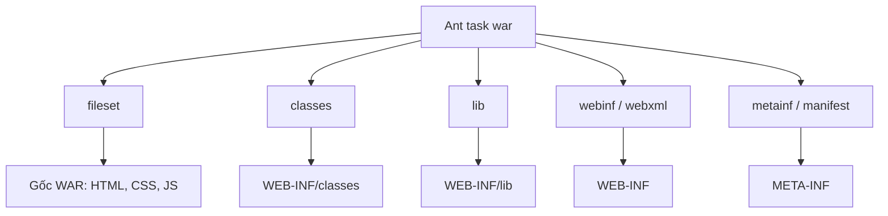

# Đóng gói WAR với `WEB-INF/classes`, `WEB-INF/lib` và `web.xml` khi cần trong Apache Ant

Ứng dụng web Java thường được phân phối dưới dạng file WAR (Web Application Archive). WAR là một archive có cấu trúc chuẩn để servlet container như Tomcat triển khai ứng dụng. Apache Ant cung cấp task `war` để đóng gói file tĩnh, class đã biên dịch, thư viện runtime và deployment descriptor vào đúng vị trí.

Ba vị trí quan trọng trong WAR là:

- `WEB-INF/classes/`: class Java của ứng dụng và các resource nằm trên classpath.
- `WEB-INF/lib/`: các thư viện JAR mà ứng dụng cần lúc chạy và container không cung cấp sẵn.
- `WEB-INF/web.xml`: deployment descriptor nếu ứng dụng hoặc môi trường triển khai cần file này.

Task `war` chịu trách nhiệm tạo archive và ánh xạ các nhóm đầu vào vào cấu trúc WAR. Nó không biên dịch Java source, không tự phân biệt dependency nào do servlet container cung cấp và cũng không kiểm tra ứng dụng có chạy đúng trên container hay không. Các bước compile, copy resource và lựa chọn thư viện cần được tổ chức rõ ràng trong buildfile.

## 1. Cấu trúc chuẩn của một WAR

Một WAR điển hình có cấu trúc như sau:

```text
inventory-web.war
├── index.html
├── assets/
│   ├── app.css
│   └── app.js
└── WEB-INF/
    ├── web.xml
    ├── classes/
    │   ├── com/example/web/InventoryServlet.class
    │   └── config/app.properties
    └── lib/
        ├── commons-lang3-3.14.0.jar
        └── jackson-databind-2.17.1.jar
```

| Đường dẫn trong WAR | Nội dung |
|---|---|
| `/` | Trang HTML, CSS, JavaScript, ảnh và nội dung web công khai |
| `/WEB-INF/web.xml` | Deployment descriptor của ứng dụng web, nếu có |
| `/WEB-INF/classes/` | Class đã biên dịch và resource trên classpath |
| `/WEB-INF/lib/` | JAR dependency runtime của ứng dụng |
| `/META-INF/` | Metadata archive, chẳng hạn manifest hoặc metadata khác khi cần |

Nội dung dưới `WEB-INF` không được servlet container phục vụ trực tiếp như tài nguyên web công khai. Container dùng `WEB-INF/classes` và `WEB-INF/lib` để thiết lập classloader cho ứng dụng. Các file như `index.html`, `assets/app.css` nằm ngoài `WEB-INF` và có thể được truy cập qua URL theo cấu hình ứng dụng.

## 2. Chuẩn bị source và thư mục build

Nên tách mã nguồn Java, resource, nội dung web và thư viện theo mục đích. Ví dụ:

```text
project/
├── build.xml
├── src/
│   └── main/
│       ├── java/
│       │   └── com/example/web/InventoryServlet.java
│       ├── resources/
│       │   └── config/app.properties
│       └── webapp/
│           ├── index.html
│           ├── assets/app.css
│           └── WEB-INF/
│               └── web.xml
├── lib/
│   ├── runtime/              # JAR ứng dụng cần khi chạy
│   └── provided/             # API do container cung cấp lúc chạy
│       └── servlet-api.jar
└── build/
    ├── classes/
    └── dist/
```

Các thư mục `src/` và `lib/` là đầu vào do dự án quản lý. `build/` là nơi chứa đầu ra sinh tự động và có thể xóa rồi tạo lại.

Đặt đường dẫn vào property ở đầu buildfile:

```xml
<property name="src.java.dir" location="src/main/java"/>
<property name="src.resources.dir" location="src/main/resources"/>
<property name="webapp.dir" location="src/main/webapp"/>

<property name="build.dir" location="build"/>
<property name="classes.dir" location="${build.dir}/classes"/>
<property name="dist.dir" location="${build.dir}/dist"/>
<property name="war.file" location="${dist.dir}/inventory-web.war"/>

<property name="runtime.lib.dir" location="lib/runtime"/>
<property name="servlet.api.jar" location="lib/provided/servlet-api.jar"/>
```

Property giúp compile và đóng gói cùng sử dụng một đường dẫn. Khi thay đổi tên artifact hoặc cấu trúc thư mục, chỉ cần cập nhật cấu hình tại một nơi.

## 3. Biên dịch Java vào `WEB-INF/classes`

Ant task `javac` ghi file `.class` vào `destdir`. Ta thường biên dịch vào một thư mục build riêng, sau đó task `war` đưa nội dung thư mục đó vào `WEB-INF/classes`.

```xml
<path id="compile.classpath">
    <pathelement location="${servlet.api.jar}"/>
    <fileset dir="${runtime.lib.dir}" includes="**/*.jar"/>
</path>

<target name="init">
    <mkdir dir="${classes.dir}"/>
    <mkdir dir="${dist.dir}"/>
</target>

<target name="compile" depends="init">
    <javac srcdir="${src.java.dir}"
           destdir="${classes.dir}"
           encoding="UTF-8"
           includeantruntime="false">
        <classpath refid="compile.classpath"/>
    </javac>
</target>
```

Khi đóng gói, phần tử nested `<classes>` sẽ lấy nội dung từ `${classes.dir}` và đặt dưới `WEB-INF/classes/`. Ví dụ class `com.example.web.InventoryServlet` được lưu tại `build/classes/com/example/web/InventoryServlet.class` sẽ xuất hiện trong WAR tại `WEB-INF/classes/com/example/web/InventoryServlet.class`.

`javac` chỉ xử lý source Java. File `.properties`, XML hoặc JSON trong `src/main/resources` cần được copy vào cùng thư mục classes để ứng dụng có thể đọc chúng qua classpath:

```xml
<target name="copy-resources" depends="init">
    <copy todir="${classes.dir}">
        <fileset dir="${src.resources.dir}"/>
    </copy>
</target>
```

Ví dụ `src/main/resources/config/app.properties` sẽ được đặt ở `WEB-INF/classes/config/app.properties`. Khi dùng `ClassLoader.getResource("config/app.properties")`, ứng dụng có thể tìm thấy file này.

## 4. Đưa thư viện vào `WEB-INF/lib`

Nested element `<lib>` của task `war` đưa các JAR vào `WEB-INF/lib`. Thư mục nguồn nên chỉ chứa dependency cần có khi ứng dụng chạy:

```xml
<war destfile="${war.file}">
    <lib dir="${runtime.lib.dir}" includes="**/*.jar"/>
</war>
```

Ví dụ, `lib/runtime/commons-lang3-3.14.0.jar` sẽ được đặt ở `WEB-INF/lib/commons-lang3-3.14.0.jar`.

### Phân biệt dependency runtime và provided

Không phải mọi JAR có trên compile classpath đều phải được đóng gói vào WAR. Một servlet container cung cấp các API nền tảng của môi trường web. Với ứng dụng dùng Servlet API, JAR `servlet-api` thường cần để biên dịch source nhưng không nên đặt trong `WEB-INF/lib`, vì container đã cung cấp implementation/API tương ứng.

| Loại dependency | Compile classpath | `WEB-INF/lib` |
|---|---:|---:|
| Thư viện ứng dụng cần lúc chạy, ví dụ thư viện JSON | Có | Có |
| Servlet API do container cung cấp | Có | Không |
| Thư viện chỉ dùng cho test | Chỉ test compile/runtime | Không |
| Công cụ build như Ant task JAR | Không cần cho ứng dụng | Không |

Vì vậy, hãy giữ thư viện container-provided trong một thư mục riêng như `lib/provided` và chỉ đưa `lib/runtime` vào nested `<lib>`. Nếu dùng một thư mục chung chứa tất cả JAR rồi đóng gói toàn bộ, WAR có thể chứa `servlet-api.jar` hoặc các thư viện không cần thiết, dẫn đến xung đột classloader.

Với ứng dụng Java EE/Jakarta EE, còn có các API khác do container cung cấp như JSP, JPA, WebSocket hoặc CDI tùy nền tảng. Hãy xác định dependency nào thuộc môi trường triển khai và không đóng gói lại các API đó nếu container đã cung cấp.

## 5. Tạo `web.xml` khi cần

`web.xml` là deployment descriptor đặt tại `WEB-INF/web.xml`. Nó có thể khai báo servlet, servlet mapping, filter, listener, session configuration, welcome file, security constraint và các metadata triển khai khác.

Ví dụ `src/main/webapp/WEB-INF/web.xml` cho ứng dụng Servlet 4.0:

```xml
<?xml version="1.0" encoding="UTF-8"?>
<web-app xmlns="http://xmlns.jcp.org/xml/ns/javaee"
         xmlns:xsi="http://www.w3.org/2001/XMLSchema-instance"
         xsi:schemaLocation="http://xmlns.jcp.org/xml/ns/javaee
                             http://xmlns.jcp.org/xml/ns/javaee/web-app_4_0.xsd"
         version="4.0">

    <display-name>Inventory Web</display-name>

    <servlet>
        <servlet-name>inventory</servlet-name>
        <servlet-class>com.example.web.InventoryServlet</servlet-class>
    </servlet>

    <servlet-mapping>
        <servlet-name>inventory</servlet-name>
        <url-pattern>/inventory</url-pattern>
    </servlet-mapping>

    <welcome-file-list>
        <welcome-file>index.html</welcome-file>
    </welcome-file-list>

</web-app>
```

Khai báo trên ánh xạ URL `/inventory` đến servlet `com.example.web.InventoryServlet`. `display-name` là tên mô tả ứng dụng; `welcome-file-list` chỉ định trang mặc định khi truy cập context root.

Để đưa file descriptor vào WAR, dùng thuộc tính `webxml` của task `war`:

```xml
<war destfile="${war.file}"
     webxml="${webapp.dir}/WEB-INF/web.xml">
    <!-- Các phần tử nguồn khác -->
</war>
```

Ant đặt file được chỉ định tại `WEB-INF/web.xml` trong archive. Khi đã dùng thuộc tính `webxml`, tránh copy cùng file lần nữa qua một FileSet hoặc nested `<webinf>` để không tạo entry trùng.

### Khi nào có thể không cần `web.xml`?

Với Servlet 3.0 trở lên, ứng dụng có thể khai báo servlet, filter và listener bằng annotation hoặc cơ chế cấu hình khác mà không cần deployment descriptor. Nhiều framework hiện đại cũng tự đăng ký thành phần khi khởi động. Trong trường hợp đó, task `war` có thể bỏ thuộc tính `webxml` và đóng gói các thành phần còn lại.

`web.xml` vẫn hữu ích khi cần cấu hình tập trung, khai báo bảo mật, welcome file, error page, session timeout hoặc kiểm soát thứ tự/metadata triển khai. Khả năng bỏ descriptor phụ thuộc phiên bản Servlet/Jakarta Servlet và container đích. Nếu ứng dụng hoặc quy trình triển khai yêu cầu descriptor, hãy cung cấp file rõ ràng.

**Lưu ý tương thích API:** Servlet 4.0 dùng namespace và package `javax.servlet` (ví dụ Tomcat 9). Jakarta Servlet 5.0 trở lên dùng namespace Jakarta và package `jakarta.servlet` (ví dụ Tomcat 10+). Không biên dịch ứng dụng với `javax.servlet-api` rồi triển khai trên container chỉ hỗ trợ `jakarta.servlet`, hoặc ngược lại. Hãy chọn phiên bản descriptor, API JAR và container theo cùng một nền tảng.

## 6. Đưa nội dung web tĩnh và cấu hình WEB-INF vào WAR

Các file web tĩnh như `index.html`, CSS, JavaScript và ảnh thường nằm trực tiếp ở gốc WAR. Có thể dùng FileSet ở cấp task `war`:

```xml
<war destfile="${war.file}"
     webxml="${webapp.dir}/WEB-INF/web.xml">
    <fileset dir="${webapp.dir}" excludes="WEB-INF/**"/>
</war>
```

Pattern `WEB-INF/**` loại toàn bộ nội dung dưới `WEB-INF` khỏi FileSet gốc. Nhờ vậy file tĩnh được đưa vào đúng vị trí, còn các thành phần bên trong `WEB-INF` được đưa vào bằng phần tử chuyên biệt.

Nested `<webinf>` đưa các file cấu hình khác vào thư mục `WEB-INF`. Ví dụ:

```xml
<webinf dir="${webapp.dir}/WEB-INF"
        excludes="web.xml,classes/**,lib/**"/>
```

Các file như `jboss-web.xml`, `beans.xml`, tag library descriptor hoặc cấu hình container có thể được đưa vào qua `webinf` khi ứng dụng cần. `web.xml` đã được xử lý bởi thuộc tính `webxml`, còn `classes` và `lib` được tạo từ các thư mục build/runtime riêng, nên loại chúng khỏi nguồn webinf để tránh entry trùng.

Không nên copy nguyên thư mục `src/main/webapp/WEB-INF` vào WAR rồi đồng thời dùng `classes`, `lib` và `webxml` cho cùng các nội dung đó. Hãy quyết định rõ nhóm nào được task `war` tạo và nhóm nào lấy từ webapp source.

## 7. Vai trò của các nested element trong task `war`

Task `war` mở rộng khả năng đóng gói của task archive và cung cấp các nested element phù hợp với cấu trúc web application:

| Nested element | Vị trí trong WAR | Nội dung |
|---|---|---|
| `fileset` | Gốc WAR theo đường dẫn tương đối | HTML, CSS, JS, ảnh hoặc file web tĩnh |
| `classes` | `WEB-INF/classes/` | Class và resource của ứng dụng |
| `lib` | `WEB-INF/lib/` | JAR runtime |
| `webinf` | `WEB-INF/` | File cấu hình bổ sung của web application |
| `metainf` | `META-INF/` | Metadata archive |
| `manifest` | `META-INF/MANIFEST.MF` | Manifest của archive |

Có thể hình dung task `war` ánh xạ nguồn theo cấu trúc:



Các nested element giúp tránh phải tự tạo cây thư mục WAR thủ công. Nếu dùng FileSet thông thường để copy class hoặc JAR, phải tự đảm bảo đường dẫn đích; `classes` và `lib` đã thể hiện đúng ý định đóng gói.

## 8. Ví dụ buildfile hoàn chỉnh

Giả sử ứng dụng dùng Servlet 4.0 và triển khai trên container tương thích như Tomcat 9. Thư mục `lib/provided/servlet-api.jar` chứa Servlet API dùng khi compile; `lib/runtime` chứa các JAR cần đóng gói vào WAR.

Buildfile `build.xml`:

```xml
<?xml version="1.0" encoding="UTF-8"?>
<project name="inventory-web" default="war" basedir=".">

    <property name="src.java.dir" location="src/main/java"/>
    <property name="src.resources.dir" location="src/main/resources"/>
    <property name="webapp.dir" location="src/main/webapp"/>

    <property name="build.dir" location="build"/>
    <property name="classes.dir" location="${build.dir}/classes"/>
    <property name="dist.dir" location="${build.dir}/dist"/>
    <property name="war.file" location="${dist.dir}/inventory-web.war"/>

    <property name="runtime.lib.dir" location="lib/runtime"/>
    <property name="servlet.api.jar" location="lib/provided/servlet-api.jar"/>

    <path id="compile.classpath">
        <pathelement location="${servlet.api.jar}"/>
        <fileset dir="${runtime.lib.dir}" includes="**/*.jar"/>
    </path>

    <target name="clean">
        <delete dir="${build.dir}"/>
    </target>

    <target name="init">
        <mkdir dir="${classes.dir}"/>
        <mkdir dir="${dist.dir}"/>
    </target>

    <target name="compile" depends="init">
        <javac srcdir="${src.java.dir}"
               destdir="${classes.dir}"
               encoding="UTF-8"
               includeantruntime="false">
            <classpath refid="compile.classpath"/>
        </javac>
    </target>

    <target name="copy-resources" depends="init">
        <copy todir="${classes.dir}">
            <fileset dir="${src.resources.dir}"/>
        </copy>
    </target>

    <target name="war" depends="compile,copy-resources">
        <war destfile="${war.file}"
             webxml="${webapp.dir}/WEB-INF/web.xml">

            <!-- Nội dung web công khai ở gốc WAR. -->
            <fileset dir="${webapp.dir}"
                     excludes="WEB-INF/**"/>

            <!-- Class và resource được đặt dưới WEB-INF/classes. -->
            <classes dir="${classes.dir}"/>

            <!-- Chỉ đóng gói dependency runtime. -->
            <lib dir="${runtime.lib.dir}"
                 includes="**/*.jar"/>

            <!-- Cấu hình WEB-INF khác ngoài web.xml/classes/lib. -->
            <webinf dir="${webapp.dir}/WEB-INF"
                    excludes="web.xml,classes/**,lib/**"/>

        </war>
    </target>

</project>
```

Khi chạy `ant war`, Ant:

1. Tạo thư mục build và dist.
2. Biên dịch Java source vào `build/classes` với Servlet API và runtime dependency trên compile classpath.
3. Copy resource vào cùng `build/classes`.
4. Tạo WAR với nội dung web tĩnh ở gốc.
5. Đưa class và resource vào `WEB-INF/classes`.
6. Đưa JAR trong `lib/runtime` vào `WEB-INF/lib`.
7. Đưa descriptor được chỉ định vào `WEB-INF/web.xml` và copy các file WEB-INF bổ sung.

File `servlet-api.jar` chỉ được dùng khi biên dịch. Vì nested `<lib>` chỉ lấy `${runtime.lib.dir}`, API do container cung cấp không bị đóng gói vào WAR.

## 9. Đóng gói WAR không có `web.xml`

Nếu ứng dụng dùng Servlet 3.0+ annotation hoặc framework tự cấu hình và không cần deployment descriptor, có thể bỏ thuộc tính `webxml`:

```xml
<war destfile="${war.file}">
    <fileset dir="${webapp.dir}" excludes="WEB-INF/**"/>
    <classes dir="${classes.dir}"/>
    <lib dir="${runtime.lib.dir}" includes="**/*.jar"/>
    <webinf dir="${webapp.dir}/WEB-INF"
            excludes="web.xml,classes/**,lib/**"/>
</war>
```

Trong trường hợp này, archive không có `WEB-INF/web.xml`. Container sẽ dựa vào annotation, framework hoặc metadata khác theo phiên bản nền tảng web mà nó hỗ trợ. Nếu ứng dụng cần `web.xml` để khai báo mapping, security constraint hoặc cấu hình đặc thù, không dùng cấu hình này.

Không tạo một `web.xml` rỗng chỉ để làm cho WAR có vẻ đầy đủ. Descriptor nên phản ánh cấu hình triển khai thực sự. Ngược lại, nếu quy định của dự án hoặc container yêu cầu file descriptor, hãy truyền đường dẫn bằng thuộc tính `webxml` và bảo đảm file tồn tại.

## 10. Kiểm tra nội dung WAR

WAR là archive ZIP. Có thể xem nội dung bằng lệnh JDK:

```bash
jar tf build/dist/inventory-web.war
```

Kết quả cần có các đường dẫn như:

```text
index.html
assets/app.css
WEB-INF/web.xml
WEB-INF/classes/com/example/web/InventoryServlet.class
WEB-INF/classes/config/app.properties
WEB-INF/lib/commons-lang3-3.14.0.jar
```

Kiểm tra các điểm sau:

- File tĩnh xuất hiện ở gốc WAR theo đường dẫn mong muốn.
- Class nằm trong `WEB-INF/classes` với đúng cấu trúc package.
- Resource production nằm trong `WEB-INF/classes` và có thể được tìm qua classloader.
- Dependency runtime xuất hiện trong `WEB-INF/lib`.
- Servlet API và thư viện container-provided không xuất hiện trong `WEB-INF/lib`.
- `web.xml` có mặt khi được cấu hình; nếu ứng dụng không cần descriptor thì không có entry này.
- Không có bản sao class/JAR ở gốc WAR hoặc entry trùng do cùng nguồn được đưa vào nhiều nested element.

Kiểm tra archive chỉ xác nhận cấu trúc và thành phần được đóng gói. Nó không thay thế việc triển khai WAR lên đúng servlet container để kiểm tra startup, mapping, dependency và hành vi HTTP.

## 11. Triển khai và tương thích container

WAR được triển khai vào servlet container. Container giải nén hoặc đọc archive, thiết lập classloader, nạp các JAR trong `WEB-INF/lib`, nạp class trong `WEB-INF/classes`, rồi khởi tạo ứng dụng web theo metadata và annotation.

Ví dụ, nếu triển khai `inventory-web.war` vào Tomcat với context mặc định, ứng dụng thường được truy cập theo context path tương ứng với tên WAR, chẳng hạn `/inventory-web`. Servlet mapping `/inventory` trong `web.xml` sẽ tạo endpoint `/inventory-web/inventory`.

Khi chọn container, cần căn chỉnh ba yếu tố:

1. **Servlet/Jakarta Servlet API:** phiên bản mà source compile và runtime yêu cầu.
2. **Namespace Java:** `javax.servlet.*` cho nền tảng Java EE/Servlet cũ, `jakarta.servlet.*` cho Jakarta EE/Jakarta Servlet mới.
3. **Descriptor:** namespace và `version` trong `web.xml` phải tương thích với container đích.

Tomcat 9 thuộc dòng Servlet 4.0 dùng `javax.servlet`; Tomcat 10 trở lên chuyển sang `jakarta.servlet`. Chỉ thay namespace trong `web.xml` không đủ để chuyển ứng dụng: source import, dependency API và các thư viện/framework cũng phải tương thích.

## 12. Lỗi thường gặp và cách xử lý

| Triệu chứng | Nguyên nhân có thể | Cách xử lý |
|---|---|---|
| WAR không có class ứng dụng | Chưa biên dịch hoặc thiếu nested `<classes>` | Kiểm tra target compile và `classes dir` |
| WAR có class nhưng servlet không khởi tạo | Thiếu dependency runtime hoặc API/container không tương thích | Kiểm tra `WEB-INF/lib`, servlet namespace và container version |
| Resource không tìm thấy khi chạy | Resource chưa được copy vào classes output | Copy `src/main/resources` vào `${classes.dir}` trước khi đóng gói |
| JAR dependency không nằm trong WAR | Nested `<lib>` trỏ sai thư mục hoặc include pattern không khớp | Kiểm tra `runtime.lib.dir` và pattern `**/*.jar` |
| WAR chứa `servlet-api.jar` | Đóng gói cả compile/provided library | Tách `lib/provided` và chỉ đóng gói runtime dependency |
| Có hai file `WEB-INF/web.xml` hoặc entry trùng | Dùng `webxml` và đồng thời copy descriptor qua FileSet/webinf | Exclude `WEB-INF/**` khỏi fileset gốc và loại `web.xml` khỏi webinf |
| Trang tĩnh trả 404 | File nằm sai vị trí hoặc bị exclude khỏi WAR | Kiểm tra fileset gốc và `jar tf` |
| Container báo descriptor không hợp lệ | Namespace/version trong `web.xml` không phù hợp | Dùng schema/version đúng với Servlet/Jakarta Servlet container |
| Ứng dụng lỗi `ClassNotFoundException` | Thiếu JAR runtime hoặc dependency bắc cầu | Đưa dependency cần thiết vào `lib/runtime` |
| Lỗi `NoSuchMethodError` hoặc `LinkageError` | WAR chứa nhiều phiên bản thư viện hoặc API xung đột với container | Loại JAR trùng, kiểm tra dependency tree và thư viện container-provided |
| WAR cũ vẫn còn class đã xóa | Build incremental giữ lại file trong thư mục classes | Chạy `clean` trước khi đóng gói release hoặc dọn output có kiểm soát |

## 13. Quy tắc tổ chức buildfile

- Dùng `war` để đóng gói, `javac` để biên dịch và `copy` để đưa resource vào output.
- Đưa class và resource ứng dụng vào một thư mục output rồi ánh xạ bằng `<classes>`.
- Đưa dependency runtime vào `<lib>` để chúng nằm trong `WEB-INF/lib`.
- Giữ Servlet API và các API do container cung cấp trong compile classpath nhưng ngoài WAR.
- Dùng `webxml` khi ứng dụng cần `WEB-INF/web.xml`; nếu không cần, bỏ thuộc tính này theo khả năng của nền tảng đích.
- Loại `WEB-INF/**` khỏi FileSet gốc nếu đang dùng `webxml`, `classes`, `lib` và `webinf` riêng.
- Dùng `<webinf>` cho cấu hình bổ sung, tránh copy lại `web.xml`, `classes` hoặc `lib` đã được xử lý riêng.
- Căn chỉnh phiên bản Servlet/Jakarta Servlet API, namespace source và container triển khai.
- Kiểm tra archive bằng `jar tf` và triển khai thử trên container đích.
- Giữ thư mục WAR output riêng với class output và test output để không đóng gói nhầm file.

## 14. Bài tập tự kiểm tra

**Bài 1.** Class `com.example.web.InventoryServlet.class` được biên dịch vào `build/classes`. Muốn đưa class vào WAR ở đúng vị trí, dùng nested element nào?

**Đáp án:**

```xml
<classes dir="build/classes"/>
```

Task `war` sẽ đặt class dưới `WEB-INF/classes/com/example/web/InventoryServlet.class`.

**Bài 2.** Dependency `commons-lang3.jar` cần lúc chạy ứng dụng. Nó nên nằm ở đâu trong WAR?

**Đáp án:** Trong `WEB-INF/lib/commons-lang3.jar`, được đưa vào qua nested `<lib>`.

**Bài 3.** Vì sao `servlet-api.jar` thường không được đóng gói vào `WEB-INF/lib`?

**Đáp án:** Servlet container cung cấp Servlet API. WAR chỉ cần API đó trên compile classpath; đóng gói lại có thể gây xung đột classloader hoặc phiên bản.

**Bài 4.** Khi đã dùng `webxml="${webapp.dir}/WEB-INF/web.xml"`, cần lưu ý gì nếu cũng dùng `<webinf>`?

**Đáp án:** Loại `web.xml` khỏi nested `<webinf>` và loại `WEB-INF/**` khỏi FileSet gốc để không đưa cùng descriptor vào archive nhiều lần.

**Bài 5.** Ứng dụng Servlet 4.0 dùng `javax.servlet` có thể triển khai trực tiếp trên Tomcat 10 không?

**Đáp án:** Không thể giả định tương thích. Tomcat 10 dùng Jakarta Servlet với package `jakarta.servlet`; ứng dụng cần được chuyển đổi source/dependency/framework sang namespace Jakarta hoặc chạy trên container hỗ trợ `javax.servlet` như Tomcat 9.

**Bài 6.** Một ứng dụng Servlet 3.0+ dùng annotation và không cần descriptor có thể đóng gói WAR không có `web.xml` không?

**Đáp án:** Có, nếu container và ứng dụng hỗ trợ cấu hình annotation và không có yêu cầu triển khai nào bắt buộc descriptor. Khi đó bỏ thuộc tính `webxml` khỏi task `war`.

## Kết luận

Task `war` của Apache Ant ánh xạ từng nhóm đầu vào vào cấu trúc Web Application Archive: `classes` tạo `WEB-INF/classes`, `lib` tạo `WEB-INF/lib`, `webxml` đưa deployment descriptor vào `WEB-INF/web.xml`, còn FileSet và `webinf` bổ sung nội dung web và cấu hình. Khi tách rõ dependency runtime với API do container cung cấp, copy resource vào class output và chọn `web.xml` theo yêu cầu nền tảng, WAR sẽ có cấu trúc dễ triển khai và ít gặp xung đột thư viện.

