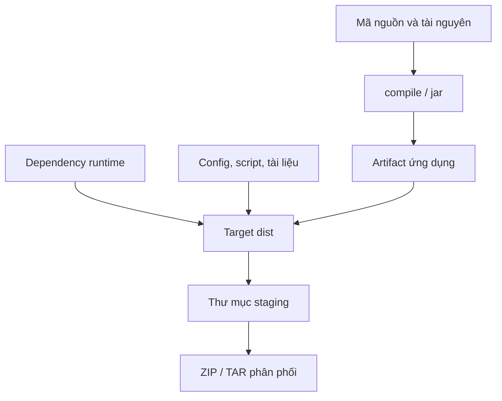

# Thiết kế target dist và cấu trúc thư mục phân phối

Sau khi mã Java đã được biên dịch và đóng gói thành JAR, dự án vẫn cần chuẩn bị những file để người dùng có thể chạy ứng dụng: thư viện phụ thuộc, file cấu hình, script khởi động, tài liệu và thông tin giấy phép. Một file JAR đơn lẻ thường chưa đủ để đại diện cho toàn bộ bản phân phối.

Trong Apache Ant, target `dist` thường chịu trách nhiệm tập hợp các thành phần đã được build vào một **thư mục phân phối (distribution directory)** có cấu trúc ổn định. Từ thư mục này, build có thể tạo ZIP hoặc TAR để chuyển cho người dùng, CI hoặc hệ thống phát hành. Thiết kế tốt giúp người nhận giải nén và tìm thấy đúng file ở vị trí dự kiến, đồng thời giúp nhóm phát triển tái tạo cùng một gói từ cùng một mã nguồn và cấu hình.

## 1. Target dist dùng để làm gì?

Tên `dist` thường được dùng cho bước chuẩn bị bản phân phối. Đây là quy ước đặt tên target, không phải một task đặc biệt của Ant. Bên trong target, người viết buildfile kết hợp các task như:

- `mkdir`: tạo các thư mục trong staging area.
- `copy`: sao chép JAR, file cấu hình, script và tài liệu vào đúng vị trí.
- `jar`: tạo JAR ứng dụng nếu chưa có.
- `zip`: đóng gói cấu trúc thư mục thành archive ZIP.
- `tar`: tạo archive TAR, có thể kết hợp gzip hoặc bzip2 nếu cần.
- `delete`: xóa staging hoặc archive cũ để tránh sót file từ lần build trước.

Target `dist` thường làm các việc theo thứ tự:

1. Đảm bảo artifact ứng dụng đã được tạo.
2. Tạo một thư mục staging sạch.
3. Sao chép artifact chính vào staging.
4. Sao chép các dependency runtime vào thư mục `lib`.
5. Sao chép cấu hình, script và tài liệu vào các thư mục tương ứng.
6. Tạo archive phân phối từ staging.



Target `dist` tập hợp đầu ra đã có và tạo một bố cục mà người dùng cuối có thể hiểu. Nó không nên trở thành nơi chứa mã nguồn thô hoặc file tạm của compiler.

## 2. Phân biệt build output, staging và distribution archive

Ba khái niệm này có quan hệ với nhau nhưng không giống nhau:

| Khu vực | Vai trò | Ví dụ |
|---|---|---|
| Build output | Kết quả trung gian hoặc artifact của các target biên dịch/đóng gói | `build/classes`, `build/artifacts/inventory.jar` |
| Staging directory | Cấu trúc thư mục hoàn chỉnh được chuẩn bị để phân phối | `build/distribution/inventory-2.4.1/` |
| Distribution archive | File nén chứa staging để tải lên hoặc chuyển giao | `dist/inventory-2.4.1.zip` |

Không nên copy toàn bộ thư mục `build` vào staging. Build output có thể chứa class test, báo cáo, file tạm hoặc dữ liệu debug không thuộc bản phát hành. Hãy chọn đúng thành phần cần phân phối bằng các đường dẫn và FileSet cụ thể.

Staging directory là nơi quan trọng nhất để kiểm tra bố cục gói trước khi tạo archive. Nếu staging đúng, archive thường chỉ là bước đóng gói lại đúng cây thư mục đó.

## 3. Thiết kế cấu trúc thư mục phân phối

Một ứng dụng Java chạy từ command line có thể dùng cấu trúc:

```text
inventory-2.4.1/
├── inventory.jar
├── lib/
│   ├── json-parser.jar
│   └── logging-api.jar
├── conf/
│   └── application.properties.example
├── bin/
│   ├── run.sh
│   └── run.bat
├── README.md
└── LICENSE
```

Ý nghĩa:

| Đường dẫn | Nội dung | Lý do đặt ở đây |
|---|---|---|
| `inventory.jar` | JAR chứa class ứng dụng và manifest | Artifact chính, dễ nhận biết ở thư mục gốc |
| `lib/` | Các JAR dependency runtime | Tách thư viện ngoài khỏi artifact ứng dụng |
| `conf/` | File cấu hình mẫu hoặc mặc định | Phân biệt cấu hình triển khai với code |
| `bin/` | Script khởi động hoặc script hỗ trợ | Gom lệnh chạy cho từng hệ điều hành |
| `README.md` | Hướng dẫn cài đặt và sử dụng | Giúp người nhận hiểu cách chạy gói |
| `LICENSE` | Điều khoản sử dụng hoặc giấy phép | Phân phối thông tin pháp lý đi cùng sản phẩm |

Tên thư mục có thể thay đổi theo loại ứng dụng. Ứng dụng server có thể có `config/`, `logs/` hoặc `plugins/`; ứng dụng desktop có thể có `runtime/` hoặc thư mục native library. Điều quan trọng là bố cục ổn định và được tài liệu hóa.

### 3.1. Giữ cấu trúc gói đơn giản

Người nhận gói nên có thể trả lời nhanh:

- JAR nào là chương trình chính?
- Thư viện phụ thuộc nằm ở đâu?
- File cấu hình nào cần chỉnh trước khi chạy?
- Lệnh khởi động nằm ở đâu?
- Tài liệu và giấy phép đi kèm nằm ở đâu?

Không nên đưa các thư mục như `src`, `.git`, `build/test-classes` hoặc báo cáo kiểm thử vào gói phát hành nếu người dùng không cần chúng.

## 4. Khai báo property cho dist

Định nghĩa các đường dẫn và thông tin phiên bản ở đầu `build.xml`:

```xml
<property name="app.name" value="inventory"/>
<property name="app.version" value="2.4.1"/>
<property name="main.class" value="com.acme.inventory.Main"/>

<property name="src.main.dir" location="src/main/java"/>
<property name="resources.dir" location="src/main/resources"/>
<property name="classes.dir" location="build/classes"/>
<property name="runtime.lib.dir" location="lib/runtime"/>

<property name="build.dir" location="build"/>
<property name="artifact.dir" location="${build.dir}/artifacts"/>
<property name="dist.stage.parent" location="${build.dir}/distribution"/>
<property name="distribution.name" value="${app.name}-${app.version}"/>
<property name="dist.stage.dir" location="${dist.stage.parent}/${distribution.name}"/>
<property name="dist.dir" location="dist"/>
<property name="dist.archive" location="${dist.dir}/${distribution.name}.zip"/>
```

Các property này giúp quản lý tập trung tên sản phẩm, phiên bản, artifact, staging và archive. Khi tăng phiên bản, có thể đổi `app.version` hoặc truyền từ dòng lệnh:

```bash
ant -Dapp.version=2.4.2 dist
```

Property của Ant có tính bất biến; giá trị truyền từ dòng lệnh được thiết lập trước các giá trị mặc định trong buildfile. Vì vậy, khai báo mặc định trong file không ghi đè giá trị `-D`.

## 5. Target compile và jar tạo artifact ứng dụng

Target `dist` nên phụ thuộc vào target tạo artifact chính. Ví dụ tối giản:

```xml
<target name="prepare-classes">
    <mkdir dir="${classes.dir}"/>
</target>

<target name="compile" depends="prepare-classes">
    <javac srcdir="${src.main.dir}"
           destdir="${classes.dir}"
           encoding="UTF-8"
           includeantruntime="false"/>
</target>

<target name="jar" depends="compile">
    <mkdir dir="${artifact.dir}"/>

    <jar destfile="${artifact.dir}/${app.name}.jar"
         basedir="${classes.dir}">
        <fileset dir="${resources.dir}"/>
        <manifest>
            <attribute name="Main-Class" value="${main.class}"/>
        </manifest>
    </jar>
</target>
```

Target `compile` biên dịch source vào `build/classes`. Target `jar` đóng gói class cùng resource ứng dụng vào `build/artifacts/inventory.jar` và ghi `Main-Class` vào manifest.

Ví dụ trên chưa thêm thư viện ngoài vào manifest. Phần dependency runtime sẽ được xử lý riêng ở bước dist. Nếu ứng dụng cần các JAR ngoài để chạy, cần cung cấp chúng trong gói và cấu hình cách JVM tìm thấy chúng.

## 6. Chuẩn bị staging directory

Staging phải được làm sạch trước khi tập hợp file. Nếu chỉ copy đè lên thư mục cũ, những file đã bị xóa khỏi source có thể vẫn còn trong staging và lọt vào archive mới.

```xml
<target name="prepare-dist">
    <delete dir="${dist.stage.dir}" quiet="true"/>

    <mkdir dir="${dist.stage.dir}"/>
    <mkdir dir="${dist.stage.dir}/lib"/>
    <mkdir dir="${dist.stage.dir}/conf"/>
    <mkdir dir="${dist.stage.dir}/bin"/>
</target>
```

`delete` chỉ xóa thư mục staging của bản phân phối hiện tại. Không đặt nhầm `dist.stage.dir` trỏ đến thư mục source hoặc thư mục chứa dữ liệu người dùng. `mkdir` tạo lại cây thư mục cần thiết.

Nếu cần giữ nhiều staging version để so sánh, có thể dùng tên thư mục theo phiên bản như ví dụ. Target trên chỉ xóa staging của phiên bản hiện tại.

## 7. Copy artifact và dependency runtime

Sau khi staging được tạo, copy JAR ứng dụng vào thư mục gốc:

```xml
<copy file="${artifact.dir}/${app.name}.jar"
      todir="${dist.stage.dir}"/>
```

Copy các dependency runtime vào `lib`:

```xml
<copy todir="${dist.stage.dir}/lib">
    <fileset dir="${runtime.lib.dir}">
        <include name="*.jar"/>
    </fileset>
</copy>
```

FileSet giới hạn đầu vào vào các JAR trong `lib/runtime`. Không nên lấy toàn bộ JAR từ thư mục build hoặc thư mục công cụ phát triển vì có thể đưa nhầm compiler, JUnit, Checkstyle hoặc dependency chỉ dùng trong test.

Nếu dự án có thư viện ở nhiều vị trí, hãy khai báo từng FileSet riêng và xác định chính xác dependency runtime nào cần được phát hành.

### 7.1. Copy cấu hình

Ví dụ dự án có cấu hình mặc định tại `src/dist/conf`:

```xml
<copy todir="${dist.stage.dir}/conf">
    <fileset dir="src/dist/conf">
        <include name="**/*"/>
    </fileset>
</copy>
```

Không nên copy file cấu hình chứa mật khẩu hoặc token môi trường thật vào gói phân phối công khai. Thường nên đưa file mẫu hoặc cấu hình mặc định không chứa bí mật; người triển khai cung cấp secret qua môi trường hoặc hệ thống quản lý cấu hình.

### 7.2. Copy script và tài liệu

```xml
<copy todir="${dist.stage.dir}/bin">
    <fileset dir="src/dist/bin">
        <include name="run.sh"/>
        <include name="run.bat"/>
    </fileset>
</copy>

<copy file="README.md" todir="${dist.stage.dir}"/>
<copy file="LICENSE" todir="${dist.stage.dir}"/>
```

Các script nên dùng đường dẫn tương đối với vị trí của chính script hoặc thư mục gói. Không nên ghi cứng đường dẫn checkout của developer.

Trên Linux/macOS, file `run.sh` cần có quyền thực thi. Task copy thông thường không phải lúc nào cũng bảo đảm quyền executable được giữ nguyên giữa mọi hệ thống file; hãy kiểm tra quyền file trong staging/archive và dùng cơ chế đóng gói mode phù hợp nếu cần. Trên Windows, `run.bat` được gọi bằng Command Prompt hoặc PowerShell.

## 8. Manifest Class-Path để ứng dụng tìm dependency

Nếu muốn khởi động ứng dụng bằng `java -jar inventory.jar`, JAR chính có thể khai báo `Class-Path` trong manifest. Các đường dẫn trong thuộc tính này là URI tương đối được phân giải từ vị trí JAR chính.

Giả sử staging có:

```text
inventory-2.4.1/
├── inventory.jar
└── lib/
    ├── json-parser.jar
    └── logging-api.jar
```

Vì `inventory.jar` nằm ở thư mục gốc và dependency nằm trong `lib`, manifest cần ghi:

```text
Main-Class: com.acme.inventory.Main
Class-Path: lib/json-parser.jar lib/logging-api.jar
```

Khai báo Ant trong task `jar`:

```xml
<property name="runtime.classpath.manifest"
          value="lib/json-parser.jar lib/logging-api.jar"/>

<jar destfile="${artifact.dir}/${app.name}.jar"
     basedir="${classes.dir}">
    <fileset dir="${resources.dir}"/>
    <manifest>
        <attribute name="Main-Class" value="${main.class}"/>
        <attribute name="Class-Path" value="${runtime.classpath.manifest}"/>
    </manifest>
</jar>
```

Khi copy các dependency vào `dist.stage.dir/lib`, các đường dẫn trong manifest khớp với bố cục cuối cùng. Người dùng có thể chạy:

```bash
java -jar inventory.jar
```

Lệnh phải được chạy từ thư mục gói hoặc với đường dẫn đến JAR phù hợp. Manifest Class-Path không tự copy dependency; target dist vẫn phải đưa các JAR đó vào đúng vị trí.

### 8.1. Giữ manifest và thư mục lib đồng bộ

Nếu thêm `new-library.jar` vào runtime lib nhưng quên thêm vào `runtime.classpath.manifest`, ứng dụng có thể không tìm thấy class khi chạy. Ngược lại, manifest trỏ đến file không được copy cũng gây lỗi runtime.

Với dự án có ít dependency, khai báo danh sách rõ ràng bằng property là dễ đọc. Với dự án lớn, nên quản lý dependency bằng một nguồn cấu hình thống nhất rồi sinh cả Path và manifest từ cùng danh sách; tránh duy trì hai danh sách độc lập có thể lệch nhau.

## 9. Target dist hoàn chỉnh

Các target có thể được kết hợp như sau:

```xml
<target name="dist" depends="jar,prepare-dist">
    <!-- Application artifact. -->
    <copy file="${artifact.dir}/${app.name}.jar"
          todir="${dist.stage.dir}"/>

    <!-- Runtime dependencies. -->
    <copy todir="${dist.stage.dir}/lib">
        <fileset dir="${runtime.lib.dir}" includes="*.jar"/>
    </copy>

    <!-- Default configuration. -->
    <copy todir="${dist.stage.dir}/conf">
        <fileset dir="src/dist/conf" includes="**/*"/>
    </copy>

    <!-- Launch scripts. -->
    <copy todir="${dist.stage.dir}/bin">
        <fileset dir="src/dist/bin">
            <include name="run.sh"/>
            <include name="run.bat"/>
        </fileset>
    </copy>

    <!-- Documentation and license. -->
    <copy file="README.md" todir="${dist.stage.dir}"/>
    <copy file="LICENSE" todir="${dist.stage.dir}"/>

    <!-- Create the archive with one top-level product directory. -->
    <mkdir dir="${dist.dir}"/>
    <delete file="${dist.archive}" quiet="true"/>
    <zip destfile="${dist.archive}">
        <zipfileset dir="${dist.stage.dir}" prefix="${distribution.name}"/>
    </zip>
</target>
```

Ant xử lý các dependency target theo thứ tự trong `depends`: `jar` được thực hiện trước, sau đó `prepare-dist`; rồi mới chạy các task bên trong `dist`. Vì vậy, artifact đã tồn tại trước khi copy và staging được làm sạch trước khi nhận file.

Archive ZIP có một thư mục gốc `inventory-2.4.1/`, bên trong chứa JAR, `lib`, `conf`, `bin` và tài liệu. Khi giải nén, người dùng nhận được một thư mục sản phẩm hoàn chỉnh thay vì các file rời rạc trộn vào thư mục hiện tại.

Nếu dự án cần build/test trước khi phát hành, có thể tạo target riêng:

```xml
<target name="release" depends="test,dist"/>
```

Khi gọi `ant release`, Ant chạy test trước rồi tạo distribution. Nếu test thất bại, target dist không được thực hiện. Giữ target `dist` độc lập cũng hữu ích khi chỉ cần đóng gói lại artifact đã được xác minh.

## 10. Tạo launcher script cho người dùng

Launcher giúp người nhận không cần tự nhớ classpath dài. Ví dụ `src/dist/bin/run.sh`:

```bash
#!/usr/bin/env sh
set -eu

SCRIPT_DIR=$(CDPATH= cd "$(dirname "$0")" && pwd)
APP_HOME=$(CDPATH= cd "$SCRIPT_DIR/.." && pwd)

exec java -jar "$APP_HOME/inventory.jar" "$@"
```

Script xác định thư mục của chính nó, suy ra thư mục gốc của gói và chạy JAR chính. Dùng `exec` để tiến trình Java thay thế shell script và nhận tín hiệu hệ điều hành trực tiếp.

Ví dụ script dùng tên JAR cố định. Nếu phiên bản nằm trong tên file JAR, có thể đặt tên ổn định `inventory.jar` bên trong gói như các ví dụ trên; tên archive bên ngoài vẫn mang phiên bản.

Trên Windows, `src/dist/bin/run.bat` có thể là:

```bat
@echo off
setlocal

set "SCRIPT_DIR=%~dp0"
set "APP_HOME=%SCRIPT_DIR%.."

java -jar "%APP_HOME%\inventory.jar" %*
exit /b %ERRORLEVEL%
```

Script dùng `%~dp0` để lấy thư mục chứa batch file, sau đó xây dựng đường dẫn đến JAR. `exit /b %ERRORLEVEL%` trả lại mã thoát của Java cho chương trình gọi.

Nếu ứng dụng không dùng manifest Class-Path mà cần launcher tự tạo classpath, script phải đưa JAR chính và các file trong `lib` vào classpath theo cú pháp của hệ điều hành. Không dùng dấu phân cách classpath cố định cho cả Windows và Linux/macOS.

## 11. Quản lý cấu hình triển khai trong gói

Một distribution thường nên có file cấu hình mẫu hoặc cấu hình mặc định:

```text
conf/
├── application.properties.example
└── logging.properties
```

File `.example` cho biết người triển khai cần cung cấp những giá trị nào mà không chứa secret. README có thể hướng dẫn copy thành file thật:

```bash
cp conf/application.properties.example conf/application.properties
```

Trên Windows:

```bat
copy conf\application.properties.example conf\application.properties
```

Nếu ứng dụng đọc cấu hình theo đường dẫn tương đối với working directory, launcher nên chuyển về thư mục gốc của distribution trước khi chạy hoặc truyền đường dẫn cấu hình rõ ràng. Đừng giả định người dùng luôn chạy lệnh từ đúng thư mục hiện tại.

### 11.1. Tách file cấu hình theo môi trường

Nếu cần cung cấp cấu hình cho nhiều môi trường, có thể tổ chức:

```text
conf/
├── application-development.properties
├── application-staging.properties
└── application-production.example.properties
```

Không đưa mật khẩu production hoặc API key thật vào ZIP phát hành nếu archive có thể được lưu hoặc phân phối rộng. Các secret nên được cung cấp ở thời điểm triển khai thông qua biến môi trường, secret manager hoặc cơ chế cấu hình được tổ chức sử dụng.

## 12. Đóng gói thêm tài liệu và metadata

Một gói dễ sử dụng thường có:

- `README.md`: yêu cầu Java, cách cấu hình, lệnh chạy, cách dừng và vị trí log.
- `LICENSE`: giấy phép của sản phẩm.
- `NOTICE`: thông tin thông báo bản quyền của dependency nếu giấy phép yêu cầu.
- `CHANGELOG.md`: các thay đổi đáng chú ý giữa phiên bản.
- `conf/*.example`: mẫu cấu hình không chứa bí mật.

Có thể copy những file này trong target dist:

```xml
<copy todir="${dist.stage.dir}">
    <fileset dir="src/dist/docs">
        <include name="README.md"/>
        <include name="LICENSE"/>
        <include name="NOTICE"/>
        <include name="CHANGELOG.md"/>
    </fileset>
</copy>
```

Nếu README ở thư mục gốc repository, dùng `copy file=... todir=...`. Nếu tài liệu được gom trong `src/dist/docs`, dùng FileSet như ví dụ. Chỉ đưa tài liệu cần cho người nhận gói; không copy log nội bộ, ghi chú phát triển hoặc file tạm.

## 13. Tạo archive ZIP và TAR

ZIP phù hợp với nhiều hệ điều hành và dễ giải nén. Ant có task `<zip>`:

```xml
<zip destfile="${dist.archive}">
    <zipfileset dir="${dist.stage.dir}" prefix="${distribution.name}"/>
</zip>
```

`zipfileset` cho phép thêm nội dung từ staging và đặt prefix để archive có thư mục gốc theo tên sản phẩm.

Nếu cần TAR gzip cho môi trường Linux, có thể dùng task `<tar>`:

```xml
<tar destfile="${dist.dir}/${distribution.name}.tar.gz"
     compression="gzip">
    <tarfileset dir="${dist.stage.dir}" prefix="${distribution.name}"/>
</tar>
```

Task TAR hỗ trợ các kiểu nén phù hợp với phiên bản Ant đang dùng. Với script shell cần giữ quyền executable, hãy kiểm tra khả năng và cấu hình mode của `tarfileset` theo phiên bản; ZIP không phải lúc nào cũng bảo toàn metadata quyền file theo cùng cách trên mọi công cụ giải nén.

Có thể tạo cả hai archive từ cùng staging:

```xml
<target name="dist-archives" depends="dist">
    <delete file="${dist.dir}/${distribution.name}.tar.gz" quiet="true"/>
    <tar destfile="${dist.dir}/${distribution.name}.tar.gz"
         compression="gzip">
        <tarfileset dir="${dist.stage.dir}" prefix="${distribution.name}"/>
    </tar>
</target>
```

Target `dist` trong ví dụ trước đã tạo ZIP và staging. `dist-archives` chỉ thêm TAR gzip từ cùng staging, vì vậy cả hai định dạng có cùng cấu trúc file.

## 14. Target clean và khả năng tái tạo distribution

Nên có target dọn các đầu ra phân phối:

```xml
<target name="clean-dist">
    <delete dir="${dist.stage.parent}" quiet="true"/>
    <delete dir="${dist.dir}" quiet="true"/>
</target>
```

Target này xóa staging và archive. Chỉ sử dụng nếu `dist.stage.parent` và `dist.dir` là các thư mục output của dự án; không đặt chúng trỏ đến thư mục dữ liệu triển khai hoặc thư mục chứa file người dùng.

Để tạo lại bản phân phối từ đầu:

```bash
ant clean-dist dist
```

Nếu target `clean` chung đã xóa toàn bộ `build`, có thể để `prepare-dist` tạo lại staging sau khi `jar` hoàn tất. Không nên để target `clean` xóa thư mục `dist` nếu dự án muốn giữ các archive của nhiều phiên bản.

### 14.1. Tránh file cũ lọt vào gói mới

Giả sử phiên bản trước có `lib/old-driver.jar`, nhưng phiên bản hiện tại không còn cần. Nếu target dist chỉ copy file mới vào staging cũ, `old-driver.jar` có thể vẫn tồn tại. Vì vậy, hãy xóa staging trước khi copy.

Tương tự, nếu archive ZIP cũ không được xóa, task zip có thể cập nhật archive hiện tại theo cơ chế thêm/cập nhật entry; entry cũ không còn trong staging có thể vẫn còn tùy cách archive được tạo lại. Xóa archive đích trước khi tạo mới giúp tránh trạng thái cũ sót lại.

### 14.2. Tính ổn định của gói

Để hai lần build từ cùng revision tạo ra distribution tương đương, hãy:

- Cố định phiên bản JDK và dependency build.
- Dùng danh sách file đầu vào rõ ràng.
- Không copy file tạm hoặc file sinh ra không xác định.
- Không đưa timestamp, đường dẫn máy cá nhân hoặc dữ liệu môi trường không cần thiết vào artifact.
- Làm sạch staging trước khi tập hợp file.
- Xóa archive cũ trước khi tạo archive mới.
- Dùng version property và tên file nhất quán.

Archive có thể vẫn khác byte-for-byte do timestamp hoặc metadata file. Nếu cần build hoàn toàn reproducible theo checksum, phải kiểm soát cả timestamp, thứ tự entry và metadata đóng gói theo khả năng của task/phiên bản Ant.

## 15. Kiểm tra nội dung trước khi phát hành

Sau khi target dist hoàn thành, hãy kiểm tra staging và archive:

```text
build/distribution/inventory-2.4.1/
├── inventory.jar
├── lib/
├── conf/
├── bin/
├── README.md
└── LICENSE
```

Kiểm tra archive ZIP bằng lệnh:

```bash
jar tf dist/inventory-2.4.1.zip
```

Hoặc dùng công cụ `unzip`:

```bash
unzip -l dist/inventory-2.4.1.zip
```

Kiểm tra các điểm:

1. JAR chính có trong archive và có đúng tên.
2. Các dependency runtime cần thiết có trong `lib`.
3. Manifest `Main-Class` và `Class-Path` trỏ đến đúng vị trí.
4. File cấu hình mẫu có mặt nhưng không chứa secret.
5. Launcher dùng đường dẫn tương đối đúng với bố cục gói.
6. README và LICENSE được copy.
7. Không có class test, báo cáo, file tạm hoặc source không cần thiết.
8. Archive có đúng một thư mục gốc nếu đó là quy ước phân phối của dự án.

Một cách kiểm tra quan trọng là giải nén gói vào một thư mục mới và chạy thử từ đó. Việc này phát hiện các trường hợp ứng dụng vô tình phụ thuộc vào file trong workspace build hoặc đường dẫn tuyệt đối trên máy developer.

## 16. Các lỗi thường gặp khi thiết kế dist

| Hiện tượng | Nguyên nhân có thể có | Cách xử lý |
|---|---|---|
| Archive thiếu JAR chính | Target dist chạy trước target jar hoặc đường dẫn artifact sai | Khai báo `depends="jar"` và kiểm tra property artifact |
| Ứng dụng chạy ở máy developer nhưng không chạy từ gói | Thiếu dependency runtime hoặc manifest Class-Path sai | Kiểm tra `lib` và đường dẫn tương đối trong manifest |
| Gói chứa JUnit hoặc thư viện Checkstyle | Copy toàn bộ thư mục `lib` thay vì chỉ runtime dependency | Tách `lib/runtime` và `lib/test`/`lib/tools` |
| File cũ vẫn còn trong archive | Staging hoặc ZIP cũ không được xóa trước khi tạo mới | Xóa staging và archive đích trước khi copy/zip |
| Archive có file nằm rời ở root ngoài dự kiến | Dùng `basedir`/`zipfileset` không đặt prefix | Dùng `zipfileset prefix="${distribution.name}"` |
| File cấu hình production chứa secret | Copy cấu hình thật từ workspace hoặc repository | Chỉ đóng gói template; inject secret khi triển khai |
| Script không chạy trên Linux/macOS | File thiếu quyền executable hoặc shebang sai | Đặt quyền file phù hợp trong bước đóng gói và kiểm tra launcher |
| Script Windows không tìm thấy JAR | Dùng đường dẫn tuyệt đối hoặc tính sai `%~dp0` | Tính APP_HOME tương đối với vị trí script |
| Manifest Class-Path không tìm thấy thư viện | Đường dẫn manifest không khớp vị trí JAR sau khi copy | Tính đường dẫn tương đối từ JAR chính và giữ danh sách đồng bộ |
| Archive quá lớn | Đưa source, test output, report hoặc dependency không cần vào gói | Dùng FileSet include cụ thể cho từng nhóm đầu vào |
| Bản phân phối có cấu trúc khác giữa các máy | Dựa vào file tồn tại sẵn trong workspace hoặc đường dẫn local | Tạo staging sạch và khai báo đầy đủ đầu vào trong buildfile |

## 17. Tích hợp dist vào quy trình phát hành

Target `dist` chỉ tập hợp và đóng gói. Một target phát hành tổng thể có thể đặt các bước kiểm tra trước đó:

```xml
<target name="release" depends="clean,test,dist"/>
```

Với quan hệ này, Ant chạy `clean`, sau đó `test`, rồi `dist`. Nếu test thất bại, target dist không được chạy. Dự án cũng có thể tách target xác minh và target tạo archive để CI thực hiện các bước độc lập.

Một quy trình CI điển hình:

1. Checkout revision cần phát hành.
2. Thiết lập JDK và dependency toolchain đúng phiên bản.
3. Chạy test và các quality gate.
4. Chạy target `dist` hoặc `release`.
5. Lưu file ZIP/TAR trong CI artifact storage.
6. Tạo checksum và metadata release nếu quy trình yêu cầu.
7. Chỉ phát hành artifact sau khi các bước xác minh hoàn tất.

Không nên tự động copy distribution vào một máy production chỉ vì target dist thành công. Việc triển khai là bước riêng, có cấu hình môi trường và quyền truy cập riêng.

## 18. Ví dụ buildfile tổng hợp

Ví dụ dưới đây kết hợp compile, jar, prepare-dist, dist và clean-dist. Nó giả định dependency runtime đã được đặt trong `lib/runtime`, cấu hình mẫu ở `src/dist/conf`, script ở `src/dist/bin`, cùng README và LICENSE ở thư mục gốc.

```xml
<?xml version="1.0" encoding="UTF-8"?>
<project name="inventory" default="dist" basedir=".">

    <property name="app.name" value="inventory"/>
    <property name="app.version" value="2.4.1"/>
    <property name="main.class" value="com.acme.inventory.Main"/>

    <property name="src.main.dir" location="src/main/java"/>
    <property name="resources.dir" location="src/main/resources"/>
    <property name="classes.dir" location="build/classes"/>
    <property name="artifact.dir" location="build/artifacts"/>
    <property name="runtime.lib.dir" location="lib/runtime"/>

    <property name="build.dir" location="build"/>
    <property name="distribution.name" value="${app.name}-${app.version}"/>
    <property name="dist.stage.parent" location="${build.dir}/distribution"/>
    <property name="dist.stage.dir" location="${dist.stage.parent}/${distribution.name}"/>
    <property name="dist.dir" location="dist"/>
    <property name="dist.archive" location="${dist.dir}/${distribution.name}.zip"/>

    <property name="runtime.classpath.manifest"
              value="lib/json-parser.jar lib/logging-api.jar"/>

    <target name="clean">
        <delete dir="${build.dir}" quiet="true"/>
    </target>

    <target name="prepare-classes">
        <mkdir dir="${classes.dir}"/>
    </target>

    <target name="compile" depends="prepare-classes">
        <javac srcdir="${src.main.dir}"
               destdir="${classes.dir}"
               encoding="UTF-8"
               includeantruntime="false"/>
    </target>

    <target name="jar" depends="compile">
        <mkdir dir="${artifact.dir}"/>
        <jar destfile="${artifact.dir}/${app.name}.jar"
             basedir="${classes.dir}">
            <fileset dir="${resources.dir}"/>
            <manifest>
                <attribute name="Main-Class" value="${main.class}"/>
                <attribute name="Class-Path" value="${runtime.classpath.manifest}"/>
            </manifest>
        </jar>
    </target>

    <target name="prepare-dist">
        <delete dir="${dist.stage.dir}" quiet="true"/>
        <mkdir dir="${dist.stage.dir}"/>
        <mkdir dir="${dist.stage.dir}/lib"/>
        <mkdir dir="${dist.stage.dir}/conf"/>
        <mkdir dir="${dist.stage.dir}/bin"/>
    </target>

    <target name="dist" depends="jar,prepare-dist">
        <copy file="${artifact.dir}/${app.name}.jar"
              todir="${dist.stage.dir}"/>

        <copy todir="${dist.stage.dir}/lib">
            <fileset dir="${runtime.lib.dir}" includes="*.jar"/>
        </copy>

        <copy todir="${dist.stage.dir}/conf">
            <fileset dir="src/dist/conf" includes="**/*"/>
        </copy>

        <copy todir="${dist.stage.dir}/bin">
            <fileset dir="src/dist/bin">
                <include name="run.sh"/>
                <include name="run.bat"/>
            </fileset>
        </copy>

        <copy file="README.md" todir="${dist.stage.dir}"/>
        <copy file="LICENSE" todir="${dist.stage.dir}"/>

        <mkdir dir="${dist.dir}"/>
        <delete file="${dist.archive}" quiet="true"/>
        <zip destfile="${dist.archive}">
            <zipfileset dir="${dist.stage.dir}" prefix="${distribution.name}"/>
        </zip>
    </target>

    <target name="clean-dist">
        <delete dir="${dist.stage.parent}" quiet="true"/>
        <delete dir="${dist.dir}" quiet="true"/>
    </target>

</project>
```

Các lệnh sử dụng:

```bash
# Biên dịch và tạo JAR
ant jar

# Tạo staging và ZIP phân phối
ant dist

# Xóa staging và archive phân phối
ant clean-dist

# Xóa build output, sau đó tạo lại distribution
ant clean dist

# Tạo gói với phiên bản được truyền vào
ant -Dapp.version=2.4.2 dist
```

Đây là bộ khung minh họa. Với dự án thật, cần bổ sung dependency classpath cho javac nếu mã nguồn dùng thư viện ngoài; bảo đảm tên JAR trong manifest khớp với những file thực sự được copy; và cấu hình runner, file cấu hình cùng metadata theo yêu cầu sản phẩm.

## 19. Nguyên tắc thiết kế target dist dễ bảo trì

- Dùng một property phiên bản duy nhất để tạo tên thư mục và archive.
- Giữ build output, staging và archive ở các vị trí riêng.
- Làm sạch staging trước khi copy để tránh file cũ lọt vào gói.
- Chỉ copy artifact và dependency runtime cần thiết.
- Tách thư viện test và công cụ build khỏi `lib` của bản phát hành.
- Đặt file cấu hình triển khai trong `conf` và không đóng gói secret.
- Đặt launcher trong `bin`, dùng đường dẫn tương đối với distribution root.
- Đưa README, LICENSE và NOTICE cần thiết vào gói.
- Nếu dùng manifest Class-Path, bảo đảm đường dẫn tương đối khớp bố cục archive.
- Tạo archive từ staging đã hoàn chỉnh và xóa archive cũ trước khi tạo mới.
- Giữ một thư mục gốc trong archive để giải nén không làm lẫn file với thư mục hiện tại.
- Kiểm tra gói bằng cách giải nén vào một thư mục mới và chạy thử.
- Tách target `dist` khỏi target triển khai production.

## 20. Kết luận

Target `dist` trong Apache Ant là nơi tập hợp artifact ứng dụng, dependency runtime, cấu hình, script và tài liệu thành một cấu trúc thư mục phân phối ổn định. Cách tổ chức phổ biến là tạo staging dưới `build/distribution`, copy JAR vào thư mục gốc, đặt dependency trong `lib`, cấu hình trong `conf`, script trong `bin`, rồi tạo ZIP hoặc TAR ở thư mục `dist`.

Điểm quan trọng là làm sạch staging trước khi tập hợp file, chọn đúng thành phần runtime, đồng bộ manifest với thư viện được copy và giữ đường dẫn trong launcher tương đối với vị trí gói. Khi target `dist` được tách rõ khỏi compile, test và deploy, nhóm có thể tái tạo artifact, kiểm tra cấu trúc trước khi phát hành và chuyển cùng một gói đã xác minh qua các môi trường mà không phụ thuộc workspace của developer.

## Tài liệu tham khảo

- [Apache Ant — Target](https://ant.apache.org/manual/targets.html)
- [Apache Ant — Copy Task](https://ant.apache.org/manual/Tasks/copy.html)
- [Apache Ant — Jar Task](https://ant.apache.org/manual/Tasks/jar.html)
- [Apache Ant — Zip Task](https://ant.apache.org/manual/Tasks/zip.html)
- [Apache Ant — Tar Task](https://ant.apache.org/manual/Tasks/tar.html)
- [Java — JAR Manifest and Class-Path](https://docs.oracle.com/en/java/javase/)
