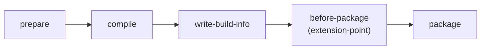

# Kết hợp `extension-point` với phần build dùng chung trong Apache Ant

Khi nhiều dự án Java cùng dùng Apache Ant, phần lớn quy trình build thường giống nhau: tạo thư mục đầu ra, biên dịch mã nguồn, đóng gói JAR và dọn dẹp. Điểm khác biệt có thể chỉ là một vài việc nhỏ, chẳng hạn thêm thông tin phiên bản vào JAR, sinh tài nguyên hoặc kiểm tra tệp cấu hình trước khi đóng gói. Nếu sao chép toàn bộ `build.xml` cho từng dự án, mỗi lần sửa quy trình chung đều phải sửa ở nhiều nơi.

Ant giải quyết tình huống này bằng cách kết hợp hai cơ chế:

- **`<import>`** đưa các target và cấu hình build dùng chung vào dự án hiện tại.
- **`<extension-point>`** công bố một vị trí trong chuỗi phụ thuộc để các dự án có thể gắn target riêng vào mà không sửa tệp build chung.

Điểm cốt lõi là **tệp chung quyết định quy trình và công bố điểm mở rộng; tệp dự án chỉ khai báo phần xử lý đặc thù**.

## 1. Hiểu vai trò của `target`, `depends` và `extension-point`

Trong Ant, một `target` là đơn vị công việc có tên. Thuộc tính `depends` khai báo những target phải chạy trước nó:

```xml
<target name="compile" depends="prepare">
    <javac srcdir="src" destdir="build/classes"
           includeantruntime="false"/>
</target>
```

Chạy `ant compile` sẽ thực hiện `prepare` trước `compile`, miễn là target `prepare` đã được định nghĩa. Tuy nhiên, `depends` thông thường nêu **đích danh** các target cần thiết. Nếu tệp build chung muốn thực thi thêm một target riêng của dự án, nó sẽ phải biết trước tên target đó.

`extension-point` giải quyết vấn đề này. Nó là **một điểm tập hợp phụ thuộc**, có tên và có thể có `depends`, nhưng **không chứa các tác vụ build** như `<javac>`, `<copy>` hay `<jar>`:

```xml
<extension-point name="before-package" depends="compile"/>

<target name="package" depends="before-package">
    <!-- Công việc đóng gói chung -->
</target>
```

Tệp build của một dự án có thể bổ sung:

```xml
<target name="generate-metadata" extensionOf="before-package">
    <!-- Công việc riêng của dự án -->
</target>
```

Khai báo `extensionOf="before-package"` khiến Ant thêm `generate-metadata` vào danh sách phụ thuộc của extension-point `before-package`. Bởi `package` phụ thuộc vào điểm này, lệnh `ant package` sẽ chạy cả công việc chung lẫn công việc được gắn thêm.

| Thành phần | Chức năng | Ai thường sở hữu? |
| --- | --- | --- |
| `target` | Thực hiện tác vụ cụ thể, ví dụ biên dịch hoặc tạo JAR | Build chung hoặc dự án |
| `depends` | Xác định các target phải chạy trước một target | Nơi định nghĩa target |
| `extension-point` | Công bố vị trí cho phép bổ sung các target phụ thuộc | Build chung |
| `extensionOf` trên `target` | Gắn một target vào extension-point đã công bố | Build của dự án |
| `import` | Tái sử dụng các khai báo từ tệp build khác | Build của dự án |

**Lưu ý:** `extension-point` không tự thực hiện công việc; công việc nằm trong những target mà nó phụ thuộc hoặc các target dùng `extensionOf` để mở rộng nó.

## 2. Ví dụ hoàn chỉnh: một quy trình chung, hai dự án

Giả sử hai dự án `orders` và `reports` đều biên dịch Java rồi tạo JAR. Riêng `orders` cần thêm tệp `build-info.txt` vào JAR. Ta bố trí thư mục:

```text
workspace/
├── shared/
│   └── common.xml
├── orders/
│   ├── build.xml
│   └── src/
│       └── demo/
│           └── Main.java
└── reports/
    ├── build.xml
    └── src/
        └── demo/
            └── Main.java
```

### Bước 1: định nghĩa quy trình dùng chung trong `shared/common.xml`

```xml
<?xml version="1.0" encoding="UTF-8"?>
<project name="shared">
    <!-- Giá trị mặc định; dự án có thể đặt trước khi import. -->
    <property name="src.dir" location="src"/>
    <property name="build.dir" location="build"/>
    <property name="classes.dir" location="${build.dir}/classes"/>
    <property name="dist.dir" location="${build.dir}/dist"/>
    <property name="artifact.name" value="application"/>

    <target name="prepare" description="Tạo thư mục build">
        <mkdir dir="${classes.dir}"/>
        <mkdir dir="${dist.dir}"/>
    </target>

    <target name="compile" depends="prepare"
            description="Biên dịch mã nguồn Java">
        <javac srcdir="${src.dir}"
               destdir="${classes.dir}"
               includeantruntime="false"/>
    </target>

    <!-- Mỗi dự án có thể bổ sung công việc ở đây. -->
    <extension-point name="before-package"
                     depends="compile"
                     description="Điểm mở rộng trước khi tạo JAR"/>

    <target name="package" depends="before-package"
            description="Đóng gói JAR">
        <jar destfile="${dist.dir}/${artifact.name}.jar"
             basedir="${classes.dir}"/>
    </target>

    <target name="clean" description="Xóa đầu ra build">
        <delete dir="${build.dir}"/>
    </target>
</project>
```

Ở đây, `prepare`, `compile`, `package` và `clean` là các **target tái sử dụng được**. `before-package` là **điểm mở rộng** nằm giữa việc biên dịch và tạo JAR. Bản thân `common.xml` không cần biết dự án nào có bước tạo metadata và dự án nào không.

Các đường dẫn `src`, `build` được hiểu theo thư mục gốc của dự án gọi Ant. Vì vậy, dù `common.xml` nằm trong `shared/`, đầu ra vẫn thuộc về từng dự án, không ghi chung vào một thư mục `shared/build`.

### Bước 2: thêm target riêng trong `orders/build.xml`

```xml
<?xml version="1.0" encoding="UTF-8"?>
<project name="orders" default="package" basedir=".">
    <!-- Đặt giá trị riêng trước khi nhập build chung. -->
    <property name="artifact.name" value="orders"/>

    <import file="../shared/common.xml"/>

    <target name="write-build-info"
            extensionOf="before-package"
            description="Thêm thông tin build vào JAR">
        <echo file="${classes.dir}/build-info.txt"
              encoding="UTF-8">Project: ${artifact.name}</echo>
    </target>
</project>
```

`orders` dùng nguyên các target chung đã nhập, chỉ thêm `write-build-info`. Target này ghi tệp vào `${classes.dir}` trước khi `package` nén toàn bộ nội dung thư mục đó thành JAR. Không cần chép lại hoặc thay thế target `package`.

Với file `orders/src/demo/Main.java` tối thiểu:

```java
package demo;

public class Main {
    public static void main(String[] args) {
        System.out.println("Hello from Ant");
    }
}
```

Lệnh build sẽ tạo `build/dist/orders.jar`, chứa `demo/Main.class` và `build-info.txt`.

### Bước 3: dự án không cần mở rộng trong `reports/build.xml`

```xml
<?xml version="1.0" encoding="UTF-8"?>
<project name="reports" default="package" basedir=".">
    <property name="artifact.name" value="reports"/>
    <import file="../shared/common.xml"/>
</project>
```

`reports` dùng chính các target chung và **không định nghĩa target có `extensionOf`**. Vì thế, `before-package` vẫn hoạt động bình thường như một điểm không có bước mở rộng; JAR của `reports` được tạo mà không có `build-info.txt`. Để chạy thử, đặt một tệp Java hợp lệ trong `reports/src/`, tương tự ví dụ `Main.java` phía trên.

### Bước 4: chạy Ant và quan sát thứ tự

Từ thư mục `orders`:

```bash
ant -p
ant package
jar tf build/dist/orders.jar
```

`ant -p` liệt kê các target có mô tả, hữu ích để người dùng biết những lệnh được công bố. Lệnh `ant package` (hoặc chỉ `ant` vì dự án khai báo `default="package"`) tạo JAR; `jar tf` liệt kê nội dung JAR bằng công cụ JDK.

Luồng phụ thuộc đối với `orders` có thể nhìn như sau:



Đây là **thứ tự thực thi khái niệm**, không phải danh sách các lời gọi thủ công. Ant dựng quan hệ phụ thuộc từ `depends` và `extensionOf`, sau đó chỉ thực thi mỗi target một lần trong cùng một lần build. Với `reports`, bước `write-build-info` không tồn tại; `compile` vẫn chạy trước `package`.

Kết quả có thể kiểm tra trong `orders.jar`:

```text
demo/Main.class
build-info.txt
```

Với `reports.jar`, chỉ có lớp đã biên dịch và các tài nguyên của dự án (nếu có). Tên và thứ tự các mục khi liệt kê JAR có thể khác nhau.

## 3. Vì sao cần cả `import` lẫn `extension-point`?

Nếu chỉ dùng `import`, các dự án đã tái sử dụng được những target cố định như `compile` và `package`, nhưng chưa có nơi chuẩn hóa cho bước tùy biến. Dự án có thể tự định nghĩa lại `package`, song việc ghi đè như vậy sẽ khiến nó tự chịu trách nhiệm duy trì phần logic đóng gói chung khi quy trình thay đổi.

Nếu chỉ khai báo `extension-point` mà không nhập các target chung, mỗi dự án vẫn phải tự viết phần `prepare`, `compile`, `package`. Khi kết hợp, ta có một hợp đồng rõ ràng:

1. **Build chung** định nghĩa quy trình và tên điểm mở rộng ổn định.
2. **Build riêng** `import` tệp chung và cấu hình các property cần thiết.
3. **Build riêng** gắn các target tùy chọn vào điểm đã công bố bằng `extensionOf`.
4. **Ant** giải quyết quan hệ phụ thuộc khi chạy target cuối cùng, chẳng hạn `package`.

Nhờ đó, một thay đổi chung như bổ sung tùy chọn biên dịch chỉ cần sửa ở `common.xml`, còn hành vi đặc thù của `orders` vẫn nằm trong `orders/build.xml`.

## 4. Thiết kế nhiều điểm mở rộng trong một pipeline

Với pipeline phức tạp, có thể đặt nhiều extension-point tại những ranh giới có ý nghĩa, chẳng hạn `before-compile`, `after-compile` hoặc `before-package`:

```xml
<target name="prepare">
    <mkdir dir="${classes.dir}"/>
</target>

<extension-point name="before-compile" depends="prepare"/>

<target name="compile" depends="before-compile">
    <javac srcdir="${src.dir}" destdir="${classes.dir}"
           includeantruntime="false"/>
</target>

<extension-point name="after-compile" depends="compile"/>

<target name="package" depends="after-compile">
    <jar destfile="${dist.dir}/${artifact.name}.jar"
         basedir="${classes.dir}"/>
</target>
```

Đoạn trên minh họa một **cách tổ chức khác**; không ghép nguyên văn vào ví dụ `common.xml` ở mục 2 vì sẽ trùng tên target. Một dự án có thể gắn target sinh mã vào `before-compile`, hoặc gắn target tạo tài nguyên vào `after-compile`. Khi đặt điểm mở rộng, cần xác định cụ thể đầu vào nào đã tồn tại và công việc nào phải hoàn tất trước khi bước kế tiếp chạy.

Nếu hai target cùng mở rộng một điểm mà có quan hệ thứ tự, hãy khai báo quan hệ đó bằng `depends` thay vì ngầm dựa vào thứ tự chúng xuất hiện trong XML:

```xml
<target name="generate-metadata" extensionOf="after-compile">
    <echo file="${classes.dir}/metadata.txt">generated</echo>
</target>

<target name="verify-metadata"
        depends="generate-metadata"
        extensionOf="after-compile">
    <available file="${classes.dir}/metadata.txt"
               property="metadata.present"/>
    <fail unless="metadata.present"
          message="Missing metadata.txt"/>
</target>
```

`verify-metadata` luôn cần `generate-metadata` hoàn thành trước. Dù cả hai cùng gắn vào `after-compile`, quan hệ phụ thuộc tường minh giúp quy tắc vận hành rõ ràng. Các target chỉ bị chạy một lần trong một lần thực thi Ant, kể cả khi chúng xuất hiện qua nhiều đường phụ thuộc.

## 5. Phân biệt các cơ chế tái sử dụng

| Cơ chế | Dùng khi nào? | Giới hạn cần nhớ |
| --- | --- | --- |
| `<import>` | Nhiều dự án dùng chung target, property và quy trình build | Bản thân nó không xác định điểm tùy biến trong pipeline |
| `depends` | Một target có những bước tiên quyết biết trước | Muốn thêm bước mới thường phải sửa danh sách phụ thuộc |
| `<extension-point>` + `extensionOf` | Build chung công bố vị trí để dự án khác tự gắn target vào | Điểm mở rộng không chứa task và phải có tên được xác định đúng |
| `<macrodef>` | Định nghĩa một thao tác lặp lại có tham số, được gọi tại nơi cần dùng | Là cách tái sử dụng tác vụ, không tự tham gia đồ thị phụ thuộc của pipeline |

Trong bài toán này, `import` và `extension-point` **bổ trợ nhau**: cơ chế đầu tái sử dụng phần có sẵn, cơ chế sau thêm công việc theo nhu cầu của từng dự án.

## 6. Các lỗi thường gặp và cách tránh

### Nhầm `extensionOf` với `depends`

```xml
<!-- Target này phải chạy trước before-package khi điểm đó được dùng. -->
<target name="add-info" extensionOf="before-package">
    <echo message="Add project info"/>
</target>

<!-- Target này chỉ tự yêu cầu before-package chạy trước nó. -->
<target name="show-info" depends="before-package">
    <echo message="Done"/>
</target>
```

`extensionOf` thay đổi các target phụ thuộc của **điểm mở rộng**; `depends` chỉ khai báo target hiện tại phụ thuộc vào **một target khác**. Đảo hai chiều này sẽ cho một luồng thực thi khác mong muốn.

### Gắn vào tên extension-point không tồn tại

Trong dự án dùng `before-package`, viết nhầm `extensionOf="before-pakage"` khiến Ant không tìm thấy điểm mở rộng. Hãy thống nhất tên trong tài liệu của build chung, giữ cơ chế báo lỗi mặc định khi thiếu extension-point và sửa lỗi tên thay vì âm thầm bỏ qua bước build cần thiết. Ant cũng hỗ trợ thuộc tính `onMissingExtensionPoint` trên target ở các phiên bản có hỗ trợ tính năng này, nhưng chỉ nên dùng chế độ bỏ qua khi đó là hành vi có chủ đích.

### Đặt logic riêng trong file chung

Nếu `common.xml` trực tiếp gọi `orders.write-build-info`, build chung đã phụ thuộc ngược vào một dự án cụ thể. Thay vào đó, để `common.xml` biết `before-package`, còn `orders` tự đăng ký target `write-build-info` vào điểm đó.

### Vô tình ghi đè tên target được import

`import` cho phép target trong tệp chính thay thế target cùng tên ở tệp được nhập. Đây là khả năng hợp lệ của Ant nhưng có thể làm thay đổi cả chuỗi build dùng chung nếu vô tình đặt trùng tên `compile` hoặc `package`. Nên đặt tên riêng dễ nhận biết cho target mở rộng và công bố quy ước tên của các target dùng chung.

### Hiểu sai phạm vi property và đường dẫn

Property thông thường của Ant có tính chất **gán lần đầu là giữ nguyên**. Nếu dự án cần đặt `artifact.name`, hãy đặt trước dòng `<import>` như trong ví dụ. Ngoài ra, đường dẫn tương đối trong các tác vụ phụ thuộc vào `basedir` của dự án; đừng mặc định chúng sẽ tương đối với thư mục chứa tệp XML được import. Khi cần tham chiếu tài nguyên nằm cạnh tệp chung, nên xác định đường dẫn đó một cách tường minh.

### Lạm dụng extension-point cho mọi bước

Một bước bắt buộc và giống nhau ở mọi dự án, như `prepare`, thường nên là target thông thường có `depends` rõ ràng. Chỉ công bố extension-point tại vị trí thật sự cần cho phép bổ sung hành vi. Nếu một phần mở rộng yêu cầu bắt buộc phải có mặt, phải có quy tắc kiểm tra riêng, thay vì coi một extension-point trống là lỗi tự động.

## 7. Gợi ý tổ chức build dùng chung có thể bảo trì

- Giữ **target chung** tập trung vào những tác vụ và chính sách thực sự giống nhau giữa các dự án.
- Đặt tên điểm mở rộng theo **thời điểm và mục đích** (`before-package`, `after-compile`), đồng thời mô tả đầu vào và đầu ra mà target mở rộng có thể dùng.
- Đặt giá trị tùy biến vào **property** và cung cấp giá trị mặc định phù hợp. Không cần tạo extension-point chỉ để đổi một tên tệp hoặc thư mục.
- Cho các bước mở rộng độc lập với nhau; nếu có thứ tự bắt buộc, ghi `depends` rõ ràng.
- Chạy `ant -p`, `ant package` và kiểm tra nội dung artifact ở một dự án **có** mở rộng và một dự án **không** mở rộng khi thay đổi quy trình chung.

Đối với Apache Ant, việc tái sử dụng hiệu quả không chỉ là gom nhiều target vào một tệp XML. **`import` giữ cho quy trình chung được viết một lần, còn `extension-point` tạo ra hợp đồng mở rộng có kiểm soát**: dự án có thể bổ sung đúng bước cần thiết, và pipeline đóng gói vẫn do build chung điều phối.
