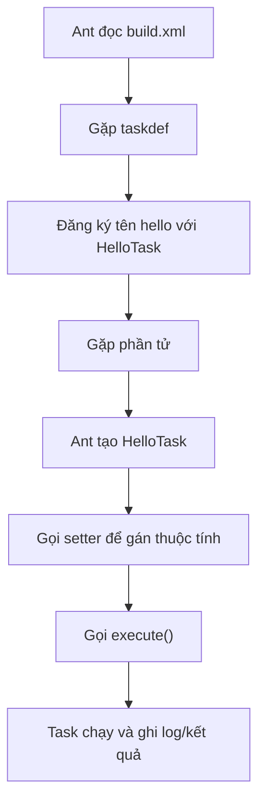

# Viết task Java kế thừa org.apache.tools.ant.Task

Apache Ant cung cấp nhiều task dựng sẵn như `javac`, `copy`, `jar`, `zip` và `junit`. Khi buildfile cần thực hiện một thao tác riêng mà các task có sẵn không đáp ứng trực tiếp, ta có thể mở rộng Ant bằng cách viết một lớp Java và đăng ký lớp đó thành task mới.

Cách cơ bản nhất là tạo một lớp **kế thừa `org.apache.tools.ant.Task`**, ghi đè phương thức `execute()` để thực hiện công việc, khai báo các thuộc tính đầu vào bằng setter, rồi dùng task `taskdef` để đăng ký tên XML cho lớp. Sau khi đăng ký, buildfile có thể gọi task tùy chỉnh như một task Ant thông thường.

## 1. Custom task của Ant là gì?

Một custom task là một lớp Java được Ant khởi tạo và gọi trong quá trình thực thi buildfile. Lớp này có thể đọc thuộc tính từ XML, sử dụng thông tin của project, ghi log, kiểm tra file, gọi API Java hoặc phối hợp với các thư viện khác.

Ví dụ, dự án muốn có task:

```xml
<hello message="Building the application"/>
```

Khi Ant gặp phần tử `<hello>`, Ant cần biết phần tử đó tương ứng với lớp Java nào. Ta đăng ký ánh xạ bằng:

```xml
<taskdef name="hello" classname="com.acme.ant.HelloTask"/>
```

Lớp `com.acme.ant.HelloTask` kế thừa `Task`. Ant tạo instance của lớp, gán các thuộc tính được viết trong XML, sau đó gọi `execute()` để thực hiện công việc.

Luồng hoạt động tổng quát:



Custom task phù hợp khi thao tác cần được tái sử dụng trong nhiều target hoặc nhiều dự án, cần tích hợp một API Java riêng, hoặc cần đóng gói logic phức tạp thành một phần tử XML dễ đọc.

## 2. Vai trò của lớp org.apache.tools.ant.Task

`org.apache.tools.ant.Task` là lớp cơ sở dành cho các task Ant. Khi kế thừa lớp này, custom task nhận được những khả năng hữu ích từ môi trường Ant, chẳng hạn:

- Truy cập `Project` đang thực hiện build thông qua `getProject()`.
- Ghi log bằng `log(...)` với mức thông tin phù hợp.
- Lấy vị trí trong buildfile thông qua `getLocation()` để thông báo lỗi có ngữ cảnh.
- Nhận các thông tin do Ant thiết lập trong vòng đời task.
- Ném `BuildException` để báo cho Ant biết task không thể hoàn thành.

Một task tối thiểu cần triển khai phương thức:

```java
@Override
public void execute() throws BuildException {
    // Công việc của custom task được thực hiện ở đây.
}
```

`execute()` là điểm vào chính của logic task. Ant gọi phương thức này khi đến lượt thực hiện phần tử task trong target. Nếu thao tác thành công, phương thức kết thúc bình thường. Nếu có lỗi khiến build không thể tiếp tục đúng yêu cầu, task nên ném `BuildException`.

### 2.1. Import các lớp cần thiết

Một custom task đơn giản thường sử dụng:

```java
import org.apache.tools.ant.BuildException;
import org.apache.tools.ant.Project;
import org.apache.tools.ant.Task;
```

- `Task`: lớp cơ sở mà custom task kế thừa.
- `BuildException`: ngoại lệ dành cho lỗi trong quá trình thực hiện build.
- `Project`: cung cấp các hằng mức log như `Project.MSG_INFO`, `Project.MSG_WARN` và `Project.MSG_ERR`.

Không cần tự tạo logger riêng chỉ để ghi thông báo build đơn giản. Dùng `log()` của Ant giúp thông báo tuân theo mức log và cấu hình của tiến trình Ant.

## 3. Ví dụ đầu tiên: tạo HelloTask

Tạo file Java:

```text
src/custom-task/java/com/acme/ant/HelloTask.java
```

Nội dung:

```java
package com.acme.ant;

import org.apache.tools.ant.BuildException;
import org.apache.tools.ant.Project;
import org.apache.tools.ant.Task;

public class HelloTask extends Task {

    private String message;

    public void setMessage(String message) {
        this.message = message;
    }

    @Override
    public void execute() throws BuildException {
        if (message == null || message.trim().isEmpty()) {
            throw new BuildException(
                "Attribute 'message' is required.",
                getLocation()
            );
        }

        log(message, Project.MSG_INFO);
    }
}
```

Lớp này có bốn phần quan trọng:

1. `extends Task`: khai báo đây là task Ant tùy chỉnh.
2. Trường `message`: lưu dữ liệu nhận từ thuộc tính XML.
3. `setMessage(String message)`: setter để Ant gán giá trị `message`.
4. `execute()`: kiểm tra đầu vào rồi ghi thông báo bằng API của Ant.

### 3.1. Vì sao setter có tên setMessage?

Ant dùng cơ chế introspection để ánh xạ thuộc tính XML với phương thức setter của Java. Thuộc tính:

```xml
<hello message="Building the application"/>
```

được ánh xạ đến phương thức:

```java
public void setMessage(String message) {
    this.message = message;
}
```

Tên thuộc tính `message` tương ứng với property `message` trong JavaBean và setter `setMessage`. Nếu buildfile viết `text="..."` nhưng lớp chỉ có `setMessage(...)`, Ant không biết cách gán thuộc tính đó và sẽ báo lỗi cấu hình task.

### 3.2. Vì sao execute() ném BuildException?

Nếu `message` không được cung cấp, task không thể thực hiện đúng yêu cầu. Ném `BuildException` giúp Ant đánh dấu task thất bại và dừng luồng build theo cơ chế xử lý lỗi thông thường.

Dùng constructor có `getLocation()` giúp lỗi gắn với vị trí task trong buildfile. Khi đọc log, người phát triển dễ xác định phần tử XML gây lỗi hơn.

### 3.3. Ghi log bằng log()

Task có thể ghi thông tin ở các mức khác nhau:

```java
log("Starting custom task", Project.MSG_INFO);
log("Optional input was not provided", Project.MSG_WARN);
log("Detailed diagnostic information", Project.MSG_VERBOSE);
```

Một số mức log thường dùng:

| Mức | Ý nghĩa |
|---|---|
| `Project.MSG_ERR` | Thông báo lỗi |
| `Project.MSG_WARN` | Cảnh báo |
| `Project.MSG_INFO` | Thông tin thông thường |
| `Project.MSG_VERBOSE` | Thông tin chi tiết hơn |
| `Project.MSG_DEBUG` | Thông tin gỡ lỗi sâu |

Nếu lỗi khiến task thất bại, hãy ném `BuildException` thay vì chỉ ghi một dòng log có chữ `ERROR`. Một dòng log không tự làm cho Ant nhận biết task đã thất bại.

## 4. Cấu trúc thư mục cho custom task

Có thể tách source và class đã biên dịch của custom task khỏi source ứng dụng:

```text
hello-ant/
├── build.xml
├── src/
│   └── custom-task/
│       └── java/
│           └── com/acme/ant/
│               └── HelloTask.java
├── build/
│   └── custom-task-classes/
└── src/main/java/
```

Trong ví dụ này:

- `src/custom-task/java`: mã nguồn của task mở rộng Ant.
- `build/custom-task-classes`: class đã biên dịch của custom task.
- `src/main/java`: mã nguồn ứng dụng thông thường.

Việc tách riêng giúp tránh đưa class của task build vào JAR ứng dụng. Custom task là công cụ phục vụ quá trình build; nó thường không phải dependency runtime của sản phẩm.

## 5. Biên dịch custom task với Ant API

Lớp `HelloTask` tham chiếu đến `Task`, `BuildException` và `Project`, vì vậy compiler cần nhìn thấy Ant API trên compile classpath.

Ant phân phối API chính trong file `ant.jar`, thường nằm dưới `${ant.home}/lib/ant.jar`.

Trong buildfile, khai báo các property và Path:

```xml
<property name="custom.task.src.dir" location="src/custom-task/java"/>
<property name="custom.task.classes.dir" location="build/custom-task-classes"/>

<path id="ant.api.classpath">
    <pathelement location="${ant.home}/lib/ant.jar"/>
</path>
```

Sau đó tạo target biên dịch:

```xml
<target name="compile-custom-task">
    <mkdir dir="${custom.task.classes.dir}"/>

    <javac srcdir="${custom.task.src.dir}"
           destdir="${custom.task.classes.dir}"
           encoding="UTF-8"
           includeantruntime="false">
        <classpath refid="ant.api.classpath"/>
    </javac>
</target>
```

`includeantruntime="false"` giúp buildfile khai báo rõ thư viện mà compiler cần thay vì dựa vào việc Ant tự thêm runtime classpath. Ở đây, Ant API được thêm tường minh qua `ant.api.classpath`.

Nếu dùng một thư viện bên ngoài trong custom task, hãy thêm JAR đó vào compile classpath và cả classpath lúc Ant nạp task. Nếu chỉ thêm ở bước compile mà không cung cấp khi chạy, Ant có thể biên dịch được task nhưng thất bại khi khởi tạo hoặc thực hiện task.

### 5.1. Kiểm tra vị trí Ant API

Ant thường cung cấp property `ant.home` khi được khởi động bằng launcher chuẩn. Có thể in ra để kiểm tra:

```xml
<target name="show-ant-home">
    <echo message="Ant home: ${ant.home}"/>
</target>
```

Nếu môi trường chạy Ant không cung cấp `ant.home` như dự kiến, kiểm tra cách cài đặt và khởi động Ant. Có thể cấu hình đường dẫn Ant API riêng theo môi trường, nhưng không nên ghi cứng đường dẫn thư mục người dùng trên một máy.

## 6. Đăng ký task bằng taskdef

Sau khi class đã được biên dịch, cần đăng ký tên task XML với lớp Java. Ant dùng task `taskdef` cho việc này.

Ví dụ:

```xml
<taskdef name="hello"
         classname="com.acme.ant.HelloTask"
         classpath="build/custom-task-classes"/>
```

Ý nghĩa:

- `name="hello"`: tên phần tử XML mà buildfile sẽ sử dụng.
- `classname="com.acme.ant.HelloTask"`: tên đầy đủ của lớp Java.
- `classpath`: vị trí chứa class đã biên dịch và các thư viện cần để nạp task.

Sau khi đăng ký, có thể gọi:

```xml
<hello message="Building the application"/>
```

Tên task là tên do buildfile chọn; nó không bắt buộc giống tên lớp Java. Ví dụ có thể đăng ký `name="say"` cho `com.acme.ant.HelloTask`, rồi dùng `<say .../>`.

### 6.1. Dùng classpathref

Khi task cần nhiều thư viện hoặc được dùng ở nhiều nơi, nên khai báo Path có `id`:

```xml
<path id="custom.task.classpath">
    <pathelement location="build/custom-task-classes"/>
    <pathelement location="lib/custom-task/helper-library.jar"/>
</path>

<taskdef name="hello"
         classname="com.acme.ant.HelloTask"
         classpathref="custom.task.classpath"/>
```

`classpathref` tham chiếu Path đã khai báo. Cách này dễ bảo trì hơn khi task có nhiều dependency.

Ant API thường đã có trong class loader cha của task vì chính Ant đang chạy. Tuy nhiên, nếu custom task cần thư viện ngoài, các JAR đó phải có trong classpath mà `taskdef` sử dụng hoặc được cung cấp theo cơ chế loader phù hợp.

## 7. Đăng ký task ở cấp project hay bên trong target?

Có hai cách thường gặp.

### 7.1. Đăng ký ở cấp project

Nếu custom task đã được biên dịch từ trước, có thể đặt `taskdef` ở ngoài target:

```xml
<project name="custom-task-demo" default="run">

    <taskdef name="hello"
             classname="com.acme.ant.HelloTask"
             classpath="build/custom-task-classes"/>

    <target name="run">
        <hello message="Hello from Ant"/>
    </target>

</project>
```

Ant đăng ký task khi xử lý cấu hình project. Class của task phải có sẵn trước khi buildfile được nạp. Nếu thư mục class chưa tồn tại, `taskdef` không thể nạp lớp.

Cách này phù hợp khi custom task được build và cài đặt như một công cụ riêng, hoặc class của task đã được tạo ở bước trước.

### 7.2. Biên dịch rồi đăng ký trong cùng lượt build

Nếu buildfile tự biên dịch mã custom task, không thể đặt một `taskdef` ở đầu project để nạp class chưa được tạo. Có thể đặt `taskdef` bên trong target, sau bước compile và trước lần gọi task:

```xml
<target name="run-custom-task" depends="compile-custom-task">
    <taskdef name="hello"
             classname="com.acme.ant.HelloTask"
             classpath="${custom.task.classes.dir}"/>

    <hello message="Hello from a task compiled in this build"/>
</target>
```

Trong target này:

1. Dependency `compile-custom-task` chạy trước.
2. `taskdef` nạp class từ thư mục output.
3. Phần tử `<hello>` được thực hiện sau khi tên task đã đăng ký.

Đây là cách thuận tiện để build và thử custom task trong cùng một project.

## 8. Buildfile hoàn chỉnh cho HelloTask

Ví dụ dưới đây kết hợp property, compile class, `taskdef` và target thực thi:

```xml
<?xml version="1.0" encoding="UTF-8"?>
<project name="custom-task-demo" default="run-custom-task" basedir=".">

    <property name="custom.task.src.dir" location="src/custom-task/java"/>
    <property name="custom.task.classes.dir" location="build/custom-task-classes"/>

    <path id="ant.api.classpath">
        <pathelement location="${ant.home}/lib/ant.jar"/>
    </path>

    <target name="clean">
        <delete dir="build" quiet="true"/>
    </target>

    <target name="compile-custom-task">
        <mkdir dir="${custom.task.classes.dir}"/>

        <javac srcdir="${custom.task.src.dir}"
               destdir="${custom.task.classes.dir}"
               encoding="UTF-8"
               includeantruntime="false">
            <classpath refid="ant.api.classpath"/>
        </javac>
    </target>

    <target name="run-custom-task" depends="compile-custom-task">
        <taskdef name="hello"
                 classname="com.acme.ant.HelloTask"
                 classpath="${custom.task.classes.dir}"/>

        <hello message="Custom task is running"/>
    </target>

</project>
```

Chạy:

```bash
ant run-custom-task
```

Ant biên dịch `HelloTask.java`, đăng ký task `hello`, rồi gọi `execute()`. Log sẽ có thông báo `Custom task is running`.

Có thể chạy lại từ đầu:

```bash
ant clean run-custom-task
```

Target `clean` xóa output cũ; target compile tạo lại class trước khi task được đăng ký.

## 9. Nhận thuộc tính XML bằng setter

Custom task có thể khai báo nhiều thuộc tính. Mỗi thuộc tính được ánh xạ đến một setter tương ứng.

Ví dụ task nhận `message`, `prefix` và `uppercase`:

```java
package com.acme.ant;

import org.apache.tools.ant.BuildException;
import org.apache.tools.ant.Project;
import org.apache.tools.ant.Task;

public class GreetingTask extends Task {

    private String message;
    private String prefix = "INFO";
    private boolean uppercase;

    public void setMessage(String message) {
        this.message = message;
    }

    public void setPrefix(String prefix) {
        this.prefix = prefix;
    }

    public void setUppercase(boolean uppercase) {
        this.uppercase = uppercase;
    }

    @Override
    public void execute() throws BuildException {
        if (message == null || message.trim().isEmpty()) {
            throw new BuildException("The message attribute is required.", getLocation());
        }

        String output = message;
        if (uppercase) {
            output = output.toUpperCase();
        }

        log("[" + prefix + "] " + output, Project.MSG_INFO);
    }
}
```

Sử dụng trong buildfile:

```xml
<taskdef name="greeting"
         classname="com.acme.ant.GreetingTask"
         classpath="build/custom-task-classes"/>

<target name="demo">
    <greeting message="Preparing release"
              prefix="BUILD"
              uppercase="true"/>
</target>
```

Ant chuyển giá trị văn bản `true` thành kiểu boolean cho setter `setUppercase(boolean)`. Các kiểu dữ liệu cơ bản và một số kiểu Ant hỗ trợ có thể được chuyển đổi khi gọi setter; với kiểu phức tạp hoặc dữ liệu cần xác thực riêng, hãy định nghĩa API task rõ ràng và kiểm tra trong `execute()`.

### 9.1. Giá trị mặc định và thuộc tính bắt buộc

Một thuộc tính có thể có giá trị mặc định trong Java:

```java
private String prefix = "INFO";
```

Nếu buildfile không cung cấp `prefix`, task dùng giá trị `INFO`. Với thuộc tính bắt buộc, nên kiểm tra trong `execute()` và ném `BuildException` có thông báo dễ hiểu.

Không nên phụ thuộc vào việc setter luôn được gọi. Nếu thuộc tính bị bỏ qua trong XML, setter tương ứng không được gọi và trường sẽ giữ giá trị khởi tạo.

### 9.2. Xác thực đầu vào trong setter hay execute?

Có thể kiểm tra định dạng đơn giản ngay trong setter, nhưng kiểm tra phụ thuộc nhiều thuộc tính hoặc phụ thuộc file system thường phù hợp hơn trong `execute()`.

Ví dụ, `message` chỉ cần là chuỗi không rỗng thì có thể xác thực khi execute. Nếu task có `source` và `destination`, cần kiểm tra cả hai cùng lúc trước khi thực hiện thao tác.

## 10. Sử dụng Project và log trong custom task

Task được thực thi trong ngữ cảnh một Ant project. Có thể truy cập project hiện tại:

```java
Project project = getProject();
String projectName = project.getName();
log("Project: " + projectName, Project.MSG_INFO);
```

Project cung cấp thông tin và API liên quan đến build, ví dụ property đã được định nghĩa:

```java
String environment = getProject().getProperty("environment");
```

Nếu property có thể thiếu, hãy kiểm tra `null` trước khi sử dụng:

```java
String environment = getProject().getProperty("environment");
if (environment == null) {
    environment = "development";
}
```

Không nên dùng custom task để thay đổi tùy tiện property toàn cục nếu buildfile không có chủ đích đó. Hãy thiết kế rõ task chỉ đọc cấu hình hay có nhiệm vụ cập nhật project state.

### 10.1. Chọn mức log phù hợp

Thông tin thông thường:

```java
log("Starting validation", Project.MSG_INFO);
```

Cảnh báo không làm task thất bại:

```java
log("Optional report was not configured", Project.MSG_WARN);
```

Thông tin chỉ cần khi chạy verbose:

```java
log("Resolved input directory: " + inputDir, Project.MSG_VERBOSE);
```

Lỗi không thể tiếp tục:

```java
throw new BuildException("Input directory does not exist.", getLocation());
```

Hãy tránh in log quá nhiều trong vòng lặp xử lý hàng nghìn file. Có thể ghi tổng kết và chỉ ghi chi tiết khi người dùng bật mức verbose/debug.

## 11. Ví dụ task kiểm tra một file đầu vào

Custom task không chỉ in thông báo. Nó có thể thực hiện thao tác Java thực tế. Ví dụ sau nhận đường dẫn file và kiểm tra file tồn tại, là file thường và có thể đọc được.

```java
package com.acme.ant;

import java.io.File;

import org.apache.tools.ant.BuildException;
import org.apache.tools.ant.Project;
import org.apache.tools.ant.Task;

public class CheckInputTask extends Task {

    private File file;

    public void setFile(File file) {
        this.file = file;
    }

    @Override
    public void execute() throws BuildException {
        if (file == null) {
            throw new BuildException("Attribute 'file' is required.", getLocation());
        }

        if (!file.exists()) {
            throw new BuildException("Input file does not exist: " + file, getLocation());
        }

        if (!file.isFile()) {
            throw new BuildException("Input path is not a regular file: " + file, getLocation());
        }

        if (!file.canRead()) {
            throw new BuildException("Input file is not readable: " + file, getLocation());
        }

        log("Input file is ready: " + file.getAbsolutePath(), Project.MSG_INFO);
    }
}
```

Sử dụng:

```xml
<taskdef name="checkinput"
         classname="com.acme.ant.CheckInputTask"
         classpath="build/custom-task-classes"/>

<target name="verify-input">
    <checkinput file="src/main/resources/application.properties"/>
</target>
```

Khi setter nhận tham số kiểu `File`, Ant chuyển đường dẫn theo ngữ cảnh project. Task kiểm tra trạng thái file trong `execute()` và báo lỗi có vị trí buildfile nếu đầu vào không hợp lệ.

Đây là ví dụ kiểm tra file đơn giản. Nếu task cần xử lý nhiều file theo include/exclude, có thể xem xét dùng nested FileSet hoặc tận dụng các task Ant có sẵn thay vì tự viết lại cơ chế quét file.

## 12. Xử lý lỗi và ngoại lệ

Task nên phân biệt lỗi đầu vào, lỗi nghiệp vụ của thao tác và lỗi kỹ thuật từ thư viện bên ngoài.

Ví dụ:

```java
try {
    performOperation();
} catch (IOException ex) {
    throw new BuildException("Unable to process the input file.", ex, getLocation());
}
```

Constructor `BuildException` có thể giữ nguyên nguyên nhân gốc (`cause`) để log cung cấp stack trace khi cần. Không nên bắt mọi `Exception` rồi chỉ ghi một thông báo chung và tiếp tục như thể task thành công.

Các nguyên tắc hữu ích:

- Kiểm tra thuộc tính bắt buộc trước khi thực hiện thao tác.
- Đưa tên file, đường dẫn hoặc thông tin đầu vào liên quan vào thông báo lỗi.
- Dùng `getLocation()` để gắn lỗi với vị trí task trong buildfile.
- Giữ nguyên exception gốc khi chuyển lỗi từ API bên ngoài sang `BuildException`.
- Không nuốt lỗi bằng cách chỉ gọi `log()` rồi return.
- Không để stack trace chứa thông tin nhạy cảm như token hoặc mật khẩu.

## 13. Thêm thư viện ngoài cho custom task

Custom task có thể cần một thư viện Java ngoài Ant. Ví dụ task gọi một thư viện JSON. Khi đó, JAR cần có ở cả hai giai đoạn:

1. **Compile time:** compiler cần class của thư viện để biên dịch source custom task.
2. **Task loading/runtime:** Ant cần thư viện khi nạp hoặc thực thi custom task.

Khai báo Path:

```xml
<path id="custom.task.compile.classpath">
    <pathelement location="${ant.home}/lib/ant.jar"/>
    <pathelement location="lib/custom-task/json-library.jar"/>
</path>

<path id="custom.task.runtime.classpath">
    <pathelement location="build/custom-task-classes"/>
    <pathelement location="lib/custom-task/json-library.jar"/>
</path>
```

Dùng compile classpath:

```xml
<javac srcdir="${custom.task.src.dir}"
       destdir="${custom.task.classes.dir}"
       includeantruntime="false">
    <classpath refid="custom.task.compile.classpath"/>
</javac>
```

Đăng ký task với runtime classpath:

```xml
<taskdef name="jsoncheck"
         classname="com.acme.ant.JsonCheckTask"
         classpathref="custom.task.runtime.classpath"/>
```

Nếu thiếu JAR ở compile time, `javac` có thể báo `package ... does not exist` hoặc `cannot find symbol`. Nếu thiếu JAR lúc runtime, `taskdef` hoặc khi chạy task có thể gặp `ClassNotFoundException` hay `NoClassDefFoundError`.

Không nên đưa mọi JAR của ứng dụng vào classpath của custom task theo thói quen. Chỉ khai báo dependency thực sự cần cho task để giảm xung đột phiên bản và giữ môi trường Ant ổn định.

## 14. Đăng ký nhiều custom task

Một project có thể định nghĩa nhiều lớp task. Có thể dùng nhiều phần tử `taskdef`:

```xml
<taskdef name="hello"
         classname="com.acme.ant.HelloTask"
         classpathref="custom.task.runtime.classpath"/>

<taskdef name="checkinput"
         classname="com.acme.ant.CheckInputTask"
         classpathref="custom.task.runtime.classpath"/>
```

Sau đó dùng trong target:

```xml
<target name="verify-and-report">
    <checkinput file="src/main/resources/application.properties"/>
    <hello message="Input validation completed"/>
</target>
```

Nếu có nhiều task liên quan và muốn phân phối như một thư viện Ant, có thể tổ chức chúng thành một JAR riêng. Cách đóng gói và đăng ký nâng cao thường dùng `antlib.xml`; phần này được trình bày ở mục tiếp theo.

## 15. Đóng gói custom task thành JAR và dùng antlib

Khi task được dùng trong nhiều project, không nên copy class file vào từng repository. Có thể đóng gói custom task thành JAR:

```text
custom-ant-tasks.jar
├── com/acme/ant/HelloTask.class
├── com/acme/ant/CheckInputTask.class
└── com/acme/ant/antlib.xml
```

Một file `antlib.xml` có thể đăng ký các task:

```xml
<?xml version="1.0" encoding="UTF-8"?>
<antlib>
    <taskdef name="hello" classname="com.acme.ant.HelloTask"/>
    <taskdef name="checkinput" classname="com.acme.ant.CheckInputTask"/>
</antlib>
```

Trong buildfile, nạp thư viện và namespace:

```xml
<project name="antlib-demo" default="run">

    <typedef resource="com/acme/ant/antlib.xml"
             uri="antlib:com.acme.ant"
             classpath="lib/custom-ant-tasks.jar"/>

    <target name="run">
        <acme:hello xmlns:acme="antlib:com.acme.ant"
                    message="Hello from antlib"/>
    </target>

</project>
```

Với antlib, các task được tổ chức dưới một namespace URI để tránh xung đột tên với task khác. Cấu trúc package, vị trí resource `antlib.xml` và classpath phải nhất quán trong JAR.

Nếu chỉ có một task dùng trong một buildfile, `taskdef` trực tiếp thường đơn giản hơn. Antlib phù hợp khi muốn phân phối một nhóm task như một thư viện có thể tái sử dụng.

## 16. Phân biệt Task với các lớp mở rộng khác của Ant

Ant có nhiều kiểu mở rộng. Chọn đúng lớp cơ sở giúp task đơn giản và phù hợp hơn:

| Lớp/cơ chế | Khi nào phù hợp |
|---|---|
| `Task` | Một thao tác độc lập, có thuộc tính và logic trong `execute()` |
| `MatchingTask` | Task cần hỗ trợ cơ chế include/exclude và quét file tương tự các task file của Ant |
| `TaskContainer` hoặc nested-element API | Task cần nhận các phần tử con được cấu hình trong XML |
| `MacroDef` / `MacroInstance` | Muốn tái sử dụng tổ hợp task Ant bằng XML mà không cần viết Java |
| `ScriptDef` | Muốn định nghĩa task bằng script theo engine được cấu hình thay vì viết lớp Java riêng |

Với bài toán một thao tác Java tùy chỉnh, kế thừa `Task` là lựa chọn cơ bản. Nếu chỉ cần ghép các task sẵn có thành một quy trình, macro hoặc target có thể đủ; không nhất thiết phải viết thêm Java.

## 17. Nested elements trong custom task

Ngoài thuộc tính dạng chuỗi, một task có thể nhận phần tử con. Đây là tính năng nâng cao hữu ích khi cấu hình cần cấu trúc rõ ràng.

Ví dụ buildfile muốn viết:

```xml
<messagebundle>
    <message value="Preparing sources"/>
    <message value="Running validation"/>
</messagebundle>
```

Task có thể cung cấp phương thức tạo hoặc thêm đối tượng con, chẳng hạn `createMessage()` hoặc `addConfiguredMessage(...)`. Ant sử dụng introspection để nhận biết các phương thức này theo quy ước nested element.

Ví dụ giản lược:

```java
public class MessageBundleTask extends Task {

    private final List<String> messages = new ArrayList<>();

    public void addConfiguredMessage(MessageElement element) {
        messages.add(element.getValue());
    }

    @Override
    public void execute() throws BuildException {
        for (String message : messages) {
            log(message, Project.MSG_INFO);
        }
    }
}
```

Lớp phần tử con:

```java
public class MessageElement {

    private String value;

    public void setValue(String value) {
        this.value = value;
    }

    public String getValue() {
        return value;
    }
}
```

Để Ant nhận ra kiểu phần tử con và phương thức tương ứng, cấu trúc class, visibility và tên phương thức phải tuân theo quy tắc nested element của Ant. Với task đầu tiên, nên bắt đầu bằng các setter đơn giản; chỉ thêm nested elements khi cấu hình thật sự cần danh sách hoặc cấu trúc con.

## 18. Gỡ lỗi custom task

Khi task không được nạp hoặc không chạy như mong đợi, hãy phân loại lỗi theo giai đoạn.

### 18.1. Lỗi biên dịch Java

Thông báo thường gặp:

```text
package org.apache.tools.ant does not exist
cannot find symbol: class Task
```

Nguyên nhân thường là compile classpath thiếu `ant.jar` hoặc đường dẫn Ant API sai. Kiểm tra:

- `${ant.home}` có đúng không?
- File `${ant.home}/lib/ant.jar` có tồn tại không?
- Path đó có được truyền vào `<javac>` không?
- Compiler có đang chạy trong JDK tương thích không?

### 18.2. taskdef không tìm thấy class

Ví dụ lỗi:

```text
ClassNotFoundException: com.acme.ant.HelloTask
```

Kiểm tra:

1. Package trong source có đúng `com.acme.ant` không?
2. Tên class có đúng `HelloTask` không?
3. File output có nằm tại `build/custom-task-classes/com/acme/ant/HelloTask.class` không?
4. Classpath của `taskdef` có trỏ đến thư mục gốc chứa package `com` không?
5. `taskdef` có chạy sau target compile không?

Không trỏ classpath trực tiếp đến file `.class`; hãy trỏ đến thư mục gốc của cây package hoặc JAR chứa class.

### 18.3. Thiếu dependency lúc thực thi

Nếu task class được tìm thấy nhưng thiếu thư viện mà nó sử dụng, lỗi có thể xuất hiện khi Ant nạp hoặc thực hiện task. Hãy kiểm tra classpath của `taskdef`, không chỉ compile classpath.

### 18.4. Ant không nhận diện thuộc tính XML

Ví dụ buildfile:

```xml
<hello text="Hello"/>
```

nhưng Java chỉ có `setMessage(...)`. Ant không thể ánh xạ `text` sang setter. Hãy đổi XML thành:

```xml
<hello message="Hello"/>
```

hoặc cung cấp setter tương ứng `setText(...)` nếu đó mới là API mong muốn.

### 18.5. Task chạy nhưng không làm build thất bại

Nếu task chỉ ghi log:

```java
log("Input is invalid", Project.MSG_ERR);
```

Ant vẫn có thể tiếp tục vì task chưa ném exception. Nếu điều kiện đó là lỗi thực sự, hãy dùng:

```java
throw new BuildException("Input is invalid.", getLocation());
```

## 19. Các lỗi thiết kế nên tránh

- **Đặt logic chính trong constructor:** Ant chưa hoàn tất cấu hình task khi constructor chạy. Hãy để constructor nhẹ và thực hiện công việc trong `execute()`.
- **Không xác thực thuộc tính bắt buộc:** task có thể chạy với dữ liệu `null` rồi phát sinh lỗi khó hiểu ở sâu bên trong.
- **Chỉ log lỗi mà không ném exception:** build có thể bị đánh dấu thành công dù thao tác thất bại.
- **Dùng đường dẫn tuyệt đối trên máy cá nhân:** task không chạy được ở CI hoặc máy khác.
- **Đưa Ant API vào JAR ứng dụng:** Ant cung cấp API trong môi trường build; không nên đóng gói `ant.jar` vào sản phẩm chỉ vì custom task kế thừa `Task`.
- **Quên dependency lúc taskdef:** compile thành công không bảo đảm Ant nạp được task nếu thiếu thư viện runtime.
- **Ghi trạng thái vào biến static dùng chung:** dễ tạo tác dụng phụ khó đoán giữa các lần gọi hoặc project.
- **Lạm dụng custom task:** nếu một tổ hợp task có sẵn hoặc macro giải quyết được, Java task mới có thể làm build khó bảo trì hơn.
- **Che exception gốc:** làm mất thông tin cần thiết để chẩn đoán lỗi.

## 20. Quy trình tạo custom task từ đầu

Có thể làm theo trình tự:

1. Xác định thao tác mà task cần thực hiện và các đầu vào cần nhận.
2. Tạo lớp Java `public` kế thừa `org.apache.tools.ant.Task`.
3. Khai báo các trường và setter cho thuộc tính XML.
4. Ghi đè `execute()` để xác thực đầu vào và thực hiện công việc.
5. Dùng `log()` để ghi thông tin; ném `BuildException` khi task thất bại.
6. Biên dịch source với Ant API và các dependency cần thiết.
7. Dùng `taskdef` để ánh xạ tên XML tới lớp Java.
8. Gọi task trong một target và kiểm tra log/kết quả.
9. Khi cần tái sử dụng ở nhiều project, đóng gói class và dependency thành JAR; cân nhắc antlib.

## 21. Lệnh hữu ích khi phát triển task

```bash
# Xem phiên bản Ant
ant -version

# Xem thông tin chẩn đoán môi trường Ant
ant -diagnostics

# Xem target có mô tả trong buildfile
ant -p

# Chạy target với log chi tiết
ant -verbose run-custom-task

# Chạy với thông tin debug sâu hơn
ant -debug run-custom-task
```

`ant -diagnostics` hữu ích khi cần xác định Ant home, Java runtime và thư viện liên quan. `-verbose` hoặc `-debug` giúp quan sát quá trình thực thi và nạp task. Khi chia sẻ log, hãy loại bỏ thông tin môi trường nhạy cảm nếu có.

## 22. Kết luận

Để viết một task Java tùy chỉnh cho Apache Ant, hãy tạo lớp kế thừa `org.apache.tools.ant.Task`, khai báo setter cho các thuộc tính XML và đặt logic thực thi trong `execute()`. Task dùng `log()` để ghi thông tin theo mức log của Ant và ném `BuildException` khi không thể hoàn thành công việc.

Sau khi biên dịch lớp với Ant API, dùng `taskdef` để đăng ký tên XML và class Java. Nếu task được biên dịch trong chính buildfile, hãy đặt `taskdef` bên trong target sau bước compile; nếu class đã có sẵn, có thể đăng ký ở cấp project. Khi task cần thư viện ngoài, phải cung cấp dependency cả lúc biên dịch lẫn lúc Ant nạp và chạy task.

Custom task giúp đóng gói logic Java riêng thành một phần tử buildfile có thể tái sử dụng. Hãy giữ API nhỏ, kiểm tra đầu vào rõ ràng, báo lỗi đúng cách và chỉ viết task mới khi các task hoặc cơ chế cấu hình có sẵn của Ant không đáp ứng được yêu cầu.

## Tài liệu tham khảo

- [Apache Ant — Writing Your Own Task](https://ant.apache.org/manual/develop.html)
- [Apache Ant — Task Definition](https://ant.apache.org/manual/Tasks/taskdef.html)
- [Apache Ant — Typedef Task](https://ant.apache.org/manual/Tasks/typedef.html)
- [Apache Ant — BuildException API](https://ant.apache.org/manual/api/org/apache/tools/ant/BuildException.html)
- [Apache Ant — Task API](https://ant.apache.org/manual/api/org/apache/tools/ant/Task.html)
