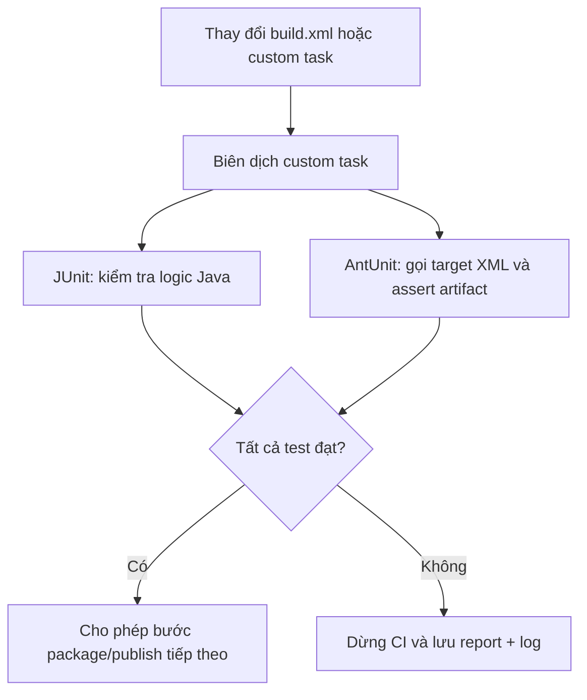

# Kiểm thử custom task và buildfile bằng AntUnit hoặc bộ kiểm thử Java

> **Chủ đề:** Build Tool Ant → Mở rộng Ant  
> **Trọng tâm:** Thiết kế và thực thi kiểm thử cho custom task viết bằng Java, cho target và luồng xử lý trong `build.xml`; lựa chọn giữa AntUnit và các framework kiểm thử Java như JUnit.

## 1. Vì sao mã build cũng cần được kiểm thử?

Một buildfile Ant là chương trình khai báo các `target`, `task`, phụ thuộc, thuộc tính và thao tác với tệp. Custom task là mã Java được Ant nạp vào để mở rộng DSL XML. Khi chúng hoạt động sai, kết quả có thể là một gói phát hành thiếu tệp, đường dẫn sai, artifact chứa dữ liệu cũ hoặc tiến trình CI báo thành công dù sản phẩm lỗi.

Lệnh `ant package` chạy thành công **không tự chứng minh** rằng gói tạo ra đúng. Kiểm thử cần xác nhận các kết quả quan sát được:

- **Đầu vào hợp lệ:** task nhận đúng attribute/nested element, đọc và ghi đúng đường dẫn, xử lý Unicode và cấu hình tùy chọn.
- **Đầu vào không hợp lệ:** thiếu thuộc tính bắt buộc, đường dẫn sai hoặc dữ liệu không phù hợp phải dẫn tới `BuildException` có ý nghĩa.
- **Hành vi target:** phụ thuộc chạy đúng, tạo đúng file/thư mục, đóng gói đúng nội dung, `clean` xóa đúng đầu ra.
- **Tính lặp lại:** chạy nhiều lần không sinh thêm dữ liệu rác và không phụ thuộc thứ tự các bài kiểm thử.
- **Kết quả tự động hóa:** khi một assertion thất bại, lệnh chạy test phải trả mã thoát khác 0 để CI dừng.

Nên kiểm thử ở hai mức: logic của **custom task Java** và hợp đồng hành vi của **buildfile Ant**. Mỗi mức có công cụ phù hợp.

## 2. Chọn AntUnit hay framework kiểm thử Java?

| Tiêu chí | AntUnit | JUnit/TestNG hoặc bộ kiểm thử Java tương đương |
|---|---|---|
| Đơn vị kiểm thử | Target trong XML; file/thư mục, thuộc tính, log, tác dụng phụ của task | Class, method, trường hợp biên và exception trong Java |
| Cách viết | XML với các target tên bắt đầu bằng `test` và các assertion của AntUnit | Java với `@Test`, assertion và fixture |
| Thiết lập | Ant và thư viện AntUnit (Antlib) | Ant API, framework Java, test engine/runner phù hợp |
| Điểm mạnh | Gần cách người dùng thực sự chạy Ant; kiểm thử phối hợp task và target | Kiểm tra chính xác giá trị, nhánh xử lý, exception, logic phức tạp |
| Giới hạn thường gặp | Khó diễn đạt kiểm thử Java phức tạp; dễ bị ảnh hưởng bởi trạng thái file/property | Cần tự tạo `Project` hoặc nạp buildfile nếu muốn kiểm thử vòng đời Ant |
| Nên dùng | Kiểm thử tích hợp buildfile, task registration, đầu ra, quy trình đóng gói | Kiểm thử đơn vị custom task và các trường hợp lỗi chi tiết |

**Chiến lược thực tế:** viết JUnit cho logic Java; dùng AntUnit cho một số kịch bản đi qua XML giống cách người dùng gọi build. Nếu dự án chỉ cần xác nhận hành vi Ant và không muốn thêm Java test, AntUnit có thể đáp ứng phần lớn yêu cầu.

AntUnit là Antlib độc lập, không phải một tập task mặc định luôn có trong Ant. Với **AntUnit 1.5.0**, phiên bản Ant chạy phải từ **1.10.13** trở lên. Ví dụ ở dưới dùng JDK **11+** do sử dụng `String.isBlank()` và `Files.writeString()`; nên dùng JDK 17 hoặc 21 nếu môi trường đã có.

## 3. Cơ chế kiểm thử của AntUnit

Một file test AntUnit vẫn là XML `<project>` thông thường. AntUnit đọc file đó, tìm các target có tên bắt đầu bằng `test`, rồi với mỗi test thực thi:

1. `setUp`, nếu có;
2. target `test...`, cùng các target mà nó `depends`;
3. `tearDown`, nếu có, kể cả khi test lỗi.

Ví dụ tối thiểu:

```xml
<project xmlns:au="antlib:org.apache.ant.antunit">
    <target name="setUp">
        <delete file="result.txt" quiet="true"/>
    </target>

    <target name="testTouchCreatesFile">
        <au:assertFileDoesntExist file="result.txt"/>
        <touch file="result.txt"/>
        <au:assertFileExists file="result.txt"/>
    </target>

    <target name="tearDown">
        <delete file="result.txt" quiet="true"/>
    </target>
</project>
```

Hai assertion quan trọng nhất ở đây là `assertFileExists` và `assertFileDoesntExist`. `assertTrue` còn có thể nhận một Ant condition như `<equals>`, `<available>` hoặc `<contains>` để kiểm tra điều kiện tùy ý.

AntUnit phân biệt:

- **Failure:** một assertion thất bại, ném `AssertionFailedException`.
- **Error:** test gây exception khác, trong đó có `BuildException` ngoài dự kiến.
- **Expected failure:** đặt lời gọi cần thất bại bên trong `<au:expectFailure>... </au:expectFailure>`; test chỉ đạt khi lệnh bên trong thực sự ném `BuildException`.

Lưu ý: AntUnit tạo project cho file test; không nên coi Ant property như biến có thể thay đổi tự do giữa các target. Property của Ant về cơ bản là bất biến sau khi được đặt. Dùng fixture độc lập, tên property riêng, và xóa các đầu ra tạm cho từng test.

## 4. Ví dụ xuyên suốt: custom task tạo tệp banner

Giả sử một dự án cần task `writebanner` ghi một dòng thông điệp UTF-8 ra file và tạo thư mục cha nếu chưa tồn tại. Buildfile biên dịch task, chạy task rồi đóng gói kết quả thành file ZIP. Ta sẽ kiểm thử cả lớp Java lẫn các target Ant.

Cấu trúc dự án:

```text
ant-testing-demo/
├── build.xml
├── lib/
│   ├── ant-antunit-1.5.0.jar
│   └── junit/                         # các JAR JUnit Jupiter/Platform và dependency
├── src/
│   ├── main/java/demo/ant/
│   │   └── WriteBannerTask.java
│   └── test/java/demo/ant/
│       └── WriteBannerTaskTest.java
├── test/
│   └── ant/
│       └── buildfile-test.xml
├── build/                             # sinh ra khi chạy; không đưa vào Git
└── reports/                           # kết quả kiểm thử
```

Đặt file `ant-antunit-1.5.0.jar` từ bản phát hành Apache AntUnit vào `lib/`. Phần kiểm thử JUnit 5 dùng bộ JAR tương thích cùng phiên bản trong `lib/junit/`: Jupiter API và engine, JUnit Platform commons/engine/launcher cùng các dependency như OpenTest4J và API Guardian. Thư viện JUnit không đi kèm mặc định trong Ant.

### 4.1. Viết custom task Java

File `src/main/java/demo/ant/WriteBannerTask.java`:

```java
package demo.ant;

import java.io.File;
import java.io.IOException;
import java.nio.charset.StandardCharsets;
import java.nio.file.Files;
import java.nio.file.Path;

import org.apache.tools.ant.BuildException;
import org.apache.tools.ant.Task;

public final class WriteBannerTask extends Task {
    private File output;
    private String message;

    // Ant ánh xạ attribute "output" tới setter này.
    public void setOutput(File output) {
        this.output = output;
    }

    // Ant ánh xạ attribute "message" tới setter này.
    public void setMessage(String message) {
        this.message = message;
    }

    @Override
    public void execute() throws BuildException {
        if (output == null) {
            throw new BuildException("Attribute 'output' is required");
        }
        if (message == null || message.isBlank()) {
            throw new BuildException("Attribute 'message' must not be blank");
        }

        Path target = output.toPath();
        try {
            Path parent = target.getParent();
            if (parent != null) {
                Files.createDirectories(parent);
            }
            Files.writeString(
                target,
                message + System.lineSeparator(),
                StandardCharsets.UTF_8
            );
        } catch (IOException ex) {
            throw new BuildException("Cannot write banner to " + target, ex);
        }
    }
}
```

Các hợp đồng có thể kiểm tra ngay từ lớp này:

1. Có đủ `output` và `message` thì tạo file đúng nội dung UTF-8.
2. Thiếu `output` hoặc `message` rỗng thì ném `BuildException`.
3. Thư mục đích nhiều cấp chưa có vẫn được tạo.
4. Nếu ghi file gặp lỗi I/O thì truyền lỗi lên qua `BuildException` để Ant coi build là thất bại.

Đây là các **hành vi** cần khẳng định, không chỉ kiểm tra rằng method `execute()` được gọi.

### 4.2. Viết `build.xml` để đăng ký task và đóng gói

```xml
<?xml version="1.0" encoding="UTF-8"?>
<project name="ant-testing-demo" default="package" basedir=".">
    <property name="build.dir" location="build"/>
    <property name="classes.dir" location="${build.dir}/classes"/>
    <property name="test.classes.dir" location="${build.dir}/test-classes"/>
    <property name="dist.dir" location="${build.dir}/dist"/>
    <property name="reports.dir" location="reports"/>

    <!-- Biên dịch custom task dựa trên Ant API của bản Ant đang chạy. -->
    <target name="compile-task">
        <mkdir dir="${classes.dir}"/>
        <javac srcdir="src/main/java"
               destdir="${classes.dir}"
               release="11"
               includeantruntime="false">
            <classpath>
                <pathelement location="${ant.home}/lib/ant.jar"/>
            </classpath>
        </javac>
    </target>

    <target name="register-task" depends="compile-task">
        <taskdef name="writebanner"
                 classname="demo.ant.WriteBannerTask">
            <classpath>
                <pathelement location="${classes.dir}"/>
            </classpath>
        </taskdef>
    </target>

    <target name="generate" depends="register-task">
        <mkdir dir="${dist.dir}"/>
        <writebanner output="${dist.dir}/banner.txt"
                     message="Hello Ant"/>
    </target>

    <target name="package" depends="generate">
        <zip destfile="${dist.dir}/bundle.zip">
            <fileset dir="${dist.dir}" includes="banner.txt"/>
        </zip>
    </target>

    <!-- Chạy AntUnit: cần cung cấp JAR AntUnit bằng -lib. -->
    <target name="test-antunit">
        <mkdir dir="${reports.dir}/antunit"/>
        <au:antunit xmlns:au="antlib:org.apache.ant.antunit"
                    failOnError="true">
            <fileset dir="test/ant" includes="*-test.xml"/>
            <au:plainlistener/>
            <au:xmllistener todir="${reports.dir}/antunit"/>
        </au:antunit>
    </target>

    <!-- JUnit 5: compile test class với Ant API + JUnit libraries. -->
    <target name="compile-java-tests" depends="compile-task">
        <mkdir dir="${test.classes.dir}"/>
        <javac srcdir="src/test/java"
               destdir="${test.classes.dir}"
               release="11"
               includeantruntime="false">
            <classpath>
                <pathelement location="${classes.dir}"/>
                <pathelement location="${ant.home}/lib/ant.jar"/>
                <fileset dir="lib/junit" includes="*.jar"/>
            </classpath>
        </javac>
    </target>

    <!-- junitlauncher cần ant-junitlauncher.jar trong Ant runtime. -->
    <target name="test-java" depends="compile-java-tests">
        <mkdir dir="${reports.dir}/junit"/>
        <junitlauncher haltOnFailure="true" printSummary="true">
            <classpath>
                <pathelement location="${classes.dir}"/>
                <pathelement location="${test.classes.dir}"/>
                <pathelement location="${ant.home}/lib/ant.jar"/>
                <fileset dir="lib/junit" includes="*.jar"/>
            </classpath>
            <test name="demo.ant.WriteBannerTaskTest"
                  outputDir="${reports.dir}/junit">
                <listener type="legacy-plain"/>
                <listener type="legacy-xml"/>
            </test>
        </junitlauncher>
    </target>

    <target name="test" depends="test-antunit,test-java"/>

    <target name="clean">
        <delete dir="${build.dir}"/>
    </target>
</project>
```

Một số chi tiết cần hiểu:

- `<javac>` cần thấy Ant API (ở đây lấy từ `ant.jar` của bản Ant hiện hành); `includeantruntime="false"` tránh phụ thuộc classpath Ant ngầm định.
- `<taskdef>` đăng ký tên XML `writebanner` cho class Java đã biên dịch. Thiếu class hoặc thiếu classpath sẽ gây lỗi đăng ký task.
- `package` phụ thuộc `generate`, `generate` phụ thuộc `register-task`, `register-task` phụ thuộc `compile-task`. Chạy `ant package` sẽ gọi đủ chuỗi cần thiết.
- `reports/` tách khỏi `build/` để test target `clean` không xóa report đang được AntUnit ghi.
- `test` có hai nhánh kiểm thử. `failOnError="true"` và `haltOnFailure="true"` bảo đảm lỗi test không bị biến thành build thành công.

## 5. Kiểm thử buildfile bằng AntUnit

Tạo `test/ant/buildfile-test.xml`:

```xml
<?xml version="1.0" encoding="UTF-8"?>
<project name="buildfile-tests"
         basedir="../.."
         xmlns:au="antlib:org.apache.ant.antunit">

    <!-- Mỗi test bắt đầu với đầu ra sạch, không xóa report. -->
    <target name="setUp">
        <delete dir="${basedir}/build/dist" quiet="true"/>
        <delete dir="${basedir}/build/unpacked" quiet="true"/>
    </target>

    <target name="tearDown">
        <delete dir="${basedir}/build/dist" quiet="true"/>
        <delete dir="${basedir}/build/unpacked" quiet="true"/>
    </target>

    <!-- Kiểm tra phối hợp compile -> taskdef -> generate -> zip. -->
    <target name="testPackageCreatesExpectedArtifacts">
        <ant antfile="${basedir}/build.xml"
             target="package"
             inheritAll="false"/>

        <au:assertFileExists file="${basedir}/build/dist/banner.txt"/>
        <au:assertFileExists file="${basedir}/build/dist/bundle.zip"/>

        <loadfile srcFile="${basedir}/build/dist/banner.txt"
                  property="banner.content"
                  encoding="UTF-8"/>
        <au:assertTrue>
            <contains string="${banner.content}" substring="Hello Ant"/>
        </au:assertTrue>

        <unzip src="${basedir}/build/dist/bundle.zip"
               dest="${basedir}/build/unpacked"/>
        <au:assertFileExists file="${basedir}/build/unpacked/banner.txt"/>
    </target>

    <!-- Task phải từ chối cấu hình thiếu attribute bắt buộc. -->
    <target name="testWriteBannerRejectsMissingMessage">
        <ant antfile="${basedir}/build.xml"
             target="compile-task"
             inheritAll="false"/>

        <taskdef name="writebanner"
                 classname="demo.ant.WriteBannerTask">
            <classpath>
                <pathelement location="${basedir}/build/classes"/>
            </classpath>
        </taskdef>

        <au:expectFailure>
            <writebanner output="${basedir}/build/dist/invalid.txt"/>
        </au:expectFailure>
        <au:assertFileDoesntExist
            file="${basedir}/build/dist/invalid.txt"/>
    </target>

    <!-- clean phải xóa cả file lẫn thư mục sinh ra từ build. -->
    <target name="testCleanRemovesBuildOutputs">
        <ant antfile="${basedir}/build.xml"
             target="package"
             inheritAll="false"/>
        <au:assertFileExists file="${basedir}/build/dist/bundle.zip"/>

        <ant antfile="${basedir}/build.xml"
             target="clean"
             inheritAll="false"/>
        <au:assertFileDoesntExist file="${basedir}/build/dist/bundle.zip"/>
        <au:assertFileDoesntExist file="${basedir}/build/classes"/>
    </target>
</project>
```

**Giải thích đường dẫn:** file test nằm trong `test/ant/`, vì vậy `basedir="../.."` đưa Ant project về thư mục gốc ví dụ. Khi gọi lại `build.xml`, thuộc tính `antfile` là đường dẫn rõ ràng đến buildfile chính. `inheritAll="false"` hạn chế truyền property từ project test sang project đang được kiểm tra.

**Giải thích tình huống:** test đầu xác nhận tồn tại nội dung trong file văn bản *và* trong ZIP, thay vì chỉ nhìn exit code. Test thứ hai chứng minh cấu hình thiếu `message` thực sự bị từ chối. Test cuối bảo đảm `clean` dọn đầu ra build. Cả ba kịch bản có `setUp`/`tearDown` để giới hạn ảnh hưởng giữa các test.

Lệnh chạy tại thư mục dự án:

```bash
ant -version
ant -lib lib/ant-antunit-1.5.0.jar -f build.xml test-antunit
```

Nếu AntUnit đã được cài trong `ANT_HOME/lib` thì thường không cần `-lib`; nhưng cung cấp rõ JAR ở lệnh chạy giúp tái lập môi trường. Đường dẫn `-lib` có thể trỏ tới một thư mục chứa JAR thay vì tệp JAR đơn lẻ.

AntUnit sẽ in số test đã chạy, failure và error, đồng thời ghi XML vào `reports/antunit/`. Một pipeline đúng phải thất bại khi assertion thất bại; không thêm cấu hình bỏ qua lỗi cho target kiểm thử chính.

### 5.1. Các assertion và công cụ kiểm thử hữu ích

| Công cụ AntUnit | Công dụng |
|---|---|
| `au:assertTrue` / `au:assertFalse` | Khẳng định một Ant condition đúng/sai |
| `au:assertFileExists` / `au:assertFileDoesntExist` | Kiểm tra dấu vết trên filesystem |
| `au:assertPropertySet` / `au:assertPropertyEquals` | Kiểm tra property |
| `au:assertFilesMatch` / `au:assertFilesDiffer` | So sánh file kết quả và fixture kỳ vọng |
| `au:expectFailure` | Xác minh một thao tác thực sự phải ném `BuildException` |
| `au:logcapturer` + `au:assertLogContains` | Kiểm tra log Ant khi log là một phần hợp đồng |
| `au:plainlistener` / `au:xmllistener` | In kết quả con người đọc được hoặc tạo report cho CI |

Không nên biến log thành tiêu chí chính nếu có thể khẳng định tệp, dữ liệu hoặc exception cụ thể. Đặc biệt, `echo` có thể xuất thông báo “success” trong khi artifact không đúng.

Ví dụ assertion dùng điều kiện lồng nhau:

```xml
<au:assertTrue>
    <available file="build/dist/bundle.zip"/>
</au:assertTrue>

<au:assertFalse>
    <equals arg1="debug" arg2="release"/>
</au:assertFalse>
```

`<au:expectFailure>` kiểm tra task *có thất bại*, chưa mặc nhiên xác nhận thông điệp lỗi chính xác. Để kiểm tra chi tiết exception (message/cause), dùng kiểm thử Java.

## 6. Kiểm thử custom task bằng JUnit 5

JUnit cho phép tác động trực tiếp lên class Java mà không cần viết một XML target cho từng nhánh. Mỗi test nên có một `Project` mới và file tạm riêng, nhờ vậy có thể chạy độc lập.

Tạo `src/test/java/demo/ant/WriteBannerTaskTest.java`:

```java
package demo.ant;

import static org.junit.jupiter.api.Assertions.assertEquals;
import static org.junit.jupiter.api.Assertions.assertFalse;
import static org.junit.jupiter.api.Assertions.assertThrows;
import static org.junit.jupiter.api.Assertions.assertTrue;

import java.io.File;
import java.io.IOException;
import java.nio.charset.StandardCharsets;
import java.nio.file.Files;
import java.nio.file.Path;

import org.apache.tools.ant.BuildException;
import org.apache.tools.ant.Project;
import org.junit.jupiter.api.Test;
import org.junit.jupiter.api.io.TempDir;

class WriteBannerTaskTest {

    @TempDir
    Path tempDir;

    private WriteBannerTask newTask() {
        Project project = new Project();
        project.init();

        WriteBannerTask task = new WriteBannerTask();
        task.setProject(project);
        task.setTaskName("writebanner");
        return task;
    }

    @Test
    void createsParentsAndWritesUtf8Text() throws IOException {
        Path output = tempDir.resolve("nested/banner.txt");
        WriteBannerTask task = newTask();
        task.setOutput(output.toFile());
        task.setMessage("Xin chào Ant");

        task.execute();

        assertTrue(Files.isRegularFile(output));
        assertEquals(
            "Xin chào Ant" + System.lineSeparator(),
            Files.readString(output, StandardCharsets.UTF_8)
        );
    }

    @Test
    void rejectsMissingOutput() {
        WriteBannerTask task = newTask();
        task.setMessage("Hello");

        BuildException ex = assertThrows(
            BuildException.class,
            task::execute
        );

        assertTrue(ex.getMessage().contains("output"));
    }

    @Test
    void rejectsBlankMessageWithoutCreatingFile() {
        Path output = tempDir.resolve("should-not-exist.txt");
        WriteBannerTask task = newTask();
        task.setOutput(output.toFile());
        task.setMessage("   ");

        BuildException ex = assertThrows(
            BuildException.class,
            task::execute
        );

        assertTrue(ex.getMessage().contains("message"));
        assertFalse(Files.exists(output));
    }
}
```

Điểm quan trọng:

- `new Project().init()` cung cấp ngữ cảnh Ant cho custom task; mỗi test nhận project khác nhau.
- `@TempDir` tạo đường dẫn tạm độc lập, tránh sửa dữ liệu thật của repo và giảm xung đột giữa các lần chạy.
- `assertThrows` buộc Java test xác nhận **đúng loại lỗi**; có thể kiểm tra thêm thông điệp hoặc nguyên nhân để đảm bảo lỗi hữu ích.
- `assertEquals` kiểm tra chính xác byte được giải mã thành chuỗi và ký tự xuống dòng theo hệ điều hành; kiểm thử này sâu hơn assertion “file có tồn tại”.

### 6.1. Chạy JUnit từ Ant

Ví dụ `build.xml` ở mục 4 đã có hai target:

- `compile-java-tests`: biên dịch các test Java, nạp `build/classes`, `ant.jar` và các thư viện JUnit trong `lib/junit/`.
- `test-java`: gọi `<junitlauncher>`, chạy lớp `demo.ant.WriteBannerTaskTest`, xuất report dạng plain/XML và dừng build nếu test thất bại.

Cần đảm bảo bản phân phối Ant có `ant-junitlauncher.jar` trong thư mục `ANT_HOME/lib` hoặc cung cấp JAR này cho Ant thông qua `-lib`. `<junitlauncher>` chỉ điều phối; JUnit Platform cùng Jupiter engine mới là thành phần phát hiện và thực thi `@Test`. Không đủ JAR có thể dẫn đến lỗi classloading hoặc không tìm thấy test engine.

Chạy riêng Java tests:

```bash
ant -f build.xml test-java
```

Hoặc chạy cả hai nhánh:

```bash
ant -lib lib/ant-antunit-1.5.0.jar -f build.xml test
```

Đây là bộ ví dụ độc lập: để chạy thực tế, bạn cần tạo đúng các file nêu ở trên và chuẩn bị bộ JAR JUnit tương thích. Ant/JUnit không tự tải dependency chỉ vì chúng xuất hiện trong `<fileset>`.

### 6.2. Nếu muốn kiểm thử cả buildfile bằng Java

Framework Java cũng có thể nạp XML buildfile qua Ant API. Cách này hữu ích khi cần kiểm tra nhiều giá trị phức tạp, dữ liệu fixture lớn hoặc assertion không tiện diễn đạt bằng AntUnit:

```java
import java.io.File;
import org.apache.tools.ant.Project;
import org.apache.tools.ant.ProjectHelper;

Project project = new Project();
project.init();
ProjectHelper.configureProject(project, new File("build.xml"));
project.executeTarget("package");

// Tiếp theo dùng assertion của framework Java để kiểm tra
// bundle.zip, banner.txt hoặc trạng thái Project.
```

Đoạn trên biểu diễn cơ chế cơ bản. Trong một test thực tế, hãy dùng bản sao buildfile trong thư mục fixture hoặc cấu hình đường dẫn đầu ra riêng: gọi trực tiếp `package` lên working directory của dự án có thể tạo/xóa artifact thật. Mỗi test phải tạo project mới vì Ant properties và references có trạng thái.

Trong hệ sinh thái Ant cũ, một số dự án còn dùng `org.apache.tools.ant.BuildFileTest` (thuộc `ant-testutil`, thường kết hợp JUnit 3/4). Với dự án mới, một test dùng `Project`/`ProjectHelper` hoặc AntUnit thường rõ ràng hơn; không cần chuyển framework chỉ để kiểm tra một vài tệp đầu ra.

## 7. Thiết kế fixture và test case có giá trị

Một tập test tốt bao phủ cả *happy path* và *failure path*. Dùng bảng sau để phân tích custom task khác, chẳng hạn task kiểm tra license, sinh nguồn, copy tài nguyên hoặc đóng gói module.

| Kịch bản | Dữ liệu vào | Assertion đáng tin cậy |
|---|---|---|
| Cấu hình hợp lệ | Đủ attribute, đường dẫn file tạm | File được tạo; nội dung đúng; target thành công |
| Thiếu attribute bắt buộc | Không truyền `output` hoặc `message` | `BuildException`; không tạo output |
| Nội dung Unicode | Chuỗi có dấu tiếng Việt, ký tự đặc biệt | Đọc file bằng UTF-8, so sánh chính xác |
| Thư mục cha chưa tồn tại | Đích ở nhiều cấp thư mục | Task tự tạo thư mục và file |
| Đóng gói | Chạy target `package` | ZIP tồn tại và chứa đúng entry |
| Dọn dữ liệu | Chạy `package` rồi `clean` | Output build biến mất, dữ liệu nguồn còn nguyên |
| Chạy lại | Chạy target hai lần trong điều kiện giống nhau | Không xuất hiện kết quả thừa hoặc dữ liệu cũ |
| I/O lỗi | Đích không thể ghi, nguồn không có quyền đọc | Exception phù hợp; không báo thành công sai |
| Property tùy biến | Gọi với `-D...` hoặc file properties fixture | Target chọn đúng cấu hình; không phụ thuộc property còn sót |

Đặc biệt với Ant:

1. **Tách thư mục đầu ra.** Test không được xóa các nguồn hoặc dữ liệu người học. Dùng `build/test-output`, `@TempDir` hoặc fixture sao chép.
2. **Làm sạch trước và sau test.** `setUp` bảo vệ khỏi lần chạy trước; `tearDown` giảm side effect khi test thất bại. Không xóa report đang được runner ghi.
3. **Không phụ thuộc thứ tự.** Không giả định `testA` luôn chạy trước `testB`. Mỗi test tự tạo dữ liệu cần có.
4. **Cẩn thận với property bất biến.** Không “ghi đè” bằng `<property>` rồi kỳ vọng nhận giá trị mới; dùng project mới hoặc test file riêng nếu cần trạng thái property khác.
5. **Không dựa vào đồng hồ hoặc mạng.** Với target kiểm tra cập nhật, timestamp có độ phân giải khác nhau theo filesystem; nên kiểm soát fixture thay vì ngủ một khoảng ngẫu nhiên.
6. **Kiểm tra artifact thực tế.** Assert tệp tồn tại là mức tối thiểu; khi cần, so sánh nội dung, checksum, danh sách entry ZIP/JAR hoặc các manifest quan trọng.
7. **Không chạy song song trên một build directory chung.** Nếu CI song song, cho mỗi job một workspace/output directory hoặc dùng project/test fixture cách ly.

Một luồng kiểm thử có thể nhìn như sau:



## 8. Phân biệt failure của assertion với error của build

Giả sử một test AntUnit mong muốn tạo `bundle.zip`:

- `au:assertFileExists` không tìm được file → **failure**: target đã chạy nhưng hợp đồng đầu ra không đạt.
- `<taskdef>` không tìm thấy Java class → **error**: môi trường/classpath hoặc triển khai bị lỗi.
- Custom task cố ý ném `BuildException` vì thiếu `message`, nhưng test không bọc `expectFailure` → **error** của test.
- Cùng lời gọi đó nằm trong `expectFailure` và thực sự ném `BuildException` → test **pass**.
- Test chỉ chạy `<echo message="ok"/>` mà không assert điều kiện gì → có thể **pass giả**; nó chưa chứng minh output đúng.

Khác biệt này giúp khoanh vùng: sửa assertion/kỳ vọng, sửa chính task hay sửa cấu hình chạy test.

Với framework Java, `assertThrows` và `assertEquals` biểu diễn kỳ vọng một cách tường minh. Một lỗi ngoài dự kiến hoặc giá trị không khớp đều khiến test thất bại, và `haltOnFailure` của `junitlauncher` truyền kết quả đó lên Ant.

## 9. Đưa kiểm thử vào pipeline phát hành

Thứ tự gợi ý trong pipeline:

```text
Checkout + JDK + Ant
        |
        v
Chuẩn bị dependency AntUnit / JUnit
        |
        v
ant -lib lib/ant-antunit-1.5.0.jar test
        |
        +-- test-antunit --> reports/antunit/*.xml
        |
        +-- test-java ----> reports/junit/*.xml
        |
        v
Chỉ khi exit code = 0 mới tiếp tục package/publish
```

Nếu pipeline đã gọi target `test`, không cần chạy lại `package` chỉ để kiểm thử: test AntUnit trong ví dụ đã thực hiện package trên fixture. Tuy nhiên, ở bước phát hành chính thức nên chạy lại `package` trong môi trường sạch với tham số phát hành, rồi kiểm tra artifact trước khi upload.

**Nguyên tắc chặn lỗi:** không dùng `failOnError="false"` cho AntUnit hoặc `haltOnFailure="false"` cho JUnit rồi bỏ qua failure property. Nếu cố tình thu thập mọi report trước khi dừng, phải có target cuối kiểm tra `errorProperty`/`failureProperty` và gọi `<fail>` khi có lỗi. CI phải dựa vào **exit code**, không chỉ tìm chuỗi `BUILD SUCCESSFUL` trong log.

Các report XML có thể được công cụ CI đọc như JUnit XML. Đường dẫn report nên nằm ngoài thư mục mà một test `clean` có thể xóa, và nên được thu thập cả khi build thất bại.

## 10. Lỗi thường gặp và cách xác định nguyên nhân

| Triệu chứng | Nguyên nhân thường gặp | Hướng xử lý |
|---|---|---|
| `Problem: failed to create task or type antunit` | Chưa nạp AntUnit Antlib | Kiểm tra JAR và `-lib` / `ANT_HOME/lib`, rồi kiểm tra namespace `antlib:org.apache.ant.antunit` |
| `ClassNotFoundException: demo.ant.WriteBannerTask` | Chưa biên dịch task hoặc `taskdef` sai classpath | Kiểm tra `compile-task`, vị trí `build/classes` và `classname` |
| Không có test nào được chạy | Không khớp file pattern hoặc tên target không bắt đầu bằng `test` | Kiểm tra `includes="*-test.xml"`, tên `test...` và listener |
| Test đúng khi chạy lẻ nhưng sai khi chạy chung | Dữ liệu tạm/property dùng chung hoặc phụ thuộc thứ tự | Thêm fixture cô lập, tạo project mới, hạn chế state toàn cục |
| Assertion file thất bại dù build chạy được | Sai `basedir`, target xuất file sang đường dẫn khác | In/log đường dẫn chuẩn hóa và kiểm tra file theo đường dẫn tuyệt đối |
| `junitlauncher` không tìm thấy test engine | Thiếu Jupiter Engine/Platform hoặc JAR không đồng bộ | Đặt đủ bộ JUnit và dependency tương thích trong classpath |
| Java test báo thiếu `org.apache.tools.ant.*` | Compile/runtime classpath không có Ant API | Thêm `ant.jar` thích hợp, tránh trộn nhiều bản Ant |
| CI vẫn xanh dù assertion lỗi | Runner đang bỏ qua lỗi hoặc failure property chưa được xử lý | Bật fail/halt hoặc dùng `<fail>` tại target cuối |
| Test `clean` xóa report | Report được ghi trong thư mục build mà test đang xóa | Đưa report sang `reports/` độc lập |

Khi gặp lỗi, nên xem **điểm lỗi đầu tiên**: taskdef/classpath, quá trình biên dịch, XML parsing, lệnh chạy target, assertion hay formatter. Những lỗi này cần cách sửa khác nhau.

## 11. Bài thực hành mở rộng

Từ ví dụ đã xây dựng, hãy thực hiện lần lượt:

1. Thêm attribute `uppercase` (boolean, mặc định `false`) cho `WriteBannerTask`; viết Java test kiểm tra nội dung đầu ra được viết hoa khi bật cờ.
2. Thêm một test AntUnit gọi target `generate` và chứng minh nó chỉ tạo `banner.txt`, chưa tạo `bundle.zip`.
3. Thêm test kiểm tra ZIP không chứa file tạm `debug.txt`, kể cả khi file này xuất hiện trong thư mục phát triển.
4. Viết test negative path cho trường hợp `message` chứa toàn dấu cách. Xác nhận test Java nhận đúng `BuildException` và test AntUnit sử dụng `expectFailure`.
5. Cố tình đổi `includes="banner.txt"` thành một tên sai trong `<fileset>` của target `package`, chạy `test` và giải thích assertion nào phát hiện regression.
6. Phân tách output/report cho hai job CI chạy song song, bảo đảm không có test nào phụ thuộc state của job còn lại.

**Tiêu chí hoàn thành:** mỗi thay đổi hành vi đều có test có thể chạy lại; test âm (negative) thất bại khi bỏ validation; test artifact thất bại nếu ZIP thiếu nội dung; lệnh `ant ... test` trả mã khác 0 khi có lỗi và report chỉ ra đúng trường hợp hỏng.

## 12. Tài liệu tham khảo

- [Apache AntUnit — tài liệu, cơ chế `antunit` và ví dụ](https://ant.apache.org/antlibs/antunit/)
- [Apache Ant — Tutorial: Writing Tasks](https://ant.apache.org/manual/tutorial-writing-tasks.html)
- [Apache Ant — Tutorial: Tasks using Properties, Filesets & Paths](https://ant.apache.org/manual/tutorial-tasks-filesets-properties.html)
- [Apache Ant — `junitlauncher` cho JUnit 5](https://ant.apache.org/manual/Tasks/junitlauncher.html)
- [Apache Ant — `junit` cho JUnit 3/4](https://ant.apache.org/manual/Tasks/junit.html)

Các ví dụ minh họa cách tổ chức một bộ kiểm thử có thể mở rộng: **JUnit xác minh logic của custom task, AntUnit xác minh cách task và buildfile phối hợp để tạo đúng artifact**.
