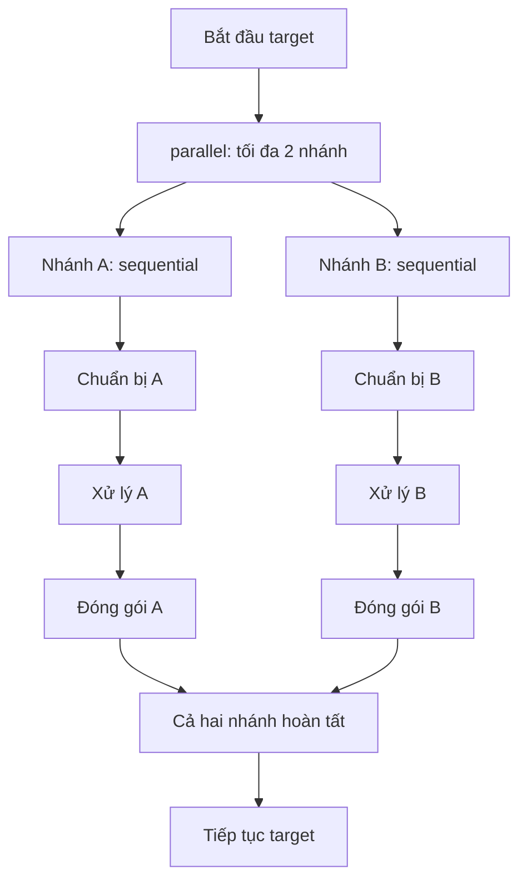

# Chạy tuần tự hoặc song song bằng `sequential` và `parallel` trong Apache Ant

Apache Ant thường thực hiện các task trong một target theo thứ tự chúng xuất hiện. Khi một bước cần kết quả của bước trước, cách chạy tuần tự là phù hợp: tạo thư mục, copy file, rồi đóng gói. Khi có nhiều công việc độc lập, Ant có task container `parallel` để chạy chúng trên các thread riêng. Task `sequential` cho phép gom một chuỗi thao tác thành một nhánh có thứ tự bên trong vùng chạy song song.

Ba khái niệm cần phân biệt:

- **Thứ tự task thông thường:** các task được khai báo trong một target chạy lần lượt từ trên xuống dưới.
- **`sequential`:** một container thực thi các task con lần lượt; thường được dùng để tạo một pipeline trong một nhánh của `parallel`.
- **`parallel`:** một container chạy các task con đồng thời trên những thread riêng, trong giới hạn số thread được cấu hình.

`sequential` và `parallel` là task container, không phải target và cũng không thay thế đồ thị dependency của `target depends`. Chúng điều khiển cách thực thi các task được lồng bên trong.

## 1. Chạy tuần tự: bước sau dùng kết quả bước trước

Trong target thông thường, Ant chạy các task theo thứ tự khai báo. Ví dụ:

```xml
<target name="prepare-release">
    <mkdir dir="build/stage"/>
    <copy todir="build/stage">
        <fileset dir="src/release"/>
    </copy>
    <zip destfile="build/release.zip"
         basedir="build/stage"/>
</target>
```

Trình tự thực hiện là:

1. Tạo thư mục `build/stage`.
2. Copy các file phát hành vào thư mục staging.
3. Tạo `build/release.zip` từ nội dung đã staging.

Task `zip` cần file được copy ở bước trước, nên ba thao tác phải chạy theo thứ tự. Nếu đưa chúng vào các nhánh song song riêng biệt, `zip` có thể bắt đầu trước khi `copy` hoàn tất và tạo archive thiếu nội dung.

### Dùng `sequential` tường minh

Có thể gom cùng chuỗi thao tác vào một `<sequential>`:

```xml
<target name="prepare-release">
    <sequential>
        <mkdir dir="build/stage"/>
        <copy todir="build/stage">
            <fileset dir="src/release"/>
        </copy>
        <zip destfile="build/release.zip"
             basedir="build/stage"/>
    </sequential>
</target>
```

Trong một target, việc dùng `sequential` như trên thường không cần thiết vì các task cấp cao nhất vốn đã chạy theo thứ tự. Giá trị chính của nó xuất hiện khi chuỗi này được đặt bên trong `<parallel>`: toàn bộ chuỗi trở thành một nhánh, và các task trong nhánh vẫn chạy lần lượt.

`sequential` không có thuộc tính cấu hình riêng và chỉ nhận các Ant task làm phần tử con. Không đặt một phần tử `<target>` bên trong `sequential`; hãy đặt các task thực thi hoặc task điều phối phù hợp.

## 2. Chạy song song bằng `parallel`

`parallel` khởi chạy các task con trên các thread riêng. Ant chờ các task hoàn tất trước khi tiếp tục phần tiếp theo của target trong trường hợp chạy thành công bình thường.

Ví dụ, hai nhóm tài nguyên độc lập có thể được staging và nén đồng thời:

```xml
<target name="build-resource-archives">
    <mkdir dir="build/archive"/>

    <parallel threadCount="2">
        <sequential>
            <mkdir dir="build/stage/docs"/>
            <copy todir="build/stage/docs">
                <fileset dir="docs"/>
            </copy>
            <zip destfile="build/archive/docs.zip"
                 basedir="build/stage/docs"/>
        </sequential>

        <sequential>
            <mkdir dir="build/stage/config"/>
            <copy todir="build/stage/config">
                <fileset dir="config/release"/>
            </copy>
            <zip destfile="build/archive/config.zip"
                 basedir="build/stage/config"/>
        </sequential>
    </parallel>
</target>
```

Có hai nhánh độc lập:

- Nhánh tài liệu copy `docs/` rồi tạo `docs.zip`.
- Nhánh cấu hình copy `config/release/` rồi tạo `config.zip`.

Hai nhánh có thể chạy đồng thời vì chúng ghi vào thư mục staging và archive khác nhau. Bên trong mỗi nhánh, `mkdir` phải hoàn tất trước `copy`, và `copy` phải hoàn tất trước `zip`; do đó mỗi nhánh được đặt trong một `<sequential>`.

`threadCount="2"` giới hạn tối đa hai task con chạy đồng thời. Vì ở đây có hai nhánh `sequential`, Ant có thể chạy cả hai cùng lúc.

### Thứ tự bắt đầu và thứ tự hoàn tất

Khi giới hạn bằng `threadCount`, Ant khởi chạy các task con theo thứ tự chúng được khai báo, nhưng không bảo đảm task nào hoàn tất trước. Nhánh copy nhanh có thể kết thúc trước nhánh copy chậm. Không viết logic phụ thuộc vào thứ tự hoàn tất của các nhánh song song.

Nếu không đặt `threadCount`, các task con có thể được chạy đồng thời cùng lúc. Với nhiều task nặng, điều này có thể làm máy thiếu CPU, RAM hoặc băng thông đĩa. Hãy đặt giới hạn phù hợp với tài nguyên và đặc điểm công việc.

## 3. Kết hợp `parallel` và nhiều nhánh `sequential`

Đây là mẫu sử dụng quan trọng nhất khi một build có nhiều pipeline độc lập. Mỗi nhánh thực hiện một chuỗi công việc theo thứ tự riêng; các nhánh chạy đồng thời với nhau.



Ví dụ thực tế hơn là build hai module độc lập. Mỗi module có buildfile riêng với target `verify` và `package`:

```xml
<target name="build-modules">
    <parallel threadCount="2" failonany="true">
        <sequential>
            <ant antfile="modules/catalog/build.xml"
                 target="verify"
                 inheritAll="false"/>
            <ant antfile="modules/catalog/build.xml"
                 target="package"
                 inheritAll="false"/>
        </sequential>

        <sequential>
            <ant antfile="modules/billing/build.xml"
                 target="verify"
                 inheritAll="false"/>
            <ant antfile="modules/billing/build.xml"
                 target="package"
                 inheritAll="false"/>
        </sequential>
    </parallel>
</target>
```

Trong nhánh `catalog`, target `package` chỉ được gọi sau khi `verify` của catalog hoàn tất. Nhánh billing có trình tự tương tự. Hai module chạy song song vì chúng độc lập với nhau.

Ví dụ này giả định mỗi module có output directory riêng và buildfile con không ghi chung file với module khác. Nếu buildfile con dùng `javac`, hãy xem xét chạy compiler trong tiến trình riêng bằng `fork="true"`; không nên mặc định mọi task Ant đều an toàn khi nhiều thread gọi đồng thời.

## 4. Phân biệt task container với dependency giữa target

`depends` và `parallel` giải quyết hai loại quan hệ khác nhau:

| Cơ chế | Điều khiển | Ví dụ |
|---|---|---|
| `depends` | Target tiền đề phải chạy trước target được yêu cầu | `test` phụ thuộc `compile` |
| Task thông thường trong target | Thứ tự các task trong phần thân target | `mkdir` rồi `copy` rồi `zip` |
| `sequential` | Thứ tự các task con trong cùng container | `copy` rồi `zip` trong một nhánh |
| `parallel` | Chạy các task con độc lập trên thread riêng | Build hai module độc lập cùng lúc |

Ví dụ khai báo:

```xml
<target name="compile">
    <!-- Biên dịch ứng dụng -->
</target>

<target name="test" depends="compile">
    <!-- Chạy kiểm thử sau khi compile -->
</target>

<target name="release" depends="test">
    <parallel threadCount="2">
        <sequential>
            <copy todir="build/release/docs">
                <fileset dir="docs"/>
            </copy>
            <zip destfile="build/release/docs.zip"
                 basedir="build/release/docs"/>
        </sequential>
        <sequential>
            <copy todir="build/release/config">
                <fileset dir="config/release"/>
            </copy>
            <zip destfile="build/release/config.zip"
                 basedir="build/release/config"/>
        </sequential>
    </parallel>
    <echo message="Các gói release đã được tạo."/>
</target>
```

Khi gọi `ant release`, Ant thực hiện `compile`, sau đó `test`, rồi mới vào phần thân `release`. Bên trong target release, hai nhánh copy/zip chạy song song. Task `echo` sau container chỉ chạy sau khi `parallel` kết thúc thành công.

Khai báo `depends="compile,test"` không tự biến hai target thành hai nhánh song song. Dependency của target được Ant xử lý theo đồ thị target; muốn chạy các task đồng thời, phải dùng task container `parallel` ở vị trí thích hợp.

## 5. Các thuộc tính quan trọng của `parallel`

| Thuộc tính | Tác dụng |
|---|---|
| `threadCount` | Giới hạn số task con được thực thi đồng thời; nếu bỏ qua, các task con có thể được chạy cùng lúc |
| `threadsPerProcessor` | Xác định số thread theo số processor khả dụng trên JVM hỗ trợ; khi được chỉ định, giá trị này chi phối giới hạn thread thay cho `threadCount` |
| `failonany` | Khi `true`, container kết thúc ngay khi một task con thất bại, không chờ các task con khác hoàn tất; mặc định là `false` |
| `timeout` | Giới hạn thời gian thực thi của container, tính bằng mili giây |

Không cần đặt tất cả thuộc tính trong mọi buildfile. Thường chỉ cần `threadCount` để kiểm soát tải và `failonany` để chọn cách phản ứng khi có lỗi.

### `failonany` và lỗi trong nhánh

Mặc định `failonany="false"`. Nếu một task con thất bại, các task ở thread khác vẫn tiếp tục; Ant chờ các task còn lại hoàn tất rồi mới báo lỗi của container.

Khi đặt `failonany="true"`, container kết thúc ngay khi phát hiện một task con thất bại và không chờ các task còn lại hoàn tất. Điều này không nên được hiểu là mọi tác vụ đang chạy chắc chắn bị dừng tức thì. Một tiến trình hoặc task đã bắt đầu có thể còn đang thực hiện thao tác bên ngoài; hãy tránh để nó tiếp tục ghi vào đầu ra dùng chung hoặc dữ liệu mà bước sau sẽ xóa.

Ví dụ:

```xml
<parallel threadCount="3" failonany="true">
    <sequential>
        <exec executable="tool-a" failonerror="true"/>
    </sequential>
    <sequential>
        <exec executable="tool-b" failonerror="true"/>
    </sequential>
    <sequential>
        <exec executable="tool-c" failonerror="true"/>
    </sequential>
</parallel>
```

Với `exec`, cần đặt `failonerror="true"` nếu mã thoát khác 0 phải được xem là thất bại của task. Nếu không, tiến trình ngoài có thể trả lỗi nhưng task Ant vẫn không báo lỗi theo cách build mong đợi.

### Timeout

Có thể đặt timeout theo mili giây cho các tác vụ có thời gian chạy giới hạn:

```xml
<parallel threadCount="2" timeout="300000" failonany="true">
    <!-- Các task độc lập -->
</parallel>
```

`300000` mili giây tương đương 5 phút. Timeout giúp giới hạn thời gian chờ của container; không nên dùng nó thay cho cơ chế dừng/cleanup chuyên biệt của một server hoặc tiến trình ngoài.

## 6. Chọn công việc phù hợp để chạy song song

Một nhóm công việc chỉ phù hợp để chạy song song khi chúng độc lập về dữ liệu, đầu ra và trạng thái dùng chung. Ví dụ thường phù hợp:

- Tạo archive tài liệu và archive cấu hình vào hai file khác nhau.
- Chạy các kiểm tra độc lập trên các module có workspace/output riêng.
- Chạy một tiến trình server và một bộ kiểm thử cần server đó, khi đã thiết kế cơ chế khởi động, chờ sẵn sàng và dừng server rõ ràng.
- Gọi nhiều công cụ bên ngoài độc lập, mỗi công cụ nhận input và ghi output riêng.

Các tình huống không phù hợp:

- Task B cần file do task A tạo ra.
- Hai nhánh ghi cùng một file, cùng thư mục staging hoặc cùng archive.
- Nhiều task cập nhật cùng một property hoặc reference dùng chung.
- Một task xóa thư mục trong khi task khác đang đọc/ghi bên trong.
- Task có trạng thái nội bộ không an toàn khi nhiều instance chạy cùng lúc.

Không nên song song hóa chỉ vì máy có nhiều lõi CPU. Một tác vụ có thể bị giới hạn bởi ổ đĩa, mạng hoặc bộ nhớ; thêm thread có thể làm build chậm hơn do tranh chấp tài nguyên.

## 7. Thread safety và trạng thái dùng chung của Ant

Ant cảnh báo rằng task lồng trong `parallel` không được bảo đảm an toàn luồng. Dù phần lõi Ant được xem là thread-safe, các task không được kiểm thử để bảo đảm mọi cách dùng đồng thời đều an toàn. Task của bên thứ ba có thể có hành vi riêng; một số task lõi như `javac` không re-entrant vì thư viện compiler được sử dụng không được thiết kế cho nhiều lần gọi đồng thời trong cùng tiến trình.

Vì vậy, hãy đặc biệt thận trọng với:

- **`javac`:** không chạy nhiều instance trong cùng JVM song song một cách mặc định. Nếu cần biên dịch độc lập đồng thời, cân nhắc `fork="true"` để mỗi compiler chạy trong tiến trình riêng và ghi vào `destdir` riêng.
- **`javadoc`:** không chạy đồng thời với `javac` hoặc một Javadoc task khác nếu chưa xác minh tổ hợp task/JDK an toàn.
- **Task bên thứ ba:** đọc tài liệu hoặc kiểm thử thread safety trước khi đưa vào `parallel`.
- **Property:** Ant property thông thường bất biến sau khi thiết lập. Không để các nhánh đua nhau thiết lập cùng một tên property rồi phụ thuộc vào nhánh nào thắng.
- **File output:** mỗi nhánh cần output path riêng; việc hai nhánh cùng ghi một file có thể làm hỏng hoặc ghi đè kết quả.

Ví dụ dùng compiler forked cho hai module độc lập:

```xml
<parallel threadCount="2" failonany="true">
    <javac srcdir="modules/catalog/src"
           destdir="build/catalog/classes"
           fork="true"
           includeantruntime="false"/>

    <javac srcdir="modules/billing/src"
           destdir="build/billing/classes"
           fork="true"
           includeantruntime="false"/>
</parallel>
```

Đây là một mẫu minh họa cho hai lần biên dịch được cô lập trong tiến trình compiler riêng. Hai `destdir` khác nhau và source root độc lập. Vẫn cần bảo đảm classpath, thư viện, output và các tác động khác không xung đột. Nếu compiler hoặc annotation processor dùng cache/thư mục tạm chung, hãy cấu hình chúng riêng hoặc chạy tuần tự.

## 8. Kết hợp tuần tự sau giai đoạn song song

Thông thường, một build có thể chạy các bước độc lập đồng thời, rồi thực hiện một bước tổng hợp sau khi tất cả nhánh đã hoàn tất:

```xml
<target name="assemble-release">
    <mkdir dir="build/release"/>

    <parallel threadCount="2" failonany="true">
        <sequential>
            <copy todir="build/release/docs">
                <fileset dir="docs"/>
            </copy>
            <zip destfile="build/release/docs.zip"
                 basedir="build/release/docs"/>
        </sequential>
        <sequential>
            <copy todir="build/release/config">
                <fileset dir="config/release"/>
            </copy>
            <zip destfile="build/release/config.zip"
                 basedir="build/release/config"/>
        </sequential>
    </parallel>

    <!-- Chỉ chạy sau khi cả hai nhánh hoàn tất thành công. -->
    <zip destfile="build/release/release-bundle.zip"
         basedir="build/release"/>
</target>
```

Archive tổng hợp chỉ được tạo sau khi container `parallel` trả về thành công. Nếu một nhánh thất bại, task container ném lỗi và các task phía sau trong target không được chạy.

Với `failonany="true"`, nhánh còn lại có thể vẫn đang hoàn tất tác động bên ngoài khi container trả lỗi. Vì thế, không nên có một target cleanup tự động xóa ngay output của các nhánh đang chạy mà không kiểm tra trạng thái tiến trình.

## 9. Logging và khả năng quan sát

Khi nhiều task chạy cùng lúc, thông điệp log của chúng có thể xen kẽ. Không dựa vào thứ tự dòng log để suy luận chính xác thứ tự thực thi. Hãy đặt thông điệp nhận diện nhánh hoặc cấu hình mỗi tiến trình ghi log vào file riêng:

```xml
<parallel threadCount="2">
    <sequential>
        <echo message="[catalog] Bắt đầu kiểm tra"/>
        <exec executable="catalog-checker"
              failonerror="true"
              output="build/logs/catalog.log"/>
    </sequential>
    <sequential>
        <echo message="[billing] Bắt đầu kiểm tra"/>
        <exec executable="billing-checker"
              failonerror="true"
              output="build/logs/billing.log"/>
    </sequential>
</parallel>
```

Ví dụ giả định thư mục `build/logs` đã tồn tại và hai công cụ ngoài hỗ trợ cách gọi này. Mỗi tiến trình ghi log riêng để dễ xem lại khi log console bị xen kẽ.

## 10. Ví dụ buildfile hoàn chỉnh

Ví dụ dưới đây staging hai nhóm tài nguyên độc lập đồng thời, sau đó tạo một archive tổng hợp:

```xml
<?xml version="1.0" encoding="UTF-8"?>
<project name="parallel-build" default="release" basedir=".">

    <property name="build.dir" location="build"/>
    <property name="stage.dir" location="${build.dir}/stage"/>
    <property name="archive.dir" location="${build.dir}/archive"/>

    <target name="clean">
        <delete dir="${build.dir}"/>
    </target>

    <target name="init">
        <mkdir dir="${stage.dir}"/>
        <mkdir dir="${archive.dir}"/>
    </target>

    <target name="stage" depends="init">
        <parallel threadCount="2" failonany="true">
            <sequential>
                <mkdir dir="${stage.dir}/docs"/>
                <copy todir="${stage.dir}/docs">
                    <fileset dir="docs"/>
                </copy>
                <zip destfile="${archive.dir}/docs.zip"
                     basedir="${stage.dir}/docs"/>
            </sequential>

            <sequential>
                <mkdir dir="${stage.dir}/config"/>
                <copy todir="${stage.dir}/config">
                    <fileset dir="config/release"/>
                </copy>
                <zip destfile="${archive.dir}/config.zip"
                     basedir="${stage.dir}/config"/>
            </sequential>
        </parallel>
    </target>

    <target name="release" depends="stage">
        <zip destfile="${archive.dir}/release-bundle.zip">
            <fileset dir="${archive.dir}" includes="docs.zip,config.zip"/>
        </zip>
    </target>

</project>
```

Chạy:

```bash
ant stage
ant release
```

`ant stage` chỉ thực hiện hai nhánh staging và tạo hai archive riêng. `ant release` gọi `stage` trước nhờ dependency, rồi tạo archive tổng hợp. Trong lần chạy `release`, target `stage` chỉ được thực hiện một lần trong invocation đó.

Ví dụ này minh họa cách chia một target thành các nhánh độc lập. Với dự án thực tế, hãy kiểm tra thread safety của các task được chọn và bảo đảm không có hai nhánh ghi cùng một đường dẫn.

## 11. Những lỗi thường gặp và cách xử lý

| Triệu chứng | Nguyên nhân có thể | Cách xử lý |
|---|---|---|
| Archive thiếu file | `zip` chạy song song với `copy` thay vì sau nó | Gom `copy` rồi `zip` vào cùng một `sequential` |
| Một nhánh đọc file trước khi nhánh khác tạo xong | Hai công việc có dependency nhưng bị đặt ở hai nhánh song song | Chuyển chúng vào cùng nhánh tuần tự hoặc tạo target tiền đề riêng |
| Build lỗi ngẫu nhiên khi chạy song song | Task không thread-safe hoặc dùng trạng thái chung | Chạy tuần tự, cô lập tiến trình bằng `fork` khi phù hợp, hoặc thay task |
| File output bị ghi đè/hỏng | Hai nhánh cùng ghi một file hoặc thư mục | Tách output directory và tên artifact theo nhánh |
| Property nhận giá trị không ổn định | Nhiều nhánh cùng cố thiết lập property | Tính property trước `parallel`; dùng tên riêng cho dữ liệu riêng của từng nhánh |
| Build dừng ngay khi một nhánh lỗi | Đặt `failonany="true"` | Dùng mặc định nếu cần chờ tất cả nhánh hoàn tất trước khi báo lỗi |
| Build chỉ báo lỗi sau khi mọi nhánh đã chạy xong | `failonany` mặc định là false | Đặt `failonany="true"` nếu chính sách cần kết thúc container ngay khi phát hiện lỗi |
| Máy chậm hơn khi bật parallel | Quá nhiều thread, tranh chấp CPU/RAM/đĩa hoặc công việc vốn phụ thuộc I/O chung | Giới hạn `threadCount` và đo thời gian trên workload thực tế |
| Log khó đọc | Nhiều thread ghi console cùng lúc | Gắn nhãn log hoặc ghi output mỗi nhánh vào file riêng |
| Compiler lỗi khi nhiều module build cùng lúc | `javac` chạy trong cùng JVM và không re-entrant | Dùng `fork="true"` với output riêng hoặc biên dịch tuần tự |

## 12. Quy tắc tổ chức buildfile

- Để các task phụ thuộc nhau trong cùng target chạy theo thứ tự khai báo hoặc gom chúng trong một `sequential`.
- Dùng `parallel` chỉ cho những task/nhánh độc lập về đầu vào, đầu ra và trạng thái.
- Dùng một `sequential` cho mỗi pipeline cần giữ thứ tự bên trong nhưng có thể chạy đồng thời với pipeline khác.
- Đặt `threadCount` để giới hạn số task con chạy cùng lúc; không mặc định càng nhiều thread càng nhanh.
- Chọn `failonany` theo chính sách lỗi của build và hiểu rằng task khác có thể vẫn đang tác động bên ngoài khi container trả về sớm.
- Không chạy nhiều task `javac` trong cùng JVM song song nếu chưa cô lập hoặc xác minh thread safety; cân nhắc `fork="true"`.
- Không để các nhánh cập nhật cùng property, reference, file hoặc thư mục output.
- Dùng `depends` cho thứ tự giữa các target; không trông chờ danh sách dependency tự chạy song song.
- Giữ bước tổng hợp sau `parallel` để chỉ dùng đầu ra khi các nhánh đã hoàn tất thành công.
- Kiểm tra log riêng cho từng nhánh khi cần chẩn đoán lỗi.

## 13. Bài tập tự kiểm tra

**Bài 1.** Một target cần chạy `mkdir`, `copy`, rồi `zip`. Có cần `parallel` không?

**Đáp án:** Không. Đây là chuỗi phụ thuộc; các task trong target vốn chạy tuần tự. Có thể dùng `sequential` để biểu diễn rõ một chuỗi, đặc biệt nếu nó sẽ được lồng vào `parallel`.

**Bài 2.** Có hai module độc lập, mỗi module cần chạy `verify` rồi `package`. Cách tổ chức nào phù hợp?

**Đáp án:** Dùng một `parallel` chứa hai `sequential`. Trong mỗi nhánh, gọi `verify` trước `package`; hai nhánh module có thể chạy đồng thời nếu output và task của chúng độc lập, thread-safe.

**Bài 3.** `threadCount="2"` có bảo đảm nhánh thứ nhất hoàn tất trước nhánh thứ hai không?

**Đáp án:** Không. Nó giới hạn số task con chạy đồng thời. Ant có thể khởi chạy task theo thứ tự khai báo nhưng không bảo đảm thứ tự hoàn tất.

**Bài 4.** Khi một task con thất bại, `failonany="false"` làm gì?

**Đáp án:** Các task còn lại tiếp tục chạy; container chờ các task hoàn tất rồi mới báo lỗi. Với `failonany="true"`, container kết thúc khi phát hiện lỗi mà không chờ các task khác hoàn tất.

**Bài 5.** Có nên chạy hai task `javac` trong cùng một `parallel` không?

**Đáp án:** Không nên mặc định làm vậy. `javac` không re-entrant trong cùng JVM; nếu cần chạy đồng thời, cân nhắc `fork="true"` và bảo đảm mỗi compiler có output riêng.

**Bài 6.** Vì sao không nên để hai nhánh song song cùng ghi `build/release.zip`?

**Đáp án:** Hai thread có thể cùng ghi một archive, dẫn đến ghi đè hoặc file hỏng. Mỗi nhánh cần tạo artifact riêng; bước tổng hợp chạy sau khi tất cả nhánh hoàn tất.

## Tài liệu tham khảo

- [Apache Ant Manual: Parallel Task](https://ant.apache.org/manual/Tasks/parallel.html)
- [Apache Ant Manual: Sequential Task](https://ant.apache.org/manual/Tasks/sequential.html)
- [Apache Ant Manual: Java Task](https://ant.apache.org/manual/Tasks/java.html)

## Kết luận

`sequential` giữ thứ tự giữa các task trong cùng một pipeline; `parallel` chạy những task hoặc pipeline độc lập trên các thread riêng. Kết hợp hai container cho phép mỗi nhánh thực hiện các bước phụ thuộc theo thứ tự, trong khi những nhánh khác chạy đồng thời. Để build ổn định, cần giới hạn số thread, tách đầu ra, chọn chính sách lỗi phù hợp và kiểm tra thread safety của task. Với các quan hệ giữa target, tiếp tục dùng `depends`; với các công việc độc lập bên trong một target, dùng `parallel` có chủ đích.

