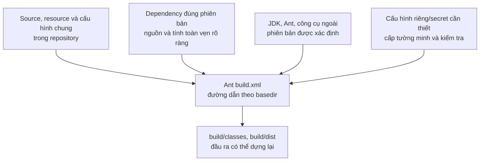

# Loại bỏ phụ thuộc ngầm vào máy cá nhân và thư mục người dùng khi build bằng Apache Ant

Một dự án Ant có thể chạy thành công trên máy người viết nhưng thất bại khi đồng nghiệp clone mã nguồn, khi đổi tài khoản đăng nhập hoặc khi chạy trên CI. Nguyên nhân thường không nằm ở mã Java: `build.xml` đã âm thầm đọc thư viện, cấu hình, công cụ hoặc tệp trung gian chỉ tồn tại trên máy ban đầu.

Trong bối cảnh **Build Tool Ant → Build tái lập**, mục tiêu của bài học là biến các phụ thuộc đó thành **đầu vào rõ ràng, có thể kiểm soát**. Một bản build phải xác định được nó lấy mã nguồn ở đâu, dùng phiên bản công cụ và thư viện nào, nhận cấu hình bằng cách nào và đặt kết quả ở đâu, mà không cần biết người chạy là ai hoặc thư mục home của họ nằm ở đâu.

## 1. Nhận diện phụ thuộc ngầm

Xét một đoạn `build.xml` như sau:

```xml
<project name="legacy-app" default="compile">
    <property name="lib.dir" location="${user.home}/my-jars"/>
    <property name="private.config"
              location="C:\Users\alice\Desktop\app.properties"/>

    <target name="compile">
        <mkdir dir="build/classes"/>
        <javac srcdir="src" destdir="build/classes"
               classpath="${lib.dir}/common.jar"
               includeantruntime="true"/>
    </target>
</project>
```

Trên máy Alice, hai tệp có thể tồn tại nên target `compile` chạy được. Sau khi clone dự án sang máy khác, `${user.home}` trỏ sang home của người mới; đường dẫn `C:\Users\alice\...` vẫn trỏ đến máy Alice; `common.jar` không được dự án khai báo nguồn hoặc phiên bản. Việc cho phép classpath của Ant lọt vào compiler còn khiến kết quả phụ thuộc vào các JAR cài cùng Ant.

Đây là **phụ thuộc ngầm**: một phần đầu vào build tồn tại ngoài nguồn đã quản lý nhưng không được mô tả thành yêu cầu có thể tái tạo.

Không phải mọi đường dẫn tuyệt đối đều sai. Máy CI có thể chủ động truyền đường dẫn đến một JDK hoặc một tệp cấu hình bí mật. Điểm khác biệt là đường dẫn ấy được **khai báo, cung cấp và kiểm tra công khai** trong quy trình build, thay vì bị cố định theo môi trường của một cá nhân.

### Ba mức độ cần phân biệt

| Khái niệm | Yêu cầu thực tế | Ví dụ |
| --- | --- | --- |
| **Khả chuyển (portable build)** | Build chạy được ở các thư mục và tài khoản khác nhau khi đủ điều kiện tiên quyết | Không sử dụng `C:\Users\alice` hoặc `/home/alice` |
| **Có thể tái lập (reproducible build)** | Với các đầu vào và phiên bản công cụ đã xác định, kết quả được tạo nhất quán | Cùng source, JDK, Ant, thư viện và cấu hình |
| **Cách ly hoàn toàn (hermetic build)** | Chỉ các đầu vào được phép mới tác động đến quá trình build | Toolchain và dependency được cấp trong môi trường cách ly |

Loại bỏ phụ thuộc vào home là bước quan trọng để xây dựng tính khả chuyển và tái lập, nhưng **chưa tự động bảo đảm JAR giống nhau từng byte**: timestamp, thứ tự đóng gói, phiên bản JDK/Ant và môi trường biên dịch vẫn có thể tạo khác biệt.

## 2. Vì sao `user.home` và đường dẫn máy cá nhân gây lỗi?

Ant chạy trên JVM nên có thể nhìn thấy các Java system property, bao gồm `user.home`. Lệnh `<property environment="env"/>` còn nhập các biến môi trường thành những property như `${env.HOME}` hoặc `${env.USERPROFILE}`, tùy hệ điều hành và môi trường.

Các giá trị ấy mô tả **máy đang chạy**, không mô tả **cấu trúc dự án**. Chúng không phù hợp làm nguồn mặc định cho JAR đầu vào, mã nguồn hay file cấu hình có ảnh hưởng tới sản phẩm build.

Một số dấu hiệu điển hình:

| Dấu hiệu trong script | Rủi ro | Cách xử lý |
| --- | --- | --- |
| `C:\Users\...`, `/Users/...`, `/home/...` | Gắn với tên người dùng và hệ điều hành | Chuyển dữ liệu cần thiết vào cấu trúc dự án hoặc khai báo đầu vào |
| `${user.home}/lib`, `${env.HOME}/tools` | Cấu hình mỗi máy khác nhau | Dùng thư mục trong repository hoặc tham số explicit |
| `${user.home}/.m2/repository/...jar` | Vô tình dùng bản JAR có sẵn trong cache | Khai báo phiên bản nguồn dependency và cách lấy dependency |
| `classpath="${java.class.path}"` | Hút các JAR từ JVM/Ant đang chạy | Tạo `<path>` classpath riêng cho dự án |
| `includeantruntime="true"` trong `<javac>` | Compiler thấy thư viện của runtime Ant | Đặt `includeantruntime="false"` |
| Gọi `git`, `node`, `protoc` không xác định phiên bản | Dùng executable đầu tiên trên `PATH` | Ấn định phiên bản và cách cấp công cụ; kiểm tra đầu vào |
| Đọc `../shared/config.xml` nằm ngoài repository | Clone riêng dự án có thể thiếu file | Đưa file vào source hoặc khai báo đường dẫn và nguồn cấp |
| Tạo artifact trực tiếp vào Desktop/Documents | Build không độc lập với tài khoản, khó dọn dẹp | Đặt đầu ra dưới thư mục build được quy ước |

Lưu ý: cache tải dependency hoặc thư mục tạm của hệ thống có thể được dùng để **tối ưu tốc độ**. Vấn đề xảy ra khi cache trở thành nơi **duy nhất** chứa đầu vào bắt buộc, hoặc nội dung cache quyết định phiên bản thư viện được dùng.

## 3. Chọn điểm neo đường dẫn: `basedir` của Ant

Với project Ant bình thường, `basedir` là thư mục gốc của dự án: mặc định gắn với vị trí file build được chọn, hoặc được xác định bởi thuộc tính `basedir` trên `<project>`. Thay vì ghép tên home của người chạy, hãy neo đường dẫn tới thư mục này.

```xml
<project name="portable-app" default="package" basedir=".">
    <property name="src.dir" location="src/main/java"/>
    <property name="build.dir" location="build"/>
    <property name="classes.dir" location="${build.dir}/classes"/>
    <property name="dist.dir" location="${build.dir}/dist"/>
</project>
```

Khi dùng thuộc tính `location`, Ant xử lý đường dẫn theo cơ sở dự án và chuẩn hóa thành path phù hợp với hệ điều hành. Vì vậy cách viết trên không phụ thuộc vào việc người dùng clone repository trong `D:\work`, `/srv/ci/workspace` hay một vị trí khác.

So sánh:

```xml
<!-- Dễ hỏng: dữ liệu được giữ ngoài dự án trên máy người viết. -->
<property name="src.dir" location="C:\Users\alice\project\src"/>
<property name="build.dir" location="${user.home}/Desktop/build-output"/>

<!-- Có thể di chuyển: đường dẫn nằm trong cấu trúc dự án. -->
<property name="src.dir" location="src"/>
<property name="build.dir" location="build"/>
```

Không nên lấy thư mục làm việc của shell làm giả định không được ghi nhận. Hai cách gọi dưới đây phải cùng xác định đúng source và output nếu trỏ vào cùng một `build.xml`:

```bash
# Đứng ở thư mục dự án.
ant -f build.xml package

# Đứng ở thư mục bất kỳ, chỉ rõ file build của repository.
ant -f /path/to/repository/build.xml package
```

Đường dẫn `/path/to/repository` trong ví dụ là chỗ người thực thi thay bằng vị trí clone thực tế; nó không phải giá trị cần đưa vào `build.xml`.

### Khi nào cần biết vị trí một file build được import?

Trong Ant, một file được `<import>` thường hoạt động trong **basedir của project chính**. Vì vậy nếu một target import cần đọc tài nguyên nằm cạnh **chính file import**, không nên mặc nhiên coi `${basedir}` là thư mục của file đó. Ant cung cấp property dạng `ant.file.<project-name>` cho file có tên project được import; có thể xác định thư mục của nó bằng `<dirname>` khi thực sự cần.

```xml
<!-- Trong file common.xml có <project name="common">. -->
<dirname property="common.dir" file="${ant.file.common}"/>
<property name="common.template"
          location="${common.dir}/templates/config.xml"/>
```

Cách này xử lý dependency nằm cạnh file import, thay vì dựa vào thư mục home hoặc vị trí người dùng gõ lệnh.

## 4. Một dự án Ant độc lập với thư mục người dùng

Ví dụ tối thiểu sau chỉ cần mã nguồn được đưa vào repository và bộ công cụ Ant/JDK đúng phiên bản. Nó không cần file trong Desktop, `~/.ant`, `~/.m2` hay các thư mục riêng của một người.

```text
portable-ant/
├── build.xml
├── build.properties
├── src/
│   └── main/
│       └── java/
│           └── com/example/App.java
└── build/                 # Được Ant tạo ra, không commit
```

**File `build.properties`** — commit cùng mã nguồn:

```properties
java.release=17
source.encoding=UTF-8
```

**File `src/main/java/com/example/App.java`:**

```java
package com.example;

public final class App {
    public static void main(String[] args) {
        System.out.println("Portable Ant build");
    }
}
```

**File `build.xml` hoàn chỉnh:**

```xml
<?xml version="1.0" encoding="UTF-8"?>
<project name="portable-ant" default="package" basedir=".">
    <!-- Thuộc tính dự án được kiểm soát bằng version control. -->
    <property file="${basedir}/build.properties"/>

    <!-- Tất cả đường dẫn mặc định bám theo project basedir. -->
    <property name="src.dir" location="src/main/java"/>
    <property name="build.dir" location="build"/>
    <property name="classes.dir" location="${build.dir}/classes"/>
    <property name="dist.dir" location="${build.dir}/dist"/>

    <target name="init">
        <mkdir dir="${classes.dir}"/>
    </target>

    <target name="compile" depends="init">
        <javac srcdir="${src.dir}"
               destdir="${classes.dir}"
               release="${java.release}"
               encoding="${source.encoding}"
               includeantruntime="false"/>
    </target>

    <target name="package" depends="compile">
        <mkdir dir="${dist.dir}"/>
        <jar destfile="${dist.dir}/app.jar"
             basedir="${classes.dir}">
            <manifest>
                <attribute name="Main-Class" value="com.example.App"/>
            </manifest>
        </jar>
    </target>

    <target name="clean">
        <delete dir="${build.dir}"/>
    </target>
</project>
```

Chạy từ thư mục dự án:

```bash
ant clean package
java -jar build/dist/app.jar
```

Đầu ra mong đợi từ chương trình là `Portable Ant build`. Đây là ví dụ dành cho **JDK 17** và phiên bản Ant hỗ trợ thuộc tính `release` trên task `javac` (Ant 1.10.x phù hợp). Trên CI nên chọn rõ phiên bản Java và Ant thay vì mặc định dùng bản cài sẵn bất kỳ.

Tác dụng của từng quyết định:

- `build.properties` chứa phiên bản ngôn ngữ và encoding cần thiết, được quản lý cùng source.
- Các thư mục đầu vào/đầu ra luôn xác định từ `basedir`.
- `includeantruntime="false"` ngăn `javac` lấy thêm các thư viện riêng của Ant.
- `build/` là sản phẩm sinh ra có thể xóa và dựng lại; nên khai báo `build/` trong `.gitignore`.
- `clean` làm sạch đầu ra cũ để phát hiện các đầu vào vốn chỉ tồn tại nhờ lần build trước.

Ví dụ chưa có dependency ngoài JDK. Nếu ứng dụng cần thư viện bên thứ ba, phải xử lý chúng theo mục tiếp theo.

## 5. Loại bỏ JAR “mượn” từ home và classpath toàn cục

Một cấu hình nguy hiểm nhưng thường gặp là:

```xml
<property name="junit.jar"
          location="${user.home}/Downloads/junit-4.13.2.jar"/>
<javac srcdir="src" destdir="build/classes"
       classpath="${junit.jar}:${java.class.path}"/>
```

Nó phụ thuộc vào tệp tải về thủ công và ký tự `:` dùng làm dấu phân tách classpath kiểu Unix, đồng thời thêm classpath toàn cục vào compiler. Trên Windows, định dạng và nội dung classpath có thể khác.

### Phương án A: quản lý JAR trong repository

Với dự án nhỏ, có thể lưu các JAR đã phê duyệt và kiểm tra nguồn gốc/giấy phép trong `lib/` của dự án, đồng thời kiểm soát chính xác phiên bản bằng commit và checksum.

```text
portable-ant/
├── build.xml
├── lib/
│   ├── example-api-1.2.3.jar
│   └── example-core-2.4.0.jar
└── src/...
```

Khai báo classpath bằng cấu trúc `<path>` và `<fileset>`, để Ant tự dùng cách phân tách path của hệ điều hành:

```xml
<property name="lib.dir" location="lib"/>

<path id="compile.classpath">
    <fileset dir="${lib.dir}" includes="*.jar"/>
</path>

<target name="compile" depends="init">
    <javac srcdir="${src.dir}"
           destdir="${classes.dir}"
           release="${java.release}"
           encoding="${source.encoding}"
           includeantruntime="false">
        <classpath refid="compile.classpath"/>
    </javac>
</target>
```

Đây là **đoạn thay thế target `compile`** của ví dụ trước khi dự án thật có các JAR trong `lib/`; không phải đoạn cần chèn thêm để tạo hai target cùng tên. Thư mục `lib/` phải tồn tại và các JAR cần thiết phải có mặt, nếu không build phải báo lỗi thay vì tự tìm ở máy cá nhân.

### Phương án B: lấy dependency từ nguồn quản lý

Với dự án lớn, thay vì commit JAR, có thể dùng **Apache Ivy** hoặc một cơ chế quản lý artifact được tổ chức phê duyệt. Cần quy định rõ:

1. Tọa độ artifact và **phiên bản cụ thể**; tránh phụ thuộc vào phiên bản động như “latest”.
2. Repository được phép tải, quyền truy cập cần thiết và khả năng hoạt động trên CI.
3. Cách kiểm tra tính toàn vẹn (checksum hoặc cơ chế xác thực repository).
4. Chính sách cache: cache có thể tăng tốc, nhưng xóa cache không được làm thay đổi phiên bản được chọn.
5. Cách build thất bại rõ ràng nếu nguồn dependency không sẵn sàng, thay vì tự rơi về một JAR có sẵn trong `~/.m2` hoặc `~/Downloads`.

Ant gốc không có đầy đủ cơ chế quản lý dependency theo tọa độ và khóa phiên bản như các build tool hiện đại; nếu dùng Ivy, cần khai báo plugin, cấu hình và phiên bản của chính Ivy. Không được giả định Ivy đã tự hiện diện trong thư mục người dùng của máy chạy.

## 6. Cấu hình theo môi trường: cho phép khác nhau nhưng phải tường minh

Một dự án có thể cần endpoint thử nghiệm, khóa ký artifact, vị trí chứng chỉ hoặc tệp cấu hình riêng của CI. Không nhất thiết commit giá trị bí mật. Cách đúng là **biến chúng thành tham số bắt buộc hoặc có giá trị mặc định an toàn**, có tài liệu chỉ rõ nguồn cung cấp.

Ant property thường có nguyên tắc **giá trị được đặt trước giữ ưu tiên**. Giá trị từ `-D` trên dòng lệnh được cung cấp trước các khai báo `<property>` trong build file, nên có thể dùng để override một cấu hình mặc định. Nên đặt default cho dữ liệu ổn định rồi cho phép override có chủ đích.

```xml
<!-- Mặc định được commit, không chứa bí mật. -->
<property name="config.file" location="config/build-default.properties"/>

<target name="validate-config">
    <available file="${config.file}" property="config.available"/>
    <fail unless="config.available"
          message="Không tìm thấy config.file. Truyền -Dconfig.file=..."/>
</target>
```

Chạy với cấu hình mặc định:

```bash
ant validate-config
```

Hoặc CI cung cấp tệp khác một cách rõ ràng:

```bash
ant -Dconfig.file=/ci/config/build-ci.properties validate-config
```

Target `validate-config` ở đây minh họa **kiểm tra sự tồn tại của đầu vào**. Trong build thật, target nào cần file cấu hình phải khai báo `depends="validate-config"` và các bước sau đó mới đọc file đã được kiểm tra. Nếu cấu hình yêu cầu bí mật, CI phải cấp qua cơ chế secret thích hợp; không in giá trị bí mật ra log và không vô ý đóng gói chúng vào JAR.

Tránh mẫu dưới đây:

```xml
<!-- Mọi máy buộc phải có config riêng nằm trong home. -->
<property name="config.file"
          location="${user.home}/.mycompany/build.properties"/>
```

Trong trường hợp thật sự cần chọn file ngoài repository, hãy sử dụng `-Dconfig.file=...` hoặc cơ chế tương đương và báo lỗi hữu ích khi người chạy chưa cung cấp. Đường dẫn ngoại vi lúc đó là **đầu vào được công bố**, không phải phụ thuộc ngầm.

### Cẩn thận với property bất biến và thứ tự nạp

`<property>` không hoạt động như phép gán có thể ghi đè tùy ý. Nếu build nạp một property từ file trước, khai báo cùng tên ở phía sau thường không thay thế được giá trị đã có. Vì vậy:

- Xác định một thứ tự ưu tiên rõ ràng: tham số `-D` do người chạy/CI cấp, cấu hình dự án được commit, rồi mới tới các default còn thiếu.
- Không nạp cả một file cấu hình cá nhân vào build mà không kiểm soát những property nó được phép thay đổi.
- Không dùng giá trị `${env.HOME}` như một default “tiện tay” cho nguồn hoặc dependency bắt buộc.
- Nếu có nhiều môi trường, ghi rõ property nào được phép override và property nào phải cố định để duy trì tính tái lập.

## 7. Công cụ ngoài Ant cũng là đầu vào của build

Một target có thể không chứa đường dẫn home nhưng vẫn phụ thuộc vào máy cá nhân thông qua executable trên `PATH`:

```xml
<target name="generate">
    <exec executable="protoc" failonerror="true">
        <arg value="--version"/>
    </exec>
</target>
```

Đoạn này dùng bản `protoc` mà máy tình cờ tìm thấy trước. Nếu các máy có phiên bản khác nhau, source được sinh ra có thể khác. Với công cụ ngoài Ant:

- Ưu tiên task Ant hoặc thư viện đã kiểm soát phiên bản khi phù hợp.
- Nếu cần `<exec>`, quy định phiên bản công cụ; CI có thể cấp qua image/toolchain đã pin, hoặc một đường dẫn được truyền rõ ràng.
- Đặt working directory cụ thể khi lệnh cần đọc đường dẫn tương đối; dùng `dir="${basedir}"` cho lệnh chạy ở gốc dự án.
- Dùng `<arg value="..."/>`, `<arg file="..."/>` hoặc `<arg path="..."/>` thay cho tự nối chuỗi lệnh có phụ thuộc dấu cách và dấu phân tách path.
- Bật `failonerror="true"` khi lỗi của tiến trình ngoài phải làm build thất bại.

Ví dụ cấu hình đường dẫn công cụ rõ ràng:

```xml
<target name="verify-tool">
    <fail unless="protoc.executable"
          message="Cần truyền -Dprotoc.executable=PATH_TO_PROTOC"/>
    <exec executable="${protoc.executable}"
          dir="${basedir}" failonerror="true">
        <arg value="--version"/>
    </exec>
</target>
```

Đường dẫn được truyền vẫn có thể khác giữa CI/Linux/Windows, nhưng mục tiêu là **công cụ và phiên bản đã biết**. Chỉ kiểm tra `--version` không tự bảo đảm các phiên bản trùng nhau; pipeline còn cần chính sách pin hoặc xác thực phiên bản được chấp nhận.

## 8. Quy trình chuyển một build Ant cũ sang cấu hình tái lập

### Bước 1 — Liệt kê mọi đầu vào thật sự

Đọc `build.xml` và các file được `<import>`, `<include>` hoặc `<ant>` gọi tới. Ghi nhận:

- Source, resource, file cấu hình, template, JAR, plugin và script cần thiết.
- Công cụ: JDK, Ant, trình sinh mã, compiler bổ sung, shell utility, executable ngoài.
- Cấu hình hệ thống: biến môi trường, Java system properties, thư mục home, PATH, locale/encoding.
- Output và thư mục trung gian: class, generated sources, report, package, cache.

Có thể tìm các dấu hiệu trong file **đã được Git quản lý** bằng:

```bash
git grep -n -e 'user.home' -e 'env.HOME' \
  -e 'USERPROFILE' -e '/Users/' -e '/home/' \
  -e '.m2/repository' -e 'java.class.path' \
  -- '*.xml' '*.properties' '*.sh' '*.bat'
```

Câu lệnh nhiều dòng dùng `\` của shell Unix; trên PowerShell hãy nhập thành **một dòng** hoặc dùng cú pháp tiếp dòng tương ứng. Tìm kiếm văn bản chỉ phát hiện dấu hiệu đã biết; còn phải kiểm tra script gọi lệnh ngoài, file chưa theo dõi và các dependency được lấy gián tiếp từ classpath.

### Bước 2 — Phân loại đường dẫn và quyết định nơi sở hữu

| Loại đầu vào | Nơi nên quản lý |
| --- | --- |
| Mã nguồn, resource, template không bí mật | Repository |
| Phiên bản Java/Ant và compiler bổ sung | Tài liệu toolchain + cấu hình CI/image được pin |
| JAR hoặc dependency bên ngoài | `lib/` được quản lý hoặc artifact repository có phiên bản cố định |
| Cấu hình chung, ví dụ không chứa bí mật | File cấu hình được commit |
| Secret hoặc thông số chỉ có ở CI | CI secret/config và tham số explicit; kiểm tra thiếu dữ liệu |
| Output, generated code có thể tạo lại | Thư mục `build/` hay `dist/` có quy ước, không commit |
| Cache dùng để tăng tốc | Vị trí cache được kiểm soát, không làm nguồn đầu vào duy nhất |

### Bước 3 — Thay đường dẫn cá nhân bằng đường dẫn dự án

Giữ `<project basedir=".">` hoặc thiết lập basedir có căn cứ; tạo các property `src.dir`, `resource.dir`, `build.dir`, `dist.dir` bằng `location`. Nếu nhiều target dùng chung một đường dẫn, khai báo một lần rồi tham chiếu. Tránh chép nhiều đường dẫn đầy đủ vào `copy`, `javac` và `jar`.

### Bước 4 — Cố định classpath và toolchain

Dùng `<path>`, `<fileset>` và `<classpath refid="..."/>` để Ant quản lý path theo nền tảng. Đặt `includeantruntime="false"`. Khai báo encoding và mục tiêu Java, giữ phiên bản JDK, Ant và dependency nhất quán giữa local/CI. Loại bỏ mọi cơ chế tự quét thư mục tải về cá nhân để tìm JAR đầu tiên khớp tên.

### Bước 5 — Khai báo và kiểm tra cấu hình được phép thay đổi

Với mỗi biến môi trường hoặc property tùy chọn, quyết định:

- Có default nào an toàn và dùng chung được không?
- Nếu bắt buộc, build phải fail ở đâu với thông báo nào?
- Nếu phải thay đổi trên CI, ai cấp, bằng `-D` hay file cấu hình ngoài?
- Giá trị đó có thể tác động tới nội dung artifact không, và đã ghi nhận trong đầu vào build chưa?

Một script không còn đường dẫn `/home/alice` nhưng tự động dùng `${env.HOME}` để tìm JAR vẫn chưa giải quyết nguyên nhân ban đầu.

### Bước 6 — Tách build khỏi trạng thái còn sót trên máy

Kiểm tra việc chạy sau `clean` và trong một clone sạch. Không để target tạo artifact thành công nhờ các class, generated source hoặc tệp tạm từ lần trước. Nếu dùng cache hợp lệ, thực hiện một lượt chạy với cache trống để xác định chính xác nguồn dependency và khả năng tải của hệ thống.

## 9. Kiểm chứng trên môi trường khác nhau

Một bài kiểm tra hữu ích không phải chỉ chạy lại trong thư mục phát triển cũ, mà là thay đổi chính những điều từng gây phụ thuộc.

| Tình huống | Điều cần quan sát |
| --- | --- |
| Clone project sang đường dẫn khác | Không cần sửa `build.xml`; source/output vẫn đúng |
| Chạy Ant qua `-f` từ thư mục khác | Target không tự đọc file theo shell working directory |
| Chạy bằng tài khoản khác hoặc CI runner | Không tìm file trong home của tài khoản cũ |
| Dọn `build/` rồi build lại | Không cần class/JAR do lượt trước để lại |
| Cache dependency trống | Có nguồn dependency được khai báo hoặc thông báo lỗi rõ ràng |
| Dùng phiên bản JDK/Ant đã pin | Build dùng công cụ phù hợp với hợp đồng đã công bố |
| Thiếu config bắt buộc | Thất bại sớm với hướng dẫn cấp tham số, không âm thầm dùng config khác |

Ví dụ các lệnh kiểm tra kỹ thuật trong một clone độc lập:

```bash
ant -version
java -version
ant -f build.xml clean package
java -jar build/dist/app.jar
```

Kết quả build có thể được đối chiếu bằng checksum nếu yêu cầu **bit-for-bit reproducibility**. Khi đó còn phải chuẩn hóa metadata trong archive, timestamp, thứ tự file, nguồn sinh mã và các yếu tố phụ thuộc môi trường. Chỉ sửa path sang `${basedir}` không đủ để cam kết checksum JAR giống nhau.

### Lưu ý khi chạy trên CI

CI nên checkout repository vào workspace riêng, cài/cấp JDK và Ant phiên bản xác định, cấp dependency theo quy trình chuẩn rồi chạy `ant clean package`. Secret chỉ được đưa vào khi target cần chúng; artifact nên lưu ở vị trí mà CI thu thập từ dự án. Không nên gắn pipeline vào `/home/<tên-runner>` hoặc thư mục người dùng cụ thể của máy chạy build.

Nếu build chỉ chạy được khi đã mở IDE hoặc đã chạy một lệnh thủ công trước đó, hãy xác định **lệnh nào tạo đầu vào còn thiếu** và biến nó thành target hoặc bước chuẩn bị được khai báo trong pipeline.

## 10. Những nhầm lẫn thường gặp

**“Đổi `C:\Users\alice` thành `${user.home}` đã đủ chưa?”** Chưa. Cách đó bỏ tên Alice nhưng vẫn giữ dependency trong home riêng của từng tài khoản. Nó chỉ phù hợp với dữ liệu cá nhân *được chủ động khai báo là cấu hình ngoài*, không phù hợp với source hay dependency bắt buộc.

**“Có được dùng `${ant.home}` không?”** Có thể dùng để nhận biết vị trí cài Ant, nhưng không nên lấy `${ant.home}/lib` làm thư viện biên dịch cho ứng dụng. Nơi cài Ant và tập JAR đi kèm có thể khác nhau giữa các máy.

**“Có thể dùng cache trong `~/.m2` hoặc `~/.ivy2` không?”** Có, nếu cache chỉ lưu artifact đã được xác định từ cấu hình dependency và có nguồn khôi phục/kiểm tra rõ ràng. Trỏ thẳng classpath tới một file JAR có sẵn trong cache, không khai báo cách tạo ra file đó, là phụ thuộc ngầm.

**“Mọi đường dẫn tuyệt đối đều phải cấm?”** Không. Một đường dẫn JDK hoặc chứng chỉ do CI truyền vào qua property, được kiểm tra và mô tả, là đầu vào tường minh. Việc hard-code đường dẫn của cá nhân trong `build.xml` mới gây mất tính khả chuyển.

**“Chạy tốt trên CI có nghĩa là tái lập hoàn toàn?”** Không nhất thiết. CI có thể vô tình tái sử dụng cache, image mutable, dependency động hoặc công cụ có phiên bản thay đổi. Cần kiểm soát cả nguồn đầu vào lẫn toolchain để nâng mức bảo đảm.

## 11. Mô hình build sau khi loại bỏ phụ thuộc cá nhân



Khi đọc một `build.xml`, câu hỏi hữu ích nhất là: **nếu chuyển toàn bộ repository sang một máy sạch, mọi file và công cụ mà target cần có được tìm thấy từ một nguồn đã khai báo hay không?** Nếu câu trả lời là có, Ant đã không còn phụ thuộc ngầm vào máy cá nhân và thư mục home của người viết. Đây là nền tảng để tiếp tục kiểm soát phiên bản, metadata và môi trường nhằm đạt mức build tái lập cao hơn.
