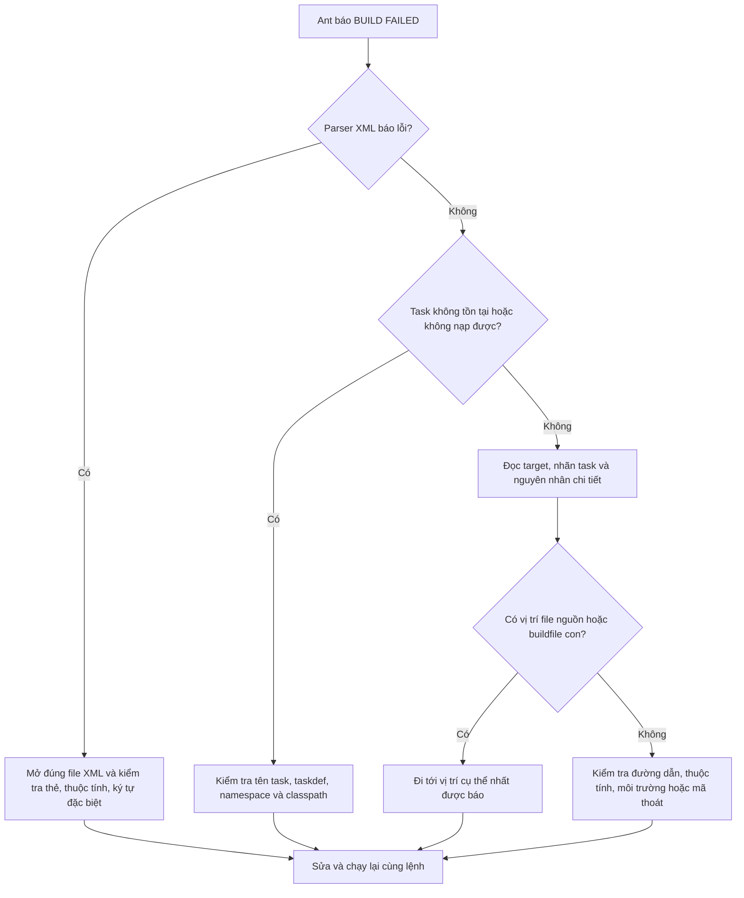

# Đọc lỗi XML, tên task, đường dẫn buildfile và số dòng trong Apache Ant

Khi chạy **Apache Ant**, thông báo lỗi thường chứa nhiều tầng thông tin: file XML đang được nạp, target đang chạy, task phát sinh lỗi, vị trí trong `build.xml` và đôi khi cả vị trí trong file nguồn Java hoặc một buildfile khác. Biết cách đọc từng tầng giúp xác định **nên mở file nào, đến dòng nào và sửa điều gì trước**, thay vì thử sửa ngẫu nhiên.

Bài học này tập trung vào cách diễn giải nhật ký và lỗi của Ant, đặc biệt là lỗi cú pháp XML, lỗi task, đường dẫn buildfile và số dòng. Các đường dẫn và số dòng trong ví dụ chỉ nhằm minh họa; kết quả thực tế phụ thuộc vào cấu trúc dự án, phiên bản Ant và task đang chạy.

## 1. Ant thực thi `build.xml` như thế nào?

Ant đọc một file cấu hình XML, thường tên là `build.xml`. Phần tử gốc `<project>` khai báo dự án; mỗi `<target>` gom một số công việc; bên trong target là các **task** như `<mkdir>`, `<javac>`, `<copy>` hoặc `<jar>`.

```xml
<project name="ant-demo" default="package" basedir=".">
    <property name="src.dir" location="src"/>
    <property name="build.dir" location="build"/>

    <target name="prepare">
        <mkdir dir="${build.dir}/classes"/>
    </target>

    <target name="compile" depends="prepare">
        <javac srcdir="${src.dir}"
               destdir="${build.dir}/classes"
               includeantruntime="false"/>
    </target>

    <target name="package" depends="compile">
        <jar destfile="${build.dir}/app.jar"
             basedir="${build.dir}/classes"/>
    </target>
</project>
```

Chạy target `package`:

```bash
ant -f build.xml package
```

Ant giải quyết quan hệ `depends`: chạy `prepare`, tiếp đến `compile`, sau đó mới `package`. Vì thế, **lệnh yêu cầu `package` nhưng lỗi có thể nằm trong target `compile` hoặc `prepare`**. Khi phân tích nhật ký, hãy tìm task thực sự thất bại thay vì chỉ nhìn tên target được truyền trên dòng lệnh.

## 2. Nhận diện cấu trúc của một nhật ký lỗi

Ví dụ minh họa một lần biên dịch Java không thành công:

```text
Buildfile: /workspace/ant-demo/build.xml

prepare:
    [mkdir] Created dir: /workspace/ant-demo/build/classes

compile:
    [javac] Compiling 2 source files to /workspace/ant-demo/build/classes
    [javac] /workspace/ant-demo/src/App.java:14: error: cannot find symbol
    [javac]         System.out.println(message);
    [javac]                            ^
    [javac]   symbol:   variable message

BUILD FAILED
/workspace/ant-demo/build.xml:10: Compile failed; see the compiler error output for details.

Total time: 1 second
```

| Thành phần | Ý nghĩa | Cần làm gì? |
|---|---|---|
| `Buildfile: /workspace/ant-demo/build.xml` | File XML mà Ant dùng để thực hiện build | Xác nhận đúng dự án và đúng buildfile |
| `prepare:`, `compile:` | Các target Ant đang thực hiện | Xác định giai đoạn thất bại |
| `[mkdir]`, `[javac]` | Nhãn log của task phát sinh thông điệp; thường cũng là tên task | Tìm cấu hình hoặc thao tác liên quan |
| `src/App.java:14: error: ...` | Lỗi do trình biên dịch Java phát hiện ở dòng 14 của **file nguồn Java** | Mở `App.java`, không mở dòng 14 của `build.xml` |
| `BUILD FAILED` | Kết quả chung: quá trình build thất bại | Đọc phần nguyên nhân ngay trước/sau dòng này |
| `build.xml:10: Compile failed...` | Vị trí task hoặc cấu hình Ant liên quan đến thất bại | Mở `build.xml` tại dòng 10 để xem task `<javac>` |
| `Total time: ...` | Thời gian chạy | Không phải nguyên nhân lỗi |

Trong ví dụ, dòng `build.xml:10` chỉ dẫn tới **task gọi trình biên dịch**; nguyên nhân cần sửa là biến `message` trong `App.java:14`. Một lần build có thể hiển thị hai hoặc nhiều bộ `đường dẫn:số dòng` ở các tầng khác nhau.

### Đọc log theo hai chiều

1. **Từ đầu xuống:** xác nhận `Buildfile`, target và task đang chạy; hữu ích khi dự án có nhiều buildfile hoặc nhiều target phụ thuộc.
2. **Từ cuối lên:** tìm `BUILD FAILED`, vị trí `build.xml:line`, sau đó lần ngược các dòng lỗi cụ thể hoặc `Caused by`. Đây thường là cách nhanh nhất để tìm tín hiệu chính trong log dài.
3. **Ghép hai đầu:** xác định task nào gặp vấn đề, task được khai báo ở đâu và thông báo bên dưới task đó cho biết nguyên nhân gì.

Đừng mặc định dòng gần `BUILD FAILED` nhất luôn là dòng cần sửa. Nó có thể chỉ là nơi Ant *gọi* một task, còn lỗi thật nằm trong mã Java, file XML được import, file cấu hình đầu vào hoặc một lệnh bên ngoài.

## 3. Phân biệt lỗi cú pháp XML và lỗi khi thực thi task

Ant sử dụng XML làm ngôn ngữ khai báo. Điều này tạo ra hai nhóm lỗi khác nhau về thời điểm và cách khắc phục.

### 3.1. Lỗi XML: tài liệu không hợp lệ về cú pháp

Xét nội dung `build.xml` sau, với số dòng được đánh dấu ở bên trái để dễ theo dõi:

```text
1  <project name="demo" default="hello">
2      <target name="hello">
3          <echo message="Xin chào"/>
4  </project>
```

Phần tử `<target>` chưa có `</target>`. Ant có thể báo:

```text
BUILD FAILED
/workspace/demo/build.xml:4: The element type "target" must be
terminated by the matching end-tag "</target>".
```

**Cách đọc:** file lỗi là `/workspace/demo/build.xml`, trình phân tích XML phát hiện sự không khớp khi đến dòng 4 và yêu cầu đóng phần tử `target`. Lỗi thực tế bắt đầu từ phần tử mở ở dòng 2. **Số dòng của lỗi XML thường chỉ nơi trình phân tích nhận ra cấu trúc sai, không nhất thiết là nơi người viết tạo ra lỗi.**

Sửa thành:

```xml
<project name="demo" default="hello">
    <target name="hello">
        <echo message="Xin chào"/>
    </target>
</project>
```

Một số lỗi XML thường gặp:

| Mẫu thông báo | Nguyên nhân thường gặp | Hướng kiểm tra |
|---|---|---|
| `The element type "..." must be terminated ...` | Thiếu thẻ đóng hoặc đóng sai thứ tự | So cặp thẻ mở/đóng ở dòng báo lỗi và vài dòng phía trước |
| `The markup in the document following the root element must be well-formed` | Có phần tử hoặc nội dung thừa sau thẻ gốc `</project>` | Kiểm tra cuối file, đảm bảo chỉ một phần tử gốc |
| `The entity name must immediately follow the '&' ...` | Ký tự `&` được viết trực tiếp trong XML | Đổi `&` thành `&amp;` trong văn bản hoặc thuộc tính |
| `Element type ... must be followed by either attribute specifications, '>' or '/>'` | Cú pháp thẻ/thuộc tính hỏng | Kiểm tra dấu `=`, dấu nháy, `>` và `/>` |
| `The value of attribute ... must not contain the '<' character` | Dùng trực tiếp `<` trong giá trị thuộc tính | Viết `&lt;` nếu muốn biểu diễn ký tự `<` |

Ví dụ, giá trị thuộc tính dưới đây **không phải XML hợp lệ**:

```xml
<echo message="A & B"/>
```

Phải viết:

```xml
<echo message="A &amp; B"/>
```

Các tham chiếu property của Ant như `${build.dir}` không gây lỗi XML vì bản thân dấu `$`, `{` và `}` được phép xuất hiện trong giá trị thuộc tính.

**Dấu hiệu quan trọng:** lỗi XML có thể xuất hiện **trước khi bất kỳ target nào chạy**. Vì parser chưa tạo được cấu trúc dự án hợp lệ, sửa mã Java hoặc đổi tên target thường không giải quyết được lỗi này.

### 3.2. XML hợp lệ nhưng tên task không được Ant nhận diện

Ví dụ sau là XML đúng cú pháp, nhưng `ecoh` là tên task viết nhầm:

```xml
<project name="demo" default="hello">
    <target name="hello">
        <ecoh message="Xin chào"/>
    </target>
</project>
```

Đoạn thông báo minh họa:

```text
hello:

BUILD FAILED
/workspace/demo/build.xml:3: Problem: failed to create task or type ecoh
Cause: The name is undefined.
```

Đây là **lỗi cấu hình task**, không phải lỗi cú pháp XML. Ant đọc được file, đã chọn target `hello`, nhưng không tìm thấy task có tên `ecoh`. Cách sửa là đổi `<ecoh>` thành `<echo>`.

Nếu đó là task do thư viện ngoài cung cấp, hãy kiểm tra thêm khai báo `<taskdef>`, namespace, file JAR và classpath mà Ant dùng để nạp task. Một thông báo `failed to create task or type` có thể do viết sai tên **hoặc** do task mở rộng chưa được đăng ký.

### 3.3. Task hợp lệ nhưng thất bại khi chạy

Các task như `<copy>`, `<javac>`, `<jar>`, `<exec>` có thể đã được Ant nhận ra nhưng vẫn thất bại vì thiếu file, sai đường dẫn, thiếu quyền, thiếu dependency hoặc chương trình bên ngoài trả về mã lỗi.

Ví dụ:

```xml
<target name="copy-config">
    <copy file="config/app.properties"
          tofile="build/app.properties"/>
</target>
```

Nếu không tìm thấy file nguồn, Ant có thể báo lỗi ở dòng của `<copy>` và nêu file bị thiếu. Lúc này cú pháp XML và tên task đều hợp lệ; cần kiểm tra file đầu vào và cách phân giải đường dẫn của dự án.

## 4. Hiểu chính xác `buildfile:line`

Một vị trí trong log thường có dạng:

```text
/home/dev/project/build.xml:18: <thông báo lỗi>
```

hoặc trên Windows:

```text
C:\work\project\build.xml:18: <thông báo lỗi>
```

Cần tách ba phần:

- **Đường dẫn buildfile:** `/home/dev/project/build.xml` hoặc `C:\work\project\build.xml`.
- **Số dòng:** `18` — vị trí Ant gắn với lỗi trong file XML đó.
- **Thông báo:** phần văn bản phía sau dấu `:` tiếp theo, cho biết điều gì thất bại.

Trong đường dẫn Windows, `C:` là tên ổ đĩa; đừng nhầm dấu hai chấm sau `C` với dấu phân cách số dòng. Hãy tìm mẫu `tên-file.xml:<số nguyên>:` ở cuối phần đường dẫn.

### Số dòng chỉ tới phần nào?

Tùy loại lỗi, `build.xml:18` có thể chỉ tới:

- Thẻ task đang thực hiện, ví dụ `<javac>` hoặc `<copy>`.
- Thẻ khai báo task sai tên hoặc sai thuộc tính.
- Dòng mà parser XML phát hiện cấu trúc không hợp lệ.
- Dòng gọi sang một target, macro hoặc buildfile khác; nguyên nhân sâu hơn có thể được báo ở vị trí kế tiếp.

**Không phải mọi log đều có số cột.** Lỗi của parser XML hoặc công cụ khác có thể hiển thị `line` và `column`; nhiều lỗi của Ant chỉ đưa `đường dẫn:số dòng`. Nếu vị trí không hiện rõ, bật chế độ log chi tiết và tìm thông báo của task phát sinh lỗi.

### Mở đúng file, không chỉ đúng số dòng

Dự án có thể chứa `build.xml`, `build-common.xml`, `subproject/build.xml` hoặc buildfile được chọn riêng bằng `-f`. Dòng 18 ở hai file khác nhau hoàn toàn không tương đương. Hãy dùng **cả đường dẫn lẫn số dòng** trong thông báo.

Ví dụ:

```bash
ant -f tools/build.xml compile
```

Nếu log ghi `Buildfile: /workspace/demo/tools/build.xml`, cần mở file trong `tools/`, không mặc định mở `build.xml` ở thư mục gốc. Đường dẫn tương đối mà task sử dụng còn phụ thuộc vào `basedir` của project; mặc định nó thường dựa trên thư mục chứa buildfile, trừ khi dự án quy định khác.

## 5. Xác định task và target liên quan

Ant thường in tiêu đề target dưới dạng `target-name:` và in thông điệp từ task với nhãn dạng `[task-name]`.

```text
clean:
   [delete] Deleting directory /workspace/demo/build

prepare:
    [mkdir] Created dir: /workspace/demo/build

compile:
    [javac] Compiling 5 source files to /workspace/demo/build/classes
    [javac] /workspace/demo/src/Main.java:8: error: ';' expected

BUILD FAILED
/workspace/demo/build.xml:24: Compile failed; see the compiler error output for details.
```

Từ đoạn log này có thể kết luận:

1. `clean` và `prepare` đã hoàn thành những thao tác được ghi lại; chưa có dấu hiệu lỗi ở đó.
2. Target có log lỗi là `compile`.
3. `[javac]` là nhãn của task đang chạy và thông báo `';' expected` do trình biên dịch Java phát ra.
4. `Main.java:8` là vị trí mã Java cần sửa; `build.xml:24` là vị trí cấu hình task biên dịch.

Lưu ý nhãn trong dấu `[...]` **thường phản ánh task**, nhưng một task có thể tự ghi nhiều dòng, gọi công cụ ngoài hoặc hiển thị thông điệp từ các lớp bên dưới. Vì vậy, dùng nhãn task để định hướng, rồi dùng nội dung thông báo để xác định nguyên nhân.

Một số task thường gặp và kiểu lỗi cần tìm:

| Task | Dữ liệu cần kiểm tra khi lỗi |
|---|---|
| `<javac>` | File `.java`, số dòng Java, `classpath`, phiên bản JDK, thư mục source/output |
| `<copy>` / `<move>` | Đường dẫn nguồn/đích, sự tồn tại của file, quyền đọc/ghi |
| `<mkdir>` / `<delete>` | Quyền hệ thống file, đường dẫn đích, file đang bị khóa |
| `<jar>` / `<zip>` | Thư mục đầu vào, đường dẫn archive đầu ra, file bị thiếu |
| `<exec>` | Đường dẫn chương trình, đối số, thư mục làm việc và mã thoát của chương trình con |
| `<java>` | Main class, classpath, tham số và ngoại lệ của chương trình Java |
| `<taskdef>` | Tên class, file JAR, classpath và khả năng nạp task tùy biến |

Đối với `<exec>`, thông báo lỗi của một công cụ bên ngoài có thể có định dạng riêng. Nếu log chỉ ra `error code` hoặc `exit code`, cần phân biệt lỗi chương trình con với lỗi parser hoặc cú pháp task của Ant.

## 6. Khi lỗi dẫn qua nhiều buildfile hoặc nhiều tầng gọi

Trong dự án lớn, một `build.xml` có thể gọi một buildfile khác, import các target chung hoặc dùng macro. Vì thế, log đôi khi chứa **chuỗi vị trí lỗi**:

```text
BUILD FAILED
/workspace/root/build.xml:12: The following error occurred while executing this line:
/workspace/root/modules/service/build.xml:27: src/main/resources/app.properties doesn't exist
```

Diễn giải:

- `root/build.xml:12` là nơi một lệnh/tác vụ ở build cha dẫn đến thao tác thất bại.
- `modules/service/build.xml:27` là vị trí cụ thể hơn trong build con.
- Thông báo file `app.properties` không tồn tại là nguyên nhân cần kiểm tra đầu tiên.

Tương tự, lỗi trong `<macrodef>`, `<antcall>` hoặc `<import>` có thể được trình bày thành nhiều dòng `The following error occurred while executing this line:`. Đọc từ tầng ngoài vào tầng trong, **ưu tiên thông báo cụ thể nhất có liên quan đến thao tác thất bại**. Không xóa hay thay đổi lệnh gọi ở build cha chỉ vì dòng đầu tiên của chuỗi trỏ tới nó.

Nếu vị trí trỏ đến file đã được import, hãy mở file đó đúng đường dẫn. Nếu lỗi báo tên task chưa tồn tại, xác định task được định nghĩa trong buildfile nào và đã được import/đăng ký đúng chưa.

## 7. Tăng mức chi tiết của nhật ký khi thông báo chưa đủ rõ

Ant hỗ trợ các mức log để khảo sát một lỗi khó tái hiện hoặc khó định vị:

```bash
# Chạy target cụ thể với log thông thường
ant -f build.xml compile

# Hiển thị chi tiết hơn về task, classpath, thao tác và thuộc tính
ant -f build.xml -verbose compile

# Hiển thị thông tin gỡ lỗi nội bộ nhiều hơn
ant -f build.xml -debug compile

# Ghi log vào file để có thể tìm và chia sẻ đoạn cần thiết
ant -f build.xml -verbose -logfile ant-build.log compile
```

`-verbose` (có thể viết `-v`) thường là bước tiếp theo thích hợp khi output mặc định chưa cho thấy đường dẫn hoặc cấu hình đã được phân giải. `-debug` (có thể viết `-d`) tạo log lớn hơn và hữu ích khi cần hiểu sâu chuyện nạp task, classpath hoặc cấu hình của Ant. Dùng `-logfile` (hay `-l`) để lưu nhật ký thành file.

Khi log dài, tìm theo thứ tự: `BUILD FAILED`, `build.xml:`, `The following error occurred`, `Caused by`, `[task]`, rồi đọc phần target nằm phía trên. Đừng chỉ tìm chuỗi `error` vì công cụ bên ngoài có thể dùng từ này cho thông điệp không khiến build thất bại.

Với lỗi môi trường như sai phiên bản Java hoặc task mở rộng không được nạp, lệnh sau có thể cung cấp thông tin thêm về môi trường Ant:

```bash
ant -diagnostics
```

Log `-debug` và `-diagnostics` có thể dài và chứa đường dẫn hệ thống, tên tài khoản hoặc giá trị cấu hình. Khi gửi log cho người khác, chỉ trích phần liên quan và kiểm tra dữ liệu nhạy cảm trước khi chia sẻ.

## 8. Quy trình xử lý một lần `BUILD FAILED`

Áp dụng các bước sau cho hầu hết lỗi Ant:

1. **Ghi lại lệnh vừa chạy.** Xác định `-f` trỏ đến buildfile nào và target nào được gọi.
2. **Tìm `BUILD FAILED`.** Đọc toàn bộ thông báo phía sau và các dòng log lỗi trước đó, không dừng ở tiêu đề thất bại.
3. **Nhận diện loại lỗi.** Parser XML, task không tồn tại/cấu hình sai, task chạy thất bại, trình biên dịch Java báo lỗi hay chương trình con thất bại?
4. **Lấy vị trí chính xác.** Ghi đủ `đường dẫn buildfile:số dòng`; nếu có `src/...java:line`, ghi thêm vị trí file nguồn.
5. **Đối chiếu target và task.** Tìm tiêu đề target gần đó và nhãn `[task]` hoặc thẻ task ở dòng XML được chỉ ra.
6. **Lần theo nguyên nhân sâu hơn.** Nếu có nhiều buildfile, `The following error occurred...` hay `Caused by`, đọc đến thông báo cụ thể nhất.
7. **Sửa đúng lớp nguyên nhân.** Đóng/mở thẻ XML cho đúng, sửa tên task, sửa đường dẫn hoặc cấu hình, hay sửa mã Java ở dòng được trình biên dịch chỉ ra.
8. **Chạy lại cùng lệnh.** Nếu lỗi vẫn chưa rõ, thêm `-verbose` rồi cân nhắc `-debug`; theo dõi thông báo mới thay vì dựa vào log cũ.

Có thể hình dung quá trình quyết định như sau:



### Bảng tự phân loại nhanh

| Nhìn thấy trong log | Mở ở đâu trước? | Sửa gì trước? |
|---|---|---|
| `build.xml:4: The element type ...` | `build.xml`, quanh dòng 4 và thẻ mở liên quan | Cấu trúc XML |
| `build.xml:7: failed to create task or type ...` | `build.xml`, dòng 7; phần `taskdef` nếu có | Tên task/đăng ký task |
| `[javac] src/Foo.java:23: error: ...` | `src/Foo.java`, dòng 23 | Mã Java hoặc dependency theo nội dung lỗi |
| `build.xml:15: ... file not found` | Task ở `build.xml:15`, đường dẫn file trong thông báo | Đường dẫn nguồn, `basedir`, sự tồn tại của file |
| `parent/build.xml:12: ...` rồi `child/build.xml:27: ...` | `child/build.xml:27` và thông báo sâu nhất | Nguyên nhân trong build con, sau đó mới kiểm tra chỗ gọi |

## 9. Bài tập đọc log

### Tình huống A — XML chưa đóng thẻ

```text
BUILD FAILED
/work/app/build.xml:9: The element type "target" must be terminated
by the matching end-tag "</target>".
```

**Phân tích:** lỗi ở giai đoạn đọc XML. Mở `/work/app/build.xml` quanh dòng 9, tìm `<target>` đã mở mà chưa đóng đúng thứ tự. Có thể cần xem các dòng trước dòng 9 vì parser phát hiện lỗi muộn hơn nơi thiếu thẻ.

### Tình huống B — Gõ sai tên task

```text
build:

BUILD FAILED
/work/app/build.xml:16: Problem: failed to create task or type copuy
Cause: The name is undefined.
```

**Phân tích:** XML đủ hợp lệ để chạy target `build`. Ant không nhận ra `copuy` tại dòng 16; nếu định dùng task sao chép file có sẵn của Ant, sửa thành `<copy>`. Không cần sửa cú pháp file nguồn Java.

### Tình huống C — Có hai loại số dòng

```text
compile:
    [javac] /work/app/src/Order.java:31: error: incompatible types

BUILD FAILED
/work/app/build.xml:22: Compile failed; see the compiler error output for details.
```

**Phân tích:** `build.xml:22` xác định vị trí `<javac>`; `Order.java:31` là nơi trình biên dịch nhận ra lỗi kiểu dữ liệu. Mở `Order.java` dòng 31, xem khai báo và biểu thức liên quan. Chỉ chỉnh `<javac>` nếu thông báo thực sự chỉ ra vấn đề ở thiết lập trình biên dịch, classpath hoặc phiên bản Java.

### Tình huống D — Lỗi từ buildfile con

```text
BUILD FAILED
/work/app/build.xml:11: The following error occurred while executing this line:
/work/app/tools/build-release.xml:38: Unable to create directory /restricted/output
```

**Phân tích:** file `build.xml` dòng 11 gọi đến một thao tác khác. Vị trí chi tiết là `tools/build-release.xml:38`, liên quan đến thao tác tạo thư mục. Kiểm tra đường dẫn đích và quyền truy cập trước; không vội xóa lệnh gọi ở dòng 11.

## 10. Ghi nhận lỗi để dễ trao đổi và tái hiện

Một báo cáo lỗi Ant ngắn nhưng đủ thông tin nên có:

```text
Lệnh chạy: ant -f tools/build.xml compile
Buildfile: /workspace/demo/tools/build.xml
Target: compile
Task: javac
Vị trí cấu hình Ant: /workspace/demo/tools/build.xml:22
Vị trí nguồn (nếu có): /workspace/demo/src/Order.java:31
Thông báo gốc: incompatible types
Hành động kiểm tra: mở Order.java dòng 31, đối chiếu kiểu dữ liệu
```

Ghi cả **lệnh**, **file**, **số dòng**, **task** và **thông báo nguyên nhân** giúp người khác tái hiện đúng bối cảnh. Nếu cần đính kèm log, dùng một đoạn đủ chứa target, lỗi cụ thể và khối `BUILD FAILED`.

Điểm cốt lõi khi đọc lỗi Ant: `Buildfile:` cho biết file XML được sử dụng; `target:` cho biết giai đoạn; `[task]` cho biết hoạt động đang phát log; `build.xml:line` định vị cấu hình Ant; còn `File.java:line` hoặc vị trí buildfile con có thể chỉ đến **nguyên nhân thực sự**. Luôn đọc các vị trí cùng nội dung thông báo trước khi quyết định sửa file nào.
