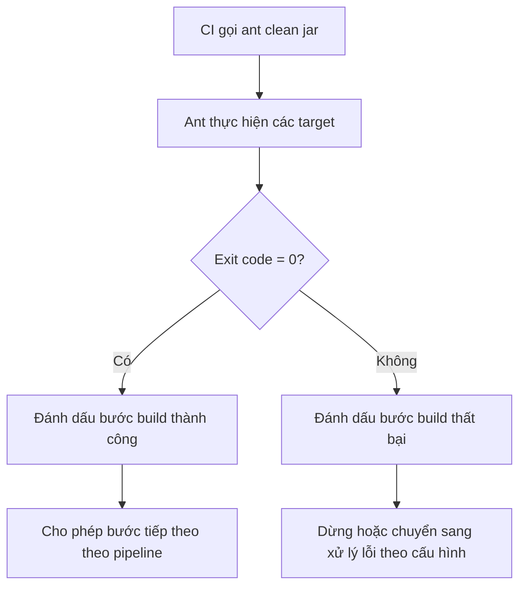

# Đọc kết quả BUILD SUCCESSFUL, BUILD FAILED và mã thoát

Khi chạy một lệnh Ant, terminal hiển thị nhiều dòng thông tin: target đang chạy, task đang thực hiện, thông báo biên dịch, cảnh báo và cuối cùng là kết quả của toàn bộ lượt build. Để biết quy trình đã hoàn thành hay thất bại, người phát triển cần đọc cả phần kết quả Ant in ra lẫn **mã thoát (exit code)** mà tiến trình trả về cho hệ điều hành.

Hai dòng thường được chú ý nhất là `BUILD SUCCESSFUL` và `BUILD FAILED`. Chúng cho biết Ant đánh giá lượt thực thi build như thế nào. Mã thoát bổ sung một tín hiệu máy có thể xử lý: quy ước thông dụng là `0` biểu thị thành công, còn giá trị khác `0` biểu thị có lỗi. Các hệ thống CI/CD dựa vào tín hiệu này để quyết định một bước build có được xem là thành công hay không.

## 1. Kết quả Ant gồm những phần nào?

Khi chạy một lệnh như:

```bash
ant clean jar
```

Ant đọc file build, xác định các target được yêu cầu cùng những target phụ thuộc, thực hiện các task rồi in thông tin tổng kết. Một lượt chạy thường có thể được đọc theo ba phần:

1. **Thông tin khởi động:** file build nào được đọc, project nào đang chạy và các target được gọi.
2. **Thông tin thực thi:** target, task, thông báo biên dịch, sao chép, đóng gói, cảnh báo hoặc lỗi.
3. **Kết quả cuối:** `BUILD SUCCESSFUL` hoặc `BUILD FAILED`, thường kèm tổng thời gian thực hiện.

Ví dụ minh họa một lượt build thành công:

```text
Buildfile: C:\projects\hello-ant\build.xml

clean:
   [delete] Deleting directory C:\projects\hello-ant\build

prepare:
    [mkdir] Created dir: C:\projects\hello-ant\build\classes

compile:
   [javac] Compiling 2 source files to C:\projects\hello-ant\build\classes

jar:
     [jar] Building jar: C:\projects\hello-ant\dist\hello-ant.jar

BUILD SUCCESSFUL
Total time: 1 second
```

Tên target, nội dung log, đường dẫn và thời gian trong ví dụ chỉ mang tính minh họa. Dự án thực tế có thể có nhiều target và task hơn, hoặc cách trình bày khác tùy logger và cấu hình Ant.

Khi đọc log, hãy nối phần thực thi với phần tổng kết. Một dòng `[javac]` cho biết task biên dịch đã chạy; dòng `[jar]` cho biết task đóng gói đã chạy. Dòng `BUILD SUCCESSFUL` cho biết Ant kết thúc lượt build mà không ghi nhận lỗi build chưa được xử lý theo cấu hình hiện tại.

## 2. Ý nghĩa của BUILD SUCCESSFUL

`BUILD SUCCESSFUL` là thông báo tổng kết cho biết Ant đã hoàn thành lượt thực thi được yêu cầu mà không gặp lỗi khiến build bị đánh dấu thất bại.

Ví dụ:

```text
compile:
   [javac] Compiling 5 source files to build/classes

jar:
     [jar] Building jar: dist/application.jar

BUILD SUCCESSFUL
Total time: 2 seconds
```

Trong ví dụ này, Ant đã thực hiện target `compile`, sau đó thực hiện target `jar` và kết thúc thành công. Nếu mục tiêu của người dùng là tạo file JAR, đây là dấu hiệu tốt cho thấy quy trình đã chạy đến bước đóng gói.

### 2.1. Điều gì có thể kết luận?

Khi thấy `BUILD SUCCESSFUL`, có thể kết luận rằng:

- Ant đã hoàn thành các target được yêu cầu và các target phụ thuộc mà nó thực sự phải thực hiện.
- Các task bắt buộc trong lượt chạy không làm Ant ghi nhận một lỗi build chưa được xử lý.
- Tiến trình Ant kết thúc theo nhánh thành công; thông thường tiến trình trả mã thoát `0`.
- Nếu target đóng gói đã được gọi và chạy thành công, task đóng gói đã hoàn thành theo cấu hình của nó.

### 2.2. Điều gì chưa thể kết luận?

`BUILD SUCCESSFUL` không tự chứng minh rằng:

- Ứng dụng chạy đúng nghiệp vụ hoặc không có lỗi runtime.
- Tất cả test đều đã chạy. Điều đó chỉ đúng khi target được gọi thực sự bao gồm các test cần thiết và các lỗi test không bị bỏ qua.
- File JAR nằm đúng thư mục mà người dùng mong đợi nếu cấu hình đầu ra khác dự kiến.
- Mọi cảnh báo đã được xử lý.
- Kết quả có thể chạy trên mọi máy hoặc tương thích với mọi phiên bản Java.
- Các task bên ngoài đã hoàn thành công việc theo đúng ý nghĩa nghiệp vụ nếu task được cấu hình cho phép bỏ qua lỗi.

Ví dụ, nếu chỉ chạy `ant compile`, Ant có thể in `BUILD SUCCESSFUL` dù target `test` và `jar` chưa được gọi. Nếu task `exec` được cấu hình `failonerror="false"`, một lệnh bên ngoài có thể trả lỗi nhưng task không làm toàn bộ build thất bại. Vì vậy, cần xem target và cấu hình thực tế trước khi kết luận sản phẩm đã được kiểm thử hoặc phát hành đầy đủ.

## 3. Ý nghĩa của BUILD FAILED

`BUILD FAILED` cho biết Ant đã ghi nhận lỗi khiến lượt build được đánh dấu thất bại. Lỗi có thể xảy ra trong lúc đọc file build, chuẩn bị cấu hình, thực hiện một task hoặc xử lý một điều kiện bắt buộc.

Ví dụ minh họa:

```text
Buildfile: C:\projects\hello-ant\build.xml

compile:
   [javac] Compiling 3 source files to build/classes
   [javac] C:\projects\hello-ant\src\App.java:12: error: cannot find symbol
   [javac]         MissingService.run();
   [javac]         ^
   [javac]   symbol:   variable MissingService
   [javac]   location: class App

BUILD FAILED
C:\projects\hello-ant\build.xml:35: Compile failed; see the compiler error output for details.
Total time: 1 second
```

Trong ví dụ này, thông báo quan trọng đầu tiên là lỗi compiler không tìm thấy `MissingService`. Dòng `build.xml:35` cho biết task hoặc cấu hình gây ra lỗi nằm ở dòng 35 của file build. Dòng `BUILD FAILED` là kết quả tổng kết của toàn bộ lượt chạy.

### 3.1. Đọc lỗi từ nguyên nhân gần nhất

Khi build thất bại, đừng chỉ nhìn dòng cuối cùng. Hãy đọc log từ trên xuống và xác định lỗi cụ thể xuất hiện đầu tiên trong chuỗi thông báo có liên quan.

Một cách đọc hữu ích:

1. Tìm `BUILD FAILED` để xác nhận lượt build đã thất bại.
2. Đọc phần ngay phía trên để tìm thông báo lỗi của task, compiler hoặc chương trình bên ngoài.
3. Tìm đường dẫn file và số dòng nếu Ant chỉ ra vị trí trong `build.xml`.
4. Đối chiếu target đang chạy với các target phụ thuộc để biết lỗi phát sinh ở giai đoạn nào.
5. Sửa nguyên nhân gốc rồi chạy lại đúng target cần xác minh.

Thông báo tổng kết như `Compile failed` đôi khi chỉ là mô tả chung. Nguyên nhân cụ thể có thể nằm trong các dòng compiler output phía trước, chẳng hạn thiếu class, lỗi cú pháp, sai kiểu dữ liệu hoặc không tìm thấy thư viện.

### 3.2. Các nhóm nguyên nhân thường gặp

| Nhóm lỗi | Ví dụ dấu hiệu | Hướng điều tra |
|---|---|---|
| Cấu hình build | Không đọc được XML, target hoặc property không hợp lệ | Kiểm tra file `build.xml`, tên target, thuộc tính và phần tử XML |
| Môi trường | Không tìm thấy Java, compiler hoặc executable ngoài | Kiểm tra `JAVA_HOME`, `PATH`, JDK và đường dẫn công cụ |
| Mã nguồn | `cannot find symbol`, lỗi cú pháp hoặc kiểu dữ liệu | Đọc compiler output và sửa mã nguồn liên quan |
| Dependency/classpath | Không tìm thấy package hoặc class từ thư viện | Kiểm tra file JAR, `path`, `fileset` và classpath của task |
| File và thư mục | Không tìm thấy đầu vào hoặc không ghi được đầu ra | Kiểm tra đường dẫn, quyền truy cập và thư mục làm việc |
| Kiểm thử | Test thất bại hoặc assertion không đúng | Xem báo cáo test và xác định test đầu tiên thất bại |
| Công cụ bên ngoài | Lệnh được gọi trả lỗi hoặc không khởi động được | Kiểm tra executable, tham số, môi trường và mã thoát của lệnh con |

Không phải mọi lỗi đều bắt nguồn từ Ant. Ant điều phối các task; lỗi có thể nằm trong Java compiler, mã nguồn, thư viện, công cụ bên ngoài hoặc môi trường hệ điều hành.

## 4. Phân biệt cảnh báo và lỗi

Trong log build, có thể thấy các từ như `warning`, `error`, `failed` hoặc thông báo về việc một số file đã cũ. Chúng không có cùng ý nghĩa.

- **Warning (cảnh báo):** cho biết có điều đáng chú ý nhưng task vẫn có thể tiếp tục. Cảnh báo thường không làm build thất bại nếu cấu hình không yêu cầu coi cảnh báo là lỗi.
- **Error (lỗi):** cho biết một thao tác không thể hoàn thành đúng yêu cầu. Nếu lỗi được truyền lên Ant như một build failure, lượt chạy sẽ kết thúc với `BUILD FAILED`.
- **Skipped (bỏ qua):** một target hoặc task có thể không chạy vì điều kiện, thuộc tính hoặc logic cấu hình. Build vẫn có thể thành công nếu việc bỏ qua là hợp lệ theo thiết kế.
- **Up-to-date (đã cập nhật):** một số task có thể không cần xử lý lại đầu vào vì kết quả hiện tại được xem là còn hợp lệ. Đây không phải lỗi.

Ví dụ, compiler có thể phát cảnh báo về API đã deprecated nhưng vẫn tạo được bytecode. Ant vẫn có thể in `BUILD SUCCESSFUL`. Nếu dự án bật tùy chọn coi warning là lỗi, kết quả có thể thay đổi. Cần đọc cấu hình compiler và log cụ thể thay vì chỉ dựa vào từ `warning`.

## 5. Mã thoát (exit code) là gì?

Mã thoát là một giá trị số mà tiến trình trả về cho hệ điều hành khi kết thúc. Shell hoặc chương trình gọi có thể đọc giá trị này để biết lệnh vừa chạy có được xem là thành công hay không.

Quy ước thông dụng của các chương trình dòng lệnh là:

| Mã thoát | Ý nghĩa thông dụng |
|---:|---|
| `0` | Tiến trình kết thúc thành công |
| Khác `0` | Tiến trình kết thúc với lỗi hoặc trạng thái không thành công |

Với Ant, khi lượt build hoàn thành bình thường, launcher thường trả mã `0`. Khi Ant đánh dấu build thất bại, launcher trả mã khác `0` để shell và CI nhận biết. Giá trị khác `0` cụ thể có thể phụ thuộc loại lỗi, launcher hoặc lớp công cụ bọc bên ngoài; trong script tự động hóa, nên dựa vào điều kiện bằng `0` hay khác `0`, không nên giả định mọi lỗi luôn có cùng một số.

Ví dụ về mối liên hệ giữa thông báo và mã thoát:

```text
BUILD SUCCESSFUL  -> exit code 0
BUILD FAILED      -> exit code khác 0
```

Đây là cách diễn giải thông dụng khi Ant kết thúc bình thường. Nếu tiến trình bị người dùng ngắt, JVM bị dừng, máy hết tài nguyên hoặc shell không tìm thấy lệnh, kết quả có thể không có dòng tổng kết như trên; khi đó mã thoát và thông báo của shell vẫn cần được xem xét.

### 5.1. Vì sao CI/CD cần mã thoát?

Con người có thể đọc log và nhận ra dòng `BUILD FAILED`, nhưng hệ thống CI/CD cần một tín hiệu máy có thể xử lý để quyết định bước tiếp theo.

Một pipeline có thể hoạt động như sau:



Nếu chỉ in `BUILD SUCCESSFUL` ra màn hình nhưng script bên ngoài vô tình che mất mã thoát, CI có thể đưa ra trạng thái sai. Ngược lại, nếu build thất bại nhưng script vẫn kết thúc bằng một lệnh thành công, CI có thể đánh dấu job xanh dù Ant đã trả lỗi.

Vì vậy, log và exit code bổ sung cho nhau: log giúp con người hiểu điều gì xảy ra; exit code giúp công cụ tự động quyết định kết quả.

## 6. Đọc và lưu mã thoát trong từng shell

Mỗi shell có cách đọc mã thoát của lệnh vừa chạy khác nhau. Điều quan trọng là phải lấy mã ngay sau lệnh Ant, trước khi chạy một lệnh khác có thể thay đổi trạng thái đó.

### 6.1. Linux và macOS (Bash/Zsh)

Sau khi chạy lệnh:

```bash
ant clean jar
```

Đọc mã thoát ngay sau đó bằng:

```bash
echo $?
```

Hoặc lưu vào biến:

```bash
ant clean jar
ant_status=$?
printf 'Ant exit code: %s\n' "$ant_status"

if [ "$ant_status" -eq 0 ]; then
    echo "Build completed successfully."
else
    echo "Build failed."
fi
```

`$?` chứa trạng thái thoát của lệnh vừa thực hiện. Nếu chạy `echo` hoặc một lệnh khác trước khi lưu, `$?` sẽ phản ánh lệnh mới chứ không còn là kết quả của Ant.

Có thể viết gọn bằng cấu trúc điều kiện:

```bash
if ant clean jar; then
    echo "Build completed successfully."
else
    ant_status=$?
    echo "Build failed with exit code: $ant_status"
fi
```

Trong nhánh `else`, `$?` là mã thất bại của lệnh điều kiện `ant clean jar`.

### 6.2. Windows PowerShell

Trong PowerShell, khi gọi một chương trình native như `ant.bat`, dùng biến `$LASTEXITCODE` để lấy mã thoát của tiến trình:

```powershell
ant clean jar
$antExitCode = $LASTEXITCODE

Write-Host "Ant exit code: $antExitCode"

if ($antExitCode -eq 0) {
    Write-Host "Build completed successfully."
} else {
    Write-Host "Build failed."
}
```

Không nên nhầm `$LASTEXITCODE` với `$?`. Trong PowerShell, `$?` là trạng thái thành công dạng Boolean của thao tác gần nhất; `$LASTEXITCODE` lưu mã thoát số của chương trình native gần nhất. Khi cần truyền trạng thái Ant cho script khác hoặc CI, mã số trong `$LASTEXITCODE` là thông tin cần dùng.

Nếu muốn lưu log:

```powershell
ant clean jar > build.log 2>&1
$antExitCode = $LASTEXITCODE
Get-Content build.log
Write-Host "Ant exit code: $antExitCode"
```

Hãy lưu `$LASTEXITCODE` ngay sau lệnh Ant. Các thao tác PowerShell tiếp theo không nên được dùng thay cho mã thoát của tiến trình Ant.

### 6.3. Windows Command Prompt (cmd.exe)

Trong Command Prompt, biến `%ERRORLEVEL%` chứa mã thoát của chương trình vừa chạy:

```bat
ant clean jar
echo Ant exit code: %ERRORLEVEL%
```

Nếu cần lưu giá trị để sử dụng tiếp:

```bat
ant clean jar
set "ANT_EXIT_CODE=%ERRORLEVEL%"
echo Ant exit code: %ANT_EXIT_CODE%

if not "%ANT_EXIT_CODE%"=="0" exit /b %ANT_EXIT_CODE%
```

Trong một file `.bat`, đoạn trên giả định các lệnh nằm trên các dòng riêng, không đặt việc mở rộng `%ERRORLEVEL%` bên trong một khối ngoặc đã được phân tích trước. Nếu cần dùng biến trong khối `(...)`, hãy hiểu cơ chế delayed expansion và cân nhắc dùng `!ERRORLEVEL!` sau khi bật `setlocal EnableDelayedExpansion`.

`exit /b` trả mã thoát từ batch file về chương trình gọi. Điều này quan trọng khi batch file được CI gọi: nếu Ant thất bại, script cần trả lại trạng thái thất bại thay vì tiếp tục rồi kết thúc bằng mã `0` của một lệnh khác.

## 7. Cẩn thận khi chuyển hướng log hoặc dùng pipeline

Khi ghi log, cần bảo toàn mã thoát của Ant. Cách đơn giản là chuyển hướng đầu ra trực tiếp vào file:

```bash
ant clean jar > build.log 2>&1
ant_status=$?
```

`2>&1` gộp luồng lỗi chuẩn vào luồng đầu ra chuẩn để cả hai cùng được ghi vào file. Lưu mã thoát ngay sau lệnh chuyển hướng vẫn lấy được trạng thái của Ant.

Nếu dùng pipeline để vừa hiển thị vừa lưu log:

```bash
ant clean jar 2>&1 | tee build.log
```

Trong Bash, nếu không bật `pipefail`, mã thoát mặc định của pipeline thường là mã của lệnh cuối cùng (`tee`). Khi Ant thất bại nhưng `tee` ghi file thành công, pipeline có thể trả `0`. Có thể dùng:

```bash
set -o pipefail
ant clean jar 2>&1 | tee build.log
pipeline_status=$?
```

`pipefail` làm pipeline trả trạng thái khác `0` nếu một lệnh trong pipeline thất bại. Nếu cần lấy riêng mã thoát của Ant trong Bash, hãy lưu mảng `PIPESTATUS` ngay sau pipeline:

```bash
ant clean jar 2>&1 | tee build.log
pipeline_statuses=("${PIPESTATUS[@]}")
ant_status=${pipeline_statuses[0]}
tee_status=${pipeline_statuses[1]}
printf 'Ant: %s, tee: %s\n' "$ant_status" "$tee_status"
```

Đây là điểm quan trọng trong script CI: một pipeline có thể làm mất trạng thái của lệnh build nếu người viết không chủ động bảo toàn mã thoát.

## 8. Vì sao BUILD FAILED nhưng vẫn có log phía sau?

Trong một số trường hợp, Ant có thể tiếp tục thực hiện những target độc lập sau khi một target thất bại, nếu người dùng bật tùy chọn `-keep-going`:

```bash
ant -keep-going build-all
```

Tùy chọn này cho phép Ant tiếp tục các target không phụ thuộc vào target đã thất bại, để thu thập thêm thông tin về những lỗi khác. Tuy nhiên, nếu có lỗi build, kết quả tổng thể vẫn là thất bại. Việc nhìn thấy thêm log sau một lỗi không có nghĩa lượt build đã phục hồi thành công.

Ngoài ra, một target có thể gọi chương trình bên ngoài. Ví dụ task `exec` có thuộc tính `failonerror="false"`; khi đó lệnh con trả mã khác `0` nhưng task không nhất thiết làm Ant đánh dấu build thất bại. Điều này có thể được dùng có chủ ý, nhưng nếu cấu hình sai, build có thể in `BUILD SUCCESSFUL` dù một thao tác phụ đã thất bại.

Khi cần xác minh một bước bên ngoài có thực sự thành công, hãy xem cách task xử lý mã thoát của chương trình con, không chỉ nhìn dòng tổng kết của Ant.

## 9. Một số tình huống dễ đọc nhầm

| Tình huống | Cách hiểu đúng |
|---|---|
| Có warning nhưng `BUILD SUCCESSFUL` | Cảnh báo không nhất thiết làm build thất bại; xem cấu hình compiler và yêu cầu dự án |
| Có dòng lỗi trong log rồi `BUILD FAILED` | Xác định lỗi gốc ở phía trên và target/task gây lỗi |
| Có log task sau một lỗi | Có thể Ant đang dùng `-keep-going` hoặc task xử lý lỗi theo cấu hình |
| `BUILD SUCCESSFUL` nhưng không thấy file JAR | Có thể đã chạy target không đóng gói, đầu ra ở vị trí khác hoặc task được cấu hình bỏ qua lỗi |
| Terminal hiển thị `BUILD FAILED` nhưng CI vẫn xanh | Script có thể đã ghi đè hoặc không truyền tiếp mã thoát của Ant |
| Không có `BUILD SUCCESSFUL` cũng không có `BUILD FAILED` | Có thể tiến trình bị ngắt, JVM/shell gặp lỗi hoặc launcher chưa chạy được; xem mã thoát và thông báo shell |
| Ant trả mã khác `0` nhưng log không rõ | Lưu log đầy đủ, chạy lại với mức thông tin phù hợp và kiểm tra lỗi khởi động hoặc lỗi từ công cụ bên ngoài |

Không nên viết script tìm chuỗi `BUILD SUCCESSFUL` trong log để thay thế mã thoát. Dòng chữ chỉ phục vụ người đọc; mã thoát là tín hiệu chính mà shell và CI dùng để đánh giá tiến trình.

## 10. Tăng thông tin khi điều tra lỗi

Nếu log mặc định chưa đủ để xác định lỗi, có thể yêu cầu Ant in thêm thông tin:

```bash
# In thông tin chi tiết hơn về các bước thực thi
ant -verbose clean jar

# In thông tin debug sâu hơn
ant -debug clean jar

# Ghi log Ant vào file được chỉ định
ant -logfile build.log clean jar
```

`-verbose` và `-debug` giúp quan sát thêm hoạt động của Ant. `-logfile` yêu cầu Ant ghi log vào file. Tùy phiên bản và logger, nội dung hiển thị có thể khác nhau; hãy chọn mức thông tin vừa đủ để tìm nguyên nhân và tránh làm log quá khó đọc.

Khi chia sẻ log với người khác, hãy kiểm tra xem có đường dẫn cá nhân, tên người dùng, thông tin môi trường hoặc tham số nhạy cảm hay không. Chỉ gửi những phần cần thiết để giải thích lỗi.

## 11. Quy trình đọc kết quả build trong thực tế

Khi một lượt Ant kết thúc, có thể làm theo thứ tự sau:

1. Xác định lệnh và target đã gọi, ví dụ `ant clean jar`.
2. Tìm dòng tổng kết `BUILD SUCCESSFUL` hoặc `BUILD FAILED`.
3. Đọc các target/task đã chạy để biết phạm vi công việc thực tế.
4. Nếu thất bại, tìm thông báo lỗi cụ thể gần nơi task thất bại và xác định nguyên nhân gốc.
5. Đọc mã thoát ngay sau lệnh Ant trong shell.
6. Nếu build thành công, kiểm tra đầu ra mong đợi có tồn tại ở đúng vị trí và thực hiện các bước kiểm thử cần thiết.
7. Nếu chạy trong CI, xác nhận script giữ nguyên mã thoát thất bại và pipeline phản ánh đúng trạng thái.

Ví dụ, với mục tiêu tạo JAR:

```bash
ant clean jar
```

Nếu log kết thúc bằng `BUILD SUCCESSFUL`, kiểm tra file JAR trong thư mục `dist` hoặc đường dẫn mà thuộc tính `destfile` của task `jar` đã cấu hình. Nếu kết quả là `BUILD FAILED`, tìm lỗi đầu tiên từ compiler hoặc task đóng gói, sửa nguyên nhân rồi chạy lại. Nếu mã thoát là `0` nhưng file không tồn tại, cần kiểm tra target thực sự đã chạy và cấu hình đầu ra; không nên chỉ dựa vào mã thoát để kết luận file mong đợi đã được tạo.

## 12. Kết luận

`BUILD SUCCESSFUL` và `BUILD FAILED` là thông báo tổng kết giúp con người nhận biết kết quả lượt chạy Ant. Mã thoát là tín hiệu số mà shell và hệ thống CI/CD dùng để tự động phân biệt thành công với thất bại: `0` thường là thành công, khác `0` là không thành công.

Khi đọc kết quả build, hãy kết hợp ba thông tin: target/task thực sự đã chạy, log lỗi hoặc cảnh báo và mã thoát của tiến trình. Cách đọc này giúp xác định chính xác Ant đã hoàn thành công việc nào, lỗi xuất hiện ở đâu và hệ thống tự động hóa có đang nhận đúng kết quả hay không.
