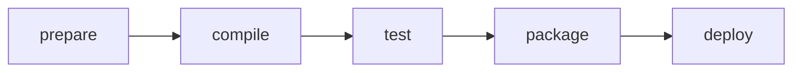

# Đo thời gian từng giai đoạn trước khi tối ưu Apache Ant

Một lần chạy **Apache Ant** chậm không có nghĩa mọi phần của build đều chậm. Thời gian có thể tập trung ở bước biên dịch Java, chạy kiểm thử, sao chép tài nguyên, tạo JAR, tải dependency hoặc một lệnh bên ngoài do Ant gọi. Nếu chưa đo, việc chỉnh sửa `build.xml` theo cảm giác rất dễ tốn công mà không cải thiện được thời gian hoàn thành.

Nguyên tắc của bài học là **xác lập số liệu ban đầu, xác định giai đoạn tốn thời gian, chỉ tối ưu phần có tác động lớn rồi đo lại trong cùng điều kiện**. Đây là cách tiếp cận phù hợp cả khi xây dựng một dự án Java nhỏ trên máy cá nhân lẫn khi phân tích một pipeline Ant chạy trong CI.

## 1. Hiểu đúng những gì đang được đo

Trong Ant, một file build thường gồm các **target** chứa những **task**. Target có thể phụ thuộc vào target khác bằng `depends`, nên lời gọi đến một target cuối cùng có thể kích hoạt nhiều giai đoạn liên tiếp.

Ví dụ luồng build:



Mỗi giai đoạn có thể chứa nhiều công việc nhỏ. Chẳng hạn `compile` dùng `<javac>`; `test` dùng `<junit>` hoặc `<exec>`; `package` dùng `<jar>` hoặc `<zip>`; `deploy` có thể gọi `<copy>`, `<scp>` hay một script bên ngoài. Để phân tích đúng, cần phân biệt các loại số đo:

| Chỉ số | Diễn giải | Dùng để làm gì? |
|---|---|---|
| **Thời gian toàn build** (*wall-clock time*) | Thời gian thực từ lúc bắt đầu lệnh Ant đến lúc lệnh kết thúc | Đánh giá trải nghiệm thực tế của người chạy hoặc CI |
| **Thời gian target** | Khoảng thời gian Ant thực thi một target được chọn | Xác định giai đoạn chiếm nhiều thời gian |
| **Thời gian task** | Khoảng thời gian task cụ thể thực hiện | Phân biệt `javac`, `copy`, `jar` hoặc lệnh ngoài bên trong cùng target |
| **Thời gian CPU** | Thời gian CPU sử dụng, khác thời gian đồng hồ khi chờ I/O | Hỗ trợ nhận diện tác vụ thiên về xử lý CPU hay chờ dữ liệu |
| **Số lượng công việc** | Số file biên dịch, số test, số file được copy, kích thước đầu vào/đầu ra | Giải thích vì sao thời gian thay đổi giữa các lần đo |

**Lưu ý:** `Total time` trong log Ant là thời gian tổng quát của lần chạy Ant; đó không phải danh sách thời gian của từng giai đoạn. Ngoài công việc của các target, số đo ở mức tiến trình còn có thể bao gồm khởi động JVM, đọc buildfile, cấu hình task và những chi phí khác. Vì vậy không nên coi tổng mọi số đo con lúc nào cũng khớp tuyệt đối với `Total time`.

## 2. Bắt đầu từ một buildfile có các giai đoạn rõ ràng

Xét một dự án Java đơn giản với cấu trúc:

```text
ant-demo/
├── build.xml
├── src/
│   └── demo/
│       └── Main.java
├── resources/
│   └── app.properties
├── build/                    # Sinh ra khi build
└── dist/                     # Sinh ra khi đóng gói
```

File `build.xml` sau chia các bước thành target để dễ nhận diện khi đo:

```xml
<?xml version="1.0" encoding="UTF-8"?>
<project name="ant-demo" default="package" basedir=".">
    <property name="src.dir" location="src"/>
    <property name="resource.dir" location="resources"/>
    <property name="classes.dir" location="build/classes"/>
    <property name="dist.dir" location="dist"/>

    <target name="clean">
        <delete dir="build"/>
        <delete dir="dist"/>
    </target>

    <target name="prepare">
        <mkdir dir="${classes.dir}"/>
        <mkdir dir="${dist.dir}"/>
    </target>

    <target name="compile" depends="prepare">
        <javac srcdir="${src.dir}"
               destdir="${classes.dir}"
               includeantruntime="false"/>
    </target>

    <target name="copy-resources" depends="prepare">
        <copy todir="${classes.dir}">
            <fileset dir="${resource.dir}"/>
        </copy>
    </target>

    <target name="package" depends="compile,copy-resources">
        <jar destfile="${dist.dir}/ant-demo.jar"
             basedir="${classes.dir}"/>
    </target>
</project>
```

Ở đây, `package` phụ thuộc vào `compile` và `copy-resources`, còn hai target này đều phụ thuộc vào `prepare`. Trong cùng một lượt thực thi project, Ant chỉ cần chạy target phụ thuộc `prepare` một lần. Khi đo, ta cần biết những target nào **thực sự đã được thực hiện**, không chỉ biết tên target truyền trên dòng lệnh.

Chạy lần lượt hai tình huống:

```bash
# Build từ đầu: xóa kết quả cũ rồi chạy các giai đoạn cần thiết
ant -f build.xml clean package

# Build lặp lại: giữ kết quả đầu ra từ lần trước
ant -f build.xml package
```

Hai lần chạy đại diện cho hai loại tải công việc khác nhau. Lần đầu phải biên dịch và tạo lại artifact; lần thứ hai có thể gần như không phải biên dịch nếu mã nguồn và đầu ra không thay đổi. **Không dùng số đo build lặp lại để kết luận rằng thời gian build sạch đã được cải thiện.**

## 3. Đo tổng thời gian của lệnh Ant

Đo mức tổng thể trước sẽ cho biết độ trễ mà người dùng hoặc pipeline thực sự cảm nhận. Giữ nguyên target, dữ liệu và điều kiện đo khi so sánh.

### Trên Linux hoặc macOS

Có thể sử dụng công cụ `time` của hệ điều hành:

```bash
time ant -f build.xml clean package
```

Với môi trường có `/usr/bin/time` hỗ trợ tùy chọn POSIX `-p`:

```bash
/usr/bin/time -p ant -f build.xml clean package
```

Ví dụ output minh họa:

```text
BUILD SUCCESSFUL
Total time: 12 seconds

real 12.84
user 18.12
sys 1.65
```

- `real`: thời gian thực người dùng phải chờ; đây thường là chỉ số cần ưu tiên khi đánh giá tốc độ build.
- `user`: thời gian CPU thực hiện mã ở không gian người dùng.
- `sys`: thời gian CPU dành cho thao tác hệ thống.

`user + sys` không nhất thiết bằng `real`: chương trình có thể chờ I/O, sử dụng nhiều luồng/tiến trình hoặc chịu ảnh hưởng của lập lịch CPU. Định dạng của lệnh `time` có thể khác nhau tùy shell và hệ điều hành.

### Trên Windows PowerShell

Sử dụng đồng hồ của .NET để đo thời gian thực và đồng thời kiểm tra mã thoát:

```powershell
$timer = [System.Diagnostics.Stopwatch]::StartNew()
& ant -f build.xml clean package
$exitCode = $LASTEXITCODE
$timer.Stop()

Write-Host ("Elapsed: {0:N3} seconds" -f $timer.Elapsed.TotalSeconds)
if ($exitCode -ne 0) {
    throw "Ant failed with exit code $exitCode"
}
```

Đo cả **trạng thái thành công**. Một build thất bại trước giai đoạn kiểm thử có thể nhanh bất thường, nhưng đó không phải cải thiện hiệu năng hợp lệ. Thời gian của build lỗi không nên trộn vào nhóm số đo của build hoàn thành thành công.

## 4. Đo theo target và task bằng listener của Ant

Chỉ số toàn build cho biết *chậm bao nhiêu* nhưng chưa cho biết *chậm ở đâu*. Ant hỗ trợ cơ chế **BuildListener** để nhận sự kiện như `targetStarted`, `targetFinished`, `taskStarted` và `taskFinished`. Một listener ghi thời gian giúp quan sát các giai đoạn mà không cần chèn lệnh đo vào từng target.

Với bản phân phối Ant có lớp `org.apache.tools.ant.listener.ProfileLogger`, có thể chạy:

```bash
ant -f build.xml \
    -listener org.apache.tools.ant.listener.ProfileLogger \
    clean package
```

Trên Windows PowerShell, viết gọn trên một dòng để tránh nhầm ký tự xuống dòng của shell:

```powershell
ant -f build.xml -listener org.apache.tools.ant.listener.ProfileLogger clean package
```

`-listener` yêu cầu Ant nạp listener theo tên lớp. Khi listener khả dụng, nhật ký có thêm dữ liệu thời gian liên quan đến target/task mà listener ghi nhận. **Cách trình bày và độ chi tiết phụ thuộc phiên bản Ant và lớp listener**; đừng phụ thuộc vào một chuỗi output cố định để phân tích. Nếu xuất hiện lỗi không tìm thấy lớp listener, hãy kiểm tra phiên bản và classpath của bản Ant đang dùng, hoặc dùng cách đo thay thế ở phần tiếp theo.

Ví dụ bảng dữ liệu đã trích từ một lần build (số liệu giả định để thực hành phân tích):

| Target | Thời gian | Tín hiệu |
|---|---:|---|
| `clean` | 0,3 s | Xóa output cũ |
| `prepare` | 0,1 s | Tạo thư mục |
| `compile` | 8,9 s | Biên dịch Java chiếm phần lớn |
| `copy-resources` | 0,4 s | Sao chép tài nguyên |
| `package` | 1,1 s | Tạo JAR |
| **Toàn lệnh** | **11,6 s** | Bao gồm chi phí khác ngoài thời gian các target |

Trong tình huống này, `compile` là ứng viên cần khảo sát trước: 8,9 giây trên tổng 11,6 giây. Tối ưu `mkdir` chỉ tiết kiệm được một phần rất nhỏ, dù bản thân bước đó có thể dễ chỉnh sửa hơn.

### Khi không có profiling listener

Có thể đo riêng một target bằng lệnh bên ngoài, ví dụ:

```bash
time ant -f build.xml compile
```

Tuy nhiên, **số đo này có thể bao gồm các target `depends`**, cộng thêm chi phí khởi động Ant/JVM. Nó phản ánh thời gian để hoàn thành yêu cầu `compile` từ một trạng thái nhất định, không mặc nhiên là thời gian thuần của riêng task `<javac>`. Không lấy các số đo chạy Ant độc lập rồi cộng lại như thể đó là thời gian của một lượt build chung.

Nếu cần thông tin chi tiết đến từng task mà không có listener sẵn, có thể triển khai một `BuildListener` tùy biến để lưu thời điểm bắt đầu/kết thúc bằng đồng hồ đơn điệu như `System.nanoTime()`. Cách này phù hợp với dự án lớn cần đo thường xuyên, nhưng nên ưu tiên công cụ có sẵn để tránh tạo thêm chi phí bảo trì.

## 5. Gắn mốc thời gian trong `build.xml` khi cần quan sát cục bộ

Đối với một đoạn công việc cụ thể, Ant có task `<tstamp>` để ghi **mốc thời gian** vào property:

```xml
<target name="compile" depends="prepare">
    <tstamp>
        <format property="measure.compile.start"
                pattern="yyyy-MM-dd HH:mm:ss.SSS"/>
    </tstamp>

    <javac srcdir="${src.dir}"
           destdir="${classes.dir}"
           includeantruntime="false"/>

    <tstamp>
        <format property="measure.compile.end"
                pattern="yyyy-MM-dd HH:mm:ss.SSS"/>
    </tstamp>

    <echo message="compile: ${measure.compile.start} -> ${measure.compile.end}"/>
</target>
```

Ví dụ output minh họa:

```text
[echo] compile: 2026-11-13 09:15:10.120 -> 2026-11-13 09:15:14.650
```

Hiệu giữa hai mốc là khoảng 4,53 giây trong ví dụ. `<tstamp>` giúp quan sát diễn tiến nhưng **không tự tính duration**. Mốc đồng hồ có thể bị ảnh hưởng khi giờ hệ thống thay đổi, còn property trong Ant thường không bị ghi đè sau khi đã đặt giá trị. Vì vậy hãy dùng **tên property khác nhau** cho đầu và cuối; nếu cần đo độ chính xác cao hoặc một đoạn chạy lặp nhiều lần, hãy dùng timer đơn điệu ở listener/script thay vì cố cập nhật cùng một property.

Khi task thất bại và Ant dừng target, mốc cuối có thể không được in. Đây cũng là lý do đo qua sự kiện `taskFinished`/`targetFinished` hoặc qua tiến trình bên ngoài thường thuận tiện hơn cho chẩn đoán lỗi.

## 6. Phân biệt clean build, incremental build và no-op build

Một phép đo hiệu năng chỉ có ý nghĩa khi chỉ rõ **trạng thái đầu vào**.

| Kiểu chạy | Điều kiện | Ý nghĩa của số đo |
|---|---|---|
| **Clean build** | Xóa output được sinh ra, sau đó thực hiện build | Đánh giá chi phí tạo kết quả từ đầu |
| **Incremental build** | Giữ output và thay đổi một phần mã nguồn/tài nguyên | Đánh giá chi phí build trong quá trình phát triển |
| **No-op build** | Không thay đổi input và output đã hợp lệ | Đánh giá phần chi phí còn lại khi hầu hết task không có việc mới |

Ví dụ quy trình tách trường hợp:

```bash
# Clean build: đo toàn bộ chuỗi clean + package
ant -f build.xml clean package

# No-op build: không sửa file sau lần trước
ant -f build.xml package

# Incremental build: sửa một file .java có kiểm soát,
# sau đó chạy lại đúng target và ghi thời gian
ant -f build.xml package
```

Task `<javac>` trong Ant có thể dựa trên thời điểm sửa đổi và sự tồn tại của `.class` để chọn file cần biên dịch. Các task khác như `<copy>` và `<jar>` cũng có hành vi cập nhật phụ thuộc input/output. Không nên giả định **mọi lần chạy đều thực hiện lượng công việc bằng nhau** chỉ vì gọi cùng một target.

Đối với phép đo clean build, lưu ý lệnh `ant clean package` có thêm thời gian xóa đầu ra. Nếu muốn đo riêng thời gian tạo artifact *sau khi đã clean*, hãy chạy `clean` như bước chuẩn bị nằm **ngoài đồng hồ đo** rồi mới bấm giờ `package`:

```bash
ant -f build.xml clean
time ant -f build.xml package
```

Hai cách đo này trả lời hai câu hỏi khác nhau:

- `time ant clean package`: mất bao lâu để thực hiện toàn bộ quy trình, kể cả dọn dẹp?
- `ant clean` rồi `time ant package`: riêng phần dựng artifact từ trạng thái sạch mất bao lâu?

Khi ghi báo cáo, chọn một định nghĩa rõ ràng và dùng nhất quán trước/sau tối ưu.

## 7. Thiết kế phép đo để số liệu đáng tin cậy

Một lần chạy có thể bị nhiễu do hệ điều hành, quá trình chạy nền, bộ nhớ đệm, tải CPU, đĩa và mạng. Vì vậy nên **đo nhiều lần** với cùng cách chuẩn bị và cùng workload.

### 7.1. Giữ điều kiện ổn định

Trước khi đo, ghi lại:

1. **Phiên bản công cụ:** phiên bản Ant, JDK, hệ điều hành và công cụ được task bên ngoài gọi.
2. **Lệnh và buildfile:** `-f`, target, property `-D...`, các option JVM và classpath liên quan.
3. **Trạng thái đầu vào:** clean/incremental/no-op, số file Java, số test, kích thước tài nguyên, trạng thái dependency.
4. **Máy chạy:** CPU, RAM, loại ổ đĩa và mức tải nền; nếu đo trên CI thì ghi tên runner và điều kiện tài nguyên.
5. **Yếu tố môi trường:** truy cập mạng, proxy, kho dependency, antivirus, I/O đĩa và các tiến trình khác.

Nếu thay đổi đồng thời JDK, số test và cấu hình máy, ta không thể quy cải thiện thời gian một cách tin cậy cho riêng chỉnh sửa của `build.xml`.

### 7.2. Đo lặp lại và dùng trung vị

Ví dụ chạy năm lượt cùng một kịch bản và thu được:

```text
Lần 1: 20,1 giây
Lần 2: 19,9 giây
Lần 3: 22,8 giây
Lần 4: 20,0 giây
Lần 5: 19,8 giây
```

Sắp xếp: `19,8; 19,9; 20,0; 20,1; 22,8`. **Trung vị là 20,0 giây**. Giá trị 22,8 giây có thể do một tác vụ nền hoặc I/O chậm bất thường. Trung vị hữu ích vì ít bị kéo lệch bởi các lượt quá chậm hoặc quá nhanh; đồng thời vẫn cần giữ và xem xét toàn bộ số liệu nếu độ biến động lớn.

Có thể đo lặp một **no-op build** trong PowerShell:

```powershell
$results = foreach ($run in 1..5) {
    $timer = [System.Diagnostics.Stopwatch]::StartNew()
    & ant -f build.xml package
    $code = $LASTEXITCODE
    $timer.Stop()

    if ($code -ne 0) {
        throw "Ant failed in run $run with exit code $code"
    }

    [pscustomobject]@{
        Run     = $run
        Seconds = [math]::Round($timer.Elapsed.TotalSeconds, 3)
    }
}
$results | Format-Table -AutoSize
```

Đoạn script cố ý **không `clean`** nên phù hợp khảo sát build lặp lại từ cùng tập nguồn đã có output. Để đo clean build nhiều lần, mỗi lượt phải thiết lập lại trạng thái sạch bằng cùng một cách, chẳng hạn gọi `clean` trước phần được bấm giờ hoặc đưa `clean` vào lệnh đo theo định nghĩa đã chọn.

### 7.3. Tránh chi phí của phép đo làm sai kết luận

Chạy Ant với `-verbose` hoặc `-debug` có thể tạo rất nhiều dòng log và làm tăng I/O. Những chế độ này có ích để **chẩn đoán** nhưng khi so sánh hiệu năng hãy giữ **cùng mức log** giữa baseline và kết quả tối ưu. Với task tạo hàng nghìn file, việc in chi tiết từng file đôi khi trở thành một phần đáng kể của thời gian chạy.

Nếu công việc kết nối dịch vụ ngoài, thời gian có thể phụ thuộc latency mạng hoặc tải server. Hãy ghi thêm các chỉ số có liên quan (số yêu cầu, dung lượng truyền, trạng thái cache) để tránh gán nhầm nguyên nhân cho Ant.

## 8. Xác định giai đoạn có tác động lớn nhất

Giả sử một lần build có dữ liệu sau (chỉ là ví dụ):

| Giai đoạn | Thời gian | Tỷ trọng gần đúng so với tổng 20,7 s |
|---|---:|---:|
| Chuẩn bị | 0,2 s | 1% |
| Biên dịch | 4,6 s | 22% |
| Kiểm thử | 14,2 s | 69% |
| Đóng gói | 0,9 s | 4% |
| Phần còn lại | 0,8 s | 4% |
| **Tổng** | **20,7 s** | **100%** |

Khi target `test` chiếm gần 69% thời gian, có cơ sở để khảo sát kiểm thử trước. Điều đó **chưa chứng minh** nguyên nhân là do framework test: thời gian có thể đến từ khởi tạo ứng dụng, tạo cơ sở dữ liệu thử nghiệm, ghi file, chờ mạng hoặc test cụ thể. Cần tiếp tục đo bên trong giai đoạn đó trước khi thay đổi cách chạy.

Một phép tính đơn giản giúp tránh kỳ vọng quá mức:

\[
T_{\text{new}} \approx T_{\text{other}} + T_{\text{optimized stage,new}}
\]

Ví dụ giảm 20% thời gian kiểm thử từ `14,2 s` xuống khoảng `11,36 s` sẽ tiết kiệm khoảng `2,84 s`. Nếu các phần khác không đổi, tổng build mới gần `17,86 s`, tức nhanh hơn khoảng `13,7%` so với `20,7 s`. Ngược lại, dù loại bỏ hoàn toàn bước chuẩn bị `0,2 s`, mức tiết kiệm tối đa cũng chưa tới 1% tổng thời gian.

Đây là lý do cần ưu tiên **giai đoạn chiếm thời gian đáng kể và có thể tối ưu an toàn**, không ưu tiên chỉ vì một task trông có vẻ phức tạp trong XML.

### Đọc kết quả khi các target chạy song song

Nếu build dùng `<parallel>` hoặc task tự tạo nhiều luồng/tiến trình, các khoảng thời gian có thể chồng lên nhau. Tổng thời gian của từng task/nhánh có thể **lớn hơn thời gian thực của toàn build**. Khi đó:

- Dùng wall-clock time của cả build để đánh giá kết quả cuối cùng.
- Xem thời gian của từng nhánh để tìm công việc chậm hoặc đoạn phải chờ.
- Không cộng thẳng các khoảng thời gian chồng lắp để tính tổng.
- Xác định nhánh quyết định thời điểm kết thúc (*critical path*) trước khi tối ưu.

Ví dụ hai task chạy đồng thời, một task mất 8 giây và task còn lại 5 giây: tổng thời gian của hai task là 13 giây nhưng đoạn song song, nếu không có chi phí khác, có thể kết thúc sau khoảng 8 giây. Giảm task 5 giây xuống 3 giây sẽ ít ảnh hưởng đến wall-clock nếu task 8 giây vẫn quyết định thời điểm hoàn tất.

## 9. Từ số liệu đến giả thuyết tối ưu

Chỉ **sau khi** biết giai đoạn chậm, mới chọn cách điều tra và cải thiện tương ứng:

| Kết quả đo | Câu hỏi kiểm tra trước khi sửa | Hướng tối ưu có thể thử |
|---|---|---|
| `compile` chậm | Có bao nhiêu file `.java` thực sự được biên dịch? Build no-op có chạy lại `javac`? | Kiểm tra điều kiện cập nhật và đường dẫn output; hạn chế biên dịch lại không cần thiết |
| `test` chậm | Test nào chậm? Có chờ dịch vụ hoặc dùng tài nguyên chung? | Tách nhóm test, cải thiện khởi tạo fixture; chỉ cân nhắc song song khi test độc lập |
| `copy-resources` chậm | Có copy lại hàng nghìn file không đổi? Ổ đĩa có chậm? | Chỉ copy file cần thiết, thu hẹp `fileset`, tránh thao tác thừa |
| `package` chậm | Archive có chứa file không cần thiết hoặc quá lớn? | Điều chỉnh nội dung đóng gói và đường dẫn đầu vào theo yêu cầu sản phẩm |
| `<exec>` chậm | Thời gian nằm trong Ant hay trong chương trình được gọi? | Đo công cụ con; tối ưu tại nơi thực hiện công việc thực sự |
| CI chậm, local nhanh | CI runner, network, cache, JDK, filesystem có khác local? | Chuẩn hóa môi trường, đo riêng thời gian tải dependency và khởi tạo |

Mọi thay đổi phải giữ nguyên **tính đúng đắn của kết quả build**. Giảm thời gian bằng cách bỏ test quan trọng, bỏ đóng gói file bắt buộc hoặc dùng artifact cũ không hợp lệ không phải là một tối ưu thành công.

Một cách làm có kiểm soát:

1. Ghi giả thuyết cụ thể: “`compile` chậm vì biên dịch lại mọi file nguồn trong no-op build”.
2. Thu thập bằng chứng: log `<javac>`, số file biên dịch, trạng thái output và thời gian target.
3. Chỉ thay đổi một nhóm cấu hình có liên quan.
4. Chạy lại cùng kịch bản, kiểm tra build thành công và artifact vẫn đúng.
5. So sánh trung vị, mức dao động và thời gian target trước/sau.

Nếu kết quả không cải thiện hoặc độ dao động lớn hơn mức thay đổi, hãy giữ kết luận ở mức **chưa đủ bằng chứng**, tiếp tục đo trong điều kiện ổn định hơn trước khi quyết định giữ sửa đổi.

## 10. Mẫu báo cáo baseline và so sánh sau tối ưu

Một bản ghi ngắn giúp mọi người tái hiện phép đo:

```text
Dự án: ant-demo
Máy chạy: CI runner Linux, 4 vCPU, JDK 21
Ant: ghi chính xác phiên bản từ môi trường đã sử dụng
Buildfile: build.xml
Lệnh: ant -f build.xml clean package
Loại build: clean, bao gồm thời gian clean
Số lượt: 5, đều BUILD SUCCESSFUL
Mức log: mặc định; cùng cấu hình ở cả hai nhóm

Baseline (giây): 20.1, 19.9, 22.8, 20.0, 19.8
Trung vị baseline: 20.0 s

Giả thuyết: bước copy-resources làm việc lại với dữ liệu không đổi
Thay đổi: giới hạn fileset về đúng tài nguyên cần đóng gói

Sau tối ưu (giây): 17.5, 17.4, 17.6, 17.3, 17.5
Trung vị sau tối ưu: 17.5 s
Chênh lệch: giảm 2.5 s (~12.5%)
Xác nhận: build thành công; nội dung artifact cần thiết vẫn đầy đủ
```

Số liệu trên **là ví dụ giả định**, không phải kết quả thực nghiệm của dự án `ant-demo`. Trong một báo cáo thật, ghi số liệu profiler của từng target để giải thích phần thời gian tiết kiệm đã xuất hiện ở đâu. Nếu thời gian `copy-resources` giảm rất ít nhưng tổng build giảm mạnh, có thể còn yếu tố khác tác động; cần kiểm tra trước khi kết luận.

### Mẫu bảng theo dõi từng giai đoạn

| Giai đoạn | Baseline (s) | Sau thay đổi (s) | Chênh lệch | Ghi chú |
|---|---:|---:|---:|---|
| `prepare` | — | — | — | Điền trung vị từ các lượt đo cùng điều kiện |
| `compile` | — | — | — | Ghi số lượng file được biên dịch |
| `test` | — | — | — | Ghi số lượng test và kết quả |
| `package` | — | — | — | Ghi kích thước và nội dung artifact |
| **Wall-clock toàn build** | **—** | **—** | **—** | Chỉ tính các lượt build thành công |

Không bắt buộc dùng công cụ phân tích phức tạp; ngay cả bảng thời gian từng target cùng vài lượt đo lặp đã đủ để ngăn nhiều quyết định tối ưu sai hướng.

## 11. Lỗi thường gặp khi đo hiệu năng Ant

### Chỉ nhìn `Total time` rồi sửa task bất kỳ

`Total time` không chỉ ra giai đoạn chậm. Trước tiên hãy bổ sung số đo target/task để thấy công việc nào chiếm thời gian lớn nhất.

### So sánh clean build với incremental build

Hai workload khác nhau không thể dùng trực tiếp để kết luận thay đổi buildfile tốt hơn. Hãy đo cùng một loại build và ghi rõ cách thiết lập lại trạng thái đầu vào.

### Cộng thời gian của nhiều lệnh Ant chạy riêng

Mỗi lệnh có chi phí khởi động và có thể kích hoạt lại target `depends`; cache và output cũng có thể thay đổi. Tổng các phép đo độc lập không đại diện chính xác cho một lần gọi `ant package`. Nên profile một lượt build đầy đủ để thấy ranh giới của các giai đoạn.

### Lấy một lượt nhanh nhất làm chuẩn

Một lượt nhanh bất thường có thể nhờ cache hoặc ít công việc hơn. Dùng nhiều lượt và xem trung vị cùng mức dao động; giải thích các giá trị khác biệt nếu có.

### Đo trong chế độ debug rồi so sánh với chế độ thường

Log quá chi tiết làm thay đổi chi phí I/O. Giữ cùng chế độ logging ở cả hai nhóm. Tách các lần chạy dùng để chẩn đoán với các lần chạy dùng để kết luận hiệu năng.

### Bỏ qua tính đúng đắn của artifact

Lệnh chạy nhanh nhưng thiếu `.class`, resource, file JAR hoặc test vẫn chưa đáp ứng mục tiêu build. Mỗi lần đánh giá sau tối ưu cần có kết quả `BUILD SUCCESSFUL` và cách kiểm tra đầu ra phù hợp dự án.

### Không phân biệt thời gian Ant và công cụ bên ngoài

Khi `<exec>` gọi compiler, package manager, script hoặc trình triển khai, thời gian quan sát được thuộc toàn bộ lời gọi ấy. Muốn tìm phần chậm thật sự, cần lấy thêm timing của công cụ con, thay vì vội tối ưu câu lệnh `<exec>` trong XML.

## 12. Bài tập tự thực hành

Giả sử bạn chạy `ant -f build.xml clean package` và ghi được các thời gian giả định:

```text
clean          0.6 s
prepare        0.2 s
compile        7.8 s
copy-resources 0.3 s
package        1.0 s
Toàn lệnh     10.4 s
```

Hãy tự trả lời:

1. Target nào nên được điều tra đầu tiên nếu mục tiêu là giảm thời gian clean build?
2. Có thể kết luận rằng chỉ sửa `<javac>` sẽ giúp giảm gần 7,8 giây hay chưa?
3. Nếu chạy lần thứ hai thấy `compile` chỉ còn `0,1 s`, nên ghi đây là cải thiện do sửa code hay do build lặp lại?
4. Nếu chuyển một số task sang song song, có nên cộng thời gian từng task để tính thời gian tổng?

**Gợi ý phân tích:**

- `compile` chiếm nhiều thời gian nhất, nên bắt đầu khảo sát số file được biên dịch, classpath và chi phí biên dịch thực tế.
- Chưa thể khẳng định có thể tiết kiệm toàn bộ 7,8 giây; phải tìm được nguyên nhân cụ thể và xác minh bằng phép đo sau thay đổi.
- Lần thứ hai có thể là incremental/no-op build; cần giữ cùng trạng thái đầu vào khi so sánh hai phiên bản buildfile.
- Trong luồng song song, các khoảng thời gian có thể chồng lắp; đánh giá bằng wall-clock của toàn lệnh và đường găng thực thi.

Sau khi có kết quả thực hành, thử bổ sung profiling listener hoặc mốc thời gian để quan sát riêng `compile` và `package`. Lặp lại phép đo với clean build và no-op build, ghi rõ điều kiện mỗi lượt. Nhờ vậy, trước khi tối ưu, bạn đã có **baseline có thể kiểm chứng**, biết **giai đoạn nào tiêu tốn thời gian** và có cách xác nhận rằng thay đổi tiếp theo thực sự giúp build nhanh hơn.
