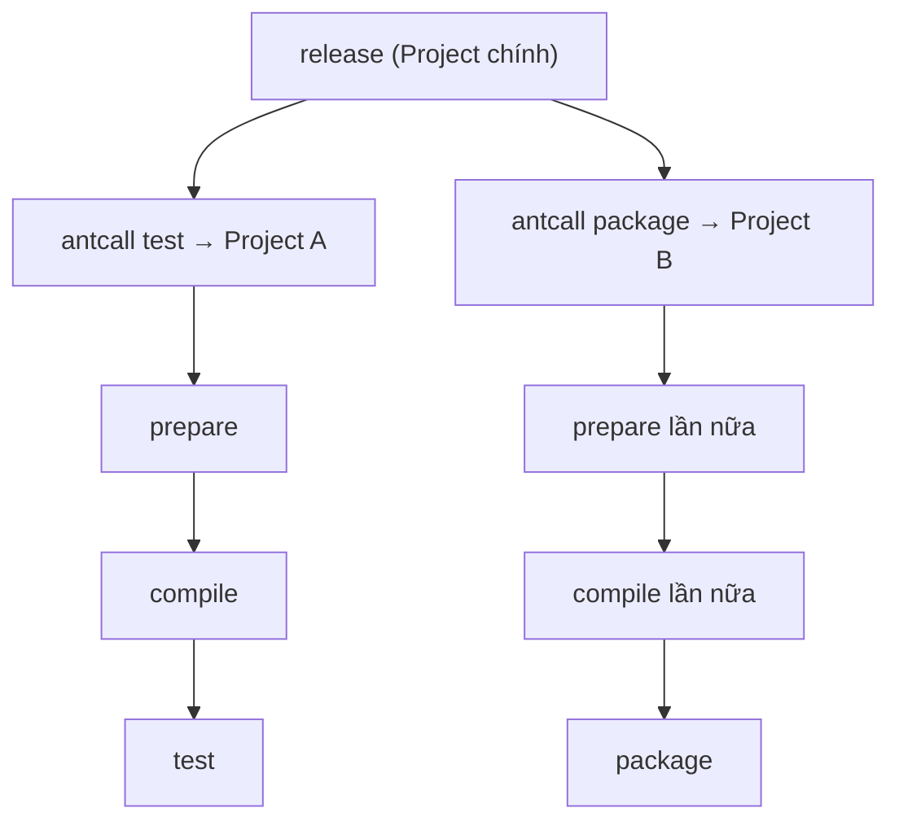
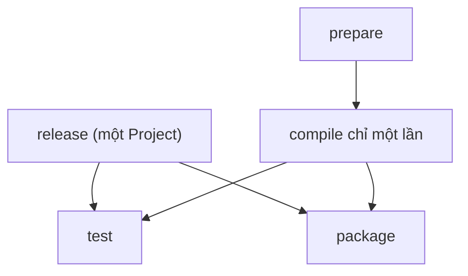

# Tránh `antcall` hoặc sub-build không cần thiết để cải thiện hiệu năng Apache Ant

> **Chủ đề:** Build Tool Ant  
> **Nhóm kiến thức:** Hiệu năng  
> **Trọng tâm:** Nhận diện những lần gọi lại target/buildfile gây tốn chi phí, chuyển sang đồ thị phụ thuộc hoặc cơ chế tái sử dụng tác vụ khi thích hợp, và giữ sub-build ở những ranh giới thực sự cần thiết.

Trong một dự án Apache Ant, chậm build không phải lúc nào cũng bắt nguồn từ `javac`, chạy kiểm thử hay đóng gói JAR. Một nguồn chi phí dễ bỏ qua là cách các target gọi lẫn nhau. Việc dùng `<antcall>` để “gọi hàm” trong cùng buildfile hoặc liên tục chạy lại buildfile con có thể khiến Ant **tạo nhiều đối tượng Project, nạp lại cấu hình và chạy lại các nhánh phụ thuộc**.

Bài này giải thích chính xác cơ chế, các dấu hiệu cần nhận diện và cách tái cấu trúc build để loại bỏ công việc không cần thiết mà vẫn giữ đúng kết quả.

## 1. Ba khái niệm cần phân biệt

Ant tổ chức công việc bằng **task**, **target** và **Project**:

- **Task** là thao tác cụ thể, chẳng hạn `<javac>`, `<copy>`, `<jar>` hoặc custom task.
- **Target** là nhóm task có tên, có thể phụ thuộc target khác qua thuộc tính `depends`.
- **Project** là ngữ cảnh thực thi chứa các target, property, reference, listener và trạng thái target đã chạy. Thông thường, chạy một buildfile tạo một Project chính.

Các cơ chế nhìn giống nhau nhưng có chi phí khác nhau:

| Cơ chế | Ant làm gì? | Trường hợp phù hợp |
|---|---|---|
| `depends="prepare,compile"` | Lập thứ tự thực thi trên **cùng Project**; target chung chỉ chạy một lần trong lần thực thi đó | Điều phối công việc thuộc cùng buildfile |
| `<antcall target="compile"/>` | Gọi target thông qua một **Project mới** từ buildfile hiện tại; cần khởi tạo/ngữ cảnh mới | Trường hợp hiếm cần chạy target với property khác hoặc cần Project riêng |
| `<ant antfile="child/build.xml" .../>` | Thực thi một buildfile với **Project riêng** | Dự án con thật sự có buildfile và cấu hình độc lập |
| `<subant>` | Điều phối nhiều Ant sub-build, thường là nhiều buildfile/module | Các module độc lập cần được gọi như các build riêng |
| `<macrodef>` | Định nghĩa một task có tham số, dùng lại logic **trong Project hiện tại** | Lặp lại nhóm task với bộ tham số khác nhau |
| `<import>` / `<include>` | Ghép định nghĩa target từ XML khác vào cùng Project | Tách file cấu hình nhưng vẫn có chung vòng đời build |

**Phân biệt quan trọng:** `antcall`, `ant` và `subant` không mặc nhiên khởi động một JVM mới ở mỗi lần gọi. Thông thường chúng tạo Ant Project mới **bên trong JVM đang chạy**. Dù vậy, việc xử lý buildfile, dựng ngữ cảnh và chạy lại dependency vẫn tiêu tốn thời gian. Trường hợp gọi chương trình `ant` qua `<exec>` mới có thêm chi phí khởi động tiến trình/JVM bên ngoài.

## 2. Vì sao `antcall` có thể làm build chậm?

Ant thực hiện `depends` như một đồ thị phụ thuộc: nếu `test` và `package` đều phụ thuộc `compile` thì trong **một Project**, Ant chỉ thực thi `compile` một lần trước các target cần nó.

Ngược lại, mỗi `<antcall>` có project riêng và lịch sử target riêng. Ant **không chia sẻ** thông tin “target `compile` đã chạy” giữa những Project đó.

### Ví dụ đồ thị

Giả sử:

```xml
<target name="prepare">...</target>
<target name="compile" depends="prepare">...</target>
<target name="test" depends="compile">...</target>
<target name="package" depends="compile">...</target>

<target name="release">
    <antcall target="test"/>
    <antcall target="package"/>
</target>
```

Trong project mới cho `test`, Ant đi qua `prepare → compile → test`. Ở project mới cho `package`, Ant lại đi qua `prepare → compile → package`.



Bước `<javac>` thứ hai có thể nhận ra class đã cập nhật và bỏ qua biên dịch lại. Tuy nhiên, target `compile` vẫn được *thực thi*: Ant phải xử lý thêm Project, target và các task kiểm tra tính mới. Nếu có generator không kiểm tra input, task xóa/thay file, mạng hoặc xử lý tài nguyên thì lượng công việc lặp lại còn lớn hơn.

Khi chuyển sang `depends`, mọi đường đi dùng chung một Project, nên dependency chung được thực thi đúng một lần:

```xml
<target name="release" depends="test,package"/>
```



Sơ đồ biểu diễn quan hệ phụ thuộc. Ant thực thi các target theo thứ tự hợp lệ của đồ thị, **không chạy song song mặc định**.

## 3. Tái cấu trúc từ `antcall` sang `depends`

Đây là thay đổi thường đem lại lợi ích rõ ràng nhất khi các target thuộc **cùng một buildfile**, không cần tham số riêng cho mỗi lượt gọi.

### 3.1. Thiết kế ban đầu: các target con được gọi bằng `antcall`

Giả sử dự án có mã Java ở `src/main/java`:

```xml
<?xml version="1.0" encoding="UTF-8"?>
<project name="example" default="release" basedir=".">
    <property name="build.dir" location="build"/>
    <property name="classes.dir" location="${build.dir}/classes"/>

    <target name="prepare">
        <mkdir dir="${classes.dir}"/>
    </target>

    <target name="compile" depends="prepare">
        <javac srcdir="src/main/java"
               destdir="${classes.dir}"
               includeantruntime="false"/>
    </target>

    <target name="test" depends="compile">
        <!-- Thay bằng bộ kiểm thử thật của dự án. -->
        <echo message="Run unit tests"/>
    </target>

    <target name="package" depends="compile">
        <jar destfile="${build.dir}/example.jar"
             basedir="${classes.dir}"/>
    </target>

    <target name="release">
        <antcall target="test"/>
        <antcall target="package"/>
    </target>
</project>
```

Với `ant release`, có hai lượt khởi tạo Project con. Các target `prepare` và `compile` được gọi qua cả hai nhánh.

### 3.2. Thiết kế tối ưu: mô tả quan hệ phụ thuộc

Giữ nguyên `prepare`, `compile`, `test` và `package`; chỉ đổi target điều phối:

```xml
<target name="release" depends="test,package">
    <echo message="Release targets completed"/>
</target>
```

Lúc này:

1. Ant vào `test`, thực hiện `prepare` và `compile` trước khi chạy test.
2. Ant vào `package`, nhận thấy `compile` đã chạy trong Project hiện tại nên không chạy lại nó.
3. Target `release` chạy phần thân sau khi các dependency đã hoàn thành.
4. Nếu một dependency thất bại, quá trình thực thi thông thường sẽ dừng và không coi `release` là thành công.

Dùng cách này khi các target cùng tham gia một quy trình build và có thể chia sẻ property/reference của Project.

### 3.3. Không tạo “target gọi lại target” chỉ để tổ chức code

Ví dụ sau cũng thường dư thừa:

```xml
<target name="compile-wrapper">
    <antcall target="compile"/>
</target>

<target name="run" depends="compile-wrapper"/>
```

Nếu wrapper không có hành vi riêng, có thể chuyển thành:

```xml
<target name="run" depends="compile"/>
```

Nếu có tác vụ cần chạy sau `compile`, đặt chúng trực tiếp trong target phụ thuộc `compile`:

```xml
<target name="instrument" depends="compile">
    <!-- Chạy instrumentation khi compile đã xong. -->
</target>
```

**Nguyên tắc:** dependency mô tả “cần hoàn thành công việc gì trước”, còn thân target mô tả “làm gì tại bước này”. Không cần `antcall` để thực hiện lời gọi tuần tự giữa các target cùng ngữ cảnh.

## 4. Tái sử dụng logic có tham số: dùng `macrodef` thay vì `antcall`

Một lý do phổ biến dùng `antcall` là muốn tái sử dụng “target như một hàm” và truyền giá trị bằng `<param>`.

### 4.1. Cách dùng `antcall` cho từng tệp

```xml
<target name="copy-one">
    <copy file="${source}"
          tofile="${destination}"/>
</target>

<target name="assemble">
    <antcall target="copy-one">
        <param name="source" value="src/config/app.properties"/>
        <param name="destination" value="build/config/app.properties"/>
    </antcall>
    <antcall target="copy-one">
        <param name="source" value="src/config/logging.properties"/>
        <param name="destination" value="build/config/logging.properties"/>
    </antcall>
</target>
```

Hai bản sao file tạo ra hai Project con. Nếu lặp lại hàng chục lần, số lần dựng Project tăng theo số thao tác, trong khi hành vi thực sự chỉ là copy file.

### 4.2. Dùng một `macrodef` trong Project hiện tại

```xml
<project name="assets" default="assemble">
    <macrodef name="copy-config">
        <attribute name="source"/>
        <attribute name="destination"/>
        <sequential>
            <copy file="@{source}"
                  tofile="@{destination}"/>
        </sequential>
    </macrodef>

    <target name="assemble">
        <mkdir dir="build/config"/>
        <copy-config source="src/config/app.properties"
                     destination="build/config/app.properties"/>
        <copy-config source="src/config/logging.properties"
                     destination="build/config/logging.properties"/>
    </target>
</project>
```

`<macrodef>` tạo một task tái sử dụng được. Cú pháp `@{source}` là **attribute của macro**, khác với `${source}` là **property của Ant**.

Lợi ích:

- Không có Project mới cho mỗi lần gọi macro.
- Không dùng property toàn cục để biểu diễn các tham số thay đổi giữa các lần gọi.
- Có thể đặt logic xử lý chung trong một định nghĩa dễ bảo trì.
- Các task được thực hiện ngay trong ngữ cảnh hiện tại, sử dụng cùng properties và references.

**Lưu ý về chức năng:** `macrodef` phù hợp khi cần lặp **chuỗi task có tham số**. Nó không tự thay thế cơ chế điều phối phụ thuộc giữa những target cấp cao; vai trò đó thuộc `depends`.

### 4.3. Với nhiều file, ưu tiên một task xử lý cả tập dữ liệu

Nếu mục tiêu chỉ là copy toàn bộ thư mục, thậm chí hai lượt gọi `copy-config` còn không cần thiết:

```xml
<target name="copy-configs">
    <copy todir="build/config">
        <fileset dir="src/config" includes="**/*.properties"/>
    </copy>
</target>
```

`<copy>` cùng `<fileset>` có thể xử lý nhiều file trong một task, tận dụng cơ chế kiểm tra timestamp/độ mới của Ant. Điều này thường đơn giản và hiệu quả hơn lặp qua từng file rồi gọi build/target mới.

Cùng tư duy áp dụng cho `<javac>`, `<jar>`, `<zip>` và các task nhận resource collection: ưu tiên gom các tài nguyên cùng loại vào một bước khi không có lý do chia nhỏ.

## 5. Phân biệt sub-build thật sự với lần tự gọi lại vô ích

`<ant>` và `<subant>` có ích khi cần điều phối **những buildfile độc lập**. Vấn đề nằm ở cách dùng và số lần gọi, không nằm ở bản thân task.

### 5.1. Dấu hiệu sub-build không cần thiết

Xét cấu trúc:

```text
repo/
├── build.xml
├── src/
└── modules/
    ├── service-a/
    │   └── build.xml
    └── service-b/
        └── build.xml
```

Nếu `repo/build.xml` tự gọi lại chính nó bằng `<ant>` chỉ để thực hiện một target khác:

```xml
<target name="all">
    <ant antfile="build.xml" target="compile"/>
    <ant antfile="build.xml" target="package"/>
</target>
```

thì hai lần chạy đang dựng lại Project từ cùng buildfile. Thông thường nên chuyển:

```xml
<target name="all" depends="compile,package"/>
```

Một dấu hiệu tương tự là các target `build-service-a`, `test-service-a`, `package-service-a` đều gọi đi gọi lại `modules/service-a/build.xml` theo những target mà bản thân buildfile con đã có thể điều phối.

### 5.2. Khi nào nên giữ `<ant>`?

Giữ sub-build nếu module:

- Có buildfile riêng, vòng đời và default target riêng.
- Cần tách property/reference và tên target khỏi Project điều phối.
- Phải được build hoặc kiểm thử độc lập từ dòng lệnh.
- Có cấu hình riêng khó hoặc không an toàn khi ép vào cùng một Project.
- Được tổ chức theo nhiều kho mã, thư mục hoặc sản phẩm có ranh giới rõ ràng.

Ví dụ một lời gọi hợp lý:

```xml
<target name="package-service-a">
    <ant antfile="modules/service-a/build.xml"
         target="package"
         inheritAll="false"/>
</target>
```

Ở đây, chi phí Project mới phục vụ ranh giới module. Nhưng hãy tránh gọi đi gọi lại cùng một module nếu có thể để buildfile con tự xử lý đầy đủ quy trình một lần.

Một cách giảm số lần gọi:

```xml
<!-- Parent chỉ gọi pipeline tổng hợp một lần. -->
<target name="verify-service-a">
    <ant antfile="modules/service-a/build.xml"
         target="verify"
         inheritAll="false"/>
</target>
```

Trong `modules/service-a/build.xml`:

```xml
<target name="compile">...</target>
<target name="test" depends="compile">...</target>
<target name="package" depends="compile">...</target>
<target name="verify" depends="test,package"/>
```

Khi đó một Project con xử lý toàn bộ chuỗi `verify`, chia sẻ trạng thái dependency trong nội bộ nó.

### 5.3. `<subant>` không phải công cụ loại bỏ chi phí Project

Đối với các module độc lập cùng có buildfile, `<subant>` giúp điều phối có hệ thống:

```xml
<target name="build-modules">
    <subant target="verify" inheritall="false">
        <fileset dir="modules" includes="*/build.xml"/>
    </subant>
</target>
```

Ví dụ này giảm XML lặp lại ở parent nhưng **không biến các sub-build thành một Project duy nhất**: mỗi buildfile vẫn được xử lý như sub-build. Hãy dùng `subant` vì cần quản lý nhiều build độc lập, không coi nó là cách tối ưu hiệu năng tự động.

Với dự án có vài module lớn, ranh giới tách biệt có thể đáng giá hơn một ít thời gian khởi tạo. Với hàng trăm module nhỏ, cân nhắc kiến trúc điều phối để không lặp những tác vụ chuẩn bị chung ở từng sub-build.

## 6. Dùng `import` hoặc `include` khi chỉ muốn chia nhỏ file cấu hình

Không phải cứ có nhiều file XML là cần sub-build. Nếu mục tiêu là tách file cho dễ đọc nhưng tất cả target thuộc cùng một ứng dụng, `<import>` hoặc `<include>` giúp tải các định nghĩa vào cùng Project.

Ví dụ:

```text
project/
├── build.xml
└── build/
    └── common.xml
```

File `build/common.xml`:

```xml
<project name="common">
    <target name="prepare">
        <mkdir dir="out"/>
    </target>

    <target name="compile" depends="prepare">
        <echo message="Compile sources"/>
    </target>
</project>
```

File `build.xml`:

```xml
<project name="app" default="verify" basedir=".">
    <import file="build/common.xml"/>

    <target name="test" depends="compile">
        <echo message="Run tests"/>
    </target>

    <target name="verify" depends="test"/>
</project>
```

Target trong file được import hoạt động trong **cùng Project** với target ở file chính, nên không cần `<ant antfile="build/common.xml".../>` chỉ để gọi `compile`.

Điểm cần cân nhắc trước khi đổi:

- `import` và `include` có quy tắc riêng về tên target/khả năng ghi đè hoặc tiền tố tên; cần giải quyết xung đột tên.
- Property của Ant dùng chung và gần như bất biến sau khi được đặt. Những module từng cần property khác nhau có thể xung đột khi nhập chung.
- Đường dẫn tương đối và `basedir` cần được xem xét, nhất là khi imported file từng được chạy độc lập. Khi cần đường dẫn bên cạnh file imported, có thể dùng property `ant.file.<tên-project-imported>` theo cơ chế Ant.
- Nếu module cần chạy độc lập, thay bằng `import` có thể thay đổi hợp đồng build. Không nhất thiết phải áp dụng chỉ vì muốn giảm thời gian.

**Quy tắc chọn:** tách cấu hình XML nhưng cùng vòng đời thì xem xét `import`/`include`; tách build độc lập thì giữ `ant`/`subant`.

## 7. Property và reference: lý do tránh refactor máy móc

Khi bỏ `antcall` hoặc `ant`, thay đổi lớn nhất không chỉ là tốc độ, mà là **ngữ cảnh thực thi**.

### 7.1. Property trong Ant không phải biến có thể gán lại tùy ý

Thông thường một property được đặt một lần trong Project và những lần đặt tiếp theo không ghi đè giá trị đã có. Với `antcall`, mỗi Project con có bộ property riêng nên ta có thể truyền tham số bằng `<param>`:

```xml
<antcall target="render">
    <param name="format" value="html"/>
</antcall>
<antcall target="render">
    <param name="format" value="pdf"/>
</antcall>
```

Đổi trực tiếp thành hai target `depends="render,render"` là **sai mục tiêu**: `render` chỉ chạy một lần trong cùng Project và không nhận hai giá trị `format` khác nhau.

Nếu `render` thực chất chỉ là chuỗi task cần chạy hai lần với tham số khác, hãy chuyển logic đó thành `macrodef`:

```xml
<macrodef name="render-one">
    <attribute name="format"/>
    <sequential>
        <echo message="Render output as @{format}"/>
        <!-- Đặt task render thật ở đây. -->
    </sequential>
</macrodef>

<target name="render-all">
    <render-one format="html"/>
    <render-one format="pdf"/>
</target>
```

Nếu hai lượt thực sự phải có cấu hình Project khác nhau, `antcall` có thể vẫn là lựa chọn hợp lý.

### 7.2. Thay đổi bên trong Project con không tự trở về Project cha

Property được thiết lập trong một Project con **không trở thành property mới của Project cha** sau khi `antcall` hoặc `ant` kết thúc. Vì vậy, không dùng sub-build như một “hàm trả về property” theo cách thông thường.

Với `antcall`, `inheritAll` mặc định cho phép truyền các property hiện có sang Project con. `inheritRefs` kiểm soát việc truyền references và mặc định không bật; các reference có thể được truyền tường minh khi cần. Những property do người dùng truyền từ dòng lệnh thường có độ ưu tiên riêng và không thể tùy tiện bị `param` ghi đè.

Sau khi đổi sang `depends` hoặc `macrodef`, các task chia sẻ cùng property/reference của Project chính. Điều này giảm việc tạo ngữ cảnh nhưng cũng đòi hỏi tránh phụ thuộc vào hành vi cô lập trước kia.

### 7.3. `if` / `unless` không bỏ qua dependency của target

Giả sử:

```xml
<target name="compile">
    <echo message="Expensive compile"/>
</target>

<target name="optional-test"
        depends="compile"
        if="run.tests">
    <echo message="Run optional tests"/>
</target>
```

Trong Ant, dependency được xử lý **trước khi** đánh giá `if`/`unless` trên thân target. Vì vậy, khi gọi `optional-test` mà không đặt `run.tests`, `compile` vẫn có thể chạy.

Nếu chuyển từ điều kiện trong `antcall` sang một target phụ thuộc, cần thiết kế lại ranh giới kiểm tra điều kiện cho đúng. Không đặt điều kiện trên target cha rồi mặc định rằng toàn bộ dependency sẽ bị bỏ qua.

## 8. Giảm chi phí lặp ở mức task và artifact

Dù đã bỏ `antcall` không cần thiết, build vẫn có thể chậm nếu những target còn lại luôn làm lại công việc.

### 8.1. Dùng các task có khả năng xử lý incremental

Ant có nhiều cơ chế kiểm tra tính mới:

- `<javac>` thường kiểm tra thời điểm cập nhật của source và class tương ứng, chỉ biên dịch source bị coi là cũ hơn hoặc chưa có class.
- `<copy>` có thể bỏ qua file đích đã cập nhật.
- `<jar>`/`<zip>` có cơ chế cập nhật archive tùy cấu hình.
- `<uptodate>` có thể dùng để đặt property khi một tập output còn mới so với input.

Một ví dụ dùng `uptodate` để bỏ qua tác vụ đắt tiền:

```xml
<target name="check-generated">
    <uptodate property="generated.current"
              targetfile="build/generated/schema.java">
        <srcfiles dir="schema" includes="**/*.xsd"/>
    </uptodate>
</target>

<target name="generate"
        depends="check-generated"
        unless="generated.current">
    <mkdir dir="build/generated"/>
    <!-- Gọi generator thật và tạo schema.java ở đây. -->
</target>
```

Ở ví dụ minh họa này, output phải do generator thật tạo ra; khi chỉ kiểm tra timestamp, có rủi ro một thay đổi logic generator hoặc cấu hình không được nhận ra. Trong dự án thực tế, cần coi file cấu hình, template và phiên bản generator là input khi chúng ảnh hưởng kết quả.

### 8.2. Tránh target luôn xóa output trước khi build

Ví dụ kém hiệu quả:

```xml
<target name="compile">
    <delete dir="build/classes"/>
    <mkdir dir="build/classes"/>
    <javac srcdir="src/main/java"
           destdir="build/classes"
           includeantruntime="false"/>
</target>
```

Nếu mỗi lần chạy `compile` đều xóa class, `javac` bắt buộc biên dịch lại. Trong luồng có nhiều `antcall`, vấn đề càng nghiêm trọng.

Tốt hơn là tách `clean` thành target chủ động:

```xml
<target name="clean">
    <delete dir="build"/>
</target>

<target name="prepare">
    <mkdir dir="build/classes"/>
</target>

<target name="compile" depends="prepare">
    <javac srcdir="src/main/java"
           destdir="build/classes"
           includeantruntime="false"/>
</target>
```

Chạy `ant clean compile` khi cần build sạch; chạy `ant compile` hằng ngày để tận dụng incremental build.

### 8.3. Đưa việc chuẩn bị dùng chung lên dependency chung

Nếu các target `lint`, `test` và `package` đều cần cùng một bước sinh metadata hoặc chuẩn bị thư mục, hãy cho chúng phụ thuộc một target `prepare` dùng chung:

```xml
<target name="prepare">...</target>
<target name="lint" depends="prepare">...</target>
<target name="test" depends="prepare">...</target>
<target name="package" depends="prepare">...</target>
<target name="verify" depends="lint,test,package"/>
```

Trong cùng Project, `prepare` chỉ thực thi một lần. Đây là lợi ích trực tiếp của thiết kế đồ thị target đúng đắn.

## 9. Nhận diện nơi lãng phí trong một buildfile thực tế

Khi đọc `build.xml` và các file được nhập, tìm trước các mẫu sau:

| Mẫu nhận diện | Câu hỏi cần trả lời | Hướng xử lý có thể phù hợp |
|---|---|---|
| Nhiều `<antcall target="X"/>` trong target điều phối | Các target X có cần Project riêng không? | Dùng `depends` nếu cùng Project |
| `<antcall>` với `<param>` lặp nhiều lần | Đây có phải các thao tác có tham số không? | Dùng `macrodef` |
| `<ant antfile="build.xml".../>` gọi lại chính buildfile | Có tạo vòng đời build mới không cần thiết không? | Dùng dependency nội bộ |
| Nhiều `<ant>` tới cùng buildfile con | Có thể tạo target `verify` hoặc `all` ở buildfile con không? | Gọi sub-build một lần |
| Một `<antcall>` cho mỗi file | Task hiện có nhận `fileset`/resource collection không? | Xử lý hàng loạt |
| `clean` là dependency của `compile` | Có đang xóa mọi output khi build thường ngày không? | Chỉ chạy `clean` theo yêu cầu |
| `compile`, `generate` hoặc `archive` bị gọi lại | Output đã tồn tại nhưng task vẫn làm việc nặng? | Tối ưu incremental, khai báo input/output |
| Sub-build mang nhiều property/reference từ cha | Có thực sự cần truyền hết môi trường này? | Xem xét `inheritAll="false"` và truyền cấu hình tường minh |

Không phải tất cả lần gọi `antcall` đều sai. Mỗi thay đổi cần dựa trên hợp đồng chức năng thực sự của target và kết quả đầu ra.

## 10. Đo hiệu năng trước và sau thay đổi

Không nên khẳng định một con số tăng tốc cố định, vì thời gian phụ thuộc số lượng target, kích thước buildfile, tính incremental của task, tốc độ đĩa, phiên bản Ant/JDK và dữ liệu cache.

### 10.1. Đo đúng hai tình huống

**Build sạch (cold build)**: xóa output qua `clean` trước khi chạy. Kiểm tra xem thay đổi có giảm overhead điều phối hay tác động bất lợi đến biên dịch/đóng gói.

**Build lặp (warm build)**: chạy cùng lệnh khi source không đổi. Trường hợp này thường phơi bày thời gian bị lãng phí do tạo Project, parse cấu hình hoặc kiểm tra lặp.

Trong Bash:

```bash
# Cold run: clean rồi build.
ant -f build.xml clean
time ant -f build.xml release

# Warm run: không thay đổi source.
time ant -f build.xml release
```

Trong PowerShell:

```powershell
ant -f build.xml clean
Measure-Command { ant -f build.xml release }
Measure-Command { ant -f build.xml release }
```

Khi so sánh hai cách tổ chức target, dùng cùng JDK/Ant, máy, bộ source, phụ thuộc và điều kiện cache tương đương. Chạy vài lần rồi so sánh trung vị/độ phân tán thay vì chỉ một phép đo.

### 10.2. Quan sát target bị thực thi lại

Lệnh `-verbose` giúp thấy thứ tự chạy và hoạt động của task:

```bash
ant -f build.xml -verbose release
```

Tìm số lần xuất hiện của các target như `prepare`, `compile` hoặc việc gọi lồng nhau đến buildfile. Khi build có nhiều module, ghi cả đường dẫn buildfile để tránh nhầm các target trùng tên.

Ant có khả năng dùng custom logger/listener để đo chi tiết. Tùy bản phân phối, có thể dùng `org.apache.tools.ant.listener.ProfileLogger` thông qua tham số `-logger`:

```bash
ant -f build.xml \
  -logger org.apache.tools.ant.listener.ProfileLogger release
```

Nếu bản Ant của bạn không cung cấp logger đó, có thể dùng log verbose kết hợp phép đo toàn tiến trình hoặc listener profiler tương thích. Thời gian logger chỉ là phần hỗ trợ: kết quả chính vẫn là thời gian thực thi và artifact đúng.

### 10.3. Bảng ghi nhận kết quả

| Chỉ số | Trước refactor | Sau refactor |
|---|---|---|
| Tổng số lần gọi `antcall` / sub-build | Đếm từ luồng chạy | Đếm lại |
| Số lượt `compile` trong một lần `release` | Quan sát log | Kỳ vọng giảm nếu trùng |
| Thời gian cold build | Đo thực tế | Đo thực tế |
| Thời gian warm build | Đo thực tế | Đo thực tế |
| Tập artifact cuối cùng | Ghi danh sách và checksum | So sánh với baseline |
| Kết quả kiểm thử, exit code | Ghi nhận | Phải giữ hợp đồng |

Đặc biệt, **số lần gọi `compile` giảm không đồng nghĩa chắc chắn với số lần biên dịch class giảm**: một số lượt trước đó có thể chỉ là kiểm tra up-to-date. Cần phân biệt số target chạy, số task chạy và số nguồn thực sự được biên dịch.

## 11. Các lỗi có thể xảy ra khi tối ưu

### 11.1. Phụ thuộc thứ tự sai

Nếu target `package` cần đầu ra của `test` nhưng chỉ phụ thuộc `compile`, việc chuyển sang `depends="package,test"` có thể làm thay đổi thứ tự trước đây.

**Cách xử lý:** khai báo quan hệ nghiệp vụ thực, chẳng hạn `package depends="test"` nếu đóng gói phải đợi test. Không dùng thứ tự lời gọi `antcall` như một cách ngầm định để che giấu dependency thiếu.

### 11.2. Muốn chạy target hai lần nhưng `depends` chỉ chạy một lần

Một target chạy hai lần với tham số khác nhau là hành vi **khác** target được yêu cầu bởi hai dependency. Nếu logic cần lặp, dùng `macrodef` hoặc chia thành các target riêng có output riêng; nếu cần Project cô lập theo lượt, giữ `antcall` có chủ đích.

### 11.3. Property bị “đóng băng”

Khi nhập hai buildfile độc lập vào một Project, cả hai có thể dùng cùng property `build.dir` nhưng kỳ vọng giá trị khác nhau. Vì property không tùy ý ghi đè, output có thể bị ghi vào nhầm thư mục.

**Cách xử lý:** đặt namespace property rõ ràng, ví dụ `module.a.build.dir` và `module.b.build.dir`, hoặc giữ build độc lập.

### 11.4. Không còn classpath/reference ở Project con

Chuyển từ `<ant>` sang `<import>` có thể khiến cách tạo/đăng ký `path`, `taskdef`, classloader hoặc reference đổi ngữ cảnh. Ngược lại, giữ `antcall` mà quên `inheritRefs` có thể làm Project con không nhìn thấy reference cần dùng.

**Cách xử lý:** khai báo rõ classpath/reference và kiểm thử đúng các target chính của mỗi cấu hình, không chỉ nhìn thời gian chạy.

### 11.5. Vòng phụ thuộc

Khi thay lời gọi target bằng `depends`, đừng tạo vòng như:

```xml
<target name="compile" depends="package"/>
<target name="package" depends="compile"/>
```

Ant phát hiện dependency vòng và dừng build. Cần thiết kế đồ thị một chiều theo các giai đoạn: `prepare → compile → test/package → release`.

### 11.6. Dùng `<parallel>` để bù cho thiết kế chưa tốt

`<parallel>` có thể chạy nhiều task đồng thời, nhưng không tự giải quyết việc các Project con lặp dependency, tranh chấp thư mục output hoặc file log. Chỉ xét song song hóa sau khi ranh giới dữ liệu và công việc độc lập đã rõ; nếu không dễ phát sinh race condition, kết quả không ổn định và lỗi khó tái hiện.

## 12. Quy trình refactor từng bước

Có thể áp dụng trình tự sau cho một build lớn:

1. **Xác định entry point thực tế**: các lệnh mà người phát triển và CI đang chạy, chẳng hạn `ant test`, `ant package`, `ant release`.
2. **Vẽ luồng target và các sub-build**: ghi lại tên target, file build, property/param được truyền và những target dùng chung.
3. **Phân loại lời gọi**: target cùng Project, logic có tham số, hoặc buildfile con thực sự độc lập.
4. **Thay đúng cơ chế**: `depends` cho quan hệ tiên quyết, `macrodef` cho thao tác có tham số, `fileset` cho tác vụ theo lô, `import` cho cấu hình dùng chung; giữ `ant`/`subant` khi cần độc lập.
5. **Giữ kết quả**: so sánh file đầu ra, cấu trúc archive, tham số test và mã thoát của luồng cũ/mới.
6. **Đo lại**: kiểm tra cold/warm build, số target bị gọi lặp và report của CI.
7. **Loại bỏ các đường gọi cũ**: sau khi luồng mới vận hành đúng, xóa wrapper/target dư thừa để tránh hai cách gọi song song.

Một bảng lựa chọn nhanh:

| Nhu cầu | Giải pháp ưu tiên |
|---|---|
| “Trước khi `release`, phải chạy `test` và `package`” | `depends="test,package"` |
| “Chạy cùng chuỗi task nhiều lần với tham số khác” | `macrodef` |
| “Copy hoặc đóng gói hàng trăm file” | Một task với `fileset`/resource collection |
| “Chia XML dài thành nhiều file nhưng dùng chung build” | `import` / `include` |
| “Xây các module có buildfile và môi trường riêng” | `ant` hoặc `subant`, mỗi module được gọi tối thiểu cần thiết |
| “Phải chạy cùng target với các property Project độc lập” | Có thể giữ `antcall` có chủ đích |
| “Cần một JVM/process riêng cho một thao tác” | Cấu hình fork/tiến trình ngoài phù hợp; đừng giả định `antcall` tạo JVM riêng |

## 13. Bài thực hành

### Bài 1 — Nhận diện dependency bị lặp

Cho buildfile:

```xml
<project default="all">
    <target name="init"><echo message="INIT"/></target>
    <target name="compile" depends="init">
        <echo message="COMPILE"/>
    </target>
    <target name="test" depends="compile">
        <echo message="TEST"/>
    </target>
    <target name="package" depends="compile">
        <echo message="PACKAGE"/>
    </target>
    <target name="all">
        <antcall target="test"/>
        <antcall target="package"/>
    </target>
</project>
```

Yêu cầu:

- Dự đoán số lượt `INIT` và `COMPILE` trong luồng gọi hiện tại.
- Thay duy nhất target `all` bằng cấu trúc dependency phù hợp.
- Chạy `ant -verbose all` cho từng phiên bản và quan sát khác biệt.
- Giải thích tại sao hai thông báo lặp không có nghĩa Ant chạy hai JVM khác nhau.

### Bài 2 — Thay lời gọi theo tham số bằng macro

Cho target copy cấu hình được gọi ba lần bằng `antcall` và `param`. Tạo `macrodef` nhận `source` và `destination`, gọi ba lần trong cùng một target. Sau đó thử thay ba lời gọi macro bằng một `<copy>` kèm `<fileset>` nếu cả ba nguồn cùng một thư mục.

### Bài 3 — Giữ ranh giới module

Có ba module, mỗi module có `build.xml` độc lập với target `compile`, `test` và `package`. Parent đang gọi từng target bằng ba `<ant>` riêng cho từng module.

Thiết kế target `verify` bên trong mỗi module sử dụng `depends`; parent chỉ gọi `verify` một lần cho mỗi module. So sánh số Project con được tạo trước và sau mà vẫn giữ khả năng build từng module độc lập.

### Bài 4 — Giữ đúng hợp đồng hành vi

Một target `render` được `antcall` hai lần với `format=html` và `format=pdf`. Chứng minh tại sao `depends="render"` không thay thế được. Chọn `macrodef` hoặc giữ `antcall` theo nhu cầu cách ly, rồi xác nhận cả hai artifact đều xuất hiện.

## 14. Tài liệu tham khảo

- [Apache Ant — Targets và `depends`](https://ant.apache.org/manual/targets.html)
- [Apache Ant — `antcall` task](https://ant.apache.org/manual/Tasks/antcall.html)
- [Apache Ant — `ant` task](https://ant.apache.org/manual/Tasks/ant.html)
- [Apache Ant — `subant` task](https://ant.apache.org/manual/Tasks/subant.html)
- [Apache Ant — `macrodef` task](https://ant.apache.org/manual/Tasks/macrodef.html)
- [Apache Ant — `import` task](https://ant.apache.org/manual/Tasks/import.html)
- [Apache Ant — `include` task](https://ant.apache.org/manual/Tasks/include.html)
- [Apache Ant — `copy` task](https://ant.apache.org/manual/Tasks/copy.html)

**Ghi nhớ:** hiệu năng Ant phụ thuộc rất nhiều vào ranh giới Project và thiết kế đồ thị target. Một Project với các dependency khai báo đúng sẽ tránh được việc khởi tạo lại và thực thi lặp các target dùng chung. `antcall` và sub-build vẫn hữu ích khi cần bộ property, reference hoặc vòng đời build độc lập; giá trị tối ưu nằm ở việc **chỉ dùng chúng khi sự độc lập đó thực sự cần thiết**.
