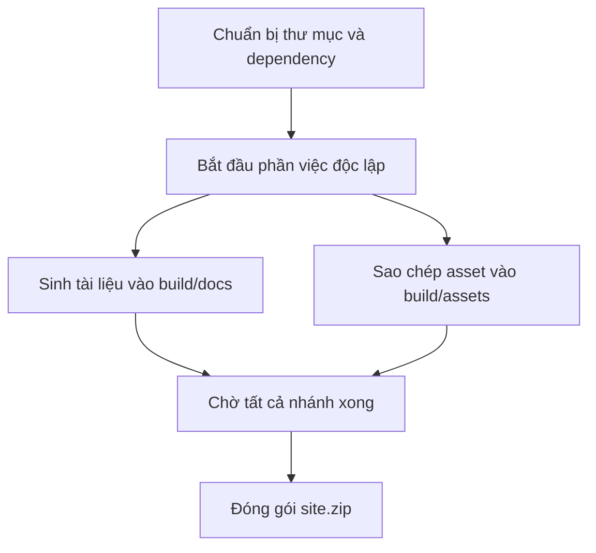

# Giới hạn tài nguyên và tránh tranh chấp khi dùng `parallel` trong Apache Ant

Chạy nhiều công việc cùng lúc có thể rút ngắn thời gian build, đặc biệt khi các công việc độc lập và mỗi công việc có lúc phải chờ I/O. Trong **Apache Ant**, task `<parallel>` cho phép thực thi đồng thời các task con bằng các luồng Java. Tuy nhiên, tăng số luồng không đồng nghĩa với tăng hiệu năng tương ứng. Nếu nhiều task cùng dùng quá nhiều CPU, bộ nhớ, ổ đĩa hoặc cùng sửa một file, bản build có thể chậm hơn, hết bộ nhớ, sinh artifact lỗi hoặc thất bại ngẫu nhiên.

Bài học này thuộc chủ đề **Build Tool Ant → Hiệu năng**. Trọng tâm là **chọn mức song song dựa trên ngân sách tài nguyên** và **thiết kế các task không tranh chấp dữ liệu hay tài nguyên bên ngoài**.

## 1. Hiểu đúng phạm vi của `<parallel>`

Ví dụ:

```xml
<target name="work">
    <parallel threadCount="2" failonany="true">
        <sequential>
            <echo message="Nhánh A bắt đầu"/>
            <sleep seconds="2"/>
            <echo message="Nhánh A xong"/>
        </sequential>
        <sequential>
            <echo message="Nhánh B bắt đầu"/>
            <sleep seconds="2"/>
            <echo message="Nhánh B xong"/>
        </sequential>
    </parallel>
    <echo message="Hai nhánh đã kết thúc"/>
</target>
```

Trong đoạn trên:

- `<parallel>` điều phối các task con để chúng có thể chạy đồng thời.
- `threadCount="2"` giới hạn số luồng thực hiện **các task con trực tiếp của khối `parallel`**. Nó không đặt giới hạn tổng số luồng hoặc tiến trình của toàn bộ hệ thống.
- Mỗi `<sequential>` là một đơn vị công việc có các bước chạy **theo thứ tự bên trong nhánh**. Hai nhánh `sequential` có thể chạy cùng lúc.
- Dòng log từ hai nhánh có thể đan xen; đừng dựa vào thứ tự log để suy ra thứ tự hoàn tất.
- Khi các tác vụ thông thường trong khối đã hoàn thành, Ant mới thực hiện lệnh `echo` tiếp theo. Các tác vụ khai báo riêng dưới `<daemons>` có cách chờ hoàn tất khác, nên không dùng chúng cho công việc bắt buộc phải kết thúc trước khi đóng gói.

Ant không tự đọc cấu trúc dependency để đoán task nào an toàn cho việc chạy song song. Nếu đặt hai thao tác cần cùng một file vào `<parallel>`, chính người viết build phải bảo đảm chúng không xung đột.

### Phân biệt ba loại song song

| Cơ chế | Điều gì chạy đồng thời? | Giới hạn cần lưu ý |
| --- | --- | --- |
| `<parallel>` | Các task Ant con trong cùng bản build | `threadCount` chỉ quản lý công việc được khối đó điều phối |
| Task mở tiến trình ngoài: `<exec>`, `<java fork="true">` | Mỗi task có thể tạo tiến trình riêng | Mỗi tiến trình có heap, luồng, file handle và CPU riêng |
| Công cụ bên trong tự chạy song song | Compiler, test runner, trình nén, script hoặc công cụ ngoài có thể tự mở worker | Cần tính cả mức song song bên trong chúng |

Ví dụ, đặt `threadCount="2"` cho hai tác vụ test, nhưng mỗi tác vụ test tự khởi chạy bốn JVM thì máy có thể phải phục vụ tám JVM test cùng lúc. Không thể xem con số hai là tổng ngân sách tài nguyên.

## 2. Hai câu hỏi phải trả lời trước khi bật song song

**Công việc có thực sự độc lập?** Hai nhánh chỉ nên chạy đồng thời nếu nhánh này không cần kết quả đang được nhánh kia tạo ra, và chúng không ghi vào cùng đầu ra hay thay đổi chung một trạng thái.

**Máy có đủ tài nguyên cho số nhánh dự kiến?** Ngay cả khi không có tranh chấp dữ liệu, hai tác vụ dùng gần hết RAM hoặc băng thông đĩa vẫn có thể làm tổng thời gian tăng lên.

Phân loại một build đơn giản:



Hai nhánh ở giữa có thể chạy song song vì mỗi nhánh có thư mục đầu ra riêng. Bước đóng gói phải chạy sau **cả hai nhánh**, vì nó cần kết quả của cả hai.

Ngược lại, chuỗi `compile → test → package` thông thường có quan hệ phụ thuộc. Không được đặt ba bước ấy ngang hàng trong một khối `parallel` rồi hy vọng Ant chạy theo thứ tự hợp lý.

## 3. Ngân sách CPU, RAM, I/O và tài nguyên bên ngoài

Không có một giá trị `threadCount` tối ưu cho mọi dự án. Số nhánh phải được chọn theo loại công việc và giới hạn thực tế của máy hoặc container.

| Tài nguyên | Dấu hiệu vượt giới hạn | Cách xử lý |
| --- | --- | --- |
| CPU | CPU bão hòa liên tục, tăng luồng nhưng không giảm thời gian | Giảm nhánh chạy đồng thời; tính cả worker do tool con tạo |
| RAM / heap | `OutOfMemoryError`, hệ điều hành swap, tiến trình bị OOM-kill | Giảm số tiến trình; đặt heap rõ ràng; để phần RAM dự phòng |
| Ổ đĩa / IOPS | Nhiều job copy, giải nén hoặc compile cùng đọc/ghi làm I/O chậm | Hạn chế nhánh I/O nặng; dùng đầu ra riêng |
| File handle / process handle | Lỗi “too many open files”, không mở được tệp hoặc tiến trình | Giảm concurrency; đóng tài nguyên đúng cách; xem giới hạn hệ thống |
| Mạng / artifact repository | Tải dependency chậm, timeout, HTTP 429 | Dùng cache hợp lệ; giới hạn số request tải đồng thời |
| Database / dịch vụ test | Tranh chấp bảng, connection pool cạn, cổng bị chiếm | Cô lập schema/instance/cổng hoặc chạy tuần tự |
| CI runner / container | Máy host nhiều core nhưng container chỉ được cấp một phần | Tính theo quota và memory limit của job, không chỉ thông số host |

### Với công việc chủ yếu dùng CPU

Nếu mỗi nhánh dùng gần một CPU core liên tục, số nhánh có ích thường không nên vượt xa số core **thực tế được cấp** cho build. Có tám core trên host không có nghĩa container đang được cấp tám core.

Ngược lại, nếu mỗi nhánh thường xuyên chờ mạng hoặc đĩa, có thể thử nhiều nhánh hơn số core, nhưng phải đo thời gian thực tế: request song song quá nhiều dễ khiến dịch vụ bên ngoài bị nghẽn.

### Với công việc chủ yếu dùng bộ nhớ

Ước lượng theo **bộ nhớ đỉnh** của các nhánh, không dùng mức RAM nhàn rỗi lúc khởi động.

Giả sử một CI runner được cấp:

- Tổng RAM: **4 GiB**.
- Bộ nhớ nền cho Ant, hệ điều hành và các công việc khác: **0,8 GiB**.
- Khoảng dự phòng an toàn: **0,5 GiB**.
- Mỗi worker test đã đo được lúc cao nhất dùng khoảng **1,1 GiB**.

Khi đó:

\[
N_{\text{RAM}} =
\left\lfloor
\frac{4 - 0{,}8 - 0{,}5}{1{,}1}
\right\rfloor
= 2
\]

Nếu quota CPU cho phép tối đa bốn worker CPU nặng, số nhánh khởi đầu hợp lý theo cả CPU và RAM là:

\[
N_{\text{ban đầu}} = \min(N_{\text{CPU}}, N_{\text{RAM}}) = \min(4,2)=2
\]

Đây là **ước lượng để chọn cấu hình ban đầu**, không phải phép chứng minh rằng luôn có thể chạy hai worker. Cần tính cả bộ nhớ native, thread stack, JVM khác, cache, giai đoạn peak đồng thời và mức giới hạn của container. Sau đó đo lại bằng build thật.

### Dùng cấu hình có thể điều chỉnh

Thay vì hard-code quá nhiều luồng trong nhiều nơi, khai báo một property với mặc định thận trọng:

```xml
<property name="parallel.workers" value="2"/>

<target name="run-independent-work">
    <parallel threadCount="${parallel.workers}" failonany="true">
        <sequential>
            <echo message="Worker A"/>
        </sequential>
        <sequential>
            <echo message="Worker B"/>
        </sequential>
    </parallel>
</target>
```

Người chạy có thể override:

```bash
ant -Dparallel.workers=1 run-independent-work
ant -Dparallel.workers=2 run-independent-work
```

Ant property do `-D` cung cấp được ưu tiên so với mặc định trong `build.xml`. Chỉ cấp số nguyên dương phù hợp với hạn mức máy. Không nên dùng ngay số luồng lớn nhất chỉ vì `Runtime.availableProcessors()` có thể nhìn thấy nhiều processor; CI có thể áp quota thấp hơn.

## 4. Ví dụ build an toàn với hai nhánh độc lập

Ví dụ sau sao chép tài nguyên tĩnh và tài liệu vào hai khu vực riêng, sau đó đóng gói kết quả. Thao tác sao chép ở đây là minh họa: trên dự án thực, hai nhánh có thể được thay bằng các công việc tốn thời gian hơn nhưng vẫn phải bảo toàn nguyên tắc **độc lập đầu vào và tách đầu ra**.

Cấu trúc tối thiểu:

```text
ant-parallel-demo/
├── build.xml
├── src/
│   ├── assets/
│   │   └── logo.txt
│   └── docs/
│       └── guide.txt
└── build/                # Ant tạo ra khi chạy
```

**`build.xml`:**

```xml
<?xml version="1.0" encoding="UTF-8"?>
<project name="ant-parallel-demo" default="package" basedir=".">
    <property name="parallel.workers" value="2"/>
    <property name="build.dir" location="build"/>
    <property name="assets.out" location="${build.dir}/assets"/>
    <property name="docs.out" location="${build.dir}/docs"/>
    <property name="dist.dir" location="${build.dir}/dist"/>

    <target name="prepare">
        <mkdir dir="${assets.out}"/>
        <mkdir dir="${docs.out}"/>
        <mkdir dir="${dist.dir}"/>
    </target>

    <target name="package" depends="prepare">
        <parallel threadCount="${parallel.workers}"
                  failonany="true">
            <!-- Nhánh A chỉ ghi build/assets. -->
            <sequential>
                <copy todir="${assets.out}">
                    <fileset dir="src/assets"/>
                </copy>
                <echo message="Assets đã sẵn sàng"/>
            </sequential>

            <!-- Nhánh B chỉ ghi build/docs. -->
            <sequential>
                <copy todir="${docs.out}">
                    <fileset dir="src/docs"/>
                </copy>
                <echo message="Docs đã sẵn sàng"/>
            </sequential>
        </parallel>

        <!-- Chỉ chạy sau khi cả hai nhánh trong parallel kết thúc. -->
        <zip destfile="${dist.dir}/site.zip"
             basedir="${build.dir}"
             includes="assets/**,docs/**"/>
    </target>

    <target name="clean">
        <delete dir="${build.dir}"/>
    </target>
</project>
```

Đặt nội dung bất kỳ vào `src/assets/logo.txt` và `src/docs/guide.txt` rồi chạy:

```bash
ant clean package
```

Khi build thành công:

```text
build/
├── assets/
│   └── logo.txt
├── docs/
│   └── guide.txt
└── dist/
    └── site.zip
```

Trong ví dụ này, `prepare` chạy trước để tạo các thư mục; mỗi nhánh `sequential` chỉ sao chép vào thư mục mình sở hữu; `zip` chạy sau khi `parallel` hoàn tất. Vì tập file đầu ra của hai nhánh không giao nhau, chúng không tranh chấp quyền ghi lên cùng một artifact.

**Vì sao ví dụ không đặt `<zip>` trong khối `parallel`?** Vì `zip` cần tiêu thụ kết quả của **cả hai** nhánh. Đặt nó cạnh hai thao tác `copy` sẽ tạo race: có lần nén đọc đủ file, có lần nén đọc thiếu.

## 5. Nhận diện tranh chấp dữ liệu trước khi thực thi

Với mỗi nhánh, liệt kê hai tập:

- **Read set:** những file, thư mục, property, bảng dữ liệu và dịch vụ mà nhánh đọc.
- **Write set:** những file, thư mục, trạng thái và tài nguyên mà nhánh có thể sửa.

Hai nhánh A và B có nguy cơ xung đột khi:

\[
W_A \cap W_B \neq \varnothing
\]

hoặc:

\[
W_A \cap R_B \neq \varnothing
\quad\text{hay}\quad
W_B \cap R_A \neq \varnothing
\]

Trong đó `R` là tập tài nguyên đọc và `W` là tập tài nguyên ghi. Nếu một nhánh ghi đúng dữ liệu mà nhánh khác cần đọc, phải thêm quan hệ thứ tự hoặc tạo snapshot đầu vào ổn định trước khi hai nhánh cùng chạy. Hai nhánh chỉ đọc cùng một dữ liệu **bất biến** thường an toàn hơn.

Đây là mô hình phân tích, không phải tính năng Ant tự tính cho người dùng. Cần nhớ rằng write set bao gồm cả những thứ ít rõ ràng như file log, cache, temporary directory, cổng mạng, schema cơ sở dữ liệu, báo cáo kiểm thử và property của Ant.

### Những xung đột phổ biến

| Tranh chấp | Biểu hiện có thể gặp | Cách thiết kế lại |
| --- | --- | --- |
| Hai `<javac>` cùng ghi vào `build/classes` | File class bị ghi đè, kết quả phụ thuộc thời điểm | Dùng `build/classes/module-a` và `module-b`; gộp sau |
| Hai `<jar>` cùng tạo `build/app.jar` | Artifact thay đổi tùy nhánh kết thúc sau | Mỗi nhánh tạo JAR riêng; một bước đóng gói cuối |
| `<delete dir="build"/>` chạy cùng `<copy>` hoặc `<javac>` | File biến mất khi task còn dùng | Chạy `clean` trước toàn bộ phần việc |
| Hai test suite cùng ghi `build/reports/result.xml` | Report bị ghi đè hoặc không đọc được | Mỗi suite dùng thư mục report riêng; gộp tuần tự |
| Hai integration test cùng dùng port 8080 | “Address already in use” và test flaky | Cấp port riêng hoặc chạy nhóm test tuần tự |
| Hai nhánh cùng sửa một database/schema | Dữ liệu bị xóa hoặc kết quả test thay đổi | Tách database/schema/container hoặc cô lập transaction phù hợp |
| Hai nhánh cập nhật shared config/property | Nhánh đọc thấy giá trị phụ thuộc thời điểm | Đặt cấu hình trước khi chạy, chỉ đọc trong các nhánh |
| Hai nhánh cùng ghi một thư mục temp cố định | Tệp tạm bị xóa/ghi đè | Cấp thư mục temp theo tên nhánh và dọn sau |

### Mẫu không an toàn: các bước phụ thuộc bị chạy đồng thời

```xml
<!-- SAI: compile, package và clean tranh chấp build/. -->
<target name="unsafe">
    <parallel threadCount="3">
        <delete dir="build"/>
        <javac srcdir="src" destdir="build/classes"/>
        <jar destfile="build/app.jar" basedir="build/classes"/>
    </parallel>
</target>
```

Ở đây `<jar>` có thể chạy trước khi `<javac>` sinh xong class; `<delete>` có thể xóa dữ liệu mà hai task còn lại đang dùng. Tăng hoặc giảm `threadCount` không sửa được quan hệ dependency sai.

Thiết kế đúng là:

```xml
<target name="clean">
    <delete dir="build"/>
</target>

<target name="compile">
    <mkdir dir="build/classes"/>
    <javac srcdir="src"
           destdir="build/classes"
           includeantruntime="false"/>
</target>

<target name="package" depends="compile">
    <jar destfile="build/app.jar" basedir="build/classes"/>
</target>
```

Chạy `ant clean package` để thực hiện các giai đoạn theo thứ tự. Chỉ đặt **những nhánh độc lập bên trong cùng giai đoạn** vào `<parallel>`.

## 6. Tách đầu ra theo nhánh rồi gộp ở một điểm

Một cách thiết kế dễ bảo trì là cấp cho từng nhánh một namespace trong thư mục build:

```text
build/
├── compile/
│   ├── library-a/
│   └── library-b/
├── tests/
│   ├── unit/
│   └── integration/
├── generated/
│   ├── schema-a/
│   └── schema-b/
└── dist/
    └── final-artifact.jar
```

Các nhánh song song chỉ sửa phần mình sở hữu. Một bước xử lý sau điểm chờ sẽ kiểm tra đủ kết quả, quyết định quy tắc gộp và tạo artifact cuối cùng. Nhờ đó khi xuất hiện file trùng tên, build có thể có quy tắc ưu tiên rõ ràng hoặc báo lỗi, thay vì phụ thuộc thứ tự ghi file trên hệ điều hành.

Nếu hai phần việc cùng đọc một repository hoặc một thư viện cố định, việc đọc chung thường chấp nhận được. Tuy nhiên, nếu một nhánh đồng thời regenerate chính file mà nhánh kia đang đọc, đầu vào không còn ổn định. Cần hoàn thành việc generate trước rồi mới phân nhánh.

### `<sequential>` không phải khóa đồng bộ

`<sequential>` chỉ bảo đảm **thứ tự giữa các task trong cùng một nhánh**. Nó không ngăn một nhánh khác đụng vào cùng file. Ví dụ hai `<sequential>` cùng có `<echo file="build/log.txt" append="true">` vẫn có thể ghi đan xen; nội dung log không có thứ tự xác định.

Khi thật sự cần một tài nguyên độc quyền, có ba lựa chọn:

1. **Tách tài nguyên**: mỗi nhánh có output/schema/port riêng, thường là cách dễ dự đoán nhất.
2. **Dời phần tranh chấp ra ngoài `parallel`**: cùng tạo các file độc lập rồi serial merge hoặc publish.
3. **Dùng cơ chế khóa phù hợp với tài nguyên** nếu không thể tách, ví dụ khóa do dịch vụ hoặc hệ điều hành cung cấp; quy định timeout và cách xử lý khi khóa bị bỏ lại. Không coi `<mkdir>` hoặc `<sequential>` là mutex tổng quát giữa nhiều tiến trình.

## 7. Tranh chấp ở cấp JVM và task Ant

Ngay cả khi đường dẫn output khác nhau, một số task có thể vẫn có trạng thái chia sẻ bên trong tiến trình Ant: project properties, references, classloader, system properties, thư viện hoặc biến môi trường được đọc qua JVM.

Các lưu ý quan trọng:

- Không mặc định mọi task Ant hay task của bên thứ ba đều **thread-safe**. Task có mutable state toàn cục hoặc thay đổi Java system properties có thể xung đột khi chạy đồng thời.
- Ant properties thường có ngữ nghĩa **đặt một lần**, không phải biến dùng để cộng dồn kết quả từ các luồng. Tránh cho nhiều nhánh cùng đặt một property rồi dùng property ấy để quyết định logic.
- Hai task có thể dùng chung đường dẫn cache, file tạm hoặc reference id dù output chính tách nhau. Cần xem tất cả side effect.
- Khi task của thư viện bên thứ ba không ghi rõ an toàn trong môi trường song song, nên chạy tuần tự hoặc cách ly thành các tiến trình riêng với đầu vào/đầu ra tách biệt.
- Nếu một nhánh gặp lỗi, công việc ở nhánh khác có thể đã tạo một phần kết quả. Đừng xem build thất bại như một phép rollback tự động.

**Cách ly bằng process** có thể giúp giảm tranh chấp trạng thái Java trong cùng Ant JVM, nhưng cũng tăng chi phí startup và RAM. Nó vẫn không loại bỏ xung đột file, port hoặc database; các tài nguyên ấy phải được tách riêng.

## 8. Hiểu giới hạn của `threadCount` và song song lồng nhau

Giả sử script có hai tầng:

```xml
<parallel threadCount="2">
    <sequential>
        <parallel threadCount="4">
            <!-- Bốn task độc lập thuộc nhóm A -->
        </parallel>
    </sequential>
    <sequential>
        <parallel threadCount="4">
            <!-- Bốn task độc lập thuộc nhóm B -->
        </parallel>
    </sequential>
</parallel>
```

Giới hạn hai ở tầng ngoài chỉ điều phối **hai nhóm**. Mỗi nhóm lại có thể chạy tối đa bốn task bên trong, khiến số task đang hoạt động vượt hai. Nếu chúng tiếp tục fork JVM hoặc tự tạo thread pool, mức tài nguyên tiêu thụ còn tăng thêm.

Để tránh oversubscription:

- Xác định **một nơi sở hữu ngân sách song song chính**: pipeline, Ant, test runner hay tool con.
- Nếu Ant chạy nhiều nhánh, giới hạn worker của tool con tương ứng; nếu test runner đã chia nhiều worker, cân nhắc để Ant chạy ít test suite cùng lúc.
- Tránh chồng nhiều tầng `<parallel>` mà không tính tổng số task/process cực đại.
- Chia nhóm theo tính chất công việc: CPU-heavy, memory-heavy, I/O-heavy, integration tests dùng dịch vụ chia sẻ.

Một công thức tham khảo cho số công việc chạy đồng thời trên toàn pipeline:

\[
N_{\text{thực tế}}
\approx
N_{\text{job CI}}
\times N_{\text{nhánh Ant mỗi job}}
\times N_{\text{worker nội bộ mỗi nhánh}}
\]

Đây là ước lượng trong trường hợp các cấp đều có thể đạt mức concurrency tối đa; không phải tất cả nhánh luôn tạo đủ worker. Dù vậy nó chỉ ra vì sao cài `threadCount="4"` ở Ant chưa chắc là “chỉ dùng bốn worker”.

## 9. Giới hạn bộ nhớ của Ant và tiến trình con

Giảm `threadCount` là một cách giới hạn áp lực bộ nhớ, nhưng cũng phải phân biệt **heap của Ant JVM** và **heap của JVM do task fork ra**.

Ví dụ trên shell Unix, người chạy có thể cấu hình heap cho tiến trình Ant bằng biến môi trường trước khi khởi chạy:

```bash
export ANT_OPTS="-Xmx1g"
ant -Dparallel.workers=2 package
```

`ANT_OPTS` tác động đến JVM chạy Ant. Nó **không tự động biến `-Xmx1g` thành giới hạn chung cho tất cả JVM con**. Nếu task `<java fork="true">` hoặc công cụ test mở thêm JVM, các tiến trình đó có thể cần khai báo giới hạn riêng:

```xml
<java classname="com.example.TestRunner"
      fork="true" failonerror="true">
    <jvmarg value="-Xmx512m"/>
    <classpath>
        <pathelement location="build/test-classes"/>
        <pathelement location="build/classes"/>
    </classpath>
</java>
```

Đoạn trên chỉ minh họa nơi gắn tham số heap, giả định class `com.example.TestRunner` có trong classpath. Trong thực tế, phải tính cả native memory và thread stack; tổng RAM một tiến trình có thể **lớn hơn `-Xmx`**. Ngoài heap, cơ chế giới hạn memory của container/job mới kiểm soát mức sử dụng cuối cùng, nhưng khi bị vượt giới hạn hệ điều hành có thể kill tiến trình đột ngột.

Trên Windows hoặc CI, cấu hình biến môi trường theo cơ chế của hệ thống tương ứng. Không hard-code một mức heap cố định cho mọi runner nếu tài nguyên được cấp thay đổi; tài liệu của pipeline cần chỉ ra giá trị áp dụng.

## 10. Kiểm soát lỗi, timeout và kết quả dở dang

Khi chạy tuần tự, một lỗi thường xuất hiện trong một chuỗi thực thi dễ theo dõi. Với `<parallel>`, nhiều nhánh có thể đã bắt đầu trước khi một nhánh báo lỗi, nên cần quy tắc xử lý rõ ràng.

### `failonany` giúp báo lỗi sớm, không thay thế cơ chế hủy an toàn

```xml
<parallel threadCount="2"
          failonany="true"
          timeout="300000">
    <sequential>
        <!-- Công việc độc lập A -->
        <echo message="A"/>
    </sequential>
    <sequential>
        <!-- Công việc độc lập B -->
        <echo message="B"/>
    </sequential>
</parallel>
```

Ở đây:

- `failonany="true"` yêu cầu khối song song phản ứng khi có task con thất bại, thay vì tiếp tục xem đó là một kết quả bình thường.
- `timeout="300000"` là giới hạn thời gian **300.000 mili giây (5 phút)** đối với khối `parallel`, hữu ích khi một nhánh có nguy cơ treo.
- Timeout hoặc lỗi không bảo đảm mọi task ngoài, child process hay thao tác I/O đều lập tức dừng sạch. Một số task có thể không đáp ứng tín hiệu ngắt; pipeline nên có timeout tổng và cơ chế dọn dẹp phù hợp.
- Bước publish, ký hoặc phát hành artifact phải chỉ chạy sau khi tất cả đầu vào bắt buộc đã hoàn thành thành công.

Không nên dùng `<parallel>` như hệ thống giao dịch: nếu một nhánh tạo file rồi nhánh khác thất bại, file đã tạo vẫn tồn tại. Với output quan trọng, có thể build vào thư mục staging theo lần chạy, chỉ chuyển kết quả cuối khi toàn bộ job thành công, và dọn staging ở lần build kế tiếp theo cơ chế đã quy định.

### Tránh khiến test thất bại ngẫu nhiên

Integration test chạy đồng thời thường đụng vào tài nguyên chung mà test đơn vị không sử dụng:

- Port mặc định của HTTP server hoặc database.
- Tên container và volume Docker.
- Schema hoặc bảng trong một database dùng chung.
- User/account test dùng chung và các tác vụ dọn dữ liệu.
- Thư mục chứa snapshot, fixture hoặc báo cáo.
- Hạn mức request của API ngoài.

Trước khi tăng song song ở nhóm này, phải cấp **namespace riêng cho từng test worker** hoặc phân nhóm có thể chạy tuần tự. Một bài test “thỉnh thoảng đỏ” sau khi tăng `threadCount` là tín hiệu cần điều tra race, không phải lý do để tự động retry vô hạn.

## 11. Đo hiệu năng sau khi giới hạn

Song song có ích khi **tổng thời gian hoàn thành** giảm và kết quả vẫn ổn định. Chỉ nhìn % CPU hoặc số luồng là chưa đủ.

Một quy trình đo thực tế:

1. Chạy baseline với `-Dparallel.workers=1` trên cùng loại runner.
2. Đo thời gian tổng, thời gian từng giai đoạn, RAM đỉnh, CPU, disk I/O và số tiến trình.
3. Thử cấu hình `2`, sau đó `3` hoặc `4` nếu tài nguyên còn đủ; giữ nguyên source, toolchain, dữ liệu và kiểu runner khi so sánh.
4. Quan sát các lỗi OOM, timeout, file contention, port conflict và report ghi đè, kể cả khi tổng thời gian trung bình có vẻ tốt.
5. Chọn mức concurrency ổn định với **khoảng dự phòng** cho dao động tải, thay vì mức nhanh nhất trong một lần chạy may mắn.

Ví dụ kết quả **minh họa**, không phải benchmark chung của Ant:

| `parallel.workers` | Thời gian build | RAM đỉnh | Nhận xét |
| ---: | ---: | ---: | --- |
| 1 | 12 phút | 1,4 GiB | Mốc đối chiếu |
| 2 | 7 phút | 2,3 GiB | Cải thiện rõ |
| 4 | 6 phút 30 giây | 3,8 GiB | Cải thiện ít; gần giới hạn 4 GiB |
| 6 | Lỗi OOM | Vượt giới hạn | Không chấp nhận |

Với môi trường giống ví dụ, cấu hình hai worker có thể hợp lý hơn bốn worker: thời gian chỉ chậm thêm một chút nhưng có dư RAM cho tải không dự đoán được.

Giới hạn lợi ích tăng tốc còn đến từ phần việc bắt buộc tuần tự. Nếu tỷ lệ thời gian có thể song song hóa là `p` và dùng `N` worker, công thức Amdahl mô tả giới hạn lý tưởng:

\[
S(N) \le \frac{1}{(1-p) + \frac{p}{N}}
\]

Ví dụ `p = 0,8` và `N = 4` thì mức tăng tốc lý tưởng tối đa chỉ là `1/(0,2+0,8/4) = 2,5` lần, ngay cả trước khi tính chi phí scheduling và tranh chấp tài nguyên. Vì vậy không nên kỳ vọng tăng luồng từ hai lên bốn luôn làm thời gian giảm một nửa.

### Phân biệt thứ tự log và độ ổn định artifact

Khi chạy đồng thời, thứ tự các dòng `echo` hoặc log có thể khác giữa hai lần build dù kết quả đúng. Trái lại, nếu nội dung JAR, report hoặc file được tạo khác nhau vì các nhánh ghi đè lẫn nhau, đó là vấn đề nghiêm trọng về race/determinism.

Muốn log dễ truy vết, đặt tiền tố tên nhánh và ghi log riêng cho từng phần việc; sau điểm chờ có thể gom log theo một thứ tự xác định nếu cần. Đừng dùng việc log có thứ tự ngẫu nhiên làm bằng chứng rằng task đang chạy sai.

## 12. Khi nào nên để tuần tự?

Song song không phải cấu hình mặc định tối ưu cho mọi target. Nên giữ tuần tự nếu:

- Task sau cần sản phẩm mới tạo của task trước (như compile rồi package).
- Nhiều task bắt buộc dùng cùng DB schema, chung port, chung thư mục hoặc công cụ không hỗ trợ chạy đồng thời.
- Tác vụ đã chiếm gần hết tài nguyên máy khi chạy một mình.
- Task bên thứ ba thay đổi trạng thái chung trong JVM và không có cam kết thread safety.
- Một hoạt động xuất bản/phát hành cần tính độc quyền hoặc thứ tự rõ ràng.
- Chi phí tạo thread, process hoặc điều phối lớn hơn thời gian công việc thực tế.

Ví dụ, nếu hai task chỉ mất vài mili giây mỗi task, tạo cơ chế điều phối song song thường không tạo lợi ích đáng kể. Dành parallel cho công việc đủ lớn, độc lập và có thể kiểm soát tài nguyên.

## 13. Mẫu vận hành trên CI

Một pipeline có thể chia thành ba giai đoạn:

```text
1. Prepare (tuần tự)
   - Checkout source, xác định JDK/Ant/dependency
   - Clean output cũ, tạo thư mục staging
   - Cấp cấu hình và giới hạn worker cho job

2. Parallel work (có giới hạn)
   - Mỗi nhánh sở hữu output, temp, report riêng
   - Chỉ đọc input ổn định
   - Theo dõi RAM/CPU/I/O, lỗi và timeout

3. Join / Verify / Publish (tuần tự)
   - Chờ và kiểm tra tất cả nhánh thành công
   - Gộp report/artifact theo quy tắc rõ ràng
   - Chỉ publish kết quả hoàn chỉnh
```

Khi CI có nhiều job chạy đồng thời trên cùng runner hoặc cùng dịch vụ ngoài, ngân sách không chỉ nằm bên trong một `build.xml`. Ví dụ bốn job Ant, mỗi job mở ba nhánh test có thể tạo mười hai nhóm test cạnh tranh trên một database nếu không có cơ chế phân vùng hoặc limit ở cấp CI.

Nếu cần giới hạn tài nguyên cứng, dùng quota CPU/memory, giới hạn concurrency và timeout của hệ điều hành/container/CI kết hợp với `threadCount` của Ant. Ant tự nó không phải bộ quản lý tài nguyên toàn hệ thống.

## 14. Các tình huống xử lý nhanh

**Tăng `threadCount` nhưng build chậm hơn.** Kiểm tra CPU saturation, swap, disk I/O và việc các nhánh có đang tải dependency hoặc tạo quá nhiều JVM cùng lúc. Giảm concurrency và đo lại từng giai đoạn, thay vì chỉ nhìn tổng số thread.

**Build lỗi ngẫu nhiên, chạy lại thì qua.** Kiểm tra file output trùng, shared test database, port, report, cache ghi chung và tool không thread-safe. Thử chạy `-Dparallel.workers=1` để cô lập tác động của concurrency, rồi tách tài nguyên trước khi tăng trở lại.

**Có `threadCount="2"` nhưng máy vẫn có hàng chục thread.** Ant JVM và công cụ con tự tạo thread; `threadCount` giới hạn các task con do khối `parallel` điều phối. Hãy xem tổng số JVM, thread pool bên trong test runner và các khối parallel lồng nhau.

**Một nhánh fail, nhánh khác vẫn để lại file.** Lỗi không rollback hệ thống file. Sử dụng staging/output riêng và chỉ tiến tới bước publish khi khối parallel thành công; đừng công bố artifact có thể đang dang dở.

**Chỉ một số integration test có thể chạy song song.** Tách nhóm test dựa trên tài nguyên chung: nhóm dùng server/DB độc quyền chạy tuần tự, nhóm có instance/port riêng chạy theo mức giới hạn đã đo được.

**Muốn chạy theo đúng thứ tự A rồi B dù đang dùng parallel.** Nếu B phụ thuộc A, hai bước phải đặt trong cùng `<sequential>` hoặc thành các target tuần tự. Parallel nên diễn tả những công việc **không cần thứ tự tương đối**.

## 15. Nguyên tắc thiết kế cuối cùng

Một cấu hình `<parallel>` tốt đáp ứng đồng thời ba điều kiện:

1. **Quan hệ dependency đúng:** task chỉ được chạy song song khi không cần kết quả chưa hoàn tất của task khác.
2. **Tài nguyên có ngân sách:** số nhánh, JVM con và worker nội bộ được tính theo CPU, RAM, I/O và dịch vụ thực tế.
3. **Không tranh chấp ghi:** mỗi nhánh có output và tài nguyên mutable riêng; bước gộp hoặc publish nằm sau điểm chờ và sau kiểm tra thành công.

Hãy xem `threadCount` như một **giới hạn điều phối**, không phải bảo đảm tuyệt đối về hiệu năng hoặc an toàn. Hiệu năng tốt đến từ việc chọn đúng phần việc độc lập, đo tải thực tế và kiểm soát mọi tài nguyên mà các nhánh có thể tranh chấp.
