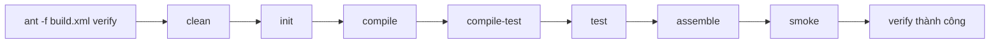
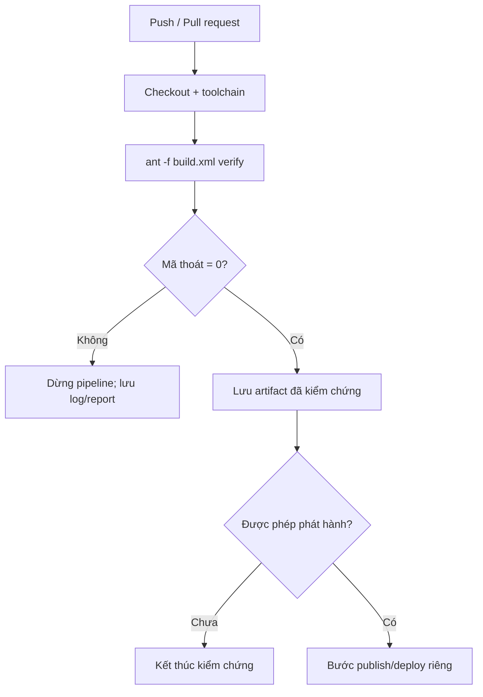

# Thiết kế một lệnh Ant chuẩn cho máy phát triển và CI

> **Chủ đề:** Build Tool Ant  
> **Nhóm kiến thức:** CI/CD  
> **Mục tiêu:** Dùng **một lệnh Ant duy nhất** làm hợp đồng kiểm chứng chất lượng trên máy lập trình viên và trên hệ thống Continuous Integration (CI), với cùng thứ tự bước, cùng tiêu chí thành công/thất bại và đầu ra có thể kiểm tra.

## 1. Vấn đề: tại sao cần một lệnh chuẩn?

Trong dự án Ant, một nhóm có thể chạy `ant compile` để kiểm tra code, nhóm khác chạy `ant jar`, còn CI gọi một shell script riêng. Mỗi cách chạy sẽ kiểm tra một tập điều kiện khác nhau:

- Máy phát triển có thể đóng gói một file JAR mà không chạy test.
- CI có thể gọi test nhưng bỏ qua mã thoát khi test lỗi.
- Một máy dựa vào file `build/classes` còn sót, trong khi máy sạch không thể biên dịch.
- Hệ thống phát hành có thể tạo artifact theo đường dẫn khác với artifact lập trình viên xem trên máy của mình.
- Các tùy chọn môi trường ẩn làm kết quả khác nhau dù chạy “cùng một project”.

Giải pháp là định nghĩa một **điểm vào chung** trong `build.xml`, chẳng hạn:

```bash
ant -f build.xml verify
```

Lệnh trên được chạy nguyên vẹn từ thư mục gốc repository ở cả hai nơi:

| Nơi chạy | Lệnh | Mục đích |
|---|---|---|
| Máy phát triển | `ant -f build.xml verify` | Phát hiện lỗi trước khi commit hoặc mở pull request |
| CI khi push/pull request | `ant -f build.xml verify` | Chặn thay đổi không vượt qua kiểm chứng |
| CI trước khi phát hành | `ant -f build.xml verify` | Kiểm tra lại source đầu vào trước khi đưa artifact sang bước phát hành |

**`verify` là một target Ant do dự án tự đặt tên**, không phải một lệnh có sẵn với ngữ nghĩa cố định như `javac`. Chất lượng của hợp đồng phụ thuộc hoàn toàn vào những target mà `verify` nối lại và cách chúng báo lỗi.

Lệnh chuẩn có nhiệm vụ tạo và kiểm chứng artifact. Phần **triển khai lên server**, **đẩy artifact lên registry** hay **đọc secret của môi trường Production** nên nằm ở bước CI/CD sau đó, với quyền hạn và điều kiện kích hoạt riêng.

## 2. Hợp đồng của `verify`

Trước khi viết XML, xác định rõ điều kiện đầu vào, các hành động và kết quả.

| Thành phần | Hợp đồng |
|---|---|
| Thư mục làm việc | Gốc repository, có `build.xml` và `src/` |
| Toolchain | JDK 17 và bản Apache Ant hỗ trợ `javac release`, ví dụ Ant 1.10.x |
| Tham số bắt buộc | Không có; cùng lệnh chạy trên máy phát triển/CI |
| Phạm vi ghi file | Chỉ trong `build/` dành cho dữ liệu sinh ra |
| Chuỗi bước | Xóa đầu ra cũ → biên dịch → chạy test → tạo JAR → chạy smoke test của JAR |
| Thành công | Mọi bước hoàn tất; artifact có thể chạy; exit code bằng `0` |
| Thất bại | Lỗi compile/test/package/runtime khiến Ant thoát khác `0` |
| Đầu ra | `build/dist/ant-demo.jar` |
| Phát hành | CI chỉ upload/promote artifact sau khi `verify` thành công |

Một hợp đồng tốt phải đáp ứng **tính nhất quán về hành vi**. Máy chạy có thể khác hệ điều hành, nhưng cùng input và cùng toolchain phải có cùng tiêu chí đánh giá. Điều đó không mặc nhiên có nghĩa file JAR sẽ giống nhau từng byte trên mọi máy: timestamp, phiên bản JDK/Ant và metadata có thể ảnh hưởng ZIP/JAR. Khi cần reproducible build ở mức byte, phải cấu hình chuẩn hóa metadata và xác minh checksum riêng.

### 2.1. Chọn tên target

Các tên sau có vai trò khác nhau:

- `clean`: xóa thư mục sinh ra.
- `compile`: biên dịch source chính.
- `compile-test`: biên dịch mã test.
- `test`: chạy bộ kiểm thử.
- `assemble`: đóng gói đầu ra.
- `smoke`: chạy bản đóng gói để chứng minh có thể khởi động.
- **`verify`: điểm vào chuẩn, bao phủ toàn bộ chuỗi.**

Tên `ci` cũng có thể được dùng, nhưng `verify` dễ dùng ở cả local lẫn CI mà không gợi ý rằng nó phụ thuộc hệ thống CI cụ thể. Nếu dự án dùng Maven/Gradle ở module khác, vẫn cần nêu rõ ở đây rằng `verify` là target do buildfile Ant quy định.

### 2.2. Sơ đồ thứ tự thực thi



Một bước lỗi sẽ khiến luồng dừng. Ant tự tính quan hệ `depends` và không thực thi lặp một target nhiều lần trong cùng một lần chạy bình thường, kể cả khi nhiều target phụ thuộc vào nó.

## 3. Ví dụ hoàn chỉnh: ứng dụng Java tối giản

Để tập trung vào Ant và CI, ví dụ sử dụng **các task có sẵn trong Ant và JDK**, không cần tải Maven dependency hay thư viện test ngoài. Bộ test được viết bằng một class Java có `main`, trả lỗi bằng `AssertionError`. Dự án thực tế có thể thay bộ test này bằng JUnit 5, TestNG, AntUnit hoặc bộ test riêng mà vẫn giữ nguyên lệnh `verify`.

Cấu trúc:

```text
ant-demo/
├── build.xml
├── src/
│   ├── main/
│   │   └── java/
│   │       └── demo/
│   │           └── Hello.java
│   └── test/
│       └── java/
│           └── demo/
│               └── HelloTest.java
├── .github/
│   └── workflows/
│       └── ant-verify.yml
├── .gitignore
└── build/                  # tạo ra khi chạy Ant; không commit
    ├── classes/
    ├── test-classes/
    └── dist/
        └── ant-demo.jar
```

Các file ở `src/` là nguồn do developer duy trì. `build/` hoàn toàn do Ant sinh ra và được xóa mỗi lần chạy `verify`, vì vậy nên thêm vào `.gitignore`:

```gitignore
/build/
```

### 3.1. Mã ứng dụng: `Hello.java`

Tạo `src/main/java/demo/Hello.java`:

```java
package demo;

public final class Hello {
    private Hello() {}

    public static String greet(String name) {
        if (name == null || name.isBlank()) {
            throw new IllegalArgumentException("name must not be blank");
        }
        return "Hello, " + name.strip() + "!";
    }

    public static void main(String[] args) {
        String name = args.length == 0 ? "Ant" : args[0];
        System.out.println(greet(name));
    }
}
```

Hai hành vi cần kiểm chứng: method `greet` trả lời chào đúng với tên hợp lệ và từ chối tên rỗng; chương trình đóng gói trong JAR phải chạy được bằng `java -jar`.

### 3.2. Mã kiểm thử: `HelloTest.java`

Tạo `src/test/java/demo/HelloTest.java`:

```java
package demo;

public final class HelloTest {
    private HelloTest() {}

    private static void expectEquals(String expected, String actual) {
        if (!expected.equals(actual)) {
            throw new AssertionError(
                "Expected [" + expected + "], but got [" + actual + "]"
            );
        }
    }

    private static void expectInvalidName(String name) {
        boolean rejected = false;
        try {
            Hello.greet(name);
        } catch (IllegalArgumentException expected) {
            rejected = true;
        }
        if (!rejected) {
            throw new AssertionError("Expected invalid name to be rejected");
        }
    }

    public static void main(String[] args) {
        expectEquals("Hello, Ant!", Hello.greet("Ant"));
        expectEquals("Hello, Ant!", Hello.greet("  Ant  "));
        expectEquals("Hello, Việt!", Hello.greet("Việt"));
        expectInvalidName("  ");

        System.out.println("PASS: 4 checks");
    }
}
```

Đây là **test runner tối giản phục vụ ví dụ**, không nhằm thay thế JUnit cho dự án lớn. Ưu điểm là có thể chạy trên JDK 17 mà không cần dependency bên ngoài.

Chi tiết quan trọng: Java keyword `assert` có thể bị **tắt nếu không bật `-ea`**, vì thế test này ném `AssertionError` trực tiếp. Khi một điều kiện sai, tiến trình Java thoát khác `0`; Ant sẽ nhận lỗi nhờ `failonerror="true"`.

## 4. Buildfile thực thi toàn bộ hợp đồng

Tạo file `build.xml` ở gốc repository:

```xml
<?xml version="1.0" encoding="UTF-8"?>
<project name="ant-demo" default="verify" basedir=".">

    <!-- Tập trung cấu hình đầu vào và đầu ra tại một chỗ. -->
    <property name="src.dir" location="src/main/java"/>
    <property name="test.src.dir" location="src/test/java"/>

    <property name="build.dir" location="build"/>
    <property name="classes.dir" location="${build.dir}/classes"/>
    <property name="test.classes.dir" location="${build.dir}/test-classes"/>
    <property name="dist.dir" location="${build.dir}/dist"/>
    <property name="artifact.file" location="${dist.dir}/ant-demo.jar"/>

    <!-- 1. Xóa tất cả dữ liệu được tạo từ lần build trước. -->
    <target name="clean">
        <delete dir="${build.dir}"/>
    </target>

    <!-- 2. Chuẩn bị thư mục đích. -->
    <target name="init">
        <mkdir dir="${classes.dir}"/>
        <mkdir dir="${test.classes.dir}"/>
        <mkdir dir="${dist.dir}"/>
    </target>

    <!-- 3. Biên dịch mã nguồn ứng dụng bằng JDK 17. -->
    <target name="compile" depends="init">
        <javac srcdir="${src.dir}"
               destdir="${classes.dir}"
               release="17"
               encoding="UTF-8"
               includeantruntime="false"/>
    </target>

    <!-- 4. Biên dịch test với classpath chứa mã ứng dụng. -->
    <target name="compile-test" depends="compile">
        <javac srcdir="${test.src.dir}"
               destdir="${test.classes.dir}"
               release="17"
               encoding="UTF-8"
               includeantruntime="false">
            <classpath>
                <pathelement location="${classes.dir}"/>
            </classpath>
        </javac>
    </target>

    <!-- 5. Chạy test trong JVM riêng và không bỏ qua lỗi. -->
    <target name="test" depends="compile-test">
        <java classname="demo.HelloTest"
              fork="true"
              failonerror="true">
            <classpath>
                <pathelement location="${classes.dir}"/>
                <pathelement location="${test.classes.dir}"/>
            </classpath>
        </java>
    </target>

    <!-- 6. Chỉ đóng gói khi test đã qua. -->
    <target name="assemble" depends="test">
        <jar destfile="${artifact.file}"
             basedir="${classes.dir}">
            <manifest>
                <attribute name="Main-Class" value="demo.Hello"/>
            </manifest>
        </jar>
    </target>

    <!-- 7. Chạy chính JAR vừa tạo như một smoke test. -->
    <target name="smoke" depends="assemble">
        <java jar="${artifact.file}"
              fork="true"
              failonerror="true">
            <arg value="CI"/>
        </java>
    </target>

    <!-- 8. Đây là điểm vào chuẩn duy nhất cho local và CI. -->
    <target name="verify" depends="clean,smoke">
        <available file="${artifact.file}"
                   property="artifact.exists"/>
        <fail unless="artifact.exists"
              message="Missing expected artifact: ${artifact.file}"/>
        <echo message="VERIFIED: ${artifact.file}"/>
    </target>

</project>
```

### 4.1. Vì sao bố trí `depends` như vậy?

Lệnh `ant -f build.xml verify` yêu cầu chạy target `verify`. Ant thấy `verify` phụ thuộc vào `clean` và `smoke`, nên thực hiện `clean` trước, rồi đi sâu qua các dependency của `smoke`:

```text
verify
├── clean                    [thực thi trước]
└── smoke
    └── assemble
        └── test
            └── compile-test
                └── compile
                    └── init
```

Sau khi các dependency đã chạy, phần thân target `verify` mới được thực thi để xác nhận artifact tồn tại và in thông báo hoàn tất.

**Lưu ý quan trọng về thứ tự:** Ant có thể khử các target trùng lặp trong một lần chạy, nhưng không coi `depends` như thứ tự bất kỳ. Trong danh sách `depends="clean,smoke"`, `clean` phải nằm trước `smoke`. Nếu đổi thành `depends="smoke,clean"` thì artifact có thể bị xóa ngay sau khi kiểm thử.

### 4.2. Vì sao phải có `failonerror="true"`?

Task `<javac>` mặc định làm build thất bại khi biên dịch sai. Nhưng với `<java>` chạy một chương trình ngoài:

```xml
<java classname="demo.HelloTest"
      fork="true"
      failonerror="true">
    ...
</java>
```

- `fork="true"` chạy chương trình trong JVM riêng và nhận exit status rõ ràng.
- `failonerror="true"` biến exit code khác `0` thành lỗi build của Ant.
- Nếu test ném `AssertionError`, `smoke` và `verify` sẽ không được chạy đến kết thúc.
- Ant trả exit code khác `0` cho shell/CI. CI vì thế đánh dấu bước kiểm chứng là thất bại.

Không nên bọc lệnh Ant trong cú pháp shell cố tình trả `0` như `ant verify || true`. Cách đó làm CI “xanh” ngay cả khi test thực sự hỏng.

### 4.3. Vì sao tách `assemble` và `smoke`?

File JAR tồn tại không có nghĩa nó chạy được. `assemble` kiểm chứng khả năng tạo gói, còn `smoke` thử chính gói đó bằng lệnh Java tương đương:

```bash
java -jar build/dist/ant-demo.jar CI
```

Nếu quên `Main-Class` trong manifest hoặc đóng gói thiếu class, bước smoke sẽ thất bại. Với dự án web service, smoke test nên chạy trong môi trường cô lập để tránh chiếm cổng thật hoặc làm thay đổi dữ liệu ngoài, và có thể cần timeout rõ ràng.

## 5. Chạy cùng một lệnh trên máy phát triển

### 5.1. Chuẩn bị môi trường

Cần có:

1. JDK 17 trên `JAVA_HOME` và `PATH`, cung cấp `java` và `javac`.
2. Apache Ant 1.10.x trên `PATH`.
3. Cấu trúc source đúng như ví dụ.
4. Quyền ghi vào thư mục `build/` trong repository.

Kiểm tra phiên bản:

```bash
java -version
javac -version
ant -version
```

Sau đó đứng ở thư mục gốc của `ant-demo` và chạy:

```bash
ant -f build.xml verify
```

Đường dẫn `-f build.xml` làm rõ buildfile nào được dùng. Có thể chỉ chạy `ant` bởi vì project đã khai báo `default="verify"`, nhưng trong README và CI nên dùng **một cách viết duy nhất** để lệnh dễ tìm kiếm trong log, script và hướng dẫn.

Khi thành công, phần quan trọng của log sẽ có nội dung tương tự:

```text
clean:
init:
compile:
compile-test:
test:
     [java] PASS: 4 checks
assemble:
smoke:
     [java] Hello, CI!
verify:
     [echo] VERIFIED: .../build/dist/ant-demo.jar

BUILD SUCCESSFUL
```

Đường dẫn, thời gian, chi tiết compile và định dạng log phụ thuộc hệ điều hành/bản Ant. Điều có ý nghĩa là test và smoke đều chạy, file `build/dist/ant-demo.jar` xuất hiện và tiến trình Ant trả `0`.

Chạy ứng dụng đã đóng gói:

```bash
java -jar build/dist/ant-demo.jar Local
```

Kết quả dự kiến:

```text
Hello, Local!
```

### 5.2. Chạy trên Windows và Linux/macOS

Cùng câu lệnh có thể được gọi từ PowerShell, Command Prompt, Bash hoặc shell của CI, miễn là JDK và Ant đã nằm trên `PATH`:

```text
ant -f build.xml verify
```

Trong PowerShell, mã thoát của lệnh native gần nhất nằm ở `$LASTEXITCODE`. Trong Bash, mã thoát nằm ở `$?`. Nếu viết script bọc quanh Ant, cần bảo toàn mã thoát này:

```powershell
ant -f build.xml verify
if ($LASTEXITCODE -ne 0) {
    exit $LASTEXITCODE
}
```

Trong pipeline thông thường, tốt nhất gọi Ant trực tiếp bằng một bước `run` hoặc `sh` để CI tự theo dõi exit code; không cần wrapper nếu không có hành vi phụ trợ thật sự.

### 5.3. Khi nào chạy target nhỏ hơn?

Trong quá trình phát triển, có thể chạy nhanh một bước:

```bash
ant -f build.xml compile
ant -f build.xml test
```

Nhưng trước khi gửi mã hoặc chấp nhận kết quả CI, **chạy lại `verify`** để xóa đầu ra cũ và chạy đủ chuỗi. Lệnh `ant test` có thể tái sử dụng file class từ lần trước nhờ cơ chế incremental compile; nó không kiểm chứng đầy đủ “fresh build” như điểm vào chuẩn.

## 6. Gọi đúng lệnh trong GitHub Actions

Tạo `.github/workflows/ant-verify.yml`:

```yaml
name: Ant Verify

on:
  push:
  pull_request:

jobs:
  verify:
    runs-on: ubuntu-24.04
    timeout-minutes: 15

    permissions:
      contents: read

    steps:
      - name: Checkout source
        uses: actions/checkout@v4

      - name: Setup JDK
        uses: actions/setup-java@v4
        with:
          distribution: temurin
          java-version: '17'

      - name: Install Apache Ant
        run: |
          sudo apt-get update
          sudo apt-get install -y ant

      - name: Show toolchain
        run: |
          java -version
          javac -version
          ant -version

      - name: Verify source and artifact
        run: ant -f build.xml verify

      - name: Preserve verified JAR
        if: success()
        uses: actions/upload-artifact@v4
        with:
          name: ant-demo-jar
          path: build/dist/ant-demo.jar
          if-no-files-found: error
```

Đối chiếu:

| Local | GitHub Actions |
|---|---|
| Cài JDK 17 và Ant trên máy | `setup-java` và cài Ant cho runner |
| Mở terminal ở gốc repository | `actions/checkout` đưa source vào workspace |
| `ant -f build.xml verify` | `run: ant -f build.xml verify` |
| Đọc `build/dist/ant-demo.jar` | Upload đúng `build/dist/ant-demo.jar` sau khi thành công |
| Developer sửa lỗi nếu mã thoát khác 0 | Job thất bại và chặn các bước phụ thuộc |

Workflow chỉ làm ba việc đặc thù CI: cung cấp môi trường, gọi **cùng lệnh**, lưu artifact. Toàn bộ logic biên dịch, test, đóng gói, smoke đều nằm trong Ant để không sinh hai cách xây dựng khác nhau.

### 6.1. Nếu dùng Jenkins hoặc GitLab CI

Cấu hình CI đổi, **lệnh Ant giữ nguyên**. Ví dụ bước Jenkins Pipeline trên Linux:

```groovy
stage('Verify') {
    steps {
        sh 'ant -f build.xml verify'
    }
}
```

Với Jenkins agent chạy Windows, dùng `bat 'ant -f build.xml verify'`. Với GitLab CI, đặt đúng lệnh trong `script`:

```yaml
verify:
  stage: test
  script:
    - ant -f build.xml verify
  artifacts:
    when: on_success
    paths:
      - build/dist/ant-demo.jar
```

Các snippet này giả định runner đã có Ant và JDK phù hợp. Việc cung cấp toolchain thuộc cấu hình runner/container của từng nền tảng.

## 7. Các quyết định giúp local và CI thực sự đồng nhất

### 7.1. Khóa phiên bản và nguồn dependency

Trong ví dụ, ứng dụng chỉ dùng JDK nên không cần tải thư viện. Dự án thực tế cần dependency (JUnit, Jackson, Spring, JDBC driver...) phải có quy tắc tái tạo rõ ràng:

- Chỉ rõ **JDK release** bằng `release="17"`, không vô tình compile theo JDK mới nhất trên máy cá nhân.
- Chuẩn hóa phiên bản Ant mà dự án hỗ trợ; ghim bản Ant trong image/tooling khi tính ổn định cao là yêu cầu.
- Ghì phiên bản dependency bằng metadata kiểm soát được, tránh tự lấy “latest” mỗi lần chạy.
- Nếu dùng Ivy/Maven Resolver, tách bước **resolve dependency** và dùng cache thích hợp; cache tải xuống chỉ nên tăng tốc, không phải điều kiện để build đúng.
- Khi cần kiểm toán supply chain, kiểm tra checksum/chữ ký của dependency và lưu dấu nguồn artifact.
- Trong CI cần log phiên bản JDK/Ant thực tế để phân tích lỗi chỉ xảy ra ở một runner.

Ví dụ workflow cài Ant bằng `apt` thuận tiện cho bài học, nhưng phiên bản từ package repository có thể thay đổi. Pipeline Production nghiêm ngặt có thể dùng container image được ghim phiên bản hoặc cài bản Ant cố định và kiểm tra checksum tải xuống.

### 7.2. Không phụ thuộc biến môi trường ẩn

Không nên viết logic như sau trong buildfile:

```xml
<!-- Phản ví dụ: local và CI vô tình chạy hai đường khác nhau. -->
<condition property="skip.tests" value="true" else="false">
    <isset property="env.CI"/>
</condition>
```

Nếu các máy chạy `verify` mà một máy bỏ qua test thì hợp đồng đã bị phá vỡ. Biến môi trường như `CI=true` chỉ nên dùng cho báo cáo, màu log hoặc tính năng không làm thay đổi tiêu chí kiểm chứng.

Với cấu hình bắt buộc theo môi trường, có thể truyền bằng `-Dkey=value`. Tuy nhiên khi thêm tham số cần ghi rõ trong README và workflow. Ant properties thường **bất biến sau khi được thiết lập**; các thuộc tính truyền qua `-D` có độ ưu tiên cao, nên phải hiểu cách chúng ảnh hưởng target và không cho đầu vào không đáng tin cậy điều khiển đường dẫn `clean`.

**Đặc biệt:** `build.dir` của ví dụ là vị trí mà target `clean` xóa đệ quy. Không cho pipeline hoặc script bên ngoài tự ý đưa vào `-Dbuild.dir` là một thư mục ngoài vùng output dự kiến. Với dự án cho phép tùy biến đường dẫn, cần kiểm soát path trước khi xóa.

### 7.3. Chỉ ghi artifact vào thư mục sinh ra

`clean` an toàn khi xóa toàn bộ file **chỉ do build tạo**. Cần duy trì ranh giới:

```text
src/          # nguồn - không xóa
config/       # cấu hình dự án - không xóa
build/        # có thể xóa rồi tạo lại
reports/      # nếu có, tổ chức theo chính sách lưu trữ riêng
```

Không dùng `<delete dir="."/>` hoặc xóa đường dẫn tùy biến chưa được kiểm tra. Nếu chạy Ant trong container hoặc CI, working directory và quyền ghi phải rõ ràng.

Nếu dự án tạo test report bên trong `build/reports/`, các report sẽ bị xóa ở **đầu** lần chạy `verify` nhưng còn lại sau khi hoàn tất. CI nên upload chúng trong một bước `if: always()` để báo cáo vẫn có sẵn khi test thất bại. Trong ví dụ tối giản, test chỉ ghi log vào console; không sinh JUnit XML.

### 7.4. Không “nuốt lỗi” để pipeline xanh

Các trường hợp cần tránh:

```bash
# Sai nếu mong CI chặn mọi lỗi:
ant -f build.xml verify || true
```

```xml
<!-- Sai nếu đây là phép thử bắt buộc cho verify. -->
<java classname="demo.HelloTest"
      fork="true"
      failonerror="false">
    ...
</java>
```

Nếu runner thực thi nhiều test và muốn chạy hết để thu báo cáo, hãy dùng framework hỗ trợ tổng hợp kết quả rồi **fail cuối cùng**. Bài học quan trọng là exit code của `verify` phải phản ánh chất lượng thực tế.

### 7.5. Tách build/test và phát hành

Một pipeline hợp lý:



Target `verify` không cần token deploy hoặc mật khẩu registry. Các secret chỉ được cấp cho job publish/deploy được bảo vệ. Trên pull request từ fork, pipeline kiểm chứng vẫn nên chạy được mà không có secret.

## 8. Mở rộng sang JUnit, AntUnit và các bài toán thực tế

Bộ test dùng `main` phù hợp để minh họa lệnh chuẩn với ít dependency. Khi nâng cấp, giữ **giao diện `ant -f build.xml verify`**, thay việc triển khai bên trong các target.

### 8.1. Dùng JUnit 5

Thay target `test` bằng một target chạy `<junitlauncher>` hoặc bộ runner tương ứng. Các thành phần cần có:

- Biên dịch test với JUnit Jupiter API trên classpath.
- JUnit Platform launcher và Jupiter engine trong classpath khi chạy test.
- Cấu hình runner coi test failure là build failure (`haltOnFailure="true"` nếu dùng `junitlauncher`).
- Ghi report XML về đường dẫn cố định, ví dụ `build/reports/junit/`.
- Cho CI upload report ngay cả khi test thất bại.

Đừng chỉ biên dịch source test. `compile-test` thành công nhưng test chưa được chạy vẫn không đủ để công nhận `verify` thành công.

### 8.2. Dùng AntUnit để kiểm thử chính buildfile

Với dự án có custom task, target sinh mã hoặc target đóng gói phức tạp, có thể thêm:

```xml
<target name="test-buildfile" depends="compile">
    <au:antunit
        xmlns:au="antlib:org.apache.ant.antunit"
        failOnError="true">
        <fileset dir="test/ant" includes="*-test.xml"/>
        <au:plainlistener/>
    </au:antunit>
</target>
```

AntUnit là Antlib độc lập, phải có JAR của AntUnit trên classpath Ant (ví dụ qua `-lib` hoặc cài trong Ant runtime). Khi đưa AntUnit vào điểm vào chuẩn, cần đảm bảo local và CI đều nạp Antlib giống nhau. Nên kiểm thử buildfile trong workspace/fixture riêng: một test AntUnit tự gọi `clean` trên cùng thư mục `build/` có thể xóa class đang được bộ test khác sử dụng.

Với ví dụ này, một khả năng mở rộng là làm target `assemble` phụ thuộc vào target test tích hợp, sau đó để `smoke` phụ thuộc `assemble`. Tên `verify` vẫn giữ nguyên.

### 8.3. Dự án đa module

Nếu repository có nhiều `build.xml`, xác định **một entrypoint gốc** điều phối các module bằng `<subant>` hoặc `<ant antfile="...">`. Ví dụ khung:

```xml
<target name="verify-modules">
    <subant target="verify" failonerror="true">
        <fileset dir="modules"
                 includes="*/build.xml"/>
    </subant>
</target>
```

Các module phải bảo đảm test độc lập và output riêng. Cần quyết định thứ tự module có dependency, thay vì chỉ phụ thuộc thứ tự liệt kê file. Khi cần chia sẻ artifact giữa module, biên dịch dependency trước hoặc dùng một trình quản lý dependency phù hợp; không giả định mọi module có thể chạy song song.

Nếu xây dựng một entrypoint root `verify`, tài liệu dự án nên yêu cầu mọi người dùng entrypoint đó khi xác nhận thay đổi toàn repository.

## 9. Xử lý lỗi thường gặp

| Hiện tượng | Nguyên nhân có thể có | Cách xử lý |
|---|---|---|
| `ant: command not found` | Ant chưa cài hoặc `PATH` không chứa Ant | Cài Ant, cấu hình `PATH`, kiểm tra `ant -version` |
| `Unable to find tools.jar` hoặc không có `javac` | Chạy JRE hoặc `JAVA_HOME` sai | Dùng JDK 17, kiểm tra `java` và `javac` |
| `invalid flag: --release` hoặc lỗi attribute `release` | Ant/JDK quá cũ | Cập nhật toolchain tương thích |
| `error: release version 17 not supported` | JDK đang chạy cũ hơn 17 | Đồng bộ JDK local và CI |
| Class `demo.HelloTest` không tìm thấy | Sai `package`, `srcdir` hoặc classpath test | Kiểm tra cấu trúc thư mục và `compile-test` |
| Test in `PASS` nhưng build vẫn đóng gói sai | Test chưa kiểm tra artifact thực tế | Bổ sung `smoke`/assertion nội dung JAR |
| Có `BUILD SUCCESSFUL` dù test fail | `failonerror` tắt hoặc shell bỏ qua exit code | Bật fail fast; truyền exit status đúng |
| Local thành công nhưng CI lỗi encoding | Default charset hoặc locale khác nhau | Chỉ rõ `encoding="UTF-8"` và charset tại điểm đọc/ghi |
| CI báo không tìm thấy artifact | Đường dẫn upload khác `jar destfile` | Dùng cùng đường dẫn `build/dist/ant-demo.jar` |
| Lần build sau sử dụng class cũ | Không dọn dữ liệu hoặc chạy target nhỏ hơn | Chạy canonical `verify` có `clean` |
| `clean` làm mất tệp quan trọng | File nguồn/report được đặt nhầm trong thư mục build | Phân tách rõ dữ liệu nguồn và dữ liệu sinh ra |
| Verify mất nhiều thời gian | Tải dependency lại, kiểm thử quá nặng, không dùng cache | Cache dependency, nhóm test hợp lý; vẫn giữ lệnh chuẩn |

Một lỗi chỉ xảy ra trên CI thường bắt nguồn từ phiên bản tool, đường dẫn, tên file phân biệt chữ hoa/chữ thường, quyền ghi, locale, dependency chưa khai báo hoặc state tồn tại sẵn trên máy developer. Đầu tiên hãy chạy lại `verify` trên workspace sạch và đối chiếu log phiên bản công cụ.

## 10. Những tiêu chí để một lệnh Ant được coi là chuẩn

Một lệnh có thể được dùng làm “quality gate” khi các điều sau được chứng minh:

| Nhóm | Điều kiện chấp nhận |
|---|---|
| Giao diện | README và mọi CI job đều dùng `ant -f build.xml verify` |
| Điểm vào | Target `verify` có trong `build.xml` và không cần tham số ẩn |
| Fresh build | Đầu ra cũ được xóa trước khi biên dịch |
| Compile | Sai cú pháp hoặc thiếu classpath làm lệnh thất bại |
| Test | Một assertion lỗi làm lệnh thất bại |
| Package | Tạo đúng artifact ở đường dẫn đã cam kết |
| Smoke | Artifact vừa tạo thực sự chạy được |
| Exit code | Thành công = `0`; lỗi = khác `0` |
| Môi trường | Phiên bản JDK/Ant và dependency đủ rõ để tái tạo |
| CI | Job dùng exit code và chỉ upload artifact khi kiểm chứng thành công |
| An toàn | Verify không cần secret triển khai; clean không xóa dữ liệu ngoài vùng output |

Khi thêm bước mới như kiểm tra style, phân tích tĩnh, license scan hoặc integration test, hãy tích hợp nó vào chuỗi dependency của `verify`. Người dùng vẫn có **một lệnh ghi nhớ** mà không cần biết project có bao nhiêu bước nội bộ.

## 11. Bài thực hành: thử phá vỡ hợp đồng

Từ dự án ví dụ, thực hiện các tình huống sau:

1. Chạy `ant -f build.xml verify` trên workspace sạch. Quan sát các target và JAR sinh ra.
2. Cố tình sửa `Hello.greet` để bỏ `strip()`. Chạy lại `verify` và giải thích vì sao `HelloTest` phải báo lỗi.
3. Sửa `HelloTest` để ném `new AssertionError("simulated failure")`. Xác nhận không có JAR mới được đóng gói ở lần chạy đó do `clean` chạy trước.
4. Đổi tên `Main-Class` trong `jar manifest` thành một class không tồn tại. Xác nhận bước `smoke` phát hiện lỗi dù bước `assemble` tạo được file JAR.
5. Sửa `javac release="17"` thành release vượt quá JDK đang cài. Quan sát compile failure và mã thoát Ant.
6. Chạy `ant -f build.xml test` rồi chạy `ant -f build.xml verify`. Giải thích vì sao chỉ `verify` bảo đảm toàn bộ fresh-build pipeline.
7. Thêm một report đơn giản cho kết quả test, lưu dưới `build/reports/` và cấu hình CI upload report cả khi thất bại.
8. Đưa target phát hành vào một CI job riêng chỉ chạy sau khi `verify` thành công; giữ secret chỉ trong job đó.

**Đầu ra mong đợi:** người học có thể giải thích và trình diễn rằng cùng câu lệnh `ant -f build.xml verify` chạy từ root project thực thi trọn chuỗi clean → compile → test → package → smoke, và bất kỳ lỗi bắt buộc nào cũng chặn thành công của CI.

## 12. Tài liệu tham khảo

- [Apache Ant Manual — Using Apache Ant](https://ant.apache.org/manual/using.html): project, target, command-line options và property.
- [Apache Ant Manual — Target](https://ant.apache.org/manual/targets.html): quan hệ `depends` và thứ tự thực thi.
- [Apache Ant Manual — Javac](https://ant.apache.org/manual/Tasks/javac.html): biên dịch Java, `release`, `includeantruntime`.
- [Apache Ant Manual — Java](https://ant.apache.org/manual/Tasks/java.html): chạy Java program/JAR, `fork` và `failonerror`.
- [Apache Ant Manual — Jar](https://ant.apache.org/manual/Tasks/jar.html): đóng gói JAR và manifest.
- [GitHub Docs — Building and testing Java with Ant](https://docs.github.com/en/actions/tutorials/build-and-test-code/java-with-ant): triển khai build Ant trong GitHub Actions.
- [Apache AntUnit](https://ant.apache.org/antlibs/antunit/): mở rộng kiểm thử target/buildfile khi dự án có Antlib và custom task.

**Nguyên tắc áp dụng:** thiết kế `verify` như một hợp đồng sản phẩm của hệ thống build: công khai đầu vào, thứ tự kiểm chứng, artifact, điều kiện thất bại và lệnh gọi duy nhất. Khi đó máy phát triển và CI thực thi cùng một chuẩn chất lượng, và phần phát hành có thể tin vào artifact đã được kiểm chứng.
