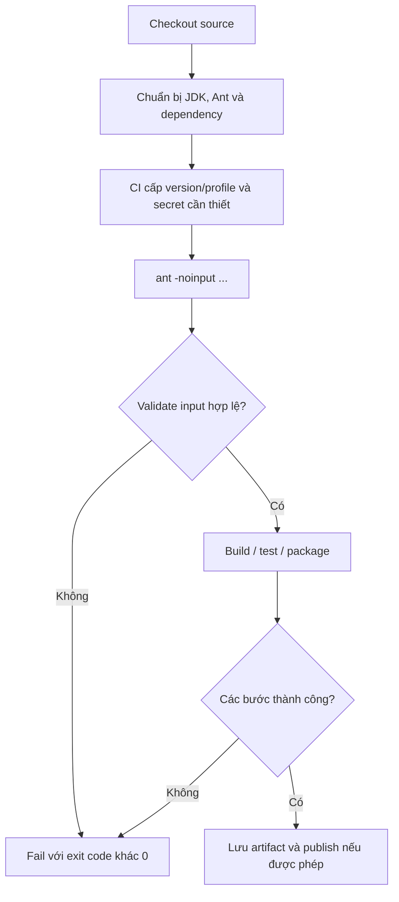

# Build không tương tác với `-noinput` và property từ môi trường trong Apache Ant

Một bản build chạy thủ công có thể dừng lại để hỏi: “Nhập phiên bản phát hành”, “Chọn môi trường”, “Có chắc muốn tiếp tục không?”. Với hệ thống **CI/CD**, không có người ngồi trước terminal để trả lời. Nếu build dừng chờ bàn phím, job có thể treo, hết thời gian chờ hoặc sử dụng một giá trị mặc định không phù hợp. Một pipeline tốt phải biết **mọi đầu vào cần thiết trước khi thực thi**, có thể báo lỗi ngay nếu thiếu và trả kết quả rõ ràng cho hệ thống CI.

Trong **Build Tool Ant → CI/CD**, hai cơ chế trọng tâm là:

- Tùy chọn `ant -noinput`: cấm các yêu cầu nhập tương tác do Ant điều phối.
- Các **Ant property** được cấp trước từ `-D`, `-propertyfile` hoặc biến môi trường hệ điều hành: cho phép job chạy với cấu hình rõ ràng, không cần người nhập trực tiếp.

Chủ đề còn liên quan đến cách kiểm tra property bắt buộc, thứ tự ưu tiên giữa các nguồn cấu hình, bảo vệ secret, xử lý công cụ con có khả năng yêu cầu tương tác và cách viết một pipeline có thể lặp lại.

## 1. Vì sao build tương tác không phù hợp với CI/CD?

Xét target Ant sau:

```xml
<project name="legacy-demo" default="release">
    <target name="release">
        <input message="Nhập phiên bản phát hành:"
               addproperty="release.version"/>
        <echo message="Đang xử lý phiên bản ${release.version}"/>
    </target>
</project>
```

Lệnh:

```bash
ant release
```

có thể hiện lời nhắc và chờ người dùng cung cấp `release.version`. Cách này có thể tiện khi thao tác bằng tay, nhưng không đáng tin cậy với job chạy trên runner, container hoặc lịch tự động. Job không có terminal tương tác có thể thất bại hoặc phải chờ đến timeout.

Khi chạy:

```bash
ant -noinput release
```

Ant không cho phép yêu cầu input tương tác. Nếu target vẫn cần một câu trả lời chưa có, thao tác input không thể tiếp tục như trong terminal của người dùng và build sẽ báo lỗi, thay vì dựa vào việc có ai đó trả lời.

Với task `<input addproperty="release.version"/>`, Ant bỏ qua lời nhắc khi property cần thiết **đã được đặt**. Có thể chuyển giá trị vào lệnh gọi:

```bash
ant -noinput -Drelease.version=1.4.2 release
```

Đây là cách tương thích với build cũ. Đối với build CI mới, nên đưa việc xác thực property vào một target riêng, không cần `<input>` trong luồng tự động.

### Phạm vi chính xác của `-noinput`

| Tình huống | `-noinput` có ý nghĩa gì? |
| --- | --- |
| Task Ant `<input>` cần hỏi người dùng | Ant không cho phép tương tác và báo lỗi khi chưa có câu trả lời thích hợp |
| Input đã cấp dưới dạng property trước khi gọi target | Có thể bỏ qua prompt phụ thuộc property, tùy cách target được viết |
| Property chưa được định nghĩa | `-noinput` không tự tạo giá trị hoặc tự chọn mặc định |
| Task gọi `git`, `ssh`, script hoặc tool ngoài bằng `<exec>` | Công cụ con có cơ chế đọc input riêng; cần cấu hình không tương tác cho từng công cụ |
| Task cần credential, quyền deploy hoặc xác nhận môi trường | `-noinput` không thay thế hệ thống secret/approval |
| Tiến trình chờ mạng hoặc treo | Vẫn cần timeout và cơ chế dừng job ở CI |

Do đó, `-noinput` là một **hàng rào chống tương tác** ở cấp Ant, không phải một tùy chọn tự động trả lời “yes” cho mọi câu hỏi.

## 2. Ant property là gì và đến từ đâu?

Ant property là cặp tên–giá trị được tham chiếu bằng `${ten.property}`. Chúng giúp phân biệt **logic build** trong `build.xml` với các giá trị thay đổi theo lượt chạy như version, profile, đường dẫn output hoặc URL dịch vụ.

| Nguồn giá trị | Cú pháp | Vai trò phù hợp |
| --- | --- | --- |
| Command line | `-Dbuild.version=1.4.2` | Chỉ định thông tin riêng cho một lượt CI |
| File được nạp khi khởi động | `-propertyfile ci.properties` | Cung cấp một nhóm cấu hình cho job |
| File nạp trong script | `<property file="build.properties"/>` | Đặt cấu hình chung của dự án |
| Environment | `<property environment="env"/>` | Nhập các biến CI cung cấp |
| Default trong script | `<property name="build.profile" value="dev"/>` | Đặt mặc định an toàn khi không có nguồn ưu tiên hơn |
| Java system property | Chẳng hạn `${java.version}` | Thông tin JVM mà Ant có thể truy cập |

Trong dự án Java/Ant, property không giống biến mutable trong ngôn ngữ lập trình thông thường. **Property được đặt trước thường giữ giá trị cho phần còn lại của build**. Vì vậy, thứ tự nạp rất quan trọng.

## 3. Cấp property bằng `-D` khi gọi Ant

Ví dụ:

```bash
ant -noinput -Dbuild.version=1.4.2 -Dbuild.profile=ci package
```

Trong file Ant:

```xml
<project name="args-demo" default="package">
    <target name="package">
        <echo message="Version: ${build.version}"/>
        <echo message="Profile: ${build.profile}"/>
    </target>
</project>
```

Ant dùng các giá trị `1.4.2` và `ci` tương ứng. Nếu trong `build.xml` có `<property name="build.profile" value="dev"/>`, giá trị do `-Dbuild.profile=ci` được ưu tiên.

Đặt dấu quote phù hợp khi giá trị chứa dấu cách:

```bash
# Bash
ant -noinput "-Drelease.label=Candidate 1" package
```

```powershell
# PowerShell
ant -noinput "-Drelease.label=Candidate 1" package
```

**Không dùng `-Dsecret=...` để truyền token hoặc mật khẩu khi có cách an toàn hơn.** Giá trị trên command line có thể xuất hiện trong log của shell, nhật ký chạy job hoặc công cụ quan sát tiến trình. `-D` thích hợp với metadata không nhạy cảm: version, profile, tên artifact, đường dẫn config hoặc tên nhánh.

### Đừng nhầm `-D` với biến môi trường

Lệnh:

```bash
ant -Dbuild.version=1.4.2 package
```

đặt một **Ant property** tên `build.version`. Nó không tạo biến môi trường mới tên `BUILD_VERSION` cho mọi tiến trình khác. Nếu một công cụ con yêu cầu environment variable cụ thể, phải truyền bằng cơ chế của công cụ hoặc qua `<exec><env .../></exec>`, không mặc định mọi property đều tự trở thành environment variable.

## 4. Nạp property từ file bằng `-propertyfile`

Giả sử có file `config/ci.properties`:

```properties
build.version=1.4.2
build.profile=ci
artifact.name=sample
```

Chạy:

```bash
ant -noinput -propertyfile config/ci.properties package
```

Nếu muốn thay riêng phiên bản cho một job:

```bash
ant -noinput -propertyfile config/ci.properties \
    -Dbuild.version=1.4.3 package
```

Trong trường hợp này, `-Dbuild.version=1.4.3` **ưu tiên hơn** giá trị `build.version=1.4.2` ở `config/ci.properties`. Điều này cho phép đặt cấu hình chung trong file, còn hệ thống CI ghi đè một số metadata của lượt chạy.

### Phân biệt hai cách đọc file

Hai cú pháp sau có thời điểm xử lý khác nhau:

```bash
ant -propertyfile config/ci.properties package
```

```xml
<property file="config/ci.properties"/>
```

Tùy chọn `-propertyfile` được Ant xử lý lúc khởi động. Task `<property file="..."/>` được xử lý theo thứ tự xuất hiện trong build file. Với task `<property file>`, một file không tồn tại có thể bị bỏ qua mà không làm build thất bại ở mức log thông thường. Vì vậy **đầu vào bắt buộc** vẫn phải được kiểm tra trong target validate, thay vì giả định chỉ cần có dòng nạp property là đủ.

File properties tuân theo định dạng `java.util.Properties`, không phải YAML. Với đường dẫn Windows, cần lưu ý dấu `\` có thể được hiểu là ký tự escape:

```properties
output.dir=build/dist
# Nếu phải viết dấu backslash trong value:
legacy.dir=C:\\workspace\\legacy
```

Nếu file cấu hình chứa thông tin bí mật, hãy để CI cấp file theo cơ chế quản lý secret, giới hạn quyền đọc và không commit vào repository.

## 5. Đọc biến môi trường bằng `<property environment="env"/>`

Nền tảng CI thường cấp thông tin như commit SHA, run ID, tên nhánh hoặc môi trường triển khai dưới dạng environment variable. Ant có thể nhập những biến này:

```xml
<project name="env-demo" default="show-context">
    <property environment="env"/>

    <target name="show-context">
        <echo message="Version: ${env.CI_BUILD_VERSION}"/>
        <echo message="Profile: ${env.BUILD_PROFILE}"/>
    </target>
</project>
```

Trên Bash:

```bash
CI_BUILD_VERSION=1.4.2 BUILD_PROFILE=ci \
    ant -noinput show-context
```

Trên PowerShell:

```powershell
$env:CI_BUILD_VERSION = "1.4.2"
$env:BUILD_PROFILE = "ci"
ant -noinput show-context
```

Trên Windows Command Prompt:

```bat
set "CI_BUILD_VERSION=1.4.2"
set "BUILD_PROFILE=ci"
ant -noinput show-context
```

`<property environment="env"/>` tạo những Ant property có prefix `env.`. Ví dụ, biến hệ điều hành `CI_BUILD_VERSION` trở thành `env.CI_BUILD_VERSION` trong Ant, **không tự động trở thành `build.version`**. Muốn các target dùng tên trung lập với nền tảng CI, có thể ánh xạ tên:

```xml
<property environment="env"/>

<condition property="build.version"
           value="${env.CI_BUILD_VERSION}">
    <isset property="env.CI_BUILD_VERSION"/>
</condition>
```

Nếu trước đó có `-Dbuild.version=1.4.3`, property từ command line vẫn được giữ. Nếu không, `<condition>` đặt `build.version` từ biến môi trường.

**Tên property Ant phân biệt chữ hoa/thường.** Trên Windows, tên environment variable có thể xuất hiện với kiểu chữ khác tùy hệ thống; không nên mặc định `env.Path` và `env.PATH` là cùng một Ant property. Với biến do đội phát triển tự định nghĩa, hãy chọn tên thống nhất, chẳng hạn `CI_BUILD_VERSION` và `BUILD_PROFILE`.

## 6. Xây thứ tự ưu tiên cấu hình có chủ đích

Vì Ant properties thường bất biến, các nguồn nên được đặt theo thứ tự ưu tiên rõ ràng.

Một hợp đồng phổ biến:

```text
Ưu tiên cao
  1. -D trên lệnh gọi Ant
  2. -propertyfile của lượt CI
  3. Các biến môi trường được ánh xạ sang property chuẩn
  4. build.properties được commit trong repository
  5. Default an toàn trong build.xml
Ưu tiên thấp
```

Ví dụ:

```xml
<property environment="env"/>

<condition property="build.version"
           value="${env.CI_BUILD_VERSION}">
    <isset property="env.CI_BUILD_VERSION"/>
</condition>

<condition property="build.profile"
           value="${env.BUILD_PROFILE}">
    <isset property="env.BUILD_PROFILE"/>
</condition>

<property file="build.properties"/>
<property name="build.profile" value="dev"/>
```

Như vậy nếu có `-Dbuild.version`, nó thắng. Nếu không có, Ant chọn giá trị từ environment khi biến tồn tại. Nếu chưa có thì mới đọc `build.properties`. Giá trị mặc định `dev` chỉ được dùng khi `build.profile` chưa được đặt từ nguồn nào trước đó.

Đừng viết ngược:

```xml
<!-- Sai về thứ tự ưu tiên mong muốn: dev đã được đặt trước. -->
<property name="build.profile" value="dev"/>
<condition property="build.profile"
           value="${env.BUILD_PROFILE}">
    <isset property="env.BUILD_PROFILE"/>
</condition>
```

Ở đây `<condition>` không thể thay default đã được đặt trước. Quy tắc “giá trị đầu tiên thường thắng” nên được quyết định **trước khi triển khai pipeline**, tránh tình trạng CI gửi biến đúng mà build vẫn dùng local profile.

## 7. Kiểm tra property bắt buộc và thất bại sớm

Trong nhiều ngữ cảnh, nếu một property chưa được định nghĩa, biểu thức `${missing.property}` có thể còn nguyên thay vì chuyển thành chuỗi rỗng. Nếu biểu thức đó được dùng đặt tên artifact hoặc tạo URL, build có thể sinh ra đầu ra sai mà lỗi chỉ được phát hiện rất muộn.

Không nên:

```xml
<target name="publish">
    <echo message="Đang publish ${release.version} tới ${deploy.target}"/>
    <!-- Có thể dùng giá trị chưa tồn tại ở các task sau. -->
</target>
```

Nên kiểm tra sớm:

```xml
<target name="validate-input">
    <fail unless="release.version"
          message="Thiếu release.version: truyền -Drelease.version=..."/>
    <fail unless="deploy.target"
          message="Thiếu deploy.target: truyền -Ddeploy.target=..."/>
</target>
```

Tuy nhiên, `<fail unless="..."/>` chủ yếu kiểm tra **property đã tồn tại**, không đủ để cấm chuỗi rỗng hoặc chỉ toàn dấu cách.

Ví dụ kiểm tra khác:

```xml
<condition property="build.version.nonblank">
    <and>
        <isset property="build.version"/>
        <not>
            <equals arg1="${build.version}" arg2="" trim="true"/>
        </not>
    </and>
</condition>

<fail unless="build.version.nonblank"
      message="build.version bắt buộc và không được rỗng"/>
```

Nếu version nằm trong tên file, cần kiểm tra **định dạng**, tránh dấu gạch chéo, ký tự điều khiển hoặc ký tự không hợp lệ. Ví dụ một quy tắc tên artifact:

```xml
<condition property="build.version.valid">
    <and>
        <isset property="build.version"/>
        <matches string="${build.version}"
                 pattern="^[0-9A-Za-z][0-9A-Za-z._-]*$"/>
    </and>
</condition>

<fail unless="build.version.valid"
      message="build.version chỉ cho phép chữ, số, dấu chấm, gạch dưới hoặc gạch nối"/>
```

Quy tắc regex này là **ví dụ chính sách tên file**, không phải định nghĩa SemVer. Dự án có thể dùng quy tắc SemVer hoặc tên release khác, miễn nhất quán giữa CI và local.

Với môi trường triển khai, nên dùng danh sách giá trị được cho phép:

```xml
<condition property="build.profile.valid">
    <or>
        <equals arg1="${build.profile}" arg2="ci"/>
        <equals arg1="${build.profile}" arg2="release"/>
    </or>
</condition>
<fail unless="build.profile.valid"
      message="build.profile phải là ci hoặc release"/>
```

Nếu thiếu hoặc sai dữ liệu, nên dừng **trước khi compile, đóng gói hoặc phát hành**, thay vì tự chọn một giá trị có thể gây hậu quả ngoài ý muốn.

## 8. Dự án Ant hoàn chỉnh cho build CI không tương tác

Ví dụ sau chỉ dùng các task có sẵn của Ant. Nó lấy một file nguồn được commit, thêm metadata không nhạy cảm và tạo ZIP. Version và profile có thể đến từ `-D`, `-propertyfile` hoặc environment. Vì không có prompt, nó phù hợp để gọi với `-noinput`.

### Cấu trúc

```text
ant-ci-demo/
├── build.xml
├── build.properties
├── src/
│   └── message.txt
└── build/                  # Được tạo ra, không commit
```

**`build.properties`**:

```properties
artifact.name=ant-ci-demo
build.profile=dev
```

**`src/message.txt`**:

```text
Hello from an unattended Ant build.
```

**`build.xml`**:

```xml
<?xml version="1.0" encoding="UTF-8"?>
<project name="ant-ci-demo" default="package" basedir=".">
    <!-- Environment -> env.* -->
    <property environment="env"/>

    <!-- -D và -propertyfile đã có thì vẫn được ưu tiên. -->
    <condition property="build.version"
               value="${env.CI_BUILD_VERSION}">
        <isset property="env.CI_BUILD_VERSION"/>
    </condition>

    <condition property="build.profile"
               value="${env.BUILD_PROFILE}">
        <isset property="env.BUILD_PROFILE"/>
    </condition>

    <!-- Cấu hình repository và các default không nhạy cảm. -->
    <property file="build.properties"/>
    <property name="artifact.name" value="ant-ci-demo"/>
    <property name="build.profile" value="dev"/>

    <property name="build.dir" location="build"/>
    <property name="stage.dir" location="${build.dir}/stage"/>
    <property name="dist.dir" location="${build.dir}/dist"/>

    <target name="validate-ci">
        <condition property="build.version.valid">
            <and>
                <isset property="build.version"/>
                <matches string="${build.version}"
                         pattern="^[0-9A-Za-z][0-9A-Za-z._-]*$"/>
            </and>
        </condition>
        <fail unless="build.version.valid"
              message="Thiếu hoặc sai build.version. Cấp -Dbuild.version=... hoặc CI_BUILD_VERSION."/>

        <condition property="build.profile.valid">
            <or>
                <equals arg1="${build.profile}" arg2="ci"/>
                <equals arg1="${build.profile}" arg2="release"/>
            </or>
        </condition>
        <fail unless="build.profile.valid"
              message="build.profile phải là ci hoặc release."/>
    </target>

    <target name="prepare" depends="validate-ci">
        <mkdir dir="${stage.dir}"/>
        <mkdir dir="${dist.dir}"/>
    </target>

    <target name="package" depends="prepare">
        <copy todir="${stage.dir}">
            <fileset dir="src"/>
        </copy>

        <!-- Chỉ ghi metadata không nhạy cảm. -->
        <echo file="${stage.dir}/build-info.properties">version=${build.version}
profile=${build.profile}</echo>

        <zip destfile="${dist.dir}/${artifact.name}-${build.version}.zip"
             basedir="${stage.dir}"/>
        <echo message="Đã tạo ${artifact.name}-${build.version}.zip"/>
    </target>

    <target name="clean">
        <delete dir="${build.dir}"/>
    </target>
</project>
```

Trong bản build này:

- `validate-ci` kiểm tra version và profile trước khi tạo artifact. Khi thiếu hoặc sai, Ant báo lỗi ngay.
- `build.version` không có default giả. CI phải cung cấp thông tin thật gắn với lượt chạy.
- `build.profile=dev` là mặc định nhận diện local; target package của luồng CI chỉ chấp nhận `ci` hoặc `release`.
- `-D` và `-propertyfile` có thể override. Khi không có, `<condition>` lấy environment; sau đó mới đến file dự án và default.
- Bước `package` chỉ tạo dữ liệu từ `src/` và metadata đã cho phép. Nó không ghi token hay cấu hình secret vào artifact.
- `clean` xóa đầu ra cũ để mỗi lượt build không dựa vào file còn sót.

Chạy với `-D`:

```bash
ant -noinput -Dbuild.version=1.4.2 -Dbuild.profile=ci clean package
```

Kết quả:

```text
build/
├── stage/
│   ├── message.txt
│   └── build-info.properties
└── dist/
    └── ant-ci-demo-1.4.2.zip
```

Chạy với biến môi trường (Bash):

```bash
CI_BUILD_VERSION=2.0.0 BUILD_PROFILE=ci \
    ant -noinput clean package
```

Chạy với biến môi trường (PowerShell):

```powershell
$env:CI_BUILD_VERSION = "2.0.0"
$env:BUILD_PROFILE = "ci"
ant -noinput clean package
```

Chạy với `-propertyfile`:

```properties
# File ci-run.properties do CI cấp:
build.version=2.0.0-rc1
build.profile=release
artifact.name=ant-ci-demo
```

```bash
ant -noinput -propertyfile ci-run.properties clean package
```

Nếu chạy `ant -noinput -Dbuild.profile=ci clean package` mà không cấp version từ bất kỳ nguồn nào, target `validate-ci` báo lỗi: không chờ người dùng, không tự tạo phiên bản mặc định.

## 9. Chuyển target có `<input>` sang target CI an toàn

Một build cũ có thể vừa hỏi môi trường vừa hỏi xác nhận:

```xml
<target name="publish">
    <input message="Deployment environment?"
           validargs="staging,production"
           addproperty="deploy.environment"/>
    <input message="Continue? yes/no"
           validargs="yes,no"
           addproperty="deploy.confirm"/>
    <!-- Các thao tác deploy thật. -->
</target>
```

Nếu CI cấp `-Ddeploy.environment=staging -Ddeploy.confirm=yes`, hai câu hỏi có thể được bỏ qua. Nhưng như vậy **không có nghĩa giá trị do `-D` cung cấp đã được `validargs` kiểm tra**. Bản build cần xác thực property trực tiếp, để cả input thủ công lẫn input từ CI đều tuân cùng quy tắc.

Ví dụ target dùng chung:

```xml
<project name="deployment-gate" default="validate-deploy">
    <target name="validate-deploy">
        <condition property="deploy.environment.valid">
            <or>
                <equals arg1="${deploy.environment}"
                        arg2="staging"/>
                <equals arg1="${deploy.environment}"
                        arg2="production"/>
            </or>
        </condition>
        <fail unless="deploy.environment.valid"
              message="deploy.environment phải là staging hoặc production"/>

        <condition property="deploy.confirm.valid">
            <equals arg1="${deploy.confirm}" arg2="yes"/>
        </condition>
        <fail unless="deploy.confirm.valid"
              message="Cần deploy.confirm=yes để tiếp tục"/>
    </target>

    <!-- Chỉ minh họa validation gate; không thực hiện deploy. -->
    <target name="deploy" depends="validate-deploy">
        <echo message="Đầu vào triển khai đã hợp lệ."/>
    </target>

    <!-- Lối tương tác được tách riêng cho thao tác local. -->
    <target name="ask-and-deploy">
        <input message="Deployment environment?"
               validargs="staging,production"
               addproperty="deploy.environment"/>
        <input message="Continue? yes/no"
               validargs="yes,no"
               addproperty="deploy.confirm"/>
        <antcall target="deploy"/>
    </target>
</project>
```

CI gọi trực tiếp target không tương tác:

```bash
ant -noinput -Ddeploy.environment=staging \
    -Ddeploy.confirm=yes deploy
```

Đây chỉ là ví dụ cổng kiểm tra, **không phải quy trình phát hành production**. Giá trị `deploy.confirm=yes` không thay thế quyền triển khai, chính sách approval môi trường và cơ chế kiểm soát của nền tảng CI. Target thật phải tách bước kiểm tra khỏi bước tạo thay đổi bên ngoài.

### Vì sao không pipe `yes` vào mọi prompt?

Việc pipe `yes` hoặc giá trị cố định vào stdin có thể làm ẩn những câu hỏi mới xuất hiện sau khi script thay đổi. Nó cũng có thể tự động chấp nhận hành động sai. Với CI, cách tốt hơn là biết rõ **dữ liệu nào được phép**, cấp nó bằng property và kiểm tra trước khi thao tác.

## 10. Công cụ bên ngoài vẫn có thể yêu cầu tương tác

`-noinput` điều khiển cơ chế input của Ant, **không tự kiểm soát mọi tiến trình con** mà Ant gọi. Ví dụ:

```xml
<target name="fetch">
    <exec executable="git" failonerror="true">
        <arg value="fetch"/>
        <arg value="origin"/>
    </exec>
</target>
```

Nếu Git remote yêu cầu credential mà runner chưa có, Git hoặc credential helper có thể cố mở prompt theo cơ chế riêng. Điều này cần được xử lý ở bước chuẩn bị môi trường hoặc bằng cờ của chính công cụ.

Ví dụ Git trong CI:

```xml
<target name="fetch">
    <exec executable="git"
          dir="${basedir}"
          failonerror="true">
        <env key="GIT_TERMINAL_PROMPT" value="0"/>
        <arg value="fetch"/>
        <arg value="origin"/>
    </exec>
</target>
```

`GIT_TERMINAL_PROMPT=0` yêu cầu Git không hỏi trên terminal nếu thiếu credential; nó **không tạo credential**. CI vẫn phải cấp quyền truy cập repository bằng cơ chế phù hợp.

Các công cụ ngoài khác cũng cần xử lý riêng:

| Công cụ | Vấn đề có thể gặp | Hướng khắc phục |
| --- | --- | --- |
| `ssh` | Hỏi xác nhận host key hoặc mật khẩu | Chuẩn bị known hosts, authentication và chế độ batch thích hợp |
| Package manager | Hỏi xác nhận cài đặt, chọn repository | Sử dụng chế độ non-interactive được công cụ hỗ trợ |
| Script shell/Python | Dùng `read` hoặc `input()` | Truyền tham số, environment hoặc file cấu hình |
| Công cụ ký | Hỏi passphrase/credential | Cấp secret qua cơ chế phù hợp, giới hạn quyền và ngăn log |
| Git/HTTP client | Chờ credential hoặc kết nối mạng | Cấp credential, timeout và chính sách retry |

Trong Ant, nên dùng `failonerror="true"` cho `<exec>` khi tiến trình trả mã lỗi khác 0 phải làm pipeline thất bại. Nếu bỏ qua lỗi từ công cụ con, CI có thể báo thành công dù phần việc quan trọng đã thất bại.

## 11. Property chứa secret: kiểm tra mà không làm lộ giá trị

Một số job CI cần token hoặc mật khẩu. Thông thường nền tảng CI cấp secret qua cơ chế lưu trữ có kiểm soát, rồi tiêm vào biến môi trường của step cần sử dụng. Ant có thể đọc những biến đó:

```xml
<property environment="env"/>

<target name="validate-secret">
    <fail unless="env.DEPLOY_TOKEN"
          message="Thiếu DEPLOY_TOKEN trong môi trường CI"/>
</target>
```

Ví dụ này chỉ kiểm tra property tồn tại. Một biến được đặt nhưng rỗng vẫn có thể vượt qua phép kiểm tra tồn tại. Khi token bắt buộc không được rỗng:

```xml
<condition property="deploy.token.present">
    <and>
        <isset property="env.DEPLOY_TOKEN"/>
        <not>
            <equals arg1="${env.DEPLOY_TOKEN}" arg2="" trim="true"/>
        </not>
    </and>
</condition>
<fail unless="deploy.token.present"
      message="Thiếu DEPLOY_TOKEN hoặc token rỗng"/>
```

Các điểm cần lưu ý:

1. Cấp secret trong phạm vi step/job cần thiết; không cung cấp credential phát hành cho code hoặc pull request chưa được tin cậy.
2. Tránh `<echo message="${env.DEPLOY_TOKEN}"/>` và `<echoproperties/>` trên job có secret.
3. Không đưa token vào tên artifact, manifest, ZIP/JAR, file report hoặc metadata được upload.
4. Không để script wrapper in toàn bộ command line có secret, kể cả khi dùng `-debug` hoặc `-verbose` để điều tra lỗi.
5. Nếu phải tạo file chứa secret, sử dụng đường dẫn tạm, quyền đọc phù hợp và quy trình dọn dẹp của runner.
6. Dữ liệu biến môi trường vẫn cần được xác thực trước khi dùng làm URL, tên file hoặc tham số command, nhất là khi nó bắt nguồn từ input không đáng tin cậy.

Không phải mọi environment variable đều là bí mật: `CI_BUILD_VERSION` thường chỉ là metadata. Nhưng **việc dùng namespace `env.*` không tự tạo ra cơ chế che giấu secret**.

### Tránh chuyển input không tin cậy thành lệnh shell

Không nên:

```xml
<property environment="env"/>
<exec executable="sh">
    <arg value="-c"/>
    <arg value="${env.CI_CUSTOM_COMMAND}"/>
</exec>
```

Nếu `CI_CUSTOM_COMMAND` được lấy từ dữ liệu có thể bị người khác điều khiển, nó có nguy cơ trở thành lệnh shell tùy ý. Thay vào đó, giữ tên lệnh cố định và dùng các `<arg>` riêng cho tham số đã được xác thực.

## 12. `-D` của Ant và Java system property không phải một thứ

Trong môi trường CI, cần phân biệt ba cơ chế:

- `ant -Dbuild.version=1.4.2` tạo **Ant property** để `build.xml` sử dụng.
- Biến `ANT_OPTS` của Ant launcher chuyển tùy chọn cho **JVM chạy Ant**, chẳng hạn `-Xmx1g`.
- Một số thành phần Ant hoặc thư viện yêu cầu **Java system property** thực sự. Khi đó phải cấp vào JVM, không chỉ dùng `-D` trên command line của Ant.

Ví dụ với một build cũ phải nhận input qua `PropertyFileInputHandler`, có thể sử dụng:

```bash
ANT_OPTS="-Dant.input.properties=/ci/input-answers.properties" \
  ant -inputhandler \
      org.apache.tools.ant.input.PropertyFileInputHandler \
      legacy-target
```

Ở đây `ant.input.properties` là **Java system property** chứa tên file câu trả lời. Handler tra cứu câu trả lời từ file dựa trên nội dung prompt; khi không tìm được input hợp lệ, nó báo lỗi. Chỉ dùng `ant -Dant.input.properties=...` không tương đương với đặt Java system property mà handler cần.

Đây là **giải pháp tương thích riêng cho build kế thừa**, khác với cách được khuyến nghị cho CI mới: chuyển các câu hỏi thành property rõ ràng, validate đầu vào rồi dùng `-noinput`. Không ghép hai chiến lược một cách tùy tiện và giả định mọi InputHandler đều hoạt động giống nhau.

## 13. Ví dụ pipeline GitHub Actions

Một pipeline có thể chia thành bốn phần: checkout source, chuẩn bị toolchain, cấp property, chạy Ant không tương tác và lưu artifact nếu thành công.



Ví dụ workflow cho dự án `ant-ci-demo`:

```yaml
name: Ant CI

on:
  push:
  pull_request:

jobs:
  build:
    runs-on: ubuntu-latest
    steps:
      - uses: actions/checkout@v4

      - uses: actions/setup-java@v4
        with:
          distribution: temurin
          java-version: '17'

      - name: Install Ant
        run: |
          sudo apt-get update
          sudo apt-get install -y ant
          ant -version

      - name: Build without prompts
        env:
          CI_BUILD_VERSION: 1.0.${{ github.run_number }}
          BUILD_PROFILE: ci
        run: ant -noinput -f build.xml clean package

      - name: Upload artifact
        uses: actions/upload-artifact@v4
        with:
          name: ant-ci-output
          path: build/dist/*.zip
          if-no-files-found: error
```

Điểm chính:

- `CI_BUILD_VERSION` và `BUILD_PROFILE` được khai báo ở step cần chúng. Ant thấy các biến khi tiến trình được khởi chạy.
- `ant -noinput` ngăn các yêu cầu input do Ant xử lý.
- Nếu `validate-ci` hoặc `package` trả lỗi, bước build thất bại và workflow sẽ không tiến đến bước upload thông thường.
- `if-no-files-found: error` tránh trường hợp lưu artifact rỗng mà pipeline không cảnh báo.
- Bước cài bằng package manager là ví dụ dễ hiểu. Để build tái lập nghiêm ngặt hơn, cần **pin phiên bản Ant** bằng image hoặc toolchain được quản lý thay vì nhận phiên bản hệ thống mới nhất.
- Đây là quy trình **đóng gói**, chưa thực hiện deploy production. Quyền deploy và approval là một luồng riêng.

Với nền tảng CI khác, ý tưởng vẫn giữ nguyên: map các biến sẵn có của runner sang tên chung như `CI_BUILD_VERSION` và `BUILD_PROFILE`, rồi gọi Ant với cùng bộ tham số.

### Giữ cùng một lệnh trên local và CI

Lập trình viên có thể mô phỏng hành vi của CI:

```bash
ant -noinput -Dbuild.version=1.0.5 -Dbuild.profile=ci \
    clean package
```

Nếu lệnh này còn đòi hỏi người nhập, còn đọc file trong home cá nhân hoặc phụ thuộc vào bước IDE chưa được khai báo, cần xử lý trước khi đưa lên runner. Với dự án Java thật, cũng nên cố định phiên bản JDK, Ant, dependency, encoding và output directory để giảm khác biệt môi trường.

## 14. Vấn đề thường gặp khi chuyển sang non-interactive

| Triệu chứng | Nguyên nhân có thể xảy ra | Hướng xử lý |
| --- | --- | --- |
| Job dừng ở “Enter value” | `<input>` hoặc công cụ ngoài đang hỏi stdin | Loại prompt khỏi CI; cấp property và bật `-noinput` |
| Ant báo lỗi về input handler | Target cần input khi ở non-interactive mode | Xác định task hỏi; validate và cấp input trước |
| File tạo ra tên `${build.version}` | Property chưa định nghĩa | `<isset>`, `<condition>`, `<fail>` trước khi dùng |
| Có biến CI nhưng `${env.CI_BUILD_VERSION}` không thay | Chưa gọi `<property environment="env"/>` hoặc sai tên biến | Nạp namespace và kiểm tra tên/case |
| `-Dbuild.profile=ci` không có tác dụng mong đợi | Target đang đọc property khác, ví dụ `env.BUILD_PROFILE` trực tiếp | Thống nhất property đích và cách ánh xạ |
| Biến environment có tồn tại nhưng rỗng | CI chưa cấp giá trị/secret | Kiểm tra chuỗi rỗng, không chỉ `<isset>` |
| Property trong file không được dùng | Sai path, sai key hoặc file đọc ở thứ tự không đúng | Xác định nguồn, thứ tự nạp và validate |
| Tool con lỗi nhưng CI vẫn success | `<exec>` không fail khi exit code khác 0 | Dùng `failonerror="true"`, truyền lỗi lên runner |
| Git/SSH dừng chờ credential | Công cụ con vẫn tự hỏi | Cấp credential và bật batch/non-interactive mode của công cụ |
| Secret xuất hiện trong log | Dùng `-Dsecret=...`, `<echo>` hoặc verbose/debug | Cấp secret đúng phạm vi, không in giá trị |
| Build thành công nhưng artifact khác giữa các runner | Toolchain/dependency động hoặc đầu vào không rõ | Kiểm soát môi trường, nguồn dependency và version |

### Phân biệt các tên dễ gây nhầm lẫn

```text
build.version
BUILD_VERSION
env.BUILD_VERSION
env.CI_BUILD_VERSION
```

Đó là **bốn Ant property khác nhau**. Nếu shell đặt `CI_BUILD_VERSION=1.4.2` và build nạp `<property environment="env"/>`, Ant thấy `env.CI_BUILD_VERSION`. Cần ánh xạ để target có thể tham chiếu `build.version`, hoặc trực tiếp cấp `-Dbuild.version=1.4.2`.

### `-quiet` và `-silent` không thay `-noinput`

`-quiet` / `-silent` chỉ thay đổi mức log, không phải cơ chế cấm tương tác. Ngược lại, `-noinput` không có nhiệm vụ ẩn log hoặc che secret. CI nên để log lỗi rõ ràng nhưng tránh in thông tin nhạy cảm.

### Không bỏ qua mã trả về

Build thành công thường kết thúc với mã trả về 0; lỗi build trả mã khác 0 để CI phát hiện. Không được bọc Ant bằng script nuốt lỗi, chẳng hạn lệnh sau trong Bash:

```bash
# Không nên: ép cả bước thành công kể cả khi Ant thất bại.
ant -noinput package || true
```

Với tool con, dùng `failonerror="true"` khi cần và để runner nhận nguyên trạng lỗi của Ant. Đối với luồng phát hành, phải kiểm tra build/test/package thành công trước khi thực thi bước tạo thay đổi bên ngoài.

## 15. Quy tắc thiết kế có thể áp dụng cho mọi pipeline Ant

1. **Khai báo mọi đầu vào bắt buộc.** Version, profile, đường dẫn artifact, endpoint và cấu hình hệ thống phải có nguồn rõ ràng.
2. **Có thứ tự ưu tiên duy nhất.** Ví dụ `-D` → `-propertyfile` → environment → property file trong repository → default. Tránh đặt default trước rồi mong giá trị phía sau sẽ thay thế.
3. **Validate sớm, đầy đủ.** Phân biệt “property chưa đặt”, “đã đặt nhưng rỗng” và “đã đặt nhưng không hợp lệ”.
4. **CI không gọi target có prompt.** Chạy `ant -noinput`, tách target dành cho tương tác thủ công nếu thật sự cần.
5. **Công cụ con cũng dùng batch mode.** Với Git, SSH, script và package manager, cần cấu hình non-interactive và timeout riêng.
6. **Không lộ secret.** Cấp secret qua cơ chế CI, chỉ trong phạm vi cần thiết, không đưa vào command line/log/artifact.
7. **Truyền lỗi tới CI.** Khi Ant hoặc công cụ ngoài lỗi, job phải dừng với trạng thái thất bại; không bị nuốt bởi wrapper script.
8. **Kiểm soát cả toolchain.** Không có prompt mới chỉ giải quyết tính tự động. Muốn build ổn định giữa local và CI còn phải xác định JDK, Ant, dependency và môi trường.

Một câu hỏi thực hành quan trọng là: **nếu pipeline được kích hoạt trên runner mới lúc nửa đêm, mọi giá trị mà Ant và công cụ con cần đã được cung cấp và xác thực trước khi dùng chưa?** Khi câu trả lời là có, `ant -noinput ...` giúp build thực thi dựa trên cấu hình đã khai báo, thất bại rõ ràng khi thiếu input và không phụ thuộc vào sự có mặt của người vận hành.

## Tài liệu tham khảo

- [Apache Ant Manual — Running Apache Ant](https://ant.apache.org/manual/running.html): tùy chọn `-noinput`, `-D`, `-propertyfile` và mã trả về.
- [Apache Ant Manual — Property Task](https://ant.apache.org/manual/Tasks/property.html): property từ file, environment, thứ tự nạp và tính bất biến.
- [Apache Ant Manual — Input Task](https://ant.apache.org/manual/Tasks/input.html): prompt, `addproperty` và điều kiện bỏ qua prompt khi property đã có.
- [Apache Ant Manual — InputHandler](https://ant.apache.org/manual/inputhandler.html): cách Ant xử lý input và `PropertyFileInputHandler` cho build kế thừa.
