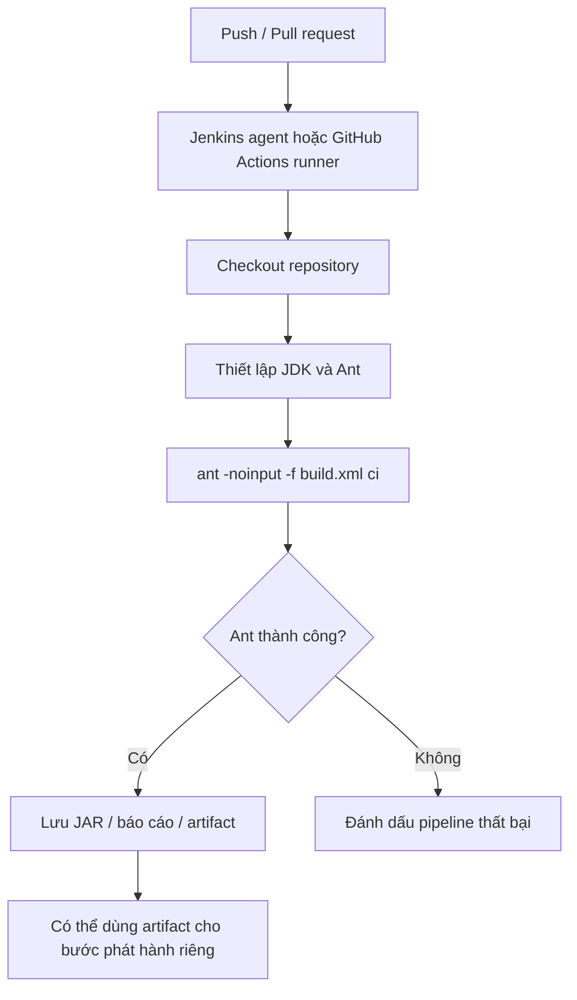

# Tích hợp lệnh Ant trong Jenkins hoặc GitHub Actions

## 1. Mục tiêu của việc đưa Ant vào CI/CD

Apache Ant là công cụ tự động hóa build dựa trên các **target** trong file `build.xml`. Khi lập trình viên chạy `ant test` hoặc `ant dist` ở máy cá nhân, kết quả phụ thuộc vào những bước họ đã thực hiện trước đó: chọn đúng JDK, cài Ant, lấy mã nguồn mới nhất, chuẩn bị dependency, chạy test và lưu lại artifact. Jenkins hoặc GitHub Actions có thể thực hiện những bước này tự động sau mỗi lần push hoặc tạo pull request.

Trong một pipeline CI, Ant thường đảm nhiệm **logic build của dự án**, còn nền tảng CI đảm nhiệm **lịch chạy, chọn runner/agent, checkout mã nguồn, cấp công cụ, quản lý quyền truy cập, thu thập báo cáo và lưu artifact**.

Quy trình cơ bản:



Điểm cốt lõi là **CI chạy cùng các target Ant mà lập trình viên có thể chạy ở máy cá nhân**. Nền tảng CI không nên phải biết từng lệnh `javac`, `jar` hay `copy` bên trong `build.xml`; các thao tác này được đóng gói trong target Ant. Khi cần sửa quy trình biên dịch, chỉ cần điều chỉnh build script của dự án.

Sau bài học, bạn sẽ có thể:

- Tạo một target Ant phù hợp với CI, thất bại bằng mã thoát khác 0 khi kiểm tra không đạt.
- Gọi target đó từ `Jenkinsfile` hoặc workflow GitHub Actions.
- Cung cấp JDK, Ant, đường dẫn working directory và property đầu vào một cách rõ ràng.
- Thu thập artifact, thêm báo cáo test và tìm nguyên nhân khi pipeline không chạy giống máy cá nhân.
- Phân biệt **build/test**, **lưu artifact** và **triển khai (deploy)** trong một quy trình CI/CD.

## 2. Chuẩn bị dự án Ant để CI có thể gọi trực tiếp

Trước khi viết cấu hình Jenkins hoặc GitHub Actions, hãy có một lệnh build chạy được tại thư mục gốc repository. Một cách tổ chức đơn giản:

```text
ant-ci-demo/
├── build.xml
├── Jenkinsfile
├── .github/
│   └── workflows/
│       └── ant-ci.yml
└── src/
    ├── main/
    │   └── java/
    │       └── example/
    │           └── App.java
    └── test/
        └── java/
            └── example/
                └── AppSmokeTest.java
```

Các file `Jenkinsfile` và `.github/workflows/ant-ci.yml` có thể cùng nằm trong repository để học cách tích hợp hai nền tảng; dự án thực tế chỉ cần bật những pipeline mình muốn sử dụng.

### 2.1. Một `build.xml` tối thiểu dùng được cho cả hai nền tảng

Ví dụ này sử dụng JDK 17 trở lên và Ant hỗ trợ thuộc tính `release` của `<javac>`. Nó biên dịch mã nguồn, chạy một phép kiểm tra đơn giản rồi đóng gói JAR.

```xml
<?xml version="1.0" encoding="UTF-8"?>
<project name="ant-ci-demo" default="ci" basedir=".">

    <!-- Đường dẫn có một nơi khai báo chung -->
    <property name="main.src" location="src/main/java"/>
    <property name="test.src" location="src/test/java"/>
    <property name="build.dir" location="build"/>
    <property name="main.classes" location="${build.dir}/classes"/>
    <property name="test.classes" location="${build.dir}/test-classes"/>
    <property name="dist.dir" location="dist"/>

    <target name="clean">
        <delete dir="${build.dir}"/>
        <delete dir="${dist.dir}"/>
    </target>

    <target name="compile">
        <mkdir dir="${main.classes}"/>
        <javac srcdir="${main.src}"
               destdir="${main.classes}"
               encoding="UTF-8"
               release="17"
               includeantruntime="false"/>
    </target>

    <target name="compile-test" depends="compile">
        <mkdir dir="${test.classes}"/>
        <javac srcdir="${test.src}"
               destdir="${test.classes}"
               encoding="UTF-8"
               release="17"
               includeantruntime="false">
            <classpath>
                <pathelement location="${main.classes}"/>
            </classpath>
        </javac>
    </target>

    <target name="test" depends="compile-test">
        <java classname="example.AppSmokeTest"
              fork="true"
              failonerror="true">
            <classpath>
                <pathelement location="${main.classes}"/>
                <pathelement location="${test.classes}"/>
            </classpath>
        </java>
    </target>

    <target name="dist" depends="test">
        <mkdir dir="${dist.dir}"/>
        <jar destfile="${dist.dir}/ant-ci-demo.jar"
             basedir="${main.classes}">
            <manifest>
                <attribute name="Main-Class" value="example.App"/>
            </manifest>
        </jar>
    </target>

    <!-- Clean xong mới build, test và đóng gói -->
    <target name="ci" depends="clean,dist"/>

</project>
```

Ở đây, `ci` là **điểm vào thống nhất** của pipeline. Khi chạy `ant ci`, Ant thực hiện `clean`, rồi các dependency của `dist` theo thứ tự cần thiết: `compile`, `compile-test`, `test`, `dist`. Một target chỉ được thực hiện một lần trong cùng một lượt build ngay cả khi nhiều target phụ thuộc vào nó.

Hai quyết định đáng chú ý:

- `encoding="UTF-8"` và `release="17"` giúp compiler không đoán tùy ý charset hoặc mức Java mục tiêu.
- `failonerror="true"` trong `<java>` khiến một chương trình test kết thúc bằng mã lỗi khác 0 làm target Ant thất bại. Đây là điều CI cần để biết build **không đạt**.

Bài demo không dùng thư viện test ngoài, do đó chạy được mà không cần Maven, Ivy hay JUnit. Khi dự án dùng JUnit/TestNG, vẫn giữ cấu trúc pipeline tương tự nhưng thay target `test` bằng task test tương ứng và cấu hình xuất báo cáo XML.

### 2.2. Mã nguồn và kiểm tra smoke test

Nội dung `src/main/java/example/App.java`:

```java
package example;

public final class App {
    private App() {
    }

    public static String message() {
        return "Ant CI OK";
    }

    public static void main(String[] args) {
        System.out.println(message());
    }
}
```

Nội dung `src/test/java/example/AppSmokeTest.java`:

```java
package example;

public final class AppSmokeTest {
    private AppSmokeTest() {
    }

    public static void main(String[] args) {
        if (!"Ant CI OK".equals(App.message())) {
            throw new AssertionError("Unexpected application message");
        }
        System.out.println("Smoke test passed");
    }
}
```

Một `AssertionError` chưa được bắt khiến Java process kết thúc không thành công; do `failonerror="true"`, Ant thất bại và Jenkins/GitHub Actions nhận trạng thái lỗi. Ví dụ này minh họa **cơ chế trả lỗi**, không thay thế một bộ unit test chính thức.

### 2.3. Xác định lệnh chạy chung cho máy cá nhân và CI

Tại thư mục chứa `build.xml`:

```bash
java -version
ant -version
ant -noinput -f build.xml ci
java -jar dist/ant-ci-demo.jar
```

Ý nghĩa các tùy chọn:

| Cú pháp | Tác dụng |
|---|---|
| `ant ci` | Chạy target `ci` của file `build.xml` mặc định ở thư mục hiện tại |
| `-f build.xml` | Chọn chính xác build file; cũng có thể dùng `-buildfile` |
| `-noinput` | Không yêu cầu nhập tương tác; phù hợp với môi trường CI tự động |
| `-Dname=value` | Truyền Ant property để điều chỉnh build theo cấu hình được phép |
| `-q` / `-verbose` | Điều chỉnh mức độ chi tiết của log khi cần kiểm tra |
| `-version` | In phiên bản Ant đang chạy |

Nếu build file nằm ở thư mục con như `backend/build.xml`, pipeline cần gọi đúng đường dẫn hoặc đổi working directory:

```bash
ant -noinput -f backend/build.xml ci
```

Với `-f`, Ant xác định thư mục gốc tương ứng với build file theo cấu hình project; với những đường dẫn tương đối do script shell hoặc chương trình ngoài sử dụng, vẫn cần xét **working directory** thực tế. Vì thế hãy ghi rõ giả định về vị trí chạy các lệnh trong pipeline.

## 3. Tích hợp Ant trong Jenkins

Jenkins thường dùng **Pipeline as Code**: file `Jenkinsfile` đặt cùng mã nguồn chứa mô tả các stage cần chạy. Jenkins controller điều phối công việc, còn **agent** là nơi thực sự checkout, chạy Ant và tạo artifact.

### 3.1. Chuẩn bị Jenkins agent và công cụ

Trước khi chạy ví dụ:

1. Tạo Pipeline hoặc Multibranch Pipeline có quyền đọc repository và nhận biết `Jenkinsfile`.
2. Bảo đảm agent Linux có nhãn `linux`, truy cập được mã nguồn và có quyền ghi trong workspace. Nếu nhãn khác, sửa phần `agent` theo môi trường thực tế.
3. Trong cấu hình công cụ của Jenkins (**Manage Jenkins → Tools**; tên mục có thể thay đổi theo phiên bản/giao diện), chuẩn bị một JDK mang tên `JDK_17` và Ant mang tên `ANT_1_10`. Tên trong `Jenkinsfile` phải khớp **chính xác** tên được khai báo.
4. Cài hoặc bật các thành phần hỗ trợ Pipeline và Ant tool installation theo cấu hình Jenkins của tổ chức. Nếu agent đã cài JDK/Ant theo image cố định, có thể dùng trực tiếp PATH thay cho cơ chế `tools`, nhưng nên chọn một cách thống nhất.

Việc có JDK trên máy chạy Jenkins controller **không bảo đảm** agent chạy job cũng có đúng JDK. Log `java -version` và `ant -version` ở agent mới là thông tin có ý nghĩa đối với build.

### 3.2. Ví dụ Declarative Pipeline đầy đủ

Nội dung `Jenkinsfile` ở thư mục gốc:

```groovy
pipeline {
    agent { label 'linux' }

    options {
        skipDefaultCheckout(true)
        timeout(time: 20, unit: 'MINUTES')
    }

    tools {
        jdk 'JDK_17'
        ant 'ANT_1_10'
    }

    stages {
        stage('Checkout') {
            steps {
                checkout scm
            }
        }

        stage('Toolchain') {
            steps {
                sh 'java -version'
                sh 'ant -version'
            }
        }

        stage('Build and test') {
            steps {
                sh 'ant -noinput -f build.xml ci'
            }
        }
    }

    post {
        success {
            archiveArtifacts artifacts: 'dist/*.jar',
                             fingerprint: true
        }
    }
}
```

Các thành phần chính:

- `agent { label 'linux' }` chọn agent có nhãn phù hợp. `sh` cần môi trường shell tương thích; không dùng `sh` cho agent chỉ có Windows.
- `skipDefaultCheckout(true)` tắt lần checkout tự động để stage `Checkout` tự chịu trách nhiệm gọi `checkout scm`. Cách này giúp luồng dễ quan sát và tránh checkout hai lần.
- `tools` đưa JDK và Ant đã đăng ký trong Jenkins vào môi trường thực thi của pipeline.
- `timeout` bảo vệ job khỏi một lần build chạy treo quá lâu.
- `sh 'ant -noinput -f build.xml ci'` chạy chính target Ant vừa chuẩn bị. Nếu Ant trả exit code khác 0, step `sh` thường thất bại và stage/job được đánh dấu lỗi.
- `post { success { archiveArtifacts ... } }` lưu JAR trên Jenkins sau khi build thành công. `fingerprint: true` hỗ trợ Jenkins ghi nhận dấu vết artifact theo cơ chế fingerprint của Jenkins.

Lệnh `checkout scm` dùng tốt trong Jenkins Pipeline đã gắn với SCM. Nếu tạo Pipeline không gắn repository theo cơ chế đó, phải cấu hình checkout tường minh theo loại nguồn tương ứng.

Không nhất thiết phải đưa `ant` vào target Ant: Jenkins gọi Ant bằng lệnh shell, còn `build.xml` chỉ mô tả logic build.

### 3.3. Agent Windows và thư mục con

Nếu dùng agent Windows, thay step shell bằng lệnh batch:

```groovy
stage('Build and test') {
    steps {
        bat 'ant -noinput -f build.xml ci'
    }
}
```

Nếu repository chứa nhiều dự án và Ant project nằm trong `legacy-app/`, có thể dùng step `dir`:

```groovy
stage('Build and test') {
    steps {
        dir('legacy-app') {
            sh 'ant -noinput -f build.xml ci'
        }
    }
}
```

Khi đó cần điều chỉnh đường dẫn `archiveArtifacts` theo vị trí artifact **tính từ workspace gốc** (ví dụ `legacy-app/dist/*.jar`). Đường dẫn trong `archiveArtifacts` không tự động đổi chỉ vì một step trước đó chạy trong `dir(...)`.

### 3.4. Đưa báo cáo unit test vào Jenkins

Bản demo dùng smoke test Java thuần, chưa sinh XML. Với dự án có JUnit, hãy cấu hình target test của Ant để xuất report theo dạng JUnit XML, ví dụ vào `build/test-reports/TEST-*.xml`. Jenkins có thể đọc report bằng step:

```groovy
post {
    always {
        junit testResults: 'build/test-reports/TEST-*.xml',
              allowEmptyResults: false
    }
    success {
        archiveArtifacts artifacts: 'dist/*.jar',
                         fingerprint: true
    }
}
```

Đây là **ví dụ thay thế/điều chỉnh khối `post`** của pipeline trước đó, áp dụng **chỉ khi target Ant thực sự sinh ra file XML**. Step `junit` không tự chạy test; nó chỉ đọc kết quả do runner đã tạo. `allowEmptyResults: false` giúp phát hiện sai đường dẫn hoặc trường hợp test đáng lẽ chạy nhưng không tạo báo cáo. Nếu có nhiệm vụ chạy test không sinh XML, dùng log và exit code để xác định thành công/thất bại.

## 4. Tích hợp Ant trong GitHub Actions

GitHub Actions khai báo workflow trong thư mục `.github/workflows/`. Một workflow có thể được kích hoạt bởi sự kiện repository, gồm nhiều **job** và mỗi job có các **step**. Job chạy trên runner; mỗi lệnh `run` được thực thi trong môi trường runner đó.

### 4.1. Workflow cho push, pull request và chạy thủ công

Nội dung file `.github/workflows/ant-ci.yml`:

```yaml
name: Ant CI

on:
  push:
  pull_request:
  workflow_dispatch:

permissions:
  contents: read

jobs:
  build:
    name: Build with Apache Ant
    runs-on: ubuntu-24.04
    timeout-minutes: 20

    steps:
      - name: Checkout source
        uses: actions/checkout@v4

      - name: Set up JDK 17
        uses: actions/setup-java@v4
        with:
          distribution: temurin
          java-version: '17'

      - name: Install Apache Ant
        run: |
          sudo apt-get update
          sudo apt-get install -y ant

      - name: Show tool versions
        run: |
          java -version
          ant -version

      - name: Compile, test and package
        run: ant -noinput -f build.xml ci

      - name: Upload JAR artifact
        uses: actions/upload-artifact@v4
        with:
          name: ant-ci-demo-jar
          path: dist/*.jar
          if-no-files-found: error
```

Trong workflow này:

- `on` mô tả **lúc nào** CI chạy. `push` và `pull_request` phù hợp để kiểm tra thay đổi, còn `workflow_dispatch` cho phép chạy thủ công.
- `permissions: contents: read` giới hạn quyền token mặc định cho trường hợp chỉ cần checkout mã nguồn.
- `runs-on: ubuntu-24.04` chọn một nhãn runner Linux cụ thể. Nhãn này giúp ổn định lựa chọn OS, nhưng image và các gói trong image vẫn được cập nhật theo thời gian.
- `actions/checkout` lấy mã nguồn; `actions/setup-java` thiết lập JDK cần dùng.
- Bước cài Ant dùng gói từ hệ điều hành runner. Đây là **cách khởi đầu đơn giản**, chưa phải cách ghim chính xác phiên bản Ant cho reproducible build.
- `run: ant -noinput -f build.xml ci` trả trạng thái từ Ant cho step. Khi bước này thất bại, các step bình thường phía sau sẽ không chạy.
- `actions/upload-artifact` lưu file JAR để tải lại từ trang run của workflow. `if-no-files-found: error` giúp phát hiện trường hợp target build thành công nhưng không tạo file theo đường dẫn mong đợi.

Ví dụ dùng các major version của GitHub Actions được thể hiện trong YAML; khi triển khai thực tế, hãy chọn phiên bản action được hỗ trợ trong tổ chức và cân nhắc ghim bằng commit SHA để kiểm soát supply chain.

### 4.2. Runner, PATH và cách cài Ant

GitHub-hosted runner có một số công cụ được cài sẵn, nhưng **không nên coi danh sách hoặc phiên bản của các công cụ đó là hợp đồng bất biến**. Workflow trên chủ động cài gói `ant`, đồng thời in `java -version` và `ant -version` để kết quả dễ truy vết.

Nếu dự án cần chính xác một bản Ant, ví dụ để bảo đảm behavior của task hoặc plugin, có thể chọn một trong các cách:

1. Dùng container image chứa đúng JDK, Ant và các công cụ hệ thống đã được kiểm soát; nếu cần mức bất biến cao, ghim image bằng digest.
2. Tải bản phát hành Ant được chỉ định, xác minh checksum/chữ ký và khai báo `ANT_HOME`/`PATH` trong step.
3. Dùng self-hosted runner đã quản lý chặt phiên bản phần mềm.

Cần ghim cả **JDK** và dependency, không chỉ Ant. Một lệnh `ant -version` giống nhau không bảo đảm JDK và thư viện liên quan giống nhau.

### 4.3. Ghi lại báo cáo test dù build thất bại

Nếu target Ant đã tạo báo cáo JUnit XML, có thể bổ sung step upload report:

```yaml
      - name: Upload test reports
        if: ${{ always() }}
        uses: actions/upload-artifact@v4
        with:
          name: junit-test-reports
          path: build/test-reports/TEST-*.xml
          if-no-files-found: warn
```

`always()` khiến step này được xem xét chạy kể cả khi bước build/test trước đó lỗi. Với các workflow phức tạp, có thể bổ sung điều kiện để tránh upload khi job đã bị hủy nếu đó là yêu cầu vận hành. `if-no-files-found: warn` phù hợp khi báo cáo có thể không xuất hiện do build thất bại rất sớm; nếu một report luôn bắt buộc, có thể dùng `error` để bắt lỗi cấu hình.

Điểm quan trọng là **upload XML không tự chuyển file XML thành giao diện chi tiết về test**. Jenkins có step `junit` xử lý hiển thị test report; GitHub Actions chỉ lưu artifact ở ví dụ này. Muốn có chú thích hoặc bảng kết quả test ngay trong GitHub, cần thêm một action hoặc công cụ đọc JUnit XML phù hợp.

### 4.4. Dự án Ant nằm trong thư mục con

GitHub Actions hỗ trợ `working-directory` ở mức step hoặc default. Ví dụ:

```yaml
      - name: Build backend
        working-directory: legacy-app
        run: ant -noinput -f build.xml ci

      - name: Upload backend JAR
        uses: actions/upload-artifact@v4
        with:
          name: backend-jar
          path: legacy-app/dist/*.jar
          if-no-files-found: error
```

Đường dẫn artifact trong `upload-artifact` được tính từ workspace sau checkout khi không có cấu hình đường dẫn đặc biệt khác. Vì vậy phải chỉ đến `legacy-app/dist/*.jar` thay vì `dist/*.jar`.

## 5. Jenkins và GitHub Actions giống và khác nhau ở đâu?

Cả hai đều chỉ cần một lệnh Ant tương tự:

```bash
ant -noinput -f build.xml ci
```

Điểm khác chủ yếu thuộc về cách nền tảng CI quản lý môi trường và dữ liệu:

| Nhu cầu | Jenkins | GitHub Actions |
|---|---|---|
| Nơi lưu cấu hình | `Jenkinsfile` tại repository (thường dùng) | `.github/workflows/*.yml` |
| Máy thực thi | Jenkins agent/agent label | GitHub-hosted hoặc self-hosted runner |
| Kích hoạt | Webhook SCM, multibranch, lịch hoặc cấu hình job | `on: push`, `pull_request`, `workflow_dispatch`, lịch... |
| Cấp JDK và Ant | Jenkins Tools, PATH, container hoặc agent image | `setup-java`, package, container hoặc runner image |
| Chạy Ant | `sh 'ant ...'` hoặc `bat 'ant ...'` | `run: ant ...` |
| Thu thập JAR | `archiveArtifacts` | `actions/upload-artifact` |
| Hiển thị JUnit XML | Step `junit` khi có plugin tương ứng | Upload artifact hoặc dùng công cụ/action đọc report |
| Secret | Jenkins Credentials và scope pipeline | GitHub Actions secrets/variables và permissions |
| Điều kiện thành công | Exit status của step và trạng thái stage | Exit status của step và trạng thái job |

Không nền tảng nào tự hiểu ý nghĩa của target `dist` hay `ci`: chúng chỉ thực thi lệnh. Ant phải mô tả chính xác target, dependency và cách báo thất bại.

## 6. Truyền tham số từ pipeline vào Ant

Một script Ant được tái sử dụng tốt thường có vài property dùng cấu hình theo môi trường, nhưng không thay đổi cơ chế build cốt lõi. Ví dụ:

```xml
<project name="ant-ci-demo" default="ci">
    <property name="build.profile" value="local"/>

    <target name="show-profile">
        <echo message="Selected profile: ${build.profile}"/>
    </target>

    <target name="ci" depends="show-profile"/>
</project>
```

Đây là **mẫu độc lập minh họa Ant property**, không dùng để thay toàn bộ `build.xml` đầy đủ ở phần 2. Lệnh chạy:

```bash
ant -noinput -Dbuild.profile=ci show-profile
```

Ant property được thiết lập bằng `-D` trên dòng lệnh có thể ưu tiên hơn giá trị mặc định từ `<property>`. Như vậy Jenkins có thể gọi:

```groovy
sh 'ant -noinput -Dbuild.profile=ci -f build.xml ci'
```

Còn GitHub Actions:

```yaml
- name: Build with CI profile
  run: ant -noinput -Dbuild.profile=ci -f build.xml ci
```

Chỉ nên dùng những property có **ý nghĩa rõ ràng và giá trị được kiểm soát**, chẳng hạn tên môi trường, đường dẫn output hay chế độ bật/tắt kiểm tra được phép. Mọi trường hợp thay target test bằng target bỏ test theo property phải được cân nhắc vì có thể tạo ra pipeline xanh dù chưa kiểm tra mã nguồn.

### 6.1. Không đặt thông tin bí mật trực tiếp vào `build.xml`

Nếu build cần token để tải dependency từ kho nội bộ, sử dụng cơ chế secret của CI:

- Jenkins: lưu token trong **Credentials**, giới hạn scope và truyền cho command trong khối `withCredentials` khi cần.
- GitHub Actions: dùng **repository/environment secrets**, cấp vào biến môi trường của step được phép sử dụng; không hardcode token trong YAML.

Ví dụ truy cập secret trong GitHub Actions bằng biến môi trường của một step:

```yaml
      - name: Resolve private dependencies
        env:
          REPOSITORY_TOKEN: ${{ secrets.REPOSITORY_TOKEN }}
        run: ant -noinput -f build.xml resolve-private
```

Ở đây `resolve-private` chỉ là **tên target minh họa**; phải định nghĩa nó trong `build.xml` của dự án thực tế. Ant task hoặc chương trình được Ant gọi phải đọc biến môi trường đó theo cách tương thích, ví dụ thông qua `${env.REPOSITORY_TOKEN}` sau khi khai báo `<property environment="env"/>`. Tuy nhiên, secret được truyền vào property vẫn có nguy cơ bị in ra log nếu lệnh `echo` hoặc mode verbose ghi nó. Hạn chế log chứa secret và không truyền secret qua đối số dòng lệnh nếu có cách an toàn hơn.

Workflow chạy từ pull request của fork thường không được cấp repository secrets như workflow tin cậy; quy tắc quyền cụ thể phụ thuộc sự kiện và thiết lập repository. Thiết kế CI để **kiểm tra pull request công khai không yêu cầu secret dùng để phát hành**.

## 7. Cache dependency, artifact và bước triển khai là ba việc khác nhau

### 7.1. Cache để tăng tốc những lần build tiếp theo

Nếu dự án Ant dùng Apache Ivy hoặc một cơ chế tải thư viện, việc tải dependency mỗi lần sẽ làm CI chậm. Jenkins hoặc GitHub Actions có thể cache thư mục tải xuống, ví dụ cache Ivy, với điều kiện đường dẫn và chính sách cache phù hợp.

Một ví dụ **chỉ dành cho dự án thực sự dùng Ivy** trong GitHub Actions:

```yaml
      - name: Cache Ivy dependencies
        uses: actions/cache@v4
        with:
          path: ~/.ivy2/cache
          key: ${{ runner.os }}-ivy-${{ hashFiles('ivy.xml') }}
```

Key dựa vào hệ điều hành và hash của file mô tả dependency để giảm khả năng dùng cache không phù hợp khi dependency thay đổi. Nếu dependency được khai báo trong nhiều file, cần đưa tất cả file liên quan vào cách tạo key. Cache là cơ chế tối ưu hiệu năng; với dependency có thể biến đổi nội dung, cần kiểm soát phiên bản và tính toàn vẹn của gói thay vì tin rằng cache luôn đúng.

**Không dùng cache như nguồn phát hành chính thức của JAR.** Artifact `dist/*.jar` là sản phẩm của lần build hiện tại; cache dependency chỉ hỗ trợ tạo ra nó.

### 7.2. Artifact được lưu sau build, không tự trở thành bản phát hành

Ở Jenkins:

```groovy
archiveArtifacts artifacts: 'dist/*.jar', fingerprint: true
```

Ở GitHub Actions:

```yaml
- uses: actions/upload-artifact@v4
  with:
    name: ant-ci-demo-jar
    path: dist/*.jar
    if-no-files-found: error
```

Hai bước trên giúp **giữ và tải lại file build của một job/run**, nhưng không mặc nhiên đưa JAR lên máy chủ production, kho artifact Maven hay GitHub Release. Khi có nhu cầu CD, nên thêm một **job/stage phát hành riêng** có điều kiện như branch/tag được duyệt, quyền ghi tối thiểu, kiểm tra artifact và cơ chế phê duyệt phù hợp.

Một pipeline CI chỉ biên dịch, kiểm tra và lưu artifact đã có giá trị ngay cả khi chưa cấu hình deploy.

## 8. Độ ổn định và tính tái lập của pipeline Ant

Chuyển lệnh Ant sang CI giúp quá trình nhất quán hơn, nhưng để có kết quả dễ tái lập cần kiểm soát thêm đầu vào và môi trường:

| Thành phần | Việc nên làm |
|---|---|
| JDK | Công bố phiên bản/nhánh JDK; nếu cần byte-identical build, ghim chính xác phiên bản JDK |
| Ant | Dùng một phiên bản Ant đã biết; không dựa vô điều kiện vào Ant tình cờ có trên PATH |
| Plugin và thư viện | Khóa phiên bản; hạn chế dependency kiểu mới nhất hoặc snapshot thay đổi liên tục |
| Encoding | Chỉ định UTF-8 trong `<javac>` và các thao tác đọc/ghi text |
| Locale, múi giờ | Chỉ định khi dữ liệu sinh ra phụ thuộc định dạng; dùng timestamp đầu vào cố định nếu cần |
| Xuống dòng | Quy định LF/CRLF cho file nguồn và artifact text theo loại file |
| Đường dẫn | Dùng cấu trúc workspace rõ ràng; không nhúng đường dẫn tuyệt đối trên máy cá nhân |
| Dữ liệu build | Tránh nhúng thời gian hiện tại, tên runner, workspace ngẫu nhiên hoặc biến môi trường không kiểm soát vào artifact |
| Archive ZIP/JAR | Nếu yêu cầu hash JAR giống nhau, kiểm soát metadata entry, thứ tự đóng gói và timestamp theo khả năng của toolchain |
| Quyền truy cập | Token chỉ có quyền cần thiết; build pull request nên có quyền đọc và không tự phát hành |

Ở mức CI, một cải tiến đơn giản là dùng target tổng hợp `ci` luôn có bước `clean` trước `compile`. Điều này giảm nguy cơ file từ lần build cũ che giấu lỗi. Trên runner mới, workspace thường sạch, nhưng **không nên mặc định** điều này cho Jenkins agent lâu năm hoặc self-hosted runner.

Một số build project lớn chạy các target song song để tăng tốc. Chỉ nên làm vậy nếu target đã phân tách file đầu ra và dependency chính xác; hai tiến trình cùng ghi `build/classes` hoặc `dist` có thể khiến kết quả khó dự đoán.

## 9. Xử lý các lỗi thường gặp trong Jenkins và GitHub Actions

| Hiện tượng | Nguyên nhân có thể | Hướng xử lý |
|---|---|---|
| `ant: command not found` | Chưa cài Ant hoặc PATH không chứa `ant` | Cấu hình Jenkins Tools, cài Ant trong workflow, kiểm tra `ant -version` |
| `JAVA_HOME is not defined correctly` | Chọn JDK sai hoặc launcher Ant không tìm được Java | Kiểm tra `java -version`, `JAVA_HOME`, cấu hình JDK trên agent/runner |
| `Target "ci" does not exist` | `build.xml` không có target `ci` hoặc pipeline gọi sai file | Xem target trong `build.xml` và lệnh `-f` |
| `srcdir does not exist` | Checkout thiếu file hoặc working directory sai | Kiểm tra stage checkout và thư mục chứa `build.xml` |
| Jenkins báo `No such DSL method 'ant'` hoặc không nhận tool | Thiếu thành phần plugin/tool type hoặc dùng DSL sai | Kiểm tra plugin và cấu hình Jenkins Tools; có thể gọi `sh 'ant ...'` nếu binary có trên PATH |
| Jenkins `sh: not found` trên agent Windows | Dùng Unix shell step ở Windows | Dùng `bat` hoặc chọn agent Linux |
| Ant chạy test lỗi nhưng pipeline vẫn xanh | Target bỏ qua mã thoát hoặc script nuốt lỗi | Đặt `failonerror="true"` khi cần, tránh `|| true` hoặc cơ chế bỏ qua exit code |
| `archiveArtifacts` / `upload-artifact` không tìm thấy JAR | Target không tạo file, đường dẫn relative sai hoặc job đã dừng trước khi đóng gói | Đối chiếu `dist.dir`, working directory và log target `dist` |
| Test đã chạy nhưng không thấy báo cáo | Chưa tạo JUnit XML hoặc cấu hình đường dẫn report sai | Cấu hình test runner xuất XML; chỉ dùng Jenkins `junit` hoặc upload report khi có file thật |
| Chỉ fail trên CI | Phiên bản JDK/Ant/dependency, biến môi trường, timezone, đường dẫn hoặc quyền file khác | So sánh log version và input; tái hiện lệnh đầy đủ ở máy cá nhân |
| Build treo đợi nhập bàn phím | Task tương tác hoặc công cụ ngoài cần xác nhận | Dùng `-noinput`, cung cấp tham số noninteractive cho công cụ được gọi |
| Hai build cùng ghi ra một folder | Workspace dùng chung hoặc script ghi ngoài thư mục dự án | Tách workspace/output theo job và kiểm soát concurrency |

### 9.1. Tìm lỗi từ mã thoát của Ant

Ant có quy tắc cơ bản: target bị lỗi làm process `ant` kết thúc không thành công. Jenkins `sh` và GitHub Actions `run` mặc định coi lệnh có mã thoát khác 0 là thất bại. Vì thế, không nên vô tình **nuốt lỗi**:

```bash
# Không nên dùng trong bước bắt buộc phải kiểm tra thành công:
ant -noinput ci || true
```

Nếu cần kiểm tra vì sao Ant thất bại, tăng độ chi tiết log trong một lần chẩn đoán:

```bash
ant -noinput -verbose -f build.xml ci
```

Tránh bật chế độ verbose tràn lan khi có thông tin bảo mật hoặc cấu hình chứa secret. Với CI, ưu tiên thông điệp lỗi đủ bối cảnh ngay trong target hoặc task Ant để biết file/điều kiện nào làm build dừng.

### 9.2. Kiểm tra việc test thực sự chạy

Trong demo, bước `test` chạy class `example.AppSmokeTest` với `fork="true"` và `failonerror="true"`. Để quan sát đường truyền lỗi, bạn có thể tạm thay chuỗi mong đợi trong smoke test thành một giá trị sai, rồi chạy lại `ant -noinput ci` trên nhánh thử nghiệm. Ant sẽ dừng ở `test`, không hoàn thành `dist`, và job CI phải báo thất bại.

Với JUnit hoặc TestNG, xác nhận task Ant chuyển đúng số lượng test thất bại thành kết quả build thất bại; tùy runner, chỉ tạo report XML chưa chắc đã tự làm Ant trả lỗi. Khi cần, sử dụng các thuộc tính kiểm soát lỗi như `haltonfailure`, `haltonerror` hoặc kiểm tra property thất bại theo cơ chế task cụ thể.

## 10. Mở rộng pipeline sau khi CI cơ bản hoạt động

Khi đã có một lệnh chuẩn, có thể mở rộng theo nhu cầu:

- **Nhiều JDK:** Tạo matrix jobs hoặc stage riêng để chạy cùng target Ant trên JDK 17 và JDK 21 khi dự án yêu cầu kiểm tra tương thích.
- **Nhiều hệ điều hành:** Chạy trên Linux và Windows, điều chỉnh `sh`/`bat` nhưng giữ target Ant chung; hữu ích nếu chương trình xử lý đường dẫn, encoding hoặc xuống dòng.
- **Kiểm tra chất lượng:** Thêm target `checkstyle` hoặc `static-analysis` vào dependency của `ci` sau khi tích hợp công cụ tương ứng.
- **Artifact versioning:** Đưa phiên bản ứng dụng vào tên hoặc metadata artifact bằng property đã quản lý, tránh dùng timestamp hiện tại một cách tùy ý.
- **Release có điều kiện:** Chỉ thực thi job phát hành trên tag/branch được chỉ định, dùng artifact đã qua kiểm tra và quyền ghi tối thiểu.
- **Thông báo lỗi:** Sử dụng cơ chế thông báo có sẵn của Jenkins/GitHub Actions sau khi quy tắc build thất bại và thu thập report đã hoạt động đáng tin cậy.

Đừng chuyển toàn bộ logic Ant sang Groovy/YAML chỉ để CI chạy được. Jenkins hoặc GitHub Actions nên biết **gọi target nào và xử lý kết quả ra sao**; `build.xml` vẫn là nơi triển khai việc compile, test, package và các bước build được dự án sở hữu.

## 11. Bài thực hành

Thực hiện theo thứ tự dưới đây để quan sát được cả kết quả thành công và thất bại:

1. Tạo cấu trúc thư mục, `build.xml`, `App.java` và `AppSmokeTest.java` từ ví dụ ở phần 2.
2. Cài JDK 17 trở lên và Ant trên máy phát triển. Chạy `ant -noinput -f build.xml ci`; quan sát thông báo `Smoke test passed` và file `dist/ant-ci-demo.jar`.
3. Thêm `Jenkinsfile` nếu sử dụng Jenkins hoặc `.github/workflows/ant-ci.yml` nếu sử dụng GitHub Actions. Đổi tên Jenkins tools/agent label khi cần để khớp môi trường.
4. Commit và push mã nguồn; mở job/run. Kiểm tra stage hoặc step `Build and test` thành công, sau đó mở artifact `ant-ci-demo.jar`.
5. Trên một nhánh thử nghiệm, làm smoke test thất bại có chủ đích rồi push lại. Kiểm tra pipeline báo lỗi ở bước Ant, không hiển thị kết quả thành công giả.
6. Khôi phục test; chỉnh target `ci` để bao gồm bước chất lượng bổ sung của dự án nếu có, sau đó kiểm tra lại toàn bộ luồng.

**Kết luận thực hành:** Điểm nối giữa Ant và nền tảng CI có thể đơn giản chỉ là `ant -noinput -f build.xml ci`. Để kết quả đáng tin cậy, target `ci` phải mô tả đầy đủ thứ tự build/test, trả lỗi chính xác; còn Jenkins hoặc GitHub Actions phải chuẩn bị đúng môi trường, chỉ chạy từ nguồn đã checkout và lưu lại artifact/report theo đường dẫn đã thống nhất.

