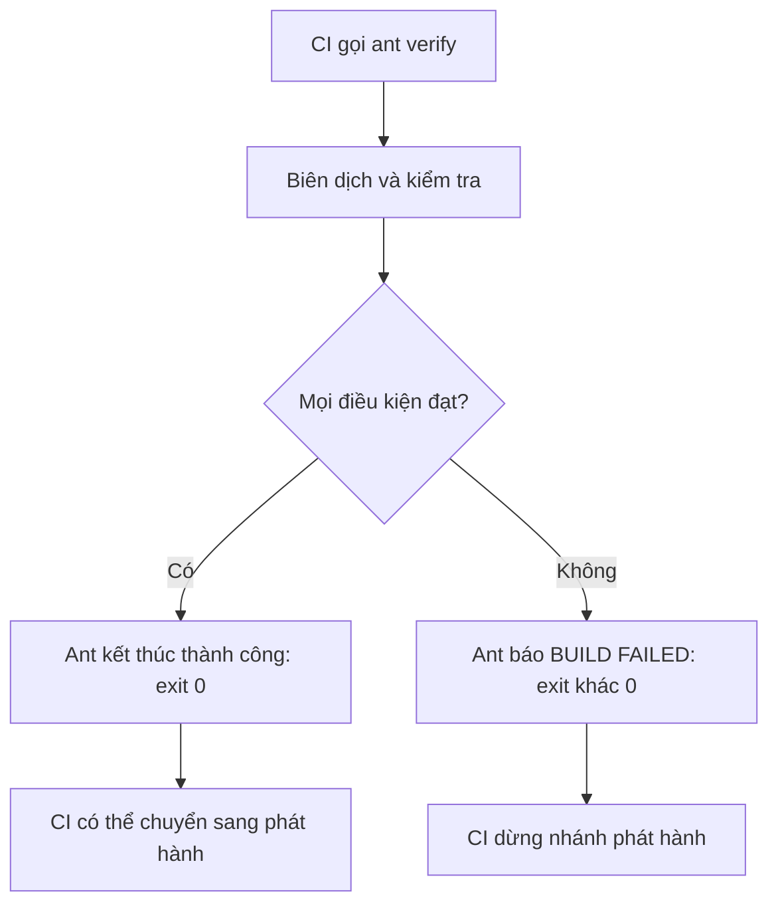

# Truyền mã lỗi và chặn phát hành khi kiểm tra không đạt trong Apache Ant

Trong quy trình **CI/CD**, một lệnh build chỉ thực sự bảo vệ bản phát hành nếu kết quả kiểm tra được chuyển thành **trạng thái thành công hoặc thất bại mà hệ thống CI hiểu được**. Nếu một bài kiểm tra báo lỗi trên màn hình nhưng Apache Ant vẫn kết thúc thành công, pipeline có thể tiếp tục tạo artifact, tải lên kho lưu trữ hoặc triển khai phiên bản có lỗi.

Để thiết kế cổng kiểm tra đáng tin cậy với Ant, cần nối đúng ba bước:

1. **Công cụ kiểm tra** trả về trạng thái lỗi hoặc thông báo điều kiện không đạt.
2. **Ant** biến trạng thái đó thành build thất bại và không chạy các target phụ thuộc tiếp theo.
3. **CI/CD** dựa trên mã thoát của lệnh Ant để ngăn job phát hành hoặc triển khai.

Ví dụ dưới đây minh họa nguyên lý bằng lệnh Ant, chương trình Java nhỏ, các tác vụ `<java>`, `<exec>`, `<fail>` và cấu hình GitHub Actions. Phần phát hành thật được để ở dạng vị trí tích hợp, vì mỗi dự án có kho artifact, thông tin xác thực và chính sách phát hành riêng.

## 1. Mã thoát là tín hiệu để CI phân biệt thành công và thất bại

Chương trình dòng lệnh thường kết thúc với **exit code** (mã thoát). Quy ước phổ biến là:

| Mã thoát | Ý nghĩa thông dụng | Cách xử lý trong CI |
| --- | --- | --- |
| `0` | Chương trình hoàn thành thành công | Cho phép đi tiếp nếu các cổng kiểm tra khác cũng đạt |
| Khác `0` | Có lỗi hoặc một điều kiện kiểm tra không đạt | Đánh dấu bước thất bại và chặn phát hành |

Mã số cụ thể như `1`, `2` hay `7` có ý nghĩa riêng theo từng chương trình. CI thường chỉ cần biết **bằng `0` hay khác `0`**; không nên mặc định Ant sẽ giữ nguyên mã lỗi của chương trình con.

Khi chạy:

```bash
ant -f build.xml verify
```

Ant hoàn thành thành công thì tiến trình `ant` trả về trạng thái thành công. Nếu một tác vụ ném lỗi build, chẳng hạn `<fail>` được kích hoạt hoặc `<java failonerror="true">` nhận mã thoát khác `0`, Ant báo `BUILD FAILED` và chính tiến trình Ant kết thúc thất bại. Bộ điều phối CI nhìn vào **mã thoát của Ant**, không chỉ tìm chuỗi `BUILD FAILED` trong log.

Luồng trạng thái lý tưởng:



Điểm quan trọng: **in ra dòng chữ `ERROR` không tự làm Ant thất bại**. Trạng thái lỗi phải được công cụ và tác vụ Ant truyền đi đúng cách.

## 2. Khi gọi công cụ bên ngoài, đặt `failonerror="true"`

Ant thường gọi chương trình bên ngoài bằng `<exec>` hoặc chạy Java bằng `<java>`. Trong một cổng chất lượng, hãy chỉ rõ rằng exit code khác `0` phải làm build thất bại.

### Với `<exec>`

```xml
<target name="check-source">
    <exec executable="quality-check-tool"
          failonerror="true">
        <arg value="--check"/>
        <arg file="src"/>
    </exec>
</target>
```

`quality-check-tool` là tên minh họa; khi áp dụng, thay bằng chương trình kiểm tra thực tế đã cài trong môi trường CI. Các `<arg>` tách biệt giúp Ant truyền đúng từng tham số mà không phải ghép chuỗi shell. Nếu chương trình trả về mã khác `0`, `failonerror="true"` khiến Ant dừng với lỗi.

Đối với một chương trình bắt buộc, việc **không thể khởi chạy chương trình** cũng phải là lỗi. Thuộc tính `failifexecutionfails="true"` của `<exec>` kiểm soát trường hợp đó (mặc định là `true`); không nên dùng cơ chế bỏ qua lỗi khởi chạy trong cổng phát hành.

Nếu bỏ `failonerror="true"`, một số tác vụ có thể chỉ ghi thông báo hoặc trả về mà không khiến build thất bại khi tiến trình con báo mã lỗi. Khi đó lệnh `ant verify` vẫn có nguy cơ được CI đánh dấu thành công.

### Với `<java>`

```xml
<target name="smoke-check" depends="compile">
    <java classname="demo.SmokeCheck"
          classpath="${classes.dir}"
          fork="true"
          failonerror="true">
        <arg value="${smoke.mode}"/>
    </java>
</target>
```

Ở đây, `fork="true"` chạy chương trình kiểm tra trong JVM riêng. Điều này cho phép mã thoát của tiến trình Java được Ant quan sát trực tiếp, kể cả khi chương trình chủ động gọi `System.exit(...)`. `failonerror="true"` chuyển trạng thái thoát khác `0` thành lỗi Ant. `classpath` phải trỏ đến lớp đã biên dịch và các dependency cần thiết nếu có.

Không nên dùng `spawn="true"` cho bước kiểm tra bắt buộc cần chờ kết quả: tiến trình tách riêng không cung cấp cơ chế chặn tuần tự đáng tin cậy như lời gọi bình thường.

## 3. Ví dụ tự chạy: kiểm tra lỗi trước khi đóng gói và phát hành

Ví dụ này chỉ cần **JDK và Apache Ant**, không yêu cầu JUnit hay plugin bên ngoài. Một chương trình Java giả lập bước smoke test: nhận giá trị `pass` thì kết thúc thành công, nhận giá trị khác thì trả về mã lỗi `7`. Ant phải dừng trước khi tạo JAR nếu smoke test không đạt.

### Cấu trúc dự án

```text
ant-ci-gate/
├── build.xml
└── src/
    └── main/
        └── java/
            └── demo/
                └── SmokeCheck.java
```

### Chương trình `src/main/java/demo/SmokeCheck.java`

```java
package demo;

public final class SmokeCheck {
    private SmokeCheck() {
    }

    public static void main(String[] args) {
        String mode = args.length == 1 ? args[0] : "missing";

        if (!"pass".equals(mode)) {
            System.err.println("SMOKE CHECK FAILED: mode=" + mode);
            System.exit(7);
        }

        System.out.println("SMOKE CHECK PASSED");
    }
}
```

Trong dự án thật, thay điều kiện mô phỏng bằng kiểm tra cần thiết: gọi API health-check, xác thực cấu hình, chạy smoke tests hoặc gọi bộ kiểm thử. Mã `7` chỉ giúp quan sát được trường hợp thất bại; Ant không bắt buộc phải thoát với đúng số `7`.

### Tệp `build.xml`

```xml
<?xml version="1.0" encoding="UTF-8"?>
<project name="ant-ci-gate" default="verify" basedir=".">

    <property name="src.dir" location="src/main/java"/>
    <property name="classes.dir" location="build/classes"/>
    <property name="dist.dir" location="build/dist"/>
    <property name="artifact.name" value="ci-demo"/>

    <!-- Có thể đổi bằng -Dsmoke.mode=fail để kiểm tra cổng lỗi. -->
    <property name="smoke.mode" value="pass"/>

    <target name="clean" description="Xóa đầu ra cũ">
        <delete dir="build"/>
    </target>

    <target name="prepare" description="Tạo thư mục biên dịch">
        <mkdir dir="${classes.dir}"/>
        <mkdir dir="${dist.dir}"/>
    </target>

    <target name="compile" depends="prepare"
            description="Biên dịch mã nguồn">
        <javac srcdir="${src.dir}"
               destdir="${classes.dir}"
               encoding="UTF-8"
               includeantruntime="false"/>
    </target>

    <target name="smoke-check" depends="compile"
            description="Chạy kiểm tra bắt buộc">
        <java classname="demo.SmokeCheck"
              classpath="${classes.dir}"
              fork="true"
              failonerror="true">
            <arg value="${smoke.mode}"/>
        </java>
    </target>

    <target name="package" depends="smoke-check"
            description="Đóng gói khi kiểm tra đạt">
        <jar destfile="${dist.dir}/${artifact.name}.jar"
             basedir="${classes.dir}"/>
    </target>

    <target name="verify" depends="package"
            description="Cổng kiểm tra chính dành cho CI"/>

    <target name="release" depends="verify"
            description="Điểm tích hợp phát hành sau khi xác minh">
        <!-- Minh họa: thay bằng tác vụ phát hành do dự án quản lý. -->
        <echo message="All checks passed; release gate is open."/>
    </target>
</project>
```

Đồ thị phụ thuộc:

```text
release
   |
   v
verify
   |
   v
package
   |
   v
smoke-check
   |
   v
compile
   |
   v
prepare
```

Các mũi tên thể hiện target phía trên **phụ thuộc vào** target phía dưới. Khi gọi `ant release`, Ant chạy theo thứ tự từ `prepare` đến `release`; nếu `smoke-check` thất bại, `package`, `verify` và `release` không được thực thi tiếp.

### Kịch bản thành công

Từ thư mục `ant-ci-gate`:

```bash
ant clean
ant verify
```

Vì `smoke.mode` mặc định là `pass`, lớp Java in:

```text
SMOKE CHECK PASSED
BUILD SUCCESSFUL
```

Đây là các dòng minh họa tiêu biểu; log thực tế còn có tên target và thời gian chạy. Sau đó xuất hiện JAR `build/dist/ci-demo.jar`.

Nếu muốn mô phỏng target phát hành sau cổng kiểm tra:

```bash
ant release
```

Target này chỉ in `All checks passed; release gate is open.`, **không thật sự tải hoặc triển khai một gói**. Việc phát hành thực tế nên do stage được bảo vệ trong pipeline CI/CD thực hiện.

### Kịch bản thất bại

Chạy với giá trị không hợp lệ:

```bash
ant clean
ant -Dsmoke.mode=fail verify
```

Chương trình con in:

```text
SMOKE CHECK FAILED: mode=fail
```

Sau đó `<java failonerror="true">` làm Ant báo `BUILD FAILED` vì chương trình con trả về `7`. Lệnh Ant trả về mã thoát **khác `0`** cho shell và cho CI. Target `package` không chạy, nên sau `ant clean` không có `build/dist/ci-demo.jar`.

Để quan sát cổng phát hành, có thể gọi:

```bash
ant clean
ant -Dsmoke.mode=fail release
```

Target `release` không chạy đến dòng `<echo>` khi `smoke-check` thất bại. Đây là cơ chế **chặn bằng đồ thị target Ant**; ở hệ CI còn phải cấu hình việc phát hành phụ thuộc vào job xác minh thành công.

**Lưu ý về trạng thái cũ:** việc không chạy `package` không tự xóa một JAR tạo từ lần build trước. Vì vậy CI nên dùng môi trường sạch hoặc chạy `clean` trước `verify`, và chỉ phát hành artifact của lần kiểm tra thành công hiện tại. Không được lấy một tệp còn sót trong `build/dist` làm bằng chứng kiểm tra mới đã đạt.

## 4. Vì sao `depends` quan trọng đối với cổng phát hành?

Trong Ant, `<target>` thường không tự chạy chỉ vì nó nằm ở phía trên hoặc phía dưới trong XML. Nó chạy khi được gọi trực tiếp hoặc khi là phụ thuộc của target đang chạy. Do đó, thứ tự khai báo file không đủ để bảo đảm kiểm tra chạy trước khi đóng gói.

Một thiết kế có thể bị bỏ qua:

```xml
<target name="test">
    <!-- Chạy kiểm thử -->
</target>

<target name="package">
    <!-- Tạo JAR mà không phụ thuộc test -->
</target>
```

Chạy `ant package` không đồng nghĩa với chạy `test`. Nếu CI chỉ gọi `ant package` rồi đẩy artifact lên kho, cổng kiểm tra gần như không tồn tại.

Cách tổ chức dễ nhận biết hơn:

```xml
<target name="compile"/>

<target name="test" depends="compile">
    <!-- Kiểm thử phải khiến build thất bại nếu không đạt. -->
</target>

<target name="package" depends="test">
    <!-- Chỉ được chạy sau khi test hoàn thành thành công. -->
</target>

<target name="verify" depends="package"/>
```

Đây là sơ đồ target rút gọn để minh họa quan hệ; không thay thế toàn bộ `build.xml` có tác vụ thực ở phần 3. Nếu một dự án cần đóng gói trước để thực hiện integration tests, có thể tách các target `package-candidate`, `integration-test` và `mark-verified` theo thứ tự phù hợp. Điều kiện bất biến là **bước phát hành phải phụ thuộc vào tất cả cổng kiểm tra bắt buộc**, bất kể thứ tự kỹ thuật tạo artifact.

## 5. Thu mã lỗi để báo thông điệp riêng bằng `resultproperty` và `<fail>`

Đôi khi mã thoát của công cụ bên ngoài cần được phân tích thay vì để Ant dừng ngay. `<exec>` hỗ trợ `resultproperty` để lưu mã trả về trong một property. Khi đó, đặt `failonerror="false"` có chủ đích và **tự chuyển kết quả không đạt thành lỗi build**.

```xml
<target name="check-external-tool">
    <exec executable="quality-check-tool"
          failonerror="false"
          failifexecutionfails="true"
          resultproperty="quality.exit.code">
        <arg value="--verify"/>
    </exec>

    <fail message="Quality check failed; exit code: ${quality.exit.code}">
        <condition>
            <not>
                <equals arg1="${quality.exit.code}" arg2="0"/>
            </not>
        </condition>
    </fail>
</target>
```

`quality-check-tool` là tên minh họa. Luồng thực thi của đoạn này:

1. Ant đợi chương trình hoàn thành và lưu mã thoát vào `quality.exit.code`.
2. `<condition>` so sánh mã đó với `0`.
3. Nếu khác `0`, `<fail>` ném lỗi build kèm thông điệp cụ thể.
4. Target gọi sau sẽ không được thực thi theo cách chạy mặc định.

Thuộc tính `resultproperty` chỉ có ý nghĩa khi Ant đợi tiến trình kết thúc. Property của Ant thường không bị ghi đè sau khi đã đặt, nên nếu cùng một script cần chạy nhiều kiểm tra, hãy đặt các tên riêng như `lint.exit.code`, `unit.exit.code`, `integration.exit.code` thay vì kỳ vọng một property được cập nhật liên tục.

Đối với chương trình Java chạy dạng fork, `<java>` cũng hỗ trợ `resultproperty` khi thích hợp. Tuy nhiên, nếu chỉ muốn kiểm tra thành công/thất bại, `failonerror="true"` gọn hơn và ít có khả năng quên một nhánh xử lý lỗi.

### Kiểm tra điều kiện không phải một chương trình dòng lệnh

Có những lỗi không sinh exit code từ tiến trình con, chẳng hạn thiếu file cấu hình hoặc thiếu artifact bắt buộc. Ant có thể dùng `<available>` và `<fail>` để tự tạo lỗi:

```xml
<target name="check-release-input">
    <available file="config/release.properties"
               property="release.config.exists"/>
    <fail unless="release.config.exists"
          message="Missing config/release.properties; release is blocked"/>
</target>
```

Nếu file không tồn tại, property `release.config.exists` không được đặt và `<fail>` làm Ant thất bại. Đối với property boolean, cần nhớ thuộc tính `if`/`unless` kiểu truyền thống của target và `<fail>` chủ yếu kiểm tra **property có tồn tại hay không**, không mặc định diễn giải chuỗi `false` thành giá trị sai. Khi cần so sánh nội dung, dùng `<condition>` với `<equals>` hoặc điều kiện phù hợp.

## 6. Tích hợp cổng Ant vào pipeline CI/CD

Giả sử repository dùng GitHub Actions và JDK để chạy `build.xml` ở phần 3. Một pipeline có thể có hai job: `verify` và `publish`. Job thứ hai được khai báo **`needs: verify`**, nên chỉ có thể tiếp tục theo đường thành công khi job xác minh hoàn tất thành công.

File minh họa `.github/workflows/ant-gate.yml`:

```yaml
name: Ant verification gate

on:
  push:
  pull_request:

jobs:
  verify:
    runs-on: ubuntu-latest
    steps:
      - uses: actions/checkout@v4

      - uses: actions/setup-java@v4
        with:
          distribution: temurin
          java-version: '21'

      - name: Install Apache Ant
        run: |
          sudo apt-get update
          sudo apt-get install -y ant

      - name: Clean and verify
        run: |
          ant -f build.xml clean
          ant -f build.xml verify

      - name: Keep verified JAR
        uses: actions/upload-artifact@v4
        with:
          name: verified-jar
          path: build/dist/ci-demo.jar
          if-no-files-found: error

  publish:
    needs: verify
    if: github.event_name == 'push' && github.ref == 'refs/heads/main'
    runs-on: ubuntu-latest
    steps:
      - name: Get verified artifact
        uses: actions/download-artifact@v4
        with:
          name: verified-jar
          path: verified

      - name: Release handoff example
        run: echo "Verified artifact available in verified/ci-demo.jar"
```

Đoạn workflow là ví dụ về **điều kiện phát hành**, chưa chứa lệnh tải lên kho artifact hay triển khai thật. Bước cuối cần được thay bằng hành động phát hành có quyền phù hợp và gắn với quy trình kiểm duyệt của dự án. Tên `ci-demo.jar` khớp với ví dụ Ant; với dự án khác phải đổi cả tên và đường dẫn artifact.

Các bảo đảm chính của thiết kế:

- Job `verify` gọi trực tiếp Ant; khi `ant verify` trả exit code khác `0`, bước đó thất bại và job bị đánh dấu lỗi.
- Bước upload chỉ chạy sau lệnh kiểm tra thành công. `if-no-files-found: error` giúp phát hiện trường hợp Ant báo thành công nhưng JAR dự kiến không được tạo.
- Job `publish` có `needs: verify`; nếu job `verify` thất bại, job phát hành không thể đi tiếp theo luồng thành công thông thường.
- Điều kiện `if` chỉ cho phép nhánh phát hành trên một lần `push` vào `main`, không phát hành từ một pull request.
- Hai job chạy trong môi trường riêng; artifact được chuyển bằng `upload-artifact`/`download-artifact`, thay vì giả định file từ job trước tự có trên máy job sau.

Mặc dù ví dụ dùng GitHub Actions, cùng nguyên tắc áp dụng cho GitLab CI (`stages`, `needs`), Jenkins (stage kiểm tra báo failed trước stage deploy) và các hệ CI/CD khác: **chỉ khởi động nhánh phát hành sau khi cổng kiểm tra bắt buộc đã thành công**. Đồng thời, nên cấu hình các status check bắt buộc ở nhánh bảo vệ nếu muốn chặn việc hợp nhất thay đổi chưa được kiểm tra.

## 7. Cẩn thận với cách shell và CI có thể che mất mã lỗi

Ngay cả khi Ant xử lý lỗi chính xác, lớp shell nằm bên ngoài vẫn có thể vô tình trả trạng thái thành công. Đây là lỗi đặc biệt nguy hiểm khi có bước phát hành tự động.

### Lệnh phụ cuối cùng che lỗi trước đó

Trên nhiều shell, trạng thái của cả đoạn script có thể là mã thoát của lệnh **cuối cùng**. Ví dụ kiểu Unix:

```bash
ant verify
echo "CI step finished"
```

Nếu runner không bật chế độ dừng khi có lỗi, `echo` có thể trả `0`, khiến bước ngoài cùng bị coi là thành công mặc dù Ant vừa thất bại. Cách cấu hình an toàn là để hệ CI thực thi trực tiếp `ant verify`, hoặc bảo đảm script dừng khi lệnh lỗi.

Với Bash:

```bash
set -e
ant verify
echo "Verification passed"
```

`set -e` hữu ích trong script tuyến tính, nhưng quy tắc của nó có ngoại lệ trong cấu trúc điều kiện, pipeline và một số ngữ cảnh shell. Vì vậy, không nên chỉ nhìn thấy `set -e` rồi mặc định mọi lỗi đều được bảo vệ.

### Dùng `|| true` biến thất bại thành thành công

```bash
ant verify || true
```

Mẫu trên có thể hữu ích cho tác vụ không bắt buộc, nhưng **không phù hợp** với cổng chất lượng trước phát hành: phía ngoài thấy kết quả thành công của `true` dù Ant đã lỗi.

Tương tự, thuộc tính `continue-on-error: true` trong một bước CI có thể cho phép workflow tiếp tục dù bước đó lỗi. Chỉ dùng cơ chế bỏ qua lỗi cho kiểm tra mang tính thông tin, sau khi xác định rõ nó **không phải điều kiện bắt buộc** để phát hành.

### Pipe nhật ký qua `tee` có thể làm mất trạng thái của Ant

Ví dụ Bash:

```bash
ant verify | tee ant.log
```

Trong pipeline thông thường, mã thoát của cả pipeline có thể đến từ `tee` thay vì Ant. Nếu `tee` ghi log thành công nhưng Ant thất bại, hệ CI có nguy cơ nhận `0`.

Khi dùng Bash và cần đồng thời lưu log:

```bash
set -o pipefail
ant verify | tee ant.log
```

`pipefail` giúp pipeline trả trạng thái lỗi nếu một thành phần thất bại. Đây là cú pháp Bash và các shell có hỗ trợ, không phải một lệnh đa nền tảng cho `cmd.exe` hoặc PowerShell. Trên runner khác, cần dùng cơ chế tương đương hoặc tránh pipe tại lớp chạy cổng kiểm tra.

### Trong PowerShell, kiểm tra `$LASTEXITCODE`

Khi dùng PowerShell để gọi chương trình native như `ant`, có thể kiểm tra mã trả về ngay sau lời gọi:

```powershell
ant verify
if ($LASTEXITCODE -ne 0) {
    throw "Ant verification failed with exit code $LASTEXITCODE"
}
```

Trong script phức tạp, hãy kiểm tra `$LASTEXITCODE` **ngay sau lệnh Ant** trước khi một chương trình native khác thay đổi giá trị. Cú pháp shell khác nhau không làm thay đổi nguyên tắc: mã lỗi của Ant phải được truyền lên runner CI.

## 8. Xử lý kiểm thử và báo cáo mà không làm mất trạng thái lỗi

Một pipeline thường muốn lưu báo cáo JUnit XML, log hoặc ảnh chụp lỗi ngay cả khi test thất bại. Có thể làm điều đó mà **không mở cổng phát hành**.

Với Ant hỗ trợ JUnit cổ điển, ví dụ minh họa:

```xml
<junit printsummary="true"
       haltonfailure="true"
       haltonerror="true"
       fork="true">
    <classpath>
        <!-- Classpath test và thư viện JUnit do dự án cung cấp. -->
    </classpath>
    <batchtest todir="build/test-reports">
        <fileset dir="build/test-classes" includes="**/*Test.class"/>
    </batchtest>
    <formatter type="xml"/>
</junit>
```

Đoạn này chỉ minh họa hai thuộc tính `haltonfailure` và `haltonerror`; để chạy thực tế cần thêm thư viện JUnit, các thành phần Ant tương ứng, thư mục báo cáo và classpath test đúng với phiên bản/framework đang dùng. Với JUnit hiện đại, có thể dùng `junitlauncher` hoặc tích hợp kiểm thử phù hợp thay cho `<junit>` cổ điển. Điều bắt buộc vẫn là **lỗi kiểm thử phải dẫn đến build thất bại**.

Nếu muốn thu toàn bộ báo cáo trước khi thất bại, một số framework cho phép tiếp tục thu kết quả rồi ghi property như `tests.failed`. Sau khi tạo báo cáo, một target tổng hợp dùng `<fail if="tests.failed" .../>` để trả trạng thái lỗi cho CI. Tuy nhiên, cần chắc chắn rằng property báo lỗi được đặt đúng theo kết quả thực tế; không được để lệnh tạo báo cáo là bước duy nhất quyết định exit code.

Trong GitHub Actions, bước tải báo cáo có thể dùng `if: always()` để chạy sau khi test lỗi. Điều kiện này chỉ nên áp dụng cho **lưu bằng chứng**, không áp dụng cho bước triển khai:

```yaml
- name: Upload test reports even on failure
  if: always()
  uses: actions/upload-artifact@v4
  with:
    name: test-reports
    path: build/test-reports/
    if-no-files-found: ignore
```

Đây là một bước có thể đặt trong job `verify` của pipeline đã có. Việc tải báo cáo thành công không biến lại bài kiểm tra thất bại thành bài kiểm tra đạt. Không nên dùng `always()` cho bước publish và kỳ vọng `needs` tự chặn mọi trường hợp, đặc biệt khi workflow có những điều kiện đặc biệt khác.

## 9. Những trường hợp dễ vô tình phát hành artifact không đạt

| Tình huống | Rủi ro | Hướng khắc phục |
| --- | --- | --- |
| Công cụ test trả mã khác `0`, `<exec>` không có `failonerror="true"` | Ant có thể tiếp tục và trả thành công | Dùng `failonerror="true"` hoặc kiểm tra `resultproperty` và gọi `<fail>` |
| Chỉ in lỗi bằng `<echo>` | Log có chữ `ERROR` nhưng exit code vẫn `0` | Dùng `<fail>` khi điều kiện kiểm tra không đạt |
| `package` không phụ thuộc `test` | Chạy `ant package` bỏ qua test | Thiết kế target `verify` và đường phụ thuộc rõ ràng |
| `ant verify || true` hay CI `continue-on-error` | CI coi lỗi cần chặn là không nghiêm trọng | Không áp dụng cơ chế bỏ qua lỗi cho gate bắt buộc |
| Pipe `ant verify` vào `tee` nhưng mất exit code | Bước shell báo thành công giả | Dùng cơ chế `pipefail` phù hợp hoặc gọi Ant trực tiếp |
| Job phát hành không `needs` job xác minh | Có thể phát hành khi kiểm tra đang lỗi/chưa xong | Thiết lập quan hệ phụ thuộc giữa các job |
| Dùng artifact từ build cũ | Phát hành JAR chưa được xác minh trong lần chạy hiện tại | Dọn đầu ra hoặc build trong workspace sạch; chuyển đúng artifact đã kiểm tra |
| Chỉ có check trên pull request, phát hành từ workflow độc lập | Nhánh phát hành có thể không dùng đúng kết quả kiểm tra | Cột mốc publish phải phụ thuộc trạng thái xác minh của đúng commit/artifact |
| Công cụ ngoài bị thiếu nhưng lỗi khởi chạy bị bỏ qua | Gate bị bỏ qua âm thầm | Giữ lỗi khởi chạy thành lỗi build, xác nhận công cụ có mặt trên runner |

Ngoài ra, việc tải artifact thành công không có nghĩa nó **đã được kiểm thử** nếu bước upload lấy nhầm tệp hoặc job verify và publish tham chiếu hai commit khác nhau. Với pipeline thực, nên dùng cùng một artifact đã xác minh, giữ mã định danh build hoặc checksum khi truyền giữa các stage, và gắn nhãn phát hành theo commit nguồn.

## 10. Quy trình điều tra khi CI vẫn phát hành dù kiểm tra lỗi

Khi gặp một lần pipeline đã phát hành sai, nên kiểm tra theo chuỗi truyền trạng thái từ trong ra ngoài:

1. **Kiểm tra công cụ test:** nó có thật sự trả mã khác `0` khi phát hiện lỗi hay chỉ in thông báo? Nếu cần, chạy riêng công cụ đó và quan sát mã thoát.
2. **Kiểm tra task Ant:** `<exec>`/`<java>` có `failonerror="true"` không? Nếu thu `resultproperty`, có `<fail>` khi mã không đạt không? Với test framework, cấu hình có đánh dấu lỗi test thành lỗi build không?
3. **Kiểm tra đồ thị target:** CI có gọi đúng `verify` không? Mỗi target `package`, `release` hoặc `publish` có phụ thuộc vào kiểm tra bắt buộc không?
4. **Kiểm tra shell wrapper:** có lệnh tiếp theo, `|| true`, pipeline `tee`, script không truyền exit code, hoặc chế độ bỏ qua lỗi làm mất trạng thái Ant không?
5. **Kiểm tra dependency giữa các CI job:** stage phát hành có phụ thuộc trực tiếp hoặc gián tiếp vào job verify thành công không? Có cờ `always`, `continue-on-error` hay đường chạy thủ công bỏ qua cổng kiểm tra không?
6. **Kiểm tra nguồn artifact:** file được phát hành có đúng là kết quả của lần build đạt kiểm tra cho đúng commit hay là file tồn từ trước?

Một cách quan sát có chủ đích là tạo lỗi giả lập như `ant -Dsmoke.mode=fail verify` từ ví dụ và xác nhận lần lượt: Java trả mã `7`, Ant báo `BUILD FAILED`, shell/CI nhận mã khác `0`, job publish bị bỏ qua, không có artifact mới được phát hành. Bài thử thất bại có kiểm soát này giúp chứng minh **toàn bộ đường truyền lỗi**, không chỉ hoạt động của bộ kiểm thử.

## 11. Nguyên tắc triển khai cổng phát hành với Ant

Trong một dự án thật, nên phân biệt rõ:

- **Target kỹ thuật** như `compile`, `unit-test`, `integration-test`, `package`: mỗi target có công việc và điều kiện thất bại cụ thể.
- **Target tổng hợp `verify`**: gom mọi kiểm tra bắt buộc và chỉ hoàn tất khi tất cả đạt.
- **Stage phát hành của CI**: chỉ chạy khi job xác minh của đúng nguồn và đúng artifact đã thành công, đồng thời thỏa điều kiện nhánh/quyền phát hành.

Ant chịu trách nhiệm truyền trạng thái từ các công cụ và điều kiện kiểm tra lên **mã thoát của chính Ant**. Hệ thống CI chịu trách nhiệm **chặn bước phát hành** khi mã thoát đó báo lỗi. Nếu một trong hai lớp làm mất tín hiệu thất bại, pipeline có thể cho ra `BUILD SUCCESSFUL` hoặc một trạng thái job thành công giả.

Khi thiết kế đúng, một kiểm tra không đạt sẽ dừng chuỗi build ngay tại nguyên nhân, giữ lại log đủ để chẩn đoán, và bảo đảm chỉ những artifact vượt qua các cổng chất lượng bắt buộc mới được xem xét phát hành.
