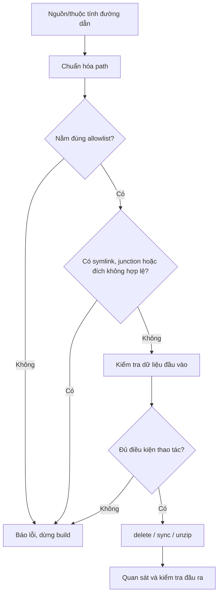
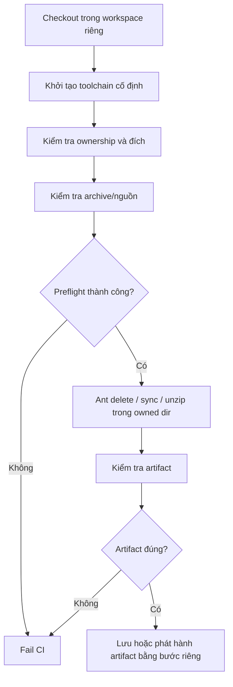

# Giới hạn đường dẫn đích của delete, sync và giải nén trong Apache Ant

> **Chủ đề:** Build Tool Ant  
> **Phần:** An toàn build  
> **Mục tiêu:** Chỉ cho phép các thao tác có khả năng xóa, ghi đè hoặc bung file hoạt động trong **thư mục đầu ra thuộc quyền quản lý của build**, đồng thời nhận diện các trường hợp vượt ranh giới đường dẫn qua `..`, đường dẫn tuyệt đối, symbolic link, Windows junction và tên file bên trong archive.

## 1. Vấn đề: một đường dẫn sai có thể phá hủy dữ liệu ngoài build

Apache Ant thường thao tác trực tiếp với hệ thống tệp. Một lệnh Ant có thể xóa hàng nghìn file, đồng bộ cây thư mục hoặc bung archive ngay sau khi đọc các thuộc tính trong `build.xml`. Nếu thuộc tính đích bị cấu hình sai, thao tác có thể lan ra thư mục source, workspace cha hoặc một đường dẫn khác trên ổ đĩa.

Ba thao tác đặc biệt cần kiểm soát:

- **`<delete>`:** xóa file, cây thư mục hoặc tập file; `<delete dir="..."/>` là dạng xóa đệ quy có tác động rộng.
- **`<sync>`:** sao chép tài nguyên nguồn vào `todir` **và xóa các file đích không khớp tập nguồn**. Nó không chỉ tương đương `copy`.
- **`<unzip>`**, **`<unjar>`**, **`<unwar>`**, **`<untar>`:** giải nén archive vào `dest`. Không chỉ đường dẫn `dest` mà **đường dẫn của từng entry trong archive** cũng cần được xem xét.

Một số tình huống dễ xảy ra:

```xml
<!-- Rủi ro: property sai hoặc truyền -Dbuild.dir=.. -->
<delete dir="${build.dir}"/>

<!-- Rủi ro: todir trỏ nhầm vào source, sync xóa file "thừa". -->
<sync todir="${site.dir}">
    <fileset dir="generated-site"/>
</sync>

<!-- Rủi ro: archive không đáng tin, hoặc dest trỏ sai. -->
<unzip src="downloaded.zip" dest="${extract.dir}"/>
```

Nếu `site.dir` vô tình là `src/main/resources`, `sync` có thể xóa những tài nguyên đang được quản lý trong Git nhưng không có ở `generated-site`. Nếu `build.dir` bị đặt thành `.` hoặc `..`, `delete` có thể xóa cả source hoặc thư mục cha.

**Nguyên tắc cốt lõi:** xác định một vùng đầu ra được phép ghi/xóa, tính đường dẫn đích rõ ràng, kiểm tra đường dẫn trước mỗi thao tác nguy hiểm và từ chối mọi đường dẫn nằm ngoài vùng đó. Với dữ liệu không đáng tin cậy hoặc thao tác hủy dữ liệu, kiểm tra phải được thực hiện ở cả **cấp ứng dụng** và **cấp quyền hệ điều hành**.

## 2. Phân loại dữ liệu và ranh giới sở hữu

Một cấu trúc repository có thể tổ chức như sau:

```text
ant-safe-io/
├── build.xml
├── src/                         # nguồn: không xóa, không sync đè
├── site-source/                 # nguồn trang tĩnh
├── archives/
│   └── site-assets.zip          # archive đầu vào đã kiểm soát
├── tools/
│   ├── CheckDestination.java    # kiểm tra đích trước khi thao tác
│   └── CheckArchive.java        # kiểm tra tên/giới hạn entry ZIP
└── build/
    └── ant-owned/               # chỉ chứa dữ liệu do build quản lý
        ├── scratch/             # vùng được xóa nội dung
        ├── site/                # vùng được sync
        └── unpacked/            # vùng được giải nén
```

Phân loại theo mức độ cho phép:

| Thư mục hoặc tài nguyên | Ai sở hữu? | Có cho phép delete/sync/unzip ghi vào? |
|---|---|---|
| `src/`, `site-source/` | Người phát triển/Git | Không |
| `build.xml`, `tools/` | Người phát triển/Git | Không |
| `archives/` | Nguồn đầu vào; có thể lưu trong Git hoặc tải có kiểm chứng | Không ghi đè bằng thao tác đầu ra |
| `build/ant-owned/scratch/` | Quá trình build | Chỉ `delete` đối với nội dung vùng này |
| `build/ant-owned/site/` | Quá trình build | Chỉ `sync` dùng đích vùng này |
| `build/ant-owned/unpacked/` | Quá trình build | Chỉ thao tác giải nén đã kiểm soát |
| Thư mục cha repository, `HOME`, thư mục tạm dùng chung | Bên ngoài quyền sở hữu của build | Không |

Cách chia nhỏ vùng đích giúp mỗi thao tác có một **đường dẫn được phép duy nhất**. Việc chỉ đặt chung một giá trị `build.dir` cho tất cả thao tác sẽ khó phát hiện hơn khi một target vô tình xóa cả artifact của target khác.

### 2.1. Các giới hạn cần kết hợp

Có thể hình dung bảo vệ theo nhiều lớp:



Không một bước riêng lẻ nào thay thế tất cả các bước khác:

- Một `fileset` có `includes` chỉ giới hạn **file được chọn**, không tự xác nhận `dir` hoặc `todir` thuộc thư mục nào.
- Một property như `output.dir=build/output` không tự ngăn người gọi truyền `-Doutput.dir=..`.
- Một `<fail>` kiểm tra chuỗi thô không thể phát hiện đầy đủ đường dẫn đã chuẩn hóa hay symbolic link.
- Ngay cả khi đường dẫn đích hợp lệ, archive chứa entry `../outside.txt` hoặc symlink trong vùng đích vẫn là mối nguy riêng.

## 3. Hiểu chính xác hành vi của ba Ant task

### 3.1. `delete`: khác biệt giữa `dir` và `fileset`

Ant có hai kiểu thường gặp:

```xml
<!-- Xóa trọn cây thư mục, kể cả thư mục gốc -->
<delete dir="build/ant-owned/scratch"/>

<!-- Chọn file theo bộ lọc; không xóa nguyên cây theo cùng cách -->
<delete includeEmptyDirs="true">
    <fileset dir="build/ant-owned/scratch"
             includes="**/*"/>
</delete>
```

Theo tài liệu Ant, dạng `<delete dir="x"/>` mang tính đệ quy rộng; nó không áp dụng default excludes của fileset và có thể đi theo symbolic link. Vì vậy, **không dùng `delete dir` với một đường dẫn có thể chứa symlink hoặc được điều khiển bởi đầu vào chưa kiểm soát**.

Với `<fileset>`:

- `includes="**/*"` chọn nội dung tương đối từ gốc fileset.
- `followsymlinks="false"` ngăn việc đi theo symbolic link trong quá trình quét fileset.
- `defaultexcludes="false"` cho phép bao gồm các file mà default excludes thường bỏ qua; chỉ nên dùng trong vùng build thật sự được sở hữu.
- `includeEmptyDirs="true"` cho phép dọn cả thư mục con khi chúng rỗng.
- `removeNotFollowedSymlinks="true"` yêu cầu xóa bản thân liên kết không được đi theo trong trường hợp task hỗ trợ, thay vì đi vào đường dẫn trỏ tới.
- `failonerror="true"` giúp build dừng nếu không xóa được dữ liệu bắt buộc.

Cần phân biệt **xóa file link** và **xóa nội dung mà link trỏ tới**. Trường hợp thứ hai có thể đụng tới dữ liệu ngoài vùng build. Đối với Windows junction, khả năng nhận diện phụ thuộc phiên bản Ant và môi trường Java/Windows; không thể coi mọi loại junction đều giống symbolic link Unix.

### 3.2. `sync`: đích được xem là ảnh phản chiếu của nguồn

```xml
<sync todir="build/ant-owned/site">
    <fileset dir="site-source"/>
</sync>
```

Giả sử thư mục nguồn có:

```text
site-source/
├── index.html
└── app.css
```

Trong khi đích đang có:

```text
build/ant-owned/site/
├── index.html
├── old.css
└── private-note.txt
```

Sau `sync`, các file như `old.css` và `private-note.txt` **có thể bị xóa** vì không nằm trong tập nguồn. Đây là hành vi chủ đích của `sync`, nên `todir` phải là một vùng có thể thay thế toàn bộ nội dung.

Đặc biệt, nếu `fileset` nguồn loại trừ một tệp thì `sync` không mặc nhiên bảo toàn tệp tương ứng ở đích. Muốn giữ một nhóm file đích, Ant có phần tử `<preserveintarget>`:

```xml
<sync todir="build/ant-owned/site">
    <fileset dir="site-source"/>
    <preserveintarget>
        <include name="cache/**"/>
    </preserveintarget>
</sync>
```

`preserveintarget` chỉ là quy tắc giữ file **bên trong chính cây đích**. Nó không bảo vệ khi toàn bộ `todir` trỏ sai nơi. Không nên dùng quy tắc giữ file để biến một thư mục source hoặc thư mục người dùng thành đích sync.

### 3.3. `unzip`: kiểm tra cả `dest` và đường dẫn từng entry

Với archive ZIP, một entry có thể mang tên như sau:

```text
assets/logo.svg
assets/site.css
../outside.txt
../../config/secret.txt
/absolute/path.txt
C:\outside.txt
```

Các tên như `../outside.txt` cố vượt ra thư mục giải nén; đây là lớp lỗi thường được gọi là **Zip Slip** hay path traversal qua archive. Đường dẫn tuyệt đối, ký tự `\`, tiền tố ổ Windows, UNC path và mapper đổi tên entry đều cần cân nhắc.

Các phiên bản Ant gần đây có thuộc tính kiểm soát:

```xml
<unzip src="archives/site-assets.zip"
       dest="build/ant-owned/unpacked"
       stripAbsolutePathSpec="true"
       allowFilesToEscapeDest="false"/>
```

- `allowFilesToEscapeDest="false"`: yêu cầu không cho phép entry thoát khỏi đích. Thuộc tính được hỗ trợ từ **Ant 1.10.4**.
- `stripAbsolutePathSpec="true"`: bỏ tiền tố slash/backslash đầu tên entry theo quy tắc Ant. Từ Ant 1.10.4, mặc định của nó là `true`.
- `overwrite="true"` là mặc định của `unzip`, nên file sẵn có ở đích có thể bị ghi đè.

**Phân biệt hai chính sách:** `stripAbsolutePathSpec="true"` có thể biến một tên bắt đầu bằng slash thành đường dẫn tương đối sau khi tước tiền tố. Nếu yêu cầu là **từ chối archive có tên không hợp lệ**, không chỉ ngăn file đi ra ngoài đích, cần quét và từ chối entry bất hợp lệ **trước** khi gọi `unzip`.

Thành phần Ant này cũng không tự bảo đảm giới hạn tổng dung lượng bung nén, số lượng entry, chi phí CPU hoặc kiểm soát mọi race condition với symbolic link đã tồn tại ở đích. Archive không đáng tin cậy cần một chính sách kiểm tra bổ sung và một môi trường chạy có quyền hạn giới hạn.

## 4. Các lỗi đường dẫn cần nhận diện

### 4.1. `..`, `.` và đường dẫn tuyệt đối

Các chuỗi có thể chỉ cùng một vị trí hoặc nằm ngoài thư mục mong muốn:

```text
build/ant-owned/site
build/ant-owned/../site
build/ant-owned/site/../../../../src
.
..
/home/ci/workspace
C:\Users\Public
\\server\share
```

Không dùng phép kiểm tra chuỗi:

```java
// Sai: "/workspace/project-backup" cũng bắt đầu bằng "/workspace/project".
if (candidate.toString().startsWith("/workspace/project")) {
    // ...
}
```

Thay vào đó dùng kiểu `Path` và `normalize()`, rồi `Path.startsWith(...)` để so sánh theo các **thành phần đường dẫn**:

```java
Path root = Path.of("/workspace/project/build/ant-owned")
                .toAbsolutePath().normalize();
Path dest = Path.of("/workspace/project/build/ant-owned/site")
                .toAbsolutePath().normalize();

if (!dest.startsWith(root) || dest.equals(root)) {
    throw new IllegalArgumentException("Destination is not an owned child");
}
```

Quy tắc trên xử lý trường hợp lexical path như `..`, nhưng **chưa đủ** để chống symbolic link. Nếu `site` là symlink trỏ tới `/etc`, đường dẫn chuỗi có vẻ nằm trong `root` nhưng thao tác thực tế có thể truy cập dữ liệu khác.

Ngoài ra, nếu mục tiêu của một thao tác phải là **một thư mục cố định**, so sánh `equals(expectedDestination)` nghiêm ngặt hơn kiểm tra chung `startsWith(root)`. Bài này dùng allowlist đích cụ thể cho từng thao tác.

### 4.2. Symbolic link và Windows junction

Giả sử:

```text
project/
└── build/
    └── ant-owned/
        └── site -> /home/user/documents
```

Nếu thao tác ghi vào `build/ant-owned/site` mà đi theo link, dữ liệu thực tế sẽ ghi ngoài vùng build. Cũng nguy hiểm nếu một **thư mục con** trong `site` được đặt thành link trỏ ra ngoài rồi `sync` hoặc `unzip` ghi vào nó.

Các thao tác cần lưu ý:

1. Kiểm tra **mọi thành phần đã tồn tại** từ project root đến đích để phát hiện symlink/junction.
2. Kiểm tra **các phần tử hiện có bên trong cây đích** trước khi thực hiện thao tác.
3. Không theo symlink khi quét resource collection nếu không thật sự cần, ví dụ `followsymlinks="false"`.
4. Dùng thư mục đầu ra mới, nằm trong workspace riêng, khi chạy trên CI với source/archive từ bên ngoài.
5. Không cho tác vụ build quyền truy cập ghi đến dữ liệu nhạy cảm nằm ngoài vùng output.

Việc kiểm tra trước rồi mới thao tác tạo ra cửa sổ thời gian **TOCTOU**: một tiến trình khác có thể thay đường dẫn giữa lúc kiểm tra và lúc Ant ghi/xóa. Không có một đoạn XML preflight đơn giản nào loại bỏ hoàn toàn cuộc đua này. Với input có khả năng đối kháng, cần cô lập bằng tài khoản hệ điều hành, container, mount, filesystem permissions hoặc cơ chế thao tác file dùng descriptor an toàn.

### 4.3. Property có thể bị ghi đè từ dòng lệnh

Ant thường cho phép command-line user property ưu tiên hơn property được khai báo trong `build.xml`:

```bash
ant -Doutput.dir=.. dangerous-target
```

Vì vậy:

```xml
<property name="output.dir" location="build/ant-owned"/>
```

không phải bằng chứng rằng `output.dir` luôn có giá trị an toàn. Một người dùng có thể truyền `-Doutput.dir=...`; script bên ngoài cũng có thể nạp property từ file không đáng tin.

Nếu project cần nhận đường dẫn tùy biến, mỗi đường dẫn phải được kiểm tra theo chính sách cho phép. Nếu không có nhu cầu tùy biến, nên dùng các thư mục cố định và từ chối giá trị sau khi chuẩn hóa không khớp với đường dẫn được phép.

## 5. Chính sách: allowlist ba đường dẫn riêng biệt

Ta quy ước:

| Tên thao tác | Đường dẫn tương đối duy nhất được phép |
|---|---|
| `clean` | `build/ant-owned/scratch` |
| `sync` | `build/ant-owned/site` |
| `unpack` | `build/ant-owned/unpacked` |

Mục đích:

- `clean` có thể xóa **nội dung** `scratch`.
- `sync` chỉ được biến `site` thành bản sao của `site-source`.
- `unpack` chỉ được bung archive vào `unpacked`.
- Không thao tác nào được nhận `build/ant-owned`, `build` hoặc repository root làm đích.
- Bất kỳ lần truyền tham số nào thay đích khỏi allowlist đều khiến build thất bại.
- Nếu phát hiện đường dẫn đích hoặc phần tử bên trong là symlink hướng tới nơi khác, build dừng trước khi ghi/xóa.

Có thể khai báo property trong Ant để tránh viết lặp:

```xml
<property name="owned.root" location="build/ant-owned"/>
<property name="scratch.dir" location="${owned.root}/scratch"/>
<property name="site.dest" location="${owned.root}/site"/>
<property name="unpack.dest" location="${owned.root}/unpacked"/>
```

Tuy nhiên, các property trên chỉ làm **cấu hình dễ đọc**. Ràng buộc an toàn thật sự được thực hiện bằng bộ kiểm tra độc lập biết chính xác ba đường dẫn cho phép.

## 6. Viết bộ kiểm tra đích bằng Java

Vì Ant core không cung cấp một thuộc tính chung “đích phải nằm trong root cho phép” cho mọi task, có thể dùng helper Java nhỏ để kiểm tra trước các thao tác có tác dụng phụ.

Ví dụ dùng **JDK 17+** và Java source-file launcher: lệnh `java tools/CheckDestination.java ...` chạy source trực tiếp mà không phải biên dịch một class ra `build/` trước khi kiểm tra an toàn.

Tạo `tools/CheckDestination.java`:

```java
import java.io.IOException;
import java.nio.file.FileVisitResult;
import java.nio.file.Files;
import java.nio.file.LinkOption;
import java.nio.file.Path;
import java.nio.file.SimpleFileVisitor;
import java.nio.file.attribute.BasicFileAttributes;
import java.util.Map;

public final class CheckDestination {

    private static final Map<String, String> ALLOWED = Map.of(
        "clean", "build/ant-owned/scratch",
        "sync", "build/ant-owned/site",
        "unpack", "build/ant-owned/unpacked"
    );

    private CheckDestination() {
    }

    public static void main(String[] args) throws Exception {
        if (args.length != 3) {
            throw new IllegalArgumentException(
                "Usage: CheckDestination <project-root> <operation> <dest>"
            );
        }

        String relative = ALLOWED.get(args[1]);
        if (relative == null) {
            throw new IllegalArgumentException(
                "Unknown operation: " + args[1]
            );
        }

        Path project = Path.of(args[0]).toAbsolutePath().normalize();
        Path projectReal = project.toRealPath();

        Path expected = project.resolve(relative).normalize();
        Path actual = Path.of(args[2]).toAbsolutePath().normalize();

        // Không chấp nhận đổi đích chỉ vì nó vẫn nằm trong build/.
        if (!actual.equals(expected)) {
            throw new IOException(
                "Rejected " + args[1] + " destination: " + actual
                + "; expected: " + expected
            );
        }

        // Kiểm tra theo thành phần Path, không kiểm bằng prefix chuỗi.
        if (!actual.startsWith(project) || actual.equals(project)) {
            throw new IOException("Destination outside project");
        }

        // Không chấp nhận symlink hoặc đường dẫn lệch khỏi root
        // tại các thành phần đã tồn tại trên đĩa.
        Path current = project;
        for (Path segment : project.relativize(expected)) {
            current = current.resolve(segment);
            if (Files.isSymbolicLink(current)) {
                throw new IOException("Symbolic link in path: " + current);
            }
            if (Files.exists(current, LinkOption.NOFOLLOW_LINKS)) {
                if (!Files.isDirectory(
                        current, LinkOption.NOFOLLOW_LINKS)) {
                    throw new IOException(
                        "Existing path is not a directory: " + current
                    );
                }
                if (!current.toRealPath().startsWith(projectReal)) {
                    throw new IOException(
                        "Physical path escaped project: " + current
                    );
                }
            }
        }

        // Kiểm tra nội dung đã tồn tại trong vùng đích.
        // Không dùng FOLLOW_LINKS; từ chối mọi link phát hiện được.
        if (Files.isDirectory(expected, LinkOption.NOFOLLOW_LINKS)) {
            Files.walkFileTree(expected, new SimpleFileVisitor<>() {
                @Override
                public FileVisitResult preVisitDirectory(
                        Path dir, BasicFileAttributes attrs)
                        throws IOException {
                    checkItem(dir, projectReal);
                    return FileVisitResult.CONTINUE;
                }

                @Override
                public FileVisitResult visitFile(
                        Path file, BasicFileAttributes attrs)
                        throws IOException {
                    checkItem(file, projectReal);
                    return FileVisitResult.CONTINUE;
                }
            });
        }

        System.out.println(
            "SAFE DESTINATION: " + args[1] + " => " + actual
        );
    }

    private static void checkItem(Path item, Path projectReal)
            throws IOException {
        if (Files.isSymbolicLink(item)) {
            throw new IOException("Link inside destination: " + item);
        }
        if (!item.toRealPath().startsWith(projectReal)) {
            throw new IOException("Path escaped project: " + item);
        }
    }
}
```

### 6.1. Bộ kiểm tra này bảo đảm điều gì?

1. Nhận đúng ba đối số: project root, tên thao tác, đường dẫn đích.
2. Mỗi thao tác có một đích cố định trong bảng `ALLOWED`.
3. So sánh đường dẫn sau `toAbsolutePath().normalize()`.
4. Dùng `toRealPath()` trên đường dẫn hiện hữu để phát hiện việc trỏ ra nơi khác.
5. Từ chối symlink tại thành phần dẫn đến đích và bên trong cây đích hiện hữu.
6. Khi lỗi, Java launcher trả exit code khác `0` để Ant có thể dừng.

Ví dụ chạy trực tiếp trên máy phát triển, từ repository root:

```bash
java tools/CheckDestination.java . sync build/ant-owned/site
```

Một đầu vào bị cấm:

```bash
java tools/CheckDestination.java . sync src/main/resources
```

Lệnh sau phải bị từ chối vì đường dẫn không phải `build/ant-owned/site`.

### 6.2. Giới hạn cần hiểu

Đây là **preflight guard cho một workspace do người chạy kiểm soát**, không phải sandbox hoặc giải pháp chống tác nhân có khả năng sửa filesystem đồng thời. Trên Windows, junction/reparse point có những khác biệt với symbolic link và cần kiểm chứng theo đúng runtime đang dùng. Nếu quyền truy cập và dữ liệu build thực sự đối kháng, bổ sung sandbox ở cấp OS và tách tài khoản chạy.

Quan trọng hơn: guard không thể bảo vệ nếu chính `build.xml` hoặc mã helper bị nguồn không đáng tin sửa đổi rồi CI chạy với quyền cao. CI phải coi build script từ pull request là mã có khả năng thực thi, sử dụng token tối thiểu và không cho quyền xóa/gửi dữ liệu ngoài workspace.

## 7. Kiểm tra archive trước khi giải nén

Ngay cả khi `unpack.dest` hợp lệ, vẫn cần kiểm tra danh sách entry bên trong ZIP. Đối với nguồn ZIP không hoàn toàn tin cậy, một chính sách đơn giản có thể **từ chối**:

- Tên rỗng, đường dẫn tuyệt đối, tiền tố ổ đĩa Windows, dấu `\` và ký tự `:` trong tên.
- Các thành phần path `.` và `..`.
- Entry trùng tên sau khi chuẩn hóa (kể cả khác biệt chữ hoa/chữ thường trong môi trường cần hỗ trợ Windows).
- Archive có quá nhiều entry hoặc tổng kích thước giải nén khai báo quá lớn.
- Tên file có ký tự điều khiển hoặc không tuân thủ convention tên của dự án.

Tạo `tools/CheckArchive.java`:

```java
import java.io.IOException;
import java.nio.file.Files;
import java.nio.file.Path;
import java.util.Enumeration;
import java.util.HashSet;
import java.util.Locale;
import java.util.Set;
import java.util.zip.ZipEntry;
import java.util.zip.ZipFile;

public final class CheckArchive {
    private static final int MAX_ENTRIES = 5_000;
    private static final long MAX_ARCHIVE_BYTES = 64L * 1024 * 1024;
    private static final long MAX_ENTRY_BYTES = 64L * 1024 * 1024;
    private static final long MAX_TOTAL_BYTES = 256L * 1024 * 1024;

    private CheckArchive() {
    }

    public static void main(String[] args) throws Exception {
        if (args.length != 1) {
            throw new IllegalArgumentException(
                "Usage: CheckArchive <zip-path>"
            );
        }

        Path zipPath = Path.of(args[0]).toAbsolutePath().normalize();
        if (!Files.isRegularFile(zipPath)) {
            throw new IOException("Archive missing: " + zipPath);
        }
        if (Files.size(zipPath) > MAX_ARCHIVE_BYTES) {
            throw new IOException("Archive is too large");
        }

        long total = 0;
        int count = 0;
        Set<String> names = new HashSet<>();

        try (ZipFile archive = new ZipFile(zipPath.toFile())) {
            Enumeration<? extends ZipEntry> entries = archive.entries();

            while (entries.hasMoreElements()) {
                ZipEntry entry = entries.nextElement();
                count++;
                if (count > MAX_ENTRIES) {
                    throw new IOException("Too many ZIP entries");
                }

                String name = entry.getName();
                if (name.isEmpty()
                        || name.startsWith("/")
                        || name.indexOf('\\') >= 0
                        || name.indexOf(':') >= 0
                        || name.chars().anyMatch(c -> c < 32)) {
                    throw new IOException("Rejected ZIP name: " + name);
                }

                for (String component : name.split("/")) {
                    if (".".equals(component) || "..".equals(component)) {
                        throw new IOException(
                            "Traversal component: " + name
                        );
                    }
                }

                Path normalized = Path.of(name).normalize();
                if (normalized.isAbsolute() || normalized.startsWith("..")) {
                    throw new IOException("Unsafe ZIP path: " + name);
                }

                // Quy tắc trùng tên bảo thủ nhằm tương thích Windows.
                String key = normalized.toString().toLowerCase(Locale.ROOT);
                if (!names.add(key)) {
                    throw new IOException("Duplicate ZIP entry: " + name);
                }

                if (!entry.isDirectory()) {
                    long size = entry.getSize();
                    if (size < 0 || size > MAX_ENTRY_BYTES
                            || size > MAX_TOTAL_BYTES - total) {
                        throw new IOException(
                            "Entry size outside limit: " + name
                        );
                    }
                    total += size;
                }
            }
        }

        System.out.println(
            "ARCHIVE ACCEPTED: " + count
            + " entries, declared size=" + total
        );
    }
}
```

**Lưu ý về phạm vi:** mã minh họa quét **metadata ZIP** để áp một số giới hạn ban đầu. Nó không xác nhận chữ ký hoặc tính toàn vẹn của file tải về, không bảo đảm dữ liệu được giải nén sẽ tiêu thụ đúng lượng tài nguyên đã khai báo và chưa xác thực mọi đặc tính phức tạp như symlink ZIP, Unicode normalization hoặc các định dạng archive khác. Với file từ bên ngoài, dùng thêm kiểm tra nguồn/checksum, giới hạn tài nguyên của sandbox và xác minh nội dung theo ứng dụng.

Nếu archive lấy từ mạng, nên chỉ chấp nhận từ nguồn rõ ràng, kiểm tra digest SHA-256 hoặc chữ ký theo quy trình phát hành và không tự động tin tên file chỉ vì nó kết thúc bằng `.zip`.

## 8. Buildfile có guard cho từng thao tác

Tạo `build.xml` tại thư mục gốc dự án:

```xml
<?xml version="1.0" encoding="UTF-8"?>
<project name="ant-safe-io"
         default="safe-workflow"
         basedir=".">

    <!-- Ba vùng đầu ra độc lập. -->
    <property name="owned.root" location="build/ant-owned"/>
    <property name="scratch.dir" location="${owned.root}/scratch"/>
    <property name="site.dest" location="${owned.root}/site"/>
    <property name="unpack.dest" location="${owned.root}/unpacked"/>

    <!-- Guard chạy trước delete. -->
    <target name="guard-clean">
        <exec executable="java" failonerror="true">
            <arg value="${basedir}/tools/CheckDestination.java"/>
            <arg value="${basedir}"/>
            <arg value="clean"/>
            <arg value="${scratch.dir}"/>
        </exec>
    </target>

    <!-- Dọn nội dung scratch, giữ lại thư mục root. -->
    <target name="clean-scratch" depends="guard-clean">
        <delete includeEmptyDirs="true"
                removeNotFollowedSymlinks="true"
                failonerror="true"
                verbose="true">
            <fileset dir="${scratch.dir}"
                     includes="**/*"
                     followsymlinks="false"
                     defaultexcludes="false"
                     erroronmissingdir="false"/>
        </delete>
    </target>

    <!-- Guard chạy trước sync. -->
    <target name="guard-sync">
        <exec executable="java" failonerror="true">
            <arg value="${basedir}/tools/CheckDestination.java"/>
            <arg value="${basedir}"/>
            <arg value="sync"/>
            <arg value="${site.dest}"/>
        </exec>
    </target>

    <!-- Sync chỉ vào vùng site do build sở hữu. -->
    <target name="sync-site" depends="guard-sync">
        <sync todir="${site.dest}"
              verbose="true"
              failonerror="true">
            <fileset dir="site-source"
                     followsymlinks="false"
                     erroronmissingdir="true"/>
        </sync>
    </target>

    <!-- Guard chạy trước giải nén. -->
    <target name="guard-unpack">
        <exec executable="java" failonerror="true">
            <arg value="${basedir}/tools/CheckDestination.java"/>
            <arg value="${basedir}"/>
            <arg value="unpack"/>
            <arg value="${unpack.dest}"/>
        </exec>
    </target>

    <!-- Quét tên và kích thước khai báo của từng ZIP entry. -->
    <target name="check-archive">
        <exec executable="java" failonerror="true">
            <arg value="${basedir}/tools/CheckArchive.java"/>
            <arg value="${basedir}/archives/site-assets.zip"/>
        </exec>
    </target>

    <!-- Chỉ giải nén sau khi hai guard đã thành công. -->
    <target name="unpack-assets"
            depends="guard-unpack,check-archive">
        <unzip src="archives/site-assets.zip"
               dest="${unpack.dest}"
               overwrite="true"
               stripAbsolutePathSpec="true"
               allowFilesToEscapeDest="false"/>
    </target>

    <!-- Điểm vào minh họa, không đụng source tree. -->
    <target name="safe-workflow"
            depends="clean-scratch,sync-site,unpack-assets">
        <echo message="Safe output operations completed."/>
    </target>

</project>
```

Bố trí này cho thấy mỗi hành động có một target guard riêng trong `depends`. Nếu người gọi cố sửa property:

```bash
ant -Dsite.dest=src/main/resources sync-site
```

`guard-sync` sẽ so sánh đích nhận được với đường dẫn allowlist `build/ant-owned/site` và trả lỗi trước khi `<sync>` thực hiện xóa/sao chép.

**Lưu ý:** buildfile là ví dụ cho các lệnh I/O; muốn chạy đầy đủ cần tạo file source Java và các thư mục/ZIP đầu vào như cấu trúc mô tả. Nếu `site-source` không tồn tại, cấu hình `erroronmissingdir="true"` khiến target sync thất bại, tránh trường hợp đồng bộ với một tập nguồn rỗng rồi xóa sạch đích ngoài ý muốn.

### 8.1. Tại sao guard phải đi cùng đúng target?

Cấu hình này là hợp lý:

```xml
<target name="sync-site" depends="guard-sync">
    <sync todir="${site.dest}">
        <fileset dir="site-source"/>
    </sync>
</target>
```

Cấu hình sau không đủ:

```xml
<target name="safe-check" depends="guard-sync"/>
<target name="sync-site">
    <sync todir="${site.dest}">
        <fileset dir="site-source"/>
    </sync>
</target>
```

Vì người dùng có thể gọi thẳng `ant sync-site`, và lúc đó `safe-check` không nằm trong đường phụ thuộc. Một quy tắc an toàn phải đặt **ngay trên tuyến thực thi của thao tác**, không chỉ ở target tổng.

Điều tương tự áp dụng cho `clean-scratch` và `unpack-assets`.

### 8.2. Vì sao không có một target `clean` xóa toàn bộ build?

Phần `build/ant-owned` chứa các loại đầu ra khác nhau. Xóa gốc chung làm giảm khả năng kiểm soát và có thể vô tình xóa report, cache hoặc artifact đang được bước khác sử dụng. Target `clean-scratch` chỉ xóa nội dung `scratch`; nếu cần clean `site` hoặc `unpacked`, nên định nghĩa **một chính sách, guard và target riêng**.

Với hệ thống cho phép `clean-all`, hãy làm nó thành tác vụ rõ ràng ở môi trường đáng tin, có danh sách đích cố định, chứ không nối một property người dùng nhập vào `delete dir`.

### 8.3. Khi nào dùng `delete dir`?

Dạng `<delete dir="..."/>` vẫn có thể chấp nhận cho một thư mục do build tạo hoàn toàn và được cô lập, nếu **đường dẫn đã xác thực**, bên trong không có symlink/junction, không có tiến trình không đáng tin cùng sửa filesystem và không cần giữ thư mục gốc.

Tuy nhiên, với đường dẫn có nguồn gốc từ cấu hình ngoài, `fileset followsymlinks="false"` và cơ chế kiểm tra link thường cho phạm vi rõ ràng hơn. Việc chọn `fileset` không có nghĩa mọi rủi ro đã biến mất: guard vẫn cần xác nhận chính `fileset dir` và các đường dẫn vật lý.

## 9. Các kịch bản cần chặn và kết quả mong muốn

Bảng sau có thể dùng làm bộ tình huống kiểm chứng khi xây dựng pipeline thật. Không chạy các ca nguy hiểm trên thư mục dữ liệu người dùng; hãy tạo một repository **fixture tạm**.

| Kịch bản | Ví dụ cấu hình/đầu vào | Kết quả mong muốn |
|---|---|---|
| Đích clean hợp lệ | `build/ant-owned/scratch` | Chỉ xử lý nội dung scratch |
| Clean nhầm repository root | `-Dscratch.dir=.` | Guard từ chối, không xóa |
| Clean nhầm thư mục cha | `-Dscratch.dir=..` | Guard từ chối |
| Đích có tiền tố giống tên | `build/ant-owned/site-backup` | Guard từ chối vì khác allowlist |
| Sync vào source | `-Dsite.dest=src/main/resources` | Guard từ chối |
| Sync với source thiếu | Xóa/đổi tên `site-source` trong fixture | Build thất bại trước khi sync phá đích |
| Đích là symlink ra ngoài | `site` trỏ đến nơi khác | Guard từ chối |
| Bên trong đích có symlink | `site/assets` trỏ ra ngoài | Guard từ chối |
| Archive chứa `../outside.txt` | Entry trong ZIP | Archive scanner từ chối |
| Archive có tên absolute | Entry `/outside.txt` | Archive scanner từ chối |
| Archive nhiều entry | Vượt `MAX_ENTRIES` | Archive scanner từ chối |
| ZIP quá lớn | Vượt giới hạn file hoặc tổng dung lượng khai báo | Archive scanner từ chối |
| Archive bình thường | Entry `assets/logo.svg`, `index.html` | Có thể giải nén vào vùng unpacked |
| Guard bị bỏ qua | Gọi thẳng target tác động mà không có `depends` | Cần sửa dependency; không được coi là thiết kế an toàn |

Một quy trình kiểm thử fixture có thể thực hiện theo thứ tự:

1. Tạo cấu trúc tạm có `site-source`, `archives/site-assets.zip` và ba vùng đích.
2. Lưu một file “sentinel” ở **ngoài** `build/ant-owned`.
3. Chạy lệnh hợp lệ và xác nhận sentinel không đổi.
4. Dùng `-D...` trỏ từng đích ra ngoài allowlist; các lệnh phải thất bại **trước khi ghi/xóa**.
5. Tạo symlink trong vùng đích của fixture; guard phải phát hiện và từ chối.
6. Thử các ZIP đầu vào có tên traversal hoặc kích thước vượt giới hạn; preflight archive phải dừng.
7. Chạy lại với đầu vào hợp lệ và kiểm tra các artifact sinh ra đúng đích.

Khi test với thao tác xóa, sentinel chỉ đặt trong thư mục fixture cách ly và không bao giờ là file quan trọng. Mục tiêu là chứng minh ranh giới được bảo toàn mà không tạo nguy cơ thật.

## 10. Vấn đề tinh vi: kiểm tra chuỗi, normalize và đường dẫn vật lý

Có ba cấp kiểm soát khác nhau:

| Phương pháp | Kiểm được | Không tự kiểm được |
|---|---|---|
| `String.startsWith(...)` | Tiền tố ký tự | Ranh giới thư mục, `..`, symlink |
| `Path.toAbsolutePath().normalize()` + `Path.startsWith()` | Ranh giới lexical theo thành phần, `.` và `..` | Symlink, junction, path thay đổi sau kiểm tra |
| `Path.toRealPath()` trên path hiện hữu | Đường dẫn vật lý đã tồn tại, nhiều dạng link | Đích chưa tồn tại, race condition, quyền hệ điều hành |

Do đó, đường dẫn mới chưa tồn tại cần kiểm tra **từng ancestor đã tồn tại**. Chỉ gọi `toRealPath()` với toàn bộ `dest` trước khi tạo thư mục sẽ gây lỗi vì `dest` chưa có; bỏ qua lỗi đó rồi cho phép mọi thứ cũng không an toàn.

Cần chú ý thêm:

- **Phân biệt chữ hoa/thường:** Linux thường phân biệt; Windows thường không. Nếu policy cần hỗ trợ cả hai, kiểm soát các trường hợp tên trùng ở lớp archive/đầu vào.
- **UNC/network share:** Một path có thể nằm trên share hoặc mount khác dù nhìn giống đường dẫn hợp lệ; kiểm tra thực tế và giới hạn quyền.
- **Mount/bind mount:** Không phải loại chuyển hướng nào cũng xuất hiện dưới dạng `Files.isSymbolicLink`. Mount độc hại hoặc cấu hình filesystem ngoài quyền kiểm soát của build cần biện pháp OS.
- **Hard link:** Có thể tồn tại nhiều tên trỏ đến cùng inode; kiểm soát link và quyền vẫn cần thiết nếu thao tác ghi đè.
- **Absolute path do mapper tạo:** Mapper có thể đổi tên entry ZIP sang vị trí khác. Không dùng mapper không đáng tin; nếu có mapper tùy biến, xác nhận đường dẫn sau ánh xạ.
- **Tên file hợp lệ trên hệ điều hành khác nhau:** Những tên hợp lệ trên Linux có thể gây lỗi hoặc nhập nhằng trên Windows. Quy ước portable filename giúp giảm rủi ro khi build xuyên nền tảng.

Không nên khẳng định rằng “đã chuẩn hóa path” nghĩa là một thao tác I/O tuyệt đối an toàn. Kiểm tra lexical là lớp đầu tiên, không phải toàn bộ chính sách.

## 11. Nếu phải nhận đường dẫn đích tùy biến từ người dùng

Một số build phải nhận thư mục đích từ CI hoặc command-line, ví dụ nơi xuất artifacts. Có ba chính sách:

### Chính sách A: đích cố định — nên dùng cho thao tác xóa/đồng bộ

```text
clean  -> build/ant-owned/scratch
sync   -> build/ant-owned/site
unpack -> build/ant-owned/unpacked
```

Không có tham số đích tùy biến. Dù property Ant bị ghi đè, guard vẫn đối chiếu với đường dẫn cố định.

### Chính sách B: đích con nằm trong root được phép

Ví dụ cho phép nhiều tên build ID trong `build/ant-owned/jobs/<id>`. Cần xác minh:

- `id` thuộc tập ký tự cho phép (ví dụ ASCII chữ/số/gạch ngang/gạch dưới).
- `id` không rỗng, không có `.`, `..`, dấu phân cách hay absolute path.
- Sau `normalize()`, toàn bộ đích phải là **con trực tiếp** hoặc thuộc phạm vi đúng cấp của root.
- Không có symlink/junction hoặc ancestor chuyển hướng.
- Lệnh xóa không được nhận chính root.
- Build ID không trùng vùng output của job khác.

Chỉ dùng `dest.startsWith(root)` không đủ nếu người dùng có quyền chọn chính `root` hoặc thư mục nhạy cảm nằm trong root. Cần đối chiếu cấu trúc đường dẫn hợp lệ và cấp thư mục cụ thể.

### Chính sách C: đích tùy ý tuyệt đối — tránh cho thao tác hủy dữ liệu

Nếu yêu cầu cho phép ghi tới một đường dẫn bất kỳ, rất khó đảm bảo chương trình không xóa đè dữ liệu người dùng. Với trường hợp này, tách việc **xuất artifact** và **xóa/sync**: tạo artifact trong vùng build đã xác thực, rồi dùng một bước copy/publish riêng với ràng buộc và quyền hạn phù hợp.

Không nên có một tham số dùng chung như `-Doutput.root=/anything` rồi truyền tới cả `delete`, `sync` và `unzip`.

## 12. An toàn trong CI/CD

CI thường chạy các bản build trên máy có nhiều workspace, cache hoặc thư mục artifact. Một cấu hình tốt giới hạn ảnh hưởng khi buildfile có lỗi.

### 12.1. Dùng workspace riêng cho mỗi job

```text
ci-runner/
├── job-101/
│   └── repo/build/ant-owned/
├── job-102/
│   └── repo/build/ant-owned/
└── shared-cache/                # build job không có quyền xóa
```

Mỗi job có nguồn và vùng đầu ra riêng. Không để `sync` dùng chung một `todir` giữa hai job vì chúng có thể cùng xóa file mà job khác vừa tạo.

### 12.2. Chạy với quyền tối thiểu

- Dùng tài khoản không phải administrator/root khi có thể.
- Không mount thư mục cá nhân, khóa SSH, token hoặc dữ liệu Production vào job kiểm chứng không cần chúng.
- Hạn chế quyền ghi vào workspace riêng và đường dẫn artifact được phép.
- Chỉ cấp secret cho bước phát hành có điều kiện rõ ràng, không cấp cho job Ant đang xử lý source chưa tin cậy.
- Với archive không đáng tin, dùng container hoặc sandbox hạn chế mạng, dung lượng, CPU và bộ nhớ.

**Preflight không thay thế permission.** Khi một build process không có quyền xóa thư mục bên ngoài, tác động của một sai sót sẽ được giới hạn đáng kể ngay cả nếu guard gặp lỗi.

### 12.3. Quan sát trước khi thao tác

`verbose="true"` ở một số task giúp nhìn thấy file bị xử lý, nhưng **không phải dry-run**: thao tác vẫn thực hiện thay đổi. Ant core không cung cấp một “preview toàn bộ thay đổi, tuyệt đối không ghi” dùng chung cho `delete`, `sync`, `unzip`.

Muốn kiểm tra dự kiến ảnh hưởng trước khi đồng bộ hoặc xóa, có thể lập danh sách nguồn/đích trong script riêng, so sánh trên fixture và ghi log; sau đó mới chạy thao tác thật trên vùng đã kiểm soát. Đối với thay đổi quan trọng, xuất sang thư mục staging mới trước rồi publish/promote sau khi kiểm tra artifact.

### 12.4. Quy trình gợi ý



Với code chưa được review, build job cần coi `build.xml`, các script và Java helper trong repo đều là mã có quyền thực thi. Chỉ chặn đường dẫn bằng một đoạn Java trong cùng repo chưa đủ nếu tác nhân có thể tự sửa chính đoạn Java ấy.

## 13. Những cấu hình cần tránh và cách thay thế

| Cấu hình rủi ro | Vì sao nguy hiểm? | Cách tiếp cận an toàn hơn |
|---|---|---|
| `<delete dir="."/>` | Xóa repository root | Chỉ clean vùng build với allowlist |
| `<delete dir="${output.dir}"/>` khi property tự do | CLI có thể đổi đích | Preflight đối chiếu đích chính xác |
| `<sync todir="src/main/resources">` | Có thể xóa file source không nằm trong nguồn sync | Sync vào `build/ant-owned/site` |
| `<sync todir="${dest}">` không kiểm nguồn | Fileset rỗng có thể làm đích mất dữ liệu | `erroronmissingdir="true"` và kiểm đầu vào |
| `<unzip dest="${basedir}">` | Ghi đè file repository | Giải nén vào vùng staging riêng |
| Chỉ lọc entry bằng `patternset` | Lọc file chưa thay thế kiểm tra path sau ánh xạ | Thêm kiểm tra metadata và escape protection |
| Chỉ dùng `Path.normalize()` | Không phát hiện symlink | Kiểm đường dẫn vật lý, link và OS permissions |
| Dùng `quiet="true"` cho xóa bắt buộc | Có thể che lỗi xóa | `failonerror="true"` và log phù hợp |
| Xem `verbose="true"` là preview | Lệnh vẫn ghi/xóa thật | Dùng dry-run tự thiết kế hoặc staging |
| Dùng chung một thư mục giữa các job | Race, job xóa output của nhau | Mỗi job một workspace |
| Tin archive theo đuôi tên file | ZIP có thể chứa entry bất thường | Quét entry, kiểm nguồn và giới hạn tài nguyên |

Một điểm dễ bị bỏ qua: trong Ant, `<delete>` và `<sync>` có thể hoàn thành thao tác trước khi target hậu kiểm chạy. Vì vậy kiểm tra đường dẫn **sau** khi task kết thúc không có giá trị ngăn chặn; bước guard phải được nối bằng `depends` hoặc thực hiện trước task trong chính target.

## 14. Bài thực hành

### Bài 1: thử cấu hình sai đích nhưng giữ an toàn fixture

Tạo repository ví dụ với vùng output riêng. Thực hiện lần lượt:

```bash
# Hợp lệ
ant -f build.xml clean-scratch

# Phải bị từ chối
ant -f build.xml -Dscratch.dir=.. clean-scratch

# Phải bị từ chối
ant -f build.xml -Dsite.dest=src/main/resources sync-site

# Phải bị từ chối
ant -f build.xml -Dunpack.dest=. unpack-assets
```

Ghi lại thông điệp lỗi từ helper và mã thoát của Ant. Xác nhận không có source file nào bị sửa trong fixture.

### Bài 2: kiểm tra đường dẫn vật lý

Trong một workspace tạm, tạo `build/ant-owned/site` thành symbolic link trỏ đến một thư mục thử nghiệm khác. Chạy `sync-site` và quan sát guard từ chối trước khi Ant sync. Thử tiếp một symbolic link **nằm bên trong** `site` nếu hệ điều hành cho phép.

Chỉ sử dụng các thư mục thử nghiệm do bạn tạo; không dùng thư mục người dùng thật.

### Bài 3: tạo ZIP có tên traversal

Tạo một ZIP fixture chứa entry bình thường `assets/image.txt` và entry sai `../outside.txt`. Chạy `check-archive` để xác nhận nó từ chối archive. Sau đó sửa archive chỉ còn tên hợp lệ và quan sát kết quả preflight thay đổi.

Trên Windows, bổ sung một trường hợp có backslash hoặc tên ổ đĩa để hiểu vì sao quy tắc đặt tên portable là cần thiết.

### Bài 4: so sánh hành vi của `sync` và `copy`

Tạo hai file trong đích: một file có trong nguồn, một file chỉ có ở đích. Chạy `copy` và `sync` trên **hai bản sao fixture khác nhau**, rồi so sánh file còn lại. Giải thích khi nào nên dùng `copy` thay vì `sync` để tránh xóa dữ liệu ngoài ý muốn.

### Bài 5: bổ sung chính sách riêng cho nhiều job

Giả sử pipeline có các job `job-a` và `job-b`. Thiết kế đường dẫn đầu ra cho mỗi job dưới `build/ant-owned/jobs/`, nhưng không cho phép một job chọn `..`, chính `jobs/` hoặc tên job của job khác. Giải thích cách kiểm tra path thành phần, ownership và collision.

### Tiêu chí hoàn thành

Sau bài thực hành, người học cần chỉ ra được:

- Khác biệt giữa xóa một cây thư mục bằng `delete dir` và xóa theo `fileset`.
- Lý do `sync` có thể xóa file đích dù người viết chỉ mong sao chép.
- Hai ranh giới của giải nén: **đích `dest`** và **tên/path của từng archive entry**.
- Vai trò của `normalize()`, `toRealPath()`, kiểm tra symlink và allowlist chính xác.
- Tại sao kiểm tra đường dẫn phải chạy **trước** thao tác và không thể thay thế quyền hệ điều hành.

## 15. Tài liệu tham khảo

- [Apache Ant Manual — Delete](https://ant.apache.org/manual/Tasks/delete.html): hai dạng `dir`/`fileset`, `failonerror`, symlink và các thuộc tính liên quan.
- [Apache Ant Manual — Sync](https://ant.apache.org/manual/Tasks/sync.html): dữ liệu đích bị xóa nếu không được chọn bởi nguồn; `preserveintarget`.
- [Apache Ant Manual — Unzip / Untar / Unjar](https://ant.apache.org/manual/Tasks/unzip.html): `dest`, `stripAbsolutePathSpec`, `allowFilesToEscapeDest` và mapper.
- [Apache Ant Manual — FileSet](https://ant.apache.org/manual/Types/fileset.html): patterns, default excludes và `followsymlinks`.
- [Oracle Java — Path](https://docs.oracle.com/en/java/javase/17/docs/api/java.base/java/nio/file/Path.html): `normalize()`, `toRealPath()` và `startsWith()`.
- [Oracle Java — Files](https://docs.oracle.com/en/java/javase/17/docs/api/java.base/java/nio/file/Files.html): kiểm tra symlink, duyệt cây thư mục và thuộc tính tệp.
- [OWASP — Path Traversal](https://owasp.org/www-community/attacks/Path_Traversal): nguy cơ traversal và thực hành phòng tránh.

**Nguyên tắc áp dụng cho dự án thật:** xây dựng vùng output có quyền sở hữu rõ ràng, ràng buộc từng thao tác Ant vào **đích chính xác đã cho phép**, kiểm tra link/path vật lý và nguồn dữ liệu trước khi chạy. Với môi trường có dữ liệu không đáng tin cậy, thêm giới hạn ở cấp hệ điều hành để một lỗi cấu hình hoặc race không thể biến thành xóa, ghi đè hay giải nén ra ngoài workspace.
