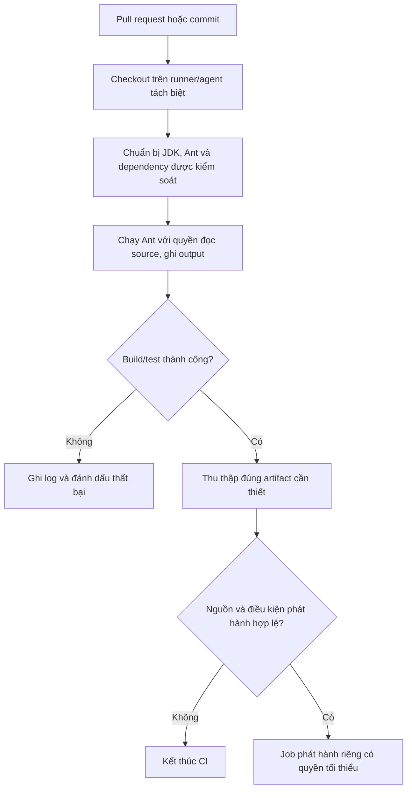
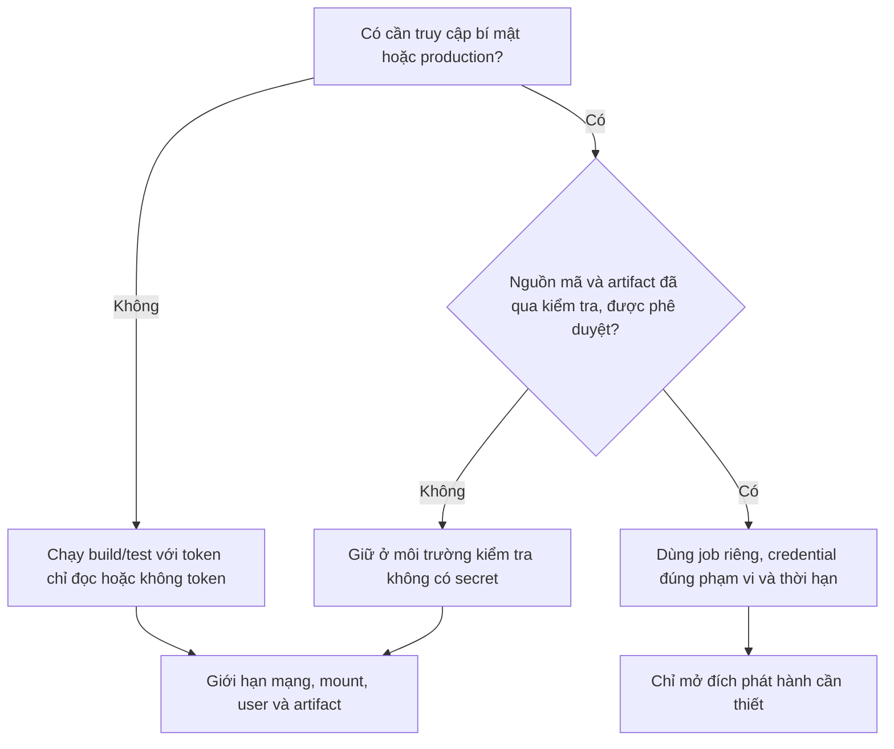

# Giảm quyền truy cập mạng, hệ thống tệp và tài khoản CI khi build bằng Apache Ant

## 1. Vì sao build Ant cần được giới hạn quyền?

Trong một dự án dùng **Apache Ant**, file `build.xml` mô tả những công việc như biên dịch, chạy kiểm thử, sao chép tài nguyên, tải dependency hoặc tạo gói phát hành. Ant có thể gọi chương trình bên ngoài qua `<exec>`, chạy Java qua `<java>`, xóa hoặc ghi file bằng nhiều task, và mở rộng chức năng bằng thư viện task tùy chỉnh.

Vì thế, **thực thi build là thực thi mã có khả năng tác động lên máy chạy build**. Một thay đổi trong mã nguồn, build script, dependency hoặc plugin có thể thực hiện hành động ngoài ý muốn: đọc secret của CI, ghi đè dữ liệu khác trong workspace, gọi dịch vụ nội bộ, tải mã không rõ nguồn gốc hoặc gửi dữ liệu qua mạng.

Ví dụ, các khả năng hợp lệ sau đều cần được đặt trong một ranh giới quyền phù hợp:

```xml
<!-- Truy cập mạng: tải một tài nguyên -->
<get src="https://example.org/resource.txt"
     dest="download/resource.txt"/>

<!-- Chạm đến hệ thống tệp: xóa một thư mục -->
<delete dir="build"/>

<!-- Chạy một chương trình hệ điều hành -->
<exec executable="git" failonerror="true">
    <arg value="status"/>
</exec>
```

Các ví dụ trên chỉ cho thấy **năng lực của task Ant**, không có nghĩa bản thân Ant mặc định cho phép hay ngăn cản một địa chỉ hoặc một đường dẫn. Quyền thực tế phụ thuộc tài khoản hệ điều hành, môi trường chạy, container, filesystem mount, chính sách mạng và cấu hình CI.

**Nguyên tắc ít đặc quyền nhất (least privilege)**: một lần build chỉ nhận những quyền cần thiết để hoàn tất công việc của lần build đó, trong khoảng thời gian cần thiết.

| Phạm vi | Build thường cần | Quyền nên tránh cấp rộng |
|---|---|---|
| Mạng | Tải dependency đã phê duyệt ở giai đoạn cần thiết | Truy cập tùy ý internet, mạng nội bộ hoặc dịch vụ quản trị |
| Hệ thống tệp | Đọc source, ghi thư mục output và tạm | Đọc toàn bộ thư mục home, ghi thư mục máy chủ hoặc truy cập workspace của job khác |
| Tài khoản CI | Checkout mã, chạy build, lưu artifact | Token có quyền quản trị repo, cập nhật secret, deploy production trong bước PR/test |
| Tiến trình | Chạy Ant/JDK và một số công cụ phục vụ build | Root, container privileged, Docker socket của host, quyền điều khiển hệ thống |

Bài học tập trung vào cách **thiết kế ranh giới quyền cho Ant trên máy phát triển, Jenkins và GitHub Actions**, đồng thời giữ cho lệnh build đơn giản và có thể chạy lại.

## 2. Xác định ranh giới tin cậy trước khi cấu hình

Không phải mọi lượt build có cùng mức độ tin cậy:

- **Build từ pull request chưa được tin cậy:** người đóng góp có thể sửa mã nguồn, test, `build.xml`, script và nhiều file cấu hình khác. Coi những file đó là mã đầu vào có thể thực thi.
- **Build từ nhánh chính đã bảo vệ:** có quy trình review và kiểm soát quyền ghi tốt hơn, nhưng vẫn cần hạn chế quyền vì lỗi, dependency độc hại hoặc tài khoản bị chiếm quyền có thể xảy ra.
- **Job phát hành:** có thể cần token để đẩy artifact, tạo release hoặc triển khai; quyền này nên cấp riêng cho bước phát hành và không chia sẻ với job test của PR.
- **Job chuẩn bị image/dependency:** có thể cần mạng để lấy công cụ. Nên tách khỏi bước build chạy mã của PR nếu chính sách hạ tầng cho phép.

Một mô hình hợp lý:



**Định nghĩa ranh giới bảo mật nằm ở nơi thực thi.** Đặt `-Doffline=true` hoặc `-Dreadonly=true` trong lệnh Ant chỉ tạo ra **property** để build script tự tuân thủ. Những property này **không phải sandbox**: một task `<get>`, `<exec>` hoặc thư viện Java không kiểm tra property vẫn có thể sử dụng mạng hoặc ghi file nếu hệ điều hành cho phép.

Cũng không nên dựa vào Java Security Manager như một cơ chế sandbox phổ quát cho build Ant hiện đại: cơ chế đó đã bị loại bỏ khỏi các JDK mới. Hãy dùng ranh giới OS/container/runner/agent, quyền tài khoản và chính sách mạng để thực sự cưỡng chế quyền truy cập.

## 3. Giảm quyền truy cập mạng

### 3.1. Phân chia mạng theo từng giai đoạn

Cần xác định chính xác bước nào **thực sự cần** kết nối ngoài:

| Giai đoạn | Nhu cầu mạng thường gặp | Cách giảm quyền |
|---|---|---|
| Checkout | Truy cập Git server | Chỉ cấp trong bước checkout hoặc cho công cụ SCM |
| Chuẩn bị toolchain | Tải JDK, Ant, image, package cần thiết | Sử dụng nguồn đã biết, phiên bản và checksum được quản lý |
| Resolve dependency | Đọc Maven repository, Ivy repository hoặc kho nội bộ | Chỉ cho phép registry/mirror cần dùng, xác minh gói |
| Compile/test/package | Thường có thể chạy offline nếu đã đủ input | Chặn egress mạng ở mức container hoặc mạng của runner |
| Publish | Gọi registry, release API hoặc nơi triển khai | Chỉ mở đích và credential đúng cho job phát hành |

Nếu dependency không có sẵn, việc chặn toàn bộ mạng ngay từ đầu có thể khiến build lỗi. Giải pháp thường là **chuẩn bị dependency trong một bước được kiểm soát**, sau đó chạy compile/test/package trong môi trường hạn chế mạng.

Trường hợp test tích hợp thật sự cần giao tiếp với database hoặc dịch vụ khác, chỉ cho phép giao tiếp đến **môi trường test cô lập** phù hợp. Quyền test không đồng nghĩa với quyền truy cập mạng production.

### 3.2. Ant property không thay thế firewall

Một số dự án cho phép chạy ở chế độ offline bằng property:

```bash
ant -noinput -Dbuild.offline=true ci
```

Property `build.offline` do dự án tự định nghĩa, **không phải thuộc tính bảo mật mặc định của Ant**. Nó chỉ hoạt động nếu mọi task, plugin hoặc code liên quan được thiết kế để tuân thủ. Một task có thể gọi `<get>`, Java network API hoặc lệnh bên ngoài mà bỏ qua property này.

Ngay cả khi Ant không gọi internet, một test có thể tạo socket hoặc dùng SDK đọc metadata/credential của môi trường đám mây. Vì vậy, nếu mục tiêu là ngăn truy cập, hãy chặn tại **network namespace, firewall, proxy egress, network policy hoặc hệ thống cô lập được quản lý**.

### 3.3. Chạy bước Ant không cần mạng bằng Docker

Trên **máy Linux có Docker**, có thể tạo container cho bước compile/test/package với networking bị tắt:

```bash
docker run --rm \
  --network none \
  --cap-drop ALL \
  --security-opt no-new-privileges \
  my-registry.example/ant-jdk17@sha256:<DIGEST> \
  ant -noinput -f /work/build.xml ci
```

Đây là **mẫu minh họa cấu hình mạng/quyền**, chưa phải lệnh hoàn chỉnh để build repository: image phải có Ant, Java, `build.xml`, source và thư mục output hợp lệ. Phần 5 sẽ đưa ra lệnh có mount rõ ràng.

Các tùy chọn:

- `--network none`: không nối container vào mạng của Docker, ngăn kết nối internet và các dịch vụ khác qua networking thông thường. Bên trong container vẫn có loopback; đây không phải một chứng minh tuyệt đối chống mọi đường thoát khỏi sandbox.
- `--cap-drop ALL`: loại bỏ Linux capabilities mặc định không cần cho công việc build thông thường.
- `--security-opt no-new-privileges`: giảm khả năng tiến trình đạt thêm đặc quyền thông qua một số cơ chế của hệ điều hành.
- Image có `@sha256:<DIGEST>`: minh họa cách tham chiếu **digest thật đã được phê duyệt** thay vì tag có thể trỏ sang image khác. Khi áp dụng, thay `<DIGEST>` bằng digest hợp lệ của image do tổ chức quản lý.

**Không mount `/var/run/docker.sock`, không dùng `--privileged` hoặc `--network host` cho build không cần đến chúng.** Một Docker socket có quyền điều khiển daemon thường kéo theo khả năng thao tác tài nguyên host, phá vỡ kỳ vọng rằng container bị cô lập.

Lưu ý: `--network none` chặn cả việc tải dependency trong bước Ant. Nếu build phải resolve dependency, hãy cấp dependency trước hoặc sử dụng mirror/cơ chế cache tin cậy tương ứng. Không đưa cache có thể bị ghi bởi mã không tin cậy vào nơi các job khác sẽ đọc mà không xác minh.

### 3.4. Khi không thể tắt mạng hoàn toàn

Nhiều doanh nghiệp sử dụng registry nội bộ và cần một mức egress tối thiểu. Khi đó:

1. Cho phép các domain/IP/port mà build thực sự cần; quản lý DNS, proxy hoặc firewall tập trung.
2. Dùng registry/mirror nội bộ với artifact đã xác minh và khóa phiên bản.
3. Không cấp quyền truy cập các mạng quản trị, metadata endpoint hoặc dịch vụ production cho job test.
4. Tách môi trường job có secret khỏi môi trường chạy source PR.
5. Ghi nhận dependency và kiểm tra checksum/chữ ký theo chính sách dự án.

Danh sách allowlist phải được thực thi bởi hạ tầng có khả năng chặn lưu lượng. Chỉ đặt biến môi trường `HTTP_PROXY` hoặc `HTTPS_PROXY` **không buộc** mọi chương trình phải đi qua proxy: ứng dụng có thể kết nối trực tiếp nếu tuyến mạng vẫn mở.

## 4. Giảm quyền truy cập hệ thống tệp

### 4.1. Xác định những nơi Ant thật sự cần đọc và ghi

Một build Java thông thường có thể được chia thành:

```text
/workspace/
├── build.xml          # Đọc
├── src/               # Đọc
├── config/            # Đọc, nếu cần
└── out/               # Ghi: classes, test-reports, dist
    ├── classes/
    ├── test-classes/
    ├── reports/
    └── dist/
```

Không nên cấp quyền ghi toàn bộ host để Ant chỉ tạo ra một file JAR. Với container hoặc sandbox OS:

- Mount `src/` và `build.xml` ở chế độ **read-only**.
- Chỉ mount `out/` ở chế độ **read-write** khi cần giữ artifact sau build.
- Cung cấp `/tmp` riêng cho file tạm, không trỏ sang thư mục tạm chung của host.
- Tránh mount thư mục home, khóa SSH, file credential của cloud, thư mục chứa secret hoặc workspace của job khác.
- Nếu dependency cache cần đọc, ưu tiên mount read-only đối với cache đã được tạo/xác minh ở giai đoạn tin cậy. Không coi cache là nguồn tin cậy chỉ vì nó nằm trong thư mục cấu hình của CI.

Một task Ant không có sandbox đường dẫn riêng. Ví dụ `<delete dir="../">` hoặc `<copy todir="../../somewhere">` có thể chạm ra ngoài workspace **nếu tài khoản thực thi có quyền truy cập đường dẫn đó**. Đây là lý do phải giới hạn permission/mount ở cấp OS, thay vì chỉ kiểm soát giá trị property trong script.

### 4.2. Sắp xếp `build.xml` để đầu ra tập trung trong một thư mục

Ví dụ dưới đây dùng Java 17 và giả định repository có thư mục `src/main/java` cùng một class ứng dụng. Tất cả file do target tạo được đặt dưới `out/`:

```xml
<?xml version="1.0" encoding="UTF-8"?>
<project name="ant-limited-access" default="ci" basedir=".">

    <property name="src.dir" location="src/main/java"/>
    <property name="out.dir" location="out"/>
    <property name="classes.dir" location="${out.dir}/classes"/>
    <property name="dist.dir" location="${out.dir}/dist"/>

    <target name="clean">
        <delete dir="${out.dir}/classes"/>
        <delete dir="${out.dir}/dist"/>
    </target>

    <target name="compile">
        <mkdir dir="${classes.dir}"/>
        <javac srcdir="${src.dir}"
               destdir="${classes.dir}"
               release="17"
               encoding="UTF-8"
               includeantruntime="false"/>
    </target>

    <target name="package" depends="compile">
        <mkdir dir="${dist.dir}"/>
        <jar destfile="${dist.dir}/app.jar"
             basedir="${classes.dir}"/>
    </target>

    <target name="ci" depends="clean,package"/>

</project>
```

Một class Java tối thiểu để chạy ví dụ, lưu tại `src/main/java/example/Hello.java`:

```java
package example;

public final class Hello {
    private Hello() {
    }

    public static void main(String[] args) {
        System.out.println("Hello from restricted Ant build");
    }
}
```

Lệnh chạy tại root:

```bash
ant -noinput -f build.xml ci
```

Nếu thành công, kết quả được lưu ở `out/dist/app.jar`. `clean` chỉ xóa các đường dẫn output đã xác định, không xóa bất kỳ thư mục cha nào.

**Tập trung output giúp cấu hình quyền dễ hơn nhưng tự nó chưa khóa được mã độc.** File `build.xml` của một pull request vẫn có thể bị sửa để gọi task khác; chính mount read-only, danh tính process và ranh giới host sẽ hạn chế quyền thực tế của build.

Trong dự án dùng Java test, có thể bổ sung target `test` vào dependency của `package` và ghi JUnit XML dưới `out/reports/`. Không nên để target `ci` báo thành công nếu test cần thiết chưa được thực thi.

### 4.3. File permission không phải một thuộc tính của Ant

Trên Linux/Unix, tài khoản chạy Ant được xác định bởi UID/GID, các permission bit, ACL, mount và chính sách bảo mật hệ điều hành. Trên Windows, quyền thuộc về access token của process, NTFS ACL và các cơ chế liên quan. Ant tuân theo những quyền process được cấp.

Không cần chạy Ant bằng root hoặc tài khoản administrator chỉ để gọi `javac` hay `jar`. Tránh giải quyết lỗi permission bằng việc cấp quyền quá rộng như `chmod -R 777` đối với workspace: điều đó cho phép nhiều process khác cùng sửa mã nguồn hoặc output.

Nếu dùng thư mục output trên host, hãy chuẩn bị ownership phù hợp với **UID/GID của process trong container**. Không nên chèn một bước `sudo chown -R` không kiểm soát vào mọi lần build để bù cho cách mount chưa nhất quán.

## 5. Ví dụ chạy Ant với source read-only, output writable và mạng bị khóa

Mẫu sau hướng đến một **Linux host có Docker Engine** và một image nội bộ đáng tin cậy chứa **JDK 17, Apache Ant** và thư mục làm việc `/work`. Không áp dụng nguyên xi cú pháp `$(id -u)` cho PowerShell trên Windows.

### 5.1. Chuẩn bị image Ant trong môi trường tin cậy

Một Dockerfile minh họa cho **giai đoạn tạo image riêng**, ví dụ file `ci/Dockerfile.ant`:

```dockerfile
FROM eclipse-temurin:17-jdk-jammy

RUN apt-get update \
    && apt-get install -y --no-install-recommends ant ca-certificates \
    && rm -rf /var/lib/apt/lists/*

RUN mkdir -p /work/src /work/out \
    && touch /work/build.xml

WORKDIR /work
```

Tạo image ở bước kiểm soát nguồn và xác minh image trước khi dùng cho build PR. Ví dụ nội bộ có thể đưa image lên registry và tham chiếu bằng digest. Lệnh cài `ant` từ package manager dùng repository ở thời điểm build image; khi cần tái lập chính xác, phải ghim cả base image digest, nguồn package và phiên bản gói theo chính sách của tổ chức.

**Không coi Dockerfile được sửa trực tiếp trong PR là đầu vào tin cậy để build một image có đặc quyền Docker host.** Với mã PR không tin cậy, sử dụng image công cụ đã được chuẩn bị và quản lý độc lập hoặc một hệ thống build image cách ly có chính sách tương đương.

### 5.2. Chạy container giới hạn quyền

Giả sử `build.xml` dùng các đường dẫn trong phần 4, repository đã có `src/`, và image công cụ được đặt tên `ant-jdk17:trusted`. Trên Linux shell:

```bash
mkdir -p out

docker run --rm \
  --network none \
  --read-only \
  --cap-drop ALL \
  --security-opt no-new-privileges \
  --user "$(id -u):$(id -g)" \
  --env HOME=/tmp \
  --tmpfs /tmp:rw,nosuid,nodev,size=128m \
  --mount "type=bind,src=$(pwd)/build.xml,dst=/work/build.xml,readonly" \
  --mount "type=bind,src=$(pwd)/src,dst=/work/src,readonly" \
  --mount "type=bind,src=$(pwd)/out,dst=/work/out" \
  --workdir /work \
  ant-jdk17:trusted \
  ant -noinput -f build.xml ci
```

Giải thích ranh giới:

| Cấu hình Docker | Hiệu quả dự kiến |
|---|---|
| `--network none` | Ant và Java process trong container không có mạng bên ngoài thông thường |
| `--read-only` | Root filesystem của container ở chế độ chỉ đọc |
| `--mount ... readonly` cho `build.xml`, `src` | Build có thể đọc cấu hình/mã nguồn nhưng không thể ghi đè qua các mount đó |
| Mount `out` không có `readonly` | Cho phép Ant ghi output tại một đường dẫn rõ ràng |
| `--user "$(id -u):$(id -g)"` | Không chạy dưới root trong container; dùng UID/GID hiện tại trên host Linux để giảm xung đột ownership cho output |
| `--tmpfs /tmp...` | Có chỗ ghi file tạm mà không phải dùng filesystem host |
| `--cap-drop ALL`, `no-new-privileges` | Giảm những khả năng nâng quyền không cần thiết |

Với image `ant-jdk17:trusted`, bạn cần bảo đảm image đã thực sự được chuẩn bị và kiểm soát. Việc dùng tag ở lệnh minh họa chỉ giúp dễ đọc; với pipeline production, chọn image có digest đã được phê duyệt.

Nếu build cần thêm thư mục `resources/` hoặc `config/`, phải thêm mount read-only tương ứng. Nếu compiler hoặc test viết vào `/home`, `/root` hay thư mục khác ngoài `/tmp` và `/work/out`, cần xác định vị trí hợp lệ của file đó, điều chỉnh target/config hoặc cấp một thư mục writable chuyên dụng; đừng chuyển cả root filesystem sang read-write chỉ để sửa một lỗi đường dẫn.

**Giới hạn bảo vệ:** container là một ranh giới cô lập dựa trên kernel/engine. Nó không thay thế việc cập nhật Docker/kernel, kiểm soát quyền điều khiển daemon, image provenance hoặc cách ly host đối với workload không tin cậy cấp cao. Với tác vụ build có rủi ro đặc biệt, có thể cần VM/runner riêng cho mỗi job.

### 5.3. Lưu ý khi dùng container trên CI

Một container chạy bằng lệnh `docker run` cần host runner hỗ trợ Docker, có quyền gọi daemon và có sẵn image. Quyền gọi Docker daemon thường rất mạnh, nên hãy phân biệt:

- **Job chuẩn bị/quản lý container:** có quyền cần thiết để khởi tạo môi trường, thuộc hạ tầng được quản lý.
- **Process Ant bên trong môi trường:** chạy với user không đặc quyền, mount và mạng bị giới hạn.

Đừng đưa Docker socket vào container đang chạy Ant. Đối với Jenkins/GitHub Actions, ưu tiên cơ chế runner/container được tổ chức quản lý hơn việc cấp trực tiếp quyền Docker daemon cho mọi người hoặc mọi pipeline.

## 6. Giảm quyền của tài khoản Jenkins

### 6.1. Các danh tính thường gặp trong Jenkins

Một hệ thống Jenkins có thể có nhiều mức quyền khác nhau:

1. **Người dùng Jenkins:** được cấp quyền xem, cấu hình hoặc chạy job trong giao diện.
2. **Tài khoản dịch vụ của Jenkins controller:** duy trì Jenkins và điều phối job; không nên sử dụng như tài khoản chạy mã nguồn không tin cậy.
3. **Tài khoản hệ điều hành trên agent:** sở hữu process `ant`, workspace và những file process có thể đọc/ghi.
4. **Credential của job:** token/SSH key được Jenkins Credentials cung cấp tại những bước thực sự cần.

Các lớp quyền này không thay thế nhau. Chẳng hạn, việc người dùng Jenkins không được quyền xem credential trên UI **không bảo đảm** một build script chạy trên agent không thể đọc token, nếu token đã được đưa vào environment của process đó.

### 6.2. Một Jenkinsfile chỉ cần quyền đọc cho CI build

Ví dụ Declarative Pipeline chạy Ant trên một agent riêng có nhãn `ant-untrusted`:

```groovy
pipeline {
    agent { label 'ant-untrusted' }

    options {
        skipDefaultCheckout(true)
        timeout(time: 20, unit: 'MINUTES')
    }

    stages {
        stage('Checkout') {
            steps {
                checkout scm
            }
        }

        stage('Tool versions') {
            steps {
                sh 'java -version'
                sh 'ant -version'
            }
        }

        stage('Build') {
            steps {
                sh 'ant -noinput -f build.xml ci'
            }
        }
    }

    post {
        success {
            archiveArtifacts artifacts: 'out/dist/*.jar',
                             fingerprint: true
        }
    }
}
```

Mẫu này giả định agent Linux đã được hạ tầng chuẩn bị với JDK/Ant phù hợp, và `out/dist/*.jar` là vị trí artifact như trong ví dụ ở phần 4.

**Điều kiện bảo mật nằm ngoài Jenkinsfile:** agent `ant-untrusted` phải có filesystem, network và tài khoản phù hợp, tốt nhất được cấp mới hoặc dọn sạch và cách ly theo mỗi lượt build. Một nhãn agent chỉ là cơ chế chọn nơi chạy, tự nó **không tạo ra sandbox**.

Để giảm quyền:

- Sử dụng agent riêng cho build PR không tin cậy; tránh chạy job đó trực tiếp trên controller hoặc agent chia sẻ với tác vụ có secret nhạy cảm.
- Tài khoản OS trên agent không nên là root/administrator; hạn chế quyền truy cập thư mục hệ thống, container daemon, khóa SSH và workspace của job khác.
- Cấu hình SCM credential chỉ có **quyền đọc** nếu job chỉ checkout.
- Không gán credential để deploy hoặc ghi registry vào môi trường mặc định của tất cả stage.
- Cấu hình quyền Jenkins theo vai trò: người được phép sửa `Jenkinsfile`, định nghĩa job hoặc credential cần được kiểm soát.
- Nếu dùng Multibranch Pipeline hoặc PR từ fork, xem kỹ **mức độ tin cậy của Jenkinsfile theo nguồn nhánh/PR** và quy tắc chọn agent/credential. Code PR có thể bao gồm thay đổi đối với chính pipeline.

### 6.3. Chỉ cấp secret cho bước phát hành tin cậy

Giả sử tổ chức có credential Jenkins dạng Secret Text tên `artifact-publish-token`. Job phát hành đã được tách riêng hoặc stage phát hành chỉ chạy từ nguồn đã duyệt có thể dùng:

```groovy
stage('Publish trusted build') {
    when {
        branch 'main'
    }
    steps {
        withCredentials([
            string(
                credentialsId: 'artifact-publish-token',
                variable: 'PUBLISH_TOKEN'
            )
        ]) {
            sh '''
                set +x
                ant -noinput -f build.xml publish
            '''
        }
    }
}
```

Đây là **đoạn minh họa** cần ghép vào một Jenkins Pipeline có nhánh/nguồn SCM phù hợp; target `publish` phải được định nghĩa bởi dự án và biết cách nhận secret từ environment một cách an toàn. `when { branch 'main' }` hữu ích trong Multibranch Pipeline, nhưng **không phải ranh giới an toàn duy nhất** để quyết định cấp credential. Phải kết hợp branch protection, quyền job, cấu hình credential và bảo đảm build script/nguồn chạy ở bước publish là đáng tin cậy.

`withCredentials` giới hạn thời điểm đưa secret vào environment và hỗ trợ masking một số dạng hiển thị trong log; nó **không ngăn** một process đã nhận secret sử dụng hoặc gửi secret ra ngoài. Nếu `build.xml` có thể bị sửa bởi người không đáng tin cậy, không được chạy nó với credential phát hành chỉ vì tên stage là `Publish`.

Không sử dụng interpolation từ Groovy để chèn secret thẳng vào chuỗi lệnh shell; truyền qua environment và đọc trong shell/task chuyên dụng khi cần. Không để `set -x` in lệnh chứa secret; tránh ghi secret trong lệnh Ant `-D...` vì argument hoặc log có thể làm lộ giá trị. Một build thông thường chỉ cần đọc dependency đã được chuẩn bị thì không cần secret phát hành.

## 7. Giảm quyền tài khoản và token trong GitHub Actions

### 7.1. Chỉ cấp `GITHUB_TOKEN` quyền đọc cho job kiểm tra

Trong GitHub Actions, `permissions` xác định các quyền của `GITHUB_TOKEN` được cấp cho workflow/job. Ví dụ `.github/workflows/ant-ci.yml`:

```yaml
name: Ant CI (limited token)

on:
  push:
    branches: [main]
  pull_request:
  workflow_dispatch:

permissions:
  contents: read

jobs:
  build:
    runs-on: ubuntu-24.04
    timeout-minutes: 20

    steps:
      - name: Checkout
        uses: actions/checkout@v4
        with:
          persist-credentials: false

      - name: Set up JDK
        uses: actions/setup-java@v4
        with:
          distribution: temurin
          java-version: '17'

      - name: Install Ant
        run: |
          sudo apt-get update
          sudo apt-get install -y ant

      - name: Show tools
        run: |
          java -version
          ant -version

      - name: Ant build
        run: ant -noinput -f build.xml ci

      - name: Upload JAR
        uses: actions/upload-artifact@v4
        with:
          name: ant-jar
          path: out/dist/*.jar
          if-no-files-found: error
```

Giải thích:

- `permissions: contents: read` chỉ cấp quyền đọc repository qua `GITHUB_TOKEN` cho các thao tác cần thiết, không cấp quyền ghi repository/release.
- `persist-credentials: false` yêu cầu `checkout` không để credential xác thực Git được lưu lại cho các lệnh Git tiếp theo trong workspace. Đây là một lớp giảm rủi ro hữu ích, nhưng token hoặc secret khác đã cấp cho job vẫn cần được quản lý.
- `runs-on: ubuntu-24.04` dùng GitHub-hosted runner theo nhãn OS được chỉ định. Điều này không ghim vĩnh viễn tất cả package trong runner image.
- Bước `apt-get` cần quyền quản trị và mạng **trong giai đoạn chuẩn bị toolchain trên runner**. Ví dụ hướng dẫn ban đầu này chưa triển khai egress isolation. Với build không tin cậy hoặc yêu cầu bảo mật cao, hãy dùng image/runner đã chuẩn bị Ant từ trước và ranh giới mạng có khả năng cưỡng chế như phần 3 và 5.
- `actions/upload-artifact` chỉ lưu JAR do build tạo ra; nó không cấp quyền phát hành repository hoặc deploy.
- Các action ở đây dùng major tag để minh họa. Trong môi trường yêu cầu kiểm soát nguồn cung ứng, ghim action bằng commit SHA đã kiểm chứng và duy trì quy trình cập nhật.

**Lưu ý quan trọng:** `permissions: contents: read` chỉ hạn chế quyền **GitHub API token**. Nó không chặn các lệnh shell truy cập mạng, không khóa filesystem của runner và không giới hạn quyền `sudo` mặc định của GitHub-hosted runner Linux. Muốn hạn chế những thứ đó phải dùng thiết kế runner/container/network riêng.

### 7.2. Không cấp secret phát hành cho pull request không tin cậy

Với workflow `pull_request` thông thường từ fork, GitHub hạn chế khả năng tiếp cận repository secrets; tuy nhiên, vẫn nên thiết kế build PR **không cần secret**. Không tự động đưa khóa deploy, private registry write token, cloud admin key hoặc production credential vào job test.

Đặc biệt cẩn thận với event `pull_request_target`: workflow này có ngữ cảnh quyền tin cậy khác với `pull_request`. Nếu checkout và thực thi mã từ PR không tin cậy trong workflow đang có token/secret mạnh, kẻ tấn công có thể lợi dụng quyền đó. Không dùng `pull_request_target` để build/chạy Ant từ head của PR trừ khi đã có kiến trúc cô lập và kiểm soát cụ thể.

Các công việc cần secret, như ký artifact hoặc deploy, nên là **workflow/job khác** chỉ nhận nguồn đã được phê duyệt và có cơ chế bảo vệ môi trường tương ứng. Job phát hành chỉ cấp những quyền thực sự cần, ví dụ `contents: write` khi thật sự cần tạo GitHub Release; không cấp quyền đó ở mức toàn bộ workflow nếu các job còn lại chỉ đọc.

### 7.3. Nếu cần secret để đọc dependency riêng tư

Có thể dùng token chỉ đọc hoặc short-lived credential cho registry nội bộ sau khi xác định chính xác nhu cầu:

```yaml
- name: Resolve approved private dependencies
  env:
    ARTIFACT_READ_TOKEN: ${{ secrets.ARTIFACT_READ_TOKEN }}
  run: ant -noinput -f build.xml resolve-private
```

Đây là ví dụ về **cách truyền environment**, không phải workflow có thể dùng ngay: target `resolve-private` phải tồn tại và biết đọc biến môi trường tương ứng. Secret này **không nên đưa vào job chạy mã PR không tin cậy**, vì mã trong build script có thể truy cập environment của process.

Đừng xem log masking là biện pháp chống đánh cắp secret: masking chỉ giúp che giá trị khi hiển thị trong những tình huống được hỗ trợ, còn một process có secret và egress mạng vẫn có thể truyền dữ liệu ra ngoài.

## 8. Kiểm soát artifact, cache và dữ liệu nhạy cảm

Giảm quyền build còn bao gồm **giới hạn thứ được mang ra khỏi runner**.

### 8.1. Đóng gói đúng thư mục đầu ra

Trong Ant:

```xml
<jar destfile="${dist.dir}/app.jar"
     basedir="${classes.dir}"/>
```

`basedir` nên trỏ đến đúng `classes.dir` hoặc tập tài nguyên đã chọn. Tránh vô tình dùng `basedir="."` và đóng gói cả repository, vì repository có thể chứa file cấu hình, credential cục bộ, log hoặc metadata ngoài ý muốn.

Khi lưu artifact, chỉ chọn đường dẫn cụ thể:

```groovy
// Jenkins
archiveArtifacts artifacts: 'out/dist/*.jar',
                 fingerprint: true
```

```yaml
# GitHub Actions: phần with của bước upload-artifact
with:
  name: ant-jar
  path: out/dist/*.jar
  if-no-files-found: error
```

Không upload toàn bộ workspace hoặc thư mục home chỉ để tiện debug. Nếu cần lưu log khi lỗi, chọn log đã xử lý phù hợp và không chứa token, khóa hoặc dữ liệu riêng tư.

### 8.2. Cache là dữ liệu đầu vào, không mặc nhiên đáng tin

Các thư mục cache dependency như `~/.ivy2/cache` hoặc cache Maven có thể giúp CI chạy nhanh hơn. Nhưng cache dùng chung giữa các job có thể gây rủi ro khi một job không tin cậy sửa artifact mà một job tin cậy sử dụng sau đó.

Nguyên tắc:

- Cache chỉ phục vụ hiệu năng; vẫn phải xác định nguồn và phiên bản dependency.
- Tách cache theo nhóm tin cậy nếu có thể, và không cho job PR ghi vào cache mà job release sẽ tin tưởng vô điều kiện.
- Khóa dependency và xác minh checksum/chữ ký khi công cụ hỗ trợ.
- Không cache file chứa secret hoặc token.
- Với bước không cần mạng, ưu tiên chỉ cấp cache **read-only** đã được chuẩn bị từ nguồn kiểm soát.

### 8.3. Script và log cũng là dữ liệu có thể bị lạm dụng

Một số cơ chế làm rò rỉ dữ liệu thường không liên quan trực tiếp đến Ant task:

- Shell bật tracing rồi in giá trị environment.
- Test ghi nội dung config có mật khẩu vào stdout.
- Script CI gọi command kèm token trong argument.
- Artifact upload có wildcard quá rộng.
- Build tạo file debug chứa biến môi trường hoặc đường dẫn secret.

Vì thế cần giới hạn dữ liệu đưa vào process ngay từ đầu. Secret không được cấp cho job sẽ không thể vô tình xuất hiện trong log của job đó qua environment.

## 9. Thiết kế CI/CD theo các mức quyền tách biệt

Một pipeline có thể tổ chức thành những mức rõ ràng:

| Công việc | Nguồn được phép | Mạng | File được ghi | Credential |
|---|---|---|---|---|
| Test PR | PR không tin cậy | Không có hoặc chỉ tới dịch vụ test riêng nếu bắt buộc | Output/temporary của job | Không có credential phát hành |
| Build nhánh chính | Nhánh chính đã qua bảo vệ | Giới hạn các endpoint cần thiết | Output/temporary của job | Token chỉ đọc khi thật sự cần |
| Ký/phát hành artifact | Commit/tag đã được duyệt | Chỉ tới registry/release service | Artifact và thư mục tạm riêng | Credential ngắn hạn/chỉ đủ quyền publish |
| Deploy | Artifact đã xác minh từ nguồn tin cậy | Chỉ tới môi trường đích | Khu vực triển khai được quản lý | Credential triển khai riêng, giới hạn môi trường |

Mỗi stage có **đầu vào và đầu ra** kiểm soát được. Không nên lấy một pipeline với quyền deploy cao, sau đó cho nó checkout và chạy mọi thay đổi trong pull request.

Một lưu đồ quyết định đơn giản:



Mức tách biệt phù hợp tùy độ nhạy của hệ thống. Với repo chỉ chứa bài thực hành cá nhân, GitHub-hosted runner ngắn hạn và `permissions: contents: read` có thể đáp ứng nhu cầu CI cơ bản. Với tổ chức có dependency riêng, secret phát hành và mạng production, thường cần runner/agent, firewall/proxy, kho artifact và identity được quản lý chặt hơn.

## 10. Những sai lầm hay gặp và cách xử lý

| Tình huống | Vấn đề | Cách sửa |
|---|---|---|
| Dùng `ant -Doffline=true` rồi cho rằng đã chặn internet | Property không cưỡng chế mạng | Đưa build vào môi trường egress bị giới hạn thực sự |
| Container dùng `--network none` nhưng build tải Ivy dependency trong cùng bước | Không có mạng để tải dependency | Chuẩn bị dependency trước; dùng mirror/cache đã xác minh |
| Cho Ant chạy bằng root/administrator | Build có quyền ghi/đọc quá rộng | Chạy tài khoản không đặc quyền và cấp đúng thư mục cần thiết |
| Mount toàn bộ home vào container để tránh lỗi cache | Lộ SSH key, cloud config, credential | Mount đúng dependency cache cần dùng; ưu tiên read-only |
| Mount Docker socket vào container build | Container có thể điều khiển daemon của host | Không mount socket; điều phối container bên ngoài môi trường build |
| Dùng chung Jenkins agent cho PR và release | File/secret/job khác có thể bị truy cập hoặc ảnh hưởng | Cách ly agent/workspace, tách môi trường tin cậy |
| `Jenkinsfile` PR có `withCredentials` mang token publish | Mã PR có thể đọc hoặc dùng token khi chạy | Không cấp credential publish cho PR; tách job phát hành tin cậy |
| GitHub workflow dùng `pull_request_target` và checkout head PR rồi chạy Ant | Thực thi đầu vào không tin cậy trong ngữ cảnh quyền cao | Dùng `pull_request` để test hoặc thiết kế ranh giới riêng được thẩm định |
| Chỉ đặt `permissions: contents: read` rồi cho rằng đã có sandbox | Quyền GitHub API khác với quyền mạng/OS | Dùng thêm runner/container/network policy |
| Dùng `chmod -R 777` để sửa lỗi ghi output | Mở quyền sửa cho process khác | Sửa ownership, UID/GID và mount của riêng output |
| Upload `**/*` làm artifact | Có thể thu thập file ngoài dự kiến | Chỉ upload JAR/report cần thiết |
| Cache dependency có thể bị sửa bởi job không tin cậy | Artifact bị thay thế trong build tin cậy | Tách cache, xác minh dependency, giới hạn quyền ghi |

### Phân biệt lỗi quyền và lỗi build

Một lần chạy Ant thất bại không phải lúc nào cũng do cấu hình sai. Có những lỗi **đúng như kỳ vọng** của ranh giới an toàn:

- `Permission denied` khi task cố ghi vào `src/` read-only: kiểm tra lại xem target có viết source ngoài ý muốn; chuyển output vào `out/`.
- Không tải được package khi `--network none`: kiểm tra dependency đã được chuẩn bị hay chưa, rồi thiết kế giai đoạn cấp dependency phù hợp.
- Không tạo được file tạm: chỉ định `java.io.tmpdir` hoặc cấp một `/tmp` tách biệt có quyền ghi, thay vì mở quyền toàn filesystem.
- Không tìm thấy secret trong job PR: đó là dấu hiệu việc cấp quyền có giới hạn đang hoạt động; điều chỉnh workflow để test PR không phụ thuộc credential phát hành.
- Không kết nối được môi trường production từ test: xác nhận test nên dùng stub, mock hoặc môi trường staging được cho phép thay vì nới mạng tới production.

Tập trung giải quyết **nhu cầu build thật sự** rồi mở quyền tối thiểu cần thiết. Việc tắt cô lập hoặc cấp quyền administrator chỉ để pipeline xanh có thể làm mất ý nghĩa của bảo vệ CI.

## 11. Bài thực hành: xây một lần build bị giới hạn quyền

Có thể thực hành trên máy Linux với Docker và một repository Ant nhỏ:

1. Tạo `build.xml` và `src/main/java/example/Hello.java` theo phần 4; chạy `ant -noinput ci` tại máy để xác nhận đầu ra nằm trong `out/dist/app.jar`.
2. Chuẩn bị một image Ant/JDK tin cậy như phần 5 và chọn đúng cách quản lý phiên bản/image digest. Chuẩn bị thư mục `out/` thuộc sở hữu người chạy.
3. Chạy lệnh container với `--network none`, root filesystem read-only, source read-only và chỉ `out` writable. Quan sát kết quả trong `out/dist/`.
4. Thử một target Ant **vô hại** ghi file thử vào `src/`; trong container giới hạn quyền, thao tác ghi đó phải bị hệ điều hành từ chối. Khôi phục nội dung thử nghiệm sau khi quan sát.
5. Thử một task `<get>` tải từ URL công khai trong môi trường test được phép; quan sát việc kết nối bị chặn khi container không có mạng. Không cần thực hiện thao tác này lên hệ thống nhạy cảm.
6. Chuyển lệnh `ant -noinput ci` vào Jenkins hoặc GitHub Actions. Bảo đảm build PR không có credential phát hành, chỉ lưu `out/dist/*.jar` và không yêu cầu truy cập thư mục bên ngoài workspace.
7. Nếu dự án cần xuất bản artifact, bổ sung job phát hành riêng chạy từ nguồn đã được duyệt, chỉ cấp credential cho job đó và chỉ mở egress đến dịch vụ đích.

**Câu hỏi tự kiểm tra:** Nếu ai đó có quyền thay đổi `build.xml` trong pull request, họ có thể đọc file nào, gọi mạng nào, lấy token nào và ghi đè đường dẫn nào trên runner? Muốn trả lời chính xác, phải xem cấu hình runner/container, quyền tài khoản và cách cấp secret — không thể chỉ nhìn tên target Ant.

## 12. Kết luận

Apache Ant giúp tự động hóa build nhưng không tự giới hạn quyền của những task hoặc chương trình mà nó chạy. Một build Ant an toàn cần kết hợp **ba lớp quyền thực tế**: mạng chỉ mở khi cần và đúng đích, hệ thống tệp chỉ cấp đường dẫn đọc/ghi cần thiết, tài khoản CI chỉ có token/credential phù hợp mức tin cậy của nguồn mã.

Trong Jenkins, trọng tâm là **agent, tài khoản hệ điều hành, Jenkins Credentials và quyền chỉnh pipeline**. Trong GitHub Actions, trọng tâm là **runner, `GITHUB_TOKEN` permissions, chính sách secrets và điều kiện chạy workflow**. Cả hai đều có thể gọi cùng một lệnh `ant -noinput -f build.xml ci`; độ an toàn chủ yếu đến từ **môi trường và danh tính bao quanh lệnh đó**. Khi cần quyền cao để publish hoặc deploy, hãy cấp trong một bước riêng dựa trên nguồn đã được phê duyệt, rồi kết thúc phạm vi quyền ngay sau khi công việc hoàn tất.

