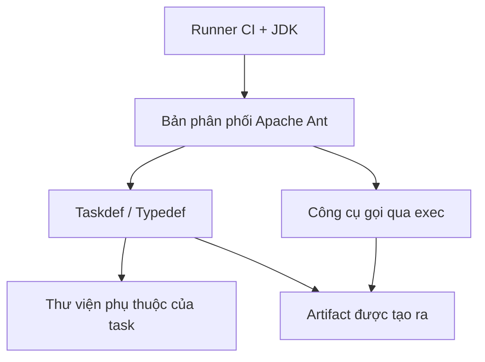

# Rà soát thư viện cũ và cập nhật các thành phần build có lỗ hổng trong Apache Ant

Một dự án Java có thể sử dụng mã nguồn ứng dụng mới nhưng vẫn chạy quy trình build trên **Apache Ant cũ**, nạp một JAR tiện ích được sao chép từ nhiều năm trước hoặc dùng task bên thứ ba không còn được duy trì. Những thành phần này hoạt động trong lúc build, thường trên máy lập trình viên hoặc runner CI có quyền đọc mã nguồn, biến môi trường và thông tin xác thực phát hành. Vì vậy, kiểm tra lỗ hổng **chỉ ở thư viện được đóng gói vào ứng dụng** là chưa đủ để đánh giá an toàn của toàn bộ quy trình build.

Mục tiêu của bài học là xây dựng quy trình có thể lặp lại: **kiểm kê chính xác thành phần đang được Ant sử dụng → xác minh lỗ hổng và mức độ ảnh hưởng → cập nhật có kiểm soát → chạy lại kiểm tra → chặn phát hành nếu rủi ro chưa được xử lý theo chính sách**. Nội dung tập trung vào Ant và thư viện build; không giả định một phiên bản cụ thể nào đang có lỗ hổng tại thời điểm đọc bài.

## 1. Vì sao thư viện build cũ là một rủi ro riêng?

Thư viện runtime của ứng dụng và thư viện build có vai trò khác nhau:

- **Runtime dependency** được ứng dụng dùng khi chạy; một số được đưa vào JAR/WAR hoặc đường dẫn chạy của dịch vụ.
- **Build dependency** được Ant hay các task mở rộng tải vào JVM để biên dịch, kiểm thử, tạo tài liệu, biến đổi tài nguyên, ký hoặc phát hành artifact.
- **Công cụ ngoài** như trình phân tích mã, trình tạo mã hoặc công cụ đóng gói có thể được gọi bằng `<exec>`. Chúng không nhất thiết xuất hiện trong classpath Java nhưng vẫn là một phần chuỗi cung ứng build.

Ví dụ, `<taskdef>` nạp một JAR tiện ích để cung cấp task tùy biến. Khi Ant thực thi task đó, mã Java bên trong JAR hoạt động với quyền của tiến trình Ant. Nếu task bị thay thế, lỗi thời hoặc dùng một thư viện dễ bị khai thác, hậu quả có thể xảy ra **ngay tại thời điểm build**, trước khi artifact ứng dụng được tạo ra.

Các rủi ro đáng quan tâm gồm: xử lý tệp không tin cậy, thư viện XML hoặc nén lỗi thời, tải mã từ nguồn không kiểm soát, công cụ có quyền truy cập secret CI, task có thể chạy lệnh hệ thống và việc sử dụng JAR không rõ nguồn gốc. Không phải mọi cảnh báo CVE đều có thể khai thác trong mỗi build; cần đánh giá **phiên bản thực dùng và bối cảnh hoạt động**, thay vì chỉ đếm số cảnh báo.

## 2. Kiểm kê đúng những gì Ant thật sự nạp

Trước khi tìm bản cập nhật, phải biết thành phần nào đang được sử dụng. Cùng một repository có thể cho kết quả build khác nhau giữa máy lập trình viên và CI nếu classpath, bản Ant hay thư viện đặt trong thư mục cá nhân không giống nhau.

| Lớp cần kiểm kê | Ví dụ vị trí hoặc cơ chế | Câu hỏi cần trả lời |
| --- | --- | --- |
| Bản Apache Ant | Bản `ant` được gọi từ `PATH`, Ant do IDE hoặc CI cài đặt | Ant thực tế là phiên bản nào? Đến từ bản phân phối nào? |
| Java chạy Ant | JDK/JRE dùng khởi động tiến trình Ant | Java phiên bản nào và do nhà cung cấp nào phát hành? |
| JAR của Ant và task tùy chọn | Thư mục `lib` trong bản phân phối Ant | Có JAR bổ sung hoặc bản khác được chèn vào không? |
| Thư viện Ant ở phạm vi người dùng | Thường là `${user.home}/.ant/lib` | CI và máy cá nhân có đang nạp khác nhau không? |
| Thư viện thêm lúc khởi chạy | `ant -lib ...` | Script hoặc job CI có thêm classpath ngoài repository không? |
| Task tùy biến của dự án | `<taskdef>`, `<typedef>`, `classpath`, `classpathref` | Task được nạp từ file JAR nào, phiên bản nào? |
| Thư viện do Ivy hoặc công cụ khác giải quyết | `ivy.xml`, cấu hình resolver, cache và kho Maven/Ivy | Dependency trực tiếp và bắc cầu là gì? Có khóa phiên bản không? |
| JAR được chép vào repository | `tools/`, `lib/`, `build-tools/` | Có tọa độ phát hành, checksum và nơi lấy đáng tin cậy không? |
| Chương trình gọi bằng Ant | `<exec executable="...">` | Executable được lấy từ đâu, phiên bản nào, có nằm trên `PATH` không? |

### 2.1. Ghi nhận môi trường Ant và Java

Trên môi trường có Ant, các lệnh sau hữu ích cho bước khám phá:

```bash
ant -version
ant -diagnostics
java -version
```

`ant -version` cho biết bản Ant đang thực thi. `ant -diagnostics` thu thập thêm thông tin môi trường, thư viện và các thành phần Ant nhìn thấy; nên xem đầu ra để tìm điểm khác biệt giữa máy phát triển và CI. `java -version` cho biết Java mà lệnh `java` trên `PATH` sử dụng, **chưa chắc** là JVM đang chạy Ant nếu script khởi động chọn Java theo `JAVA_HOME` hoặc cơ chế riêng. Vì vậy, cần đối chiếu cả dữ liệu Java trong chẩn đoán Ant.

Trong một `build.xml`, có thể in một số property cơ bản:

```xml
<target name="show-build-environment">
    <echo message="Ant home: ${ant.home}"/>
    <echo message="Ant version: ${ant.version}"/>
    <echo message="Java version: ${java.version}"/>
    <echo message="Java home: ${java.home}"/>
    <echo message="Project base: ${basedir}"/>
</target>
```

Các thông tin này giúp giải thích sự khác biệt phiên bản và vị trí nạp thư viện. Tuy nhiên, log chẩn đoán có thể chứa đường dẫn người dùng, cấu hình môi trường hoặc thông tin nhạy cảm khác; hãy kiểm soát phạm vi chia sẻ thay vì đăng công khai toàn bộ log.

### 2.2. Tìm các nơi khai báo thư viện build

Khi rà soát dự án, cần tìm những cấu hình như:

```xml
<!-- Nạp một task từ file JAR chỉ định. -->
<taskdef name="custom-audit"
         classname="example.build.AuditTask"
         classpath="tools/ant-libs/custom-audit.jar"/>

<!-- Tạo classpath từ các thư viện task trong thư mục. -->
<path id="custom.tasks.classpath">
    <fileset dir="tools/ant-libs" includes="*.jar"/>
</path>
```

`example.build.AuditTask` là tên lớp **giả định để minh họa cú pháp**, không phải một task được cài sẵn trong Ant. Khi áp dụng thực tế, phải biết chính xác JAR nào cung cấp class đó và các dependency liên quan. Với một thư mục chứa nhiều `*.jar`, cần ghi lại **danh sách tệp thực tế**, không chỉ ghi “có thư viện trong `tools/ant-libs`”.

Ngoài `build.xml` chính, các tệp được `<import>` hoặc `<include>`, script gọi Ant, cấu hình task được IDE chèn vào và tham số `-lib` cũng có thể làm thay đổi thành phần được nạp. Cần kiểm tra cả những đường đi này, nhất là khi kết quả CI khác kết quả tại máy cá nhân.

### 2.3. Xác định danh tính của JAR

Tên như `utility.jar` hoặc `commons.jar` thường **không đủ** để xác định sản phẩm, phiên bản và lỗ hổng. Một số JAR có metadata trong `META-INF/MANIFEST.MF` hoặc `META-INF/maven/.../pom.properties`; có thể xem danh sách nội dung bằng công cụ JDK:

```bash
jar tf tools/ant-libs/custom-audit.jar
```

Không phải JAR nào cũng có metadata đầy đủ. JAR được đóng gói lại, đổi tên hoặc gộp nhiều thư viện (*shaded/fat JAR*) có thể làm mất tọa độ gốc. Khi không xác định được nguồn, cần đối chiếu checksum với bản phát hành đáng tin cậy, tài liệu đi kèm hoặc lịch sử đưa tệp vào repository. Không nên tự suy đoán phiên bản dựa vào tên lớp hay ngày sửa tệp.

## 3. Lập bảng tài sản để theo dõi cập nhật

Một bảng kiểm kê có cấu trúc giúp người bảo trì biết cần kiểm tra và nâng cấp thành phần nào. Ví dụ **dữ liệu minh họa**, không mô tả lỗ hổng có thật:

| Thành phần | Được nạp ở đâu? | Phiên bản hiện tại | Nguồn xác minh | Tình trạng rà soát |
| --- | --- | --- | --- | --- |
| Apache Ant | Runner CI | Ghi theo `ant -version` | Bản phân phối và trang phát hành chính thức | Chưa đối chiếu cảnh báo |
| JDK chạy Ant | `JAVA_HOME` của CI | Ghi theo log chẩn đoán | Thông tin nhà cung cấp JDK | Chưa đối chiếu bản vá |
| Task tạo báo cáo | `tools/ant-libs/report-task.jar` | Chưa xác định | Cần tìm manifest, tọa độ và checksum | Chờ xác minh |
| Thư viện XML của task | Đường dẫn phụ thuộc của task | Ghi theo resolver/JAR thực tế | Metadata gói và advisory | Chưa phân tích phạm vi ảnh hưởng |
| Công cụ phân tích chất lượng | `<exec>` trong target `quality` | Ghi theo lệnh phiên bản của công cụ | Trang phát hành của công cụ | Chưa đối chiếu cảnh báo |

Với mỗi dòng, nên bổ sung chủ sở hữu, ngày kiểm tra, môi trường sử dụng, **đường dẫn hoặc tọa độ cụ thể**, checksum (khi là tệp nhị phân), advisory liên quan và hành động xử lý. Những thuộc tính này giúp phân biệt “có cảnh báo trong cơ sở dữ liệu” với “bản nhị phân đang chạy trong CI thực sự bị ảnh hưởng”.

Danh sách thư viện ứng dụng và danh sách thư viện build nên được lập **cả hai**. Một dependency có thể chỉ có trong classpath build; ngược lại, dependency runtime có thể không hề được tải vào JVM của Ant. Nếu công cụ lập SBOM hoặc quét dependency chỉ đọc `pom.xml` trong khi repository sử dụng các JAR rời cho Ant, kết quả có thể bỏ sót chúng.

## 4. Đối chiếu lỗ hổng với phiên bản và ngữ cảnh thực tế

Sau khi có danh tính các thành phần, tra cứu thông tin từ nguồn đáng tin cậy:

- Thông báo bảo mật và ghi chú phát hành của **dự án thư viện hoặc nhà cung cấp**.
- Cơ sở dữ liệu như [NVD](https://nvd.nist.gov/), [OSV](https://osv.dev/) và [GitHub Advisory Database](https://github.com/advisories).
- Tọa độ gói, dải phiên bản bị ảnh hưởng, bản được sửa, điều kiện khai thác và biện pháp giảm thiểu trong advisory.
- Công cụ rà quét phù hợp với nguồn dependency: chẳng hạn **OWASP Dependency-Check**, **OSV-Scanner**, hoặc công cụ kiểm tra SBOM/JAR mà tổ chức đã lựa chọn. Mỗi công cụ hỗ trợ loại đầu vào và cơ chế phát hiện khác nhau; cần xác nhận nó thực sự quét được thư viện build đang dùng.

Không kết luận chỉ từ việc thấy tên một CVE. Hãy trả lời lần lượt:

1. **Cùng sản phẩm và đúng artifact chưa?** Tên gần giống không chứng minh cùng thư viện. Một JAR đổi tên phải được xác định từ nguồn hoặc metadata đáng tin.
2. **Phiên bản thực tế có nằm trong dải bị ảnh hưởng không?** Đối chiếu bản đang chạy trên CI, không chỉ phiên bản ghi trong tài liệu hoặc máy phát triển.
3. **Điều kiện khai thác có hiện diện trong build không?** Ví dụ task có xử lý XML/tệp nén không tin cậy, có tải dữ liệu mạng hay xử lý nội dung do pull request đóng góp không?
4. **Rủi ro tác động đến đâu?** Runner có quyền truy cập secret, ký artifact, đẩy image hoặc ghi vào kho phát hành hay chỉ build trong môi trường giới hạn?
5. **Có bản vá hay phương án thay thế được hỗ trợ không?** Ghi rõ bản dự định cập nhật và lý do lựa chọn.

Điểm CVSS/CVE giúp xếp mức ưu tiên, nhưng cần kết hợp mức độ phơi nhiễm và khả năng truy cập các đường xử lý dễ tổn thương. Một lỗi có thể không ảnh hưởng do chức năng liên quan chưa được dùng; ngược lại, một thư viện build được chạy với quyền phát hành có thể cần xử lý gấp vì hậu quả của việc bị lợi dụng lớn.

**Tránh hai kết luận sai:** “quét sạch CVE nghĩa là build an toàn tuyệt đối” và “thư viện có CVE nghĩa là mọi cách dùng đều khai thác được”. Dữ liệu advisory và công cụ quét có thể thiếu, trễ, hoặc báo nhầm; kết quả cần được lưu kèm bằng chứng và đánh giá.

## 5. Ưu tiên cập nhật theo chuỗi phụ thuộc

Các thành phần trong một quy trình Ant có thể phụ thuộc lẫn nhau. Nâng cấp mỗi JAR riêng lẻ mà không xét các ràng buộc dễ gây lỗi nạp lớp hoặc lỗi tác vụ chỉ xuất hiện trong CI.



Với từng nhóm, cách xử lý có thể khác nhau:

| Nhóm | Hướng cập nhật | Cần chú ý |
| --- | --- | --- |
| Ant và các JAR phân phối đi kèm | Nâng bản phân phối theo bản phát hành chính thức và yêu cầu tương thích | Không tự trộn JAR của các phiên bản Ant khác nhau nếu không có hướng dẫn hỗ trợ |
| JDK chạy Ant | Chọn bản JDK đã được bảo trì và vá lỗi, phù hợp yêu cầu build | Nâng JDK có thể thay đổi compiler, TLS, thuật toán ký hoặc khả năng tương thích task |
| Task bên thứ ba | Nâng task và các dependency cần thiết theo tài liệu nhà cung cấp | `taskdef` có thể lỗi `ClassNotFoundException`, `NoSuchMethodError` hoặc thay đổi API |
| Thư viện build do Ivy/resolver tải | Sửa tọa độ và phiên bản, xét dependency bắc cầu | Cần kiểm soát cache, kho tải và tính tái lập |
| JAR rời trong repository | Thay đúng artifact, xác thực nguồn/checksum, ghi lại phiên bản | Tránh giữ cả JAR cũ và mới trong cùng classpath |
| Công cụ ngoài từ `<exec>` | Cập nhật bản cài trong runner hoặc container build | Đường dẫn `PATH`, tham số dòng lệnh và mã thoát có thể thay đổi |

Không nên xóa một JAR chỉ vì thấy tên cũ mà chưa biết target nào đang dùng nó. Cũng không nên “vá” bằng cách sao chép tùy tiện một dependency mới vào `ANT_HOME/lib`: điều này có thể ảnh hưởng mọi dự án Ant chạy trên cùng máy và làm classpath khó giải thích. Ưu tiên đường nạp thư viện rõ ràng, theo phạm vi dự án, cùng quy trình phân phối có kiểm soát.

## 6. Khóa và xác thực bản nhị phân dùng cho build

Một thành phần có phiên bản mới chưa chắc đã là đúng tệp. Với JAR được tải về hoặc lưu trong repository, kiểm tra **nguồn phát hành** và **tính toàn vẹn** giúp phát hiện thay đổi ngoài dự kiến.

Ví dụ, nếu dự án lưu một thư viện build tại `tools/ant-libs/report-task.jar`, có thể dùng `SHA-256` để so sánh file thật với checksum đã được duyệt độc lập.

Trên hệ Unix có công cụ `sha256sum`:

```bash
sha256sum tools/ant-libs/report-task.jar
```

Trên Windows PowerShell:

```powershell
Get-FileHash -Algorithm SHA256 -LiteralPath "tools/ant-libs/report-task.jar"
```

Hai lệnh minh họa cách tính hash từ file local. **Checksum thu được từ chính file không tự chứng minh file an toàn**; phải đối chiếu với giá trị đáng tin cậy từ kênh công bố của nhà phát hành hoặc quy trình duyệt artifact. Khi cùng một nguồn có thể bị sửa cả JAR lẫn checksum, kiểm tra khớp hai file đó không ngăn được tấn công.

### 6.1. Dùng task `<checksum>` để chặn thư viện bị thay đổi

Ant có task dựng sẵn `<checksum>`. Giả sử repository có:

```text
project/
├── build.xml
├── build-tools-checksums.properties
└── tools/
    └── ant-libs/
        └── report-task.jar
```

`build-tools-checksums.properties` chứa checksum kỳ vọng đã được xác minh và phê duyệt:

```properties
# Thay chuỗi bên dưới bằng SHA-256 thật từ nguồn đã tin cậy.
report.task.sha256.expected=REPLACE_WITH_TRUSTED_SHA256
```

Trong `build.xml`, tạo một target kiểm tra trước khi task được sử dụng:

```xml
<?xml version="1.0" encoding="UTF-8"?>
<project name="build-tool-integrity" default="verify-build-tools" basedir=".">

    <property file="build-tools-checksums.properties"/>
    <property name="report.task.jar" location="tools/ant-libs/report-task.jar"/>

    <target name="verify-build-tools">
        <available file="${report.task.jar}"
                   property="report.task.jar.exists"/>
        <fail unless="report.task.jar.exists"
              message="Missing required report-task.jar"/>

        <fail unless="report.task.sha256.expected"
              message="Missing approved SHA-256 for report-task.jar"/>

        <checksum file="${report.task.jar}"
                  algorithm="SHA-256"
                  property="report.task.sha256.actual"/>

        <condition property="report.task.checksum.matches">
            <equals arg1="${report.task.sha256.actual}"
                    arg2="${report.task.sha256.expected}"
                    casesensitive="false"/>
        </condition>

        <fail unless="report.task.checksum.matches"
              message="Build tool checksum mismatch: report-task.jar"/>
        <echo message="Build tool checksum verified"/>
    </target>
</project>
```

Với placeholder `REPLACE_WITH_TRUSTED_SHA256`, target **sẽ thất bại** cho đến khi điền checksum SHA-256 hợp lệ của tệp được duyệt. Đó là hành vi mong muốn: ví dụ không đưa ra một hash giả có thể bị hiểu nhầm là đáng tin.

Khi chuyển sang một task thực tế, hãy bảo đảm mọi target dùng task đó phụ thuộc vào `verify-build-tools`. Nếu định nghĩa task ở cấp `<project>` bằng `<taskdef>` trước khi kiểm tra, JAR có thể đã được Ant nạp **trước** lúc checksum được xác minh. Một cách tổ chức có chủ đích là khai báo `<taskdef>` trong target khởi tạo phụ thuộc vào target kiểm tra, sau đó cho các target sử dụng phụ thuộc vào target khởi tạo. Cơ chế này cần được thiết kế cùng classpath và vòng đời task thực tế.

### 6.2. Tính tái lập và độ tin cậy của kho tải

Với dependency tải bằng Ivy hoặc công cụ quản lý khác, nên khai báo **phiên bản cố định** theo chính sách dự án và hạn chế bản thay đổi động khi phát hành. Cần ghi lại repository được phép truy cập, metadata phụ thuộc và cơ chế xác minh checksum/chữ ký mà công cụ và kho hỗ trợ.

Cache chỉ giúp tăng tốc; nó không phải bằng chứng rằng JAR đã được cập nhật hay là bản sạch. Sau khi thay phiên bản, hãy quan sát bản được resolver chọn và xử lý trường hợp cache còn metadata hoặc binary cũ. Một bản build chạy được trên máy cá nhân vì cache sẵn JAR chưa chắc chạy được trên runner sạch.

## 7. Ví dụ: nạp thư viện task từ classpath có kiểm soát

Để giảm việc một task vô tình dùng JAR nào đó trong thư mục người dùng hoặc bản Ant toàn cục, có thể chỉ rõ classpath nạp task:

```xml
<path id="build.task.classpath">
    <fileset dir="tools/ant-libs" includes="*.jar"/>
</path>

<target name="register-build-tasks" depends="verify-build-tools">
    <taskdef name="report-task"
             classname="example.build.ReportTask"
             classpathref="build.task.classpath"/>
</target>

<target name="make-report" depends="register-build-tasks">
    <report-task/>
</target>
```

`example.build.ReportTask` và phần tử `<report-task/>` chỉ là **mẫu minh họa**; phải thay bằng tên lớp và cấu hình của thư viện thật. Đoạn này cũng giả định `verify-build-tools` đã được khai báo như mục 6 và tất cả JAR trong `tools/ant-libs` đã được kiểm kê, kiểm tra. Vì `<fileset includes="*.jar">` gom toàn bộ JAR trong thư mục, khi thêm file mới phải cập nhật hồ sơ tài sản và xác minh cả tệp đó. Với dự án nhỏ, liệt kê từng `<pathelement location="..."/>` có thể dễ kiểm soát hơn wildcard.

Không nên chỉ dựa vào `classpathref` để coi việc nạp class là cách ly hoàn toàn. Ant và JVM còn có thứ tự classloader, các task/library sẵn có và khả năng xung đột tên lớp. Khi nâng một task, hãy xác nhận runtime thực sự dùng bản muốn chọn; lỗi `NoClassDefFoundError` hoặc `NoSuchMethodError` thường gợi ý thiếu dependency, xung đột phiên bản hoặc classpath khác với dự đoán.

## 8. Quy trình cập nhật an toàn, từ phát hiện đến xác nhận

Với một cảnh báo đáng chú ý, có thể xử lý theo thứ tự sau:

### Bước 1: Cố định bằng chứng của bản build hiện tại

Ghi lại phiên bản Ant/JDK, danh sách JAR trong classpath, checksum, tọa độ dependency (nếu có), lệnh CI và các phiên bản đang chạy. Đặc biệt cần phân biệt môi trường phát triển, môi trường CI và các job phát hành có quyền cao hơn.

### Bước 2: Xác minh cảnh báo

Đối chiếu advisory theo sản phẩm, phiên bản và đường xử lý liên quan. Khi công cụ quét báo một JAR không rõ tọa độ, cần xác minh nguồn trước khi kết luận. Nếu cảnh báo là sai hoặc không áp dụng, ghi rõ **bằng chứng, người chấp thuận và thời điểm xem lại**; không chỉ bỏ hẳn cảnh báo khỏi báo cáo.

### Bước 3: Chọn hướng khắc phục

Ưu tiên bản vá được nhà phát hành hỗ trợ và còn bảo trì. Nếu phiên bản task mới yêu cầu nâng Ant hoặc JDK, đánh giá cả chuỗi tương thích. Khi dự án đã ngừng hỗ trợ, cân nhắc thay thế task, loại bỏ chức năng không còn dùng hoặc triển khai biện pháp giảm thiểu tạm thời như hạn chế input và quyền CI.

### Bước 4: Cập nhật từng nhóm và lưu dấu vết

Thay JAR hoặc sửa phiên bản trong resolver, cập nhật checksum kỳ vọng từ nguồn đã xác minh, ghi lại lý do nâng cấp và advisory liên quan. Tránh thay cùng lúc nhiều thư viện không liên quan khiến khó xác định nguyên nhân lỗi tương thích. Không sửa trực tiếp bản cài Ant dùng chung trên runner mà không kiểm soát các dự án khác phụ thuộc vào nó.

### Bước 5: Kiểm thử trên môi trường tương đương CI

Chạy các target biên dịch, kiểm thử, đóng gói và những task dùng thư viện vừa nâng. Khi thay công cụ tạo báo cáo hoặc ký artifact, cần kiểm tra cả **đầu ra**: tệp có còn được tạo đúng, checksum và chữ ký có hợp lệ, các tài nguyên quan trọng có đủ không? Kết quả build thành công đơn thuần không chứng minh mọi hành vi của task vẫn đúng.

### Bước 6: Quét lại và kiểm soát phát hành

Sau khi nâng, chạy lại công cụ quét với đầu vào đại diện **đúng bộ JAR và dependency đang sử dụng**. Lưu bản ghi rằng cảnh báo đã được xử lý hay còn ngoại lệ được chấp thuận. Cấu hình pipeline để không phát hành khi các kiểm tra bắt buộc thất bại; với cảnh báo chưa được xử lý, áp dụng ngưỡng và chính sách do tổ chức xác định.

### Bước 7: Ghi thay đổi và sẵn sàng quay lại phiên bản trước

Commit các thay đổi cấu hình cùng metadata tương ứng, giữ bằng chứng đối chiếu và kế hoạch rollback. Nếu bản cập nhật gây lỗi, chỉ quay về bản trước theo quy trình rủi ro được kiểm soát; không xem việc rollback về một phiên bản có lỗ hổng đã biết là trạng thái an toàn lâu dài.

## 9. Kết hợp kiểm tra thư viện build với CI/CD

Một pipeline tốt không chỉ kiểm tra source code mà còn ngăn phát hành khi **chuỗi công cụ tạo artifact** không đạt điều kiện bảo mật bắt buộc.

Giả sử `build.xml` có target `verify-build-tools` ở trên và một target `verify` tổng hợp:

```xml
<target name="compile" depends="verify-build-tools">
    <!-- Các tác vụ biên dịch của dự án. -->
</target>

<target name="test" depends="compile">
    <!-- Test phải làm Ant thất bại nếu kiểm thử không đạt. -->
</target>

<target name="verify" depends="test"/>
```

Các target này là **khung mô tả quan hệ phụ thuộc**, cần ghép với các tác vụ thật của dự án. Khi kiểm tra checksum thất bại, `<fail>` làm Ant báo `BUILD FAILED` và trả mã thoát khác `0` cho CI. Không dùng `failonerror="false"` hoặc bỏ qua mã lỗi của công cụ quét trừ khi có cơ chế xử lý trạng thái khác đảm bảo cổng phát hành vẫn đúng.

Ví dụ workflow GitHub Actions tối giản:

```yaml
name: Ant build-tool verification

on:
  push:
  pull_request:

jobs:
  verify:
    runs-on: ubuntu-latest
    steps:
      - uses: actions/checkout@v4

      - uses: actions/setup-java@v4
        with:
          distribution: temurin
          java-version: '21'

      - name: Install Ant
        run: |
          sudo apt-get update
          sudo apt-get install -y ant

      - name: Verify build-tool integrity
        run: ant -f build.xml verify-build-tools

      - name: Build and test
        run: ant -f build.xml verify

  publish:
    needs: verify
    if: github.event_name == 'push' && github.ref == 'refs/heads/main'
    runs-on: ubuntu-latest
    steps:
      - name: Release gate placeholder
        run: echo "Verified job passed; configure actual release here"
```

Ví dụ này chỉ minh họa **cổng kiểm tra và phụ thuộc job**, chưa thay thế quy trình quản lý phiên bản Ant, tạo SBOM, quét CVE hoặc phát hành thực tế. Nếu cần quét lỗ hổng, phải thêm một công cụ có cấu hình rõ **ngưỡng thất bại, đầu vào bao phủ cả thư viện build, cập nhật cơ sở dữ liệu advisory, cơ chế xử lý ngoại lệ và mã thoát khác `0` khi phát hiện vấn đề bị chặn**. Một công cụ quét chỉ in cảnh báo mà luôn trả `0` sẽ không tự tạo cổng an toàn.

Với job phát hành, cần bảo đảm artifact được tạo từ **đúng commit và đúng lần verify thành công**. Runner có thể dùng cache để tăng tốc nhưng không nên phát hành tệp còn sót từ build cũ. Nếu cần truyền artifact giữa các job, sử dụng cơ chế artifact của CI và kiểm tra nguồn gốc của tệp.

## 10. Phân biệt kiểm tra tính toàn vẹn và quét lỗ hổng

Hai phép kiểm tra bổ trợ nhau nhưng trả lời những câu hỏi khác nhau:

| Kiểm tra | Câu hỏi nó trả lời | Điều nó không tự chứng minh |
| --- | --- | --- |
| SHA-256 so với giá trị đã duyệt | JAR hiện tại có khớp với bản nhị phân đã duyệt không? | Bản đã duyệt không chứa lỗ hổng |
| Chữ ký phát hành và nguồn tải đáng tin | Artifact có thể gắn với người phát hành/nguồn được xác minh không? | Mọi chức năng trong artifact đều an toàn |
| Công cụ dò CVE/advisory | Thành phần được nhận diện có bản bị ảnh hưởng đã được công bố không? | Mọi lỗ hổng đều đã được phát hiện; mọi cảnh báo đều áp dụng |
| Kiểm thử build và test ứng dụng | Bản cập nhật còn chạy đúng trong các trường hợp kiểm thử không? | Không tồn tại rủi ro chưa được kiểm thử |
| Kiểm soát quyền runner CI | Hạn chế hậu quả nếu task hoặc công cụ build bị khai thác | Thành phần build đã hết lỗ hổng |

Một pipeline có thể tải đúng checksum của một JAR cũ bị ảnh hưởng bởi advisory. Ngược lại, một bản thư viện mới không có CVE công bố nhưng đến từ nguồn không tin cậy vẫn nguy hiểm. Do đó, quy trình rà soát cần quan tâm cả **nguồn gốc, phiên bản, tính toàn vẹn và hành vi khi thực thi**.

## 11. Phương án khi chưa thể nâng cấp ngay

Đôi khi một task build cũ bị khóa bởi API nội bộ hoặc bản JDK đang dùng, nên chưa thể cập nhật trong một lần thay đổi nhỏ. Nếu rủi ro chưa thể xử lý ngay, cần có kế hoạch cụ thể thay vì bỏ mặc:

- **Loại bỏ chức năng không cần thiết:** nếu target cũ không còn được gọi, kiểm tra xem có thể xóa task/JAR và cấu hình tương ứng.
- **Giảm quyền của CI:** dùng tài khoản ít quyền; không đưa secret phát hành vào job chỉ cần kiểm thử, đặc biệt với mã từ pull request chưa tin cậy.
- **Hạn chế đầu vào và mạng:** chỉ dùng nguồn artifact đã duyệt, tránh để task dễ tổn thương xử lý dữ liệu không cần thiết hoặc truy cập ngoài phạm vi.
- **Cách ly môi trường build:** sử dụng runner hoặc container build được quản lý, hạn chế quyền ghi và tránh chia sẻ lâu dài thông tin xác thực giữa nhiều dự án.
- **Theo dõi ngoại lệ có thời hạn:** ghi lý do chưa nâng, điều kiện bị ảnh hưởng, chủ sở hữu, biện pháp giảm thiểu, hạn xem lại và mục tiêu thay thế.

Biện pháp giảm thiểu là phương án tạm thời, không đồng nghĩa đã vá mã dễ bị tổn thương. Việc quyết định cho phép phát hành trong thời gian ngoại lệ cần đi theo chính sách bảo mật của tổ chức và mức rủi ro đã được đánh giá.

## 12. Những lỗi thường gặp trong lần rà soát đầu tiên

### Chỉ quét thư viện ứng dụng, bỏ qua thư viện Ant

Một công cụ đọc metadata ứng dụng có thể không nhìn thấy JAR được thêm bằng `ant -lib`, thư mục `~/.ant/lib` hoặc `<taskdef classpath="...">`. Hãy bổ sung bước kiểm kê classpath và công cụ build, kể cả các JAR lưu thủ công ngoài hệ thống quản lý dependency.

### Dựa vào phiên bản được khai báo nhưng không kiểm tra runtime thực tế

Script có thể ghi “Ant mới” nhưng runner gọi một bản cũ trên `PATH`, hoặc IDE dùng bản Ant nhúng riêng. Cần ghi kết quả `ant -version`, chẩn đoán JVM và nguồn nạp thư viện ở **đúng môi trường thực thi**.

### Nâng JAR con mà không nâng task cha

Thay một dependency có lỗ hổng mà không kiểm tra khả năng tương thích của task có thể gây `NoSuchMethodError` hoặc lỗi classloader. Nên dựa trên phiên bản tương thích được nhà phát hành task hỗ trợ, chạy test build và xác nhận output.

### Giữ nhiều phiên bản JAR cùng tên thư viện trong classpath

Nếu một thư mục `lib` chứa cả bản cũ và bản mới, Ant/JVM có thể nạp lớp từ bản không mong muốn. Không thể kết luận phiên bản đang dùng chỉ dựa vào việc “đã chép file mới vào”. Cần làm sạch thư viện không còn cần, xác định classpath và kiểm tra thực tế.

### Tự động chọn phiên bản `latest` không kiểm soát

Đổi dependency sang phiên bản động có thể khiến hai lần build cùng commit tải về các binary khác nhau. Điều này gây khó cho tái lập, phân tích lỗ hổng và rollback. Nên quản lý và duyệt bản nâng cấp một cách có chủ đích, theo khả năng khóa phiên bản của công cụ đang dùng.

### Dùng cùng một giá trị checksum lấy từ nguồn chưa xác thực

Nếu checksum nằm cạnh JAR trên cùng nguồn không đáng tin và không được kiểm chứng bằng kênh khác, việc khớp checksum không đủ đảm bảo tính xác thực. Cần biết **vì sao giá trị kỳ vọng đáng tin** và ai đã duyệt nó.

### Chặn CI chỉ dựa vào chữ “vulnerability” trong log

Phân tích log bằng chuỗi tìm kiếm dễ bỏ sót hoặc báo nhầm. Nên để scanner trả trạng thái máy đọc được hoặc xuất kết quả cấu trúc, áp chính sách rõ ràng và chuyển lỗi thành mã thoát khác `0` mà CI có thể dựa vào.

## 13. Quy trình vận hành đề xuất cho mỗi đợt cập nhật

Khi chuẩn bị nâng thư viện Ant cũ, nhóm có thể sử dụng trình tự ngắn gọn:

1. **Chụp trạng thái hiện tại:** Ant/JDK, taskdef/typedef, JAR/CLI, classpath và checksum trên đúng runner.
2. **Định danh thành phần:** lấy tọa độ, phiên bản, nguồn phát hành; đánh dấu những JAR không có danh tính đầy đủ để xử lý riêng.
3. **Đối chiếu advisory:** xác định phiên bản bị ảnh hưởng và điều kiện khai thác, ưu tiên thành phần có quyền hoặc đầu vào nhạy cảm.
4. **Chọn bản khắc phục:** ghi phiên bản đích, yêu cầu tương thích và lý do; nếu không có bản vá thì lập kế hoạch thay thế hoặc giảm thiểu.
5. **Thay đổi có kiểm soát:** cập nhật JAR, metadata, checksum, cấu hình CI và tài liệu kiểm kê; loại bỏ bản cũ gây xung đột.
6. **Xác nhận lại:** chạy trên runner sạch, kiểm tra target quan trọng và artifact đầu ra, quét lại đúng bộ thư viện hiện dùng.
7. **Chặn phát hành khi cần:** để lỗi kiểm tra truyền về mã thoát Ant/CI; chỉ duyệt ngoại lệ theo chính sách minh bạch và có thời hạn.
8. **Theo dõi sau cập nhật:** lưu bằng chứng và rà soát định kỳ khi có bản phát hành hoặc advisory mới.

Rà soát thư viện build trong Apache Ant là công việc **theo dõi chuỗi công cụ tạo ra artifact**, không chỉ thay vài tệp JAR cho mới hơn. Khi biết chính xác Ant đang nạp gì, kiểm chứng được nguồn và phiên bản, cập nhật có kiểm soát và nối kết quả kiểm tra vào cổng CI/CD, nhóm có thể giảm nguy cơ một thành phần build lỗi thời làm ảnh hưởng đến tính toàn vẹn của bản phát hành.
