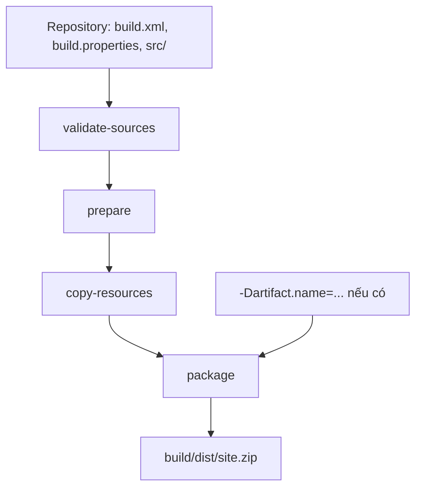

# Phát hiện đường dẫn cứng, task sao chép và property khó theo dõi trong Apache Ant

Một file `build.xml` có thể chạy ổn định trong nhiều năm nhưng ngày càng khó sửa: đường dẫn xuất hiện trực tiếp trong từng task, cùng một thao tác bị chép đi chép lại, và không ai biết chính xác property được nạp từ file nào hay vì sao giá trị truyền từ CI không có tác dụng. Những dấu hiệu này không nhất thiết gây lỗi ngay; chúng làm chi phí bảo trì tăng lên mỗi khi đổi máy, thêm module, thay cấu trúc thư mục hoặc điều chỉnh pipeline.

Trong **Build Tool Ant → Bảo trì**, bài học này hướng dẫn cách **phát hiện và truy vết** ba nhóm vấn đề:

1. **Đường dẫn cứng (hard-coded paths):** đường dẫn đến máy cá nhân, thư mục ngoài dự án hoặc những vị trí lặp lại trực tiếp trong task.
2. **Task sao chép hoặc lặp lại:** nhiều đoạn `<copy>` giống nhau, các chuỗi `<javac>`/`<jar>` được copy-paste, hay nhiều target thực hiện cùng một chính sách nhưng sửa không đồng bộ.
3. **Property khó theo dõi:** tên mơ hồ, nguồn giá trị rải rác giữa `-D`, file, environment, `<import>`, hoặc thứ tự khai báo khiến giá trị thực tế khác với dự định.

Mục tiêu của bảo trì không phải giảm số dòng XML bằng mọi giá. Một refactor tốt phải giữ được ý nghĩa của build: cùng đầu vào thì vẫn tạo đúng đầu ra, target vẫn có thứ tự phụ thuộc, tùy chọn có cùng độ ưu tiên và các lỗi thiếu dữ liệu vẫn được báo rõ ràng.

## 1. Nhìn từ triệu chứng tới nguyên nhân

| Triệu chứng khi bảo trì | Dấu hiệu trong Ant | Tác động |
| --- | --- | --- |
| Build chạy trên máy A nhưng hỏng trên máy B | `C:\Users\...`, `/home/...`, `${user.home}/Downloads` | Đầu vào chỉ tồn tại trên một máy |
| Đổi tên `build/` phải sửa nhiều nơi | `destdir="build/classes"`, `todir="build/out"` lặp lại | Một thay đổi cần chỉnh nhiều task |
| Thêm một resource phải sửa ba target | Nhiều `<copy>` có cùng nguồn, đích và policy | Bỏ sót một nơi sẽ làm các gói không nhất quán |
| Hai module biên dịch theo hai cách khác nhau | Các `<javac>` được copy-paste với tùy chọn lệch nhau | Có thể khác encoding, classpath hoặc phiên bản Java |
| `-Dbuild.mode=ci` không hoạt động như mong đợi | Target dùng `env.MODE` thay vì `build.mode` | Có nhiều tên cho cùng một khái niệm |
| Property có giá trị khác với khai báo gần target | `<property>` nằm trong file import hoặc file nạp trước | Ant giữ giá trị được đặt trước |
| Một file không được đóng gói mà build vẫn thành công | `<fileset>` hoặc `<copy>` chọn file bằng pattern quá rộng/hẹp | Có thể âm thầm bỏ qua tài nguyên bắt buộc |
| Chạy target độc lập khác kết quả khi chạy cả pipeline | Target dựa vào property/file do target khác tạo mà không khai báo dependency | Build phụ thuộc ngầm vào thứ tự gọi |

Ba nhóm này thường liên quan nhau. Một đoạn `<copy>` bị lặp ở bốn target sẽ chứa bốn lần đường dẫn cứng; khi đổi từ thư mục cá nhân sang workspace CI, có thể chỉ sửa được ba lần. Một property chung được đặt tên rõ ràng giúp sửa đường dẫn tại một điểm, nhưng nếu thứ tự nạp property không rõ thì lại tạo lỗi khác.

## 2. Đường dẫn cứng là gì?

Một đường dẫn cứng là một vị trí được gắn trực tiếp vào cấu hình ở nơi đáng lẽ phải có **một nguồn cấu hình rõ ràng**. Vấn đề có thể là đường dẫn tuyệt đối gắn với máy, hoặc một đường dẫn tương đối xuất hiện nhiều lần nhưng không dùng chung quy ước.

### 2.1. Đường dẫn phụ thuộc máy cá nhân

```xml
<project name="legacy-app" default="compile">
    <property name="external.jar"
              location="C:\Users\linh\Downloads\utility.jar"/>

    <target name="compile">
        <mkdir dir="C:\Users\linh\Desktop\output"/>
        <javac srcdir="D:\work\legacy-app\src"
               destdir="C:\Users\linh\Desktop\output"
               classpath="${external.jar}"/>
    </target>
</project>
```

Người viết có thể build được vì các đường dẫn này có thật trên máy của họ. Trên máy khác hoặc khi CI checkout vào một workspace mới, `Downloads`, `Desktop` hay ổ `D:` không tồn tại tương ứng.

Các biến thể khó nhìn thấy hơn:

```xml
<property name="jar.path"
          location="${user.home}/Downloads/utility.jar"/>
<property name="my.tools"
          location="${env.HOME}/tools"/>
<property name="shared.config"
          location="../../../../shared/config.xml"/>
```

`${user.home}` và `${env.HOME}` linh hoạt về *tên người dùng*, nhưng vẫn dựa vào dữ liệu bên ngoài repository. Đường dẫn đi lên nhiều cấp bằng `../` có thể thoát khỏi workspace và trỏ đến file không được khai báo. Những đường dẫn như vậy cần được xem lại theo chức năng thực tế của chúng.

### 2.2. Đường dẫn tương đối lặp lại cũng có thể là mùi bảo trì

```xml
<target name="compile">
    <mkdir dir="build/generated/classes"/>
    <javac srcdir="src/main/java"
           destdir="build/generated/classes"
           includeantruntime="false"/>
</target>

<target name="jar" depends="compile">
    <jar basedir="build/generated/classes"
         destfile="build/packages/app.jar"/>
</target>

<target name="clean">
    <delete dir="build/generated"/>
    <delete dir="build/packages"/>
</target>
```

Đoạn trên không gắn với máy cá nhân, nhưng thư mục class và output được lặp nhiều lần. Nếu thay bố cục `build/generated/classes`, có thể quên sửa `jar` hoặc `clean`. Giải pháp là **đặt tên những đường dẫn có ý nghĩa** và cho mọi target dùng chung.

### 2.3. Không phải đường dẫn cố định nào cũng sai

`src/main/java` hay `build/classes` là các **đường dẫn trong cấu trúc dự án**; việc dùng chúng làm mặc định là hợp lý. Một endpoint hoặc path do CI truyền qua `-Dconfig.file=...` cũng có thể là đầu vào hợp lệ. Điều cần phân biệt:

| Kiểu đường dẫn | Có nên giữ? | Điều kiện |
| --- | --- | --- |
| `src/main/java` nằm trong repository | Có | Thuộc cấu trúc dự án được quy ước |
| `build/classes` làm output | Có, nên đặt thành property | Có chủ sở hữu và được tạo/dọn theo hợp đồng |
| `C:\Users\linh\...` nằm trong `build.xml` | Không | Thay bằng đường dẫn dự án hoặc đầu vào bên ngoài tường minh |
| `${user.home}/Downloads/tool.jar` | Không nên | Dependency cần có phiên bản và nguồn cung cấp xác định |
| `/ci/secrets/signing.properties` từ CI | Có thể | Chỉ truyền khi cần, kiểm tra tồn tại, bảo vệ secret |
| `https://repository.example/...` | Phụ thuộc mục đích | Đây là URL cấu hình, không nhất thiết là filesystem path; cần xác định nguồn và quyền truy cập |

Không nên sửa tất cả đoạn chứa ký tự `/` một cách máy móc. URL, tên package, đường dẫn resource trong JAR và file path của Ant có ngữ nghĩa khác nhau.

## 3. Dùng `basedir` và property để tách cấu trúc dự án khỏi vị trí checkout

Ant có project base directory, thường được xác định từ file `build.xml` và thuộc tính `basedir` của `<project>`. Đường dẫn của dự án nên neo ở đây thay vì gắn với thư mục home hoặc thư mục nơi người dùng mở terminal.

```xml
<project name="portable-app" default="package" basedir=".">
    <property name="src.dir" location="src/main/java"/>
    <property name="resources.dir" location="src/main/resources"/>
    <property name="build.dir" location="build"/>
    <property name="classes.dir" location="${build.dir}/classes"/>
    <property name="dist.dir" location="${build.dir}/dist"/>

    <target name="compile">
        <mkdir dir="${classes.dir}"/>
        <javac srcdir="${src.dir}"
               destdir="${classes.dir}"
               encoding="UTF-8"
               includeantruntime="false"/>
    </target>

    <target name="package" depends="compile">
        <mkdir dir="${dist.dir}"/>
        <jar basedir="${classes.dir}"
             destfile="${dist.dir}/app.jar"/>
    </target>

    <target name="clean">
        <delete dir="${build.dir}"/>
    </target>
</project>
```

Thuộc tính `location` trên `<property>` cho Ant xử lý một path dựa trên project base directory. Khi dự án được checkout trong `D:\workspace\project` hay `/srv/ci/job/project`, các task vẫn dùng cùng cấu trúc bên trong dự án.

Việc gom đường dẫn thành property còn giúp đọc ý định. `${classes.dir}` truyền đạt chức năng rõ hơn một chuỗi `build/generated/classes` lặp đi lặp lại.

**Quy tắc:** chỉ tạo property cho đường dẫn có ý nghĩa dùng chung, đường dẫn có thể thay đổi theo môi trường hoặc đường dẫn phức tạp. Không cần tạo hàng chục tên cho những path chỉ xuất hiện một lần và không có giá trị biểu đạt riêng.

### Đặc biệt lưu ý file được `<import>`

Khi dùng `<import file="build/common.xml"/>`, các khai báo trong file import thường tham gia cùng project chính; không được giả định `${basedir}` tự đổi thành thư mục của file import.

Nếu file import cần tham chiếu template nằm cạnh chính nó, có thể xác định thư mục của file đó thông qua `ant.file.<project-name>` và `<dirname>`:

```xml
<!-- Trong build/common.xml, giả sử <project name="common">. -->
<dirname property="common.dir"
         file="${ant.file.common}"/>
<property name="common.template"
          location="${common.dir}/templates/config.xml"/>
```

Đây là trường hợp cần phân biệt **gốc project đang build** và **gốc của file script được import**. Nếu không, file import có thể chạy đúng khi đứng riêng nhưng sai khi được gọi từ project cha.

## 4. Phát hiện đường dẫn cứng bằng kiểm tra có hệ thống

Không nên chỉ tìm chuỗi `C:\Users` rồi kết luận đã xử lý xong. Hãy đi từ toàn bộ điểm vào của build, xác định các task có đọc/ghi file và lần theo các property.

### 4.1. Kiểm tra nơi đường dẫn thường xuất hiện

| Nhóm Ant | Thuộc tính hoặc thành phần nên xem |
| --- | --- |
| Input/output file | `file`, `dir`, `todir`, `tofile`, `destfile`, `srcdir`, `destdir` |
| Resource collections | `<fileset dir="...">`, `<filelist>`, `<path>`, `<pathelement>` |
| Toolchain và dependency | `classpath`, `<classpath>`, `executable`, `<java>`, `<exec>` |
| File cấu hình | `<property file="...">`, `<loadproperties>`, template, filter file |
| Kịch bản nhiều file Ant | `<import>`, `<include>`, `<ant antfile="...">`, `<subant>` |
| Đầu ra phát hành | `<jar>`, `<zip>`, `<copy>`, `<move>`, upload/publish scripts |
| Công cụ ngoài | Tham số đường dẫn trong `<arg>` hoặc script được gọi |

Mỗi trường hợp cần hỏi: đường dẫn đến từ **repository**, từ **output được tạo lại**, từ **dependency được khai báo**, hay từ **trạng thái máy chạy**?

### 4.2. Tìm dấu hiệu trong mã nguồn bằng tìm kiếm văn bản

Trong một repository có `rg` (ripgrep), có thể bắt đầu với:

```bash
rg -n -g '*.xml' -g '*.properties' \
  -e 'user\.home' -e 'env\.HOME' -e 'env\.USERPROFILE' \
  -e 'C:\\' -e '/Users/' -e '/home/' -e '\.\./' .
```

Lệnh dùng cú pháp tiếp dòng của shell Unix; trong PowerShell có thể nhập thành một dòng. Một số mẫu sẽ cho kết quả không liên quan, ví dụ ví dụ minh họa trong tài liệu hoặc thư mục cha hợp lệ. Đây là **danh sách vị trí cần xem**, không phải bộ phân tích khẳng định mọi kết quả đều sai.

Để tìm tác vụ thực sự tương tác với đường dẫn:

```bash
rg -n -g '*.xml' \
  -e '<(copy|move|javac|jar|zip|unzip|exec)\b' \
  -e '<(property|fileset|pathelement)\b' .
```

Nếu không có `rg`, có thể dùng tìm kiếm IDE, `git grep` hoặc công cụ tương đương. Ưu tiên tìm trong file thuộc phạm vi dự án; log và thư mục `build/` được sinh ra thường không phải nguồn sửa chữa.

### 4.3. Lập bảng đường dẫn: nguồn, tác vụ, ý nghĩa

Với mỗi đường dẫn có khả năng gây vấn đề, ghi tối thiểu:

| Vị trí phát hiện | Đang phục vụ điều gì? | Nguồn dữ liệu thực tế | Hướng xử lý |
| --- | --- | --- | --- |
| `compile` dùng `/home/linh/lib/core.jar` | JAR biên dịch | Máy cá nhân | Đưa vào dependency được quản lý |
| `copy-assets` dùng `src/assets` | Resource đầu vào | Repository | Giữ; đặt property nếu dùng nhiều nơi |
| `package` dùng `build/out` | Output gói | Do build tạo | Dùng chung `dist.dir` |
| `sign` dùng `${env.SIGNING_FILE}` | Tệp ký riêng của CI | CI cung cấp | Validate và giới hạn quyền |
| `import` dùng `../common/build.xml` | Logic build dùng chung | Có thể nằm ngoài checkout | Xác định ownership và cơ chế phân phối |

Bảng này giúp tránh refactor nhầm. Một JAR bên ngoài project không thể được “sửa” chỉ bằng cách đổi tên property; cần xác định **ai cung cấp JAR, ở phiên bản nào, vào thời điểm nào**.

## 5. Task sao chép: hai kiểu lặp thường gặp

Cụm “task sao chép” có thể chỉ cả **task `<copy>` của Ant** lẫn **các đoạn task bị copy-paste** trong `build.xml`. Hai kiểu đều có thể gây nợ bảo trì.

### 5.1. Nhiều `<copy>` cùng làm một công việc

```xml
<target name="assets">
    <copy file="src/assets/logo.svg"
          todir="build/site/assets"/>
    <copy file="src/assets/site.css"
          todir="build/site/assets"/>
    <copy file="src/assets/app.js"
          todir="build/site/assets"/>
</target>
```

Nếu ba file cùng tuân theo một chính sách sao chép và cùng nằm trong một thư mục nguồn, có thể dùng **resource collection**:

```xml
<property name="assets.src.dir" location="src/assets"/>
<property name="assets.out.dir" location="build/site/assets"/>

<target name="assets">
    <mkdir dir="${assets.out.dir}"/>
    <copy todir="${assets.out.dir}">
        <fileset dir="${assets.src.dir}">
            <include name="logo.svg"/>
            <include name="site.css"/>
            <include name="app.js"/>
        </fileset>
    </copy>
</target>
```

Lúc này nơi xác định **source**, **destination** và **chính sách copy** đều dễ tìm. Nếu chính sách cho phép sao chép toàn bộ asset directory, có thể bỏ các `<include>` và sử dụng `<fileset dir="${assets.src.dir}"/>`. Nhưng chỉ làm vậy nếu việc đưa các file mới trong thư mục vào gói là đúng với yêu cầu của dự án.

**Lưu ý về file bắt buộc:** một `<fileset>` với pattern có thể không chọn file không tồn tại mà không báo lỗi cụ thể cho từng tên file. Nếu `logo.svg` là artifact bắt buộc, hãy dùng `<available>` kết hợp `<fail>` để báo lỗi khi thiếu thay vì coi một tập file rỗng là hợp lệ.

### 5.2. Task `<copy>` bị lặp ở nhiều target

```xml
<target name="package-dev">
    <copy todir="build/dev/config">
        <fileset dir="src/common-config"/>
    </copy>
    <!-- Các bước riêng của dev -->
</target>

<target name="package-prod">
    <copy todir="build/prod/config">
        <fileset dir="src/common-config"/>
    </copy>
    <!-- Các bước riêng của prod -->
</target>
```

Hai target có chính sách copy giống nhau, chỉ khác nơi đặt đầu ra. Có thể trừu tượng hóa bằng `<macrodef>`:

```xml
<property name="config.src.dir" location="src/common-config"/>

<macrodef name="copy-common-config">
    <attribute name="destination"/>
    <sequential>
        <mkdir dir="@{destination}"/>
        <copy todir="@{destination}">
            <fileset dir="${config.src.dir}"/>
        </copy>
    </sequential>
</macrodef>

<target name="package-dev">
    <copy-common-config destination="build/dev/config"/>
</target>

<target name="package-prod">
    <copy-common-config destination="build/prod/config"/>
</target>
```

Giờ đây, thay chính sách copy (ví dụ loại trừ file tạm hoặc thêm filter) chỉ cần sửa một nơi. Vẫn giữ hai target vì chúng là hai **hành động nghiệp vụ khác nhau**.

Nếu một target cần lọc template còn target kia phải giữ byte gốc, **không nên ép cả hai dùng cùng macrodef mặc định** nếu điều đó che giấu sự khác biệt. Có thể dùng hai macro rõ nghĩa hoặc một macro có tham số được tài liệu hóa kỹ.

### 5.3. Copy-paste các task không phải `<copy>`

```xml
<target name="compile-core">
    <mkdir dir="build/classes/core"/>
    <javac srcdir="src/core"
           destdir="build/classes/core"
           encoding="UTF-8"
           includeantruntime="false"/>
</target>

<target name="compile-api">
    <mkdir dir="build/classes/api"/>
    <javac srcdir="src/api"
           destdir="build/classes/api"
           encoding="UTF-8"
           includeantruntime="false"/>
</target>
```

Ở đây bộ quy tắc biên dịch giống nhau, còn tham số module khác nhau. Có thể định nghĩa:

```xml
<property name="modules.src.dir" location="src"/>
<property name="modules.classes.dir" location="build/classes"/>

<macrodef name="compile-module">
    <attribute name="module"/>
    <sequential>
        <mkdir dir="${modules.classes.dir}/@{module}"/>
        <javac srcdir="${modules.src.dir}/@{module}"
               destdir="${modules.classes.dir}/@{module}"
               encoding="UTF-8"
               includeantruntime="false"/>
    </sequential>
</macrodef>

<target name="compile-core">
    <compile-module module="core"/>
</target>

<target name="compile-api">
    <compile-module module="api"/>
</target>
```

`@{module}` là tham số của macro, khác với `${property}` là cú pháp property của Ant. Macro giúp gom **chính sách giống nhau**, còn target và `depends` tiếp tục mô tả thứ tự công việc. Chỉ dùng macro khi các module thật sự có chung cách biên dịch; nếu mỗi module có dependency và classpath khác nhau, cần làm rõ sự khác biệt trước khi trừu tượng hóa.

## 6. Khi nào gộp task, khi nào giữ tách?

Mục đích là loại bỏ **sự lặp lại gây khó sửa**, không biến mọi task giống nhau thành một cấu hình bí ẩn.

| Tình huống | Hướng bảo trì |
| --- | --- |
| Nhiều file copy vào cùng đích, cùng quy tắc | Một `<copy>` với `<fileset>` phù hợp |
| Nhiều target copy cùng nguồn nhưng đích khác | `<macrodef>` có tham số destination nếu chính sách thật sự giống |
| Nhiều task `<javac>` chia sẻ encoding và options | Gom cấu hình chung hoặc macro |
| Hai bản build có classpath/flag khác nhau vì mục đích thật | Giữ sự khác biệt, ghi rõ chính sách |
| Task có cùng tên nhưng chạy ở pha khác nhau | Giữ target/`depends` rõ ràng để không phá thứ tự |
| Nhiều thư mục nguồn nhưng chính sách đóng gói có thứ tự và ghi đè | Làm rõ quy tắc trùng tên trước khi gom |
| Một task đọc output của task khác | Giữ dependency, không đưa chúng vào parallel chỉ để giảm thời gian |

### Cẩn thận khi thay nhiều `<copy>` bằng một `<fileset>`

Một lần refactor có thể vô tình đổi:

- **Tập file được chọn:** include/exclude, file ẩn, thư mục rỗng hoặc nested directories.
- **Cấu trúc thư mục dưới đích:** `flatten`, `mapper` hoặc nhiều root nguồn có thể làm thay layout.
- **Cách xử lý file trùng:** một số nguồn có cùng tên file và cùng dest.
- **Filter/encoding:** `filtering` hoặc `<filterset>` có thể thay đổi nội dung text, không phù hợp với binary.
- **Chính sách cập nhật:** timestamp, `overwrite`, `preservelastmodified` và các task kiểm tra up-to-date có thể ảnh hưởng khi copy lại.
- **Báo lỗi:** `file` trực tiếp và `fileset` có thể khác nhau khi một resource bị thiếu.

Vì vậy, cần xác định trước **file nào phải được tạo, tên tương đối ra sao, file nào bị loại trừ và file thiếu có làm build thất bại không**. Sau đó mới chọn cách viết ngắn hơn.

## 7. Property khó theo dõi: nguyên nhân gốc

Một property trong Ant có thể đến từ rất nhiều nơi:

```text
ant -Dbuild.mode=ci ...
    |
    +--> -propertyfile ci.properties
    |
    +--> <property environment="env"/>
    |         |
    |         +--> <condition property="build.mode" value="..."/>
    |
    +--> <property file="build.properties"/>
    |
    +--> <import file="build/common.xml"/>
    |
    +--> <property name="build.mode" value="local"/>
    |
    +--> target dùng ${build.mode}
```

Điểm quyết định là: **property thông thường có ngữ nghĩa bất biến sau lần đặt đầu tiên**. Khai báo có cùng tên ở phía sau thường không thay thế giá trị đã có.

Ví dụ:

```xml
<property name="output.dir" value="build/local"/>
<property name="output.dir" value="build/ci"/>
<echo message="${output.dir}"/>
```

Giá trị được in là `build/local`, không phải `build/ci`. Tác giả có thể đọc khai báo ở gần cuối và tưởng đã đổi thành công, nhưng Ant vẫn giữ giá trị đầu.

Khi chạy:

```bash
ant -Doutput.dir=build/from-cli show
```

property được cấp trên command line sẽ có độ ưu tiên cao hơn cùng tên trong build file. Vì thế cả **thứ tự trong XML** lẫn **cách gọi Ant** đều quan trọng.

### 7.1. Một khái niệm, nhiều tên

```xml
<property environment="env"/>
<property name="out.dir" location="build/out"/>
<property name="dist.path" location="build/out"/>

<target name="package">
    <jar destfile="${dist.path}/app.jar" basedir="build/classes"/>
</target>
```

Nếu CI gửi `-Dout.dir=build/ci` thì target `package` vẫn dùng `dist.path`. Vấn đề ở đây không phải Ant bỏ qua `-D`, mà là cấu hình có **hai tên cho một khái niệm**.

Nên chọn tên thể hiện vai trò, chẳng hạn `dist.dir`, và yêu cầu mọi target dùng cùng một property. Nếu cần giữ alias tương thích trong giai đoạn chuyển đổi, phải ghi rõ property nào là canonical, property nào deprecated và cách xử lý xung đột giữa hai tên.

### 7.2. Thứ tự nạp làm mất override

Không nên:

```xml
<property name="build.profile" value="dev"/>
<property environment="env"/>
<condition property="build.profile"
           value="${env.BUILD_PROFILE}">
    <isset property="env.BUILD_PROFILE"/>
</condition>
```

Ở ví dụ này, `build.profile` đã được đặt thành `dev`, nên `<condition>` không ghi đè được nữa.

Nên đặt nguồn được ưu tiên trước:

```xml
<property environment="env"/>

<condition property="build.profile"
           value="${env.BUILD_PROFILE}">
    <isset property="env.BUILD_PROFILE"/>
</condition>

<property file="build.properties"/>
<property name="build.profile" value="dev"/>
```

Với cách này, nếu command line đã cấp `-Dbuild.profile=ci`, giá trị đó vẫn được giữ. Nếu không có, Ant dùng biến `BUILD_PROFILE` khi tồn tại; tiếp theo là file được nạp; cuối cùng mới đến default `dev`.

Một biến môi trường tồn tại nhưng có giá trị rỗng vẫn có thể được chọn. Với các property quan trọng, cần bổ sung kiểm tra chuỗi rỗng và tập giá trị hợp lệ.

### 7.3. Nạp environment không tự tạo tên property mong muốn

```xml
<property environment="env"/>
```

Nếu hệ điều hành có biến `BUILD_PROFILE=ci`, Ant nạp vào `env.BUILD_PROFILE`. Nó **không tự tạo `build.profile`**. Đây là nguyên nhân phổ biến khiến một target thấy giá trị mặc định dù biến CI đã được đặt.

Tên property Ant phân biệt chữ hoa và chữ thường. Đừng nhầm `build.profile` với `BUILD_PROFILE` hoặc `env.BUILD_PROFILE`.

### 7.4. Property dùng chung và property chỉ dành cho một target

Property có vai trò toàn project nên có tên ổn định và được định nghĩa ở khu vực cấu hình rõ ràng. Với biến chỉ cần trong một phạm vi nhỏ, Ant hỗ trợ `<local>` để khai báo tên property cục bộ trong phạm vi phù hợp (trên các phiên bản Ant hiện đại).

```xml
<target name="prepare-report">
    <local name="report.tmp.dir"/>
    <property name="report.tmp.dir"
              location="${build.dir}/tmp/report"/>
    <mkdir dir="${report.tmp.dir}"/>
</target>
```

Việc tách phạm vi giúp tránh vô tình giữ lại một property tạm và tác động đến target khác trong cùng build. Tuy nhiên, không dùng `<local>` để thay thế các property giao diện mà CI hoặc target khác cần truyền vào.

## 8. Truy vết một property theo từng tầng

Khi gặp giá trị “không hiểu từ đâu ra”, cách làm hiệu quả nhất là **bắt đầu từ nơi dùng**, rồi quay ngược về nơi thiết lập.

Giả sử:

```xml
<jar destfile="${release.dir}/app.jar"
     basedir="${classes.dir}"/>
```

Thực hiện lần lượt:

1. **Xác định tên property thực sự được dùng**: ở đây là `release.dir`, không phải tên gần giống `dist.dir` hoặc `output.dir`.
2. **Tìm mọi điểm định nghĩa**: `<property name="release.dir">`, `<condition property="release.dir">`, file `.properties`, `-Drelease.dir`.
3. **Xem các file được nhập**: `<import>`, `<include>`, `<property file>` và đoạn macro có thể chứa khai báo khác.
4. **Kiểm tra lệnh Ant do CI thực thi**: có `-D`, `-propertyfile` hoặc script wrapper đặt property không?
5. **Xác định thứ tự nạp**: giá trị đã được đặt sớm chưa; sau đó có khai báo nào tưởng là override nhưng không có hiệu lực?
6. **Xác định môi trường của tiến trình Ant**: nếu có `<property environment="env"/>`, biến có tồn tại và tên đúng case không?
7. **Ghi nhận kết quả thành một hợp đồng**: property này dùng để làm gì, default nào, nguồn override nào được cho phép và ai sở hữu nó?

Có thể tìm tên bằng:

```bash
rg -n -F 'release.dir' -g '*.xml' -g '*.properties' .
```

Trong Git repository, cũng có thể dùng:

```bash
git grep -n 'release.dir' -- '*.xml' '*.properties'
```

Hai lệnh này chỉ giúp tìm vị trí chứa chuỗi; chúng **không tự tính thứ tự khai báo thực tế** khi có import, condition hoặc target được gọi qua `<ant>` / `<antcall>`. Phải đọc luồng cấu hình và cách chạy cụ thể.

### Những công cụ quan sát có ích

- `ant -p` hoặc `ant -projecthelp` giúp xem các target được mô tả để biết điểm vào của build.
- `ant -verbose <target>` có thể cung cấp thêm thông tin về task và resource được xử lý.
- `ant -debug <target>` cho log chi tiết hơn khi cần điều tra một vấn đề khó.
- `ant -diagnostics` cung cấp thông tin chẩn đoán về môi trường Ant/Java cho tình huống khác biệt giữa máy.
- Một `<echo message="dist.dir=${dist.dir}"/>` được đặt tạm ở vị trí không nhạy cảm có thể giúp xác nhận giá trị hiệu lực.

**Không bật log chi tiết trên job có secret mà không kiểm soát nội dung**. Property có thể chứa token hoặc credential, và log hay `<echoproperties>` có thể lộ chúng. Ant cũng không tự tạo một bảng “property X xuất phát từ dòng Y” có thể tin cậy cho mọi trường hợp. Truy vết nguồn vẫn cần dựa trên lệnh chạy, thứ tự nạp và cấu trúc build.

## 9. Thiết kế một sơ đồ sở hữu property dễ bảo trì

Một thiết kế dễ theo dõi thường tách rõ các loại property:

| Nhóm | Ví dụ | Chính sách |
| --- | --- | --- |
| Cấu trúc dự án | `src.dir`, `resources.dir` | Định nghĩa dựa trên `basedir` |
| Output và staging | `build.dir`, `classes.dir`, `dist.dir` | Có chủ sở hữu; output có thể xóa và tạo lại |
| Phiên bản và toolchain | `java.release`, `compiler.encoding` | Cấu hình có version; CI/local thống nhất |
| Tham số lượt chạy | `release.version`, `build.profile` | CI truyền bằng `-D` hoặc environment được ánh xạ |
| Dependency | `lib.dir`, classpath `id` | Một nguồn dependency rõ ràng; không phụ thuộc JAR trong home |
| Secret và cấu hình ngoài | `env.SIGNING_FILE` | Không in log; kiểm tra tồn tại; chỉ cấp cho target cần dùng |
| Tạm thời nội bộ | `report.tmp.dir` | Nếu cần, dùng phạm vi `<local>` và tên có nghĩa |

Nên ghi một **bảng hợp đồng property** ngắn tại khu vực cấu hình hoặc tài liệu dự án:

| Property | Bắt buộc? | Nguồn ưu tiên | Giá trị mặc định | Target dùng |
| --- | --- | --- | --- | --- |
| `build.dir` | Không | `-D`, default | `build` | compile, package, clean |
| `java.release` | Có | file dự án | `17` trong ví dụ | compile |
| `build.profile` | Có khi phát hành | `-D`, environment | `dev` cho local | validate, package |
| `release.version` | Có khi phát hành | `-D` hoặc CI | Không đặt default giả | package, publish |
| `signing.file` | Có với target sign | CI cấp | Không | sign |

Điểm quan trọng là không tạo ra hai property cùng nghĩa. Khi tên được dùng nhất quán, người bảo trì không cần đoán target đang đọc `out.dir`, `output` hay `dist.path`.

## 10. Refactor các task lặp lại bằng đúng công cụ của Ant

Ant cung cấp một số cơ chế có mục đích khác nhau:

| Cơ chế | Khi nào phù hợp | Điều cần nhớ |
| --- | --- | --- |
| `<property>` | Đặt tên chung cho giá trị/đường dẫn | Property thường bất biến; thứ tự nạp quyết định ưu tiên |
| `<path id="...">` | Dùng chung classpath hoặc path collection | Có thể tham chiếu bằng `refid` |
| `<fileset>` | Chọn tập file theo quy tắc | Phải xem include/exclude, hành vi khi file thiếu |
| `<macrodef>` | Gói một chuỗi task có tham số | `@{...}` là tham số macro; không tự mô tả dependency giữa target |
| `<presetdef>` | Định nghĩa task với tùy chọn mặc định chung | Hợp với việc chuẩn hóa các attribute của một loại task |
| Target + `depends` | Mô tả các pha và thứ tự thực hiện | Dùng cho việc cần dependency thật |
| `<import>` / `<include>` | Tái sử dụng định nghĩa build từ file khác | Cần hiểu namespace, basedir và tên target |

### 10.1. Chia sẻ classpath bằng `<path>`

Không nên lặp danh sách JAR dài trong từng `<javac>`:

```xml
<path id="compile.classpath">
    <fileset dir="lib" includes="*.jar"/>
</path>

<target name="compile">
    <mkdir dir="${classes.dir}"/>
    <javac srcdir="${src.dir}"
           destdir="${classes.dir}"
           includeantruntime="false">
        <classpath refid="compile.classpath"/>
    </javac>
</target>
```

Nếu dự án sử dụng thư viện bên ngoài, bản thân thư mục `lib/` hoặc cơ chế tải dependency vẫn cần được quản lý rõ về phiên bản và nguồn gốc. Chia sẻ classpath giải quyết duplication trong XML, không tự giải quyết dependency thiếu hoặc phụ thuộc vào cache của máy cá nhân.

### 10.2. Chuẩn hóa attribute bằng `<presetdef>`

```xml
<presetdef name="strict-javac">
    <javac encoding="UTF-8"
           includeantruntime="false"/>
</presetdef>

<target name="compile">
    <mkdir dir="${classes.dir}"/>
    <strict-javac srcdir="${src.dir}"
                  destdir="${classes.dir}"/>
</target>
```

`<presetdef>` hữu ích khi mục tiêu là dùng cùng cấu hình mặc định cho task. `<macrodef>` phù hợp hơn khi cần ghép nhiều bước như `mkdir` rồi `javac`, hoặc khi có nhiều tham số. Không tạo một cơ chế trừu tượng hóa phức tạp nếu chỉ có hai dòng rõ ràng được dùng một lần.

### 10.3. Target dependency khác với macro

```xml
<target name="prepare">
    <mkdir dir="${classes.dir}"/>
</target>

<target name="compile" depends="prepare">
    <javac srcdir="${src.dir}"
           destdir="${classes.dir}"
           includeantruntime="false"/>
</target>
```

`depends="prepare"` diễn tả quan hệ **prepare phải chạy trước compile**. Macro mô tả một thao tác tái sử dụng và được gọi tại vị trí sử dụng. Không dùng macro để che giấu thứ tự target nếu điều đó làm người bảo trì khó nhìn thấy dependency.

## 11. Ví dụ chuyển đổi tổng hợp: từ build khó bảo trì sang cấu trúc dễ đọc

Giả sử một dự án cần đóng gói hai asset `logo.svg` và `site.css` cùng tài liệu `guide.txt` vào ZIP. Build ban đầu:

```xml
<project name="legacy-site" default="package">
    <property name="dir" value="C:/Users/linh/work/site"/>
    <property name="output" value="C:/Users/linh/Desktop/site-dist"/>
    <property name="output" value="build/dist"/>

    <target name="package">
        <mkdir dir="${output}"/>
        <copy file="${dir}/src/assets/logo.svg"
              todir="${output}/assets"/>
        <copy file="${dir}/src/assets/site.css"
              todir="${output}/assets"/>
        <copy file="${dir}/src/docs/guide.txt"
              todir="${output}/docs"/>
        <zip destfile="${output}/site.zip"
             basedir="${output}"/>
    </target>
</project>
```

Các điểm khó bảo trì:

- `dir` và `output` quá chung chung, không nói rõ là source root hay distribution root.
- Hai đường dẫn đều chứa thư mục người dùng.
- `output` được khai báo hai lần; khai báo `build/dist` thứ hai không thay được giá trị đầu.
- Hai thao tác copy asset giống nhau nhưng được viết tách riêng.
- `zip` đọc ngay thư mục `output`, đồng thời file ZIP cũng nằm trong cùng cây. Cấu trúc đầu vào và đầu ra không được phân ranh rõ ràng, gây khó kiểm soát nội dung các lần build sau.
- Không có bước kiểm tra file nguồn bắt buộc, không tách `clean`, staging và distribution.

Một bản viết lại cho ví dụ này có cấu trúc:

```text
site/
├── build.xml
├── build.properties
├── src/
│   ├── assets/
│   │   ├── logo.svg
│   │   └── site.css
│   └── docs/
│       └── guide.txt
└── build/                      # Ant tạo; không commit
```

File `build.properties` có thể chứa cấu hình không bí mật:

```properties
artifact.name=site
```

File `build.xml`:

```xml
<?xml version="1.0" encoding="UTF-8"?>
<project name="site" default="package" basedir=".">
    <!-- CLI -D ưu tiên hơn cấu hình chung. -->
    <property file="build.properties"/>
    <property name="artifact.name" value="site"/>

    <property name="assets.src.dir" location="src/assets"/>
    <property name="docs.src.dir" location="src/docs"/>
    <property name="build.dir" location="build"/>
    <property name="stage.dir" location="${build.dir}/stage"/>
    <property name="assets.out.dir"
              location="${stage.dir}/assets"/>
    <property name="docs.out.dir"
              location="${stage.dir}/docs"/>
    <property name="dist.dir" location="${build.dir}/dist"/>

    <target name="validate-sources">
        <available file="${assets.src.dir}/logo.svg"
                   property="logo.available"/>
        <available file="${assets.src.dir}/site.css"
                   property="css.available"/>
        <available file="${docs.src.dir}/guide.txt"
                   property="guide.available"/>
        <fail unless="logo.available"
              message="Thiếu src/assets/logo.svg"/>
        <fail unless="css.available"
              message="Thiếu src/assets/site.css"/>
        <fail unless="guide.available"
              message="Thiếu src/docs/guide.txt"/>
    </target>

    <target name="prepare" depends="validate-sources">
        <mkdir dir="${assets.out.dir}"/>
        <mkdir dir="${docs.out.dir}"/>
        <mkdir dir="${dist.dir}"/>
    </target>

    <target name="copy-resources" depends="prepare">
        <copy todir="${assets.out.dir}">
            <fileset dir="${assets.src.dir}">
                <include name="logo.svg"/>
                <include name="site.css"/>
            </fileset>
        </copy>

        <copy file="${docs.src.dir}/guide.txt"
              todir="${docs.out.dir}"/>
    </target>

    <target name="package" depends="copy-resources">
        <zip basedir="${stage.dir}"
             destfile="${dist.dir}/${artifact.name}.zip"/>
        <echo message="Đã tạo ${dist.dir}/${artifact.name}.zip"/>
    </target>

    <target name="clean">
        <delete dir="${build.dir}"/>
    </target>
</project>
```

Chạy ở thư mục dự án:

```bash
ant clean package
```

Hoặc khi CI muốn đổi tên artifact mà không sửa XML:

```bash
ant -Dartifact.name=site-ci clean package
```

Đầu ra có dạng:

```text
build/
├── stage/
│   ├── assets/
│   │   ├── logo.svg
│   │   └── site.css
│   └── docs/
│       └── guide.txt
└── dist/
    └── site.zip
```

Với trường hợp override ở lệnh thứ hai, file distribution có tên `site-ci.zip`. ZIP chỉ đọc từ staging, còn file ZIP nằm ngoài staging, tránh lẫn gói đầu ra vào tập file nguồn. Các file bắt buộc đều được xác nhận trước thao tác sao chép. Nếu muốn tránh file từ một lần chạy cũ, cần thực hiện `clean` trước `package`, hoặc thiết kế lifecycle/cleanup rõ ràng hơn cho staging tùy cách dự án sử dụng Ant.

### Cấu trúc dependency sau refactor



Sơ đồ thể hiện thứ tự target: `validate-sources → prepare → copy-resources → package`. Các đường dẫn đầu vào được cố định theo project base directory; file tài nguyên cần thiết được xác định tường minh; output có chủ sở hữu và không đè lên nguồn.

## 12. Refactor theo từng bước để hạn chế thay đổi hành vi

Với file Ant lớn, sửa tất cả đường dẫn, task và property trong một lần sẽ khiến khó biết vấn đề đến từ đâu. Có thể thực hiện tuần tự:

**Bước 1 — Ghi lại điểm vào và hợp đồng đầu ra.** Xác định những lệnh Ant được gọi bởi developer và CI; target mặc định, các target công khai, input bắt buộc, tên/đường dẫn artifact và điều kiện báo lỗi. Đây là cơ sở để phân biệt refactor thuần cấu trúc và thay đổi chức năng.

**Bước 2 — Lập bản đồ đường dẫn.** Chia source, resources, dependency, config ngoài, cache và output. Với mỗi path, xác định dự án, CI hay người dùng nào chịu trách nhiệm cấp dữ liệu.

**Bước 3 — Đặt tên property chuẩn.** Chuyển những chuỗi lặp lại thành `src.dir`, `build.dir`, `classes.dir`, `dist.dir` và các tên thể hiện vai trò. Không giữ song song nhiều alias mơ hồ mà thiếu quy tắc ưu tiên.

**Bước 4 — Làm rõ nguồn và thứ tự property.** Sắp xếp `-D`, `-propertyfile`, environment, file dự án và default theo chính sách mong muốn. Kiểm tra những giá trị bắt buộc thay vì cho chúng âm thầm rơi về default sai.

**Bước 5 — Gom những task có chính sách giống nhau.** Dùng `<fileset>` cho nhiều file cần copy cùng quy tắc; `<path>` cho classpath; `<macrodef>` hoặc `<presetdef>` cho chuỗi task/options lặp. Giữ target dependency và khác biệt nghiệp vụ rõ ràng.

**Bước 6 — Tách nơi đọc và nơi ghi.** Staging, class output, temp và distribution cần có vị trí riêng, không xóa hoặc đóng gói ngược vào cùng source directory. Các target `clean` phải chỉ xóa output do build sở hữu.

**Bước 7 — Xác nhận hành vi bằng tình huống thực tế.** Với cùng đầu vào, so sánh danh sách file artifact, cấu trúc path, nội dung resource, classpath, kết quả task và các lỗi cần được phát hiện. Kiểm tra thêm trường hợp chạy từ thư mục khác hoặc checkout vào vị trí khác. Đây là quy trình áp dụng khi bảo trì dự án, không phải mục tiêu để chỉ dựa vào việc XML ít dòng hơn.

## 13. Các lỗi dễ mắc khi làm sạch `build.xml`

### “Chỉ cần đổi mọi đường dẫn thành `${basedir}`”

`basedir` giải quyết cách tìm đường dẫn trong project, nhưng không tự tạo JAR bị thiếu hoặc định nghĩa version của dependency. Nếu đường dẫn cứng ban đầu trỏ đến file bí mật, công cụ ngoài hoặc file được cung cấp riêng, cần đưa nó vào **hợp đồng đầu vào** với nguồn cấp và kiểm tra phù hợp.

### “`<copy>` càng ít thì càng tốt”

Hai `<copy>` có thể dùng filtering, overwrite, mapper hoặc tài nguyên khác nhau; gom thành một task có thể đổi kết quả. Chỉ gộp khi **chính sách sao chép tương đương**. Khi hai nguồn có thể sinh cùng tên file, phải làm rõ quy tắc xử lý trùng trước.

### “Thêm `<property>` phía dưới sẽ ghi đè”

Ant property thường bất biến sau khi đặt. Tìm nơi property được khai báo **đầu tiên**, kể cả giá trị từ command line, file hoặc import. Nếu cần thay đổi theo CI, sắp xếp thứ tự hoặc chuyển sang property đầu vào có tên rõ ràng.

### “Đặt mọi logic vào một macro là dễ bảo trì”

Một macro nhiều tham số tùy chọn có thể khó hiểu hơn ba target rõ ràng. Chỉ trừu tượng hóa khi có một **quy tắc chung ổn định**. Mỗi tham số cần có nghĩa cụ thể; không giấu logic phụ thuộc target trong macro.

### “`<fileset>` tự đảm bảo file quan trọng tồn tại”

Pattern của `<fileset>` chọn những file có thật. Nếu một file được yêu cầu nhưng bị xóa, nó có thể không được chọn. Với file bắt buộc, hãy thêm kiểm tra `<available>` và `<fail>`, hoặc chính sách kiểm tra khác trước khi đóng gói.

### “Build chạy thành công nên property chắc chắn đúng”

Một giá trị property không hợp lệ có thể chưa tác động đến target được gọi, hoặc được dùng tạo file sai tên mà không gây lỗi ngay. Cần kiểm tra property ở đúng **điểm sử dụng** và chỉ chạy những target dựa vào giá trị đã được xác thực.

### “Chạy `-verbose`/`-debug` trên CI là luôn an toàn”

Log chi tiết có thể hiển thị thông tin cấu hình, tham số và dữ liệu từ công cụ con. Với các property bí mật, nên tránh in giá trị hoặc toàn bộ danh sách properties. Log chỉ những metadata không nhạy cảm cần thiết để xác định nguồn và trạng thái build.

## 14. Bảng rà soát khi đọc một build Ant chưa quen

| Câu hỏi | Bằng chứng cần tìm | Hướng hành động nếu chưa rõ |
| --- | --- | --- |
| Source thực sự ở đâu? | `srcdir`, `fileset dir`, `basedir` | Đặt tên thư mục, loại path cá nhân |
| Dependency/JAR lấy ở đâu? | `classpath`, `lib.dir`, resolver | Làm rõ version và nguồn cấp |
| Output được ghi vào đâu? | `destdir`, `todir`, `destfile` | Quy về thư mục build có chủ sở hữu |
| Có hai task làm cùng việc không? | `<copy>`, `<javac>`, `<jar>` lặp options | So sánh chính sách, dùng fileset/macro khi phù hợp |
| Có file nào vừa là input vừa là output? | ZIP/JAR, cache, staging, temp | Tách output và xác định thứ tự |
| Property có một tên chuẩn không? | Tìm mọi tên cùng nghĩa | Chọn canonical name, xử lý alias cũ |
| Giá trị property đến từ đâu? | `-D`, propertyfile, env, import, default | Lập bảng ưu tiên và nguồn |
| Missing input có khiến build fail không? | `<available>`, `<fail>`, kiểm tra format | Thêm validation trước task tiêu thụ |
| Target phụ thuộc target nào? | `depends` và các target gọi nhau | Làm rõ lifecycle và thứ tự |
| CI dùng cùng cấu trúc đường dẫn không? | Lệnh trong pipeline và môi trường runner | Cố định toolchain và cấp input tường minh |

Một bản build có thể vẫn nhiều dòng XML sau khi bảo trì, nhưng sẽ dễ sửa hơn nếu mỗi đường dẫn có một ý nghĩa rõ ràng, mỗi hành động lặp có một nơi định nghĩa chính sách và mỗi property có nguồn cấp cùng thứ tự ưu tiên có thể giải thích được.

## 15. Kết luận

Ba dấu hiệu **đường dẫn cứng**, **task sao chép** và **property khó theo dõi** cùng phản ánh một vấn đề: logic build dựa vào thông tin bị rải rác hoặc ngầm định. Hãy chuyển chúng thành cấu trúc mà người khác có thể đọc và lần theo:

- Đường dẫn được neo vào project và đặt tên theo chức năng, còn đầu vào bên ngoài được khai báo rõ.
- Resource collections và macro/preset gom những **chính sách thật sự giống nhau**, trong khi target dependency vẫn dễ nhìn.
- Property có tên chuẩn, nguồn cấp, mặc định và thứ tự ưu tiên xác định; đầu vào quan trọng có kiểm tra thất bại sớm.
- Artifact được tạo trong các thư mục do build sở hữu và không vô tình lấy lại output cũ làm input.

Khi một người mới mở `build.xml`, họ nên trả lời được ba câu hỏi mà không cần đoán: **file được lấy từ đâu, task nào chịu trách nhiệm biến đổi file đó, và property nào quyết định hành vi thực tế?** Nếu câu trả lời hiển hiện trong cấu trúc project và các định nghĩa Ant, chi phí bảo trì sẽ giảm đáng kể khi dự án thay đổi.

## Tài liệu tham khảo

- [Apache Ant Manual — Property](https://ant.apache.org/manual/Tasks/property.html): property theo file, environment, location và quy tắc bất biến.
- [Apache Ant Manual — Copy](https://ant.apache.org/manual/Tasks/copy.html): thao tác sao chép, resource collections, filtering và tùy chọn.
- [Apache Ant Manual — FileSet](https://ant.apache.org/manual/Types/fileset.html): include/exclude và cách chọn tài nguyên.
- [Apache Ant Manual — MacroDef](https://ant.apache.org/manual/Tasks/macrodef.html): trừu tượng hóa chuỗi task dùng `@{attribute}`.
- [Apache Ant Manual — PresetDef](https://ant.apache.org/manual/Tasks/presetdef.html): đóng gói bộ tùy chọn mặc định của một task.
- [Apache Ant Manual — Import](https://ant.apache.org/manual/Tasks/import.html): hợp nhất build file, tiền tố tên target và vị trí file import.
