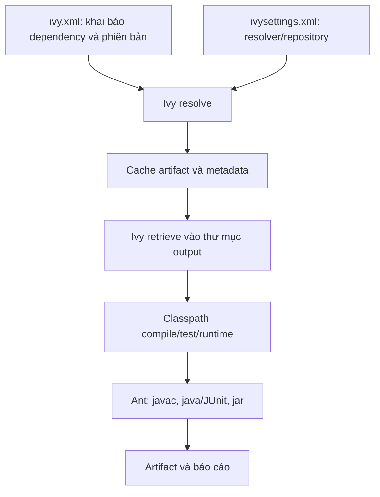

# Chuyển quản lý JAR thủ công sang cơ chế dependency có phiên bản trong Apache Ant

## 1. Bài toán: thư mục `lib/` chứa JAR nhưng thiếu hợp đồng dependency

Nhiều dự án Java dùng **Apache Ant** khởi đầu bằng cách tải thủ công các file `.jar`, chép vào `lib/`, rồi cấu hình `<javac>`, `<java>` hoặc `<jar>` dùng toàn bộ thư mục này. Cách làm đó dễ bắt đầu nhưng khó kiểm soát khi dự án phát triển: một file có thể bị thay mà không đổi tên, một thư viện cần nhiều JAR phụ thuộc đi kèm, hoặc hai người làm việc sử dụng hai bộ JAR khác nhau.

Ví dụ cấu hình kiểu cũ:

```xml
<project name="legacy-ant" default="compile" basedir=".">
    <property name="classes.dir" location="build/classes"/>

    <path id="legacy.classpath">
        <fileset dir="lib">
            <include name="**/*.jar"/>
        </fileset>
    </path>

    <target name="compile">
        <mkdir dir="${classes.dir}"/>
        <javac srcdir="src/main/java"
               destdir="${classes.dir}"
               classpathref="legacy.classpath"
               includeantruntime="false"/>
    </target>
</project>
```

File `build.xml` trên chỉ biết **những byte JAR đang có trên đĩa**; nó không tự biết nhà phát hành, phiên bản, nguồn tải hoặc quan hệ phụ thuộc của từng JAR. Nếu thư mục `lib/` chứa `commons-lang3.jar`, người đọc có thể không xác định được đó là bản nào nếu thiếu tài liệu và checksum.

Mục tiêu chuyển đổi là thay tập file không có mô tả bằng **dependency có tọa độ, phiên bản, phạm vi sử dụng và repository xác định**. Trong hệ sinh thái Java, tọa độ thường có dạng:

```text
group / organisation  +  artifact / module  +  version
org.apache.commons        commons-lang3        3.14.0
junit                     junit                4.13.2
```

Trong Apache Ivy, các thành phần tương ứng thường được đặt tên là `org`, `name` và `rev`. Khi build, một resolver biết cách lấy artifact của tọa độ này từ kho Maven/Ivy, đồng thời xác định dependency gián tiếp nếu metadata của gói có khai báo.

Sau khi chuyển đổi, repository nên trả lời được các câu hỏi: **Dự án phụ thuộc thư viện nào? Phiên bản bao nhiêu? Cần cho biên dịch, chạy hay kiểm thử? Tải từ kho nào? Khi bị thay đổi thì có thể kiểm tra lại bằng cách nào?**

## 2. Mục tiêu và phạm vi của quá trình chuyển đổi

Đối với dự án tiếp tục sử dụng Ant, lựa chọn quen thuộc là **Apache Ivy**: Ivy xử lý dependency và Ant giữ nguyên nhiệm vụ điều phối target, compile, test, package. Đây là đường chuyển đổi có mức xáo trộn thấp vì không bắt buộc viết lại toàn bộ build sang Maven hoặc Gradle.

| Nội dung | JAR thủ công | Quản lý dependency có phiên bản |
|---|---|---|
| Khai báo phụ thuộc | Tên file có trong `lib/` | `org:name:revision` trong metadata |
| Nguồn artifact | Do người dùng chép vào | Resolver/repository được cấu hình |
| Phụ thuộc gián tiếp | Người dùng tự bổ sung | Resolver có thể suy từ metadata và quy tắc resolve |
| Phiên bản | Có thể thiếu hoặc không đáng tin | Được khai báo rõ và có thể kiểm soát thay đổi |
| Phân loại compile/test/runtime | Thường trộn trong một classpath | Có configuration/scope riêng |
| Tái hiện môi trường | Cần sao chép thư mục JAR chính xác | Có thể resolve lại từ cấu hình và repository đã quản lý |
| Kiểm soát nguồn cung ứng | Chủ yếu kiểm tra file thủ công | Có cơ hội quản lý nguồn, checksum, license và chính sách version tập trung |

**Quản lý dependency có phiên bản không tự động đồng nghĩa với build hoàn toàn tái lập.** Nếu repository đổi nội dung của một artifact đã phát hành, metadata transitive sử dụng dải phiên bản hoặc plugin được cập nhật không kiểm soát, hai lần resolve vẫn có thể khác nhau. Phiên bản được ghim là nền tảng; nguồn repository, checksum, metadata, toolchain và cache cũng cần chính sách rõ ràng.

Ở cuối bài có một ví dụ tự chứa với `ivy.xml`, `ivysettings.xml`, `build.xml`, Java source và test, cùng lệnh Ant để thực hành.

## 3. Bước 1 — Kiểm kê JAR đang dùng trước khi sửa build

Đừng xóa ngay `lib/`. Trước tiên cần xác định mỗi JAR phục vụ mục đích gì và tương ứng với artifact nào.

Ví dụ một dự án cũ:

```text
legacy-app/
├── build.xml
├── lib/
│   ├── commons-lang3-3.12.0.jar
│   ├── junit-4.13.2.jar
│   ├── hamcrest-core-1.3.jar
│   └── vendor-internal.jar
└── src/
    ├── main/java/
    └── test/java/
```

Tạo bảng kiểm kê:

| File hiện có | Tọa độ/nguồn cần xác minh | Vai trò dự kiến | Câu hỏi cần giải quyết |
|---|---|---|---|
| `commons-lang3-3.12.0.jar` | `org.apache.commons:commons-lang3:3.12.0` | Compile và runtime | Có đang dùng API nào không tương thích với bản mới hơn? |
| `junit-4.13.2.jar` | `junit:junit:4.13.2` | Test | Có cần JUnit khi chạy ứng dụng production không? |
| `hamcrest-core-1.3.jar` | Dependency gián tiếp của JUnit 4.13.2 | Test | Có cần khai báo trực tiếp, hay để resolver lấy transitively? |
| `vendor-internal.jar` | Chưa rõ | Chưa rõ | Ai sở hữu? Có tọa độ, POM hoặc kho nội bộ không? |

**Cách điều tra metadata** của JAR có thể gồm:

- Kiểm tra tên file, tài liệu dự án và thư mục chứa JAR.
- Đọc `META-INF/MANIFEST.MF` nếu có `Implementation-Version`, `Bundle-Version` hoặc tên module.
- Kiểm tra `META-INF/maven/<group>/<artifact>/pom.properties` và POM đính kèm khi thư viện cung cấp.
- Tính SHA-256 để phân biệt hai bản có cùng tên file.
- Tra cứu nguồn phát hành hoặc artifact nội bộ từ nhà cung cấp; đối chiếu byte/checksum trước khi kết luận đó là một phiên bản cụ thể.

Tên file và manifest **không phải bằng chứng chắc chắn** về danh tính artifact. Với file tự đổi tên, bản được vá nội bộ hoặc JAR không có metadata, cần xác minh với người sở hữu mã hoặc kho artifact trước khi gán tọa độ.

Trên Linux/macOS (khi có `sha256sum`):

```bash
sha256sum lib/*.jar
```

Trên PowerShell:

```powershell
Get-ChildItem -LiteralPath .\lib -Filter *.jar |
    ForEach-Object {
        Get-FileHash -LiteralPath $_.FullName -Algorithm SHA256
    }
```

Lưu danh sách phiên bản, đường dẫn và checksum trong tài liệu chuyển đổi hoặc công cụ quản trị dependency của dự án. Chỉ xác định xong **nguồn và vai trò** mới thay dần từng nhóm thư viện.

### 3.1. Phát hiện những JAR có thể không cần giữ

Một thư mục `lib/` lâu năm có thể chứa JAR đã lỗi thời hoặc không còn được sử dụng:

- Thư viện test bị đưa vào gói production.
- Hai phiên bản của cùng một artifact, khiến classpath có class trùng nhau.
- JAR gián tiếp được chép thủ công dù một dependency khác đã cung cấp.
- JAR từ framework cũ không còn được gọi trong source.
- JAR bị chỉnh sửa riêng của đội dự án nhưng tên giống bản phát hành công khai.

**Không xóa chỉ vì không thấy import trực tiếp.** Các ứng dụng có thể nạp class bằng reflection, `ServiceLoader`, XML, tên class trong cấu hình hoặc plugin runtime. Cần xét thêm cách khởi chạy, test tích hợp và đặc điểm đóng gói.

## 4. Bước 2 — Chọn cơ chế quản lý phiên bản phù hợp với Ant

Trong dự án Ant, có một vài hướng phổ biến:

| Hướng | Khi phù hợp | Điểm cần cân nhắc |
|---|---|---|
| **Apache Ivy + Ant** | Muốn giữ target Ant, thêm dependency có metadata | Cần bootstrap Ivy và quản lý `ivy.xml`/`ivysettings.xml` |
| **Maven Ant Tasks hoặc cầu nối tương đương** | Dự án đang có cơ chế dùng Maven repository đặc thù | Phải kiểm tra tình trạng duy trì và sự tương thích của công cụ tích hợp |
| **Chuyển toàn bộ build sang Maven/Gradle** | Muốn thay cả mô hình lifecycle, plugin, test và publish | Phạm vi lớn hơn việc thay thư mục JAR |
| **Kho artifact nội bộ + Ant tự tải có kiểm tra** | Có một ít JAR đặc thù chưa publish theo metadata chuẩn | Tự chịu trách nhiệm quan hệ transitive, version mapping và kiểm tra toàn vẹn |

Ví dụ xuyên suốt dùng **Apache Ivy** vì nó có metadata dependency, resolver và task tích hợp trực tiếp vào `build.xml`.

Ivy không thay thế `<javac>`, `<junit>`, `<java>` hoặc `<jar>`. Nó giải quyết một câu hỏi đứng trước các task đó: **những JAR nào tạo thành classpath ở mỗi giai đoạn?**

Luồng sau chuyển đổi:



## 5. Bước 3 — Khai báo dependency có phiên bản bằng `ivy.xml`

### 5.1. Cấu trúc `ivy.xml`

Giả sử ứng dụng dùng **Apache Commons Lang** khi chạy và **JUnit 4** khi kiểm thử. Tạo file `ivy.xml` tại root:

```xml
<?xml version="1.0" encoding="UTF-8"?>
<ivy-module version="2.0">
    <info organisation="example.org"
          module="ant-deps-demo"/>

    <configurations>
        <conf name="compile"
              description="Dependency để biên dịch mã chính"/>
        <conf name="runtime"
              extends="compile"
              description="Dependency khi chạy ứng dụng"/>
        <conf name="test"
              extends="runtime"
              description="Dependency phục vụ kiểm thử"/>
    </configurations>

    <dependencies>
        <dependency org="org.apache.commons"
                    name="commons-lang3"
                    rev="3.14.0"
                    conf="compile->default"/>

        <dependency org="junit"
                    name="junit"
                    rev="4.13.2"
                    conf="test->default"/>
    </dependencies>
</ivy-module>
```

Ý nghĩa các thành phần:

- `<info>`: danh tính Ivy module hiện tại; ví dụ chọn `example.org:ant-deps-demo`.
- `<configurations>`: các tập dependency theo mục đích. `runtime` kế thừa `compile`; `test` kế thừa `runtime`.
- `<dependency org="..." name="..." rev="...">`: tọa độ artifact trực tiếp.
- `conf="compile->default"`: map configuration của dự án là `compile` tới configuration `default` được resolver cung cấp cho dependency tương ứng. Đối với POM Maven, Ivy tạo/ánh xạ các configuration thích hợp từ metadata đọc được.
- `rev="3.14.0"` và `rev="4.13.2"`: phiên bản **cụ thể**, không dùng `latest.integration`, `latest.release` hoặc dải version trong ví dụ.

Với cấu hình trên, thư viện Apache Commons Lang xuất hiện trong đường dẫn compile, runtime và test nhờ quan hệ kế thừa configuration. JUnit chỉ xuất hiện trong test và những dependency gián tiếp cần thiết sẽ được Ivy resolve theo metadata.

Các tên `compile`, `runtime`, `test` ở đây là **configuration do dự án Ivy tự định nghĩa**, không phải tên target Ant hay scope Maven có hiệu lực tự động. Nếu dự án có nhu cầu khác, có thể thêm configuration như `integrationTest` hoặc `provided` với quan hệ phù hợp.

### 5.2. Phụ thuộc trực tiếp và gián tiếp

Hai loại dependency cần phân biệt:

- **Trực tiếp:** Java source hoặc quy tắc runtime của dự án chủ động yêu cầu thư viện. Ví dụ `commons-lang3` được ứng dụng import.
- **Gián tiếp (transitive):** thư viện đã khai báo cần thư viện khác. Ví dụ `junit:junit:4.13.2` có quan hệ phụ thuộc với Hamcrest theo metadata phát hành.

Với Ivy, thông thường **không cần chép thủ công mọi JAR gián tiếp** vào thư mục `lib/`. Resolver tải chúng theo metadata. Tuy nhiên, nếu metadata thiếu, dependency bị đánh dấu optional hoặc thư viện được nạp động, vẫn có thể cần khai báo trực tiếp một dependency mà ứng dụng thật sự sử dụng.

Nếu cố ý tắt transitive cho một dependency, có thể dùng thuộc tính như `transitive="false"` trên khai báo tương ứng, nhưng khi đó nhóm tự chịu trách nhiệm khai báo các JAR đi kèm. **Không tắt transitive chỉ để làm danh sách file ngắn hơn** nếu chưa hiểu dependency graph.

### 5.3. Quy tắc về phiên bản động

Các revision như `latest.integration`, `latest.release` hoặc dải version tạo thuận tiện khi muốn tự động theo bản mới. Nhưng chúng cũng khiến đầu ra của lần build hôm nay có thể khác lần build sau ngay cả khi source không đổi.

Đối với pipeline ổn định:

1. Khai báo phiên bản trực tiếp cụ thể.
2. Xác định chính sách dependency transitive, xử lý xung đột và repository.
3. Cập nhật phiên bản bằng commit riêng có review và test.
4. Với yêu cầu tái lập nghiêm ngặt, ghi nhận artifact đã resolve cùng checksum và metadata; cân nhắc một kho artifact bất biến hoặc quy trình lưu bộ dependency đã được duyệt.

**Ivy cổ điển không có một cơ chế lockfile đồng nhất với mọi workflow như người dùng thường kỳ vọng ở package manager hiện đại.** Do đó không nên tuyên bố chỉ cần có `ivy.xml` là mọi transitive dependency đã được khóa vĩnh viễn.

## 6. Bước 4 — Chỉ định repository bằng `ivysettings.xml`

Tạo file `ivysettings.xml`:

```xml
<?xml version="1.0" encoding="UTF-8"?>
<ivysettings>
    <settings defaultResolver="mavenCentral"/>

    <resolvers>
        <ibiblio name="mavenCentral"
                 m2compatible="true"
                 root="https://repo.maven.apache.org/maven2/"/>
    </resolvers>
</ivysettings>
```

Ở đây:

- `defaultResolver="mavenCentral"` chọn resolver mặc định.
- `<ibiblio ... m2compatible="true">` cho Ivy truy vấn repository theo cấu trúc tọa độ Maven.
- `root` là địa chỉ repository công khai dùng trong **ví dụ học tập**.

Dự án doanh nghiệp thường nên dùng **repository/mirror nội bộ** đã cấu hình kiểm soát quyền đọc và policy về artifact. Khi đó đổi `root` sang địa chỉ nội bộ đã xác minh, hoặc định nghĩa nhiều resolver với thứ tự rõ ràng nếu cần.

Một hệ thống dùng repository công khai + nội bộ phải tránh tình huống thư viện nội bộ bị trùng tọa độ với package công khai. Cần chính sách tên nhóm, thứ tự resolve, nguồn tin cậy và kiểm tra provenance để giảm rủi ro **dependency confusion**.

### 6.1. Địa chỉ repository không thay thế kiểm tra toàn vẹn

Đường truyền HTTPS giúp bảo vệ khi truyền dữ liệu nhưng không tự xác nhận mọi vấn đề về nguồn gốc artifact. Đối với dự án quan trọng, nên:

- Cố định repository hoặc mirror được phép truy cập.
- Sử dụng phiên bản bất biến và hạn chế ghi đè artifact đã phát hành.
- Kiểm tra checksum/chữ ký theo công cụ và chính sách có sẵn.
- Kiểm tra giấy phép và cảnh báo bảo mật của phiên bản dependency.
- Ghi lại nguồn download và danh sách phiên bản trong báo cáo build/SBOM khi cần.
- Tránh để token ghi artifact xuất hiện trong job CI chỉ cần tải dependency.

Không đưa tài khoản hoặc mật khẩu vào `ivysettings.xml` được commit. Nếu dùng kho riêng, cấp credential bằng cơ chế secret của CI và phương thức xác thực được Ivy/repository hỗ trợ, không in credential ra log Ant.

## 7. Bước 5 — Tích hợp Ivy vào `build.xml`

### 7.1. Chuẩn bị Apache Ivy cho Ant

Ant và Ivy là hai thành phần khác nhau. Task `ivy:resolve`, `ivy:retrieve` không xuất hiện chỉ vì đã tạo file `ivy.xml`. Cần có Ivy JAR ở **classpath của Ant**.

Trong ví dụ dưới đây, giả định bạn đã lấy bản phát hành Apache Ivy được phê duyệt, kiểm tra nguồn/checksum và đặt JAR tại:

```text
tools/ivy/ivy-2.5.2.jar
```

`2.5.2` là **phiên bản minh họa được ghim**; không có yêu cầu mọi dự án phải dùng đúng phiên bản này. Có thể cài Ivy thông qua image/agent thay vì lưu binary trong repository, miễn đường dẫn được định nghĩa rõ. Nếu môi trường đã cấp Ivy qua `ant -lib`, có thể điều chỉnh cách khai báo task cho phù hợp.

**Không nhúng lệnh tải Ivy không có checksum vào target `ci` rồi để mã build tự tải tool với quyền không giới hạn.** Bước chuẩn bị toolchain phải được CI quản lý hoặc có quy trình xác minh riêng.

### 7.2. Ví dụ `build.xml` hoàn chỉnh

Cấu trúc dự án sau chuyển đổi:

```text
ant-deps-demo/
├── build.xml
├── ivy.xml
├── ivysettings.xml
├── tools/
│   └── ivy/
│       └── ivy-2.5.2.jar
├── src/
│   ├── main/java/example/App.java
│   └── test/java/example/AppTest.java
├── build/                  # Sinh trong lúc build
│   ├── classes/
│   ├── test-classes/
│   └── deps/
└── dist/                   # Sinh trong lúc build
```

Nội dung `build.xml`:

```xml
<?xml version="1.0" encoding="UTF-8"?>
<project name="ant-deps-demo"
         default="ci"
         basedir="."
         xmlns:ivy="antlib:org.apache.ivy.ant">

    <property name="ivy.jar" location="tools/ivy/ivy-2.5.2.jar"/>
    <property name="src.main" location="src/main/java"/>
    <property name="src.test" location="src/test/java"/>
    <property name="build.dir" location="build"/>
    <property name="deps.dir" location="${build.dir}/deps"/>
    <property name="classes.main" location="${build.dir}/classes"/>
    <property name="classes.test" location="${build.dir}/test-classes"/>
    <property name="dist.dir" location="dist"/>

    <!-- Đăng ký Ivy task từ JAR đã chuẩn bị trước. -->
    <path id="ivy.tool.classpath">
        <pathelement location="${ivy.jar}"/>
    </path>

    <taskdef uri="antlib:org.apache.ivy.ant"
             resource="org/apache/ivy/ant/antlib.xml"
             classpathref="ivy.tool.classpath"/>

    <!-- Fileset được sử dụng sau target resolve/retrieve. -->
    <path id="compile.classpath">
        <fileset dir="${deps.dir}/compile" includes="*.jar"/>
    </path>

    <path id="test.classpath">
        <pathelement location="${classes.main}"/>
        <fileset dir="${deps.dir}/test" includes="*.jar"/>
    </path>

    <target name="clean">
        <delete dir="${build.dir}"/>
        <delete dir="${dist.dir}"/>
    </target>

    <target name="resolve">
        <mkdir dir="${deps.dir}"/>

        <ivy:settings file="ivysettings.xml"/>
        <ivy:resolve file="ivy.xml"
                     conf="compile,runtime,test"/>

        <ivy:retrieve conf="compile,runtime,test"
                      pattern="${deps.dir}/[conf]/[artifact]-[revision].[ext]"
                      sync="true"/>
    </target>

    <target name="compile" depends="resolve">
        <mkdir dir="${classes.main}"/>

        <javac srcdir="${src.main}"
               destdir="${classes.main}"
               encoding="UTF-8"
               release="17"
               includeantruntime="false"
               classpathref="compile.classpath"/>
    </target>

    <target name="compile-test" depends="compile">
        <mkdir dir="${classes.test}"/>

        <javac srcdir="${src.test}"
               destdir="${classes.test}"
               encoding="UTF-8"
               release="17"
               includeantruntime="false"
               classpathref="test.classpath"/>
    </target>

    <!-- JUnitCore trả mã lỗi nếu có test thất bại. -->
    <target name="test" depends="compile-test">
        <java classname="org.junit.runner.JUnitCore"
              fork="true"
              failonerror="true">
            <classpath>
                <pathelement location="${classes.test}"/>
                <path refid="test.classpath"/>
            </classpath>

            <arg value="example.AppTest"/>
        </java>
    </target>

    <!-- JAR ở đây chỉ đóng gói classes của ứng dụng. -->
    <target name="dist" depends="test">
        <mkdir dir="${dist.dir}"/>

        <jar destfile="${dist.dir}/app.jar"
             basedir="${classes.main}">
            <manifest>
                <attribute name="Main-Class" value="example.App"/>
            </manifest>
        </jar>
    </target>

    <target name="ci" depends="clean,dist"/>

</project>
```

Diễn giải:

1. `<taskdef>` đăng ký các task Ivy trước khi chúng được gọi.
2. `resolve` đọc `ivysettings.xml` và `ivy.xml`, giải quyết các dependency của ba configuration.
3. `ivy:retrieve` đưa các artifact đã resolve vào `build/deps/<configuration>/`. `sync="true"` giúp thư mục retrieve phản ánh tập artifact hiện tại; **chỉ dùng trong một thư mục output chuyên dụng** vì file không thuộc tập retrieve có thể bị xóa trong quá trình đồng bộ.
4. `compile` dùng JAR từ `build/deps/compile`.
5. `compile-test` và `test` dùng bộ `test` cùng classes chính.
6. `dist` tạo `dist/app.jar` từ classes đã biên dịch. Artifact chính không bị trộn với bộ JAR test.

Trong ví dụ này, lệnh `ant ci` chạy `clean`, sau đó `resolve`, compile, test và tạo JAR. `clean` xóa output riêng của build, **không xóa cache toàn cục của Ivy**, do đó lần chạy sau thường có thể tái sử dụng dependency cache phù hợp.

Vì `<path>` chứa `<fileset>` được dùng sau khi target `resolve` hoàn tất, classpath sẽ tham chiếu đến tập JAR đã được retrieve. Nếu script đặc thù đánh giá classpath sớm trước khi retrieve, cần tổ chức lại target/định nghĩa path để tránh dùng thư mục chưa tồn tại.

### 7.3. Hai file Java để chạy thử

`src/main/java/example/App.java`:

```java
package example;

import org.apache.commons.lang3.StringUtils;

public final class App {

    private App() {
    }

    public static String message() {
        return StringUtils.capitalize("hello") + " Ivy";
    }

    public static void main(String[] args) {
        System.out.println(message());
    }
}
```

`src/test/java/example/AppTest.java`:

```java
package example;

import org.junit.Test;

import static org.junit.Assert.assertEquals;

public class AppTest {

    @Test
    public void messageUsesCommonsLang() {
        assertEquals("Hello Ivy", App.message());
    }
}
```

Khi chạy, mã chính cần Commons Lang; test cần JUnit và bộ thư viện hỗ trợ JUnit. Phạm vi `test` đã kế thừa `runtime`, vì vậy classpath test còn chứa Commons Lang của ứng dụng.

### 7.4. Lệnh chạy và đầu ra dự kiến

Sau khi chuẩn bị JDK 17+, Ant và Ivy JAR:

```bash
java -version
ant -version
ant -noinput -f build.xml ci
```

Một lần chạy thành công sẽ có cấu trúc tương tự:

```text
build/
├── classes/
│   └── example/App.class
├── test-classes/
│   └── example/AppTest.class
└── deps/
    ├── compile/
    │   └── commons-lang3-3.14.0.jar
    ├── runtime/
    │   └── commons-lang3-3.14.0.jar
    └── test/
        ├── commons-lang3-3.14.0.jar
        ├── junit-4.13.2.jar
        └── hamcrest-core-1.3.jar
dist/
└── app.jar
```

Danh sách file minh họa cách Ivy dùng các configuration; đầu ra thực tế phụ thuộc metadata và resolver của phiên bản thư viện đã chọn. JUnitCore sẽ in kết quả test ra console; ví dụ chưa cấu hình báo cáo JUnit XML dành cho dashboard CI.

Chạy ứng dụng sau khi build:

```bash
# Linux/macOS: dấu ':' phân tách phần tử classpath
java -cp "dist/app.jar:build/deps/runtime/*" example.App
```

Trên Windows:

```powershell
# Windows: dấu ';' phân tách phần tử classpath
java -cp "dist/app.jar;build/deps/runtime/*" example.App
```

Kết quả mong đợi:

```text
Hello Ivy
```

**Không mặc định rằng `java -jar dist/app.jar` sẽ chạy được.** Ví dụ đặt `Main-Class` nhưng không nhúng Commons Lang vào JAR và không khai báo Class-Path manifest trỏ tới thư viện. `-jar` không tự thêm thư mục `build/deps/runtime` vào classpath; đó là hai cách triển khai khác nhau.

## 8. Phân biệt compile, runtime và test để tránh classpath bị pha trộn

Khi quản lý JAR thủ công, nhiều dự án viết:

```xml
<path id="all.classpath">
    <fileset dir="lib" includes="*.jar"/>
</path>
```

Cách này có thể che lỗi: mã production vô tình import thư viện chỉ được phép có ở test; hoặc test thành công nhờ JAR mà gói triển khai không mang theo.

Với Ivy:

| Configuration của dự án | Thường chứa | Được dùng ở đâu |
|---|---|---|
| `compile` | API cần để biên dịch mã chính | `<javac>` cho `src/main/java` |
| `runtime` | Tập cần khi chạy, trong ví dụ kế thừa `compile` | Lệnh `java`, script chạy hoặc gói triển khai |
| `test` | Thư viện test và các phụ thuộc runtime cần cho test | `<javac>` test và test runner |

Đây là **một mô hình đơn giản**. Ứng dụng thực tế có thể có dependency chỉ cần lúc chạy (`runtimeOnly`), dependency do app server cung cấp (`provided`), native libraries hoặc nhiều test suite. Trong Ivy cần định nghĩa configuration và mapping tương ứng; tên gọi không tự mang lại đúng semantics nếu mapping sai.

Nếu một thư viện vừa có mặt trong test vừa runtime nhưng chỉ được khai báo ở test, chương trình có thể chạy sai khi deploy. Việc chạy test dưới đúng classpath runtime nên là một phần của đánh giá migration.

## 9. Phụ thuộc nội bộ hoặc JAR không có trên Maven Central

Không phải mọi JAR thủ công đều có tọa độ công khai. Với `vendor-internal.jar`, có ba tình huống:

### 9.1. Thư viện là sản phẩm của tổ chức

Nếu tổ chức sở hữu mã và quy trình phát hành, hãy publish artifact vào **Maven/Ivy repository nội bộ** với tọa độ và phiên bản rõ ràng, ví dụ minh họa:

```text
com.example.internal:report-client:1.6.0
```

Sau đó khai báo cùng cách như thư viện công khai:

```xml
<dependency org="com.example.internal"
            name="report-client"
            rev="1.6.0"
            conf="compile->default"/>
```

Cần cấu hình resolver được phép đọc repository nội bộ và cơ chế xác thực tương ứng. Tọa độ trên chỉ là ví dụ; không nên tự gán phiên bản cho một JAR không biết nguồn gốc.

### 9.2. Thư viện của nhà cung cấp chỉ có file JAR

Có thể làm việc với nhà cung cấp để lấy POM/metadata chính thức hoặc tạo **artifact có tọa độ trong kho nội bộ** kèm metadata được nhóm chịu trách nhiệm duyệt. Nếu JAR cần những JAR khác, metadata phải mô tả quan hệ đó thay vì mong mọi người tự chép thêm file.

Khi repository nội bộ chỉ lưu một JAR mà không có metadata transitive, resolver không thể tự suy ra những dependency chưa được khai báo. Bởi vậy, bước kiểm kê ban đầu vẫn cần thiết.

### 9.3. Chưa thể migrate toàn bộ

Có thể tạm giữ một số JAR legacy ở thư mục **riêng**, ví dụ `lib/legacy/`, nhưng phải công bố rõ file nào còn thủ công và vì sao. Không nên trộn cả `lib/legacy/*.jar` lẫn JAR Ivy với cùng một artifact trong một classpath mơ hồ.

Một chuyển đổi theo giai đoạn hợp lý:

1. Giữ một baseline chạy được trước thay đổi.
2. Chuyển từng thư viện đã xác minh tọa độ sang Ivy.
3. Xóa JAR thủ công tương ứng khỏi classpath, tránh bản kép.
4. Chạy lại test và kiểm tra classpath runtime.
5. Chỉ kết thúc migration khi đã biết cách quản lý mọi JAR còn lại.

Tốt hơn nên giữ một danh sách ngoại lệ có chủ sở hữu và thời điểm xử lý, thay vì để `lib/legacy/` trở thành nơi tích trữ không kiểm soát.

## 10. Xung đột phiên bản và cách Ivy chọn dependency

Tình huống phổ biến:

```text
Ứng dụng
├── A:1.0
│   └── shared-lib:2.0
└── B:1.0
    └── shared-lib:3.0
```

Nếu metadata của A và B đưa đến hai revision của `shared-lib`, Ivy cần áp dụng **conflict manager** để chọn hoặc phát hiện xung đột theo cấu hình. Kết quả cũng phụ thuộc resolver và metadata của các thư viện.

Không nên dựa vào việc một JAR tình cờ đứng trước trên classpath để giải quyết xung đột:

- Compile có thể lấy API phiên bản này, runtime lại nạp phiên bản khác.
- Một method đổi signature có thể tạo `NoSuchMethodError`.
- Class đã xóa hoặc đổi package có thể gây `NoClassDefFoundError` hoặc `ClassNotFoundException`.
- Hai artifact khác nhau chứa cùng class có thể dẫn đến hành vi khác nhau theo classloader.

Khi gặp xung đột:

1. Xem dependency graph và phiên bản thực tế Ivy đã resolve.
2. Xác định thư viện nào phụ thuộc vào revision cũ/mới.
3. Kiểm tra tính tương thích của API và hành vi trên đúng ứng dụng.
4. Nếu cần, khai báo dependency trực tiếp, exclusion hoặc conflict policy **có chủ đích**, rồi chạy test.
5. Ghi chú lý do chọn revision vì một bản nâng cấp ở dependency khác có thể làm xung đột quay lại.

Ivy hỗ trợ các cơ chế như conflict manager, override và exclusion. Tuy nhiên, mỗi cơ chế có phạm vi khác nhau; không nên thêm `<exclude>` một cách tùy tiện để làm build xanh khi runtime thật sự cần thư viện bị loại.

## 11. Kiểm tra dependency graph sau migration

Sau khi resolve, người bảo trì cần biết **đã tải những gì** chứ không chỉ nhìn target Ant thành công.

Các nguồn quan sát:

- Log của `ivy:resolve`: module được resolve, số artifact tải về, thay đổi/xung đột phiên bản.
- Thư mục `build/deps/compile`, `runtime`, `test`: tập JAR có mặt trong từng configuration.
- Báo cáo dependency bằng task `ivy:report` nếu dự án cấu hình dùng báo cáo Ivy.
- Thông tin trong repository manager hoặc SBOM do công cụ bổ sung tạo.
- Lệnh `jar tf` và kiểm tra classpath thực tế của chương trình khi cần xác định nội dung đóng gói.

Ví dụ muốn Ivy tạo báo cáo có thể thêm target riêng (đặt trong cùng project đã đăng ký Ivy task):

```xml
<target name="dependency-report" depends="resolve">
    <mkdir dir="build/reports/ivy"/>
    <ivy:report conf="compile,runtime,test"
                todir="build/reports/ivy"/>
</target>
```

Sau đó gọi:

```bash
ant -noinput dependency-report
```

Báo cáo giúp xem những dependency nào được kéo vào, nhưng **không thay thế việc chạy test và xác minh cách đóng gói runtime**.

### 11.1. So sánh trước và sau theo hành vi, không chỉ theo số JAR

Danh sách JAR mới có thể khác danh sách cũ: transitive dependency có thể xuất hiện thêm, trùng lặp có thể biến mất, tên JAR có thể mang phiên bản rõ ràng hơn.

Điều cần xác minh qua test và quan sát chạy thực tế:

- Biên dịch lại từ đầu có thành công không?
- Unit test và integration test cũ có giữ nguyên kết quả không?
- Ứng dụng có chạy bằng đúng classpath runtime không?
- Kịch bản dùng reflection, plugin, JDBC driver, logging binding hoặc `ServiceLoader` có còn hoạt động không?
- Gói triển khai có chứa hoặc đi kèm dependency runtime cần thiết không?
- Có lỗi classpath trùng, thiếu class hoặc xung đột phiên bản không?

Với hệ thống có giao diện API công khai, cũng nên kiểm tra các thay đổi ABI có thể gây lỗi chỉ khi chạy tích hợp với module khác.

## 12. Làm gì với artifact đầu ra sau khi không còn `lib/` thủ công?

Ant tạo JAR từ classes của ứng dụng:

```xml
<jar destfile="dist/app.jar" basedir="build/classes"/>
```

Điều này **không tự nhúng dependency JAR** vào `app.jar`. Đó là lựa chọn đóng gói độc lập với việc dùng Ivy.

Có ba chiến lược thường gặp:

| Chiến lược | Kết quả | Khi phù hợp |
|---|---|---|
| **JAR thường + thư mục `lib/` runtime** | `app.jar` bên cạnh những JAR cần chạy | Script khởi động kiểm soát classpath |
| **Fat/Uber JAR** | Một artifact gồm classes/dependency được xử lý đóng gói | Cần cơ chế merge resource, service descriptor, license và manifest phù hợp |
| **Triển khai vào container/server có classpath riêng** | App và dependency được lắp ghép ở môi trường chạy | Server quản lý lớp dependency hoặc image đóng gói theo từng layer |

Ví dụ tạo gói phân phối có dependencies runtime bên cạnh ứng dụng:

```xml
<target name="bundle" depends="dist">
    <mkdir dir="dist/bundle/lib"/>

    <copy todir="dist/bundle">
        <fileset dir="dist" includes="app.jar"/>
    </copy>

    <copy todir="dist/bundle/lib">
        <fileset dir="build/deps/runtime" includes="*.jar"/>
    </copy>
</target>
```

Đây là **một target thêm vào project minh họa**, chạy sau `dist`, không được hiểu là làm JAR thành executable qua `java -jar`. Để chạy bằng classpath, cần script khởi động tương ứng:

```bash
java -cp "dist/bundle/app.jar:dist/bundle/lib/*" example.App
```

Trên Windows đổi dấu `:` giữa các phần tử classpath thành `;`.

Nếu cần `java -jar`, manifest phải cung cấp `Class-Path` phù hợp với cấu trúc phát hành hoặc dự án phải chọn cách đóng gói khác. Không nên ép mọi JAR vào một file duy nhất bằng cách giải nén/ghép thẳng mà chưa xử lý các trùng lặp metadata, chữ ký JAR và resource đặc biệt.

## 13. Cache, offline và quyền mạng trong CI

Khi dùng Ivy, build có thêm bước tải dependency. Điều này có tác động trực tiếp đến CI/CD.

### 13.1. Cache Ivy dùng để tăng tốc

Ivy thường lưu artifact/metadata trong vùng cache của người dùng hoặc đường dẫn cache được cấu hình. Một runner có cache phù hợp sẽ hạn chế tải lặp.

**Cache không phải bằng chứng rằng dependency đã được kiểm tra an toàn.** Một cache được ghi bởi job không tin cậy có thể chứa file sai, và dùng chung cache giữa nhiều nhánh có thể làm khó điều tra.

Các nguyên tắc:

- Khóa phiên bản trực tiếp, quản lý metadata và repository.
- Tách vùng cache tin cậy với cache từ PR không đáng tin cậy khi cần.
- Không ghi secret vào cache.
- Có cách dựng lại cache từ repository được phép và kiểm tra checksum.
- Không lưu `build/deps` như một thư mục nguồn sự thật không có metadata; đó là sản phẩm retrieve có thể tái tạo.

### 13.2. Build offline sau khi chuẩn bị dependency

Nếu CI muốn chạy compile/test khi không có internet, hãy thiết kế rõ hai giai đoạn:

1. Một giai đoạn tin cậy resolve và chuẩn bị đúng dependency đã duyệt.
2. Giai đoạn build/test sử dụng tập dependency được cấp và bị hạn chế mạng bằng cơ chế của runner/container.

Không đủ chỉ truyền một property `-Doffline=true` cho Ant trừ khi tất cả task cần thiết tuân thủ property đó; bản thân Ant/Ivy có quy tắc resolve riêng. Với môi trường cần offline hoàn toàn, phải bảo đảm cache/repository cục bộ đã có đầy đủ artifact và metadata.

Nếu yêu cầu bảo đảm byte-identical build, cần cố định cả phiên bản JDK, Ant, Ivy, tool phụ trợ và xử lý timestamp của JAR/ZIP, chứ không chỉ dependency.

### 13.3. Jenkins hoặc GitHub Actions gọi lại cùng target

Một pipeline Jenkins tối giản, với agent đã có JDK/Ant/Ivy chuẩn bị sẵn:

```groovy
pipeline {
    agent { label 'java-ant' }

    stages {
        stage('Build and test') {
            steps {
                sh 'java -version'
                sh 'ant -version'
                sh 'ant -noinput -f build.xml ci'
            }
        }
    }

    post {
        success {
            archiveArtifacts artifacts: 'dist/*.jar',
                             fingerprint: true
        }
    }
}
```

Một đoạn workflow GitHub Actions tương đương, giả định **Ivy JAR đã được kiểm soát và có đúng tại đường dẫn trong `build.xml`**:

```yaml
name: Ant + Ivy CI

on:
  push:
  pull_request:

permissions:
  contents: read

jobs:
  build:
    runs-on: ubuntu-24.04
    steps:
      - uses: actions/checkout@v4

      - uses: actions/setup-java@v4
        with:
          distribution: temurin
          java-version: '17'

      - name: Install Ant
        run: |
          sudo apt-get update
          sudo apt-get install -y ant

      - name: Build and test
        run: ant -noinput -f build.xml ci

      - uses: actions/upload-artifact@v4
        with:
          name: ant-app
          path: dist/*.jar
          if-no-files-found: error
```

Trong môi trường thật, việc cung cấp `tools/ivy/ivy-2.5.2.jar` cần được thực hiện bằng nguồn tin cậy (repository đã duyệt, image chuẩn hoặc bước bootstrap có kiểm tra checksum). Nếu chọn cách không lưu binary tool trong Git, hãy sửa đường dẫn trong `build.xml` hoặc cấu hình classpath task tương ứng.

CI từ pull request không tin cậy nên chỉ được quyền đọc source/dependency cần thiết, tránh cấp token publish cho target resolve/build. Việc publish artifact cần một job có điều kiện và credential riêng.

## 14. Bước 6 — Dọn bỏ JAR thủ công mà không làm mất dữ liệu quan trọng

Sau khi dependency đã được chuyển và kiểm chứng ở môi trường build, mới dọn những file được thay thế.

Quy trình tham khảo:

1. Đưa `ivy.xml` và `ivysettings.xml` vào version control.
2. Chuẩn bị và công bố cách lấy Ivy tool JAR đúng phiên bản.
3. Thay `legacy.classpath` trong `build.xml` bằng những classpath được Ivy retrieve.
4. Kiểm tra compile, test, package và chạy runtime classpath từ đầu.
5. Xác định file `lib/` nào đã được thay thế hoàn toàn, file nào còn ngoại lệ vì chưa có tọa độ.
6. Gỡ bỏ những JAR trùng lặp khỏi classpath và repository theo quy trình review của nhóm.
7. Cập nhật tài liệu build, cách chạy local/CI, cấu hình IDE nếu trước đây trỏ trực tiếp tới `lib/`.
8. Cấu hình ignore cho output được sinh như `build/`, `dist/` và thư mục retrieve; cân nhắc chính sách riêng cho binary bootstrap hoặc artifact nội bộ được quản lý.

Một `.gitignore` minh họa:

```gitignore
/build/
/dist/
```

Nếu dự án còn `lib/legacy/`, cần chính sách riêng thay vì ignore toàn bộ `lib/` rồi vô tình loại những binary vẫn là input bắt buộc. Không xóa artifact nội bộ chỉ vì đã xóa đường dẫn tương ứng khỏi `<fileset>`.

### 14.1. Không dùng hai nguồn dependency song song lâu dài

Một sai lầm thường gặp trong quá trình chuyển đổi là giữ cả:

```xml
<fileset dir="lib" includes="**/*.jar"/>
<fileset dir="build/deps/runtime" includes="**/*.jar"/>
```

Nếu cùng một thư viện có hai version ở hai nơi, kết quả phụ thuộc thứ tự classpath, classloader và cách Java load class. Điều này có thể che giấu lỗi trong nhiều tháng.

Tạm giữ `lib/legacy` cho dependency không thể resolve là hợp lý nếu danh sách được ghi rõ; nhưng **mỗi artifact chỉ nên có một chủ sở hữu và một nguồn version được công bố**.

## 15. Các lỗi thường gặp khi chuyển từ JAR thủ công sang Ivy

| Biểu hiện | Nguyên nhân thường gặp | Cách xử lý |
|---|---|---|
| `Problem: failed to create task or type ivy:resolve` | Ivy task chưa được đăng ký hoặc Ivy JAR không nằm trong classpath task | Kiểm tra JAR path, `<taskdef>` và antlib URI |
| `module not found` | Sai tọa độ, version hoặc resolver | Đối chiếu `org/name/rev`, `ivysettings.xml`, quyền truy cập kho |
| Lỗi TLS/proxy khi resolve | CI không truy cập repository hoặc thiếu CA/proxy | Cấu hình đúng mạng/CA và kho được phép; không vô hiệu hóa kiểm tra TLS |
| `ClassNotFoundException` khi chạy | Runtime classpath thiếu JAR | Resolve/retrieve configuration `runtime` và đóng gói/khởi chạy với bộ JAR đó |
| `NoSuchMethodError` | Xung đột version hoặc phiên bản runtime khác compile | Xem graph và classpath thực tế; thống nhất version tương thích |
| Compile OK, test lỗi thiếu JUnit/Hamcrest | Mapping `test` sai hoặc dependency test bị bỏ | Kiểm tra `conf`, quan hệ `extends` và artifact retrieve |
| Một JAR có trong cả `lib/` và Ivy retrieve | Hai nguồn dependency trùng nhau | Loại khỏi một classpath, chỉ giữ phiên bản đã duyệt |
| `ivy:retrieve sync` xóa file không mong muốn | Dùng chung thư mục đích với file do người khác quản lý | Retrieve vào thư mục output chuyên dụng |
| Chỉ fail trên CI | JDK, Ant, Ivy, repository hoặc credential khác local | In tool version, so sánh settings/metadata và nguồn artifact |
| Lần build sau tải khác dù source không đổi | Revision động, metadata thay đổi hoặc repository cho ghi đè | Dùng version cụ thể, repo bất biến, checksum và policy pin |
| `java -jar` lỗi thiếu commons-lang3 | Manifest `Main-Class` không tự khai báo dependency | Dùng classpath runtime hoặc định nghĩa gói triển khai phù hợp |
| Test pass nhưng sản phẩm thiếu thư viện khi deploy | Test dùng classpath rộng hơn runtime hoặc không đóng gói dependency runtime | Chạy thử đúng gói phát hành và runtime classpath |

### 15.1. Khi tìm lỗi resolve, kiểm tra theo thứ tự

1. **Tool:** Ant có tìm thấy đúng Ivy JAR và đăng ký antlib không?
2. **Metadata:** `ivy.xml` có khai báo đúng `org/name/rev` và configuration không?
3. **Repository:** `ivysettings.xml` đang trỏ tới kho nào? Có cần xác thực không?
4. **Network:** runner có kết nối và tin cậy chứng chỉ của repository không?
5. **Transitive:** những artifact gián tiếp nào đã được chọn, có conflict hoặc exclusion không?
6. **Classpath:** task compile/test/runtime có đang dùng đúng thư mục đã retrieve không?
7. **Packaging:** file phát hành và cơ chế khởi chạy có gồm đủ runtime dependency không?

Lệnh `ant -verbose` hữu ích để chẩn đoán một lần khi cần. Tránh in secret hoặc toàn bộ biến môi trường vào log CI, đặc biệt khi repository nội bộ dùng token.

## 16. Bài thực hành chuyển đổi từng bước

Hãy thử trên một dự án Ant nhỏ trước khi áp dụng vào ứng dụng doanh nghiệp lớn.

**Giai đoạn A — Mô hình cũ**

1. Tạo mã `App.java` sử dụng `StringUtils` của Commons Lang.
2. Chạy bằng JAR chép thủ công trong `lib/`, với `<fileset dir="lib" ...>` như phần đầu bài.
3. Ghi lại tên, SHA-256, nguồn và version của các JAR đang dùng.

**Giai đoạn B — Chuyển sang phiên bản có metadata**

4. Tạo `ivy.xml` với Commons Lang `3.14.0` và JUnit `4.13.2`.
5. Tạo `ivysettings.xml` cho repository đã xác định.
6. Chuẩn bị đúng Apache Ivy JAR và cập nhật `build.xml` theo phần 7.
7. Chạy `ant -noinput ci` và quan sát các JAR nằm trong `build/deps/compile`, `runtime`, `test`.

**Giai đoạn C — Kiểm chứng và vận hành**

8. Chạy test, sau đó chạy ứng dụng với runtime classpath.
9. Giữ lại đúng các ngoại lệ chưa migrate; tránh đưa một artifact vào classpath hai lần.
10. Chạy lại trên môi trường CI sạch với cùng toolchain và repository.
11. Thay đổi **một** version bằng commit thử nghiệm, xem dependency graph, kết quả test và artifact thay đổi ra sao.
12. Khi kết quả đạt yêu cầu, cập nhật hướng dẫn dự án: cách bootstrap Ivy, cách resolve, cách build/test và cách phát hành.

Các câu hỏi tự kiểm tra:

- Nếu xóa thư mục `build/deps`, cấu hình còn đủ thông tin để lấy lại JAR không?
- Nếu một dependency cần JAR gián tiếp, metadata nào đang quyết định việc tải nó?
- Vì sao `junit` không nên nằm trong runtime classpath của ứng dụng thông thường?
- Nếu `vendor-internal.jar` không có tọa độ, cần thu thập thông tin gì trước khi di chuyển?
- Vì sao `Main-Class` trong manifest chưa đủ để `java -jar` chạy ứng dụng có thư viện ngoài?
- Khi một dependency transitive đổi version, bằng chứng nào giúp nhóm phát hiện?

## 17. Kết luận

Chuyển **quản lý JAR thủ công** sang **dependency có phiên bản** là thay đổi về nguồn dữ liệu của build: từ tập file trong `lib/` sang cấu hình tọa độ, revision, resolver và configuration được review cùng mã nguồn.

Với dự án vẫn dùng Apache Ant, **Apache Ivy** cung cấp cách chuyển đổi từng bước: `ivy.xml` khai báo dependency, `ivysettings.xml` khai báo kho, còn `build.xml` gọi `ivy:resolve`/`ivy:retrieve` để tạo classpath cho compile, test và runtime. Sau khi chuyển đổi, kiểm tra lại toàn bộ đường chạy, đóng gói và CI; quản lý cả dependency gián tiếp, artifact nội bộ và xung đột phiên bản.

Kết quả mong muốn không chỉ là **không còn các JAR bị chép tay**. Một dự án được chuyển đổi tốt phải giúp người bảo trì biết *ứng dụng đang dùng thư viện nào, vì sao dùng, version đến từ đâu, và cách dựng lại môi trường đó một cách có kiểm soát*.

