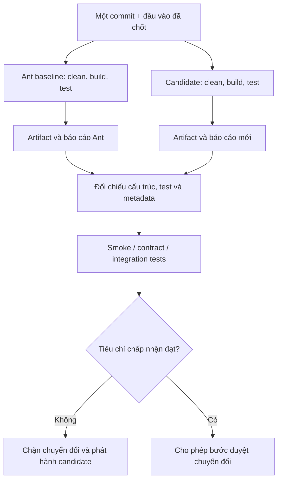

# So sánh sản phẩm, báo cáo và hành vi trước và sau chuyển đổi build

Khi chuyển một dự án Java từ **Apache Ant** sang công cụ khác như Gradle hoặc Maven, hoặc tổ chức lại các file `build.xml` và task Ant, mục tiêu không chỉ là làm cho lệnh build mới trả về `BUILD SUCCESSFUL`. Một lần chuyển đổi chỉ có thể được xem là hoàn tất khi nhóm chứng minh được rằng **sản phẩm tạo ra, báo cáo kiểm tra và hành vi sử dụng thực tế** đáp ứng cùng những cam kết đã tồn tại trước chuyển đổi, trừ các thay đổi đã được chủ động phê duyệt.

Ví dụ, một dự án có thể biên dịch thành công với cả Ant và Gradle nhưng bản JAR mới thiếu `META-INF/services`, không còn `Main-Class` trong manifest hoặc không chứa các tệp cấu hình cần thiết. Mặt khác, hai tệp JAR có mã băm khác nhau đôi khi chỉ do thời điểm đóng gói hoặc thứ tự các mục ZIP khác nhau. Vì vậy, **so sánh đúng đối tượng và đúng mức độ** quan trọng hơn việc chỉ chạy `sha256sum` trên hai tệp.

Bài học trình bày cách lập đường cơ sở (*baseline*) với Ant, xây dựng bộ bằng chứng cho build mới, so sánh artifact, báo cáo và hành vi, rồi đưa các kiểm tra đó vào cổng CI/CD để quyết định có thể chuyển đổi chính thức hay cần khắc phục tiếp.

## 1. Xác định rõ “tương đương” nghĩa là gì

Trước khi viết lệnh so sánh, cần xác định **hợp đồng build** mà người dùng, ứng dụng và hệ thống phát hành đang phụ thuộc vào. Không có một định nghĩa duy nhất về “hai bản build giống nhau” áp dụng cho mọi dự án.

| Lớp so sánh | Câu hỏi cốt lõi | Ví dụ bằng chứng |
| --- | --- | --- |
| **Sản phẩm (artifact)** | Build tạo đúng loại, số lượng, tên, nội dung và cấu trúc tệp cần thiết không? | JAR/WAR/ZIP, danh sách mục trong archive, manifest, tài nguyên, checksum |
| **Báo cáo** | Các bước test, kiểm tra chất lượng, coverage và báo cáo có được chạy, ghi nhận chính xác không? | JUnit XML, tổng số test, lỗi, skipped, coverage, cảnh báo static analysis |
| **Hành vi** | Chương trình hoặc công cụ được build ra có hoạt động như trước ở các kịch bản quan trọng không? | Mã thoát, stdout/stderr có ý nghĩa, phản hồi API, kết quả chức năng, tương thích runtime |
| **Quy trình build** | Các tác vụ quan trọng còn đúng thứ tự và đúng điều kiện thất bại không? | Ánh xạ target/task, dependency, thông số JVM, CI job và exit code |
| **Tính tái lập, phát hành** | Từ một commit và cấu hình đầu vào có thể tạo artifact đã kiểm tra và phát hành đúng bản đó không? | Toolchain, dependency đã khóa, SBOM, hash, thông tin commit và artifact provenance |

Có ít nhất ba mức tương đương thường gặp:

1. **Bằng nhau theo byte:** hai tệp có cùng SHA-256. Đây là bằng chứng mạnh về tính giống hệt nội dung, nhưng quá chặt với artifact chứa timestamp hoặc metadata sinh động.
2. **Bằng nhau về cấu trúc/nội dung quan trọng:** các class, resource, manifest, thư viện nhúng và quyền truy cập cần thiết khớp, dù timestamp ZIP hoặc thứ tự đóng gói khác nhau.
3. **Bằng nhau về hành vi được yêu cầu:** đầu vào quan trọng tạo ra kết quả tương đương, các điều kiện lỗi giống nhau, giao diện tích hợp không bị phá vỡ; bytecode có thể khác do compiler hoặc tối ưu hóa.

Không được tự động kết luận rằng mức 3 cho phép bỏ qua khác biệt ở mức 2. Với thư viện công bố cho hệ thống khác, public API và metadata phiên bản là một phần hợp đồng; với một bộ phân phối có ký số, chữ ký và cấu trúc archive cũng có ý nghĩa thực tế.

## 2. Chốt phạm vi và điều kiện thí nghiệm trước khi so sánh

Một so sánh đáng tin phải giữ các biến đầu vào có ảnh hưởng ở mức nhất quán:

- **Cùng commit mã nguồn**, cùng tài nguyên và cấu hình đầu vào; tránh build bản Ant từ commit cũ rồi build mới từ commit đã sửa logic ứng dụng.
- **Toolchain có thể xác minh:** phiên bản JDK, bộ mã hóa, locale/timezone, phiên bản Ant và công cụ thay thế, các compiler flag ảnh hưởng bytecode.
- **Dependency đã nhận diện:** phiên bản trực tiếp và bắc cầu, nguồn repository, thư viện nội bộ, plugin/task Ant được nạp.
- **Cùng cách chạy kiểm thử:** profile/môi trường, test filters, cấu hình cơ sở dữ liệu và dữ liệu thử, thời hạn timeout, biến môi trường cần thiết.
- **Hai thư mục đầu ra độc lập và sạch:** không để kết quả cũ hoặc build cache tạo cảm giác artifact đã được tạo trong lần chạy hiện tại.
- **Cùng chính sách kiểm tra:** không hạ ngưỡng lỗi, vô hiệu hóa test hoặc bỏ qua bước tạo báo cáo chỉ để build mới chạy qua.

Ví dụ hồ sơ baseline có thể ghi:

```yaml
# Ví dụ hồ sơ so sánh, không phải cấu hình sẵn có của Ant.
sourceCommit: "<full-git-commit-id>"
baseline:
  tool: "Apache Ant"
  version: "<record-from-ant-version>"
  command: "ant -f build.xml clean verify package"
candidate:
  tool: "Gradle"
  version: "<record-from-gradle-version>"
  command: "./gradlew clean test jar"
environment:
  java: "JDK 21 (cùng nhà cung cấp và bản vá khi cần so bytecode)"
  os: "<record-os-and-architecture>"
  locale: "<record-locale>"
artifacts:
  - logicalName: "application-jar"
    baselinePath: "legacy-dist/sample-app.jar"
    candidatePath: "build/libs/sample-app.jar"
checks:
  - "archive-entries-and-critical-metadata"
  - "test-results"
  - "runtime-smoke"
```

Trong ví dụ này, `verify` và `package` chỉ là **tên target giả định** của build Ant hiện có. Từng dự án phải điền đúng lệnh thực tế, bởi Ant không tự cung cấp một chuỗi target tiêu chuẩn giống nhau cho mọi `build.xml`.

Một thay đổi môi trường là chủ đích, chẳng hạn vừa chuyển sang Gradle vừa nâng JDK, cần được ghi riêng vì có thể làm sai lệch kết luận. Nếu có thể, chuyển từng yếu tố theo nhiều lượt: **giữ nguyên JDK/dependency để so đổi công cụ trước; sau đó nâng JDK/dependency như những thay đổi riêng**.

## 3. Thu baseline Ant trước khi thay đổi build

Đừng đợi xóa `build.xml` rồi mới hỏi “bản cũ đã tạo những gì?”. Trước khi chuyển đổi, cần thu đủ bằng chứng từ một bản build Ant sạch, thành công và được xác định bởi commit.

### 3.1. Ghi lệnh và môi trường Ant

Tại một bản checkout riêng cho baseline:

```bash
ant -version
ant -diagnostics
java -version
```

Sau đó chạy các target thực tế của dự án. Ví dụ nếu build Ant khai báo `clean`, `test` và `package`:

```bash
ant -f build.xml clean test package
```

`ant -diagnostics` có thể in ra đường dẫn môi trường và dữ liệu khác; chỉ chia sẻ phần cần thiết và tránh công bố log chứa bí mật CI. Nếu một target có side effect (upload, phát hành, gửi dữ liệu), phải chọn **target build/kiểm tra tương đương không gây tác động bên ngoài**, không dùng lệnh `release` cho thí nghiệm so sánh.

Điều cần ghi nhận không chỉ là lệnh *dự định* chạy mà còn là: lệnh thực tế, mã thoát, phiên bản công cụ, thư mục làm việc, các tham số `-D`, những target đã chạy và đường dẫn artifact sau khi hoàn thành.

### 3.2. Giữ đầu ra và báo cáo có định danh

Sau build, lưu một snapshot riêng, chẳng hạn:

```text
comparison/
├── baseline/
│   ├── build-environment.txt
│   ├── build.log
│   ├── dist/
│   │   └── sample-app.jar
│   ├── reports/
│   │   ├── test-results.xml
│   │   └── coverage.xml
│   └── inventory.json
└── candidate/
    ├── build-environment.txt
    ├── build.log
    ├── dist/
    │   └── sample-app.jar
    ├── reports/
    └── inventory.json
```

Đây là cấu trúc **tham khảo** cho thư mục so sánh, không phải thư mục Ant mặc định. Báo cáo thật có thể nằm ở đường dẫn khác và có nhiều file XML/HTML. Khi lưu kết quả, tránh đưa private key, token, mật khẩu hoặc tài liệu không được phép phát hành vào bộ bằng chứng.

Nếu baseline đã thất bại, đừng lấy kết quả đó làm chuẩn “thành công”. Cần phân loại lỗi tồn tại từ trước và thiết kế tiêu chí: lỗi nào bắt buộc được sửa, lỗi nào thuộc danh sách ngoại lệ có bằng chứng. Việc build mới cũng thất bại theo đúng cách cũ chưa chứng minh chuyển đổi thành công.

## 4. Lập bảng ánh xạ target Ant sang công việc ở build mới

Ant tổ chức công việc theo các target và `depends`; Gradle có task graph, Maven có lifecycle và plugin. Tên gọi khác nhau không có nghĩa hành vi cũng phải khác, nhưng **việc một task mới tồn tại không bảo đảm nó chạy cùng kiểm tra mà Ant từng chạy**.

| Việc cần giữ | Ví dụ trong Ant | Ví dụ khi chuyển sang Gradle | Bằng chứng cần quan sát |
| --- | --- | --- | --- |
| Dọn đầu ra | `clean` | `clean` | Không còn artifact cũ sau khi dọn |
| Biên dịch | `compile` + `<javac>` | `compileJava` | Cùng source/resource, flag cần thiết và dependency |
| Kiểm thử | `test` + `<junit>` hoặc `<junitlauncher>` | `test` | Bộ test đầy đủ, lỗi làm build thất bại, báo cáo được giữ |
| Đóng gói | `jar`/`package` + `<jar>` | `jar` hoặc task đóng gói khác | JAR có đủ nội dung, manifest và thông số sản phẩm |
| Kiểm tra bổ sung | `<checkstyle>`, `<exec>`, task tùy biến | Plugin/task tương đương | Quy tắc và ngưỡng kiểm tra giữ được |
| Tạo tài liệu | `javadoc` + `<javadoc>` | `javadoc` | Đủ trang, link, tài nguyên quan trọng |
| Phát hành | `release` phụ thuộc kiểm tra | Stage CI hoặc task publish | Chỉ phát hành artifact đã xác minh |

Tên trong bảng là **ví dụ thông dụng**, không phải ánh xạ tự động. Chẳng hạn Ant có thể build WAR, fat JAR hoặc tạo nhiều tệp phân phối; Gradle `jar` mặc định chỉ tạo JAR từ đầu ra của `sourceSets.main`, không tự thay thế logic đóng gói bổ sung của Ant.

Khi lập bảng ánh xạ, ghi đủ **đầu vào, điều kiện phụ thuộc, đầu ra và điều kiện thất bại** của từng bước. Nếu build Ant cũ có target `generate-sources` chạy trước `<javac>`, chuyển sang Gradle mà quên generator có thể vẫn build thành công nhờ nguồn sinh tồn từ lần chạy trước. Clean build trên runner mới thường phát hiện được lỗi này.

## 5. Ví dụ nhỏ: hai cấu hình tạo cùng loại JAR

Giả sử dự án có mã nguồn `src/main/java/demo/Main.java` và cần xuất một JAR chạy được tên `sample-app.jar`.

```java
package demo;

public final class Main {
    public static void main(String[] args) {
        System.out.println("Build migration demo");
    }
}
```

### 5.1. Baseline bằng Apache Ant

```xml
<?xml version="1.0" encoding="UTF-8"?>
<project name="sample-app" default="package" basedir=".">
    <property name="source.dir" location="src/main/java"/>
    <property name="classes.dir" location="build/ant-classes"/>
    <property name="dist.dir" location="legacy-dist"/>

    <target name="clean">
        <delete dir="build/ant-classes"/>
        <delete dir="legacy-dist"/>
    </target>

    <target name="compile">
        <mkdir dir="${classes.dir}"/>
        <javac srcdir="${source.dir}"
               destdir="${classes.dir}"
               encoding="UTF-8"
               includeantruntime="false"/>
    </target>

    <target name="package" depends="compile">
        <mkdir dir="${dist.dir}"/>
        <jar destfile="${dist.dir}/sample-app.jar"
             basedir="${classes.dir}">
            <manifest>
                <attribute name="Main-Class" value="demo.Main"/>
            </manifest>
        </jar>
    </target>
</project>
```

Lệnh baseline:

```bash
ant -f build.xml clean package
java -jar legacy-dist/sample-app.jar
```

Ant biên dịch class, tạo JAR có manifest cho phép `java -jar` và chương trình in `Build migration demo`.

### 5.2. Candidate bằng Gradle

Một cấu hình Gradle Groovy DSL tối thiểu cho cùng dự án:

```groovy
plugins {
    id 'java'
}

java {
    toolchain {
        languageVersion = JavaLanguageVersion.of(21)
    }
}

tasks.named('jar') {
    archiveBaseName.set('sample-app')
    archiveVersion.set('')
    manifest {
        attributes('Main-Class': 'demo.Main')
    }
}
```

Lệnh khi dự án đã có Gradle wrapper hợp lệ:

```bash
./gradlew clean jar
java -jar build/libs/sample-app.jar
```

Trên Windows, có thể dùng `gradlew.bat clean jar`. File `build.gradle` trên dùng Java plugin và toolchain JDK 21; bản Ant phải được chạy bằng toolchain được chọn phù hợp nếu muốn so sánh bytecode dưới điều kiện tương đương. Ví dụ minh họa phần **đóng gói class và manifest**, chưa khai báo test, tài nguyên, dependency hoặc các nhiệm vụ phát hành của một dự án thực tế.

Hai JAR nằm ở **đường dẫn khác nhau**, nhưng có thể đáp ứng cùng hợp đồng: tên logic `sample-app.jar`, chứa `demo/Main.class`, có `Main-Class: demo.Main`, chạy thành công và in cùng thông điệp. Khi chuyển đổi thật, cần kiểm tra thêm những nội dung mà bản Ant cũ đã thực hiện ngoài ví dụ đơn giản này.

## 6. So sánh sản phẩm: từ tên tệp đến cấu trúc archive

### 6.1. Kiểm tra số lượng, loại và tên logic

Đầu tiên, xác định mỗi build cần tạo những artifact nào:

- JAR, WAR, ZIP hay tập file phân phối?
- Artifact được xuất dưới tên nào? Có chứa phiên bản, classifier hoặc kiến trúc không?
- File nào là sản phẩm chính, file nào là debug/source/docs?
- Công đoạn triển khai hoặc người tiêu thụ artifact đang dùng **đường dẫn** nào?
- Những tài nguyên cấu hình, script, license, metadata hoặc file ký số nào phải được đóng gói?

Đường dẫn artifact thay đổi là điều bình thường khi đổi công cụ; cần sửa consumer hoặc tạo lớp tương thích có chủ đích. Tuy nhiên, mất một artifact mà downstream job vẫn kỳ vọng là lỗi chức năng dù phần biên dịch được báo thành công.

### 6.2. So sánh checksum toàn tệp để kiểm tra byte-for-byte

Nếu chính sách yêu cầu artifact hoàn toàn giống nhau, tính SHA-256:

```bash
sha256sum legacy-dist/sample-app.jar
sha256sum build/libs/sample-app.jar
```

Trên Windows PowerShell:

```powershell
Get-FileHash -Algorithm SHA256 -LiteralPath "legacy-dist/sample-app.jar"
Get-FileHash -Algorithm SHA256 -LiteralPath "build/libs/sample-app.jar"
```

**Hash trùng nhau** chứng minh byte nội dung trùng nhau trong phép băm đã sử dụng; **hash khác nhau** chỉ chứng minh hai tệp khác byte. Sự khác biệt có thể do thay đổi class/resource, nhưng cũng có thể do thứ tự entry, timestamp ZIP, tham số nén hoặc metadata build. Không nên bỏ qua hash khác nhau mà chưa xem thành phần nào đã đổi.

### 6.3. Xem entry và manifest trong JAR

JDK cung cấp công cụ `jar` để liệt kê nội dung:

```bash
jar tf legacy-dist/sample-app.jar
jar tf build/libs/sample-app.jar
```

Với JAR có thể chạy trực tiếp, tối thiểu cần xác nhận `META-INF/MANIFEST.MF` chứa `Main-Class` đúng. Với thư viện, cần kiểm tra class API công khai, resource, `META-INF/services`, `module-info.class` (nếu dùng Java Module System) và metadata liên quan đến tiêu thụ thư viện. Với WAR hoặc fat JAR, cấu trúc thư mục và các dependency nhúng cũng là một phần hợp đồng.

Không chỉ so file `.class`: JAR mới có thể giữ mọi class Java nhưng thiếu file cấu hình, chứng chỉ truststore do dự án cung cấp, template, tệp i18n hoặc dịch vụ đăng ký qua SPI. Những lỗi này nhiều khi chỉ xuất hiện lúc chạy.

### 6.4. Tạo manifest nội dung có thể so sánh bằng Python

Đối với JAR/ZIP, có thể kiểm tra **tên entry và SHA-256 của nội dung từng entry**. Script chuẩn Python dưới đây không phụ thuộc công cụ build; nó báo cả entry trùng tên để tránh trường hợp một mục bị ghi đè âm thầm khi dùng dictionary.

Tạo `tools/jar_inventory.py` trong khu vực phục vụ việc so sánh:

```python
#!/usr/bin/env python3
import hashlib
import json
import sys
import zipfile


def inventory(path):
    result = {}
    with zipfile.ZipFile(path, "r") as archive:
        for info in archive.infolist():
            if info.is_dir():
                continue
            if info.filename in result:
                raise ValueError(f"Duplicate archive entry: {info.filename}")
            content = archive.read(info)
            result[info.filename] = hashlib.sha256(content).hexdigest()
    return result


if __name__ == "__main__":
    if len(sys.argv) != 2:
        raise SystemExit("Usage: python jar_inventory.py <jar-or-zip>")
    print(json.dumps(inventory(sys.argv[1]), indent=2,
                     ensure_ascii=False, sort_keys=True))
```

Gọi script hai lần:

```bash
python tools/jar_inventory.py legacy-dist/sample-app.jar > ant-entries.json
python tools/jar_inventory.py build/libs/sample-app.jar > new-entries.json
```

Nếu dùng Git, có thể xem khác biệt bằng:

```bash
git diff --no-index -- ant-entries.json new-entries.json
```

`git diff --no-index` trả mã `1` khi có khác biệt; trong bước CI có thể dùng khác biệt như tín hiệu phải phân tích hoặc phải chặn, tùy chính sách. Nội dung JSON tạo theo tên entry nên thứ tự entry và timestamp của ZIP không ảnh hưởng kết quả. Tuy nhiên, script **không đánh giá quyền file, cờ nén, timestamp, chữ ký ZIP và tên thư mục rỗng**; nếu những thuộc tính này quan trọng với artifact, phải kiểm tra thêm. Nó cũng xem JAR lồng trong fat JAR như một entry nhị phân, không tự mở sâu từng JAR con.

Với `META-INF/MANIFEST.MF`, dù khác biệt chỉ là một dòng như `Created-By`, kết quả vẫn báo khác biệt. Đây là lựa chọn thận trọng: chỉ chuẩn hóa những trường đã được xác định rõ là không ảnh hưởng hợp đồng, sau khi xác minh chúng không dùng trong runtime, ký số hoặc truy vết phát hành.

### 6.5. Phân loại các khác biệt trước khi kết luận

| Khác biệt phát hiện | Có thể chấp nhận? | Hướng xác minh |
| --- | --- | --- |
| Timestamp hoặc thứ tự entry ZIP khác | Có thể, nếu chỉ là metadata không thuộc hợp đồng | So danh sách và hash nội dung entry; xem yêu cầu reproducible build |
| `Main-Class` bị mất hoặc đổi | Thường không, nếu cần `java -jar` | Đọc manifest và chạy thử JAR |
| Thiếu `.class` hoặc thay public API | Thường không, trừ thay đổi có chủ đích | So cấu trúc class, API compatibility và test gọi từ consumer |
| Thiếu `META-INF/services` | Có thể làm ServiceLoader không tìm được implementation | Smoke test luồng dịch vụ và so resource |
| Thay dependency bên trong fat JAR | Phải xem xét riêng | Kiểm tra dependency graph, phiên bản và hành vi runtime |
| Khác compression level, bytecode không đổi | Có thể chấp nhận ở mức tương đương chức năng | Đối chiếu nội dung và yêu cầu ký số/artifact digest |
| Thiếu file cấu hình hoặc script chạy | Thường không | Chạy packaging/deployment smoke test |
| Tên đường dẫn output thay đổi | Có thể, nếu pipeline/consumer được cập nhật | Kiểm tra upload, download, deploy và tài liệu vận hành |

Đối với JAR có chữ ký, thay bất kỳ nội dung hoặc metadata liên quan đến cơ chế ký có thể làm chữ ký không hợp lệ. Cần **kiểm tra chữ ký sau đóng gói bằng công cụ phù hợp**, không xem loại bỏ chữ ký cũ là một cách “chuẩn hóa” để vượt diff.

## 7. So sánh báo cáo kiểm thử và chất lượng

Hai build cùng tạo JAR và có exit code `0` vẫn có thể khác nhau về mức độ kiểm tra: build mới có thể bỏ qua test, chỉ chạy test nhỏ, hoặc không phát ra báo cáo mà CI trước đây dùng để quyết định phát hành.

### 7.1. So sánh bộ test, số lượng và trạng thái

Với JUnit XML, các trường thường hữu ích gồm số test, failures, errors, skipped và tên từng test case. Ví dụ:

```xml
<testsuite name="demo.UserServiceTest"
           tests="12" failures="0" errors="0" skipped="1">
    <!-- Các testcase thực tế được ghi tại đây. -->
</testsuite>
```

Một bảng so sánh có thể trông như sau (**số liệu minh họa**):

| Chỉ số | Ant baseline | Build mới | Cần xử lý |
| --- | ---: | ---: | --- |
| Test cases được chạy | 120 | 120 | Đối chiếu tên test, không chỉ tổng số |
| Failures | 0 | 0 | Đạt nếu cùng phạm vi và điều kiện |
| Errors | 0 | 0 | Đạt nếu cùng phạm vi và điều kiện |
| Skipped | 2 | 5 | Cần giải thích 3 test được bỏ qua thêm |
| Bộ test integration | 8 | 0 | Chưa tương đương; tìm task còn thiếu |

Số test bằng nhau vẫn chưa đủ: một nhóm kiểm thử có thể bị thay bằng nhóm khác. Nếu có thể, so **định danh test** (`classname`, `name`), trạng thái và những bộ kiểm thử phải chạy theo contract. Tùy framework và report formatter, XML có thêm thời gian, hostname, stdout/stderr và thứ tự khác nhau; nên so các trường **có ý nghĩa**, không yêu cầu byte XML giống hệt.

### 7.2. So sánh coverage và static analysis đúng điều kiện

Coverage được tạo bởi các plugin/tool khác nhau có thể đo không giống nhau. Ví dụ, cùng mã nguồn nhưng tỷ lệ line/branch coverage đổi vì:

- Một số test integration đã không còn chạy.
- Bộ instrumentation hoặc bộ lọc class được thay đổi.
- Những mã nguồn được sinh tự động nay được tính vào mẫu số.
- Phiên bản công cụ coverage hoặc quy tắc tính số liệu khác nhau.

Vì vậy, nếu muốn so số phần trăm trực tiếp, cần giữ cùng phạm vi mã nguồn, bộ test và cơ chế đo, hoặc ghi rõ phần nào đã đổi. Một mức coverage cao hơn không chứng minh build mới tương đương nếu danh sách test đã thay đổi.

Tương tự, báo cáo lint, Checkstyle, PMD hoặc static analysis cần so **ruleset, severity, phạm vi file, loại cảnh báo và chính sách exit code**. Nếu build Ant cũ chặn cảnh báo mức `error` nhưng build mới chỉ tạo report và vẫn trả thành công, khả năng bảo vệ đã bị giảm dù báo cáo HTML vẫn tồn tại.

### 7.3. Bảo đảm báo cáo vẫn được CI thu thập

Đường dẫn báo cáo thường khác nhau giữa công cụ:

```text
Ví dụ Ant:    build/reports/junit/TEST-demo.UserServiceTest.xml
Ví dụ Gradle: build/test-results/test/TEST-demo.UserServiceTest.xml
```

CI cần được cập nhật đường dẫn upload. Có thể hai build đều chạy test, nhưng CI hiển thị “0 tests” chỉ vì cấu hình report vẫn trỏ vào thư mục cũ. Phải phân biệt **test không chạy**, **report không được tạo**, và **report có nhưng CI không đọc được**.

Với test failure, vẫn nên lưu log/JUnit XML bằng bước CI chạy có điều kiện thích hợp để phục vụ điều tra, trong khi **trạng thái thất bại của bước xác minh vẫn được giữ**. Không bật `continue-on-error` cho test bắt buộc chỉ để giữ được báo cáo.

## 8. So sánh hành vi chạy của sản phẩm

Sau khi xác nhận artifact có cấu trúc phù hợp, cần kiểm tra phần mà người dùng và các hệ thống tích hợp thật sự nhìn thấy.

### 8.1. Hành vi của ứng dụng dòng lệnh

Đối với ví dụ JAR ở mục 5:

```bash
java -jar legacy-dist/sample-app.jar
java -jar build/libs/sample-app.jar
```

Cả hai phiên bản dự kiến in `Build migration demo` và kết thúc với exit code `0`. Nhưng trong dự án thật, phải kiểm tra cả tình huống lỗi:

- Đối số hợp lệ và không hợp lệ có được xử lý nhất quán không?
- Exit code có phù hợp với giao diện CLI đã công bố không?
- Đầu ra có giữ nội dung và định dạng máy đọc được không?
- Đầu vào/đầu ra tệp có đúng đường dẫn, encoding và quyền cần thiết không?
- Chương trình có xử lý cùng các biến môi trường và property JVM không?

Khi so, nên tách **stdout** và **stderr**, đồng thời ghi riêng exit code. Một chương trình chuyển lỗi sang stdout trong bản mới có thể phá vỡ script tiêu thụ output dù text nhìn có vẻ giống.

### 8.2. Hành vi của dịch vụ/API

Với ứng dụng server, các bài kiểm tra khả thi bao gồm:

| Hạng mục | Điều cần đối chiếu |
| --- | --- |
| Khởi động | Server khởi động được từ artifact mới, đúng entry point, cổng và profile |
| API | Route, HTTP status, schema JSON, headers quan trọng và lỗi chuẩn |
| Bảo mật | Cấu hình auth/authz, TLS, quyền truy cập tài nguyên và chính sách secret |
| Tài nguyên | Template, static files, `application.properties`, logging config và ServiceLoader |
| Tương tác dữ liệu | Kết nối, transaction, migration, schema và cách xử lý lỗi |
| Vận hành | Shutdown, health-check, signal handling, logging và nhu cầu tài nguyên |

Không nên kiểm tra trên hai hệ thống thật đang chia sẻ dữ liệu có thể bị sửa chỉ để lấy số liệu so sánh. Ưu tiên môi trường test cô lập và **bộ dữ liệu đầu vào đã biết**, nhất là đối với lệnh gửi thông báo, xử lý thanh toán hoặc ghi dữ liệu.

### 8.3. So sánh kết quả có ý nghĩa thay vì log thô

Log có timestamp, ID ngẫu nhiên, thread name và đường dẫn khác nhau. So byte toàn bộ log dễ tạo ra vô số khác biệt không ảnh hưởng nghiệp vụ. Có thể chuẩn hóa những trường **được công nhận là không ổn định** (ví dụ timestamp trong log thử nghiệm), rồi so các sự kiện và kết quả quan trọng:

```text
Scenario: create-user-valid
Input:     cùng request fixture
Expected: HTTP 201, JSON có id hợp lệ, user được ghi đúng
Ant:      PASS
New build: PASS

Scenario: create-user-invalid
Input:     thiếu trường bắt buộc
Expected: HTTP 400, mã lỗi xác định
Ant:      PASS
New build: FAIL (HTTP 500)
```

Ví dụ trên cho thấy **artifact có thể được đóng gói thành công nhưng hành vi không tương đương**. Kết quả `FAIL` phải chặn quyết định chuyển đổi hoặc được xử lý như một thay đổi giao diện có chủ đích và phê duyệt, không được bỏ qua vì “build đã xanh”.

## 9. So sánh hành vi của chính quy trình build

Một mục tiêu chuyển đổi khác là bảo toàn **ngữ nghĩa vận hành** mà các nhóm đang phụ thuộc vào, chẳng hạn lệnh chạy test, tham số môi trường, điều kiện dừng và các file được tạo ra.

Các tình huống nên kiểm tra ngoài happy path:

1. **Build sạch:** xóa đầu ra, biên dịch, test, đóng gói; không dựa vào file stale.
2. **Build lỗi biên dịch:** cố tình đưa vào một nhánh thử nghiệm có lỗi Java; cả Ant và build mới phải thất bại ở bước xác minh.
3. **Test thất bại:** một test có chủ đích trả lỗi phải khiến job CI thất bại; không được chỉ ghi XML báo lỗi mà tiếp tục phát hành.
4. **Thiếu dependency bắt buộc:** không được âm thầm tạo JAR thiếu lớp/tài nguyên hoặc thay bằng dependency không được duyệt.
5. **Sai cấu hình:** không có property/secret bắt buộc phải báo lỗi rõ, không dùng giá trị fallback nguy hiểm.
6. **Chạy nhiều lần:** sau lần build thành công, chạy lại với cùng đầu vào phải cho kết quả nhất quán theo hợp đồng; đặc biệt chú ý generated sources và incremental build.
7. **Môi trường runner mới:** từ checkout sạch và dependency cache trống, build phải tái tạo được artifact theo điều kiện truy cập kho đã công bố.

Trong Ant, một target `package` có thể phụ thuộc `test`; khi chuyển sang Gradle, `jar` mặc định **không nhất thiết phụ thuộc `test`**. Nếu CI chỉ đổi `ant release` thành `./gradlew jar`, gate kiểm thử có thể bị bỏ mất. Cần chọn một task tổng hợp, ví dụ `check` cùng `jar`, hoặc thiết kế dependency pipeline rõ ràng, đồng thời kiểm tra lệnh publish phụ thuộc vào job xác minh thành công.

Tham số cũng cần ánh xạ có chủ đích: `-Denv=prod` truyền property cho Ant **không tương đương tự động** với mọi cách Gradle đọc project property, system property hoặc environment variable. Phải xác định từng property thuộc lớp nào, nơi được đọc và cách chuyển đúng sang build mới.

## 10. Lập ma trận đối chiếu có tiêu chí chấp nhận

Một báo cáo đối chiếu hữu ích cần chỉ rõ trạng thái và bằng chứng, thay vì kết luận chung “hai build tương đương”. Ví dụ:

| Kiểm tra | Baseline Ant | Candidate | Kết luận | Bằng chứng/hành động |
| --- | --- | --- | --- | --- |
| Đóng gói `sample-app.jar` | Có | Có | Đạt | Tên logic, định dạng và đường dẫn tiêu thụ đã xác nhận |
| `Main-Class` | `demo.Main` | `demo.Main` | Đạt | Manifest của hai JAR |
| Hash toàn JAR | A | B | Cần phân tích | Entry inventory; timestamp hoặc nội dung nào đổi? |
| Entry quan trọng | 24 | 23 | Không đạt | Thiếu `META-INF/services/...` |
| Unit tests | 120/120 | 120/120 | Đạt một phần | Cần so danh sách test và skipped |
| Integration tests | 8/8 | Không chạy | Không đạt | Thêm task/job tương ứng |
| CLI success | Exit `0` | Exit `0` | Đạt | Smoke test cùng input |
| CLI invalid input | Exit `2` | Exit `0` | Không đạt | Sửa xử lý lỗi hoặc hợp đồng CLI |
| CI chặn publish khi test lỗi | Có | Chưa xác minh | Chưa đạt | Thực hiện failure injection |

Các con số, hash và kết luận trong bảng **chỉ mang tính minh họa**. Một bảng thật cần đường dẫn báo cáo hoặc artifact cụ thể, commit nguồn, môi trường, người đánh giá và liên kết đến job CI. Điều kiện “đạt” nên được định nghĩa trước khi chạy so sánh, tránh thay đổi tiêu chí sau khi thấy kết quả.

Phân loại phát hiện theo ba nhóm:

- **Khác biệt không được phép:** thiếu API/resource, đổi lỗi runtime, bỏ test, mất điều kiện chặn phát hành, thay đổi phiên bản dependency không được duyệt.
- **Khác biệt chấp nhận có giải thích:** tên thư mục output mới, timestamp archive không thuộc hợp đồng, thứ tự mục ZIP, báo cáo HTML có bố cục khác nhưng cùng dữ liệu kiểm tra.
- **Thay đổi có chủ đích:** nâng JDK, nâng thư viện, đổi cấu trúc đóng gói hoặc sửa hành vi; cần yêu cầu, bằng chứng và phê duyệt riêng, không coi là “tương đương” một cách mặc định.

## 11. Tổ chức so sánh trong CI/CD

Một giai đoạn chuyển đổi an toàn có thể giữ cả hai đường build trong thời gian đủ để thu bằng chứng:



Hai job có thể chạy ở những môi trường độc lập để tránh ghi đè output. Sau đó, job `compare` nhận artifact/report **của cùng một commit** và chạy script đối chiếu. Với pipeline có quyền phát hành, job `publish` phải phụ thuộc vào `compare` và các test bắt buộc đã thành công; không dùng `continue-on-error` hoặc `if: always()` cho bước deploy.

Quy tắc về mã thoát cần rõ ràng: nếu phép so sánh phát hiện khác biệt **không cho phép**, script cần trả mã khác `0` và CI phải chặn. Chỉ in một bảng `FAIL` ra console nhưng vẫn exit `0` sẽ khiến pipeline có thể báo xanh giả. Khi mục tiêu là thu thập bằng chứng trong giai đoạn thử nghiệm, có thể đặt job so sánh ở chế độ quan sát theo chính sách, nhưng phải phân biệt với cổng phát hành chính thức và không tuyên bố đã đạt khi còn khác biệt quan trọng.

### Ví dụ pseudocode cho bộ so sánh

```text
baseline = load_artifact_and_test_manifest("baseline/")
candidate = load_artifact_and_test_manifest("candidate/")

compare_expected_artifact_set(baseline, candidate)
compare_required_archive_entries(baseline, candidate)
compare_manifest_and_dependencies(baseline, candidate)
compare_test_case_identity_and_status(baseline, candidate)
compare_quality_gates_and_exit_status(baseline, candidate)
run_same_runtime_contract_tests_for_both()

if has_unapproved_difference_or_required_check_failed:
    write_comparison_report()
    exit_nonzero()

write_comparison_report()
exit_zero()
```

Đây là **thuật toán minh họa**, không phải code chạy trực tiếp. Khi hiện thực, phải lưu định danh artifact, tên và loại kiểm tra; phân biệt lỗi hạ tầng/thiếu báo cáo với trường hợp báo cáo cho biết test thất bại. Thiếu bằng chứng của một cổng bắt buộc nên được coi là **chưa đạt**, không được mặc định là pass.

## 12. Tránh những kết luận sai phổ biến

### “Hai lệnh đều build thành công, vậy đã chuyển đổi xong”

Build mới có thể bỏ qua bước test, lint, code generation hoặc đóng gói resource. Cần đối chiếu task graph, báo cáo và artifact thực tế. Exit code `0` là **điều kiện cần**, không phải toàn bộ bằng chứng.

### “Hai JAR có SHA-256 khác nhau, vậy build mới sai”

Sự khác biệt có thể đến từ timestamp ZIP, thứ tự entry hoặc compiler flag; phân loại nguyên nhân trước khi kết luận. Nếu tổ chức có yêu cầu reproducible build thì khác byte vẫn là vấn đề cần xử lý theo chính sách, nhưng không đồng nghĩa với sai hành vi ứng dụng.

### “Hai JAR có cùng tên và dung lượng gần bằng nhau, vậy tương đương”

Tên và dung lượng không chứng minh nội dung. Một resource nhỏ bị thiếu hoặc thuộc tính `Main-Class` bị thay có thể phá vỡ khả năng chạy. So entry, metadata và hành vi.

### “Tỷ lệ coverage bằng nhau nghĩa là cùng test”

Coverage có thể được đo bằng công cụ khác, bộ lọc khác hoặc bộ test khác. So định danh test và cách đo trước khi đối chiếu tỷ lệ.

### “Chỉ cần so đầu ra từ một lần chạy cục bộ”

Kết quả cục bộ có thể phụ thuộc cache, file sinh cũ và cấu hình riêng. Cần ít nhất một vòng **clean build trên môi trường tái tạo được**, rồi đối chiếu trên cùng commit.

### “Khác biệt không quan trọng thì cứ xóa khỏi báo cáo”

Nếu cần chuẩn hóa timestamp hay đường dẫn, hãy **ghi rõ chính sách chuẩn hóa và bằng chứng vì sao trường đó không ảnh hưởng hợp đồng**. Không xóa hàng loạt entry `META-INF`, file cấu hình hoặc dependency chỉ để hai danh sách khớp.

### “Build ứng dụng đúng thì phát hành an toàn”

Pipeline có thể chuyển nhầm artifact sang job publish hoặc dùng artifact từ lần chạy trước. Cần giữ liên kết giữa commit, job verify, checksum và file được phát hành. Nếu baseline Ant chỉ là bản tham chiếu, không được để đường build cũ tạo tác động ngoài ý muốn trong quá trình chạy song song.

## 13. Quy trình ra quyết định và bàn giao chuyển đổi

Khi đã có bằng chứng, một đợt chuyển đổi có thể được bàn giao theo trình tự sau:

1. **Chốt hợp đồng:** artifact nào, test nào, hành vi nào, môi trường nào và điều kiện phát hành nào bắt buộc giữ.
2. **Ghi baseline từ Ant:** lưu commit, lệnh thực tế, toolchain, artifact, report và mã thoát của các kịch bản quan trọng.
3. **Build candidate độc lập:** chạy clean build và cùng bộ kiểm tra; lưu đầu ra dưới định danh khác.
4. **So sánh nhiều lớp:** hash toàn tệp, entry/resource/manifest, dependencies, báo cáo test/chất lượng và các smoke/contract tests.
5. **Giải quyết khác biệt:** sửa lỗi hoặc ghi lại thay đổi có chủ đích và phê duyệt; tránh che lỗi bằng tắt kiểm tra hoặc giảm ngưỡng.
6. **Thử đường thất bại:** cố ý gây lỗi compile/test hoặc thiếu file cấu hình để xác nhận CI không phát hành candidate.
7. **Duyệt và chuyển mặc định:** đổi lệnh CI, đường dẫn artifact, cấu hình báo cáo và tài liệu cho người dùng; giữ khả năng quay lại trong giới hạn chính sách.
8. **Theo dõi sau chuyển đổi:** dùng các kiểm tra và metric vận hành để phát hiện khác biệt chỉ xuất hiện khi dùng thực tế.

Bộ bằng chứng bàn giao tối thiểu nên gồm bảng ánh xạ target/task, hồ sơ môi trường, danh sách sản phẩm và cấu trúc archive, bảng so sánh test/report, kết quả smoke/contract tests, giải thích các khác biệt được chấp nhận, trạng thái cổng CI và cách xử lý rollback. Người đánh giá phải có thể truy ra **artifact nào đã được kiểm tra và nó được tạo từ nguồn nào**.

Trong chuyển đổi build từ Apache Ant, sự thành công của công cụ thay thế chỉ là điểm bắt đầu. Chứng minh được **sản phẩm đúng, báo cáo đầy đủ, hành vi phù hợp và tín hiệu thất bại được truyền đến CI** mới là cơ sở để chuyển đường build chính thức mà không làm thay đổi ngầm những cam kết của dự án.
