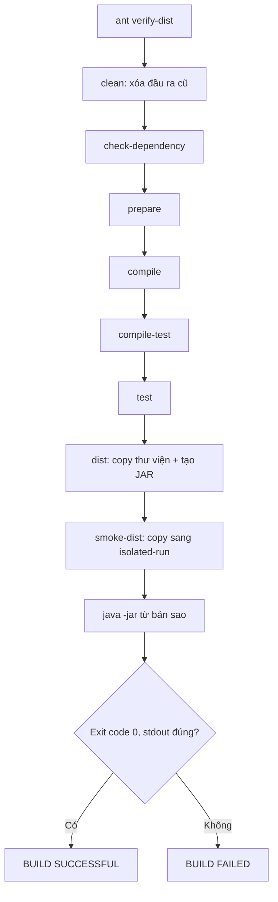

# Bổ sung thư viện ngoài và chạy JAR từ thư mục phân phối sạch

> **Build Tool Ant → Thực hành**  
> **Mục tiêu:** Thêm một dependency Java bên ngoài, cấu hình classpath khi biên dịch và chạy, đóng gói JAR cùng dependency, sau đó thử chạy sản phẩm từ một thư mục chỉ chứa file phân phối.

## 1. Tình huống thực tế

Một ứng dụng Java có thể chạy bình thường từ IDE hoặc từ thư mục `build/classes` nhưng thất bại khi chỉ gửi file JAR cho người dùng. Nguyên nhân phổ biến là chương trình tham chiếu lớp nằm trong một thư viện ngoài, còn file JAR ứng dụng chỉ chứa các class tự viết.

Ví dụ, source có:

```java
import org.apache.commons.lang3.StringUtils;
```

Nếu `StringUtils` không có trong **compile classpath**, `javac` sẽ báo không tìm thấy package/class. Nếu có lúc compile nhưng thiếu khi chạy JAR, JVM có thể báo:

```text
Exception in thread "main" java.lang.NoClassDefFoundError:
    org/apache/commons/lang3/StringUtils
```

Đây là hai vấn đề khác nhau. Bài thực hành giải quyết cả hai và cố ý kiểm chứng thành phẩm trong môi trường tách khỏi classpath của IDE.

Sản phẩm mong muốn:

```text
build/dist/
├── greeting-app.jar
└── lib/
    └── commons-lang3-3.14.0.jar
```

Sau khi copy nguyên cây `dist/` sang thư mục mới, người dùng chỉ cần Java runtime tương thích và chạy:

```bash
java -jar greeting-app.jar ant
```

Kết quả:

```text
Xin chào, Ant!
```

Chúng ta dùng mô hình **thin JAR + thư mục `lib/`**: JAR chính chứa ứng dụng, JAR của thư viện ngoài nằm bên cạnh. Cách này khác với fat/uber JAR, nơi các class của dependency được gộp vào một file.

## 2. Phân biệt các classpath

| Phạm vi | Nơi cấu hình | Thành phần cần có |
|---|---|---|
| Compile | `<javac><classpath>` | JAR chứa các class mà source tham chiếu |
| Test compile | `<javac>` cho source test | Class ứng dụng và library/test API liên quan |
| Test runtime | `<java>` hoặc test runner | Class ứng dụng, class test, các runtime dependency |
| Runtime phân phối | Manifest `Class-Path` hoặc launcher | JAR ứng dụng và toàn bộ dependency runtime |

Một entry trong compile classpath **không tự trở thành nội dung của JAR ứng dụng**. Ant cũng không tự viết manifest `Class-Path` từ classpath của `<javac>`. Bạn phải quyết định rõ ứng dụng được phân phối cùng thư viện bằng cách nào.

Để thực hành, ta dùng Commons Lang 3.14.0 (tọa độ Maven `org.apache.commons:commons-lang3:3.14.0`). Đây là thư viện cung cấp các tiện ích, trong đó có `StringUtils.isBlank` và `StringUtils.capitalize`.

## 3. Chuẩn bị thư mục và dependency

Cấu trúc dự án:

```text
ant-external-lib/
├── build.xml
├── lib/
│   └── commons-lang3-3.14.0.jar
├── src/
│   ├── main/java/demo/App.java
│   └── test/java/demo/AppTest.java
└── build/                          # sinh ra, không commit
    ├── classes/
    ├── test-classes/
    ├── dist/
    └── isolated-run/
```

Cần JDK 17 và Ant 1.10.x. Kiểm tra:

```bash
java -version
javac -version
ant -version
```

Thư viện đã ghim phiên bản có đường dẫn Maven Central:

```text
https://repo.maven.apache.org/maven2/org/apache/commons/commons-lang3/3.14.0/commons-lang3-3.14.0.jar
```

Trên Linux/macOS:

```bash
mkdir -p lib
curl --fail --location --show-error \
  --output lib/commons-lang3-3.14.0.jar \
  https://repo.maven.apache.org/maven2/org/apache/commons/commons-lang3/3.14.0/commons-lang3-3.14.0.jar
```

Trên Windows PowerShell (mỗi dòng là một lệnh):

```powershell
New-Item -ItemType Directory -Force -Path .\lib | Out-Null
Invoke-WebRequest -Uri 'https://repo.maven.apache.org/maven2/org/apache/commons/commons-lang3/3.14.0/commons-lang3-3.14.0.jar' -OutFile '.\lib\commons-lang3-3.14.0.jar'
```

Cần xác minh checksum/chữ ký với giá trị đáng tin từ nguồn phát hành trong quy trình thật. Việc chỉ tự tính SHA-256 rồi in ra **không đủ** để biết file tải về có đúng hay không. Trên CI, file này phải đến từ nguồn được kiểm soát: repository, artifact store nội bộ hoặc bước tải có kiểm tra integrity. Bài thực hành giả định file đã tồn tại trong `lib/`.

Thêm `/build/` vào `.gitignore` vì thư mục đó chứa toàn bộ đầu ra do Ant sinh ra.

## 4. Viết ứng dụng sử dụng Commons Lang

Tạo `src/main/java/demo/App.java`:

```java
package demo;

import org.apache.commons.lang3.StringUtils;

public final class App {
    private App() {
    }

    public static String greeting(String name) {
        if (StringUtils.isBlank(name)) {
            throw new IllegalArgumentException("Name must not be blank");
        }

        return "Xin chào, "
            + StringUtils.capitalize(name.strip())
            + "!";
    }

    public static void main(String[] args) {
        String name = args.length == 0 ? "ant" : args[0];
        System.out.println(greeting(name));
    }
}
```

`StringUtils.isBlank` và `StringUtils.capitalize` thực thi khi chương trình chạy. Vì thế đóng gói thành JAR không chứa Commons Lang trong runtime classpath sẽ tạo ra lỗi, ngay cả khi bước `javac` trước đó thành công.

`String.strip()` thuộc JDK từ Java 11. Bài chọn `release="17"` để nhắm tới Java 17, phù hợp toolchain đã chuẩn bị.

### 4.1. Test runner Java tối giản

Tạo `src/test/java/demo/AppTest.java`:

```java
package demo;

public final class AppTest {
    private AppTest() {
    }

    private static void check(String expected, String actual) {
        if (!expected.equals(actual)) {
            throw new AssertionError(
                "Expected [" + expected + "] but got [" + actual + "]"
            );
        }
    }

    public static void main(String[] args) {
        check("Xin chào, Ant!", App.greeting("ant"));
        check("Xin chào, Ant!", App.greeting("  ant  "));
        check("Xin chào, Việt!", App.greeting("việt"));

        boolean rejected = false;
        try {
            App.greeting("   ");
        } catch (IllegalArgumentException expected) {
            rejected = true;
        }

        if (!rejected) {
            throw new AssertionError("Blank name was accepted");
        }

        System.out.println("PASS: four checks");
    }
}
```

Đây là runner nhỏ để minh họa classpath và exit status mà không yêu cầu thêm JUnit. Khi có assertion lỗi, Java ném `AssertionError` và tiến trình thoát khác `0`. Với dự án lớn, thay bằng JUnit/TestNG và report XML, nhưng vẫn giữ bước kiểm tra JAR phân phối.

## 5. Buildfile Ant hoàn chỉnh

Tạo `build.xml` trong thư mục gốc:

```xml
<?xml version="1.0" encoding="UTF-8"?>
<project name="ant-external-library"
         default="verify-dist"
         basedir=".">

    <!-- Tên dependency cố định, dùng ở cả compile và dist. -->
    <property name="commons.version" value="3.14.0"/>
    <property name="commons.filename"
              value="commons-lang3-${commons.version}.jar"/>
    <property name="commons.jar"
              location="lib/${commons.filename}"/>

    <!-- Chỉ dữ liệu build sinh ra mới nằm trong build/. -->
    <property name="build.dir" location="build"/>
    <property name="classes.dir"
              location="${build.dir}/classes"/>
    <property name="test.classes.dir"
              location="${build.dir}/test-classes"/>
    <property name="dist.dir"
              location="${build.dir}/dist"/>
    <property name="dist.lib.dir"
              location="${dist.dir}/lib"/>
    <property name="isolated.dir"
              location="${build.dir}/isolated-run"/>
    <property name="app.jar.name" value="greeting-app.jar"/>

    <target name="check-dependency">
        <available file="${commons.jar}"
                   type="file"
                   property="commons.available"/>
        <fail unless="commons.available"
              message="Missing library: ${commons.jar}"/>
    </target>

    <target name="clean">
        <delete dir="build"/>
    </target>

    <target name="prepare" depends="check-dependency">
        <mkdir dir="${classes.dir}"/>
        <mkdir dir="${test.classes.dir}"/>
        <mkdir dir="${dist.lib.dir}"/>
    </target>

    <!-- Compile: JAR ngoài là thành phần bắt buộc. -->
    <target name="compile" depends="prepare">
        <javac srcdir="src/main/java"
               destdir="${classes.dir}"
               release="17"
               encoding="UTF-8"
               includeantruntime="false">
            <classpath>
                <pathelement location="${commons.jar}"/>
            </classpath>
        </javac>
    </target>

    <!-- Biên dịch test ngoài cây class của ứng dụng. -->
    <target name="compile-test" depends="compile">
        <javac srcdir="src/test/java"
               destdir="${test.classes.dir}"
               release="17"
               encoding="UTF-8"
               includeantruntime="false">
            <classpath>
                <pathelement location="${classes.dir}"/>
                <pathelement location="${commons.jar}"/>
            </classpath>
        </javac>
    </target>

    <!-- Test runtime cần cả class ứng dụng và thư viện ngoài. -->
    <target name="test" depends="compile-test">
        <java classname="demo.AppTest"
              fork="true"
              failonerror="true">
            <classpath>
                <pathelement location="${classes.dir}"/>
                <pathelement location="${test.classes.dir}"/>
                <pathelement location="${commons.jar}"/>
            </classpath>
        </java>
    </target>

    <!-- Tạo thin JAR có manifest Class-Path tương đối. -->
    <target name="dist" depends="test">
        <copy file="${commons.jar}"
              todir="${dist.lib.dir}"
              overwrite="true"/>

        <jar destfile="${dist.dir}/${app.jar.name}"
             basedir="${classes.dir}">
            <manifest>
                <attribute name="Main-Class" value="demo.App"/>
                <attribute name="Class-Path"
                           value="lib/${commons.filename}"/>
            </manifest>
        </jar>
    </target>

    <!-- Copy chính bản phân phối, không copy classpath repo. -->
    <target name="smoke-dist" depends="dist">
        <mkdir dir="${isolated.dir}"/>
        <copy todir="${isolated.dir}"
              overwrite="true">
            <fileset dir="${dist.dir}" includes="**/*"/>
        </copy>

        <java jar="${isolated.dir}/${app.jar.name}"
              dir="${isolated.dir}"
              fork="true"
              failonerror="true"
              outputproperty="smoke.output">
            <arg value="ant"/>
        </java>

        <condition property="smoke.output.ok">
            <equals arg1="${smoke.output}"
                    arg2="Xin chào, Ant!"
                    trim="true"/>
        </condition>
        <fail unless="smoke.output.ok"
              message="Distribution JAR returned wrong output"/>
    </target>

    <!-- Điểm vào thực hành được chạy từ đầu trên máy sạch. -->
    <target name="verify-dist" depends="clean,smoke-dist">
        <echo message="VERIFIED: ${dist.dir}"/>
    </target>
</project>
```

### 5.1. Thứ tự thực thi



Trong Ant, `depends="clean,smoke-dist"` xác định `clean` chạy trước khi thực thi nhánh `smoke-dist`. Vì vậy khi gọi `verify-dist`, thư mục `build/` được tạo lại từ đầu. Gọi riêng `ant dist` không tự dọn class cũ; đó là target phục vụ công đoạn build riêng.

### 5.2. Vì sao bước test khác bước smoke?

Target `test` chạy `demo.AppTest` với classpath có **JAR thư viện ở `lib/` của repository**. Nó kiểm tra logic Java, nhưng chưa xác nhận thứ được giao cho người dùng.

Target `smoke-dist` chỉ copy nội dung `dist/` sang `isolated-run/`, rồi chạy JAR bằng `<java jar="...">` mà không truyền classpath từ repository. JVM phải dựa vào manifest và file `isolated-run/lib/commons-lang3-3.14.0.jar`. Bước này phát hiện lỗi “IDE/CI build được nhưng artifact không chạy”.

`fork="true"` bảo đảm process riêng và mã thoát rõ ràng. `failonerror="true"` truyền lỗi runtime lên Ant. `outputproperty` và `<condition>` còn kiểm tra nội dung stdout, thay vì chỉ tin chương trình thoát mã `0`.

## 6. Manifest: chìa khóa của lệnh java -jar

Khi chạy `jar`, Ant tạo `META-INF/MANIFEST.MF`. Nội dung logic quan trọng:

```text
Manifest-Version: 1.0
Main-Class: demo.App
Class-Path: lib/commons-lang3-3.14.0.jar
```

**`Main-Class`** là tên class đầy đủ có method `public static void main(String[] args)`. Nếu thiếu, lệnh `java -jar` có thể báo:

```text
no main manifest attribute, in greeting-app.jar
```

**`Class-Path`** liệt kê đường dẫn library runtime, được giải quyết **tương đối với vị trí của JAR chứa manifest**. Vì vậy giữ nguyên:

```text
distribution/
├── greeting-app.jar
└── lib/commons-lang3-3.14.0.jar
```

Đường dẫn trong manifest dùng dấu `/` trên cả Windows và Linux. Có nhiều runtime JAR thì liệt kê từng entry phân cách bằng khoảng trắng:

```text
Class-Path: lib/a.jar lib/b.jar lib/c.jar
```

Không dựa vào wildcard `lib/*` trong manifest; wildcard là một tính năng khác của tùy chọn classpath ở Java launcher. Việc đổi tên JAR ở `lib` mà không sửa manifest sẽ làm dependency không được tìm thấy.

### 6.1. Phân biệt java -jar và java -cp

Khi manifest đúng:

```bash
java -jar greeting-app.jar ant
```

Nếu cần gọi class trực tiếp với classpath do người chạy cung cấp:

**Linux/macOS:**

```bash
java -cp "greeting-app.jar:lib/*" demo.App ant
```

**Windows:**

```powershell
java -cp "greeting-app.jar;lib/*" demo.App ant
```

Dấu phân cách các entry CLI là `:` trên Linux/macOS và `;` trên Windows. Với `java -jar`, các tham số sau tên JAR được chuyển tới `main`; câu lệnh `java -jar greeting-app.jar -cp lib/*` không thêm runtime dependency như người mới thường tưởng.

## 7. Chạy thử gói phân phối

### 7.1. Tạo artifact

Từ thư mục chứa `build.xml`:

```bash
ant -f build.xml verify-dist
```

Bộ kiểm thử in `PASS: four checks`; Ant tạo:

```text
build/dist/greeting-app.jar
build/dist/lib/commons-lang3-3.14.0.jar
build/isolated-run/greeting-app.jar
build/isolated-run/lib/commons-lang3-3.14.0.jar
```

Nếu không có lỗi compile/test/smoke, log kết thúc với `BUILD SUCCESSFUL`. Tên file log/timestamp có thể khác nhau theo Ant và hệ điều hành.

### 7.2. Thử ngoài repository trên Linux/macOS

```bash
ant -f build.xml verify-dist
CHECK_DIR="$(mktemp -d)"
cp -R build/dist/. "$CHECK_DIR/"

(
  cd "$CHECK_DIR"
  java -jar greeting-app.jar ant
)
```

Kết quả mong muốn:

```text
Xin chào, Ant!
```

`mktemp -d` tạo thư mục mới, không có class, test hay thư viện từ IDE. `cp -R build/dist/.` sao chép cả JAR ứng dụng lẫn thư mục `lib`. Khi hoàn tất, chỉ xóa đúng thư mục tạm mình đã tạo nếu muốn dọn dẹp.

### 7.3. Thử trên Windows PowerShell

```powershell
ant -f build.xml verify-dist
if ($LASTEXITCODE -ne 0) { throw 'Ant verification failed' }

$checkDir = Join-Path $env:TEMP ([guid]::NewGuid().ToString())
New-Item -ItemType Directory -Path $checkDir | Out-Null
Copy-Item -Path .\build\dist\* -Destination $checkDir -Recurse

Push-Location $checkDir
try {
    java -jar .\greeting-app.jar ant
    if ($LASTEXITCODE -ne 0) { throw 'JAR runtime failed' }
}
finally {
    Pop-Location
}
```

### 7.4. Cố ý làm sai để nhìn thấy lỗi

Trong **bản sao thư mục phân phối**, tạm chuyển `lib/commons-lang3-3.14.0.jar` ra nơi khác rồi gọi lại `java -jar greeting-app.jar ant`. Do `demo.App` dùng `StringUtils` ở runtime, JVM sẽ thất bại với `NoClassDefFoundError`.

Khôi phục thư viện là ứng dụng có thể chạy lại. Điều này chứng minh JAR ứng dụng chỉ là một phần của sản phẩm; file trong `dist/lib/` cũng bắt buộc.

Một thử nghiệm khác: giữ file Commons Lang nhưng sửa `Class-Path` trong manifest thành tên không tồn tại. Compile và copy đều đúng nhưng JAR cũng không chạy. Vì vậy cần so khớp **cả file thật lẫn manifest**.

## 8. Kiểm tra JAR bằng công cụ JDK

Liệt kê thành phần JAR ứng dụng:

```bash
jar tf build/dist/greeting-app.jar
```

Bạn cần thấy `META-INF/MANIFEST.MF` và `demo/App.class`. Trong thin JAR, `StringUtils.class` ở file Commons Lang bên ngoài, không nằm trong ứng dụng. Kiểm tra thư viện:

```bash
jar tf build/dist/lib/commons-lang3-3.14.0.jar
```

Danh sách có entry `org/apache/commons/lang3/StringUtils.class`.

Trên hệ thống có `unzip`, xem manifest:

```bash
unzip -p build/dist/greeting-app.jar META-INF/MANIFEST.MF
```

Manifest có thể gấp các dòng dài thành nhiều dòng vật lý; cần đọc theo quy tắc format JAR. Kiểm tra `Main-Class`, `Class-Path` và tên file thực tế.

Để phân tích liên kết class tĩnh, JDK có `jdeps`:

```bash
jdeps -summary --class-path "build/dist/lib/*" \
  build/dist/greeting-app.jar
```

`jdeps` không nhất thiết phát hiện tất cả dependency nạp động qua reflection, cấu hình hoặc `ServiceLoader`. Vì vậy không thay thế bước thực thi sản phẩm cuối.

## 9. Khi có nhiều thư viện hoặc dependency bắc cầu

Dự án ví dụ có đúng một thư viện ngoài. Trong dự án thực, thư viện A có thể còn phụ thuộc B/C. **Runtime distribution phải mang đủ tập phụ thuộc runtime**, kể cả JAR không được import trực tiếp từ source của ứng dụng.

Ví dụ:

```text
dist/
├── application.jar
└── lib/
    ├── library-a.jar
    ├── library-b.jar
    └── library-c.jar
```

Manifest phải tham chiếu các JAR runtime cần thiết bằng đường dẫn hợp lệ hoặc ứng dụng phải có launcher cung cấp classpath. Không nên giả định wildcard `lib/*` được hỗ trợ trong manifest.

Với nhiều dependency, việc tải bằng `curl` từng file sẽ khó duy trì. Có thể dùng **Apache Ivy** hoặc resolver khác để khai báo tọa độ, ghim version, lấy dependency bắc cầu và copy đúng tập runtime sang `dist/lib`. Tuy nhiên resolver không thay thế việc kiểm tra rằng artifact cuối chứa đủ file và hoạt động trong thư mục sạch.

Nếu dự án cần **một file JAR duy nhất**, có thể dùng fat/uber JAR, nhưng việc gộp các JAR phải xử lý class/resource trùng tên, `META-INF/services`, chữ ký, manifest và license. Không nên coi việc giải nén mọi JAR rồi ZIP lại là một giải pháp luôn đúng.

### 9.1. Phát hành dưới dạng ZIP

Thin JAR vẫn có thể cung cấp **một file tải về** bằng cách nén cả cây thư mục phân phối:

```xml
<target name="zip-dist" depends="dist">
    <zip destfile="${build.dir}/greeting-distribution.zip"
         basedir="${dist.dir}"/>
</target>
```

Người dùng giải nén ZIP thành thư mục có `greeting-app.jar` và `lib/`, sau đó chạy `java -jar`. ZIP chứa nhiều file JAR và fat JAR là hai khái niệm khác nhau.

## 10. Kết nối với CI

CI phải chạy cùng lệnh:

```bash
ant -f build.xml verify-dist
```

Ví dụ GitHub Actions, với giả định `lib/commons-lang3-3.14.0.jar` đã được quản lý cùng repository hoặc chuẩn bị bằng một bước resolve dependency có kiểm soát:

```yaml
name: Verify Ant distribution

on:
  push:
  pull_request:

jobs:
  verify:
    runs-on: ubuntu-24.04
    timeout-minutes: 15
    permissions:
      contents: read

    steps:
      - uses: actions/checkout@v4

      - name: Set up Java
        uses: actions/setup-java@v4
        with:
          distribution: temurin
          java-version: '17'

      - name: Install Ant
        run: |
          sudo apt-get update
          sudo apt-get install -y ant

      - name: Verify distribution
        run: ant -f build.xml verify-dist

      - name: Upload full distribution
        if: success()
        uses: actions/upload-artifact@v4
        with:
          name: greeting-app
          path: build/dist/
          if-no-files-found: error
```

Nếu `lib/` không được đưa vào repository, workflow cần bước lấy dependency trước khi gọi Ant. File JAR không tự xuất hiện trên runner mới. Với thin JAR, phải upload **cả thư mục `dist/`**, tránh chỉ upload JAR ứng dụng rồi làm mất runtime dependency.

Không che mã thoát lệnh kiểm chứng bằng `ant verify-dist || true`. Khi thiếu file, test hoặc smoke thất bại, CI phải nhận exit code khác `0` và dừng bước phát hành.

## 11. Xử lý các lỗi thường gặp

| Triệu chứng | Giai đoạn | Nguyên nhân và hướng sửa |
|---|---|---|
| `package org.apache.commons.lang3 does not exist` | Compile | Không có Commons Lang trong compile classpath hoặc file JAR sai đường dẫn |
| `Missing library: ...` | Kiểm tra đầu vào | Chưa tải đúng file vào `lib/` |
| `NoClassDefFoundError: StringUtils` | Runtime | Thiếu JAR trong `dist/lib` hoặc manifest trỏ sai |
| `no main manifest attribute` | Khởi chạy | Chưa đặt `Main-Class` trong manifest |
| `Could not find or load main class demo.App` | Khởi chạy | Class không nằm trong JAR hoặc `Main-Class` sai |
| `UnsupportedClassVersionError` | Runtime | JVM cũ hơn mức bytecode đã biên dịch; dùng runtime phù hợp Java 17 |
| `NoSuchMethodError` | Runtime | Thư viện thực tế không cùng phiên bản/API như lúc compile |
| Chạy được từ IDE, lỗi khi copy dist | Phân phối | IDE bổ sung classpath còn bản phân phối thiếu file |
| CI xanh dù test thất bại | Chạy test | Test runner nuốt lỗi hoặc thiếu `failonerror="true"` |
| Artifact tải về thiếu `lib` | Phát hành | Upload nhầm chỉ một JAR thay vì nguyên cây `dist` |

Chẩn đoán theo giai đoạn giúp tránh sửa sai chỗ. Thêm compile classpath không giải quyết việc bỏ quên runtime JAR; thêm file vào `dist/lib` không giải quyết lỗi `Main-Class` sai.

## 12. Bài thực hành mở rộng

1. **Bỏ compile classpath:** Tạm xóa `<pathelement location="${commons.jar}"/>` trong target `compile` của bản sao buildfile. Chạy `verify-dist` và nhận diện lỗi `javac`.
2. **Bỏ copy thư viện:** Khôi phục compile classpath nhưng tạm bỏ `<copy file="${commons.jar}">` trong target `dist`. Chạy lại và quan sát smoke thất bại sau khi compile/test đã qua.
3. **Đổi tên trong manifest:** Thay `lib/commons-lang3-3.14.0.jar` bằng tên sai trong `Class-Path`. Phân tích vì sao file thư viện tồn tại nhưng runtime vẫn thiếu class.
4. **Di chuyển phân phối:** Copy trọn `build/dist/` sang một thư mục khác rồi chạy `java -jar greeting-app.jar Alice`. Chứng minh source và `build/classes` không cần thiết.
5. **Thêm dependency thứ hai:** Chọn một thư viện có version cố định, bổ sung compile/test classpath, copy sang `dist/lib`, cập nhật manifest và viết smoke test cho chức năng mới.
6. **Kiểm tra phụ thuộc bắc cầu:** Chọn một thư viện cần thêm runtime dependency; quan sát lỗi khi chỉ copy dependency trực tiếp và sửa bằng bộ library đầy đủ.
7. **Đóng ZIP:** Thêm `zip-dist`, giải nén ở thư mục tạm, chạy JAR trong cây thư mục đã giải nén.
8. **Thay runner bằng JUnit:** Dùng JUnit 5 để tạo report XML nhưng giữ `verify-dist` là lệnh chung; lỗi assertion vẫn khiến Ant/CI thất bại.
9. **Thử trên CI sạch:** Cho runner lấy đúng phiên bản dependency qua cơ chế dự án đã chọn, kiểm chứng đầu ra không phụ thuộc cache hoặc thư viện cài toàn cục.

### Tiêu chí hoàn thành

| Mục | Điều kiện đạt |
|---|---|
| Dependency | File Commons Lang có phiên bản cụ thể và được cung cấp rõ ràng |
| Compile | Source sử dụng `StringUtils` và biên dịch thành công |
| Test | Test chạy với runtime classpath đầy đủ và báo lỗi khi assertion sai |
| JAR | `greeting-app.jar` chứa `demo/App.class` |
| Manifest | Có `Main-Class: demo.App` và đường dẫn `Class-Path` đúng |
| Distribution | `dist/lib/commons-lang3-3.14.0.jar` được copy đầy đủ |
| Chạy độc lập | `java -jar` chạy từ bản sao `dist` không có mã nguồn |
| Kiểm tra lỗi | Bỏ JAR runtime khiến smoke và CI thất bại |
| Phát hành | Upload nguyên cây `dist` hoặc ZIP chứa nguyên cây |

Thực hành đạt mục tiêu khi có thể chuyển thư mục phân phối sang một vị trí sạch, chạy ứng dụng bằng Java runtime tương thích mà không cần IDE, Ant, source code hay classpath riêng của máy phát triển.

## 13. Tài liệu tham khảo

- [Apache Ant Manual — Javac](https://ant.apache.org/manual/Tasks/javac.html): biên dịch với classpath.
- [Apache Ant Manual — Java](https://ant.apache.org/manual/Tasks/java.html): chạy JVM riêng, báo lỗi và đọc output.
- [Apache Ant Manual — Jar](https://ant.apache.org/manual/Tasks/jar.html): tạo JAR và manifest.
- [Apache Ant Manual — Copy](https://ant.apache.org/manual/Tasks/copy.html): copy các file dependency.
- [Oracle Java — JAR File Specification](https://docs.oracle.com/en/java/javase/17/docs/specs/jar/jar.html): `Main-Class` và `Class-Path`.
- [Maven Central — Apache Commons Lang 3.14.0](https://repo.maven.apache.org/maven2/org/apache/commons/commons-lang3/3.14.0/): artifact ví dụ.
- [Apache Ivy](https://ant.apache.org/ivy/): quản lý dependency và phụ thuộc bắc cầu.

**Nguyên tắc thực hành:** cấu hình đúng compile classpath là điều kiện cần; để giao một ứng dụng có thể chạy, phải đóng gói đủ các runtime dependency, khai báo đường dẫn tương đối chính xác và kiểm chứng `java -jar` từ thư mục phân phối sạch.
