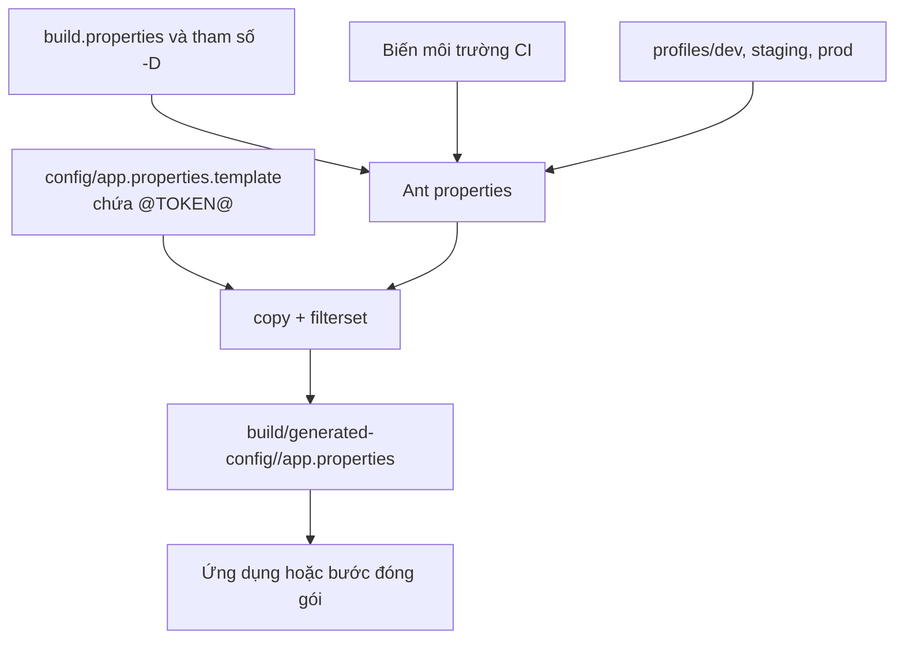
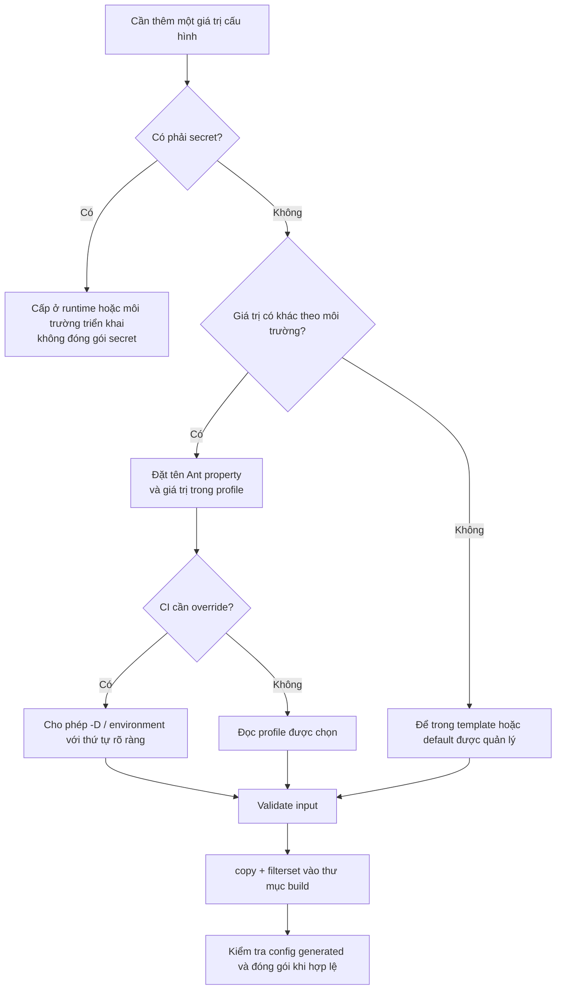

# Tạo cấu hình môi trường bằng property, mẫu tệp và bộ lọc trong Apache Ant

Một ứng dụng thường cần những giá trị cấu hình khác nhau khi chạy trên máy phát triển, môi trường kiểm thử và production: địa chỉ API, mức ghi log, thời gian chờ kết nối, tên dịch vụ hoặc cờ bật tính năng. Nếu mỗi môi trường có một bản cấu hình được sửa thủ công, rất dễ quên một giá trị, đưa nhầm cấu hình development lên production hoặc để lộ thông tin bí mật trong repository.

Trong **Build Tool Ant → Thực hành**, chúng ta sẽ tạo cấu hình theo một quy trình nhất quán:

1. Lưu **mẫu tệp** trong source control, đặt các vị trí cần thay bằng token như `@API_URL@`.
2. Định nghĩa **property** thể hiện tên môi trường và các giá trị cấu hình.
3. Dùng **`<filterset>` và `<copy>`** để thay token thành giá trị khi build.
4. Tạo tệp cấu hình hoàn chỉnh trong thư mục đầu ra do Ant quản lý.
5. Kiểm tra dữ liệu đầu vào, cách ưu tiên property và cách chạy tự động trong CI.

Kết quả là một lệnh có thể chạy lại:

```bash
ant -Dconfig.env=staging generate-config
```

Lệnh này tạo cấu hình staging từ cùng một template dùng cho các môi trường khác. Không phải mở file cấu hình bằng tay để tìm và thay địa chỉ.

## 1. Phân biệt property, template và filter

Ba khái niệm có trách nhiệm khác nhau:

| Thành phần | Vai trò | Ví dụ |
| --- | --- | --- |
| **Ant property** | Chứa một giá trị để các task trong `build.xml` sử dụng | `app.api.url=https://api.staging.example.test` |
| **Template** | Mô tả hình dạng file đầu ra, có các chỗ cần điền | `api.base-url=@API_URL@` |
| **Filter / filterset** | Quy định token nào được thay bằng giá trị nào khi sao chép file | `<filter token="API_URL" value="${app.api.url}"/>` |
| **Generated configuration** | File hoàn chỉnh mà ứng dụng hoặc bước đóng gói tiêu thụ | `build/generated-config/staging/app.properties` |

Ant không tự biến mọi property thành token có thể thay trong mọi file. Ta phải **chỉ định filter** cho các token cần thay và cho task sao chép biết khi nào áp dụng chúng.



Để tránh mơ hồ về trách nhiệm, nên coi template và profile là **đầu vào có thể xem xét, kiểm soát phiên bản**, còn file đã render là **đầu ra được sinh lại** và có thể xóa khi chạy `clean`.

## 2. Một ví dụ nhỏ trước khi dựng dự án hoàn chỉnh

Giả sử có file `config/message.txt.template`:

```text
Application: @APP_NAME@
Environment: @ENV@
```

Tạo `build.xml`:

```xml
<?xml version="1.0" encoding="UTF-8"?>
<project name="simple-filter-demo" default="generate" basedir=".">
    <property name="app.name" value="Sample Service"/>
    <property name="config.env" value="dev"/>

    <target name="generate">
        <mkdir dir="build/generated"/>
        <copy file="config/message.txt.template"
              tofile="build/generated/message.txt"
              encoding="UTF-8"
              outputencoding="UTF-8"
              overwrite="true">
            <filterset>
                <filter token="APP_NAME" value="${app.name}"/>
                <filter token="ENV" value="${config.env}"/>
            </filterset>
        </copy>
    </target>
</project>
```

Chạy:

```bash
ant generate
```

File `build/generated/message.txt` trở thành:

```text
Application: Sample Service
Environment: dev
```

Chạy với môi trường khác:

```bash
ant -Dconfig.env=test generate
```

thì dòng thứ hai trở thành `Environment: test`. Giá trị từ `-D` được đặt trước khai báo mặc định trong file Ant, nên mặc định `dev` không ghi đè nó.

Trong ví dụ, **`<filterset>` nằm bên trong `<copy>`**. Nó áp dụng cho file đang được copy. Không cần bật `filtering="true"` chỉ để nested `<filterset>` hoạt động; thuộc tính `filtering` chủ yếu quyết định việc dùng các **global filters** đã khai báo bằng `<filter>`. Việc sử dụng filterset tại chỗ giúp người đọc nhìn thấy chính xác quy tắc áp dụng cho file được tạo.

## 3. Thiết kế bài thực hành: ba profile, một template

Ta tạo ứng dụng minh họa tên `config-demo` với các môi trường:

- **dev:** dịch vụ API giả lập trên máy phát triển, log chi tiết, timeout ngắn.
- **staging:** endpoint của hệ thống kiểm thử, log vừa đủ để quan sát.
- **prod:** endpoint production, log và timeout theo yêu cầu vận hành.

Các URL dưới đây dùng tên miền ví dụ `.test`, không phải dịch vụ thật. Bài thực hành **không chứa mật khẩu, API token hoặc private key**.

### Cấu trúc thư mục

```text
config-demo/
├── build.xml
├── build.properties
├── config/
│   ├── app.properties.template
│   └── profiles/
│       ├── dev.properties
│       ├── staging.properties
│       └── prod.properties
└── build/
    └── generated-config/          # Được Ant tạo ra, không commit
```

Ý nghĩa:

- `build.xml` chứa quy trình kiểm tra, nạp profile và render template.
- `build.properties` chứa những thiết lập chung, không nhạy cảm.
- `config/profiles/*.properties` là giá trị mặc định được phê duyệt cho từng môi trường.
- `config/app.properties.template` là bố cục config duy nhất mà ứng dụng mong đợi.
- `build/generated-config/` chứa file đầu ra; nên thêm `build/` vào `.gitignore`.

Chính sách quan trọng: các file profile không phải bản sao của file cấu hình cuối. Chúng chỉ liệt kê **giá trị**, còn thứ tự, tên khóa và comment của file đầu ra được giữ trong **một template**.

## 4. Viết template cấu hình

**File `config/app.properties.template`:**

```properties
# Generated by Ant. Do not edit this file after rendering.
app.name=config-demo
app.environment=@ENV@
api.base-url=@API_URL@
logging.level=@LOG_LEVEL@
http.connect-timeout-ms=@CONNECT_TIMEOUT_MS@
```

Đây là một file text theo định dạng properties của ứng dụng. Các token được giới hạn bằng ký tự `@`:

| Token trong template | Property Ant cung cấp giá trị |
| --- | --- |
| `@ENV@` | `config.env` |
| `@API_URL@` | `app.api.url` |
| `@LOG_LEVEL@` | `app.log.level` |
| `@CONNECT_TIMEOUT_MS@` | `app.timeout.ms` |

Tên token **không bắt buộc phải trùng** tên property. Token viết hoa ngắn gọn cho dễ nhận biết trong file template; property dùng tên theo lĩnh vực để dễ truy vết trong Ant.

Ví dụ dòng `api.base-url=@API_URL@` sẽ trở thành `api.base-url=https://api.staging.example.test` khi chọn profile staging. Những dòng không có token được sao chép nguyên vẹn.

### Vì sao chọn token riêng như `@API_URL@`?

Một file ứng dụng có thể vốn chứa cú pháp `${name}`, biểu thức Java, JSON placeholder hoặc các chuỗi khác. Nếu dùng cùng dấu phân cách với cú pháp sẵn có, việc render dễ thay nhầm. `<filterset>` cho phép đặt `begintoken` và `endtoken`; cú pháp mặc định là `@TOKEN@`. Hãy chọn quy ước token hiếm khi xuất hiện như dữ liệu bình thường trong template.

## 5. Khai báo property chung và từng môi trường

**File `build.properties`:**

```properties
# Default khi chạy ở máy phát triển và không truyền -D.
config.env=dev
```

**File `config/profiles/dev.properties`:**

```properties
app.api.url=http://localhost:8080
app.log.level=DEBUG
app.timeout.ms=1500
```

**File `config/profiles/staging.properties`:**

```properties
app.api.url=https://api.staging.example.test
app.log.level=INFO
app.timeout.ms=3000
```

**File `config/profiles/prod.properties`:**

```properties
app.api.url=https://api.example.test
app.log.level=WARN
app.timeout.ms=5000
```

Cả ba profile dùng **cùng tên property**. Chúng chỉ khác giá trị. Việc đặt tên theo một hợp đồng chung giúp task render không cần chứa logic kiểu “nếu prod thì dùng key A, nếu staging thì dùng key B”.

Các giá trị minh họa đều là **cấu hình không bí mật**. Với cấu hình thật, không nên ghi mật khẩu hoặc token production trực tiếp vào file profile được commit chỉ để có thể render chúng trong build.

## 6. `build.xml` hoàn chỉnh: chọn profile, kiểm tra rồi render

Ví dụ sau dùng các task và điều kiện sẵn có của Ant, phù hợp với Ant hiện đại. Quy trình gồm ba nhóm: **chọn môi trường**, **nạp/kiểm tra property**, **sinh file cấu hình**.

```xml
<?xml version="1.0" encoding="UTF-8"?>
<project name="config-demo" default="generate-config" basedir=".">

    <!-- 1. Nhập environment của tiến trình chạy Ant. -->
    <property environment="env"/>

    <!-- 2. -D được ưu tiên. Nếu chưa có -D, dùng env APP_ENV. -->
    <condition property="config.env" value="${env.APP_ENV}">
        <isset property="env.APP_ENV"/>
    </condition>

    <!-- 3. Cho phép CI thay API URL bằng env hoặc -D. -->
    <condition property="app.api.url" value="${env.APP_API_URL}">
        <isset property="env.APP_API_URL"/>
    </condition>

    <!-- 4. Cấu hình chung và giá trị mặc định. -->
    <property file="build.properties"/>
    <property name="config.env" value="dev"/>

    <!-- 5. Các đường dẫn đều neo vào basedir của project. -->
    <property name="config.dir" location="config"/>
    <property name="profile.file"
              location="${config.dir}/profiles/${config.env}.properties"/>
    <property name="template.file"
              location="${config.dir}/app.properties.template"/>
    <property name="build.dir" location="build"/>
    <property name="generated.dir"
              location="${build.dir}/generated-config/${config.env}"/>
    <property name="generated.file"
              location="${generated.dir}/app.properties"/>

    <!-- 6. Giới hạn tên môi trường để không chọn file tùy ý. -->
    <target name="validate-selection">
        <condition property="config.env.allowed">
            <or>
                <equals arg1="${config.env}" arg2="dev"/>
                <equals arg1="${config.env}" arg2="staging"/>
                <equals arg1="${config.env}" arg2="prod"/>
            </or>
        </condition>
        <fail unless="config.env.allowed"
              message="config.env phải là dev, staging hoặc prod"/>

        <available file="${profile.file}"
                   property="profile.file.exists"/>
        <fail unless="profile.file.exists"
              message="Không tìm thấy profile: ${profile.file}"/>

        <available file="${template.file}"
                   property="template.file.exists"/>
        <fail unless="template.file.exists"
              message="Không tìm thấy template: ${template.file}"/>
    </target>

    <!-- 7. Chỉ đọc profile sau khi tên và file đã được kiểm tra. -->
    <target name="load-profile" depends="validate-selection">
        <property file="${profile.file}"/>
    </target>

    <!-- 8. Kiểm tra giá trị trước khi sinh file. -->
    <target name="validate-values" depends="load-profile">
        <condition property="app.api.url.nonblank">
            <and>
                <isset property="app.api.url"/>
                <not>
                    <equals arg1="${app.api.url}"
                            arg2="" trim="true"/>
                </not>
            </and>
        </condition>
        <fail unless="app.api.url.nonblank"
              message="app.api.url bắt buộc và không được rỗng"/>

        <condition property="app.log.level.allowed">
            <or>
                <equals arg1="${app.log.level}" arg2="DEBUG"/>
                <equals arg1="${app.log.level}" arg2="INFO"/>
                <equals arg1="${app.log.level}" arg2="WARN"/>
                <equals arg1="${app.log.level}" arg2="ERROR"/>
            </or>
        </condition>
        <fail unless="app.log.level.allowed"
              message="app.log.level phải là DEBUG, INFO, WARN hoặc ERROR"/>

        <condition property="app.timeout.valid">
            <and>
                <isset property="app.timeout.ms"/>
                <matches string="${app.timeout.ms}"
                         pattern="^[1-9][0-9]*$"/>
            </and>
        </condition>
        <fail unless="app.timeout.valid"
              message="app.timeout.ms phải là số nguyên dương"/>
    </target>

    <!-- 9. Lọc token từ template, ghi vào thư mục build. -->
    <target name="generate-config" depends="validate-values">
        <mkdir dir="${generated.dir}"/>
        <copy file="${template.file}"
              tofile="${generated.file}"
              encoding="UTF-8"
              outputencoding="UTF-8"
              overwrite="true">
            <filterset begintoken="@" endtoken="@">
                <filter token="ENV" value="${config.env}"/>
                <filter token="API_URL" value="${app.api.url}"/>
                <filter token="LOG_LEVEL" value="${app.log.level}"/>
                <filter token="CONNECT_TIMEOUT_MS"
                        value="${app.timeout.ms}"/>
            </filterset>
        </copy>
        <echo message="Đã sinh cấu hình: ${generated.file}"/>
    </target>

    <!-- Chỉ xóa kết quả do build tạo, không xóa profile/template. -->
    <target name="clean">
        <delete dir="${build.dir}"/>
    </target>
</project>
```

### Tại sao tổ chức target như vậy?

**`validate-selection`** chỉ cho phép ba profile có tên được xác định sẵn. Nếu CI vô tình truyền `config.env=production` trong khi file chỉ có `prod.properties`, build báo lỗi thay vì dùng một file khác hoặc bỏ qua.

**`load-profile`** phụ thuộc `validate-selection`, nên file profile được kiểm tra trước khi Ant đọc. Task `<property file="..."/>` khi gặp file không tồn tại có thể chỉ báo thông tin thay vì luôn thất bại như mong muốn; vì vậy ta dùng `<available>` + `<fail>` cho đầu vào bắt buộc.

**`validate-values`** chạy sau `load-profile`, nên các giá trị `app.api.url`, `app.log.level` và `app.timeout.ms` đã được chọn. Task `<condition>` kiểm tra dữ liệu thật trước khi tạo output.

**`generate-config`** chỉ chạy sau khi các bước kiểm tra thành công. `overwrite="true"` bảo đảm file được render lại khi giá trị property thay đổi, ngay cả nếu timestamp của template cũ hơn file đã sinh ở lần chạy trước. Nếu không, cơ chế up-to-date của `<copy>` có thể giữ nguyên cấu hình cũ khi chỉ có property thay đổi.

**`<filterset>` cục bộ** làm rõ mapping token → property tại chính task tạo file. Người bảo trì chỉ cần nhìn một chỗ để biết `@API_URL@` lấy từ đâu.

**`generated.dir` chứa tên môi trường** nhằm giữ các bản dev, staging và prod trong các thư mục khác nhau. Điều đó giúp tránh việc đổi profile rồi ghi đè file của môi trường khác trên cùng workspace. Nếu hai job cùng profile chạy đồng thời trên chung workspace, vẫn nên cấp workspace hoặc thư mục output riêng cho từng job.

## 7. Chạy thử và quan sát đầu ra

Giả sử đang ở thư mục `config-demo` và các file đã được tạo như trên.

### 7.1. Môi trường dev: sử dụng default

```bash
ant clean generate-config
```

Do `build.properties` khai báo `config.env=dev`, Ant nạp `config/profiles/dev.properties` và tạo:

```text
build/generated-config/dev/app.properties
```

Nội dung:

```properties
# Generated by Ant. Do not edit this file after rendering.
app.name=config-demo
app.environment=dev
api.base-url=http://localhost:8080
logging.level=DEBUG
http.connect-timeout-ms=1500
```

### 7.2. Môi trường staging: truyền `-D`

```bash
ant -Dconfig.env=staging generate-config
```

Ant chọn `config/profiles/staging.properties` và sinh:

```text
build/generated-config/staging/app.properties
```

Nội dung:

```properties
# Generated by Ant. Do not edit this file after rendering.
app.name=config-demo
app.environment=staging
api.base-url=https://api.staging.example.test
logging.level=INFO
http.connect-timeout-ms=3000
```

### 7.3. Môi trường prod: truyền tên môi trường

```bash
ant -Dconfig.env=prod generate-config
```

Ant chọn `config/profiles/prod.properties` và sinh `build/generated-config/prod/app.properties`, trong đó `api.base-url` dùng `https://api.example.test`, `logging.level=WARN` và `http.connect-timeout-ms=5000`.

### 7.4. Ghi đè duy nhất một giá trị

Nếu staging của một lượt chạy phải gọi một API endpoint khác:

```bash
ant -Dconfig.env=staging \
    -Dapp.api.url=https://api.preview.example.test \
    generate-config
```

`-Dapp.api.url=...` có ưu tiên cao hơn dòng `app.api.url=...` trong profile staging. Các giá trị `app.log.level` và `app.timeout.ms` vẫn lấy từ file staging.

Ví dụ này minh họa **cấu hình ghi đè có chủ đích**, không yêu cầu sửa file profile để phục vụ một lượt CI riêng lẻ.

## 8. Dùng biến môi trường từ CI thay cho `-D`

Trong `build.xml` hoàn chỉnh, ta đã nạp environment và ánh xạ hai biến:

```xml
<property environment="env"/>

<condition property="config.env" value="${env.APP_ENV}">
    <isset property="env.APP_ENV"/>
</condition>

<condition property="app.api.url" value="${env.APP_API_URL}">
    <isset property="env.APP_API_URL"/>
</condition>
```

Trên Bash:

```bash
APP_ENV=staging APP_API_URL=https://api.preview.example.test \
    ant -noinput generate-config
```

Trên PowerShell:

```powershell
$env:APP_ENV = "staging"
$env:APP_API_URL = "https://api.preview.example.test"
ant -noinput generate-config
```

Trên Windows Command Prompt:

```bat
set "APP_ENV=staging"
set "APP_API_URL=https://api.preview.example.test"
ant -noinput generate-config
```

Environment variable được tiến trình Ant kế thừa khi khởi chạy. Ant chỉ nhìn thấy chúng dưới các property `env.APP_ENV` và `env.APP_API_URL` sau khi gọi `<property environment="env"/>`. Task `<condition>` mới chuyển chúng sang các tên chung `config.env` và `app.api.url`.

Vì property của Ant thông thường **chỉ đặt được một lần**, giá trị `-Dconfig.env=prod` vẫn được ưu tiên hơn `APP_ENV=staging` nếu cùng xuất hiện. Đừng đọc trực tiếp cả `${config.env}` lẫn `${env.APP_ENV}` ở nhiều target khác nhau; dùng một tên canonical giúp quy tắc ưu tiên dễ hiểu.

### Thứ tự ưu tiên trong ví dụ

| Ưu tiên | Nguồn | Thời điểm/điều kiện |
| ---: | --- | --- |
| 1 | `-Dconfig.env=...` hoặc `-Dapp.api.url=...` | Giá trị được cấp từ command line trước khi xử lý build file |
| 2 | Property cùng tên trong `-propertyfile` | Nạp lúc Ant khởi động, thấp hơn `-D` cùng tên |
| 3 | `APP_ENV` / `APP_API_URL` của hệ điều hành | `<condition>` đặt vào tên chuẩn nếu chưa có |
| 4 | `build.properties` | Khai báo chung, ở đây đặt mặc định `config.env=dev` |
| 5 | `profiles/<env>.properties` | Đặt giá trị profile nếu property đích chưa được đặt |
| 6 | Default `config.env=dev` trong XML | Chỉ có tác dụng nếu tất cả nguồn trước còn thiếu |

Bảng này áp dụng cho **những property đã được ví dụ ánh xạ như trên**. Ant không tự có một thuật toán ưu tiên tổng quát cho mọi tên; **thứ tự xử lý khai báo** quyết định property nào được đặt đầu tiên.

Khi dùng nhiều file cùng khai báo một property, việc chuyển vị trí nạp file trong `build.xml` có thể thay đổi kết quả. Vì vậy nên xác định rõ từng file có trách nhiệm cung cấp loại giá trị nào.

## 9. Nhớ rằng `-D`, Ant property và environment là ba lớp khác nhau

Khi người dùng chạy:

```bash
ant -Dconfig.env=staging generate-config
```

`config.env` là **Ant property**. Nó không tự sinh ra biến môi trường `APP_ENV` cho JVM hoặc mọi tiến trình khác.

Khi người dùng chạy:

```bash
APP_ENV=staging ant generate-config
```

`APP_ENV` là **biến môi trường hệ điều hành**. Ant nạp nó thành `env.APP_ENV`; đoạn `<condition>` trong build mới chuyển nó thành `config.env`.

Nếu dùng một script bên ngoài đòi biến môi trường riêng, cần truyền qua cơ chế của tiến trình con, ví dụ:

```xml
<exec executable="some-tool" failonerror="true">
    <env key="APP_ENV" value="${config.env}"/>
    <arg value="--dry-run"/>
</exec>
```

Đây chỉ là minh họa cách truyền environment cho tiến trình con; không phải một lệnh đầy đủ nếu `some-tool` chưa được cài. Trong build thực, công cụ này còn cần phiên bản, đường dẫn executable và quyền truy cập rõ ràng.

## 10. Dùng `<filtersfile>` khi có nhiều token

Khi số token tăng lên, viết một đoạn `<filter token="..." value="..."/>` cho mỗi biến có thể dài. Ant hỗ trợ file định nghĩa các token cho `<filterset>`.

Giả sử CI hoặc một bước chuẩn bị đã tạo file `build/filter-values.properties`:

```properties
ENV=staging
API_URL=https://api.staging.example.test
LOG_LEVEL=INFO
CONNECT_TIMEOUT_MS=3000
```

Có thể áp dụng:

```xml
<copy file="config/app.properties.template"
      tofile="build/generated-config/staging/app.properties"
      overwrite="true"
      encoding="UTF-8"
      outputencoding="UTF-8">
    <filterset>
        <filtersfile file="build/filter-values.properties"/>
    </filterset>
</copy>
```

`<filtersfile>` cung cấp các cặp `TOKEN=value` cho filterset. Khi sử dụng cách này, trách nhiệm **tạo file filter-values.properties** phải được khai báo rõ: nó cần tồn tại trước khi copy, có encoding phù hợp, không chứa dữ liệu bị lộ và phải được tạo lại khi property thay đổi.

Trong ví dụ hoàn chỉnh của bài học, các filter được viết trực tiếp trong `build.xml` để thể hiện mapping rõ ràng. Với một dự án lớn, có thể tạo một file filters được kiểm soát từ dữ liệu đáng tin cậy rồi dùng `<filtersfile>`, nhưng không nên tạo thêm một tầng cấu hình nếu nó làm nguồn giá trị khó lần theo.

### Global filter và nested filterset

Ant cũng có task `<filter token="..." value="..."/>` khai báo global filter dùng chung. Task `<copy filtering="true">` có thể áp dụng tập global filter đó. Tuy nhiên, global filter tác động rộng và dễ khó theo dõi nếu nhiều target cùng sử dụng.

So sánh:

```xml
<!-- Global filter: được copy sử dụng khi filtering=true. -->
<filter token="ENV" value="${config.env}"/>
<copy file="config/message.txt.template"
      tofile="build/generated/message.txt"
      filtering="true"/>
```

với:

```xml
<!-- Filterset cục bộ: thấy rõ quy tắc ngay tại copy. -->
<copy file="config/message.txt.template"
      tofile="build/generated/message.txt">
    <filterset>
        <filter token="ENV" value="${config.env}"/>
    </filterset>
</copy>
```

Ở ví dụ thứ hai, không cần bật `filtering="true"` để nested `<filterset>` có hiệu lực. Với build có nhiều file config khác nhau, filterset cục bộ thường thuận tiện hơn khi bảo trì vì không vô tình thay token của một copy task không liên quan.

## 11. Áp dụng cùng bộ lọc cho nhiều template text

Nếu ứng dụng có `service.properties.template`, `logging.properties.template` và `client.properties.template`, ta có thể xử lý một nhóm tệp bằng `<fileset>` thay vì viết ba task `<copy>` có chính sách giống hệt nhau.

Cấu trúc:

```text
config/templates/
├── service.properties.template
├── logging.properties.template
└── client.properties.template
```

Mẫu Ant:

```xml
<target name="render-many" depends="validate-values">
    <mkdir dir="${generated.dir}"/>
    <copy todir="${generated.dir}"
          overwrite="true"
          encoding="UTF-8"
          outputencoding="UTF-8">
        <fileset dir="config/templates"
                 includes="**/*.template"/>
        <globmapper from="*.template" to="*"/>
        <filterset begintoken="@" endtoken="@">
            <filter token="ENV" value="${config.env}"/>
            <filter token="API_URL" value="${app.api.url}"/>
            <filter token="LOG_LEVEL" value="${app.log.level}"/>
            <filter token="CONNECT_TIMEOUT_MS"
                    value="${app.timeout.ms}"/>
        </filterset>
    </copy>
</target>
```

Ở đây:

- `<fileset>` chọn các tệp có đuôi `.template` trong thư mục template.
- `<globmapper>` bỏ phần đuôi `.template` khi tạo tên file đích.
- `<filterset>` thay token trong từng file text.
- `overwrite="true"` bảo đảm lần render sau dùng giá trị property mới.

Nếu các template có quy tắc lọc khác nhau, nên chia thành các nhóm copy riêng. Không áp dụng filter văn bản lên ảnh, font, JAR, chứng chỉ nhị phân hoặc file không phải text; điều đó có thể làm hỏng byte nội dung.

Một file mới được đưa vào `config/templates/` sẽ được chọn nếu khớp pattern. Đó là hành vi tiện lợi khi nhóm template có cùng chính sách; với các file bắt buộc và phải kiểm soát chính xác, nên dùng include cụ thể hoặc kiểm tra file trước khi copy.

## 12. Ranh giới giữa template và file cấu hình sinh ra

Một dự án dễ bảo trì cần xác định ai sở hữu từng file:

| File | Ai thay đổi? | Có nên commit? |
| --- | --- | --- |
| `config/app.properties.template` | Người phát triển khi thay cấu trúc cấu hình | Có |
| `config/profiles/dev.properties` | Người phát triển, theo review | Có, nếu không chứa secret |
| `config/profiles/prod.properties` | Nhóm chịu trách nhiệm cấu hình production | Có thể, nếu chỉ chứa giá trị công khai/không nhạy cảm |
| `build.properties` | Người phát triển hoặc cấu hình dự án | Có |
| `build/generated-config/prod/app.properties` | Ant tạo khi chạy | Thường không |
| File hoặc biến chứa token/credential triển khai thật | Hệ thống secret/CI runtime | Không commit |

Không nên sửa tay `build/generated-config/staging/app.properties` để khắc phục một giá trị sai: lần chạy Ant sau có thể ghi đè bản sửa đó. Thay đổi phải đi vào **profile**, **template** hoặc **tham số được cấp**.

Nếu cần tạo hai phiên bản cấu hình khác nhau trong cùng một lần build, hãy dùng hai thư mục output riêng hoặc tách hai invocation Ant có input xác định. Không cho các nhánh song song cùng sửa một file generated chung.

## 13. Kiểm tra dữ liệu và token chưa được thay

Filterset chỉ thay **những token được khai báo và xuất hiện đúng cú pháp**. Nếu template có `@APU_URL@` (gõ nhầm) nhưng filterset chỉ biết `API_URL`, token sai có thể được giữ nguyên trong file đầu ra mà thao tác copy vẫn hoàn tất.

Vì vậy có hai mức kiểm tra:

1. **Kiểm tra property nguồn:** giá trị có tồn tại, không rỗng, phù hợp kiểu dữ liệu và môi trường không?
2. **Kiểm tra file được sinh:** các token bắt buộc đã được thay, khóa cấu hình vẫn có tên đúng và giá trị có phù hợp với môi trường không?

Với file nhỏ và bộ token cố định, có thể dùng `<loadfile>` để đọc output và `<contains>` để phát hiện token còn lại:

```xml
<target name="verify-generated" depends="generate-config">
    <loadfile property="generated.config.text"
              srcFile="${generated.file}"
              encoding="UTF-8"/>

    <condition property="generated.has-unreplaced-tokens">
        <or>
            <contains string="${generated.config.text}"
                      substring="@ENV@"/>
            <contains string="${generated.config.text}"
                      substring="@API_URL@"/>
            <contains string="${generated.config.text}"
                      substring="@LOG_LEVEL@"/>
            <contains string="${generated.config.text}"
                      substring="@CONNECT_TIMEOUT_MS@"/>
        </or>
    </condition>

    <fail if="generated.has-unreplaced-tokens"
          message="File cấu hình còn token chưa được thay"/>
</target>
```

Đoạn này được thêm như **target tùy chọn** vào project ví dụ. Chạy `ant verify-generated` để render rồi kiểm tra các token đã biết. Nó không phát hiện được mọi lỗi gõ nhầm token mới (chẳng hạn `@APU_URL@`) vì token đó không có trong danh sách. Với nhiều template, nên có quy ước token chung và một bước kiểm tra phát hiện **mọi mẫu @UPPERCASE_TOKEN@ còn lại** trên output đã sinh.

Nếu file cấu hình có thể chứa secret, không nên nạp toàn bộ nội dung vào property rồi xuất qua debug hoặc `<echoproperties>`. Ví dụ ở đây chỉ xử lý dữ liệu không nhạy cảm.

### Kiểm tra đầu vào dạng chuỗi rỗng

`<isset property="app.api.url"/>` chỉ xác nhận property có tồn tại, **không xác nhận nó có nội dung**. Environment do CI cấp vẫn có thể tồn tại với value rỗng. Vì thế ví dụ chính dùng:

```xml
<condition property="app.api.url.nonblank">
    <and>
        <isset property="app.api.url"/>
        <not>
            <equals arg1="${app.api.url}" arg2="" trim="true"/>
        </not>
    </and>
</condition>
```

Giá trị URL thật còn có thể cần kiểm tra protocol, host hoặc whitelist endpoint. Kiểm tra nonblank là mức tối thiểu để tránh sinh ra cấu hình thiếu giá trị, không phải kiểm định đầy đủ một URL.

## 14. Lưu ý quan trọng về bộ lọc, dấu phân cách và định dạng dữ liệu

### 14.1. Không lọc file nhị phân

Task `<copy>` có filterset xử lý nội dung như văn bản. Nếu dùng chung task lọc cho PNG, JAR, PDF hoặc file nhị phân khác, dữ liệu có thể bị thay đổi hoặc hỏng. Tách riêng:

```xml
<!-- File text: áp dụng filterset. -->
<copy file="config/app.properties.template"
      tofile="build/config/app.properties"
      encoding="UTF-8" outputencoding="UTF-8"
      overwrite="true">
    <filterset>
        <filter token="ENV" value="${config.env}"/>
    </filterset>
</copy>

<!-- File binary: sao chép byte, không đặt filterset. -->
<copy file="src/assets/logo.png"
      tofile="build/assets/logo.png"/>
```

Các thư mục đích trong đoạn minh họa phải được tạo bằng `<mkdir>` ở bước chuẩn bị hoặc được task hỗ trợ tạo khi cần. Khi dự án mở rộng, nên đặt quy tắc tách text/binary rõ ràng để tránh thêm nhầm file vào tập cần lọc.

### 14.2. Encoding phải được xem xét ở cả đầu vào lẫn đầu ra

Ví dụ dùng `encoding="UTF-8"` và `outputencoding="UTF-8"` khi copy file template text. Đó là cách tránh dựa vào encoding mặc định của máy chạy Ant khi nội dung có tiếng Việt hoặc ký tự Unicode.

Tuy nhiên, file `.properties` được đọc bằng các cơ chế Java/Ant có thể có quy tắc escape và encoding riêng theo phiên bản/cách nạp. Với các giá trị không phải ASCII hoặc chứa dấu backslash, cần kiểm soát định dạng và thử trên đúng phiên bản Ant/JDK đã chọn. Trong bài thực hành, các value trong profile đều là ASCII để tập trung vào cơ chế property/filter.

### 14.3. Token chứa dấu `@` như dữ liệu thật

Nếu file template có địa chỉ email, ký tự `@` đơn lẻ không tự động là token. Filterset chỉ tìm dạng cặp delimiter, ví dụ `@ENV@`. Dù vậy, một chuỗi vô tình khớp đúng tên token có thể bị thay. Vì thế token nên được đặt theo quy ước riêng, ví dụ `@CFG_API_URL@`, nếu nội dung ứng dụng thường có nhiều chuỗi `@...@`.

### 14.4. Không dùng thay thế text để chỉnh cấu trúc tùy ý

Filterset phù hợp với template text có các vị trí cần điền đã được xác định. Nó không phân tích cấu trúc JSON/YAML/XML như parser của định dạng đó. Nếu cần thêm/xóa hàng loạt node XML, object JSON hay các khối YAML theo điều kiện phức tạp, nên chọn cơ chế sinh cấu hình có hiểu cấu trúc và validate được schema.

Ví dụ, giá trị `https://api.example.test/path?x=1&y=2` khi điền vào XML attribute sẽ cần escape theo quy tắc XML; filterset không tự biến dấu `&` thành entity hợp lệ. Tương tự, dấu quote và ký tự xuống dòng trong JSON cần được escape theo quy tắc JSON. Đừng coi việc thay token đơn thuần là bộ serialize dữ liệu tổng quát.

### 14.5. Property value thay đổi nhưng template không đổi

`<copy>` thường cân nhắc timestamp/source khi quyết định có phải copy lại hay không. Trong ví dụ, `overwrite="true"` được dùng vì **giá trị property có thể đổi mà timestamp của template không đổi**. Nếu bỏ thuộc tính này, cần một cơ chế invalidation khác để bảo đảm file generated phản ánh đúng giá trị mới.

Đối với dự án lớn, có thể tối ưu chỉ sinh lại khi đầu vào thay đổi, nhưng phải tính cả profile, biến môi trường, template và version của công cụ lọc. Tối ưu incremental không được khiến bản build dùng nhầm cấu hình cũ.

## 15. Đặt secret ở đúng nơi trong vòng đời ứng dụng

Một ranh giới quan trọng là **cấu hình build có thể công khai** và **secret runtime hoặc secret triển khai**.

Các giá trị như `app.log.level=INFO`, tên environment hoặc một endpoint công khai thường có thể lưu trong profile được commit. Ngược lại:

- Password kết nối database.
- Access token cho dịch vụ ngoài.
- Private key, passphrase để ký.
- Credential dùng upload artifact.

không nên có trong template/profile đã commit hoặc bị nhúng vào artifact công khai.

Một cách tổ chức an toàn là để template chỉ tạo cấu hình công khai, còn ứng dụng lấy secret từ environment/secret manager **khi chạy**. Chẳng hạn file generated có thể chỉ nói ứng dụng cần đọc biến môi trường `DB_PASSWORD`, thay vì chứa chính mật khẩu.

Nếu một hệ thống thật sự cần tạo file chứa secret khi triển khai, hãy tạo file đó **trong môi trường triển khai có kiểm soát**, giới hạn quyền đọc, không in nội dung, không đưa vào artifact được lưu dài hạn và có quy trình xóa phù hợp. `<filterset>` chỉ là phép thay thế text; nó không tự quản lý quyền hoặc che giấu giá trị nhạy cảm.

### Sai lầm dễ mắc

```xml
<property environment="env"/>

<!-- Không nên đưa token bí mật vào file config sẽ được publish. -->
<filterset>
    <filter token="DB_PASSWORD"
            value="${env.DB_PASSWORD}"/>
</filterset>
```

Nếu file được copy vào ZIP/JAR hay upload lên artifact storage, secret có thể theo artifact đi xa khỏi môi trường vốn được cấp phép. Đừng chỉ dựa vào việc CI che chuỗi secret trên console để kết luận artifact an toàn.

## 16. Kết hợp với quy trình CI/CD không tương tác

Một pipeline có thể thực hiện các bước:

1. Checkout repository.
2. Cấp đúng phiên bản JDK/Ant và dependency cần thiết.
3. Xác định môi trường mong muốn, ví dụ `APP_ENV=staging`.
4. Chạy `ant -noinput clean generate-config`.
5. Kiểm tra file generated trước khi đóng gói hoặc triển khai.
6. Chỉ chuyển artifact sang bước sau khi lệnh Ant thành công.

Ví dụ lệnh Bash trên runner:

```bash
export APP_ENV=staging
export APP_API_URL=https://api.preview.example.test
ant -noinput -f build.xml clean generate-config
```

Với một lệnh độc lập chỉ dùng thông tin không nhạy cảm:

```bash
ant -noinput \
    -Dconfig.env=prod \
    -Dapp.api.url=https://api.example.test \
    generate-config
```

`-noinput` ngăn target Ant yêu cầu câu trả lời tương tác. Các target trong ví dụ không dùng `<input>`; việc thiếu hoặc sai dữ liệu được xử lý bằng `<fail>`, giúp CI kết thúc với mã lỗi thay vì đợi người dùng.

Nếu cấu hình được tạo cho nhiều service, nên đặt tên output theo cả service và môi trường, ví dụ `build/generated-config/<service>/<env>/...`. Việc này giúp theo dõi và tránh ghi đè khi pipeline có nhiều job chạy song song.

## 17. Bài tập mở rộng

### Bài tập A — Thêm môi trường `qa`

Thêm `config/profiles/qa.properties` chứa ba property:

```properties
app.api.url=https://api.qa.example.test
app.log.level=DEBUG
app.timeout.ms=2000
```

Sau đó cập nhật điều kiện `config.env.allowed` để cho phép `qa`. Chạy:

```bash
ant -Dconfig.env=qa generate-config
```

Output mong muốn là `build/generated-config/qa/app.properties`. Nếu chỉ thêm file profile mà quên cập nhật danh sách môi trường hợp lệ, build phải thất bại ở target `validate-selection`.

### Bài tập B — Thêm cờ bật tính năng

Thêm dòng vào template:

```properties
feature.experimental=@FEATURE_EXPERIMENTAL@
```

Thêm `app.feature.experimental=true` hoặc `false` trong mỗi file profile, khai báo filter mới:

```xml
<filter token="FEATURE_EXPERIMENTAL"
        value="${app.feature.experimental}"/>
```

Rồi bổ sung điều kiện kiểm tra rằng property chỉ nhận `true` hoặc `false`. Không nên mặc định mọi chuỗi không phải `true` đều là false, vì lỗi gõ `flase` có thể bị bỏ qua.

### Bài tập C — Nhận diện property ưu tiên

Trong environment đặt `APP_ENV=staging`, nhưng gọi:

```bash
ant -Dconfig.env=prod generate-config
```

Quan sát profile nào được chọn và giải thích theo thứ tự ưu tiên property. Sau đó chạy:

```bash
ant -Dconfig.env=staging \
    -Dapp.timeout.ms=7000 \
    generate-config
```

Kiểm tra timeout được render từ `-D` hay từ file staging. Mục đích là hiểu rằng **nạp profile không ghi đè property đã được đặt trên command line**.

### Bài tập D — Phát hiện template thiếu token

Đổi nhầm `@API_URL@` trong template thành `@APU_URL@`, rồi render. File có thể vẫn được tạo nhưng token sai chưa được thay. Hãy thiết lập quy tắc phát hiện mọi token còn lại theo định dạng `@UPPERCASE_TOKEN@` trong output để pipeline thất bại sớm.

### Bài tập E — Kiểm tra môi trường không hợp lệ

Chạy:

```bash
ant -Dconfig.env=unknown generate-config
```

Build phải dừng trước khi nạp một file profile tùy ý. Thử tiếp `-Dapp.timeout.ms=abc` và `-Dapp.api.url=` để quan sát các điều kiện validation.

## 18. Những lỗi thường gặp và cách xử lý

| Hiện tượng | Nguyên nhân có thể xảy ra | Cách xử lý |
| --- | --- | --- |
| File đầu ra còn `@API_URL@` | Token viết sai hoặc không có filter tương ứng | Kiểm tra mapping `<filter token="API_URL">`, kiểm tra token chưa thay |
| Thay `APP_ENV` nhưng luôn nhận dev | Chưa nhập environment, ánh xạ sai tên hoặc `config.env` đã được đặt trước | Kiểm tra `<property environment="env"/>` và thứ tự khai báo |
| `-Dapp.api.url` không có hiệu lực | Task render đọc trực tiếp property khác hoặc file cũ chưa được render lại | Dùng tên canonical, `overwrite="true"` và xem output path |
| File profile không tồn tại nhưng build tiếp | Chỉ dùng `<property file>`, không validate file | Kiểm tra `<available>` + `<fail>` trước khi load |
| File đầu ra giữ giá trị cũ | Copy đã bỏ qua vì template không đổi timestamp | Dùng `overwrite="true"` hoặc cơ chế theo dõi tất cả đầu vào |
| Cấu hình prod dùng nhầm API staging | Giá trị từ `-D` hoặc environment ghi đè profile | Xác định nguồn ưu tiên và ghi log **metadata không bí mật** |
| File text bị lỗi dấu tiếng Việt | Encoding nguồn/đích không nhất quán | Thiết lập encoding rõ ràng và xem quy tắc file properties |
| File ZIP hoặc ảnh bị hỏng | Đã áp filterset cho file nhị phân | Chỉ lọc text; copy binary nguyên byte |
| Config generated bị sửa tay rồi biến mất | File đầu ra thuộc Ant, lần render sau ghi đè | Sửa template/profile/input thay vì sửa output |
| CI treo vì chờ input | Script khác hoặc tool con còn prompt | `-noinput` cho Ant, batch mode/timeout cho tool con |
| Token bí mật lộ trong ZIP hay log | Đã render secret vào artifact hoặc echo property | Chuyển secret sang runtime/CI, hạn chế quyền và không in giá trị |
| Hai job ghi cùng một generated file | Dùng chung workspace và output path | Cấp workspace hoặc output directory riêng cho từng job |

## 19. Mô hình quyết định khi tạo cấu hình bằng Ant

Khi một giá trị mới được yêu cầu, có thể chọn cách xử lý theo các câu hỏi:



Đối với ứng dụng có số lượng cấu hình vừa phải, `<property>` + template + `<filterset>` là một cách đơn giản và dễ đọc để tạo cấu hình theo môi trường. Hiệu quả đến từ **ranh giới rõ ràng**: property chứa giá trị, template định nghĩa hình dạng, filterset thực hiện thay thế, còn target validation bảo đảm đầu vào hợp lệ trước khi sinh file. Nhờ đó, mỗi lần chuyển từ dev sang staging hay prod chỉ thay **đầu vào được khai báo**, thay vì sửa thủ công cùng một file cấu hình.

## Tài liệu tham khảo

- [Apache Ant Manual — Property Task](https://ant.apache.org/manual/Tasks/property.html): property từ file, environment, quy tắc giá trị được đặt trước.
- [Apache Ant Manual — FilterSet Type](https://ant.apache.org/manual/Types/filterset.html): token, delimiters, nested filters và `<filtersfile>`.
- [Apache Ant Manual — Copy Task](https://ant.apache.org/manual/Tasks/copy.html): `<copy>`, `filtering`, nested filtersets, overwrite và encoding.
- [Apache Ant Manual — Condition Task](https://ant.apache.org/manual/Tasks/condition.html): kiểm tra các giá trị bằng `<condition>`.
- [Apache Ant Manual — Available Task](https://ant.apache.org/manual/Tasks/available.html) và [Fail Task](https://ant.apache.org/manual/Tasks/fail.html): kiểm tra đầu vào bắt buộc và dừng build khi cấu hình không hợp lệ.
