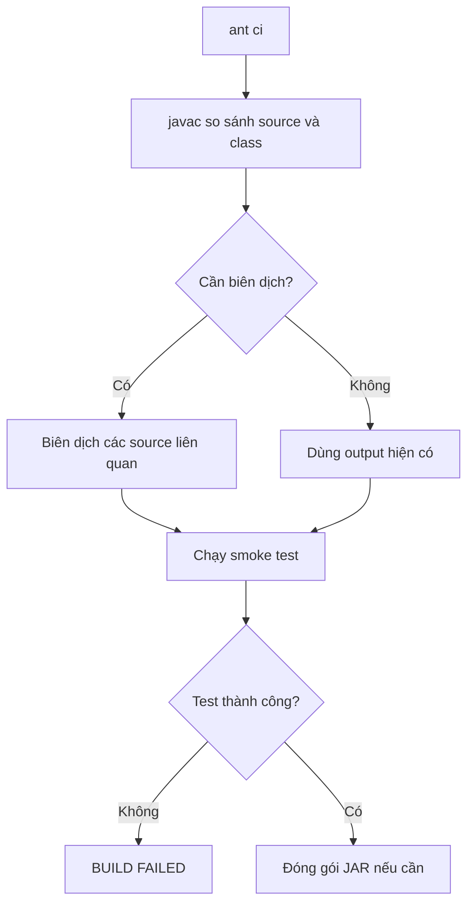

# Thử nghiệm build tăng dần, clean build và tính tái lập trong Apache Ant

## 1. Mục tiêu và ba khái niệm cần phân biệt

Apache Ant tự động hóa các công việc như biên dịch Java, chạy test và đóng gói JAR. Một dự án đã chạy `ant` thành công vẫn cần trả lời ba câu hỏi riêng biệt:

- **Build tăng dần (incremental build):** Nếu đầu vào không đổi, Ant có tránh biên dịch/đóng gói lại không? Khi một file đổi, những đầu ra liên quan có được cập nhật không?
- **Clean build:** Khi xóa tất cả output đã sinh, Ant có dựng lại đầy đủ ứng dụng từ source, dependency và cấu hình được công bố không?
- **Tính tái lập (reproducibility):** Cùng đầu vào và môi trường công cụ có cho đầu ra ổn định không? Nếu yêu cầu kết quả giống nhau theo byte, các checksum có khớp giữa hai lần build độc lập không?

Ba điều này **không đồng nghĩa**. Một build tăng dần có thể thành công nhờ file `.class` cũ dù source đã bị xóa. Ngược lại, hai clean build đều thành công nhưng file JAR khác SHA-256 vì timestamp của các entry ZIP.

| Khía cạnh | Dấu hiệu cần quan sát | Bằng chứng |
|---|---|---|
| Incremental | Biên dịch ít file hơn khi không có thay đổi | Log `javac`, timestamp và checksum của `.class` |
| Clean | Xây dựng được từ output rỗng | `ant rebuild` thành công cùng bộ input xác định |
| Đúng chức năng | Ứng dụng và test hoạt động | Exit code, test result, chạy JAR |
| Tái lập theo byte | Đầu ra từ hai lần build giống hệt | SHA-256 hoặc so sánh binary |

Bài thực hành dùng **Apache Ant 1.10.x và JDK 17 trở lên**, chỉ cần các task chuẩn của Ant. Không sử dụng dependency ngoài. Bạn sẽ chạy các thí nghiệm đổi source, đổi timestamp, xóa file nguồn, làm clean build và so sánh checksum.

## 2. Cơ chế incremental của `<javac>` và giới hạn

Task `<javac>` của Ant chủ yếu đối chiếu **timestamp nguồn `.java` với file `.class` tương ứng** tại `destdir`. Khi class còn thiếu hoặc cũ hơn source, compiler cần xử lý source đó. Nếu class đã có và được coi là mới hơn, Ant thường bỏ qua biên dịch.

```text
src/main/java/demo/Greeting.java
               |
               v
build/classes/demo/Greeting.class
```

Cơ chế này có những giới hạn quan trọng:

1. **Xóa source không tự xóa class cũ.** `Greeting.class` có thể vẫn nằm trong thư mục output và được đóng gói.
2. **Không theo dõi đầy đủ phụ thuộc Java giữa mọi source.** Sửa chữ ký method ở một class không bảo đảm mọi class gọi method đó đều được Ant biên dịch lại.
3. **Timestamp không phải nội dung.** `touch` source có thể kích hoạt compile dù byte không đổi; một thao tác thay nội dung nhưng giữ timestamp có thể không được nhận diện theo mong đợi.
4. **Thay toolchain/classpath không nhất thiết làm mọi source biên dịch lại.** Sau khi đổi JDK, compiler options, plugin hoặc dependency cần kiểm tra clean build.
5. **Một file Java có thể tạo nhiều output.** Nested/anonymous class, annotation processor và source generator khiến quy tắc một-một giữa tên file nguồn với file `.class` không đủ bao quát.

Target `test` có thể chạy mỗi lần ngay cả khi `<javac>` không biên dịch gì; task `<jar>` có kiểm tra input/timestamp riêng. Không nên suy ra rằng **target chạy** nghĩa là **mọi task bên trong đều làm lại công việc**.



## 3. Tạo dự án Ant dùng trong tất cả thí nghiệm

Cấu trúc thư mục:

```text
ant-build-lab/
├── build.xml
└── src/
    ├── main/java/demo/
    │   ├── App.java
    │   └── Greeting.java
    └── test/java/demo/
        └── SmokeTest.java
```

Sau khi build, Ant sẽ sinh:

```text
build/
├── classes/        # Bytecode của ứng dụng
├── test-classes/   # Bytecode smoke test
└── dist/
    └── app.jar
```

### 3.1. `build.xml` hoàn chỉnh

```xml
<?xml version="1.0" encoding="UTF-8"?>
<project name="ant-build-lab" default="ci" basedir=".">

    <property name="main.src" location="src/main/java"/>
    <property name="test.src" location="src/test/java"/>
    <property name="build.dir" location="build"/>
    <property name="main.classes" location="${build.dir}/classes"/>
    <property name="test.classes" location="${build.dir}/test-classes"/>
    <property name="dist.dir" location="${build.dir}/dist"/>

    <target name="clean">
        <delete dir="${build.dir}"/>
    </target>

    <target name="init">
        <mkdir dir="${main.classes}"/>
        <mkdir dir="${test.classes}"/>
        <mkdir dir="${dist.dir}"/>
    </target>

    <target name="compile" depends="init">
        <javac srcdir="${main.src}"
               destdir="${main.classes}"
               encoding="UTF-8"
               release="17"
               includeantruntime="false"
               debug="true"/>
    </target>

    <target name="compile-test" depends="compile">
        <javac srcdir="${test.src}"
               destdir="${test.classes}"
               encoding="UTF-8"
               release="17"
               includeantruntime="false"
               debug="true">
            <classpath>
                <pathelement location="${main.classes}"/>
            </classpath>
        </javac>
    </target>

    <target name="test" depends="compile-test">
        <java classname="demo.SmokeTest"
              fork="true"
              failonerror="true">
            <classpath>
                <pathelement location="${main.classes}"/>
                <pathelement location="${test.classes}"/>
            </classpath>
        </java>
    </target>

    <target name="package" depends="test">
        <jar destfile="${dist.dir}/app.jar"
             basedir="${main.classes}">
            <manifest>
                <attribute name="Main-Class" value="demo.App"/>
            </manifest>
        </jar>
    </target>

    <!-- Lượt thường: sử dụng output hiện có. -->
    <target name="ci" depends="package"/>

    <!-- Lượt sạch: xóa output trước khi chạy ci. -->
    <target name="rebuild" depends="clean,ci"/>

</project>
```

`rebuild` thực hiện `clean` trước chuỗi `ci` vì các dependency của target được Ant xử lý theo thứ tự khai báo và quan hệ phụ thuộc. `clean` chỉ xóa thư mục `build/` do bài thực hành tạo. `javac` có `encoding="UTF-8"` và `release="17"` để giảm khác biệt compiler input; `includeantruntime="false"` tránh đưa thư viện nội bộ Ant vào classpath biên dịch.

`failonerror="true"` khiến mã lỗi khác 0 từ Java smoke test làm build thất bại. Nếu test không đạt, target `package` không hoàn tất lượt đóng gói mới.

### 3.2. Source chính

File `src/main/java/demo/Greeting.java`:

```java
package demo;

public final class Greeting {
    private Greeting() {}

    public static String message() {
        return "Hello from Ant";
    }
}
```

File `src/main/java/demo/App.java`:

```java
package demo;

public final class App {
    private App() {}

    public static String message() {
        return Greeting.message();
    }

    public static void main(String[] args) {
        System.out.println(message());
    }
}
```

### 3.3. Smoke test không cần JUnit

File `src/test/java/demo/SmokeTest.java`:

```java
package demo;

public final class SmokeTest {
    private SmokeTest() {}

    public static void main(String[] args) {
        String expected = "Hello from Ant";
        String actual = App.message();
        if (!expected.equals(actual)) {
            throw new AssertionError(
                "Expected " + expected + " but was " + actual
            );
        }
        System.out.println("Smoke test passed");
    }
}
```

Ví dụ này kiểm tra cơ chế build thất bại theo exit code. Với dự án thực tế, hãy dùng JUnit/TestNG và báo cáo test phù hợp.

### 3.4. Lệnh kiểm tra công cụ

Tại thư mục chứa `build.xml`:

```bash
java -version
ant -version
ant -noinput -f build.xml -projecthelp
```

Máy cần **JDK có compiler**, không chỉ JRE. Những lệnh tiếp theo đều chạy từ thư mục gốc `ant-build-lab/`.

## 4. Thử nghiệm A — Clean build ban đầu

Chạy:

```bash
ant -noinput -f build.xml rebuild
```

Thứ tự: `clean` xóa `build/`; `init` tạo output; `compile` tạo hai class chính; `compile-test` tạo `SmokeTest.class`; `test` chạy kiểm tra; `package` sinh JAR. Log có dạng:

```text
clean:
init:
compile:
    [javac] Compiling 2 source files to .../build/classes
compile-test:
    [javac] Compiling 1 source file to .../build/test-classes
test:
     [java] Smoke test passed
package:
      [jar] Building jar: .../build/dist/app.jar
BUILD SUCCESSFUL
```

Tên target, đường dẫn và câu chữ log có thể khác theo phiên bản Ant. Xác nhận sản phẩm bằng:

```bash
java -jar build/dist/app.jar
jar tf build/dist/app.jar
```

Dự kiến ứng dụng in `Hello from Ant`. JAR có `demo/App.class` và `demo/Greeting.class`, không chứa `demo/SmokeTest.class` vì test classes ở thư mục output khác.

Đây là **baseline sạch** cho các thí nghiệm tiếp theo.

## 5. Thử nghiệm B — Chạy lại khi không sửa source

Không thay đổi file `.java` nào, chạy:

```bash
ant -noinput -f build.xml ci
```

`ci` không gọi `clean`, nên các file `.class` và JAR của lượt trước vẫn tồn tại. Nếu source không mới hơn class tương ứng, `<javac>` thường bỏ qua phần biên dịch đã cập nhật. Task `<jar>` cũng có thể không viết lại archive nếu không có input mới hơn.

Tuy nhiên **test vẫn chạy** vì task `<java>` trong ví dụ không cache kết quả. Đó là hành vi có chủ đích: tối ưu biên dịch không có nghĩa bỏ kiểm tra.

Bảng quan sát kỳ vọng:

| Bước | Lần clean đầu | Lần `ci` không sửa gì |
|---|---|---|
| `init` | Tạo thư mục | Thường không cần tạo lại |
| `compile` | Biên dịch source chính | Thường không biên dịch |
| `compile-test` | Biên dịch smoke test | Thường không biên dịch |
| `test` | Chạy | Vẫn chạy |
| `package` | Tạo JAR | Có thể dùng JAR đã cập nhật |

### 5.1. Đo thời gian sửa đổi và checksum

Trên Linux có GNU `stat`:

```bash
stat -c '%y %n' build/classes/demo/*.class build/dist/app.jar
sha256sum build/classes/demo/*.class build/dist/app.jar
```

Trên PowerShell:

```powershell
Get-ChildItem .\build\classes\demo\*.class, .\build\dist\app.jar |
    Select-Object Name, Length, LastWriteTimeUtc

Get-ChildItem .\build\classes\demo\*.class, .\build\dist\app.jar |
    ForEach-Object {
        Get-FileHash -LiteralPath $_.FullName -Algorithm SHA256
    }
```

Ghi kết quả trước và sau khi chạy `ant ci` lần hai.

- **Timestamp** cho biết file có bị ghi lại trong khoảng thời gian quan sát, nhưng không chứng minh byte khác.
- **SHA-256** cho biết hai snapshot có byte giống nhau, nhưng không giải thích nguyên nhân.
- **Log** cho thấy Ant quyết định xử lý file nào, nhưng cần kết hợp file output thật.
- **Test** cho biết điều kiện kiểm thử đạt, không chứng minh archive giống hệt theo byte.

Nếu timestamp của các file thay đổi trong cùng đơn vị thời gian mà filesystem không phân biệt được, các phép thử up-to-date có thể khó quan sát. Đối chiếu mốc thời gian thực tế trên đĩa thay vì chỉ nhìn thứ tự thao tác.

## 6. Thử nghiệm C — Thay đổi một source và chạy incremental build

Mở `src/main/java/demo/Greeting.java`, thay:

```java
return "Hello from Ant";
```

bằng:

```java
return "Hello from Ant v2";
```

Chạy:

```bash
ant -noinput -f build.xml ci
```

Lần này `Greeting.java` đã thay đổi. Ant thường biên dịch lại file tương ứng; `App.java` có thể không được xem là cần biên dịch lại vì file nguồn của nó vẫn giữ nguyên và lời gọi method không đổi chữ ký.

**Smoke test có chủ ý thất bại:** `SmokeTest` vẫn mong đợi chuỗi `Hello from Ant`. Log sẽ có dạng:

```text
Expected Hello from Ant but was Hello from Ant v2
BUILD FAILED
```

Vì `package` phụ thuộc vào `test`, pipeline không tạo được lượt đóng gói mới hoàn tất. Nếu `build/dist/app.jar` vẫn còn sau lỗi, đó là **artifact của lượt thành công trước**, không nên phát hành như sản phẩm mới.

Sửa tiếp `src/test/java/demo/SmokeTest.java`:

```java
String expected = "Hello from Ant v2";
```

Chạy:

```bash
ant -noinput -f build.xml ci
java -jar build/dist/app.jar
```

Khi thành công, test và ứng dụng đều dùng giá trị `Hello from Ant v2`. Quan sát log để xem Ant biên dịch `Greeting.java` và `SmokeTest.java` thay vì mặc định luôn biên dịch toàn bộ.

### 6.1. Đổi timestamp nhưng không đổi nội dung

Dùng `touch` trên Linux/macOS:

```bash
touch src/main/java/demo/Greeting.java
ant -noinput -f build.xml ci
```

Có thể Ant biên dịch lại `Greeting.java` dù byte source hoàn toàn giống lần trước, vì mốc thời gian mới hơn class.

Trên Windows PowerShell:

```powershell
(Get-Item .\src\main\java\demo\Greeting.java).LastWriteTimeUtc =
    [DateTime]::UtcNow
ant -noinput -f build.xml ci
```

Cơ chế dựa trên timestamp giúp Ant triển khai nhanh và đơn giản nhưng không theo dõi hash nội dung. Nếu muốn thử ảnh hưởng của timestamp, cần đo cả `LastWriteTimeUtc` và SHA-256.

## 7. Thử nghiệm D — Xóa source nhưng incremental build vẫn có thể thành công

Đây là tình huống minh họa rõ vì sao cần clean build định kỳ. **Thực hành trên bản sao/nhánh thử nghiệm có khả năng khôi phục**, tránh xóa source của công việc chưa được lưu.

Đầu tiên khôi phục mọi source về trạng thái nhất quán: `App.java` vẫn gọi `Greeting.message()`, `Greeting.java` vẫn tồn tại và `SmokeTest.java` có expected khớp với giá trị trả về. Chạy:

```bash
ant -noinput -f build.xml rebuild
```

Sau đó chỉ xóa file **nguồn** `src/main/java/demo/Greeting.java`, giữ nguyên output `build/`.

Linux/macOS:

```bash
rm src/main/java/demo/Greeting.java
ant -noinput -f build.xml ci
```

PowerShell:

```powershell
Remove-Item -LiteralPath .\src\main\java\demo\Greeting.java
ant -noinput -f build.xml ci
```

Nếu các source còn lại không mới hơn class tương ứng, Ant có thể không gọi compiler cho chúng. `build/classes/demo/Greeting.class` cũ vẫn tồn tại. `App.class` và `SmokeTest.class` đã biên dịch trước đó vẫn gọi được class này, nên test/JAR **có thể tiếp tục thành công** dù repository hiện không chứa đủ source.

Bây giờ buộc xây lại từ đầu:

```bash
ant -noinput -f build.xml rebuild
```

Lần `clean` này xóa `Greeting.class`. Compiler phải biên dịch `App.java` từ nguồn, nhưng không còn định nghĩa `Greeting` nên kết quả dự kiến:

```text
cannot find symbol
  symbol:   variable Greeting
BUILD FAILED
```

Dạng chi tiết của thông báo lỗi tùy JDK và vị trí dòng nguồn.

> Incremental build thành công chứng minh workspace hiện tại tạo được kết quả với các output đang có. Clean build kiểm tra khả năng tái tạo từ các đầu vào được công bố, không dùng lớp cũ để che lỗi.

Khôi phục file `Greeting.java` từ nội dung phần 3, hoặc từ commit đã lưu nếu dùng Git:

```bash
git restore -- src/main/java/demo/Greeting.java
ant -noinput -f build.xml rebuild
```

**Không chạy `git restore` trên file chứa sửa đổi chưa commit cần giữ lại.** Trong bài thực hành không có Git, tạo lại file nguồn theo mẫu là đủ.

### 7.1. Biến thể với resource bị xóa

Một target `copy` hoặc generator có thể để lại file cũ trong `build/resources` sau khi resource nguồn bị xóa. Nếu target `jar` đóng gói toàn bộ thư mục output, resource đã bị xóa trong repository vẫn có thể xuất hiện trong JAR incremental.

Những thay đổi như **đổi tên/xóa source, xóa resource, thay generator, thay JDK hoặc dependency** là dịp phù hợp để đối chiếu bằng clean build.

## 8. Thử nghiệm E — Hai clean build có tạo byte giống nhau không?

Đến đây bạn đã kiểm tra **tính đúng đắn chức năng** và một phần hiệu quả tăng dần. Bước tiếp theo là đo **tính tái lập theo byte**.

Một file `.class` do cùng compiler tạo với cùng input và option thường có byte ổn định. JAR lại là một **ZIP archive**: ngoài nội dung class, nó chứa metadata như timestamp entry, thứ tự entry, compression và manifest.

Vì thế có thể xảy ra:

- Hai file `App.class` giống nhau theo SHA-256.
- Hai file `Greeting.class` giống nhau.
- Hai file `app.jar` có SHA-256 khác nhau vì metadata hoặc tài nguyên trong archive.

Đây không phải bằng chứng test sai; đó là hai khái niệm đánh giá khác nhau.

### 8.1. Khóa điều kiện so sánh

Trước khi chạy, giữ nguyên những yếu tố sau:

| Đầu vào | Vì sao cần giữ nguyên |
|---|---|
| Source, resource và `build.xml` | Khác byte đầu vào có thể làm khác output |
| JDK, Ant, compiler options | Compiler/packer có thể sinh metadata khác |
| Dependency và classpath | Có thể đổi bytecode hoặc tài nguyên |
| Locale, timezone, charset | Ảnh hưởng một số generator và định dạng |
| Timestamp/phiên bản nhúng trong artifact | Thời điểm hiện tại khiến nội dung thay đổi |
| Công cụ nén và cấu hình manifest | ZIP/JAR có metadata riêng |

Hãy so sánh **hai lần clean build trong cùng môi trường trước**, sau đó mới thử trên runner hay hệ điều hành khác.

### 8.2. Script Bash lưu kết quả của hai clean build

Thư mục bằng chứng nằm ngoài `build/` để không bị `clean` xóa:

```bash
mkdir -p evidence/run-a evidence/run-b

ant -noinput -f build.xml rebuild
cp build/classes/demo/App.class evidence/run-a/App.class
cp build/classes/demo/Greeting.class evidence/run-a/Greeting.class
cp build/dist/app.jar evidence/run-a/app.jar

ant -noinput -f build.xml rebuild
cp build/classes/demo/App.class evidence/run-b/App.class
cp build/classes/demo/Greeting.class evidence/run-b/Greeting.class
cp build/dist/app.jar evidence/run-b/app.jar

sha256sum evidence/run-a/*.class evidence/run-b/*.class
sha256sum evidence/run-a/app.jar evidence/run-b/app.jar
```

Muốn so sánh từng cặp bằng byte:

```bash
cmp evidence/run-a/App.class evidence/run-b/App.class
cmp evidence/run-a/Greeting.class evidence/run-b/Greeting.class
cmp evidence/run-a/app.jar evidence/run-b/app.jar
```

`cmp` không in gì nếu hai file giống nhau và trả mã thoát khác 0 khi khác. Hãy lưu trạng thái của từng phép so sánh để diễn giải đúng.

### 8.3. Script PowerShell tương đương

```powershell
New-Item -ItemType Directory -Force .\evidence\run-a, .\evidence\run-b | Out-Null

ant -noinput -f build.xml rebuild
Copy-Item .\build\classes\demo\App.class .\evidence\run-a\
Copy-Item .\build\classes\demo\Greeting.class .\evidence\run-a\
Copy-Item .\build\dist\app.jar .\evidence\run-a\

ant -noinput -f build.xml rebuild
Copy-Item .\build\classes\demo\App.class .\evidence\run-b\
Copy-Item .\build\classes\demo\Greeting.class .\evidence\run-b\
Copy-Item .\build\dist\app.jar .\evidence\run-b\

Get-FileHash .\evidence\run-a\*.class, .\evidence\run-b\*.class
Get-FileHash .\evidence\run-a\app.jar, .\evidence\run-b\app.jar
```

So sánh cùng tên file. Ví dụ:

```powershell
$hashA = (Get-FileHash .\evidence\run-a\App.class -Algorithm SHA256).Hash
$hashB = (Get-FileHash .\evidence\run-b\App.class -Algorithm SHA256).Hash
$hashA -eq $hashB
```

`True` nghĩa là hai file `App.class` giống byte theo kết quả SHA-256. Lặp lại với `Greeting.class` và `app.jar`.

### 8.4. Khi JAR khác hash

Kiểm tra danh sách entry:

```bash
jar tf evidence/run-a/app.jar
jar tf evidence/run-b/app.jar
```

Nếu danh sách giống nhau, có thể giải nén mỗi archive vào **một thư mục riêng** rồi so sánh nội dung entry. Không giải nén chồng hai archive lên cùng thư mục.

| Nguyên nhân | Phần đầu ra có thể thay đổi |
|---|---|
| Timestamp trên `.class`/resource | Thời gian của entry JAR |
| Thứ tự đóng gói | Thứ tự entry của ZIP |
| Manifest có build time/host | `META-INF/MANIFEST.MF` |
| Generator gọi `Instant.now()` | Byte tài nguyên sinh ra |
| Encoding, locale hoặc line ending khác | Byte của file text |
| JDK, Ant hoặc thuật toán nén khác | Bytecode, metadata hoặc compressed bytes |

Nếu yêu cầu **byte-identical JAR**, cần cấu hình chuẩn hóa timestamp entry, thứ tự đóng gói, manifest và những dữ liệu sinh theo thời gian. Một số phiên bản Ant có thuộc tính hỗ trợ kiểm soát timestamp trong task đóng gói; khả năng cụ thể cần được đối chiếu với phiên bản toolchain đang dùng.

Biến môi trường `SOURCE_DATE_EPOCH` là quy ước ở một số hệ thống build nhưng **không có nghĩa mọi task Ant tự động sử dụng biến đó**. Phải cấu hình chỗ sinh dữ liệu và chỗ đóng gói một cách tường minh. Chỉ chạy `ant clean` hai lần không bảo đảm SHA-256 của JAR bằng nhau.

## 9. Thử nghiệm F — Cố ý thay đổi môi trường

Khi có baseline, hãy chỉ thay **một yếu tố mỗi lần** để xem đầu ra nào chịu ảnh hưởng:

| Yếu tố thay đổi | Cách thử | Kết quả cần quan sát |
|---|---|---|
| JDK | Clean build với hai bản JDK được hỗ trợ | Bytecode, cảnh báo, hành vi test |
| Encoding | Dùng nguồn chứa tiếng Việt và đổi charset đọc | Byte text, lỗi compiler/parser |
| Locale | Sinh số/ngày cho hai locale | Chuỗi hiển thị |
| Timezone | Format cùng một `Instant` bằng zone khác nhau | Chuỗi thời gian |
| Xuống dòng | Tạo text LF và CRLF | SHA-256 của text/JAR chứa text |
| Dependency | Đổi phiên bản thư viện đã quản lý | Classpath, test, runtime behavior |
| Build time | Nhúng thời gian hiện tại vào file sinh | Byte artifact thay đổi |
| File bị xóa | Giữ output rồi đối chiếu với clean build | Phát hiện dữ liệu cũ |

Ví dụ code minh họa đầu ra phụ thuộc thời điểm:

```java
import java.time.ZonedDateTime;

String generatedAt = ZonedDateTime.now().toString();
```

Nếu biến này được ghi vào tài nguyên hoặc manifest mà JAR đóng gói, hai lần build có thể tạo ra byte khác nhau. **Cố định múi giờ không cố định thời điểm hiện tại.** Nếu artifact cần timestamp, hãy đưa một mốc xác định trước vào như đầu vào và sử dụng lại đúng giá trị khi so sánh.

Đừng nhầm khác biệt của **log console** với khác biệt của **artifact**: log có thể chứa thời lượng, đường dẫn tuyệt đối và thời gian chạy; log khác không chứng minh JAR khác. Ngược lại, hai lần đều in `BUILD SUCCESSFUL` không chứng minh hai JAR giống byte.

## 10. Thiết kế target cho build nhanh và build sạch

Một dự án Ant nên công bố rõ hai cách chạy:

- `ant ci` hoặc `ant package` tận dụng output đã có khi phát triển để phản hồi nhanh.
- `ant rebuild` hoặc `ant clean ci` dựng từ output rỗng khi kiểm chứng release và trong CI quan trọng.

Ant cho phép gọi nhiều target trong một lệnh:

```bash
ant -noinput -f build.xml clean ci
```

Với `build.xml` của bài thực hành, lệnh này có mục đích tương đương `ant rebuild`. Khi viết target tổng hợp, phải giữ thứ tự dependency rõ ràng.

### 10.1. Giữ phạm vi clean thật hẹp

Trong ví dụ:

```xml
<property name="build.dir" location="build"/>

<target name="clean">
    <delete dir="${build.dir}"/>
</target>
```

Chỉ xóa output được tạo bởi bài thực hành. Không nên sửa thành:

```xml
<!-- Sai phạm vi: có thể xóa file ngoài thư mục output. -->
<delete dir=".."/>
```

Với dự án nhiều module hoặc output đặt ngoài repository, cần định nghĩa chính xác quyền sở hữu thư mục output. Tránh xóa dữ liệu người dùng, source hoặc cache dependency không thuộc phạm vi clean chỉ để ép một lần compiler chạy lại.

### 10.2. File do generator sinh ra cần quy tắc dependency riêng

Ngoài file `.java`, build thực tế còn có annotation processor, code generator, resource filtering và task custom. Mỗi bước nên xác định:

1. **Input:** source, template, schema, dependency, cấu hình.
2. **Output:** source/class/resource sinh ra, report, JAR/ZIP.
3. **Quan hệ:** thay đổi input nào buộc cập nhật output nào?
4. **Xóa:** nếu input biến mất thì output cũ phải được loại bỏ bằng cách nào?

Task `<uptodate>` và `<dependset>` của Ant có thể hỗ trợ điều kiện dựa trên timestamp cho một số bước. Cơ chế đó phải bao quát đúng input/output; không nên trông chờ vào timestamp khi dependency của bước sinh nội dung không được mô tả.

## 11. Thử nghiệm trên Jenkins và GitHub Actions

| Loại job | Lệnh phù hợp | Mục đích |
|---|---|---|
| Build lập trình viên | `ant ci` | Phản hồi nhanh |
| CI trên runner mới | `ant rebuild` | Dựng từ trạng thái sạch |
| CI trên agent dùng lại workspace | `ant rebuild` | Tránh output job trước che lỗi |
| Thử incremental | `rebuild` rồi `ci` không đổi nguồn | Quan sát compile có bị bỏ qua không |
| Thử reproducibility | Hai `rebuild`, lưu artifact ở hai thư mục | So sánh SHA-256 |

### 11.1. Jenkinsfile mẫu

Giả định agent Linux có nhãn `java-ant` và đã có JDK/Ant phù hợp:

```groovy
pipeline {
    agent { label 'java-ant' }

    options {
        timeout(time: 20, unit: 'MINUTES')
    }

    stages {
        stage('Toolchain') {
            steps {
                sh 'java -version'
                sh 'ant -version'
            }
        }

        stage('Clean build and test') {
            steps {
                sh 'ant -noinput -f build.xml rebuild'
            }
        }

        stage('Incremental run') {
            steps {
                sh 'ant -noinput -f build.xml ci'
            }
        }
    }

    post {
        success {
            archiveArtifacts artifacts: 'build/dist/*.jar',
                             fingerprint: true
        }
    }
}
```

Stage thứ hai thành công **chưa đủ chứng minh** không có lần compile thừa. Muốn chứng minh tự động cần thêm phép đo có kiểm soát từ log hoặc output timestamp/hash.

### 11.2. GitHub Actions mẫu

File `.github/workflows/ant-build-lab.yml`:

```yaml
name: Ant build experiments

on:
  push:
  pull_request:
  workflow_dispatch:

permissions:
  contents: read

jobs:
  ant-check:
    runs-on: ubuntu-24.04
    steps:
      - name: Checkout
        uses: actions/checkout@v4

      - name: Set up Java
        uses: actions/setup-java@v4
        with:
          distribution: temurin
          java-version: '17'

      - name: Install Ant
        run: |
          sudo apt-get update
          sudo apt-get install -y ant

      - name: Show tool versions
        run: |
          java -version
          ant -version

      - name: Clean build and test
        run: ant -noinput -f build.xml rebuild

      - name: Incremental run with unchanged source
        run: ant -noinput -f build.xml ci

      - name: Upload JAR
        uses: actions/upload-artifact@v4
        with:
          name: ant-build-lab-jar
          path: build/dist/app.jar
          if-no-files-found: error
```

Ví dụ này cài Ant từ package manager nên **chưa cố định chính xác phiên bản Ant**. Với yêu cầu so sánh byte giữa nhiều ngày hoặc nhiều runner, dùng toolchain đã được kiểm soát (chẳng hạn container image theo digest, bản JDK/Ant cụ thể và dependency đã khóa) thay vì tin rằng mọi package trên runner luôn bất biến.

Để **tự động so sánh hai clean build**, bổ sung script lưu từng đầu ra vào hai thư mục bằng chứng như phần 8 rồi so sánh checksum, đảm bảo các thư mục không nằm trong phạm vi `clean`. Chỉ upload artifact sau khi đã kiểm tra kết quả theo mục tiêu của pipeline.

## 12. Bảng ghi nhận kết quả các thí nghiệm

Sau khi chạy, hãy ghi **quan sát thực tế** thay vì mặc định mọi lần `BUILD SUCCESSFUL` đều đồng nghĩa build tái lập:

| Kịch bản | Biên dịch có thể xảy ra? | Test | Điều đáng đối chiếu |
|---|---|---|---|
| `rebuild` lần đầu | Có, toàn bộ source cần thiết | Chạy | Class và JAR mới |
| `ci` không sửa gì | Thường không | Vẫn chạy | Timestamp class/JAR, log compile |
| Sửa `Greeting.java` | Có, ít nhất source bị ảnh hưởng | Thất bại đến khi sửa expected | Class mới và log kiểm thử |
| Chỉ `touch` source | Có thể có | Chạy | Timestamp đổi, hash có thể giống |
| Xóa source nhưng giữ class | Có thể bỏ qua compile | Có thể qua nhờ class cũ | `Greeting.class` vẫn tồn tại |
| `rebuild` sau khi xóa source | Compiler phải dựng lại | Không chạy nếu compile lỗi | Lỗi thiếu symbol |
| Hai lần `rebuild` giống input | Có, mỗi lần từ đầu | Chạy mỗi lần | SHA-256 class và JAR |

Mẫu ghi chú cho một lần chạy:

```text
Lệnh: ant -noinput -f build.xml ci
JDK: [phiên bản thực tế]
Ant: [phiên bản thực tế]
Input thay đổi: [tên file và thay đổi]
Trạng thái: SUCCESS / FAILED
Source đã biên dịch: [quan sát từ log]
Test: [quan sát]
Artifact: [đường dẫn]
SHA-256: [giá trị đo]
Nhận xét: [tại sao đổi hoặc không đổi]
```

Không nên chỉ ghi `SUCCESS` cho thí nghiệm xóa source: cần nhấn mạnh việc output cũ có thể làm trạng thái đó gây hiểu nhầm.

## 13. Chẩn đoán khi kết quả không như kỳ vọng

| Hiện tượng | Giải thích có thể | Hướng quan sát |
|---|---|---|
| `ant ci` vẫn compile mọi lần | Source timestamp mới hơn class, output bị xóa hoặc custom task thay đổi đầu vào | Xem `LastWriteTimeUtc`, log `javac` và các bước trước |
| Sửa source nhưng Ant không compile | Timestamp không phản ánh thay đổi, đường dẫn nguồn sai hoặc file không thuộc fileset | Xem `srcdir`, mốc thời gian và tên class đích |
| Incremental pass nhưng clean fail | Class/resource cũ che thiếu source hoặc dependency | Xóa output và tìm chính xác lỗi compile/test |
| Smoke test fail sau khi đổi `Greeting` | Expected chưa cập nhật | So sánh expected/actual; không bỏ test |
| JAR cũ vẫn nằm trong `dist` sau khi build fail | Build thất bại trước lúc đóng gói, artifact cũ chưa bị xóa | Phân biệt file có sẵn và sản phẩm của lượt hiện tại |
| Hai `.class` có hash khác | Source, JDK, compiler option hoặc đầu vào sinh mã thay đổi | So phiên bản JDK, option, nội dung và file sinh |
| Hai JAR khác hash nhưng class bằng nhau | ZIP timestamp/order, manifest hoặc resource khác | Xem entry, timestamp và nội dung archive |
| `java -jar` không chạy | Manifest thiếu `Main-Class` hoặc runtime dependency ngoài JAR | Xem manifest và cách đóng gói/classpath |
| Build khác giữa Linux và Windows | Newline, encoding, path, filesystem timestamp, locale hoặc JDK | Ghi môi trường và so đầu vào theo byte |
| Thao tác `clean` xóa nhầm file | Thư mục output/property cấu hình quá rộng | Giới hạn đường dẫn xóa về output do build sở hữu |

Khi cần log chi tiết hơn trong một lượt kiểm tra:

```bash
ant -noinput -verbose -f build.xml ci
```

Chế độ verbose hỗ trợ quan sát Ant đang chọn input nào. Tránh in credential hoặc biến môi trường nhạy cảm nếu chạy trong CI có quyền truy cập secret.

## 14. Bài tập mở rộng

**Bài tập 1 — Đổi API giữa hai class.** Sửa chữ ký của `Greeting.message()`, giữ `App.java` gọi chữ ký cũ. Đối chiếu một lượt `ant ci` với `ant rebuild`. Giải thích vì sao incremental compile không luôn tự xây lại mọi class phụ thuộc.

**Bài tập 2 — Thêm và xóa resource.** Bổ sung thư mục `src/main/resources` và target `copy` sao chép vào `build/resources`. Cho `jar` đóng gói cả resource, rồi xóa một file nguồn và kiểm tra xem bản incremental có giữ file cũ không. Thiết kế cách xóa output stale trong phạm vi thư mục được phép.

**Bài tập 3 — Tạo artifact có timestamp.** Viết một chương trình nhỏ sinh file text chứa `Instant.now()` rồi đóng gói vào JAR. Chạy hai `rebuild` và giải thích khác biệt. Thay thời gian hiện tại bằng timestamp cấu hình cố định và so sánh lại.

**Bài tập 4 — Hai runner khác nhau.** Chạy bài thực hành với cùng source và phiên bản toolchain trên hai máy khác OS hoặc timezone. Ghi lại checksum `.class` và `.jar`, rồi xác định nguyên nhân nếu có sự khác nhau. Thử phân biệt byte nội dung entry với metadata archive.

**Bài tập 5 — Tự động hóa bằng CI.** Thiết lập một job thực hiện `rebuild` và `ci`, lưu log các bước và artifact. Thêm một bước lưu hai bộ class/JAR từ hai lần clean build ở thư mục ngoài `build/` để so sánh SHA-256.

Câu hỏi tự kiểm tra:

1. Vì sao `ant ci` lần thứ hai có thể không compile nhưng vẫn chạy test?
2. Vì sao xóa source có thể không xóa được class tương ứng trong build incremental?
3. Khi nào cần ưu tiên clean build hơn tốc độ?
4. Khi JAR khác hash, bằng chứng nào cần thêm trước khi kết luận ứng dụng khác hành vi?
5. Vì sao `SOURCE_DATE_EPOCH` hoặc `-Duser.timezone=UTC` không tự làm mọi output Ant tái lập?
6. Thay phiên bản JDK nhưng không xóa `.class` cũ có thể khiến kết quả đo incremental bị sai lệch thế nào?

## 15. Tổng kết thực hành

**Build tăng dần** dùng trạng thái output hiện có để giảm công việc; **clean build** kiểm tra khả năng dựng lại từ source, dependency và cấu hình; **tính tái lập** cần xác định đối tượng so sánh và đo được bằng chứng về hành vi hoặc byte.

Dùng `ant ci` để phát triển nhanh, `ant rebuild` ở các điểm kiểm soát quan trọng, và **hai clean build độc lập kèm SHA-256** khi đánh giá tính tái lập theo byte. Nếu có sai khác, hãy phân loại trước: source, dependency, toolchain, timestamp, locale, encoding, newline hay metadata ZIP/JAR. Kết hợp các phép thử này giúp duy trì tốc độ của Ant mà vẫn phát hiện được output cũ và yếu tố môi trường làm lệch kết quả.


