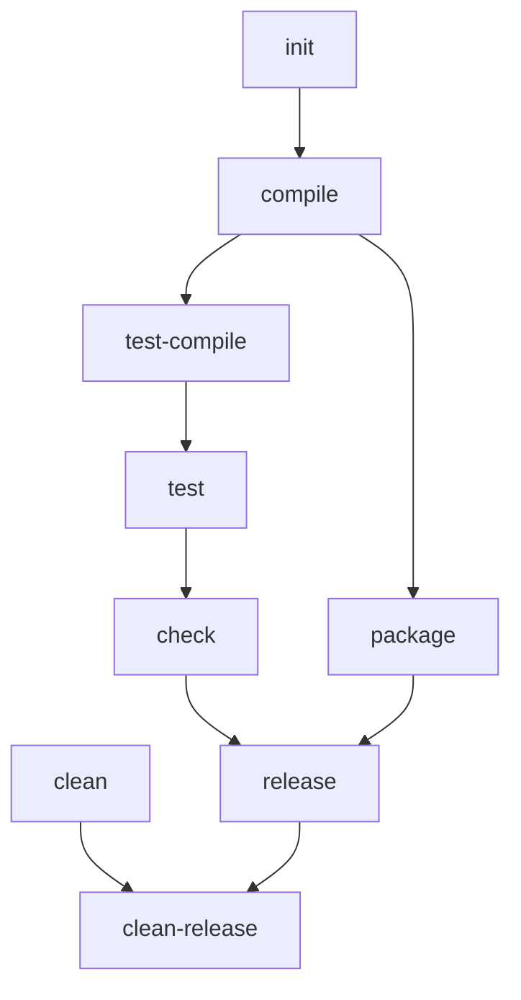

# Thiết kế target `clean`, kiểm tra và phát hành có thể chạy độc lập trong Apache Ant

Trong Apache Ant, `target` là đơn vị tổ chức các bước của quy trình build. Một buildfile dễ sử dụng thường cung cấp một số target đầu vào rõ ràng: target dọn sản phẩm build cũ, target kiểm tra mã nguồn và target tạo bản phát hành. Người dùng có thể gọi từng target trực tiếp từ dòng lệnh, còn Ant tự chạy các target phụ thuộc theo đúng thứ tự.

“Chạy độc lập” ở đây có nghĩa là người dùng có thể chọn target làm điểm bắt đầu, ví dụ `ant clean`, `ant check` hoặc `ant release`. Một target vẫn có thể khai báo `depends` để bảo đảm các bước chuẩn bị cần thiết được thực hiện. Thiết kế tốt giúp target có hợp đồng rõ ràng, không phụ thuộc vào việc người dùng đã vô tình chạy một target khác trước đó.

## 1. Mục tiêu khi thiết kế các target

Một buildfile có thể được gọi từ IDE, CI server, terminal của lập trình viên hoặc một script phát hành. Các điểm gọi này cần có hành vi dự đoán được. Khi thiết kế target, hãy xác định rõ:

- **Nhiệm vụ:** target dọn gì, kiểm tra điều gì hoặc tạo ra sản phẩm nào?
- **Đầu vào:** target cần mã nguồn, thư viện, cấu hình hay sản phẩm từ bước trước nào?
- **Đầu ra:** target tạo file ở đâu và tên file là gì?
- **Điều kiện tiên quyết:** những target nào phải chạy trước?
- **Tác động:** target có xóa dữ liệu, ghi đè file hay gửi sản phẩm ra hệ thống bên ngoài không?

Có thể chia các target thành ba nhóm:

| Nhóm | Ví dụ | Trách nhiệm |
|---|---|---|
| Target thao tác nền tảng | `init`, `compile`, `test`, `package` | Thực hiện một công đoạn cụ thể |
| Target điểm vào/kiểm tra | `check`, `verify` | Gom các bước cần thiết thành một lệnh dễ gọi |
| Target quản lý sản phẩm | `clean`, `release`, `clean-release` | Dọn sản phẩm sinh ra hoặc chuẩn bị đầu ra phát hành |

Các tên trên là quy ước do dự án chọn. Ant không bắt buộc phải đặt tên target theo một bộ tên cố định.

## 2. Target có thể được gọi trực tiếp và vẫn có dependency

Khi chạy:

```bash
ant check
```

Ant tìm target `check`, chạy các target trong thuộc tính `depends` trước, rồi mới thực hiện nội dung của `check`. Vì vậy, target `check` có thể là điểm vào độc lập dù bản thân nó chỉ gom các bước kiểm tra khác.

Ví dụ:

```xml
<target name="compile" depends="init">
    <!-- Biên dịch mã nguồn chính -->
</target>

<target name="test" depends="compile">
    <!-- Biên dịch và chạy kiểm thử -->
</target>

<target name="check" depends="test"
        description="Biên dịch và chạy các kiểm thử">
</target>
```

Người dùng chỉ cần gọi `ant check`. Ant tự đi theo chuỗi `init` → `compile` → `test` → `check`. Không cần yêu cầu người dùng chạy thủ công từng target theo đúng thứ tự.

Các dependency được khai báo bằng tên target, phân cách bởi dấu phẩy. Ví dụ `depends="check,package"` có nghĩa là chạy `check` và `package` trước target hiện tại. Với một lần gọi Ant, mỗi target trong đồ thị dependency chỉ được thực thi một lần, kể cả khi nhiều nhánh cùng phụ thuộc vào nó.



Sơ đồ thể hiện các target tiền đề nằm trước target phụ thuộc. `clean` là nhánh riêng; `clean-release` chủ động yêu cầu dọn trước rồi mới phát hành.

## 3. Thiết kế target `clean`

`clean` chịu trách nhiệm xóa các sản phẩm được tạo ra trong quá trình build, chẳng hạn thư mục class đã biên dịch, file JAR và thư mục staging. Nó thường không cần dependency vào `compile`, `test` hay `package`.

```xml
<property name="build.dir" location="build"/>

<target name="clean" description="Xóa các sản phẩm build được sinh tự động">
    <delete dir="${build.dir}"/>
</target>
```

Với cấu hình này, lệnh:

```bash
ant clean
```

sẽ xóa thư mục `build`. Nếu thư mục chưa tồn tại, task `delete` vẫn có thể hoàn tất bình thường.

Khi thiết kế `clean`, cần tuân thủ một số nguyên tắc:

- Chỉ xóa thư mục hoặc file mà buildfile sở hữu và có thể tạo lại.
- Dùng property cho thư mục đầu ra để vị trí xóa nhất quán với vị trí ghi sản phẩm.
- Không xóa `src`, `lib`, file cấu hình do người dùng quản lý hoặc dữ liệu môi trường.
- Không đặt `clean` làm dependency mặc định của `compile`, `check` hay `release`; nếu làm vậy, mọi lần build đều xóa đầu ra trước khi làm việc và mất lợi ích incremental build.
- Nếu cần bản phát hành từ trạng thái sạch, cung cấp một target riêng như `clean-release` hoặc hướng dẫn gọi `ant clean release`.

`clean` nên có thể chạy lặp lại. Việc gọi `ant clean` hai lần liên tiếp không nên gây lỗi chỉ vì thư mục đầu ra đã bị xóa ở lần đầu.

## 4. Thiết kế target kiểm tra

Target kiểm tra thường là điểm vào mà lập trình viên và CI gọi thường xuyên. Nó có thể gom các bước biên dịch, biên dịch test, chạy unit test, kiểm tra định dạng hoặc kiểm tra tĩnh.

Không nên để `check` giả định rằng một target khác đã được người dùng chạy trong terminal trước đó. Hãy khai báo toàn bộ điều kiện tiên quyết bằng `depends`:

```xml
<target name="init">
    <mkdir dir="${classes.dir}"/>
    <mkdir dir="${test.classes.dir}"/>
</target>

<target name="compile" depends="init">
    <javac srcdir="${src.dir}"
           destdir="${classes.dir}"
           includeantruntime="false"/>
</target>

<target name="test-compile" depends="compile">
    <javac srcdir="${test.src.dir}"
           destdir="${test.classes.dir}"
           includeantruntime="false">
        <classpath refid="test.classpath"/>
    </javac>
</target>

<target name="test" depends="test-compile">
    <!-- Chạy test runner -->
</target>

<target name="check" depends="test"
        description="Biên dịch và chạy kiểm thử"/>
```

Ở đây, `check` là target tổng hợp. Nó không cần có task trực tiếp nếu các target tiền đề đã thực hiện toàn bộ công việc. Khi dự án có thêm kiểm tra tĩnh, có thể bổ sung target `static-check` và đưa nó vào danh sách dependency của `check`.

```xml
<target name="check" depends="static-check,test"
        description="Chạy kiểm tra tĩnh và kiểm thử"/>
```

Các target kiểm tra nên trả về trạng thái thất bại khi phát hiện lỗi. Ví dụ, nếu dùng task `java` để chạy một test runner trong tiến trình riêng, hãy bật `failonerror="true"` để lỗi của tiến trình con làm build thất bại:

```xml
<target name="test" depends="test-compile">
    <java classname="org.junit.runner.JUnitCore"
          fork="true"
          failonerror="true">
        <classpath refid="test.classpath"/>
        <arg value="com.example.MainTest"/>
    </java>
</target>
```

Ví dụ này sử dụng JUnit 4.13.2 và Hamcrest 1.3 được đặt trong thư mục `lib`. Nếu dự án dùng framework kiểm thử khác, thay phần thực thi test runner bằng task hoặc lệnh phù hợp, nhưng vẫn giữ nguyên hợp đồng: target `test` phải báo build thất bại khi test không đạt.

## 5. Thiết kế target đóng gói và phát hành

Phát hành nên phụ thuộc vào các điều kiện chất lượng và sản phẩm cần có. Có thể tách `package` và `release` để hai công việc có thể được gọi riêng:

- `package`: tạo file JAR từ class đã biên dịch.
- `release`: yêu cầu kiểm tra thành công, yêu cầu có file JAR, rồi đưa file đó vào thư mục staging.

Ví dụ:

```xml
<property name="archive.name" value="sample-app.jar"/>
<property name="archive.file"
          location="${build.dir}/libs/${archive.name}"/>
<property name="release.dir" location="${build.dir}/release"/>

<target name="package" depends="compile"
        description="Đóng gói ứng dụng thành JAR">
    <mkdir dir="${build.dir}/libs"/>
    <jar destfile="${archive.file}" basedir="${classes.dir}">
        <manifest>
            <attribute name="Main-Class" value="com.example.Main"/>
        </manifest>
    </jar>
</target>

<target name="release" depends="check,package"
        description="Kiểm tra và chuẩn bị JAR phát hành">
    <mkdir dir="${release.dir}"/>
    <copy file="${archive.file}"
          todir="${release.dir}"
          overwrite="true"/>
</target>
```

Khi chạy `ant release`, Ant thực hiện `check` và `package` trước. Nếu kiểm tra thất bại, build dừng và target `release` không được thực hiện. Nếu mọi điều kiện đạt, file JAR được đưa vào `build/release`.

Ví dụ trên chỉ chuẩn bị bản phát hành trong thư mục local. Nếu dự án cần upload lên repository, registry hoặc máy chủ, hãy đặt thao tác đó trong một target riêng như `publish`, phụ thuộc vào `release`. Như vậy việc tạo sản phẩm và việc gửi sản phẩm ra bên ngoài có điểm gọi và tác động rõ ràng.

## 6. Ví dụ buildfile hoàn chỉnh

Giả sử dự án có cấu trúc:

```text
project/
├── build.xml
├── lib/
│   ├── junit-4.13.2.jar
│   └── hamcrest-core-1.3.jar
└── src/
    ├── main/java/com/example/Main.java
    └── test/java/com/example/MainTest.java
```

Buildfile sau cung cấp các điểm vào `clean`, `check`, `package`, `release` và `clean-release`. Ví dụ dùng JUnit 4 để minh họa target test; dự án thực tế cần có mã nguồn và hai file JAR test tương ứng.

```xml
<project name="sample-app" default="check" basedir=".">

    <!-- Các đường dẫn và tên sản phẩm được khai báo tập trung. -->
    <property name="src.dir" location="src/main/java"/>
    <property name="test.src.dir" location="src/test/java"/>
    <property name="lib.dir" location="lib"/>
    <property name="build.dir" location="build"/>
    <property name="classes.dir" location="${build.dir}/classes"/>
    <property name="test.classes.dir" location="${build.dir}/test-classes"/>
    <property name="archive.name" value="sample-app.jar"/>
    <property name="archive.file"
              location="${build.dir}/libs/${archive.name}"/>
    <property name="release.dir" location="${build.dir}/release"/>

    <path id="test.classpath">
        <pathelement location="${classes.dir}"/>
        <pathelement location="${test.classes.dir}"/>
        <pathelement location="${lib.dir}/junit-4.13.2.jar"/>
        <pathelement location="${lib.dir}/hamcrest-core-1.3.jar"/>
    </path>

    <!-- Xóa sản phẩm do build tạo ra. -->
    <target name="clean"
            description="Xóa toàn bộ thư mục build">
        <delete dir="${build.dir}"/>
    </target>

    <!-- Tạo các thư mục đầu ra cần thiết. -->
    <target name="init">
        <mkdir dir="${classes.dir}"/>
        <mkdir dir="${test.classes.dir}"/>
    </target>

    <!-- Biên dịch mã nguồn chính. -->
    <target name="compile" depends="init">
        <javac srcdir="${src.dir}"
               destdir="${classes.dir}"
               includeantruntime="false"/>
    </target>

    <!-- Biên dịch mã nguồn kiểm thử. -->
    <target name="test-compile" depends="compile">
        <javac srcdir="${test.src.dir}"
               destdir="${test.classes.dir}"
               includeantruntime="false">
            <classpath refid="test.classpath"/>
        </javac>
    </target>

    <!-- Chạy JUnit; test thất bại sẽ làm build thất bại. -->
    <target name="test" depends="test-compile">
        <java classname="org.junit.runner.JUnitCore"
              fork="true"
              failonerror="true">
            <classpath refid="test.classpath"/>
            <arg value="com.example.MainTest"/>
        </java>
    </target>

    <!-- Điểm vào cho quy trình kiểm tra. -->
    <target name="check" depends="test"
            description="Biên dịch và chạy unit test"/>

    <!-- Tạo JAR; có thể gọi riêng bằng ant package. -->
    <target name="package" depends="compile"
            description="Đóng gói ứng dụng thành JAR">
        <mkdir dir="${build.dir}/libs"/>
        <jar destfile="${archive.file}" basedir="${classes.dir}">
            <manifest>
                <attribute name="Main-Class" value="com.example.Main"/>
            </manifest>
        </jar>
    </target>

    <!-- Chỉ staging khi kiểm tra và đóng gói đều thành công. -->
    <target name="release" depends="check,package"
            description="Kiểm tra và chuẩn bị JAR phát hành">
        <mkdir dir="${release.dir}"/>
        <copy file="${archive.file}"
              todir="${release.dir}"
              overwrite="true"/>
    </target>

    <!-- Điểm vào tùy chọn để tạo release từ đầu ra sạch. -->
    <target name="clean-release" depends="clean,release"
            description="Dọn build rồi tạo bản phát hành mới"/>

</project>
```

Trong buildfile này, `default="check"` có nghĩa là chạy lệnh `ant` không kèm tên target sẽ thực hiện quy trình kiểm tra. Người dùng vẫn có thể gọi từng target công khai trực tiếp. `clean-release` là lựa chọn rõ ràng khi muốn xóa toàn bộ thư mục build trước khi kiểm tra và tạo lại bản phát hành.

## 7. Các lệnh thường dùng

| Lệnh | Hành vi |
|---|---|
| `ant` | Chạy target mặc định `check` |
| `ant clean` | Xóa thư mục `build` |
| `ant check` | Biên dịch và chạy unit test |
| `ant package` | Biên dịch và tạo JAR |
| `ant release` | Kiểm tra, đóng gói và staging JAR |
| `ant clean-release` | Dọn đầu ra cũ rồi chạy quy trình phát hành |
| `ant clean release` | Chạy lần lượt hai target được chỉ định trong cùng lần gọi Ant |
| `ant -f path/to/build.xml release` | Chọn buildfile cụ thể và gọi target `release` |
| `ant -p` | Liệt kê các target có mô tả trợ giúp |

Khi cung cấp buildfile cho nhóm, hãy ghi rõ các target công khai và ý nghĩa của chúng trong README hoặc tài liệu phát triển. Thuộc tính `description` giúp lệnh trợ giúp của Ant hiển thị mục đích target.

## 8. Dependency, thứ tự và tính độc lập

### Dependency mô tả điều kiện tiên quyết

`depends` là một đồ thị phụ thuộc, không phải lời gọi hàm thông thường. Ant giải quyết dependency trước khi chạy phần thân của target được yêu cầu. Nếu một target cần class đã biên dịch, hãy để target đó phụ thuộc vào `compile`; đừng yêu cầu người dùng nhớ chạy `ant compile` trước.

### Thứ tự trong danh sách dependency có ý nghĩa

Với `depends="check,package"`, Ant xử lý dependency theo thứ tự khai báo, cùng với các dependency bắc cầu của từng target. Điều này giúp `release` chỉ chạy sau khi cả kiểm tra và đóng gói hoàn tất. Tránh để hai target cùng ghi vào một file hoặc thư mục theo cách phụ thuộc vào thứ tự không được mô tả.

### Mỗi target chỉ chạy một lần trong một invocation

Nếu cả `check` và `package` đều phụ thuộc `compile`, khi gọi `ant release`, target `compile` không bị chạy lặp lại chỉ vì xuất hiện trong hai nhánh. Điều này giúp đồ thị dependency có thể chia sẻ các bước nền tảng.

### Tránh dependency vòng

Không để `compile` phụ thuộc `check` trong khi `check` lại phụ thuộc `compile`. Một vòng dependency khiến Ant không thể lập lịch target hợp lệ. Hãy xác định hướng từ bước nền tảng đến bước tổng hợp: `init` → `compile` → `test` → `check` → `release`.

### Target độc lập không đồng nghĩa với target không có dependency

`ant release` là một lệnh độc lập với người dùng vì nó tự kéo theo `check` và `package`. `release` vẫn có dependency; chính dependency làm cho điểm vào này an toàn và dễ dùng.

## 9. Những lỗi thiết kế thường gặp

| Cách thiết kế | Vấn đề | Hướng điều chỉnh |
|---|---|---|
| `compile` phụ thuộc `clean` | Mỗi lần biên dịch đều xóa toàn bộ đầu ra; mất khả năng build tăng dần | Giữ `clean` độc lập; tạo `clean-release` nếu cần build sạch |
| `release` không phụ thuộc `check` | Có thể tạo bản phát hành dù kiểm thử chưa chạy hoặc đã thất bại ở lần gọi trước | Đưa target kiểm tra vào dependency của `release` |
| `check` giả định người dùng đã chạy `compile` | Gọi trực tiếp `ant check` có thể thiếu class hoặc thư mục đầu ra | Khai báo dependency từ `check` qua `test` đến `compile` |
| Target kiểm tra bỏ qua exit code lỗi | CI có thể báo thành công dù test thất bại | Cấu hình task hoặc tiến trình con truyền lỗi về Ant |
| `clean` xóa thư mục dữ liệu dùng chung | Có thể mất dữ liệu do người dùng hoặc môi trường tạo ra | Chỉ xóa thư mục build-owned, khai báo bằng property riêng |
| `release` vừa đóng gói vừa upload vừa thông báo | Khó xác định bước nào gây lỗi và khó tái sử dụng sản phẩm local | Tách `package`, `release` (staging) và `publish` (gửi ra ngoài) |
| Nhiều target cùng ghi một đầu ra | Kết quả phụ thuộc thứ tự thực thi hoặc target được gọi | Chỉ định một target sở hữu mỗi đầu ra |
| Có dependency vòng | Ant không thể hoàn tất đồ thị target | Sắp xếp lại dependency theo chiều từ bước nền tảng đến bước tổng hợp |

## 10. Tính lặp lại và đầu ra có thể dự đoán

Một target dễ vận hành cần tạo kết quả ở vị trí cố định và có thể được gọi lại. Một số thực hành hữu ích:

- Tập trung đường dẫn đầu ra như `build.dir`, `classes.dir`, `archive.file` và `release.dir` ở phần property đầu buildfile.
- Để `init` tạo các thư mục cần thiết; không yêu cầu người dùng tự tạo chúng trước.
- Để task kiểm tra trả mã lỗi phù hợp khi điều kiện không đạt.
- Ghi rõ target nào được phép xóa hoặc ghi đè sản phẩm.
- Để `release` luôn staging từ đúng file do `package` tạo ra.
- Dùng `clean-release` khi cần loại bỏ class cũ còn sót lại, ví dụ khi một file nguồn đã bị xóa.

Ant property thông thường có tính bất biến sau khi được thiết lập. Vì vậy, nên khai báo cấu hình như thư mục nguồn, thư mục build và tên archive ở cấp project, thay vì cố gắng thay đổi property ở các target theo thứ tự thực thi. Nếu cần build theo nhiều môi trường, hãy thiết kế property đầu vào qua file cấu hình hoặc tham số dòng lệnh một cách rõ ràng.

## 11. Bài tập tự kiểm tra

**Bài 1.** Vì sao không nên để `compile` phụ thuộc `clean`?

**Đáp án:** Vì mỗi lần gọi `compile` sẽ xóa đầu ra trước khi biên dịch, làm mất lợi ích build tăng dần và khiến target có tác động phá hủy ngoài trách nhiệm biên dịch. Hãy gọi `clean` riêng hoặc tạo target `clean-release`.

**Bài 2.** Một lập trình viên chạy `ant release`. Những bước nào cần được bảo đảm chạy trước?

**Đáp án:** Target `release` nên phụ thuộc vào target kiểm tra như `check` và target tạo sản phẩm như `package`. Các target này khai báo tiếp dependency của chúng, ví dụ `test` → `test-compile` → `compile` → `init`.

**Bài 3.** Có thể để `check` là target rỗng không?

**Đáp án:** Có. Nếu `check` chỉ đóng vai trò target tổng hợp và toàn bộ công việc nằm trong các target dependency, phần thân của nó có thể rỗng. `depends` vẫn làm Ant chạy các bước cần thiết.

**Bài 4.** Khi nào nên dùng `clean-release` thay vì `release`?

**Đáp án:** Dùng `release` cho quy trình phát hành thông thường khi dependency bảo đảm đầu ra cần thiết. Dùng `clean-release` khi muốn xóa toàn bộ sản phẩm build cũ trước, tránh class hoặc file thừa còn sót lại.

**Bài 5.** Target `release` có nên tự upload JAR lên máy chủ không?

**Đáp án:** Điều đó phụ thuộc quy ước dự án. Một thiết kế dễ kiểm soát thường tách bước chuẩn bị sản phẩm local (`release`) khỏi thao tác gửi sản phẩm ra ngoài (`publish`), để có thể kiểm tra artifact trước khi thực hiện side effect.

## Kết luận

Thiết kế target độc lập bắt đầu từ các điểm vào có trách nhiệm rõ ràng. `clean` dọn sản phẩm build, `check` gom các bước kiểm tra, `package` tạo artifact và `release` chỉ chuẩn bị artifact sau khi các điều kiện cần thiết hoàn tất. Dependency mô tả thứ tự và điều kiện tiên quyết, còn target mặc định giúp lệnh `ant` có hành vi rõ ràng. Khi tách riêng các trách nhiệm này, lập trình viên và CI có thể gọi từng quy trình trực tiếp, lặp lại và dự đoán được kết quả.

