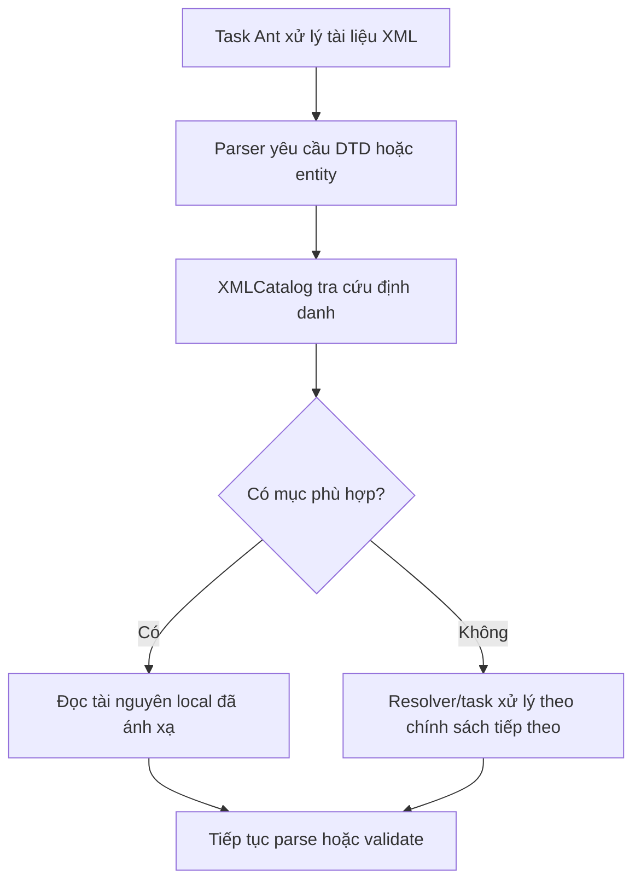

# `XMLCatalog` và phân giải tài nguyên XML cục bộ trong Apache Ant

Khi một tài liệu XML tham chiếu đến DTD, external entity, stylesheet hoặc tài nguyên XML khác bằng một URI, parser cần tìm và đọc tài nguyên đó. Nếu URI trỏ đến máy chủ bên ngoài, mỗi lần build có thể phải truy cập mạng. Điều này làm build phụ thuộc vào kết nối Internet, trạng thái máy chủ và nội dung tài nguyên từ xa. Trong môi trường CI hoặc khi cần build offline, các phụ thuộc như vậy dễ gây lỗi khó dự đoán.

Apache Ant cung cấp data type `XMLCatalog` để khai báo cách phân giải các định danh và URI XML. Thay vì để parser tự tải tài nguyên từ địa chỉ bên ngoài, catalog có thể ánh xạ một public ID hoặc system ID đến bản sao đã được lưu trong project. Những task hỗ trợ XMLCatalog, chẳng hạn `xmlvalidate` và `xslt`, có thể sử dụng cấu hình này khi xử lý tài liệu.

`XMLCatalog` là một data type/resolver được nhúng vào task có hỗ trợ. Nó không phải target và cũng không tự động thay đổi cách mọi parser trong mọi task của Ant tải tài nguyên XML.

## 1. Vấn đề khi XML tham chiếu tài nguyên từ xa

Một tài liệu XML có thể khai báo DTD bên ngoài:

```xml
<?xml version="1.0" encoding="UTF-8"?>
<!DOCTYPE inventory PUBLIC
    "-//ACME//DTD Inventory 1.0//EN"
    "https://schemas.example.invalid/dtd/inventory.dtd">
<inventory>
    <item id="A-100">Notebook</item>
</inventory>
```

Trong khai báo trên:

- Public ID là `-//ACME//DTD Inventory 1.0//EN`; đây là định danh logic mà catalog có thể dùng để tìm bản DTD phù hợp.
- System ID là URI `https://schemas.example.invalid/dtd/inventory.dtd`; parser có thể dùng URI này để truy cập tài nguyên nếu không có resolver cung cấp bản thay thế.
- Tài liệu XML phụ thuộc vào nội dung DTD để kiểm tra cấu trúc và các quy tắc hợp lệ.

Nếu máy build không có mạng, máy chủ tạm ngừng hoạt động hoặc tài nguyên bị thay đổi, bước xác thực XML có thể thất bại hoặc cho kết quả khác giữa các lần chạy. Nếu DTD đã được lưu cùng source code, XMLCatalog có thể ánh xạ public ID sang file local để build dùng bản đã quản lý trong repository.

## 2. Vai trò của `XMLCatalog`

XMLCatalog hoạt động như một bảng phân giải. Khi parser yêu cầu một tài nguyên XML, resolver kiểm tra thông tin định danh được cung cấp, tìm mục phù hợp trong catalog và trả về tài nguyên đã ánh xạ.



XMLCatalog giúp:

- Giữ các DTD và entity được dùng chung trong repository hoặc thư mục tài nguyên được quản lý.
- Tránh phải tải lại tài nguyên đã được ánh xạ trong mỗi lần build.
- Giúp môi trường local và CI sử dụng cùng một bản tài nguyên XML.
- Tách định danh công khai của tài nguyên khỏi vị trí lưu trữ thực tế.
- Tập trung cấu hình resolver để nhiều task dùng chung.

Catalog là cơ chế ánh xạ. Việc một URI không tìm thấy trong catalog có bị từ chối hay được resolver/parser tiếp tục xử lý theo URI ban đầu còn phụ thuộc vào task và cấu hình parser. Vì vậy, không nên xem việc khai báo XMLCatalog là bằng chứng rằng mọi truy cập mạng đã bị vô hiệu hóa.

## 3. Khai báo mapping trực tiếp bằng `dtd` và `entity`

Cách đơn giản nhất là khai báo các mapping ngay trong buildfile. XMLCatalog hỗ trợ các phần tử như `dtd` và `entity`, trong đó `publicId` xác định tài nguyên cần ánh xạ và `location` chỉ đến bản tài nguyên local.

```xml
<xmlcatalog id="local.xml.catalog">
    <dtd
        publicId="-//ACME//DTD Inventory 1.0//EN"
        location="${basedir}/config/dtd/inventory.dtd"/>

    <entity
        publicId="-//ACME//ENTITIES Inventory Units 1.0//EN"
        location="${basedir}/config/entities/units.ent"/>
</xmlcatalog>
```

Trong ví dụ:

- `id="local.xml.catalog"` đặt tên reference cho cấu hình XMLCatalog.
- `<dtd>` ánh xạ public ID của DTD sang file `config/dtd/inventory.dtd`.
- `<entity>` ánh xạ public ID của external entity sang file `config/entities/units.ent`.
- `${basedir}` giúp xác định đường dẫn bắt đầu từ thư mục gốc của project Ant, tránh phụ thuộc vào thư mục hiện tại mà người dùng mở terminal.

Các giá trị public ID phải khớp với định danh mà tài liệu XML hoặc DTD khai báo. Nếu khác một ký tự, resolver có thể không tìm thấy mapping mong muốn.

Ví dụ DTD có thể khai báo external entity như sau:

```dtd
<!ELEMENT inventory (item+)>
<!ELEMENT item (#PCDATA)>
<!ATTLIST item id CDATA #REQUIRED>
<!ENTITY units PUBLIC
    "-//ACME//ENTITIES Inventory Units 1.0//EN"
    "https://schemas.example.invalid/entities/units.ent">
```

File `units.ent` được lưu cục bộ có thể chứa:

```xml
<!ENTITY unitName "pieces">
```

Khi tài liệu sử dụng entity đã khai báo, resolver có thể lấy nội dung từ file local theo mapping của public ID.

## 4. Sử dụng XMLCatalog trong task `xmlvalidate`

`xmlvalidate` là task Ant dùng để kiểm tra tài liệu XML. Có thể khai báo XMLCatalog trực tiếp bên trong task hoặc tham chiếu một XMLCatalog đã được đặt `id` ở cấp project.

```xml
<project name="inventory-xml" default="validate" basedir=".">

    <property name="config.dir" location="config"/>
    <property name="src.dir" location="src"/>

    <xmlcatalog id="local.xml.catalog">
        <dtd
            publicId="-//ACME//DTD Inventory 1.0//EN"
            location="${config.dir}/dtd/inventory.dtd"/>
    </xmlcatalog>

    <target name="validate"
            description="Xác thực tài liệu inventory bằng DTD local">
        <xmlvalidate file="${src.dir}/inventory.xml">
            <xmlcatalog refid="local.xml.catalog"/>
        </xmlvalidate>
    </target>

</project>
```

Khi chạy:

```bash
ant validate
```

Ant gọi `xmlvalidate`; task chuyển XMLCatalog đã tham chiếu cho cơ chế phân giải XML. Khi parser yêu cầu DTD có public ID tương ứng, catalog trả về file `config/dtd/inventory.dtd` trong project. Nhờ vậy, việc xác thực có thể dùng bản DTD đã lưu cục bộ thay vì phụ thuộc vào máy chủ chứa DTD.

Ở đây, `id` và `refid` chỉ phục vụ tái sử dụng đối tượng XMLCatalog. `id` đặt tên cấu hình; `refid` lấy lại cấu hình đó trong task. Nó không phải property `${...}` và cũng không phải tên target.

## 5. Dùng catalog OASIS bên ngoài buildfile

Khi có nhiều tài liệu hoặc nhiều project cùng dùng một bộ quy tắc phân giải, việc viết từng mapping trong buildfile có thể gây lặp lại. Có thể lưu mapping trong một XML Catalog theo định dạng OASIS rồi đưa file catalog vào `catalogpath`.

Ví dụ cấu trúc thư mục:

```text
project/
├── build.xml
├── config/
│   ├── catalog/
│   │   └── xml-catalog.xml
│   ├── dtd/
│   │   └── inventory.dtd
│   └── xsd/
│       └── inventory.xsd
└── src/
    └── inventory.xml
```

Nội dung `config/catalog/xml-catalog.xml` có thể như sau:

```xml
<?xml version="1.0" encoding="UTF-8"?>
<catalog xmlns="urn:oasis:names:tc:entity:xmlns:xml:catalog">
    <public
        publicId="-//ACME//DTD Inventory 1.0//EN"
        uri="../dtd/inventory.dtd"/>
    <system
        systemId="https://schemas.example.invalid/dtd/inventory.dtd"
        uri="../dtd/inventory.dtd"/>
    <uri
        name="https://schemas.example.invalid/xsd/inventory.xsd"
        uri="../xsd/inventory.xsd"/>
</catalog>
```

Các loại entry trong catalog OASIS có ý nghĩa khác nhau:

| Entry | Định danh đầu vào | URI đích |
|---|---|---|
| `public` | Public ID | `uri` trỏ đến tài nguyên local |
| `system` | System ID | `uri` trỏ đến tài nguyên local |
| `uri` | URI được yêu cầu | `uri` thay thế để resolver sử dụng |

Các đường dẫn tương đối trong file catalog được hiểu theo quy tắc của XML Catalog, gắn với vị trí file catalog. Điều này giúp catalog có thể được di chuyển cùng thư mục tài nguyên nếu cấu trúc tương đối được giữ nguyên.

Buildfile nạp catalog như sau:

```xml
<project name="inventory-xml" default="validate" basedir=".">
    <property name="config.dir" location="config"/>
    <property name="src.dir" location="src"/>

    <xmlcatalog id="shared.catalog">
        <catalogpath>
            <pathelement location="${config.dir}/catalog/xml-catalog.xml"/>
        </catalogpath>
    </xmlcatalog>

    <target name="validate"
            description="Xác thực XML bằng OASIS catalog">
        <xmlvalidate file="${src.dir}/inventory.xml">
            <xmlcatalog refid="shared.catalog"/>
        </xmlvalidate>
    </target>
</project>
```

`catalogpath` là một path chứa các file catalog mà XMLCatalog cần tra cứu. Nó không phải đường dẫn đến thư mục chứa DTD; file catalog mới là nơi mô tả quan hệ giữa định danh và tài nguyên đích.

Khi sử dụng catalog OASIS, cần bảo đảm phiên bản Ant và thư viện XML Catalog Resolver tương thích, có sẵn trong môi trường chạy Ant. Một file catalog nằm trong repository chưa đủ nếu resolver không thể đọc định dạng đó.

## 6. Chia sẻ XMLCatalog giữa nhiều task

Khi nhiều task cần cùng bộ mapping, khai báo XMLCatalog một lần với `id` rồi tham chiếu bằng `refid`. Ví dụ, một build có thể xác thực XML trước, sau đó dùng XSLT để biến đổi tài liệu với cùng bộ catalog:

```xml
<xmlcatalog id="project.xml.catalog">
    <dtd
        publicId="-//ACME//DTD Inventory 1.0//EN"
        location="${basedir}/config/dtd/inventory.dtd"/>
    <entity
        publicId="-//ACME//ENTITIES Inventory Units 1.0//EN"
        location="${basedir}/config/entities/units.ent"/>
</xmlcatalog>

<target name="validate">
    <xmlvalidate file="src/inventory.xml">
        <xmlcatalog refid="project.xml.catalog"/>
    </xmlvalidate>
</target>

<target name="transform" depends="validate">
    <xslt in="src/inventory.xml"
          out="build/inventory.html"
          style="src/xsl/inventory.xsl">
        <xmlcatalog refid="project.xml.catalog"/>
    </xslt>
</target>
```

Ví dụ minh họa cách chia sẻ cùng cấu hình resolver ở các task hỗ trợ nested XMLCatalog. Task `xslt` còn có thể cần phân giải tài nguyên được tham chiếu từ stylesheet, chẳng hạn import/include hoặc URI mà bộ xử lý XSLT yêu cầu. Cụ thể những loại URI nào được chuyển qua resolver phụ thuộc vào task và bộ xử lý XML/XSLT đang sử dụng.

Không phải mọi task Ant đều hỗ trợ nested `xmlcatalog`. Trước khi thêm phần tử này vào task khác, hãy kiểm tra tài liệu task đó. Nếu task không nhận XMLCatalog, việc khai báo một reference ở cấp project không tự làm task đó sử dụng catalog.

## 7. Phạm vi và cách phân giải đường dẫn

Có ba loại đường dẫn/định danh cần phân biệt:

1. **Public ID:** định danh công khai trong khai báo XML/DTD, thường là chuỗi nhận diện một chuẩn hoặc một DTD.
2. **System ID/URI:** địa chỉ mà parser có thể dùng để tìm tài nguyên, thường là URL hoặc đường dẫn.
3. **Location trong mapping:** vị trí tài nguyên mà XMLCatalog trả về, thường là file trong repository hoặc một URL được kiểm soát.

Ví dụ, public ID có thể ổn định qua nhiều môi trường, trong khi location local thay đổi theo thư mục checkout. Dùng property như `${basedir}` giúp buildfile tính location dựa trên project thay vì gắn cứng một đường dẫn máy cá nhân.

Đối với mapping trực tiếp `dtd`/`entity`, hãy chỉ định location rõ ràng. Với catalog OASIS, giữ các URI tương đối bên cạnh file catalog và tổ chức thư mục ổn định. Nếu mapping không khớp, hãy kiểm tra lần lượt public ID, system ID, đường dẫn file đích và việc task thực sự có nhận XMLCatalog hay không.

XMLCatalog thuộc cấu hình của task/project Ant đang chạy. Nó không cài đặt DTD vào parser toàn hệ thống, cũng không tự động áp dụng cho một chương trình Java được chạy độc lập bên ngoài task có hỗ trợ.

## 8. Catalog không đồng nghĩa với tắt truy cập mạng

Đây là điểm vận hành quan trọng. XMLCatalog cung cấp một cách tìm tài nguyên thay thế. Nếu catalog không có entry phù hợp, một resolver có thể trả quyền xử lý tiếp cho parser hoặc task. Khi đó parser có thể thử dùng system ID/URI ban đầu, tùy cấu hình.

Vì vậy:

- Không giả định rằng chỉ cần có XMLCatalog là mọi request HTTP/HTTPS đều bị chặn.
- Nếu yêu cầu build offline, hãy kiểm tra các tài nguyên XML mà đầu vào thực sự tham chiếu và xác minh build chạy được khi ngắt mạng.
- Nếu yêu cầu không cho phép truy cập ngoài, hãy cấu hình parser/task theo chính sách bảo mật tương ứng và kiểm tra hành vi fallback; catalog chỉ là một phần của giải pháp.
- Không dùng parser cấu hình lỏng lẻo để xử lý XML không đáng tin cậy. External entity và DTD có thể tạo rủi ro đọc file local, truy cập mạng hoặc tiêu thụ tài nguyên quá mức.
- Chỉ ánh xạ đến tài nguyên được kiểm soát, có nguồn gốc rõ ràng và được cập nhật có chủ đích.

Việc cho phép xử lý DTD là yêu cầu chức năng của một số hệ thống XML. Hãy cân bằng yêu cầu đó với chính sách xử lý dữ liệu đầu vào; không nên bật xử lý external entity một cách mặc định cho mọi tài liệu không đáng tin cậy.

## 9. Lỗi thường gặp và cách xử lý

| Triệu chứng | Nguyên nhân có thể | Cách kiểm tra và xử lý |
|---|---|---|
| Parser vẫn cố truy cập URL bên ngoài | Public ID không khớp, mapping thiếu hoặc task không dùng catalog | So sánh public ID trong XML với `publicId`; xác nhận nested `xmlcatalog` nằm trong task hỗ trợ |
| Báo không tìm thấy DTD/entity local | Sai `location`, file không tồn tại hoặc đường dẫn tương đối được tính từ thư mục khác dự kiến | Dùng `${basedir}` cho mapping trực tiếp; kiểm tra file đích trong checkout |
| Catalog OASIS không được nạp | `catalogpath` trỏ sai file hoặc resolver library không sẵn có trong Ant runtime | Kiểm tra file catalog, namespace/định dạng và thư viện XML Catalog Resolver của môi trường Ant |
| Một task dùng catalog nhưng task khác vẫn truy cập từ xa | Catalog chỉ được gắn vào một task; task khác không có nested XMLCatalog | Thêm cấu hình vào từng task hỗ trợ hoặc kiểm tra khả năng resolver của task đó |
| Mapping tồn tại nhưng không được chọn | Định danh XML dùng system ID trong khi chỉ khai báo mapping public ID, hoặc ngược lại | Xem chính xác kiểu định danh; dùng entry OASIS `system` khi cần ánh xạ system ID |
| Build local thành công nhưng CI thất bại | Tài nguyên local không được commit hoặc đường dẫn phụ thuộc máy phát triển | Đưa tài nguyên cần thiết vào vị trí dùng chung và dùng đường dẫn dựa trên project |
| Build offline vẫn thất bại | Có URI không được catalog ánh xạ hoặc parser có fallback ra ngoài | Liệt kê tài nguyên được tham chiếu; hoàn thiện catalog và chính sách chặn truy cập ngoài |

Khi debug, bắt đầu từ tài liệu XML đang được xử lý. Tìm `DOCTYPE`, khai báo external entity, `schemaLocation`, stylesheet `import`/`include` và các URI liên quan. Sau đó xác định task nào đang parse tài liệu và task đó có thực sự nhận XMLCatalog hay không.

## 10. Quy tắc tổ chức catalog cho dự án

- Lưu DTD, entity và catalog OASIS trong thư mục tài nguyên được quản lý cùng source code nếu dự án cần chúng để build.
- Đặt tên XMLCatalog theo phạm vi, chẳng hạn `inventory.catalog` hoặc `project.xml.catalog`.
- Gom các mapping dùng chung vào một reference; tránh khai báo cùng public ID với location khác nhau ở nhiều task.
- Dùng public ID ổn định để tài liệu XML không phụ thuộc vào đường dẫn checkout của từng máy.
- Dùng `${basedir}` hoặc property thư mục đã khai báo để mapping trực tiếp có thể chạy ở nhiều môi trường.
- Duy trì cấu trúc thư mục tương đối nếu dùng OASIS catalog với URI tương đối.
- Chỉ gắn catalog vào task cần phân giải XML; đừng giả định catalog là cấu hình toàn cục.
- Ghi lại phiên bản nguồn của DTD/XSD và quy trình cập nhật chúng để tránh thay đổi âm thầm.
- Kiểm tra build trong môi trường không có mạng nếu tính độc lập khỏi dịch vụ bên ngoài là một yêu cầu.

## 11. Bài tập tự kiểm tra

**Bài 1.** Tài liệu XML khai báo public ID `-//ACME//DTD Inventory 1.0//EN`. Muốn parser sử dụng file `config/dtd/inventory.dtd`, cần khai báo phần tử nào?

**Đáp án:**

```xml
<xmlcatalog>
    <dtd
        publicId="-//ACME//DTD Inventory 1.0//EN"
        location="${basedir}/config/dtd/inventory.dtd"/>
</xmlcatalog>
```

**Bài 2.** Vì sao nên đặt `id` cho XMLCatalog và dùng `refid` trong nhiều task?

**Đáp án:** Vì các task có thể dùng chung một định nghĩa mapping, tránh sai khác giữa cấu hình validate và transform. `id` đặt tên đối tượng XMLCatalog; `refid` tham chiếu lại đối tượng đó ở nested element được hỗ trợ.

**Bài 3.** `catalogpath` trỏ đến thư mục chứa các file DTD hay đến file catalog?

**Đáp án:** `catalogpath` là path chứa các file catalog OASIS. File catalog mới ánh xạ public ID/system ID/URI sang file DTD, XSD hoặc tài nguyên khác.

**Bài 4.** Nếu XMLCatalog không tìm thấy mapping, có chắc parser sẽ từ chối truy cập URL ban đầu không?

**Đáp án:** Không. Resolver/task có thể cho parser tiếp tục xử lý system ID/URI ban đầu. Cần cấu hình và kiểm tra chính sách fallback nếu muốn bảo đảm không truy cập mạng.

**Bài 5.** XMLCatalog có tự áp dụng cho mọi task Ant không?

**Đáp án:** Không. Chỉ các task có hỗ trợ XMLCatalog mới nhận và sử dụng nested element này. Phải kiểm tra tài liệu của từng task.

## Kết luận

XMLCatalog cho phép Ant phân giải định danh XML thông qua các tài nguyên được quản lý cục bộ. Mapping trực tiếp `dtd` và `entity` phù hợp với cấu hình nhỏ; catalog OASIS kết hợp `catalogpath` phù hợp khi nhiều tài liệu hoặc project cần dùng chung bộ mapping. Gắn catalog vào task có hỗ trợ bằng `id`/`refid` giúp tái sử dụng cấu hình. Để build thực sự ổn định và an toàn, cần kiểm soát cả tài nguyên được ánh xạ lẫn hành vi khi không tìm thấy mapping.

