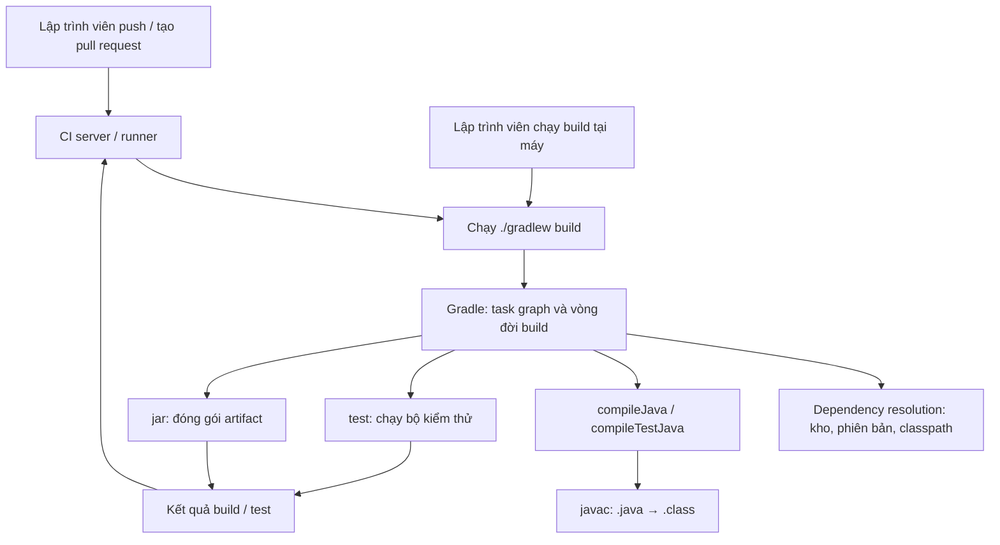

# Phân biệt build tool, trình biên dịch, trình quản lý dependency và CI server

Khi phát triển Java, ta thường thấy các lệnh như `javac`, `./gradlew build` và một workflow GitHub Actions cùng xuất hiện trong một dự án. Chúng liên quan với nhau nhưng giải quyết **bốn trách nhiệm khác nhau**. Phân biệt đúng giúp chọn công cụ, thiết kế quy trình build và khoanh vùng lỗi nhanh hơn.

Sau bài này, bạn có thể giải thích ai biên dịch mã nguồn, ai tải thư viện, ai điều phối các bước tạo sản phẩm và ai tự động chạy những bước đó khi mã nguồn thay đổi; đồng thời chỉ ra vai trò cụ thể của **Gradle** trong một dự án Java.

## 1. Bốn vai trò trong một bảng

| Vai trò | Câu hỏi mà nó trả lời | Ví dụ | Kết quả hoặc trách nhiệm chính |
| --- | --- | --- | --- |
| **Trình biên dịch (compiler)** | “Mã nguồn biến thành thứ có thể thực thi như thế nào?” | `javac` của JDK | Kiểm tra cú pháp, kiểu và biên dịch `.java` thành bytecode `.class`. |
| **Trình quản lý dependency** | “Dự án dùng thư viện nào, phiên bản nào và lấy chúng ở đâu?” | Cơ chế dependency management của Gradle; Maven cũng có cơ chế này | Giải quyết dependency trực tiếp/bắc cầu, chọn phiên bản, tải và đưa thư viện vào các classpath thích hợp. |
| **Build tool** | “Các việc để kiểm tra và tạo sản phẩm được tổ chức, chạy theo thứ tự nào?” | **Gradle**, Maven, Ant | Điều phối task như biên dịch, xử lý tài nguyên, chạy test, đóng gói JAR/WAR và xuất bản artifact khi được cấu hình. |
| **CI server / nền tảng CI** | “Khi có push/pull request, ai cấp môi trường và tự chạy các bước kiểm tra?” | Jenkins, GitHub Actions, GitLab CI | Nhận sự kiện, cấp runner/agent, chạy workflow và thu kết quả/log; gọi build tool hoặc script để thực hiện công việc. |

**Điểm then chốt:** đây là **vai trò**, không nhất thiết là bốn phần mềm độc lập. Gradle vừa là build tool, vừa cung cấp cơ chế quản lý dependency. Ngược lại, `javac` chủ yếu là compiler; GitHub Actions chủ yếu là nền tảng tự động hóa CI. Maven cũng kết hợp chức năng build và dependency management.

Hãy nhớ bốn câu ngắn:

- **Compiler** dịch mã nguồn.
- **Dependency manager** cung cấp và kết nối thư viện.
- **Build tool** điều phối quy trình tạo sản phẩm.
- **CI** chạy quy trình ấy tự động, có ghi nhận kết quả.

## 2. Trình biên dịch Java: `javac` làm gì?

Với Java truyền thống, trình biên dịch `javac` nhận file `.java` cùng các thư viện trên **compile classpath** và tạo file `.class` chứa bytecode. JVM thực thi bytecode khi chạy ứng dụng; trong quá trình chạy, JVM có thể dùng thêm các cơ chế như diễn dịch hoặc JIT, nhưng đó không phải nhiệm vụ của `javac`.

Ví dụ một lớp độc lập, không dùng thư viện ngoài:

```java
// src/main/java/demo/App.java
package demo;

public class App {
    public static String message() {
        return "Hello, Gradle!";
    }

    public static void main(String[] args) {
        System.out.println(message());
    }
}
```

Trên Linux/macOS, tại thư mục gốc dự án:

```bash
mkdir -p out
javac -d out src/main/java/demo/App.java
java -cp out demo.App
```

Kết quả chuẩn:

```text
Hello, Gradle!
```

`javac -d out` ghi `out/demo/App.class`; `java -cp out demo.App` khởi động chương trình. Trên Windows có thể tạo thư mục bằng `mkdir out`, rồi dùng hai lệnh `javac` và `java` tương tự.

`javac` **không tự đọc** cấu hình `build.gradle`, không tự truy cập Maven Central để tìm thư viện và không tự tạo một pipeline kiểm thử/phát hành. Nếu file Java import một thư viện ngoài, bạn phải đưa JAR phù hợp vào `-classpath`/`-cp` hoặc để build tool thiết lập classpath. Một lỗi `package ... does not exist` có thể là do thiếu classpath, không có nghĩa cú pháp Java sai.

> **JDK, compiler và JVM khác nhau:** JDK là bộ công cụ phát triển có `javac`, `java` và các tiện ích khác; `javac` là compiler; JVM là môi trường thực thi bytecode. Cài JDK không đồng nghĩa đã có một build workflow hoặc CI server.

## 3. Trình quản lý dependency: tìm đúng thư viện và tạo classpath

Dự án thực tế thường phụ thuộc vào thư viện như JUnit để kiểm thử hoặc thư viện JSON để xử lý dữ liệu. Ta cần mô tả **tọa độ dependency**, **repository**, **phạm vi sử dụng** và đôi khi chính sách phiên bản.

Ví dụ cấu hình Gradle DSL Groovy:

```groovy
repositories {
    mavenCentral()
}

dependencies {
    testImplementation 'org.junit.jupiter:junit-jupiter:5.10.2'
}
```

Dòng `testImplementation` khai báo dependency trực tiếp JUnit Jupiter chỉ dành cho phần test. Tọa độ `org.junit.jupiter:junit-jupiter:5.10.2` gồm `group:artifact:version`. `mavenCentral()` khai báo kho để Gradle tra cứu artifact và metadata; **Maven Central là repository, không phải compiler hay CI server**.

Khi một task cần dependency, Gradle sẽ giải quyết đồ thị phụ thuộc, bao gồm **dependency bắc cầu (transitive)** mà thư viện yêu cầu, áp dụng các quy tắc chọn phiên bản xung đột, lấy artifact từ kho hoặc cache và lập classpath cho task. Khai báo dependency không có nghĩa mọi file JAR đều phải được tải ngay lúc Gradle đọc `build.gradle`; quá trình resolution thường xảy ra khi một cấu hình được tiêu thụ.

Các cấu hình thường gặp với Gradle Java plugin:

| Cấu hình | Khi nào dùng |
| --- | --- |
| `implementation` | Thư viện cần trong mã ứng dụng; thường có mặt ở compile/runtime classpath tương ứng. |
| `compileOnly` | Chỉ cần để biên dịch, không được tự động thêm vào runtime classpath của ứng dụng. |
| `runtimeOnly` | Cần lúc chạy nhưng không cần khi biên dịch. |
| `testImplementation` | Thư viện mà mã kiểm thử cần để biên dịch/chạy, như JUnit. |
| `testRuntimeOnly` | Chỉ cần ở runtime của test. |
| `api` | Công khai dependency trên API của thư viện; dùng với plugin `java-library`, không mặc định có từ plugin `java` đơn thuần. |

Các cấu hình này phản ánh **mục đích dùng**; chúng không phải tên các giai đoạn trong CI. Gradle cũng quản lý plugin bằng cơ chế riêng; dependency dành cho mã ứng dụng và plugin dành cho logic build là hai khái niệm cần phân biệt.

Ví dụ hai lệnh hữu ích để điều tra dependency:

```bash
./gradlew dependencies --configuration testRuntimeClasspath
./gradlew dependencyInsight --dependency junit-jupiter --configuration testRuntimeClasspath
```

Lệnh thứ nhất trình bày cây dependency của cấu hình; lệnh thứ hai giải thích vì sao một module/phiên bản được chọn. Classpath và phiên bản thực tế phụ thuộc cấu hình của dự án. Đối với build cần tái lập ổn định, có thể cân nhắc version locking, dependency verification và quy định về phiên bản; chúng thuộc chính sách dependency/build, không phải trách nhiệm tự nhiên của `javac`.

## 4. Build tool: Gradle điều phối công việc như thế nào?

Gradle đọc mô hình dự án và cấu hình build, xây dựng **đồ thị task** với các dependency giữa task, sau đó chỉ thực thi những task cần thiết cho yêu cầu. Java plugin cung cấp các task và vòng đời quy ước, ví dụ:

- `compileJava`: biên dịch nguồn ứng dụng, sử dụng Java compiler và compile classpath.
- `processResources` và `classes`: chuẩn bị tài nguyên, các lớp ứng dụng.
- `compileTestJava`, `test`: biên dịch và chạy kiểm thử.
- `jar`: đóng gói class/resource thành JAR.
- `assemble`: tạo các artifact được cấu hình.
- `check`: chạy các bước xác minh, thường bao gồm `test`.
- `build`: task vòng đời phụ thuộc vào `assemble` và `check`.

Như vậy `./gradlew build` không phải một compiler mới. Nó yêu cầu **Gradle** lập kế hoạch và thực hiện chuỗi task; trong task biên dịch Java, Gradle dùng công cụ của JDK; trong task cần thư viện, Gradle sử dụng cơ chế dependency resolution. Với plugin khác, Gradle có thể điều phối Kotlin, tài nguyên frontend, code generation, container hoặc các loại đóng gói khác.

**Task graph không nhất thiết chạy tuần tự từng dòng** như một shell script. Gradle bảo đảm quan hệ phụ thuộc giữa task, đồng thời có thể bỏ qua task đã up-to-date, dùng build cache hoặc thực thi song song khi cấu hình thích hợp. `clean` chủ yếu xóa đầu ra build; không phải bước bắt buộc trong mọi lần build. Dùng `clean build` khi muốn chủ động dựng lại đầu ra, và dùng `build` trong vòng lặp phát triển khi cơ chế incremental/caching có ích.

Gradle Wrapper gồm `gradlew`, `gradlew.bat` và các file trong `gradle/wrapper/`. Wrapper cho phép thành viên nhóm và CI dùng phiên bản Gradle đã cấu hình trong dự án. Wrapper **không thay thế JDK**: máy chạy vẫn phải có JDK/toolchain đáp ứng yêu cầu hoặc cấu hình cơ chế cấp phát toolchain phù hợp. Gradle daemon chỉ là quá trình hỗ trợ chạy build, không phải CI server.

## 5. CI server: tự động gọi build khi có sự kiện

CI (Continuous Integration) nhằm kiểm tra thường xuyên các thay đổi được tích hợp vào nhánh chung. Một nền tảng CI điển hình:

1. Nhận sự kiện `push`, `pull_request` hoặc lịch chạy.
2. Chọn runner/agent và môi trường hệ điều hành, JDK, biến cấu hình.
3. Checkout mã nguồn, lấy các công cụ và bộ nhớ đệm nếu được cấu hình.
4. **Gọi** `./gradlew test` hoặc `./gradlew build`.
5. Thu exit code, log và báo cáo kiểm thử; đánh dấu job thành công/thất bại, có thể giữ artifact hoặc chuyển sang bước triển khai theo workflow.

CI không tự hiểu dependency graph hoặc cú pháp Java chỉ vì nó là CI. Nó có thể gọi `javac` trực tiếp trong job, nhưng với dự án có nhiều nguồn, test và phụ thuộc, việc gọi build tool đã được cấu hình trong repository thường tạo kết quả nhất quán hơn giữa máy nhà phát triển và CI.

Phân biệt thêm: **CI** là hoạt động tích hợp/kiểm tra tự động; **CD** là continuous delivery hoặc deployment theo thiết kế pipeline. `build` không tự đồng nghĩa với deploy, và một pipeline CI thành công không mặc nhiên chứng minh hệ thống chạy đúng ngoài môi trường kiểm thử.

## 6. Một dự án Java 17 minh họa cả bốn vai trò

Giả sử có cấu trúc:

```text
tool-roles-demo/
├── settings.gradle
├── build.gradle
├── gradlew
├── gradlew.bat
├── gradle/wrapper/gradle-wrapper.jar
├── gradle/wrapper/gradle-wrapper.properties
├── src/main/java/demo/App.java
└── src/test/java/demo/AppTest.java
```

`App.java` dùng đúng lớp ở mục 2. Hai file Gradle còn lại:

```groovy
// settings.gradle
rootProject.name = 'tool-roles-demo'
```

```groovy
// build.gradle
plugins {
    id 'java'
}

group = 'demo'
version = '1.0.0'

java {
    toolchain {
        languageVersion = JavaLanguageVersion.of(17)
    }
}

repositories {
    mavenCentral()
}

dependencies {
    testImplementation 'org.junit.jupiter:junit-jupiter:5.10.2'
}

test {
    useJUnitPlatform()
}
```

Tạo bài kiểm thử:

```java
// src/test/java/demo/AppTest.java
package demo;

import org.junit.jupiter.api.Test;
import static org.junit.jupiter.api.Assertions.assertEquals;

class AppTest {
    @Test
    void returnsExpectedMessage() {
        assertEquals("Hello, Gradle!", App.message());
    }
}
```

Trên máy đã cài Gradle và JDK phù hợp, nếu project chưa có Wrapper, tạo Wrapper một lần:

```bash
gradle wrapper --gradle-version 8.5
```

Sau đó lưu vào version control cả script Wrapper, `gradle-wrapper.properties` và `gradle-wrapper.jar` được tạo. Đảm bảo có JDK 17 để đáp ứng Java toolchain của ví dụ. Trong dự án có Wrapper, các lệnh phổ biến trên Linux/macOS:

```bash
./gradlew clean build
./gradlew test
java -cp build/libs/tool-roles-demo-1.0.0.jar demo.App
```

Trên Windows, thay `./gradlew` bằng `gradlew.bat`; câu lệnh `java -cp ...` vẫn dùng được. Sau khi build thành công, lệnh `java -cp ... demo.App` ở trên in:

```text
Hello, Gradle!
```

JAR ở ví dụ là **JAR Java thông thường**, không đặt `Main-Class` trong manifest. Vì vậy hãy chạy bằng `java -cp ... demo.App`; không được suy ra `java -jar ...` sẽ hoạt động chỉ từ việc task `jar` thành công. Output console của Gradle (`BUILD SUCCESSFUL`, số task, tình trạng cache...) phụ thuộc môi trường và lần chạy, nên không giả định một log cố định.

Lúc chạy `./gradlew clean build`, từng trách nhiệm xuất hiện rõ:

1. **Build tool (Gradle):** đọc `settings.gradle`/`build.gradle`, xác định `build` phụ thuộc các task cần thiết.
2. **Dependency management (trong Gradle):** giải quyết JUnit từ Maven Central cho classpath của test.
3. **Compiler (`javac` qua task JavaCompile):** tạo `App.class` và `AppTest.class` từ mã Java theo cấu hình.
4. **Các công cụ thực thi/test và đóng gói:** Gradle chạy test qua JUnit Platform và tạo JAR; compiler không tự làm hai việc này.
5. **CI (nếu có):** kích hoạt đúng lệnh build trên runner và thông báo kết quả.

Mẫu GitHub Actions tối giản trong `.github/workflows/ci.yml`:

```yaml
name: Java CI
on:
  push:
  pull_request:

jobs:
  build:
    runs-on: ubuntu-latest
    steps:
      - uses: actions/checkout@v4
      - uses: actions/setup-java@v4
        with:
          distribution: temurin
          java-version: '17'
      - name: Test and package
        run: bash ./gradlew --no-daemon clean build
```

Ở đây GitHub Actions là **nền tảng CI**, runner cài JDK 17 và thực thi script. `gradlew` chọn phiên bản Gradle; Gradle thực hiện task và resolution; Java compiler kiểm tra/biên dịch source. Workflow chỉ chạy được nếu các file Wrapper thực sự có mặt trong repository. Nếu job cần secret, artifact upload hoặc release, phải cấu hình thêm; ví dụ này chỉ build và test.

## 7. Sơ đồ mối quan hệ



Sơ đồ minh họa **quan hệ trách nhiệm**, không khẳng định mọi nhánh task chạy theo thứ tự tuyến tính. Developer cũng có thể dùng Gradle hoàn toàn trên máy cá nhân khi không có CI.

## 8. Phân biệt qua tình huống thực tế

| Tình huống | Tầng nên kiểm tra đầu tiên | Vì sao |
| --- | --- | --- |
| `javac` không tồn tại trong terminal | Cài đặt JDK/PATH | Chưa gọi được compiler. |
| `error: cannot find symbol` trong Java | Source code, import, compile classpath | Compiler chưa tìm được tên/kiểu cần thiết; cần xét log để phân biệt lỗi code và dependency. |
| Gradle báo `Could not resolve ...` | Tọa độ dependency, repository, mạng, credential hoặc quy tắc phiên bản | Dependency resolution không lấy được artifact. |
| Gradle báo không tìm thấy JDK 17 cho toolchain | JDK/toolchain configuration | Build yêu cầu môi trường biên dịch mà máy/runner chưa cung cấp. |
| `compileJava` thành công nhưng `test` thất bại | Test, hành vi chương trình, fixture và môi trường | Biên dịch thành công không có nghĩa logic đúng. |
| JAR tạo ra nhưng `java -jar` báo thiếu Main manifest | Cách đóng gói / lệnh khởi động | JAR thường không mặc định là executable JAR. |
| Chạy máy cá nhân được nhưng CI thất bại | Log của job cụ thể; JDK, OS, path, biến môi trường và nguồn dependency | CI chạy trong môi trường khác; phải xác định task lỗi trước khi quy cho nền tảng CI. |
| Muốn mọi pull request được kiểm tra tự động | Cấu hình workflow CI gọi Gradle | Build tool không tự lắng nghe pull request trên dịch vụ Git. |

**Chiến lược đọc log:** hỏi “lỗi xuất hiện ở task hay bước nào?” trước. Nếu bước setup JDK thất bại, xem runner/toolchain. Nếu `compileJava` thất bại, đọc thông báo từ compiler. Nếu `compileTestJava` không tìm được JUnit, xem `testImplementation` và classpath. Nếu `test` thất bại, xem test report. Nếu job không hề khởi chạy, xem trigger/quyền/cấu hình CI.

## 9. Những nhầm lẫn cần tránh

**“Gradle là trình biên dịch Java.”** Sai về trách nhiệm: Gradle điều phối task JavaCompile dùng compiler được chọn. Gradle có thể xây dựng nhiều loại dự án không phải Java; `javac` không biết cách đọc các task Gradle.

**“Chỉ CI mới build được.”** Sai: cùng `./gradlew build` chạy tại terminal local, trong IDE hoặc trên runner. CI thêm cơ chế kích hoạt, môi trường, kiểm soát và báo cáo tự động.

**“Thêm dependency là chắc chắn chương trình chạy được.”** Không đúng: cấu hình có thể sai scope, phiên bản xung đột, artifact không tồn tại hoặc thư viện chỉ có ở compile classpath. Phân biệt **compile classpath**, **runtime classpath** và **test classpath** để điều tra.

**“Maven Central, Maven và Gradle là cùng một thứ.”** Maven Central là kho artifact; Apache Maven và Gradle là build tool có khả năng quản lý dependency. Một dự án Gradle vẫn có thể sử dụng artifact phát hành theo chuẩn Maven từ Maven Central.

**“Build thành công tức đã deploy.”** `build` thường biên dịch, test và đóng gói. Publish/deploy là hành động thêm, chỉ xảy ra khi task hoặc pipeline cấu hình và gọi đến.

**“Luôn cần chạy `clean`.”** Không bắt buộc. Chạy `clean` xóa output cục bộ, có thể tăng thời gian build; Gradle hỗ trợ incremental build và caching khi đầu vào/đầu ra được khai báo đúng.

## 10. Tự kiểm tra hiểu bài

1. Có file `App.java` không dùng thư viện ngoài: muốn tạo `.class` thủ công nên dùng công cụ gì? **`javac`**.
2. Dự án có JUnit và nhiều thư viện bắc cầu: ai giải quyết artifact và classpath trong ví dụ? **Cơ chế dependency management của Gradle**.
3. Muốn chạy biên dịch, test và đóng gói qua một lệnh: chọn gì? **Gradle với `./gradlew build` và các task đã cấu hình**.
4. Muốn mọi pull request tự chạy lệnh ấy: cấu hình ở đâu? **Workflow CI**, ví dụ GitHub Actions.
5. `build.gradle` có `testImplementation` mà `javac` chạy trực tiếp vẫn không import được JUnit: vì sao? **`javac` không tự giải quyết dependency từ Gradle; lệnh trực tiếp cần classpath tương ứng hoặc dùng task Gradle**.
6. `./gradlew build` thành công nhưng `java -jar file.jar` không chạy: có phải compiler hỏng? **Không nhất thiết; kiểm tra manifest/entry point và kiểu JAR trước**.

Tóm lại, trong dự án Java dùng Gradle, **CI quyết định khi nào và ở đâu chạy**, **Gradle quyết định chạy các task nào**, **bộ quản lý dependency cung cấp classpath**, còn **`javac` dịch mã Java thành bytecode**. Phân chia trách nhiệm này giúp chọn đúng nơi cấu hình và đúng nơi sửa lỗi.