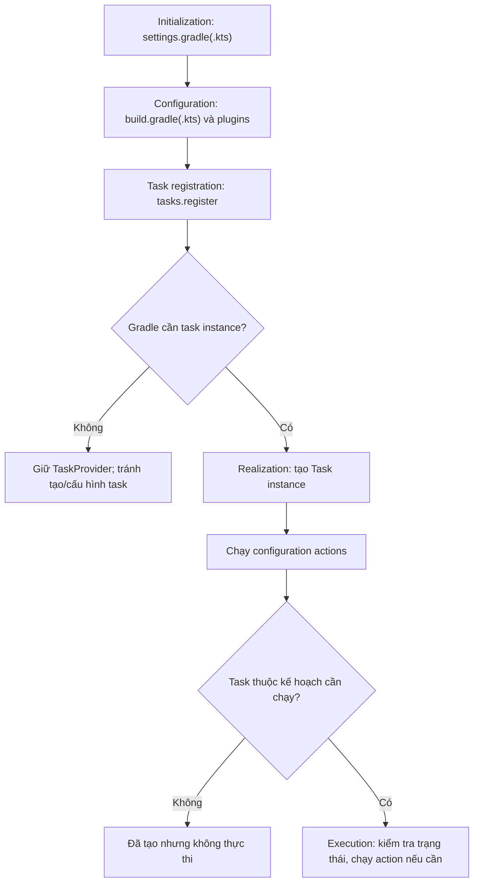

# TaskProvider và sự khác biệt giữa đăng ký, cấu hình, khởi tạo task trong Gradle

Khi một dự án Gradle có vài trăm task (ví dụ Java, Kotlin, Android, đa module), không phải task nào cũng cần được tạo đối tượng và cấu hình mỗi lần bạn chạy `./gradlew help` hay `./gradlew :app:test`. **Task Configuration Avoidance** cho phép Gradle trì hoãn phần lớn công việc ấy. API trung tâm là **`TaskProvider<T>`**, thường nhận từ `tasks.register(...)` hoặc `tasks.named(...)`.

Bốn khái niệm cần phân biệt ngay từ đầu:

1. **Đăng ký (registration):** cho Gradle biết một task có tên, kiểu và hành động cấu hình dự kiến; *chưa nhất thiết tạo đối tượng Task*.
2. **Cấu hình (configuration):** đặt thuộc tính, input/output, quan hệ phụ thuộc và action cho task. Với API lazy, hành động cấu hình được **khai báo trước**, có thể **chạy sau**.
3. **Khởi tạo/hiện thực hóa (realization):** Gradle thực sự **tạo đối tượng Task** đã đăng ký và áp dụng các hành động cấu hình liên quan. Trong tài liệu Gradle, từ chính xác thường là *realization*. Nó không phải giai đoạn *initialization* của toàn build.
4. **Thực thi (execution):** Gradle đưa task vào kế hoạch cần chạy và, khi phù hợp, chạy các action của task (ví dụ `doLast`, `@TaskAction`). Một task đã được hiện thực hóa **không có nghĩa** task ấy sẽ thực thi.

Nếu chỉ ghi nhớ một ý: **`tasks.register` không giống `tasks.create`, và `TaskProvider.get()` không giống `TaskProvider.configure(...)`.** Khác biệt đó ảnh hưởng tốc độ cấu hình, thứ tự chạy logic build và tính đúng đắn của đồ thị task.

Bài tập trung vào Gradle 8.5+ với Java 17, Groovy DSL (`build.gradle`) và Kotlin DSL (`build.gradle.kts`). Các ví dụ được trình bày độc lập; không cần đọc bài khác để hiểu hoặc chạy thử.

## 1. Một task có thể ở những trạng thái nào?

Hãy tưởng tượng bạn đăng ký task `packageDocs` nhưng lần này chỉ chạy `./gradlew help`:

```text
Build script được đánh giá
    │
    ├─ tasks.register("packageDocs") ──► Gradle biết tên/task type
    │                                  và giữ lại cấu hình đã khai báo
    │
    ├─ Không ai cần Task instance  ───► Chưa realization
    │                                  Chưa chạy configuration action
    │                                  Chưa chạy task action
    │
    └─ help hoàn tất ─────────────────► packageDocs không cần được tạo
```

Trong một lần chạy khác, bạn gọi `./gradlew packageDocs`:

```text
tasks.register("packageDocs")
       │  Trả về TaskProvider
       ▼
Gradle nhận yêu cầu :packageDocs
       │  Cần đối tượng task để xác định kế hoạch
       ▼
Realization: tạo Task instance
       │
       ▼
Chạy các configuration action của task
       │  Đặt group, description, dependsOn,
       │  doLast, inputs, outputs, ...
       ▼
Xác định task graph và kiểm tra điều kiện
       │
       ▼
Execution: chạy action nếu cần
```

Đây là **sơ đồ khái niệm**, không phải log từng thao tác nội bộ. Gradle có nhiều bước tối ưu/caching và plugin có thể làm phát sinh realization trước khi task được yêu cầu. Điểm cốt lõi: **đăng ký ≠ tạo task ≠ chạy task**.

### Bảng so sánh nhanh

| Thao tác | Task được biết đến? | Task instance phải có ngay? | Configuration action chạy ngay? | Task action chạy? |
| --- | --- | --- | --- | --- |
| `tasks.register('x')` | Có | **Không**, nếu không có tác nhân khác cần task | Chưa cần | Không |
| `tasks.register('x') { ... }` | Có | Không bắt buộc | Thường hoãn tới realization | Không |
| `tasks.named('x')` | Có, với task đã được đăng ký/tồn tại | Không bắt buộc | Không chỉ vì lấy provider | Không |
| `tasks.named('x') { ... }` hoặc `provider.configure { ... }` | Có | Không bắt buộc | Đăng ký action; chạy khi task được realization, hoặc ngay nếu task đã được realization | Không |
| `provider.get()` | Có | **Có** | Chạy các configuration action cần thiết | Không chỉ vì gọi `get()` |
| `tasks.getByName('x')` | Có | **Có** | Cấu hình ngay theo cách eager | Không chỉ vì lấy task |
| `tasks.create('x')` | Có | **Có** | Tạo/cấu hình theo API eager | Không chỉ vì create |
| `./gradlew x` | Có | Có khi lập kế hoạch/thực thi | Có | Có thể chạy; còn xét `UP-TO-DATE`, `NO-SOURCE`, `SKIPPED`, cache... |

**Lưu ý về từ “cấu hình”:** Câu `tasks.register('x') { group = 'demo' }` *khai báo* một closure cấu hình lúc script được đọc. Phần `group = 'demo'` **không nhất thiết chạy lúc khai báo**. Nó chạy khi Gradle thực sự cấu hình task instance, tức khi realization hoặc khi đối tượng đã tồn tại.

## 2. `TaskProvider<T>` thực chất là gì?

`TaskProvider<T extends Task>` là **tay nắm tham chiếu lazy** tới một task có tên, chứ không phải một `Task` đã sẵn sàng để bạn thao tác trực tiếp. Nó mở rộng các API provider/đối tượng có tên của Gradle, cung cấp:

- **`getName()`**: lấy tên task được tham chiếu mà không cần lấy Task instance.
- **`configure(Action)`**: bổ sung logic cấu hình cho task; hỗ trợ trì hoãn cho tới khi task cần được tạo.
- **`get()`** (kế thừa Provider API): lấy Task instance; **buộc realization** nếu task vẫn đang ở trạng thái chỉ đăng ký.

Trong Groovy DSL:

```groovy
def reportProvider = tasks.register('report') {
    group = 'documentation'
    description = 'Print a report message'
    doLast {
        println 'Report generated'
    }
}

// Đây là tên, không phải Task instance.
println reportProvider.name

// Chỉ lên lịch bổ sung cấu hình khi cần.
reportProvider.configure {
    description = 'Print a sample report'
}

// Không gọi reportProvider.get() nếu không thật sự cần đối tượng Task.
```

`reportProvider` chứa **provider**, nên `println reportProvider.name` có thể dùng để biết tên mà không buộc khởi tạo task. `reportProvider.get().description` cũng lấy được mô tả nhưng sẽ yêu cầu Gradle hiện thực hóa task; đó là cái giá cần cân nhắc.

Giá trị quan trọng nhất của `TaskProvider` là có thể **truyền nó vào các API khác** như `dependsOn`, `finalizedBy`, `builtBy` mà không cần `get()`. Gradle sẽ hiểu quan hệ task và tự hiện thực hóa những task cần thiết khi xây dựng task graph.

### TaskProvider không phải “một task vừa được tạo nhưng chưa chạy”

Nhầm lẫn phổ biến là nghĩ `register` đã `new Task()`, còn `get()` chỉ trả về một con trỏ. Với configuration avoidance, **Task instance có thể chưa tồn tại** cho đến lúc realization. Vì vậy không thể lấy các thuộc tính mà chỉ Task instance có rồi mong vẫn giữ lazy hoàn toàn.

Đừng đồng nhất `TaskProvider<Copy>` với `Provider<RegularFile>` hay `Property<String>`. Cùng chia sẻ mô hình provider/lazy của Gradle, nhưng:

- `TaskProvider<Copy>` đại diện cho **đối tượng task**.
- `Provider<RegularFile>` đại diện cho **giá trị file được tính lazy**.
- `Property<String>` chứa **giá trị cấu hình có thể được nối với provider khác**.

Khi thiết kế task mới, nên dùng cả hai đúng vai trò: `TaskProvider` để đăng ký/nối task; `Property`/`Provider` để mô hình hóa **đầu vào, đầu ra** và luồng dữ liệu lazy.

## 3. Ba API cốt lõi: `register`, `named`, `configure`

### 3.1. `register`: đăng ký task mới một cách lazy

Groovy DSL:

```groovy
def verifyDocs = tasks.register('verifyDocs') {
    group = 'verification'
    description = 'Check documentation'
    doLast {
        println 'Docs OK'
    }
}
```

Kotlin DSL:

```kotlin
val verifyDocs = tasks.register("verifyDocs") {
    group = "verification"
    description = "Check documentation"
    doLast {
        println("Docs OK")
    }
}
```

Cả hai phiên bản tạo **`TaskProvider`** cho task mới. Logic `doLast` là task action, vì vậy chỉ in `Docs OK` khi task thực sự được chạy. Nếu chạy một task khác không cần `verifyDocs`, Gradle có thể tránh toàn bộ việc khởi tạo/cấu hình `verifyDocs`.

### 3.2. `named`: lấy provider cho task đã được đăng ký

Ví dụ sau **chỉ là mảnh cấu hình**, giả sử task `verifyDocs` đã được đăng ký trong cùng project:

```groovy
tasks.named('verifyDocs') {
    description = 'Check docs before packaging'
}
```

```kotlin
tasks.named("verifyDocs") {
    description = "Check docs before packaging"
}
```

`named` không tạo task mới. Nếu không có task mang tên đó trong `TaskContainer` phù hợp, Gradle có thể báo `UnknownTaskException` hoặc lỗi tương ứng. Với task do plugin cung cấp, phải bảo đảm plugin đã được áp dụng trước khi `named` truy cập.

Cần phân biệt:

- `tasks.register('x')`: khai báo **một task mới**; đăng ký hai lần cùng tên không phải cách cộng thêm cấu hình.
- `tasks.named('x')`: lấy provider của **task đã đăng ký** để thêm cấu hình.
- `tasks.getByName('x')`: lấy **Task instance** và có thể gây realization ngay.

### 3.3. `provider.configure`: thêm configuration action, không cần `get`

```groovy
def verifyDocs = tasks.register('verifyDocs')

verifyDocs.configure {
    group = 'verification'
    description = 'Check documentation'
    doLast {
        println 'Docs OK'
    }
}
```

Hai phần `register` và `configure` có thể viết trong một block, hoặc tách ra để plugin/build logic khác đóng góp cấu hình. **Không bắt buộc có một task chạy ở giữa** thì action `configure` mới được đăng ký; nó là một lời hứa cấu hình cho lúc task được hiện thực hóa.

Nếu task **đã** được realization trước thời điểm gọi `configure`, hành động cấu hình mới có thể chạy **ngay**. Vì vậy `configure` có mục đích lazy nhưng không phải lệnh tuyệt đối “không bao giờ chạy trong configuration phase”.

## 4. Khởi tạo/realization khác giai đoạn initialization và khác execution

Gradle thường mô tả vòng đời build gồm:

1. **Initialization:** tìm settings, xác định root và các subproject của build.
2. **Configuration:** đánh giá build scripts/plugins, đăng ký tasks, thực hiện các configuration action cần thiết và lập task graph.
3. **Execution:** xử lý các task đã được chọn và chạy những action phù hợp.

**Task realization** là việc tạo/cấu hình **một đối tượng Task** trong quá trình quản lý mô hình task. Nó **không phải** tên khác của giai đoạn **Initialization** của toàn build.



Realization có thể xảy ra do:

- Người dùng yêu cầu task hoặc một task có **quan hệ phụ thuộc mạnh** đến nó.
- Lời gọi `TaskProvider.get()`, `tasks.getByName(...)`, `tasks.create(...)` hoặc API eager.
- Plugin hay script liệt kê/cấu hình tất cả task bằng cách eager.
- Một API khác cần truy cập Task instance để thiết lập mô hình.

**Realization không bảo đảm action sẽ chạy.** Một task có thể bị realization để xác định quan hệ phụ thuộc, nhưng không nằm trong tập task thực thi cuối cùng; hoặc task nằm trong kế hoạch nhưng được đánh dấu `UP-TO-DATE`, `NO-SOURCE` hoặc `SKIPPED`.

Ngược lại, một task được đăng ký nhưng chưa realization không thể thực hiện action, vì chưa có đối tượng để Gradle điều phối công việc của nó.

## 5. Ví dụ runnable: thấy rõ registration, configuration và execution

Tạo project một module:

```text
task-provider-lab/
├── settings.gradle
├── build.gradle
├── gradlew
├── gradlew.bat
└── gradle/
    └── wrapper/
        ├── gradle-wrapper.jar
        └── gradle-wrapper.properties
```

Các file Wrapper có thể tạo một lần bằng Gradle cài sẵn và phiên bản tương thích, ví dụ `gradle wrapper --gradle-version 8.5`. Sau đó dùng `./gradlew` trên Linux/macOS hoặc `gradlew.bat` trên Windows. Ví dụ này chỉ dùng task tích hợp nên không cần plugin/thư viện ngoài hoặc JDK compiler, nhưng vẫn cần JVM mà Gradle phiên bản đang dùng hỗ trợ.

**`settings.gradle`:**

```groovy
rootProject.name = 'task-provider-lab'
```

**`build.gradle` (toàn bộ, Groovy DSL):**

```groovy
def prepareProvider = tasks.register('prepare') {
    group = 'learning'
    description = 'Prepare input for review'

    doLast {
        println 'ACTION prepare'
    }
}

def reviewProvider = tasks.register('review') {
    group = 'learning'
    description = 'Review the prepared input'

    dependsOn(prepareProvider)

    doLast {
        println 'ACTION review'
    }
}

// Thêm cấu hình cho task đã đăng ký, không gọi get().
reviewProvider.configure {
    doFirst {
        println 'ACTION review preflight'
    }
}

tasks.register('unrelated') {
    group = 'learning'
    description = 'Task unrelated to review'

    doLast {
        println 'ACTION unrelated'
    }
}
```

Bản build đã có cả ba task `prepare`, `review`, `unrelated` ở **cấp đăng ký**, nhưng khi gọi `review`, task `unrelated` không cần được tạo và chạy. `review` dùng `dependsOn(prepareProvider)` trực tiếp; **không có `prepareProvider.get()`**.

### 5.1. Chạy `review`

```bash
./gradlew -q review
```

Stdout do các action của ví dụ in ra, theo đúng thứ tự:

```text
ACTION prepare
ACTION review preflight
ACTION review
```

Giải thích:

1. Gradle đăng ký ba task khi cấu hình build.
2. Yêu cầu `review` làm Gradle cần `review` và dependency mạnh `prepare`.
3. Gradle hiện thực hóa/cấu hình những task cần thiết. Configuration action thêm bằng `reviewProvider.configure` gắn một `doFirst` cho `review`.
4. `prepare` được thực hiện trước `review` vì `dependsOn`.
5. `doFirst` của `review` chạy trước `doLast` của chính task ấy.

Không có `ACTION unrelated` vì không task nào trong kế hoạch đòi nó.

### 5.2. Chạy `unrelated`

```bash
./gradlew -q unrelated
```

Stdout từ action:

```text
ACTION unrelated
```

Hai task còn lại đã được *đăng ký trong script* nhưng không thực thi. Trong build độc lập này và khi không có API/plugin eager khác, Gradle còn có thể tránh việc **realization** hai task ấy.

### 5.3. Xem task graph mà không chạy action

```bash
./gradlew review --dry-run
```

Các dòng task minh họa:

```text
> Task :prepare SKIPPED
> Task :review SKIPPED
```

`--dry-run` vẫn cần xác định kế hoạch nên có thể khiến task liên quan được realization/cấu hình; nó chỉ **không chạy action**. Vì vậy không thấy các dòng `ACTION ...` từ `doFirst`/`doLast`. **Đừng dùng `--dry-run` như phép đo chính xác “task nào đã được khởi tạo”.**

### 5.4. Thêm quan sát configuration action có kiểm soát

Nếu muốn quan sát thời điểm **configuration action** chạy trong ví dụ, bạn có thể thêm ngay đầu block `reviewProvider.configure`:

```groovy
reviewProvider.configure {
    println 'CONFIG review'
    doFirst {
        println 'ACTION review preflight'
    }
}
```

Đây là **mảnh thay thế** cho block `reviewProvider.configure` trong script gốc, không phải block thứ hai phải thêm chồng lên. `CONFIG review` sẽ xuất hiện khi Gradle **cấu hình Task instance** `review`, trước action `review preflight`/ `review` nếu task thực sự được thực thi. Với `./gradlew -q unrelated` trong project cô lập và không có eager lookup khác, `CONFIG review` thường **không xuất hiện**.

Lưu ý: dòng `CONFIG review` là side effect dùng để học, không nên giữ trong build thật. Cấu hình có thể được tái sử dụng qua configuration cache, nên **không nên suy ra hành vi tổng quát chỉ từ số lần `println` xuất hiện** khi cache hoạt động.

## 6. Cùng ví dụ đó với Kotlin DSL

Bạn có thể dùng lại tên build nhưng **thay thế** các file Groovy ở mục 5 bằng file `.kts` tương ứng. Đừng giữ `build.gradle` và `build.gradle.kts` cùng vai trò rồi kỳ vọng Gradle cộng dồn chúng.

**`settings.gradle.kts`:**

```kotlin
rootProject.name = "task-provider-lab"
```

**`build.gradle.kts`:**

```kotlin
val prepareProvider = tasks.register("prepare") {
    group = "learning"
    description = "Prepare input for review"

    doLast {
        println("ACTION prepare")
    }
}

val reviewProvider = tasks.register("review") {
    group = "learning"
    description = "Review the prepared input"

    dependsOn(prepareProvider)

    doLast {
        println("ACTION review")
    }
}

reviewProvider.configure {
    doFirst {
        println("ACTION review preflight")
    }
}

tasks.register("unrelated") {
    group = "learning"
    description = "Task unrelated to review"

    doLast {
        println("ACTION unrelated")
    }
}
```

Lệnh `./gradlew -q review` cho ba dòng `ACTION prepare`, `ACTION review preflight`, `ACTION review` như bản Groovy. **Khác biệt cú pháp** là `val`, chuỗi trong ngoặc và Kotlin lambda; **ngữ nghĩa TaskProvider, registration và realization không đổi**.

Trong Kotlin DSL có thể dùng typed registration, chẳng hạn `tasks.register<Copy>("copyFiles") { ... }`. Trong Groovy DSL, cú pháp gần tương ứng là `tasks.register('copyFiles', Copy) { ... }`. Những typed providers giúp cấu hình đúng API của task type, nhưng không khiến task phải được tạo ngay.

## 7. Typed TaskProvider và task do plugin cung cấp

Hầu hết Java plugin cung cấp sẵn task như `compileJava`, `classes`, `test`, `jar`. Bạn **không** đăng ký trùng tên để chỉnh chúng; thay vào đó lấy `TaskProvider` của task sẵn có rồi **configure**.

### 7.1. Ví dụ Groovy DSL với Java 17

Cấu trúc:

```text
java-provider-demo/
├── settings.gradle
├── build.gradle
└── src/main/java/demo/Hello.java
```

Giả định đã thêm Wrapper như ở mục 5 và cài JDK 17 hoặc có Java toolchain tương ứng.

**`settings.gradle`:**

```groovy
rootProject.name = 'java-provider-demo'
```

**`build.gradle`:**

```groovy
plugins {
    id 'java'
}

java {
    toolchain {
        languageVersion = JavaLanguageVersion.of(17)
    }
}

// compileJava đã được java plugin đăng ký.
// named trả về TaskProvider<JavaCompile>, không buộc lấy Task instance.
def compileProvider = tasks.named('compileJava', JavaCompile)

compileProvider.configure {
    options.encoding = 'UTF-8'
}

def classesProvider = tasks.named('classes')

tasks.register('verifyClasses') {
    group = 'verification'
    description = 'Make sure Java classes have been prepared'
    dependsOn(classesProvider)

    doLast {
        println 'Java classes are available'
    }
}
```

**`src/main/java/demo/Hello.java`:**

```java
package demo;

public final class Hello {
    private Hello() {
    }

    public static void main(String[] args) {
        System.out.println("Hello, Gradle!");
    }
}
```

Với Java plugin, `compileJava` là task kiểu `JavaCompile`; dòng `tasks.named('compileJava', JavaCompile)` lấy provider đã được biết đến, còn `compileProvider.configure` lên lịch đặt encoding cho compilation task. `classes` là lifecycle task phụ thuộc các bước tạo class cần thiết. `verifyClasses` dùng `dependsOn(classesProvider)` nên Gradle tự bảo đảm các class được chuẩn bị trước khi action của `verifyClasses` chạy.

Lệnh:

```bash
./gradlew -q verifyClasses
java -cp build/classes/java/main demo.Hello
```

Nếu môi trường build và toolchain đáp ứng, dòng do task `verifyClasses` in:

```text
Java classes are available
```

Dòng do chương trình Java in:

```text
Hello, Gradle!
```

Bạn cũng có thể kiểm tra độc lập bằng JDK 17, không qua Gradle:

```bash
mkdir -p manual-classes
javac -d manual-classes src/main/java/demo/Hello.java
java -cp manual-classes demo.Hello
```

Output của chương trình vẫn là `Hello, Gradle!`. Trên Windows, thay lệnh tạo thư mục và cách gọi Wrapper bằng cú pháp shell phù hợp. `verifyClasses` chỉ in thông báo; nó **không chứng minh bytecode chạy đúng ở mọi môi trường**, vì vậy ví dụ còn có lệnh `java` để thực thi lớp Java thực tế.

### 7.2. Tương đương Kotlin DSL

Đây là **file thay thế** `build.gradle.kts`, cùng Java source và settings script Kotlin tương ứng:

```kotlin
plugins {
    java
}

java {
    toolchain {
        languageVersion.set(JavaLanguageVersion.of(17))
    }
}

val compileProvider = tasks.named<JavaCompile>("compileJava")

compileProvider.configure {
    options.encoding = "UTF-8"
}

val classesProvider = tasks.named("classes")

tasks.register("verifyClasses") {
    group = "verification"
    description = "Make sure Java classes have been prepared"
    dependsOn(classesProvider)

    doLast {
        println("Java classes are available")
    }
}
```

Đổi `settings.gradle` thành `settings.gradle.kts` với `rootProject.name = "java-provider-demo"`. Lệnh và kết quả chức năng không đổi. Typed provider khác cú pháp, không khác nguyên tắc lazy.

**Chú ý:** nếu bỏ `plugins { id 'java' }` (hoặc `plugins { java }` ở Kotlin), `compileJava` và `classes` có thể không tồn tại; `tasks.named('compileJava')` sẽ lỗi vì nó không tự tạo task mới.

## 8. Tại sao `get()` dễ phá configuration avoidance?

So sánh hai cách kết nối task:

**Không nên làm chỉ để khai báo dependency:**

```groovy
def prepareProvider = tasks.register('prepare') {
    doLast {
        println 'prepare'
    }
}

tasks.register('review') {
    dependsOn(prepareProvider.get())
}
```

`prepareProvider.get()` yêu cầu Task instance **ngay khi biểu thức ấy được đánh giá**. Trong ví dụ, nó nằm trong configuration action của `review`; khi `review` được cấu hình, `prepare` có thể bị hiện thực hóa sớm hơn mức cần thiết. Ở những ngữ cảnh khác, nếu `get()` nằm ngay top level script, nó có thể làm `prepare` realization trong giai đoạn cấu hình kể cả khi người dùng không yêu cầu task nào liên quan.

**Nên làm:**

```groovy
def prepareProvider = tasks.register('prepare') {
    doLast {
        println 'prepare'
    }
}

tasks.register('review') {
    dependsOn(prepareProvider)
}
```

Ở bản này, `dependsOn` nhận **provider** và Gradle tự hiện thực hóa dependency khi xây task graph. Bạn không cần chạm đối tượng `Task` chỉ để nói “review cần prepare”.

### Khi nào được dùng `get()`?

Không phải tuyệt đối cấm. Nếu thật sự cần **Task instance** để tương tác với một API không chấp nhận Provider, `get()` là cách hợp lệ. Nhưng trước khi dùng:

1. Kiểm tra API có hỗ trợ `TaskProvider`, `Provider` hay task dependency notation hay không.
2. Xem có thể cấu hình task thông qua `provider.configure { ... }` không.
3. Kiểm tra `get()` có đang xuất hiện ngay trong phần top level của build script, trong cấu hình task khác hoặc trong một vòng lặp lớn không.
4. Nếu chỉ cần tên, dùng `provider.name` / `getName()` thay vì `provider.get().name`.

**Mẹo phân biệt:** `TaskProvider.get()` được thiết kế để lấy **Task instance**; `Property<T>.get()` lấy **giá trị input**. Cả hai đều có thể đẩy việc lazy sang eager, nhưng đối tượng được lấy là khác nhau. Đừng dùng `get()` trên các provider đầu vào trong configuration phase chỉ để nối chuỗi rồi gán vào task, khi API cho phép dùng `map`, `flatMap` hoặc `set(provider)`.

## 9. Eager API và lazy API: chọn đúng cặp thay thế

| Mục đích | API eager nên hạn chế | API lazy nên ưu tiên |
| --- | --- | --- |
| Tạo task mới | `tasks.create('x')`, cách viết Groovy `task x { ... }` | `tasks.register('x') { ... }` |
| Tìm task đã có | `tasks.getByName('x')`, `tasks.findByName('x')` khi phải nhận instance | `tasks.named('x')` |
| Cấu hình toàn bộ task | `tasks.all { ... }` | `tasks.configureEach { ... }` |
| Cấu hình một loại task | `tasks.withType(Test) { ... }` (Groovy closure eager) | `tasks.withType(Test).configureEach { ... }` |
| Cấu hình một task theo tên | Cú pháp Groovy `someTask { ... }` có thể ép realization | `tasks.named('someTask') { ... }` hoặc `provider.configure { ... }` |
| Sử dụng task như dependency | `dependsOn(provider.get())` | `dependsOn(provider)` |
| Duyệt task để tìm tên | `tasks.each { ... }`, `tasks.matching { ... }` có thể làm nhiều task realization | `tasks.named('exactName')` khi đã biết tên; dùng API lọc lazy phù hợp |

**Quan trọng:** `withType(Test)` riêng lẻ có thể tạo view mà không hiện thực hóa ngay mọi task; **gắn closure trực tiếp** như `tasks.withType(Test) { ... }` mới là trường hợp eager trong hướng dẫn. `withType(Test).configureEach { ... }` giữ hành động cấu hình lazy.

Một ví dụ thực tế với Java plugin:

```groovy
plugins {
    id 'java'
}

tasks.withType(Test).configureEach {
    useJUnitPlatform()
}
```

Đây là **mảnh cấu hình**. Nó không tự thêm JUnit dependency và không tự tạo test class; bạn phải khai báo test engine/dependency phù hợp khi muốn test thật. Nhưng nó đặt chính sách cấu hình cho **những task kiểu Test khi chúng được realization**, kể cả task Test được đăng ký sau.

Đối với Kotlin DSL:

```kotlin
tasks.withType<Test>().configureEach {
    useJUnitPlatform()
}
```

Chỉ cần quan tâm đến task kiểu `Test` đã hoặc sẽ được đưa vào mô hình, thay vì cấu hình tất cả các task ngay khi script được đọc.

## 10. Tránh cấu hình task khác từ trong action cấu hình của task hiện tại

Một anti-pattern rất dễ gặp:

```groovy
def checkProvider = tasks.register('checkDocs')
def verifyProvider = tasks.register('verifyDocs') {
    // Không nên sửa checkDocs tại đây:
    checkProvider.get().dependsOn(this)
}
```

Đây là **đoạn minh họa sai**, không phải code nên chạy. Tại thời điểm Gradle cấu hình `checkDocs`, `verifyDocs` có thể **chưa được realization**, nên đoạn cấu hình `dependsOn` đặt trong `verifyDocs` chưa chạy. Kết quả là task `checkDocs` có thể không phụ thuộc vào `verifyDocs` như tác giả mong muốn. Gọi `get()` còn phá tính lazy của `checkDocs`.

Hãy cấu hình **mỗi task trong action cấu hình của chính nó**:

```groovy
def checkProvider = tasks.register('checkDocs')
def verifyProvider = tasks.register('verifyDocs') {
    doLast {
        println 'Verified docs'
    }
}

checkProvider.configure {
    dependsOn(verifyProvider)
}
```

Giờ `checkDocs` luôn có quan hệ `dependsOn` với provider `verifyDocs` khi được cấu hình. Việc `verifyDocs` chưa có Task instance ở thời điểm script chạy **không làm mất** dependency.

Hướng dẫn Gradle nhấn mạnh: **chỉ sửa task hiện tại trong configuration action của task đó**. Việc phụ thuộc vào side effect lên task khác là lỗi tiềm ẩn khi Gradle tự tối ưu thứ tự realization, và có thể bị các phiên bản Gradle mới siết chặt.

## 11. Task graph: dependency mạnh khác ràng buộc thứ tự

Khi dùng `TaskProvider` để kết nối task, bạn cần biết API có **buộc task khác chạy** hay chỉ **sắp xếp thứ tự nếu cả hai đã được chọn**.

| Quan hệ | Ý nghĩa | Có thể khiến task được chọn/realization cùng task hiện tại? |
| --- | --- | --- |
| `dependsOn(provider)` | Task hiện tại **phụ thuộc** task được tham chiếu | **Có**, quan hệ mạnh |
| `finalizedBy(provider)` | Chỉ định task kết thúc/finalizer cho task hiện tại | **Có** khi task được thực thi phù hợp, quan hệ mạnh |
| `mustRunAfter(provider)` | Nếu cả hai được chọn thì task hiện tại phải chạy sau task kia | **Không** chỉ vì quan hệ thứ tự |
| `shouldRunAfter(provider)` | Ưu tiên thứ tự nếu cả hai được chọn; có thể bị bỏ qua trong các tình huống cần thiết | **Không** chỉ vì quan hệ thứ tự |

Ví dụ **không tạo dependency tự động**:

```groovy
def lint = tasks.register('lintDocs') {
    doLast { println 'LINT' }
}

tasks.register('packageDocs') {
    mustRunAfter(lint)
    doLast { println 'PACKAGE' }
}
```

Chỉ chạy `./gradlew -q packageDocs` thì output action là `PACKAGE`, **không tự chạy `lintDocs`**. Nếu chạy `./gradlew -q lintDocs packageDocs`, Gradle sẽ bảo đảm `lintDocs` xảy ra trước `packageDocs` do `mustRunAfter`.

Nếu yêu cầu nghiệp vụ là “không được đóng gói trước khi lint”, dùng:

```groovy
tasks.register('packageDocs') {
    dependsOn(lint)
    doLast { println 'PACKAGE' }
}
```

Với phiên bản thứ hai, chỉ cần chạy `packageDocs` cũng làm `lintDocs` được đưa vào kế hoạch. **Không dùng `mustRunAfter` như vật thay cho `dependsOn`.**

`finalizedBy` có thể dùng cho cleanup hoặc tổng kết sau task, nhưng phải cân nhắc riêng semantics khi task bị bỏ qua/thất bại; không giả định nó tương đương `dependsOn` đảo ngược.

## 12. Khởi tạo task chưa chắc xảy ra cùng một thứ tự

Một vấn đề thực tế của configuration avoidance là thứ tự realization **không phải hợp đồng để đặt logic nghiệp vụ**.

Ví dụ:

```groovy
def alpha = tasks.register('alpha') {
    println 'CONFIG alpha'
    doLast { println 'ACTION alpha' }
}

tasks.register('beta') {
    dependsOn(alpha)
    println 'CONFIG beta'
    doLast { println 'ACTION beta' }
}
```

Nếu chạy `./gradlew -q beta`, điều **được bảo đảm theo quan hệ phụ thuộc** là `ACTION alpha` xảy ra trước `ACTION beta`. Hai dòng `CONFIG alpha` và `CONFIG beta` xảy ra ở thời điểm task được cấu hình; **không nên thiết kế logic dựa vào thứ tự của chúng** hay dựa vào việc luôn được thực thi mỗi lần build có configuration cache.

Nếu cần xây dữ liệu để task `beta` sử dụng, đặt dữ liệu đó trong thuộc tính đầu vào của task hoặc trong **output** của task `alpha`, nối bằng Provider/dependency thích hợp. Đừng đặt một biến mutable toàn script được thay đổi từ configuration action của `alpha` rồi yêu cầu configuration action của `beta` phải đọc được giá trị vừa đổi.

Một nguyên tắc rất hữu ích: **configuration action đặt kế hoạch; task action làm công việc.** Không upload artifact, xóa file hoặc thực thi command bên trong block cấu hình chỉ để “làm trước”; hãy đặt công việc ấy trong task action thích hợp, khai báo inputs/outputs nếu cần.

## 13. TaskProvider không thay thế input/output tracking

Configuration avoidance **khác** với:

- **Incremental build / up-to-date checks:** xem input/output có thay đổi để quyết định task action cần chạy lại không.
- **Build cache:** có thể tái sử dụng output task đã tạo trước đó, khi task và cache policy cho phép.
- **Configuration cache:** có thể tái sử dụng trạng thái cấu hình giữa các invocation phù hợp.
- **Parallel execution:** chạy các task độc lập đồng thời khi điều kiện và cấu hình cho phép.

`tasks.register` giúp Gradle **tránh tạo/cấu hình task không dùng tới**; nó không tự khiến một task có output được cache hay incremental. Để task do bạn viết hoạt động đúng, bạn còn cần khai báo các thuộc tính `@Input`, `@OutputFile`, `@InputFiles`... hoặc API tương đương nếu task tạo/đọc dữ liệu.

Ví dụ một task kiểu `Copy` đã có cơ chế input/output của task type; bạn chỉ cần cấu hình nguồn/đích phù hợp:

```groovy
def copyDocs = tasks.register('copyDocs', Copy) {
    from(layout.projectDirectory.dir('docs'))
    into(layout.buildDirectory.dir('copied-docs'))
}
```

Đây là **mảnh build script**: nếu thư mục `docs/` không có file, task có thể báo `NO-SOURCE` hoặc không tạo file nào. Tập trung ở đây là `register` trả `TaskProvider<Copy>` và các đường dẫn được cung cấp cho task; không nên dùng `copyDocs.get()` chỉ để đặt `from`/`into`.

Khi cần task tiêu thụ một file do task khác sinh, tốt nhất nối **Provider của output** (ví dụ `Provider<RegularFile>`) thay vì tự ghép đường dẫn chuỗi và tạo `dependsOn` thủ công không cần thiết. Gradle có thể suy ra task dependency từ Provider mang nguồn gốc task, tùy API/task property liên quan.

## 14. Các lỗi thường gặp và cách sửa

| Hiện tượng | Nguyên nhân điển hình | Cách xử lý |
| --- | --- | --- |
| `./gradlew help` chậm vì cấu hình nhiều task | Dùng `tasks.create`, `tasks.all`, duyệt toàn bộ task hoặc `getByName` | Chuyển dần sang `register`, `named`, `configureEach`; đo lại. |
| `UnknownTaskException` khi gọi `tasks.named('x')` | Task chưa được đăng ký hoặc plugin chưa áp dụng | Áp dụng đúng plugin trước hoặc dùng `register` khi bạn sở hữu task mới. |
| Trùng tên task | Gọi `register('x')` nhiều lần | Đăng ký một lần, các nơi sau dùng `named('x')`/provider `configure`. |
| Tưởng `tasks.register` chạy logic bên trong `doLast` | Lẫn registration và execution | Yêu cầu task qua Wrapper hoặc nối dependency; đừng kỳ vọng side effect lúc đăng ký. |
| Task bị realization sớm không mong muốn | Có `provider.get()`, `getByName` hoặc API eager | Truyền `TaskProvider` trực tiếp và cấu hình qua `configure`. |
| Đặt `dependsOn` cho task khác trong configuration action | Side effect chỉ xảy ra nếu task hiện tại được realization | Đặt `dependsOn` trong action cấu hình của **task tiêu thụ**. |
| `mustRunAfter` không làm task trước xuất hiện | Ràng buộc thứ tự không phải dependency | Dùng `dependsOn` nếu task kia bắt buộc chạy. |
| Task được realization nhưng không thấy `ACTION ...` | Chưa được chọn/thực thi, hoặc action bị bỏ qua vì trạng thái | Kiểm tra task graph, `--dry-run`, output `UP-TO-DATE`/`SKIPPED`, điều kiện `onlyIf`. |
| Lệnh `--dry-run` không chạy Java/test | Dry-run vô hiệu hóa task action | Chạy thật khi cần kiểm chứng code/test; dry-run chỉ kiểm tra kế hoạch. |
| Lỗi Kotlin `Unresolved reference` khi cấu hình task Java | Plugin/typed accessor không có hoặc dùng sai DSL | Áp dụng plugin đúng; dùng `tasks.named<JavaCompile>("compileJava")` và API Kotlin tương ứng. |
| Thứ tự log `CONFIG` không ổn định | Configuration action chạy lazy, cache/plugin ảnh hưởng realization | Không xây logic dựa vào số lần/thứ tự cấu hình; mô hình hóa input/output rõ. |

### Một số anti-pattern cần tránh

**Anti-pattern A — ép tạo task khi chỉ cần cấu hình:**

```groovy
tasks.getByName('test').maxHeapSize = '1g'
```

Nếu task `test` tồn tại, cách này có thể gây realization sớm. Cách tốt hơn:

```groovy
tasks.named('test', Test) {
    maxHeapSize = '1g'
}
```

**Anti-pattern B — cấu hình mọi task Test kiểu eager:**

```groovy
tasks.withType(Test) {
    maxHeapSize = '1g'
}
```

Dùng:

```groovy
tasks.withType(Test).configureEach {
    maxHeapSize = '1g'
}
```

**Anti-pattern C — nhầm `TaskProvider` với Task object:**

```groovy
def p = tasks.register('report')
p.get().description = 'A report'
```

Dùng:

```groovy
def p = tasks.register('report')
p.configure {
    description = 'A report'
}
```

Cả hai cách có thể đạt kết quả cấu hình giống nhau, nhưng cách thứ hai **không buộc realization chỉ để gán description**.

## 15. Lộ trình chuyển đổi dự án dùng API eager

Trong dự án cũ có nhiều `task foo { ... }`, `tasks.create` và `tasks.all`, không nhất thiết sửa tất cả trong một lần lớn. Một kế hoạch an toàn:

1. **Đo hiện trạng:** chạy một lệnh nhẹ như `./gradlew help` và ghi nhận thời gian cấu hình/báo cáo profiling phù hợp. Không tối ưu dựa vào cảm giác.
2. **Sửa vòng lặp eager:** thay `tasks.all { ... }` bằng `tasks.configureEach { ... }`; thay `tasks.withType(Test) { ... }` bằng `tasks.withType(Test).configureEach { ... }`.
3. **Sửa lookup eager:** thay `getByName` hoặc cú pháp task block kiểu Groovy bằng `tasks.named` để cấu hình task hiện có.
4. **Sửa tạo task eager:** thay `tasks.create`/`task x` bằng `tasks.register`.
5. **Sửa cách nối task:** truyền provider thẳng cho `dependsOn`/`builtBy` hoặc dùng API output provider; bỏ `get()` không cần thiết.
6. **Loại side effect trong configuration action:** chỉ sửa đối tượng task hiện tại; chuyển công việc tạo/xóa/tải file vào task action đúng chỗ.
7. **Kiểm thử hành vi:** so sánh `--dry-run` của các lệnh chính, chạy build/test thật, và bảo đảm đồ thị quan hệ không bị thiếu task.
8. **Đo lại:** nhất là với lệnh không cần hầu hết task (`help`, `properties` hoặc một task đơn giản). Mức cải thiện tùy plugin, kích thước build và cache.

Khi có thể, viết kiểm thử cho build logic/plugin bằng **Gradle TestKit**. Đây là cách bắt lỗi wiring task tốt hơn so với chỉ kiểm tra xem script không báo lỗi cú pháp.

### Cách quan sát task bị realization

Tài liệu Gradle mô tả phân tích bằng **Build Scan** và mục hiệu năng cấu hình để xem task nào:

- Được tạo ngay vì API eager.
- Bị realization trong configuration phase do `get()` hoặc lookup eager.
- Được tạo trong lúc tính task graph vì thực sự cần.
- Không phải tạo trong lần build đó.

Bạn có thể bắt đầu bằng `./gradlew help --scan` trong môi trường cho phép Build Scan, nhưng hãy cân nhắc chính sách chia sẻ thông tin build trước khi xuất báo cáo lên dịch vụ bên ngoài. Không dùng `println` trong hàng trăm action cấu hình như một cơ chế đo đạc production; điều đó vừa gây nhiễu vừa ảnh hưởng hiệu năng.

## 16. Câu hỏi ôn tập và đáp án

**1.** `def p = tasks.register('foo')` đã tạo đối tượng `Task` chưa?

**Đáp án:** Chưa bắt buộc. Gradle biết task và giữ `TaskProvider`; đối tượng Task có thể chỉ được tạo khi realization.

**2.** `p.configure { description = 'X' }` có ngay lập tức chạy `description = 'X'` không?

**Đáp án:** Thường đăng ký action để chạy khi task được realization; **nếu task đã realization**, action có thể chạy ngay. Vì vậy không coi configuration action là lời gọi task action.

**3.** `p.get()` có chạy `doLast` không?

**Đáp án:** Không. Nó buộc realization và cấu hình Task instance, không tự thực thi task action.

**4.** Khác nhau giữa `tasks.register('foo')` và `tasks.named('foo')`?

**Đáp án:** `register` tạo đăng ký mới, còn `named` trả provider của task đã được đăng ký/tồn tại. Không dùng `register` lần thứ hai để thêm cấu hình cùng tên.

**5.** Nếu task `B` phải chạy sau task `A` **và bắt buộc có `A`**, dùng `mustRunAfter` hay `dependsOn`?

**Đáp án:** `dependsOn`. `mustRunAfter` chỉ đặt thứ tự khi cả hai task đã được chọn.

**6.** Vì sao `dependsOn(p)` tốt hơn `dependsOn(p.get())`?

**Đáp án:** Gradle chấp nhận `TaskProvider` để mô tả dependency, nên không cần buộc realization chỉ để lấy Task instance.

**7.** Nếu Gradle cấu hình `alpha`, nó có chắc sẽ chạy `alpha` trong execution không?

**Đáp án:** Không. Task có thể được realization do API eager hoặc để xây graph nhưng không được thực thi; còn task trong graph có thể không chạy action do trạng thái.

**8.** `tasks.withType(Test) { ... }` có giống `tasks.withType(Test).configureEach { ... }` không?

**Đáp án:** Không trong khía cạnh configuration avoidance. Dạng gắn closure trực tiếp có thể eager; `configureEach` trì hoãn cấu hình cho task phù hợp khi cần.

**9.** `./gradlew review --dry-run` không in `ACTION review`. Có phải task `review` chưa được realization?

**Đáp án:** Không thể kết luận như thế. Dry-run có thể realization task để tính lịch nhưng vô hiệu hóa action, vì vậy không có dòng `ACTION`.

**10.** Đặt `checkProvider.get().dependsOn(verify)` bên trong configuration action của `verify` có an toàn không?

**Đáp án:** Không. Configuration action của `verify` có thể không chạy khi `check` được realization, làm mất dependency. Đặt `dependsOn(verifyProvider)` trong configuration action của chính `check`.

**11.** Task được đăng ký lazy nhưng mất nhiều thời gian chạy lại dù không đổi input. Có phải chỉ cần thay `get()` bằng `configure` là giải quyết được?

**Đáp án:** Chưa chắc. Configuration avoidance giảm chi phí **tạo/cấu hình task**; kiểm tra đầu vào/đầu ra, incremental build, caching và action của task là vấn đề khác.

**12.** Muốn cấu hình `compileJava` từ Java plugin mà không khởi tạo task sớm, dùng gì?

**Đáp án:** Sau khi áp dụng plugin, dùng `tasks.named('compileJava', JavaCompile) { ... }` trong Groovy hoặc `tasks.named<JavaCompile>("compileJava") { ... }` trong Kotlin. Đừng `register` lại `compileJava`.

## 17. Tra cứu tài liệu gốc

- [Gradle — Avoiding Unnecessary Task Configuration](https://docs.gradle.org/current/userguide/task_configuration_avoidance.html): hướng dẫn chính về configuration avoidance, so sánh lazy/eager API, `TaskProvider`, quan hệ task và anti-pattern sửa task khác.
- [Gradle — Creating and Registering Tasks](https://docs.gradle.org/current/userguide/writing_tasks.html): cách đăng ký/cấu hình task và ranh giới giữa configuration với execution.
- [Gradle — TaskProvider API](https://docs.gradle.org/current/javadoc/org/gradle/api/tasks/TaskProvider.html): chữ ký `configure(Action)`, `getName()` và các phương thức kế thừa.
- [Gradle — Understanding Tasks](https://docs.gradle.org/current/userguide/more_about_tasks.html): task type, task configuration và thực thi.
- [Gradle — Lazy vs. Eager Evaluation](https://docs.gradle.org/current/userguide/lazy_eager_evaluation.html): khi nào cần `configureEach` và những tác động tới build lớn.
- [Gradle — Best Practices for Tasks](https://docs.gradle.org/current/userguide/best_practices_tasks.html): tránh `get()` sớm, quản lý inputs/outputs và mối quan hệ provider.

**Tóm tắt bản chất:** **`register`** tạo đăng ký và trả về **`TaskProvider`**; **`configure`** khai báo cách cấu hình task khi cần; **realization** tạo Task instance và áp dụng cấu hình; **execution** thực hiện công việc nếu task được chọn và không bị bỏ qua. Sử dụng `named`, `configureEach` và quan hệ task thông qua provider giúp Gradle tránh khởi tạo những task không cần thiết, đồng thời giữ task graph rõ ràng, đúng và dễ mở rộng.