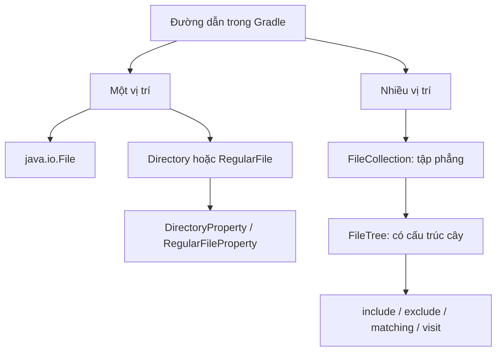

# File, Directory, FileCollection và FileTree trong Gradle

Khi cấu hình Gradle, bạn cần chỉ định **một file**, **một thư mục**, **tập nhiều đường dẫn** hoặc **cả cây file có cấu trúc thư mục**. Các dạng dữ liệu này không tương đương: dùng nhầm `files('src')` thay cho `fileTree('src')`, gọi `.files` quá sớm hoặc ghép đường dẫn bằng `new File('...')` có thể khiến task bỏ sót input, mất cấu trúc khi copy hoặc chạy không giống nhau trên máy cá nhân và CI.

Bài này giải thích và thực hành bốn đối tượng trọng tâm:

- **`File`** (`java.io.File`): biểu diễn một **đường dẫn** đơn lẻ, có thể là file hoặc thư mục; bản thân đối tượng không đảm bảo đường dẫn tồn tại.
- **`Directory`** (Gradle API): biểu diễn một vị trí **thư mục** trong mô hình filesystem của Gradle; cùng với `RegularFile`, `DirectoryProperty`, `RegularFileProperty` và `Provider` hỗ trợ cấu hình đường dẫn lazy, có kiểu.
- **`FileCollection`** (Gradle API): một **tập phẳng các đường dẫn file/thư mục**, không đòi hỏi chung thư mục cha; có thể là tập đầu vào hoặc output của task.
- **`FileTree`** (Gradle API): một dạng **`FileCollection` có biểu diễn cây thư mục**, phù hợp để quét một directory, lọc theo mẫu và giữ đường dẫn tương đối khi copy hoặc đóng gói.

Ngữ cảnh là **Build Tool Gradle → Tệp và tài nguyên**. Các ví dụ dùng Gradle Wrapper và Java 17, với một `build.gradle` Groovy DSL hoàn chỉnh; những tương đương Kotlin DSL được ghi rõ. Trọng tâm không chỉ là kiểu dữ liệu mà còn là **tính lazy, quan hệ giữa các task, input/output tracking và cách dùng an toàn**.

## 1. Sơ đồ tư duy: “một vị trí” khác “một tập tệp”



Sự khác biệt chính:

| Đối tượng | Biểu diễn | Có giữ cấu trúc thư mục khi dùng như cây nguồn? | Tạo thường gặp | Đặc điểm quan trọng |
| --- | --- | --- | --- | --- |
| `java.io.File` | Một đường dẫn file **hoặc** directory | Không phải cây dữ liệu Gradle | `file('docs/intro.md')` | API Java; không tự tạo task dependency hoặc theo dõi input/output. |
| `RegularFile` | Một vị trí **file thông thường** | Không | `layout.projectDirectory.file('docs/intro.md')` | Wrapper vị trí file của Gradle, có `asFile`. |
| `Directory` | Một vị trí **directory** | Có thể làm gốc cho các đường dẫn con; không tự quét toàn bộ | `layout.projectDirectory.dir('docs')` | Có `file(...)`, `dir(...)`, `asFile`. |
| `DirectoryProperty` | Thuộc tính lazy có giá trị `Directory` | Phụ thuộc cách task tiêu thụ | `layout.buildDirectory`, `objects.directoryProperty()` | Có thể gắn Provider để thay đổi theo cấu hình. |
| `RegularFileProperty` | Thuộc tính lazy có giá trị `RegularFile` | Không | `objects.fileProperty()` | Phù hợp `@InputFile` / `@OutputFile`. |
| `FileCollection` | Tập các đường dẫn, không có root chung bắt buộc | **Không mang cây tương đối chung** | `files('a.txt', 'b.txt')` | Có `files`, `asPath`, phép hợp/trừ, có thể lazy. |
| `FileTree` | FileCollection gắn với cây thư mục/tập các cây | **Có**, khi API tiêu thụ hỗ trợ | `fileTree('docs')`, `zipTree('x.zip')` | Có `include`, `exclude`, `matching`, `visit` và `relativePath`. |

**Lưu ý kiểu:** `FileTree` mở rộng `FileCollection` (*is-a*), nên có thể được dùng ở nhiều nơi nhận `FileCollection`. Chiều ngược lại không đúng: một `FileCollection` bất kỳ không tự nhiên có directory tree hay đường dẫn tương đối gắn với một root.

## 2. `File`: một đường dẫn Java, không phải nội dung file

Trong script Gradle viết bằng Groovy, bạn có thể dùng:

```groovy
File config = file('config/banner.txt')
println config.name
```

`Project.file(...)` trả về **`java.io.File`**, biểu diễn vị trí được yêu cầu. Nếu đường dẫn là tương đối, Gradle giải quyết nó **tương đối với project directory của project hiện tại**, không phải thư mục được người dùng tình cờ đứng ở khi gọi lệnh.

Ví dụ trong multi-project build:

```text
root/
├── settings.gradle
├── config/banner.txt
└── app/
    ├── build.gradle
    └── config/banner.txt
```

- Gọi `file('config/banner.txt')` bên trong root build script thường nhắm `root/config/banner.txt`.
- Gọi cùng biểu thức trong `:app/build.gradle` thường nhắm `root/app/config/banner.txt`.
- Muốn nhắm file ở root một cách rõ ràng từ module, dùng `rootProject.file('config/banner.txt')` hoặc `rootProject.layout.projectDirectory.file('config/banner.txt')`.

**Không nên dùng `new File('config/banner.txt')` một cách tùy tiện trong Gradle.** Constructor này hiểu đường dẫn tương đối dựa trên **current working directory của JVM**, và Gradle không cam kết CWD luôn trùng project directory. Với mã build dùng chung, `file(...)` hoặc `layout.projectDirectory.file(...)` đáng tin cậy hơn.

### `File` không tự đảm bảo đường dẫn đã tồn tại

```groovy
def report = file('build/reports/summary.txt')
println report.exists()
```

Dòng cuối sẽ trả `true` hoặc `false` tùy trạng thái filesystem tại thời điểm kiểm tra. Việc có một `File` không tự tạo file hoặc thư mục, không cam kết nó là file thường và không khiến Gradle tạo task để sinh nó.

Các method `File.exists()`, `isFile()`, `isDirectory()`, `mkdirs()` và Java NIO `Files.readString(...)` là thao tác trên filesystem. Nếu chúng làm công việc thực tế như tạo/xóa/copy dữ liệu, hãy thực hiện **trong task action** thích hợp, với input/output được khai báo rõ, thay vì âm thầm ghi file ngay khi script đang được cấu hình.

## 3. `Directory` và `RegularFile`: đường dẫn có kiểu của Gradle

Gradle cung cấp **`ProjectLayout`** qua `layout` để lấy các vị trí phù hợp với project:

```groovy
// build.gradle — các biểu thức minh họa
def projectRoot = layout.projectDirectory
def docsDir = layout.projectDirectory.dir('docs')
def bannerFile = layout.projectDirectory.file('config/banner.txt')
def reportsDir = layout.buildDirectory.dir('reports')
def reportFile = layout.buildDirectory.file('reports/summary.txt')
```

Đọc từng dòng:

- `layout.projectDirectory` là một **`Directory`** đại diện cho project directory.
- `.dir('docs')` trả về **`Directory`** cho thư mục con.
- `.file('config/banner.txt')` trả về **`RegularFile`**.
- `layout.buildDirectory` là **`DirectoryProperty`**. Bởi vậy `layout.buildDirectory.dir('reports')` trả về **`Provider<Directory>`**, không nhất thiết là `Directory` đã lấy ra.
- Tương tự, `layout.buildDirectory.file('reports/summary.txt')` trả về **`Provider<RegularFile>`**.

Điểm này dễ nhầm khi viết code: `Directory` biểu diễn **một vị trí đã xác định**, trong khi `DirectoryProperty` là **thuộc tính cấu hình lazy có thể mang vị trí đó**. Trong Groovy DSL, bạn có thể không ghi kiểu biến nên sự khác biệt bị che khuất; trong Kotlin DSL sự khác biệt dễ thấy hơn.

Ví dụ tương đương Kotlin DSL:

```kotlin
// build.gradle.kts — mảnh cấu hình minh họa
val projectRoot = layout.projectDirectory
val docsDir = layout.projectDirectory.dir("docs")
val bannerFile = layout.projectDirectory.file("config/banner.txt")
val reportsDir = layout.buildDirectory.dir("reports")
val reportFile = layout.buildDirectory.file("reports/summary.txt")
```

### Lấy đối tượng `java.io.File` từ vị trí Gradle

```groovy
def docsDir = layout.projectDirectory.dir('docs')
File javaDir = docsDir.asFile

def reportFile = layout.buildDirectory.file('reports/summary.txt')
// reportFile là Provider<RegularFile>.
// Chỉ khi thực sự cần lấy giá trị hiện tại:
File javaReport = reportFile.get().asFile
```

`asFile` trên `Directory` / `RegularFile` cho `java.io.File`. Nhưng **`.get()` trên provider có thể buộc giá trị được tính ngay**. Nếu API đích nhận `Provider` hoặc typed location, tốt hơn nên truyền provider trực tiếp để Gradle giữ khả năng lazy.

Đừng cố gọi `.asFile` trực tiếp lên một `Provider<RegularFile>` như thể nó là `RegularFile`. Và đừng gọi `.get()` sớm chỉ để nối đường dẫn.

### `Directory` có tạo thư mục không?

Không. `layout.buildDirectory.dir('generated')` mô tả nơi dự kiến có thư mục; **nó không tự chạy `mkdir`** chỉ vì bạn khai báo location. Các task Gradle có output directory được khai báo đúng thường được Gradle chuẩn bị đầu ra theo semantics của task; nếu viết `@TaskAction` tự tạo file, bạn vẫn nên bảo đảm parent directory tồn tại tại thời điểm ghi.

## 4. `DirectoryProperty` và `RegularFileProperty`: nơi đặt input/output lazy

Một custom task có thể khai báo:

```groovy
abstract class ProduceSummary extends DefaultTask {
    @InputFile
    abstract RegularFileProperty getSourceFile()

    @OutputFile
    abstract RegularFileProperty getSummaryFile()
}
```

Đây chỉ là **khung lớp**, chưa có `@TaskAction`; ví dụ chạy hoàn chỉnh xuất hiện ở mục 10.

Vì sao kiểu property được khuyến nghị?

- Gradle biết `sourceFile` là **một input file**, `summaryFile` là **một output file**.
- Người cấu hình task có thể `sourceFile.set(layout.projectDirectory.file(...))` và `summaryFile.set(layout.buildDirectory.file(...))` mà không phải tự tính đường dẫn tuyệt đối.
- Provider giúp nối giá trị từ một task sang task khác **khi cần**, hạn chế `get()` eager.
- Gradle có cơ sở để kiểm tra input, xác minh output, suy luận quan hệ task và hỗ trợ incremental/up-to-date checks theo điều kiện.

Bảng chú giải những thuộc tính thường dùng trong class task:

| Tình huống | Kiểu property thường dùng | Annotation phù hợp |
| --- | --- | --- |
| Một file bắt buộc đầu vào | `RegularFileProperty` | `@InputFile` |
| Một directory đầu vào | `DirectoryProperty` | `@InputDirectory` |
| Nhiều file đầu vào | `ConfigurableFileCollection` | `@InputFiles` |
| Một file đầu ra | `RegularFileProperty` | `@OutputFile` |
| Một directory đầu ra | `DirectoryProperty` | `@OutputDirectory` |

Đối với file input, cân nhắc thêm **`@PathSensitive(PathSensitivity.RELATIVE)`** hoặc cách normalizing thích hợp khi đường dẫn tương đối ảnh hưởng logic; đừng gắn nhãn một cách máy móc nếu ứng dụng thực sự phụ thuộc đường dẫn tuyệt đối. Với `@InputFiles`, có thể dùng `@SkipWhenEmpty` ở trường hợp input rỗng thì không cần làm việc.

**Không phải cứ dùng `FileCollection` thì Gradle tự biết đó là input.** Task phải **khai báo** `@InputFiles` hoặc `inputs.files(...)`; tương tự muốn output được quản lý phải dùng annotation/output API phù hợp.

## 5. `FileCollection`: tập phẳng nhiều đường dẫn

Một `FileCollection` là một tập các `java.io.File` với các khả năng hợp/trừ, lặp, lọc và nguồn được đánh giá lazy. Các phần tử có thể nằm rải rác, thậm chí ở nhiều thư mục khác nhau; **không yêu cầu tất cả cùng một root**.

Tạo một collection:

```groovy
def selectedFiles = files(
    'docs/intro.md',
    'docs/guide/advanced.md',
    layout.projectDirectory.file('config/banner.txt')
)
```

Có thể dùng `layout.files(...)` trong phiên bản Gradle hỗ trợ; `Project.files(...)` là cú pháp thông dụng, xử lý đường dẫn tương đối theo project directory. Hàm nhận nhiều dạng nguồn: chuỗi, `File`, `RegularFile`, danh sách, provider, task với output được định nghĩa, và các đối tượng mà API mô tả hỗ trợ.

Truy cập thường gặp:

```groovy
def docs = files('docs/intro.md', 'docs/guide/advanced.md')
Set<File> materialized = docs.files
String classpathLike = docs.asPath
File onlyFile = files('docs/intro.md').singleFile
```

- `.files`: lấy một tập `File` khi collection được giải quyết; hành động này có thể đánh giá nguồn lazy.
- `.asPath`: nối các đường dẫn bằng **dấu phân cách danh sách path của hệ điều hành** (thường `:` trên Unix, `;` trên Windows), phù hợp các API mong một path-list; không phải đường dẫn thư mục đơn.
- `.singleFile`: chỉ hợp lệ nếu collection có **đúng một phần tử**; có thể báo lỗi nếu rỗng hoặc nhiều file.
- Khi lặp collection, mỗi phần tử là `File`, không phải thông tin cây có `relativePath` nguyên thủy.

### `files('docs')` không đồng nghĩa `fileTree('docs')`

Đây là khác biệt quan trọng nhất:

```groovy
def oneDirectoryPath = files('docs')
def allMarkdown = fileTree('docs') {
    include '**/*.md'
}
```

Trong phép lặp trực tiếp, `oneDirectoryPath` mô tả một **phần tử directory path**. Nó không tự mở rộng thành mọi file con chỉ vì tham số là thư mục. `allMarkdown` mô tả một **cây file được duyệt và lọc** dưới `docs`.

Một số task (như `Copy`) có logic riêng: khi nhận **directory** qua `from(...)`, chúng có thể mở rộng nội dung thư mục thành cây để copy. Đó là semantics của **task/API tiêu thụ**, không phải bằng chứng `FileCollection` tự có cấu trúc FileTree.

### Kết hợp collection bằng `+` và `-`

```groovy
def first = files('docs/intro.md')
def second = files('docs/guide/advanced.md')

def combined = first + second
def remaining = combined - first
```

Kết quả biểu diễn:

- `combined`: hai file.
- `remaining`: chỉ `docs/guide/advanced.md`.

Trong Gradle, các phép kết hợp này có tính **live** theo nguồn: nếu các collection nguồn được cấu hình bổ sung sau đó và API cho phép, collection kết hợp sẽ phản ánh nguồn hiện tại khi được giải quyết. Đừng ép `.files` hoặc `.asPath` quá sớm khi dữ liệu còn đang được plugin/task khác bổ sung.

### Khi cần thay đổi danh sách file: `ConfigurableFileCollection`

```groovy
def inputsToCheck = objects.fileCollection()
inputsToCheck.from('docs/intro.md')
inputsToCheck.from(fileTree('docs/guide') { include '**/*.md' })
```

`objects.fileCollection()` tạo một **`ConfigurableFileCollection`** có thể nhận thêm nguồn với `from(...)`. Bạn cũng có thể khai báo nó là thuộc tính `@InputFiles` trong custom task. Đừng dùng `new HashSet<File>()` để thay mọi file collection khi bạn muốn Gradle giữ metadata về nguồn task và xử lý lazy.

**`builtBy(...)`** trên `ConfigurableFileCollection` có thể khai báo task nào tạo các file của collection; điều đó giúp Gradle biết dependency khi đối tượng được dùng như input. Nhưng nếu nguồn đã xuất phát từ output property/provider của task, ưu tiên **nối provider output trực tiếp**, tránh thiết kế quan hệ `builtBy` bằng chuỗi tên task không cần thiết.

## 6. `FileTree`: cây tệp và quy tắc chọn file theo mẫu

`FileTree` mở rộng `FileCollection`, nhưng gắn với một **cây file** có đường dẫn tương đối dưới root. Đây là lựa chọn phù hợp để quét và chọn file theo vị trí, đuôi, mẫu tên và thư mục.

```groovy
def markdownTree = fileTree('docs') {
    include '**/*.md'
    exclude '**/draft-*.md'
}
```

Ý nghĩa:

- `fileTree('docs')`: tạo cây trong thư mục `docs`; không đưa chính root directory vào như một phần tử file.
- `include '**/*.md'`: chọn file Markdown ở thư mục gốc **và** các thư mục con.
- `exclude '**/draft-*.md'`: loại những file có tên bắt đầu `draft-` ở các cấp phù hợp.
- Kết quả còn lưu thông tin đường dẫn **tương đối trong cây**; lý tưởng cho việc copy giữ hierarchy.

Đường dẫn mẫu là kiểu **Ant pattern**:

| Mẫu | Thông thường khớp |
| --- | --- |
| `*.md` | File `.md` ngay ở cấp directory áp dụng filter. |
| `**/*.md` | File Markdown cả ở root và các cấp thư mục con. |
| `guide/**` | Các nội dung dưới thư mục con `guide`. |
| `**/draft-*.md` | Những file Markdown có tên bắt đầu `draft-` ở nhiều cấp. |
| `**/*.java` | File source Java ở cây đang quét. |

Đừng nhầm **`files('docs/**/*.md')`** với globbing. `files()` thường coi chuỗi là **một đường dẫn**, không tự triển khai glob thành file matching; muốn chọn theo pattern thì dùng `fileTree` hoặc API SourceDirectorySet/CopySpec thích hợp.

### `matching { ... }` tạo phần cây đã lọc

```groovy
def allDocs = fileTree('docs')
def selectedDocs = allDocs.matching {
    include '**/*.md'
    exclude '**/draft-*.md'
}
```

Bạn có thể truyền `selectedDocs` vào task `Copy` hoặc dùng như `@InputFiles`. Cách này giúp tách định nghĩa cây ban đầu với quy tắc lọc theo từng công việc.

### `visit` để lấy thông tin đường dẫn tương đối

```groovy
selectedDocs.visit { details ->
    if (!details.directory) {
        println details.relativePath.pathString
    }
}
```

Đây là **mảnh mã**, giả sử `selectedDocs` đã được định nghĩa. `FileVisitDetails.relativePath` mô tả vị trí file tính từ root của cây. Nếu chỉ gọi `selectedDocs.files`, bạn nhận lại **`Set<File>` phẳng** và không còn trực tiếp được thao tác thông qua cấu trúc `FileVisitDetails`.

**Thứ tự duyệt cây không phải hợp đồng nên dựa vào.** Nếu output/report cần so sánh chính xác, hãy chuyển đường dẫn tương đối về chuỗi rồi `.sort()` trước khi in; ví dụ chạy đầy đủ ở mục 9 áp dụng cách này.

### `zipTree` và `tarTree`: xem archive như cây

```groovy
def zipContents = zipTree('archives/resources.zip')
def tarContents = tarTree('archives/resources.tar')
```

Đây là FileTree cho **nội dung** archive. Có thể dùng:

```groovy
tasks.register('unpackResources', Copy) {
    from zipTree('archives/resources.zip')
    into layout.buildDirectory.dir('unpacked-resources')
}
```

Đây là mảnh cấu hình yêu cầu archive có tồn tại. Nó không tạo file ZIP, và không phù hợp để copy archive **nguyên vẹn**. Nếu chỉ cần di chuyển file `resources.zip` như một file duy nhất, truyền file đó cho `Copy.from`, không dùng `zipTree`.

Khi giải nén archive do bên thứ ba cung cấp, cân nhắc đường dẫn, tên file trùng và độ tin cậy của nguồn; không mặc định mọi cấu trúc bên trong archive đều an toàn cho điểm đến.

## 7. FileCollection và FileTree ảnh hưởng thế nào đến `Copy`?

Giả sử có:

```text
docs/
├── intro.md
├── draft-idea.md
└── guide/
    ├── advanced.md
    └── notes.txt
```

Với `FileTree`:

```groovy
def markdownTree = fileTree('docs') {
    include '**/*.md'
    exclude '**/draft-*.md'
}

tasks.register('copyMarkdown', Copy) {
    from(markdownTree)
    into(layout.buildDirectory.dir('markdown-copy'))
}
```

Sau khi task chạy, cấu trúc mong đợi:

```text
build/markdown-copy/
├── intro.md
└── guide/
    └── advanced.md
```

Không có `draft-idea.md` (bị exclude), cũng không có `notes.txt` (không phải `.md`). Đường dẫn `guide/advanced.md` vẫn được giữ vì `FileTree` mang cấu trúc tương đối.

Ngược lại với một collection chỉ liệt kê hai file:

```groovy
def selectedFiles = files(
    'docs/intro.md',
    'docs/guide/advanced.md'
)

tasks.register('copyFlat', Copy) {
    from(selectedFiles)
    into(layout.buildDirectory.dir('flat-copy'))
}
```

Kết quả:

```text
build/flat-copy/
├── intro.md
└── advanced.md
```

Đây là hai **file path riêng**; không có root tree `docs` để Gradle tự giữ `guide/` khi chúng được dùng như file đơn trong ví dụ. Nếu hai file từ những thư mục khác nhau cùng mang tên `README.md`, copy phẳng có thể gây **xung đột tên**, phụ thuộc `duplicatesStrategy` và cấu hình của task. Với file tree có cấu trúc, nhiều file trùng tên có thể vẫn tồn tại ở những thư mục tương đối khác nhau.

**Ghi chú:** `Copy.from(directory)` cũng có thể giữ cấu trúc con nhờ cách riêng của CopySpec. Đừng dùng điều đó để kết luận `FileCollection` và `FileTree` giống hệt nhau.

## 8. Mô hình lazy: đừng lấy `.asFile`/`.files` trước khi cần

Gradle hỗ trợ cấu hình kiểu **Provider** để giá trị file/directory được xác định vào thời điểm thích hợp, sau khi plugin và task đã được cấu hình.

So sánh:

```groovy
// Tốt: giữ Provider<Directory> trong khai báo task.
tasks.register('copyToReportArea', Copy) {
    from(layout.projectDirectory.dir('docs'))
    into(layout.buildDirectory.dir('report-area'))
}
```

Với:

```groovy
// Có thể ép lấy giá trị quá sớm nếu đặt ở top-level script.
File fixedOutput = layout.buildDirectory.dir('report-area').get().asFile
```

Nếu một plugin đổi `layout.buildDirectory` trong giai đoạn cấu hình, `fixedOutput` có thể đã chốt vị trí trước thời điểm mong muốn. Với những API cho phép, hãy nối trực tiếp `Provider<Directory>` hoặc `Provider<RegularFile>`.

Việc duyệt filesystem ở configuration time có thể làm build chậm hoặc làm mất lợi ích **configuration cache**; tránh:

```groovy
// Anti-pattern: quét file ngay trong cấu hình.
def foundNow = fileTree('docs').files
println foundNow.size()
```

Nó không tự động gây lỗi ở mọi build, nhưng khiến việc lấy danh sách tệp xảy ra sớm, làm công việc không cần thiết cho những task khác. Nếu chỉ cần file để task xử lý, đăng ký `FileTree` làm input và để Gradle snapshot ở thời điểm thích hợp.

**Đừng trộn lẫn hai loại lazy:**

1. `TaskProvider` lazy tạo/configure **đối tượng task**.
2. `Provider<Directory>` / `Provider<RegularFile>` / FileCollection lazy đánh giá **giá trị đường dẫn/tập file**.

Cả hai thường phối hợp với nhau, nhưng chúng không phải cùng một kiểu dữ liệu.

## 9. Ví dụ Gradle hoàn chỉnh: copy cây, copy phẳng và liệt kê file

Tạo project độc lập:

```text
gradle-files-lab/
├── settings.gradle
├── build.gradle
├── gradlew
├── gradlew.bat
├── gradle/wrapper/
│   ├── gradle-wrapper.jar
│   └── gradle-wrapper.properties
├── docs/
│   ├── intro.md
│   ├── draft-idea.md
│   └── guide/
│       ├── advanced.md
│       └── notes.txt
├── config/
│   └── banner.txt
└── src/main/java/demo/Hello.java
```

Để lặp lại ví dụ, dùng Gradle Wrapper của project. Nếu chưa có Wrapper, trên máy đã cài Gradle tương thích có thể tạo một lần bằng `gradle wrapper --gradle-version 8.5` và lưu đủ các file Wrapper. Ví dụ dùng **JDK 17** cho task Java; nếu Gradle chạy ở JVM khác, cần có Java 17 toolchain sẵn hoặc được cung cấp qua cấu hình toolchain.

**`settings.gradle`:**

```groovy
rootProject.name = 'gradle-files-lab'
```

**`docs/intro.md`:**

```markdown
# Intro

Gradle file models.
```

**`docs/draft-idea.md`:**

```markdown
# Draft

This file is excluded.
```

**`docs/guide/advanced.md`:**

```markdown
# Advanced

Nested path demonstration.
```

**`docs/guide/notes.txt`:**

```text
Plain text, not Markdown.
```

**`config/banner.txt`:**

```text
hello from gradle
```

**`src/main/java/demo/Hello.java`:**

```java
package demo;

public final class Hello {
    private Hello() {
    }

    public static void main(String[] args) {
        System.out.println("Hello from Java 17!");
    }
}
```

**`build.gradle` (toàn bộ phiên bản Groovy DSL của phần thao tác file):**

```groovy
plugins {
    id 'java'
}

java {
    toolchain {
        languageVersion = JavaLanguageVersion.of(17)
    }
}

// FileTree: giữ cấu trúc dưới docs/ và chọn theo Ant pattern.
def markdownTree = fileTree('docs') {
    include '**/*.md'
    exclude '**/draft-*.md'
}

// FileCollection: chỉ liệt kê hai file cụ thể, không có root tree chung.
def selectedFiles = files('docs/intro.md', 'docs/guide/advanced.md')

// Directory đại diện cho docs/; dùng để tính relative path.
def docsDirectory = layout.projectDirectory.dir('docs')

// Tìm file; khai báo input để Gradle theo dõi thay đổi.
tasks.register('listMarkdown') {
    group = 'learning'
    description = 'List Markdown files under docs'

    inputs.files(markdownTree)
        .withPathSensitivity(PathSensitivity.RELATIVE)

    doLast {
        def root = docsDirectory.asFile.toPath()
        def relativePaths = markdownTree.files.collect { File f ->
            root.relativize(f.toPath())
                .toString()
                .replace('\\', '/')
        }.sort()

        println 'Markdown count=' + relativePaths.size()
        relativePaths.each { println it }
    }
}

// Copy FileTree: giữ lại guide/ bên dưới thư mục kết quả.
tasks.register('copyMarkdown', Copy) {
    group = 'learning'
    from(markdownTree)
    into(layout.buildDirectory.dir('markdown-copy'))
}

// Copy FileCollection: hai file được xem là nguồn file đơn.
tasks.register('copyFlat', Copy) {
    group = 'learning'
    from(selectedFiles)
    into(layout.buildDirectory.dir('flat-copy'))
}

// Zip dùng cùng FileTree; giữ đường dẫn tương đối bên trong archive.
tasks.register('zipMarkdown', Zip) {
    group = 'learning'
    archiveFileName = 'docs.zip'
    destinationDirectory = layout.buildDirectory.dir('archives')
    from(markdownTree)
}
```

Chạy từ root trên Linux/macOS:

```bash
./gradlew -q listMarkdown
```

Nếu bạn đã tạo đúng các file trong cây ví dụ và không có file Markdown bổ sung, stdout **chính xác của task** là:

```text
Markdown count=2
guide/advanced.md
intro.md
```

Thứ tự của những đường dẫn đã được `.sort()` nên không phụ thuộc thứ tự Gradle quét filesystem. Bản `listMarkdown` minh họa task nhập file **không khai báo output**, vì vậy Gradle có thể thực thi lại nó khi được gọi; khai báo input ở đây chủ yếu giúp theo dõi quan hệ với file nguồn và minh họa API. Không coi đây là một task sinh artifact có caching đầy đủ.

Tiếp theo:

```bash
./gradlew copyMarkdown copyFlat zipMarkdown classes
```

Sau một lần chạy thành công:

- `build/markdown-copy/intro.md` tồn tại.
- `build/markdown-copy/guide/advanced.md` tồn tại.
- `build/flat-copy/intro.md` và `build/flat-copy/advanced.md` tồn tại.
- `build/archives/docs.zip` chứa các file Markdown được lọc, với đường dẫn tương đối dưới `docs/`.
- `build/classes/java/main/demo/Hello.class` được JavaCompile tạo từ Java source.

Với Java 17 đã sẵn sàng, có thể chạy:

```bash
java -cp build/classes/java/main demo.Hello
```

Stdout của chương trình Java là:

```text
Hello from Java 17!
```

Muốn kiểm tra Java source **không phụ thuộc Gradle**, từ root trên Unix:

```bash
mkdir -p manual-classes
javac -d manual-classes src/main/java/demo/Hello.java
java -cp manual-classes demo.Hello
```

Stdout vẫn là `Hello from Java 17!`. Trên Windows, dùng `gradlew.bat` và lệnh tạo thư mục tương đương với shell đang dùng.

### 9.1. Khi thêm một file mới dưới `docs/`

Nếu thêm `docs/guide/new.md`, `markdownTree` sẽ phản ánh file đó khi được duyệt/giải quyết lại; lệnh `listMarkdown` tiếp theo có thể in thêm `guide/new.md` và tăng số lượng lên 3. Bạn không cần sửa danh sách `selectedFiles`, nhưng **`copyFlat` sẽ không tự thêm** file đó vì collection đã chỉ định đích danh hai đường dẫn.

Điều này minh họa khác biệt:

- `FileTree`: phù hợp **chọn file theo quy tắc**.
- `FileCollection` chỉ định cụ thể: phù hợp **một tập file đã biết hoặc được ghép từ nhiều nguồn**.

## 10. Ví dụ custom task: `RegularFileProperty` làm input/output và nối task bằng Provider

Ví dụ trước dùng task `Copy`, `Zip` có sẵn. Khi phải **tự viết task tạo file**, bạn nên khai báo đầu vào/đầu ra typed thay vì tự đọc file ở top level rồi ghi output mà Gradle không biết.

Thêm đoạn **class và đăng ký task sau đây vào cuối `build.gradle` ở mục 9**:

```groovy
abstract class UppercaseBanner extends DefaultTask {

    @InputFile
    @PathSensitive(PathSensitivity.RELATIVE)
    abstract RegularFileProperty getSourceFile()

    @OutputFile
    abstract RegularFileProperty getDestinationFile()

    @TaskAction
    void transform() {
        def inputPath = sourceFile.get().asFile.toPath()
        def outputPath = destinationFile.get().asFile.toPath()

        java.nio.file.Files.createDirectories(outputPath.parent)

        def text = java.nio.file.Files.readString(
            inputPath,
            java.nio.charset.StandardCharsets.UTF_8
        )

        java.nio.file.Files.writeString(
            outputPath,
            text.toUpperCase(java.util.Locale.ROOT),
            java.nio.charset.StandardCharsets.UTF_8
        )
    }
}

def bannerTask = tasks.register('uppercaseBanner', UppercaseBanner) {
    group = 'learning'
    sourceFile.set(layout.projectDirectory.file('config/banner.txt'))
    destinationFile.set(layout.buildDirectory.file('generated/banner-upper.txt'))
}

tasks.register('stageBanner', Copy) {
    group = 'learning'

    // Lấy output Provider của task producer, không hard-code đường dẫn.
    from(bannerTask.flatMap { it.destinationFile })
    into(layout.buildDirectory.dir('staged'))
}
```

Các kiểu `DefaultTask`, `RegularFileProperty`, `@InputFile`, `@OutputFile`, `@TaskAction`, `@PathSensitive` và `PathSensitivity` thuộc API Gradle được đưa vào những default imports của Gradle script; bạn cũng có thể viết explicit imports nếu chuyển class sang source set plugin riêng. Đây là Groovy DSL/Gradle task class; không đưa lớp này vào `src/main/java` của ứng dụng để biên dịch bằng `javac`.

Khi chạy:

```bash
./gradlew stageBanner
```

Gradle cần `uppercaseBanner` để có file đầu vào cho `stageBanner`. Vì `from(bannerTask.flatMap { it.destinationFile })` nối output `RegularFileProperty` của task producer, Gradle có thể suy luận task dependency từ metadata của Provider. Bạn **không cần gọi `bannerTask.get()`** chỉ để lấy đường dẫn.

Sau khi chạy, bạn có:

```text
build/
├── generated/
│   └── banner-upper.txt
└── staged/
    └── banner-upper.txt
```

Với `config/banner.txt` chứa văn bản `hello from gradle`, nội dung của cả hai file là:

```text
HELLO FROM GRADLE
```

Nếu file nguồn kết thúc bằng newline, file kết quả cũng giữ newline vì code chỉ thay chữ hoa; không nên dùng độ dài byte/file làm “stdout” ở đây.

Điểm đáng học:

1. **`sourceFile`** là `RegularFileProperty` có `@InputFile`; Gradle biết file nguồn ảnh hưởng output.
2. **`destinationFile`** là `RegularFileProperty` có `@OutputFile`; Gradle biết file được tạo.
3. `@TaskAction` mới là nơi thực sự đọc/ghi file.
4. Lệnh `Files.createDirectories(...)` chạy trong action để bảo đảm thư mục cha tồn tại.
5. **Provider từ output của producer** cho phép kết nối task mà không hard-code path và không `.get()` sớm trong build script.

**Giới hạn của ví dụ:** việc task có input/output đúng là nền tảng cho up-to-date checks; còn **build-cache eligibility**, configuration-cache compatibility, đường dẫn tuyệt đối, implementation và tính tái lập cần được kiểm tra theo yêu cầu plugin/build thực tế. Đừng tuyên bố mọi custom task tự động cache chỉ vì có `@OutputFile`.

## 11. `DirectoryProperty` trong custom task: đầu ra là cả thư mục

Với một công việc tạo **nhiều file** trong cùng directory, thay vì cố tạo một `RegularFileProperty` cho một file rồi nhồi nhiều file khác bên cạnh, bạn có thể khai báo `DirectoryProperty` làm output:

```groovy
abstract class GeneratePages extends DefaultTask {

    @OutputDirectory
    abstract DirectoryProperty getOutputDir()

    @TaskAction
    void generate() {
        def root = outputDir.get().asFile.toPath()
        java.nio.file.Files.createDirectories(root)
        java.nio.file.Files.writeString(
            root.resolve('index.txt'),
            'Generated by Gradle',
            java.nio.charset.StandardCharsets.UTF_8
        )
    }
}

tasks.register('generatePages', GeneratePages) {
    outputDir.set(layout.buildDirectory.dir('generated-pages'))
}
```

Đây là **mảnh độc lập** có thể thêm vào `build.gradle` trong ví dụ trên. Khi gọi `./gradlew generatePages`, task tạo `build/generated-pages/index.txt`. Vì task dùng `@OutputDirectory`, Gradle theo dõi directory output; tuy nhiên task không có input thay đổi được khai báo trong ví dụ, nên bạn cần bổ sung các `@Input` hoặc `@InputFiles` thực sự ảnh hưởng nội dung trước khi áp dụng mẫu này cho generator production.

Không nên đưa kết quả của `layout.buildDirectory.dir('generated-pages')` ra top-level bằng `.get().asFile` rồi dùng giá trị đó khắp nơi. Cấu hình có kiểu bằng `DirectoryProperty` giúp các task và plugin làm việc với output đúng phạm vi.

### Khi có nhiều input files trong custom task

```groovy
abstract class InspectSources extends DefaultTask {
    @InputFiles
    @PathSensitive(PathSensitivity.RELATIVE)
    abstract ConfigurableFileCollection getSources()
}
```

Đoạn này là **khung class minh họa**, chưa có action. Cách cấu hình:

```groovy
tasks.register('inspectSources', InspectSources) {
    sources.from(fileTree('docs') { include '**/*.md' })
}
```

Cả hai đoạn chỉ biểu diễn typed input; bạn cần thêm `@TaskAction` vào class để thực thi phân tích thật. **`ConfigurableFileCollection`** phù hợp cho tập nhiều input từ một hoặc nhiều FileTree, Provider và output task.

## 12. So sánh Groovy DSL và Kotlin DSL cho cùng các thao tác

Kotlin DSL dùng cú pháp khác nhưng mô hình file không thay đổi:

| Mục tiêu | Groovy DSL | Kotlin DSL |
| --- | --- | --- |
| Một File Java | `file('docs/intro.md')` | `file("docs/intro.md")` |
| Directory Gradle | `layout.projectDirectory.dir('docs')` | `layout.projectDirectory.dir("docs")` |
| RegularFile Gradle | `layout.projectDirectory.file('config/banner.txt')` | `layout.projectDirectory.file("config/banner.txt")` |
| Output directory lazy | `layout.buildDirectory.dir('reports')` | `layout.buildDirectory.dir("reports")` |
| Output file lazy | `layout.buildDirectory.file('reports/out.txt')` | `layout.buildDirectory.file("reports/out.txt")` |
| FileCollection | `files('a.txt', 'b.txt')` | `files("a.txt", "b.txt")` |
| FileTree | `fileTree('docs') { include '**/*.md' }` | `fileTree("docs") { include("**/*.md") }` |
| Copy | `tasks.register('copyDocs', Copy) { ... }` | `tasks.register<Copy>("copyDocs") { ... }` |

Ví dụ Kotlin DSL thay thế cho hai task copy, với cùng `docs/` ở mục 9:

```kotlin
// build.gradle.kts — mảnh cấu hình để đưa vào dự án Kotlin DSL
val markdownTree = fileTree("docs") {
    include("**/*.md")
    exclude("**/draft-*.md")
}

val selectedFiles = files(
    "docs/intro.md",
    "docs/guide/advanced.md"
)

tasks.register<Copy>("copyMarkdown") {
    from(markdownTree)
    into(layout.buildDirectory.dir("markdown-copy"))
}

tasks.register<Copy>("copyFlat") {
    from(selectedFiles)
    into(layout.buildDirectory.dir("flat-copy"))
}
```

**Không giữ đồng thời `build.gradle` và `build.gradle.kts` để mong hai script cùng tham gia cấu hình một project.** Khi chuyển DSL, cần chuyển những cấu hình liên quan cho đầy đủ và chạy lại task để kiểm chứng.

## 13. Những trường hợp FileCollection và FileTree không thay thế nhau

### 13.1. Classpath

Java classpath thường gồm nhiều file JAR và directory classes:

```groovy
def runtimeFiles = files('libs/api.jar', 'build/classes/java/main')
```

Ở ví dụ minh họa, JAR có thể tồn tại hoặc chưa; đó là **đường dẫn**, không phải dependency từ Maven Central. Trong ứng dụng thật, Java plugin có `configurations.runtimeClasspath` là nguồn giàu metadata để lấy dependency đã giải quyết. Dùng `FileCollection`/Configuration phù hợp với classpath; không nên biến toàn bộ classpath thành `fileTree` rồi mất ý nghĩa các phần tử JAR và thứ tự cần thiết của classpath.

**`asPath`** có thể cung cấp đường dẫn dạng classpath cho command-line, nhưng nên ưu tiên API `classpath.from(...)`, `classpath = ...` hoặc task type tương ứng khi nó nhận FileCollection trực tiếp; tránh tự nối path string không portable.

### 13.2. Bộ nguồn của compiler

```groovy
def javaSources = fileTree('src/main/java') {
    include '**/*.java'
}
```

`FileTree` phù hợp khi bạn cần duyệt các file source Java theo cây. Nhưng với Java plugin, source set `sourceSets.main.java` và task `compileJava` đã quản lý nguồn, convention và file tracking. Hãy cấu hình source set/task bằng API chuyên biệt khi phù hợp, thay vì tự tạo task compile bằng những file liệt kê thủ công.

### 13.3. Một file cấu hình bắt buộc

Nếu task đọc đúng một `config/banner.txt`, dùng `RegularFileProperty` với `@InputFile`, không cần `FileTree` hoặc `FileCollection` chỉ vì chúng linh hoạt hơn. Dùng đúng kiểu giúp validation phát hiện directory bị đưa vào thay cho file.

### 13.4. Một directory đầu vào

Nếu task phải xem **cả thư mục** (ví dụ một bộ template có cấu trúc), `DirectoryProperty` với `@InputDirectory` có thể thể hiện hợp đồng rõ hơn tập file riêng lẻ. Nếu chỉ muốn chọn `.md` trong một directory, `FileTree` rồi `@InputFiles` giúp giới hạn input chính xác.

### 13.5. Archive và cây bên trong archive

Để sao chép `package.zip` như file đơn, dùng `RegularFile`/`File` hoặc FileCollection có một phần tử. Để **giải nén** hoặc lấy từng entry bên trong, dùng `zipTree('package.zip')`. Hai thao tác có kết quả hoàn toàn khác nhau dù đường dẫn nguồn cùng là một ZIP file.

## 14. Input/output của Gradle, up-to-date và bảo toàn đường dẫn

Một task tự tạo file phải xác định **dữ liệu nào ảnh hưởng kết quả** (inputs) và **file/dir nào được tạo** (outputs). Gradle dùng thông tin này để:

- Kiểm tra đường dẫn input có hợp lệ khi task cần chạy.
- Kiểm tra thay đổi input/output và quyết định `UP-TO-DATE` khi thích hợp.
- Hỗ trợ build cache theo chính sách và điều kiện của task.
- Suy luận quan hệ producer–consumer khi dùng provider/output của task.
- Phát hiện một số quan hệ input/output chưa khai báo rõ.

Ví dụ cấu hình ad-hoc:

```groovy
tasks.register('reportDocCount') {
    def docs = fileTree('docs') {
        include '**/*.md'
    }
    def destination = layout.buildDirectory.file('reports/doc-count.txt')

    inputs.files(docs)
        .withPathSensitivity(PathSensitivity.RELATIVE)
    outputs.file(destination)

    doLast {
        def out = destination.get().asFile.toPath()
        java.nio.file.Files.createDirectories(out.parent)
        java.nio.file.Files.writeString(
            out,
            'Count=' + docs.files.size(),
            java.nio.charset.StandardCharsets.UTF_8
        )
    }
}
```

Đây là một **task bổ sung chạy được** khi project đã có thư mục `docs/` và bạn thêm vào `build.gradle` từ mục 9. Khi thư mục có đúng ba file `.md` gồm intro, draft và advanced, nội dung output là `Count=3`; ví dụ này **không** áp dụng exclude `draft-*.md`, vì nó cố ý dùng một FileTree khác với `markdownTree` ở mục 9.

Điểm đáng chú ý:

- `inputs.files(docs)` cho Gradle biết file nguồn; `outputs.file(destination)` cho biết output.
- `PathSensitivity.RELATIVE` cho biết cách Gradle chuẩn hóa đường dẫn input khi fingerprint; phù hợp khi tên/đường dẫn tương đối có ý nghĩa.
- `doLast` mới là lúc file được ghi.
- `destination.get()` nằm trong action, không ép output provider ở top-level.
- `Count=3` là **nội dung file**, không phải stdout của task.

**Cảnh báo:** trong task production, nên viết custom task type với typed properties như mục 10 thay vì lạm dụng ad-hoc task. Khi muốn hỗ trợ configuration cache, cần tránh capture Project/Script hoặc API không tương thích trong action và tuân thủ các quy định của Gradle theo phiên bản. Ví dụ ở đây nhằm làm rõ input/output và đường dẫn, không cam kết là mẫu production đã tối ưu hoàn toàn.

### Cần phân biệt input tree và output tree

Đầu vào `@InputFiles` có thể là `FileTree`: Gradle sẽ snapshot file phù hợp với filter.

Nhưng đối với **output**, thông thường nên khai báo một `@OutputDirectory` hoặc danh sách output file có cấu trúc rõ. Đừng dùng một FileTree quét động làm `@OutputFiles` khi bạn muốn caching, vì tập output không biết trước và khả năng xác định đầy đủ output có thể bị hạn chế. Tài liệu Gradle nêu rằng việc dùng file tree cho một số output collection có thể vô hiệu hóa caching của task.

### Không nhầm tên task với tên file

`tasks.register('generateDocs')` đăng ký **task**, không tạo `build/docs/` chỉ do tên gọi. `layout.buildDirectory.dir('docs')` chỉ chỉ ra một vị trí, không tự tạo task. Muốn Gradle thực sự sinh file, cần một task có action thích hợp và output khai báo đúng.

## 15. Lỗi thường gặp và cách xử lý

| Vấn đề | Vì sao xảy ra? | Cách xử lý |
| --- | --- | --- |
| `new File('docs')` chỉ đúng trên máy cá nhân | Dựa vào current working directory của JVM | Dùng `file('docs')` hoặc `layout.projectDirectory.dir('docs')`. |
| `files('docs/**/*.md')` không tìm được Markdown | `files` không tự áp dụng Ant glob cho chuỗi | Dùng `fileTree('docs') { include '**/*.md' }`. |
| Copy hai file bị mất cấu trúc thư mục con | Nguồn là FileCollection phẳng các file đơn | Dùng FileTree hoặc CopySpec với root directory đúng. |
| `copyMarkdown` nhận cả `draft-idea.md` | Chưa khai báo `exclude` đúng hoặc filter ở sai CopySpec | Đặt `include/exclude` trên cây hoặc trong đúng block `from`. |
| Mẫu `*.md` bỏ sót file trong thư mục con | Mẫu áp dụng cho cấp trực tiếp | Dùng `**/*.md` khi cần quét đệ quy. |
| `.singleFile` báo lỗi | Collection không có đúng một phần tử | Kiểm tra nguồn; dùng `.files` nếu có nhiều đường dẫn. |
| `Provider<RegularFile>` không có `.asFile` như mong đợi | Gọi property trên provider, chưa lấy giá trị | Truyền Provider trực tiếp; chỉ `.get().asFile` khi thật sự cần. |
| Task đọc file trước khi producer chạy | Chỉ truyền chuỗi path, thiếu metadata dependency | Nối task qua provider output hoặc khai báo dependency đúng. |
| Chạy `./gradlew help` đã scan hàng nghìn file | Eager `.files` hoặc `visit` trong script configuration | Đưa việc quét vào action/task input; tránh filesystem I/O ở top-level. |
| Task bị `UP-TO-DATE` dù đầu vào thật đã đổi | Chưa khai báo đầy đủ `@InputFile`/`@InputFiles` hoặc tracking sai | Khai báo input đúng, xem path sensitivity và nguồn dữ liệu ẩn. |
| Task chạy lại quá thường xuyên | Input có file thừa, output sai hoặc fingerprint thay đổi | Thu hẹp FileTree, khai báo input/output tối thiểu nhưng đầy đủ. |
| Copy báo xung đột file trùng tên | FileCollection phẳng hoặc nhiều cây có cùng relative path | Xem lại cấu trúc nguồn và chính sách `duplicatesStrategy`; tránh ghi đè mất dữ liệu. |
| `FileTree` không thấy archive contents | `fileTree` chỉ quét filesystem bình thường | Dùng `zipTree`/`tarTree` cho nội dung archive. |
| Không tìm thấy output dù đã có `Directory` | Directory là **mô tả vị trí**, không phải task tạo file | Chạy task producer và kiểm tra output property/path đã khai báo. |

## 16. Quy tắc thiết kế một build ổn định

1. **Dùng `ProjectLayout` khi có thể.** `layout.projectDirectory` và `layout.buildDirectory` rõ ràng hơn đường dẫn cứng theo máy.
2. **Tách đường dẫn khỏi thao tác.** Tạo location không phải tạo file; chọn input/output trong configuration, làm I/O trong task action.
3. **Giữ Provider lazy.** Tránh `.get()`, `.files`, `.asPath` ở top-level nếu API tiêu thụ chấp nhận provider/collection trực tiếp.
4. **Chọn FileCollection cho một tập rời rạc; FileTree cho mẫu chọn trên directory tree.** Không gộp mọi trường hợp vào một `Set<File>` thủ công.
5. **Ưu tiên typed properties trong custom task.** Một input file → `RegularFileProperty`; nhiều input → `ConfigurableFileCollection`; directory output → `DirectoryProperty`.
6. **Khai báo mọi input/output ảnh hưởng công việc.** Không có metadata đúng, Gradle khó đảm bảo incremental, up-to-date, cache và task ordering.
7. **Nối output producer bằng Provider khi có thể.** Đừng thay bằng chuỗi path `build/foo` và hy vọng Gradle tự nhận ra task cần chạy.
8. **Giữ cấu trúc tương đối khi copy/zip.** Kiểm tra `FileTree`/CopySpec để tránh gộp file cùng tên làm mất dữ liệu.
9. **Chỉ dùng glob ở API hỗ trợ.** `fileTree` hỗ trợ Ant pattern; `files('*.md')` không có semantics tương đương.
10. **Không phụ thuộc thứ tự duyệt filesystem.** Sort danh sách nếu muốn log, báo cáo hoặc artifact có thứ tự ổn định.
11. **Tránh đọc secret hoặc file không liên quan trong task tự động.** Chọn file bằng pattern hẹp, hạn chế in ra nội dung nhạy cảm, không giải nén nguồn không tin cậy vào vị trí quan trọng.
12. **Kiểm chứng bằng Wrapper và build sạch khi cần.** Một task thành công nhờ output cũ không chứng minh quan hệ producer/consumer đúng.

## 17. Tự kiểm tra hiểu bài

**Câu 1.** `file('docs/intro.md')` và `layout.projectDirectory.file('docs/intro.md')` trả về cùng kiểu không?

**Đáp án:** Không. Biểu thức đầu trả về `java.io.File`; biểu thức sau trả về `RegularFile` của Gradle. Hai giá trị có thể chỉ cùng vị trí.

**Câu 2.** `layout.buildDirectory.dir('reports')` trả về `Directory` trực tiếp hay một provider?

**Đáp án:** Một `Provider<Directory>` vì `layout.buildDirectory` là `DirectoryProperty`. Chỉ gọi `.get()` khi thực sự cần lấy Directory ngay.

**Câu 3.** Vì sao `files('docs')` không được hiểu mặc định là mọi file `.md` bên trong `docs/`?

**Đáp án:** FileCollection ở đây biểu diễn directory path như một phần tử. Muốn quét theo mẫu, dùng `fileTree('docs') { include '**/*.md' }` hoặc API duyệt directory thích hợp.

**Câu 4.** File `docs/guide/advanced.md` được copy qua FileTree và một FileCollection chỉ liệt kê file đơn thì có thể khác nhau thế nào?

**Đáp án:** FileTree giữ đường dẫn tương đối `guide/advanced.md` khi task Copy tiêu thụ cây; FileCollection phẳng trong ví dụ copy file đơn thành `advanced.md` ở đầu ra.

**Câu 5.** `FileTree` có phải một loại `FileCollection` không?

**Đáp án:** Có, `FileTree` mở rộng `FileCollection`. Nhưng mọi FileCollection không tự trở thành một FileTree.

**Câu 6.** `files('docs/**/*.md')` có quét tất cả Markdown như `fileTree` không?

**Đáp án:** Không. `files` không tự mở rộng chuỗi glob thành mọi file khớp. Phải dùng API có hỗ trợ filter.

**Câu 7.** Custom task nhận một file cấu hình và sinh một file báo cáo nên dùng annotation/property nào?

**Đáp án:** `@InputFile RegularFileProperty` cho nguồn và `@OutputFile RegularFileProperty` cho đích; chạy I/O trong `@TaskAction`.

**Câu 8.** Đã khai báo `layout.buildDirectory.file('generated/output.txt')` thì file có tự xuất hiện không?

**Đáp án:** Không. Đó là vị trí dự kiến. Cần task producer thật sự tạo file và khai báo output đúng.

**Câu 9.** Có `TaskProvider<Generate>` với output `RegularFileProperty`. Muốn task `Copy` nhận file ấy, nên lấy `.get().asFile` ở top-level không?

**Đáp án:** Không nên. Hãy nối output Provider như `producer.flatMap { it.outputFile }` vào `Copy.from(...)` để giữ metadata dependency và laziness khi API hỗ trợ.

**Câu 10.** Nếu task chỉ in số file Markdown và không tạo artifact, `inputs.files(fileTree(...))` có tự làm task trở thành cacheable không?

**Đáp án:** Không. Task thiếu output được theo dõi và còn có điều kiện caching khác; khai báo input không tự tạo output hay bật cache.

**Câu 11.** Khi nào chọn `zipTree` thay cho `fileTree`?

**Đáp án:** Khi cần xem hoặc giải nén **nội dung ZIP/JAR** như một cây, thay vì quét directory thông thường.

**Câu 12.** Tại sao tránh dùng `new File('src')` trong build script?

**Đáp án:** Vì đường dẫn tương đối dựa vào working directory của JVM, không có cam kết giống project directory. Dùng API `file`/`layout` giúp build portable hơn.

## 18. Tài liệu tham khảo

- [Gradle User Manual — Working With Files](https://docs.gradle.org/current/userguide/working_with_files.html): `Project.file`, `Project.files`, `FileCollection`, `FileTree`, `zipTree`, `Copy`, directory và lazy file paths.
- [Gradle User Manual — Incremental Build](https://docs.gradle.org/current/userguide/incremental_build.html): `@InputFile`, `@InputFiles`, `@InputDirectory`, `@OutputFile`, `@OutputDirectory`, task input/output validation.
- [Gradle — ConfigurableFileCollection API](https://docs.gradle.org/current/javadoc/org/gradle/api/file/ConfigurableFileCollection.html): `from`, `builtBy`, nguồn file collection.
- [Gradle — FileTree API](https://docs.gradle.org/current/javadoc/org/gradle/api/file/FileTree.html): `visit`, `matching`, cấu trúc cây file.
- [Gradle — ProjectLayout API](https://docs.gradle.org/current/javadoc/org/gradle/api/file/ProjectLayout.html): `projectDirectory`, `buildDirectory` và các vị trí thuộc project.

**Kết luận:** `File` và `RegularFile` là vị trí một file; `Directory` là vị trí một directory; `FileCollection` gom các đường dẫn rời rạc; `FileTree` biểu diễn cây file có thể lọc theo pattern. Kết hợp các đối tượng này với **typed properties, Provider API và khai báo task inputs/outputs** mới làm Gradle biết rõ file nào được đọc, file nào được tạo, task nào cần chạy và vì sao build có thể tái lập giữa các môi trường.