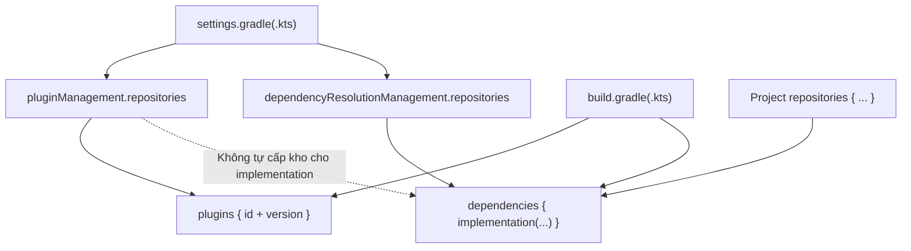

# Cấu hình repositories và pluginManagement.repositories trong Gradle

Khi khai báo một thư viện Java bằng `implementation 'com.google.guava:guava:33.2.1-jre'`, Gradle cần một **repository chứa thư viện** để tìm metadata và JAR. Khi áp dụng plugin ngoài bằng `plugins { id 'com.gradleup.shadow' version '8.3.4' }`, Gradle cần một **repository để giải quyết plugin**. Hai việc đều gọi là “tìm dependency”, nhưng được thực hiện bằng **hai phạm vi kho khác nhau**. Chỉ thêm `mavenCentral()` vào `repositories {}` không có nghĩa plugin được tìm ở đó; chỉ thêm `gradlePluginPortal()` vào `pluginManagement.repositories {}` cũng không cung cấp repository cho `implementation` của ứng dụng.

Bài học thuộc nhóm **Kho thư viện** của Gradle, tập trung vào:

1. Phân biệt `repositories {}` trong `build.gradle(.kts)`, `dependencyResolutionManagement.repositories {}` trong settings và `pluginManagement.repositories {}`.
2. Hiểu cách Gradle tìm plugin theo plugin ID/version, plugin marker artifact, nguồn plugin mặc định và cách cấu hình kho riêng.
3. Biết ảnh hưởng của thứ tự repository, repository mode, multi-project và kho chỉ dành cho buildscript/publishing.
4. Cấu hình Maven Central, Gradle Plugin Portal, Google Maven, Maven/Ivy hoặc kho nội bộ; dùng thông tin xác thực và bộ lọc an toàn.
5. Chạy một dự án Java 17 có **plugin ngoài** và **dependency thư viện ngoài** để thấy hai phạm vi hoạt động độc lập.
6. Chẩn đoán các lỗi “Plugin not found”, “Could not find dependency”, mã 401/403, lỗi cấu hình do `FAIL_ON_PROJECT_REPOS`.

Các ví dụ dùng Gradle Wrapper. Cú pháp Groovy DSL (`settings.gradle`, `build.gradle`) được ưu tiên; phần Kotlin DSL (`.kts`) được trình bày riêng. Khi dự án dùng một phiên bản Gradle cố định, hãy đối chiếu tài liệu theo phiên bản Wrapper với `./gradlew --version`.

## 1. Repository là gì? Vì sao phải khai báo?

**Repository (kho artifact)** là nơi Gradle tìm metadata và các file của module: JAR, AAR, POM, Ivy descriptor, plugin marker hoặc plugin implementation. Khi khai báo:

```groovy
dependencies {
    implementation 'com.google.guava:guava:33.2.1-jre'
}
```

đoạn trên mô tả **tọa độ module** `group:name:version`, không chỉ rõ tải ở đâu. Repository cung cấp vị trí để Gradle tra cứu module đó:

```groovy
repositories {
    mavenCentral()
}
```

Gradle **không tự thêm một project dependency repository** cho mọi project. Nếu không có repository phù hợp, `implementation` có thể được khai báo thành công ở configuration time nhưng fail lúc cấu hình dependency được giải quyết, như khi chạy `compileJava`.

Các kiểu kho thường gặp:

| Khai báo | Dùng khi nào? | Lưu ý |
| --- | --- | --- |
| `mavenCentral()` | Thư viện Java/JVM phát hành trên Maven Central | Không thay thế toàn bộ kho plugin. |
| `gradlePluginPortal()` | Plugin được phát hành trên Gradle Plugin Portal | Thường đặt trong `pluginManagement.repositories`. |
| `google()` | Android Gradle Plugin và thư viện Android/Google phát hành trên Google Maven | Thường đi cùng Maven Central, ở **cả phạm vi plugin và thư viện** khi cần. |
| `maven { url = uri('https://...') }` | Kho Maven tùy chỉnh/nội bộ, mirror doanh nghiệp | Cần kiểm soát URL, credentials, content filtering. |
| `ivy { ... }` | Kho dùng layout/metadata Ivy | Phải hiểu cách định tuyến pattern và module metadata. |
| `mavenLocal()` | Thử artifact đã publish vào Maven Local | Hạn chế cho build tái lập; có thể vô tình dùng artifact stale từ máy cá nhân. |
| `flatDir { dirs 'libs' }` | Trường hợp di sản với file JAR cục bộ | Ít metadata/transitive dependency; không nên là lựa chọn chính cho dependency management. |

**Repository là nguồn tải/đọc artifact, không phải nơi khai báo tọa độ module.** Tọa độ module thuộc `dependencies {}`; danh sách kho thuộc `repositories {}` phù hợp với loại dependency.

## 2. Ba phạm vi repository quan trọng nhất



Đọc sơ đồ theo **vai trò**, không coi một mũi tên là mô tả toàn bộ thứ tự tính toán nội bộ:

- **`pluginManagement.repositories`**: dùng để giải quyết yêu cầu plugin qua `plugins {}` của settings/build script. Thông thường plugin ngoài có ID/version, đi qua marker artifact.
- **`dependencyResolutionManagement.repositories`**: khai báo **repository cho dependency của các project** ở settings, có thể quản trị tập trung cho multi-project.
- **`repositories {}` ở project**: cũng là repository cho **dependency của project**. Quyền ưu tiên so với settings tùy `repositoriesMode`.
- **`buildscript.repositories {}`**: một phạm vi khác nữa: resolve artifact trên classpath của **chính build script**, thường gặp ở cú pháp plugin legacy.
- **`publishing.repositories {}`**: nơi **đẩy artifact lên** khi publish; không phải nguồn mặc định để tải dependency.

### Bảng so sánh

| Được khai báo ở đâu? | Tác động chủ yếu | Không nên suy luận |
| --- | --- | --- |
| `settings.gradle(.kts) → pluginManagement { repositories { ... } }` | Plugin resolution của `plugins {}` | Không tự cấp Maven Central cho `implementation`. |
| `settings.gradle(.kts) → dependencyResolutionManagement { repositories { ... } }` | Dependency resolution cấp project | Không tự thay kho plugin của `plugins {}`. |
| `build.gradle(.kts) → repositories { ... }` | Dependency resolution của project tương ứng | Không phải nơi chính để tìm plugin ngoài của `plugins {}`. |
| `build.gradle(.kts) → buildscript { repositories { ... } }` | Dependency của buildscript classpath | Không đồng nghĩa kho của `implementation` và không thay `pluginManagement`. |
| `publishing { repositories { ... } }` | Đích upload khi publish | Không phải danh sách kho để resolve application dependencies. |

**Nguyên tắc:** trước khi sửa lỗi, hãy xác định Gradle đang thiếu **plugin**, **library**, **classpath buildscript** hay **publishing destination**.

## 3. `repositories {}` trong `build.gradle`: kho cho thư viện của Project

Mẫu Groovy DSL một project:

```groovy
plugins {
    id 'java'
}

repositories {
    mavenCentral()
}

dependencies {
    implementation 'com.google.guava:guava:33.2.1-jre'
    testImplementation 'org.junit.jupiter:junit-jupiter:5.10.2'
}
```

Ở đây:

1. Plugin `java` là **core plugin** đi kèm Gradle nên không cần tải từ Gradle Plugin Portal.
2. `repositories { mavenCentral() }` áp dụng cho thư viện project như Guava và JUnit.
3. Khai báo `implementation` / `testImplementation` không tự tải JAR ngay trong lúc viết script; Gradle sẽ giải quyết khi configuration/task phù hợp cần classpath.
4. Nếu bạn dùng plugin `application`, `java-library` hoặc Kotlin JVM, configuration name có thể khác theo plugin đã áp dụng.

Tương đương Kotlin DSL:

```kotlin
plugins {
    java
}

repositories {
    mavenCentral()
}

dependencies {
    implementation("com.google.guava:guava:33.2.1-jre")
    testImplementation("org.junit.jupiter:junit-jupiter:5.10.2")
}
```

`mavenCentral()` là API tạo repository có địa chỉ đã biết; bản thân nó **không khai báo** Guava hay JUnit. Tương tự, `dependencies {}` không thay thế việc chọn nguồn.

### Khi nào không nên khai báo `repositories` trong từng project?

Với multi-project build, nếu mỗi module tự ghi:

```groovy
repositories {
    mavenCentral()
}
```

thì bạn dễ gặp:

- Lặp cấu hình ở hàng chục file.
- Một module vô tình thêm kho không được duyệt.
- Thứ tự repository khác nhau giữa modules.
- Khó kiểm soát liệu một artifact nội bộ có được tải từ public repository.
- Khó bảo đảm CI và local dùng đúng một chính sách repository.

Giải pháp Gradle hiện hành là **khai báo tập trung** bằng `dependencyResolutionManagement` trong settings, kèm `repositoriesMode` phù hợp.

## 4. `pluginManagement.repositories {}`: kho cho plugin DSL

Đặt `pluginManagement` **ở đầu `settings.gradle` hoặc `settings.gradle.kts`**, trước `rootProject.name`, `include`, `dependencyResolutionManagement` và các logic cấu hình khác. Đó là nơi Gradle cần đọc sớm để biết **cách tìm plugin**.

**`settings.gradle` — Groovy DSL:**

```groovy
pluginManagement {
    repositories {
        gradlePluginPortal()
    }
}

rootProject.name = 'plugin-demo'
```

**`settings.gradle.kts` — Kotlin DSL:**

```kotlin
pluginManagement {
    repositories {
        gradlePluginPortal()
    }
}

rootProject.name = "plugin-demo"
```

Sau đó trong `build.gradle`:

```groovy
plugins {
    id 'java'
    id 'com.gradleup.shadow' version '8.3.4'
}
```

Giải thích:

- `java` là core plugin, được cung cấp bởi Gradle distribution.
- `com.gradleup.shadow` là plugin ngoài, Gradle cần tìm bằng ID/version; phiên bản `8.3.4` được phát hành trên Plugin Portal.
- `pluginManagement.repositories` quyết định danh sách kho để tìm plugin ngoài.
- Không có nghĩa mọi `implementation 'group:artifact:version'` sẽ tìm qua Plugin Portal; để resolve application dependency bạn còn cần project/dependency-management repositories.
- Với Plugin DSL, `pluginManagement` mặc định dùng **Gradle Plugin Portal** nếu bạn không chỉ định danh sách repository. Khi bạn **chủ động chỉ định** danh sách, muốn giữ Portal thì **phải khai báo `gradlePluginPortal()` rõ ràng**.

Một cấu hình thường dùng khi tổ chức có kho plugin riêng:

```groovy
pluginManagement {
    repositories {
        maven {
            url = uri('https://plugins.example.invalid/maven')
        }
        gradlePluginPortal()
    }
}
```

Đây là **mẫu minh họa**, URL `.invalid` không phải kho đang hoạt động. Gradle sẽ thử kho tùy chỉnh theo thứ tự khai báo trước rồi mới dùng Plugin Portal khi kho trước không cung cấp module/metadata phù hợp. Đừng copy URL minh họa vào dự án thật; phải thay bằng endpoint được tổ chức cấp quyền.

### `pluginManagement` là cấu hình giải quyết plugin, không phải lệnh áp dụng plugin

```groovy
pluginManagement {
    repositories {
        gradlePluginPortal()
    }
}
```

**Không làm plugin Shadow, Spring Boot, Kotlin hay plugin khác tự động được áp dụng.** Project cần khai báo plugin phù hợp trong `plugins {}` hoặc dùng cơ chế apply thích hợp; còn `pluginManagement.repositories` chỉ chỉ ra **cách tìm plugin được yêu cầu**.

## 5. Vì sao plugin ngoài cần “plugin marker artifact”?

Plugin DSL nhận yêu cầu dạng:

```groovy
plugins {
    id 'com.gradleup.shadow' version '8.3.4'
}
```

Yêu cầu trên đưa ra **plugin ID + version**, chưa phải tọa độ JAR implementation. Gradle cần một cách ánh xạ từ ID/version sang module chứa plugin implementation. Với plugin phát hành theo chuẩn, nó tìm **plugin marker artifact**, thường mang tọa độ:

```text
<plugin-id>:<plugin-id>.gradle.plugin:<version>
```

Với ví dụ:

```text
com.gradleup.shadow:com.gradleup.shadow.gradle.plugin:8.3.4
```

Marker trỏ đến module implementation; sau đó Gradle tải plugin và các dependency cần thiết theo repository đã cấu hình. Gradle Plugin Development Plugin (`java-gradle-plugin`) cùng plugin publishing thường hỗ trợ tạo marker khi publish plugin chuẩn.

Vì vậy một kho Maven có file implementation JAR **chưa chắc dùng được với `plugins { id ... }`** nếu không chứa marker tương ứng hoặc không có resolution rule đặc biệt.

### Khi kho riêng không có plugin marker

Trong settings có thể cấu hình **plugin resolution strategy** để thay ánh xạ mặc định:

```groovy
// settings.gradle — minh họa, artifact nội bộ phải tồn tại thật.
pluginManagement {
    repositories {
        maven {
            url = uri('https://plugins.example.invalid/maven')
        }
        gradlePluginPortal()
    }
    resolutionStrategy {
        eachPlugin {
            if (requested.id.id == 'com.example.build-quality') {
                useModule('com.example.build:quality-plugin:1.2.0')
            }
        }
    }
}
```

Đây là **mảnh cấu hình minh họa**; `com.example.build:quality-plugin:1.2.0` và URL `.invalid` không phải artifact có thật. Nếu tổ chức publish implementation nhưng không publish marker, `useModule` cho Gradle biết module implementation cần dùng cho plugin ID đó. Bạn phải đảm bảo artifact chứa class plugin được đăng ký đúng ID và tồn tại trong repository cho plugin.

**Không dùng `resolutionStrategy.eachPlugin` như một bản vá tùy tiện** mỗi khi thiếu plugin: trước tiên kiểm tra plugin ID/version chính xác, kho có marker không, quyền truy cập và cách publish plugin.

## 6. Quản lý phiên bản plugin tập trung trong `pluginManagement.plugins {}`

Ngoài repositories, `pluginManagement` còn hỗ trợ khai báo phiên bản mặc định cho plugin trong cùng build:

**`settings.gradle`:**

```groovy
pluginManagement {
    repositories {
        gradlePluginPortal()
    }

    plugins {
        id 'com.gradleup.shadow' version '8.3.4'
    }
}
```

**`build.gradle`:**

```groovy
plugins {
    id 'java'
    id 'com.gradleup.shadow'
}
```

Khi version được quản lý ở settings, project có thể yêu cầu plugin theo ID mà không lặp version. Bạn vẫn phải khai báo plugin trong project mới áp dụng nó. Nếu build dùng version catalog cho plugin aliases, cần hiểu đó là **cơ chế tổ chức phiên bản/yêu cầu plugin** khác với danh sách repository; plugin alias cũng phải được resolve qua hệ thống kho plugin tương ứng.

Cần phân biệt:

- `pluginManagement.plugins`: **phiên bản mặc định** cho plugin requests.
- `pluginManagement.repositories`: **nơi tải plugin**.
- `plugins {}` trong project: **plugin thực sự được yêu cầu/áp dụng**.
- `dependencies {}`: **thư viện cho source/task**, không dùng để trực tiếp áp dụng plugin.

Nếu nhiều module cùng dùng Shadow, Spring Boot hoặc plugin code quality, quản lý phiên bản ở một nơi giúp giảm lệch version giữa modules. Vẫn nên biết version nào được một module dùng khi nó ghi version tường minh hoặc nhận plugin theo cơ chế khác.

## 7. Repository cho dependency ở cấp settings: `dependencyResolutionManagement`

Đây là điểm thường bị nhầm với `pluginManagement`:

```groovy
// settings.gradle
pluginManagement {
    repositories {
        gradlePluginPortal()
    }
}

dependencyResolutionManagement {
    repositories {
        mavenCentral()
    }
}

rootProject.name = 'centralized-repos'
```

Hai block **song song**:

1. `pluginManagement.repositories` tìm plugin ngoài yêu cầu bởi `plugins {}`.
2. `dependencyResolutionManagement.repositories` cung cấp kho cho `dependencies { implementation ... }` của các project.

Một project có thể không có block `repositories {}` trong `build.gradle` mà vẫn resolve Guava khi settings đã cung cấp `mavenCentral()`.

### `repositoriesMode`: ai có quyền quyết định repository của project?

Gradle có ba chế độ (áp dụng cho **project dependency repositories**, không phải `pluginManagement.repositories`):

| Chế độ | Tác động khi một Project hoặc plugin khai báo repository | Khi nào phù hợp |
| --- | --- | --- |
| `RepositoriesMode.PREFER_PROJECT` | **Mặc định:** repository do project khai báo có ưu tiên so với tập settings; có thể làm settings repositories bị bỏ qua cho project đó. | Dự án cần module tự quyết kho, hoặc chuyển đổi từng phần. |
| `RepositoriesMode.PREFER_SETTINGS` | Ưu tiên repository ở settings; repository do project/plugin khai báo bị bỏ qua và Gradle cảnh báo. | Muốn chính sách tập trung nhưng chưa khóa tuyệt đối bằng lỗi. |
| `RepositoriesMode.FAIL_ON_PROJECT_REPOS` | Nếu project hoặc plugin khai báo repository ở cấp project, build **báo lỗi**. | CI/doanh nghiệp cần chỉ cho phép kho đã được duyệt ở settings. |

Cấu hình Groovy DSL:

```groovy
dependencyResolutionManagement {
    repositoriesMode = RepositoriesMode.FAIL_ON_PROJECT_REPOS
    repositories {
        mavenCentral()
    }
}
```

Kotlin DSL:

```kotlin
dependencyResolutionManagement {
    repositoriesMode.set(RepositoriesMode.FAIL_ON_PROJECT_REPOS)
    repositories {
        mavenCentral()
    }
}
```

**Hệ quả thực tế:** nếu settings đã đặt `FAIL_ON_PROJECT_REPOS`, không được thêm tiếp:

```groovy
// build.gradle — sẽ xung đột với FAIL_ON_PROJECT_REPOS
repositories {
    mavenCentral()
}
```

Ngay cả khi là **cùng `mavenCentral()`**, lỗi vẫn có thể xảy ra vì chế độ nghiêm cấm **khai báo ở project**, không chỉ cấm URL khác. Nếu một plugin tự thêm repository, chế độ này cũng có thể báo lỗi; khi đó cần thay đổi cấu hình plugin hoặc điều chỉnh chính sách có kiểm soát.

`pluginManagement.repositories` **không có một `repositoriesMode` tương tự**. Plugin repositories của Plugin DSL được quyết định trong settings, không do từng subproject thêm `plugins.repositories`.

## 8. Thứ tự repository và quy tắc chọn artifact

Giả sử project có hai repository:

```groovy
repositories {
    maven {
        url = uri('https://repo.example.invalid/releases')
    }
    mavenCentral()
}
```

Đây là ví dụ để giải thích thứ tự; URL nội bộ được thay bằng endpoint thật nếu dùng trong dự án.

Gradle **xem repository theo thứ tự đã khai báo** khi tìm module/metadata. Nếu một module có metadata ở một kho, Gradle thường tiếp tục lấy những artifact của module đó từ **cùng kho**, thay vì tự động pha trộn POM của kho A với JAR cùng tọa độ của kho B. Điều này thường được gọi là tính **repository stickiness**.

Hệ quả:

- Kho đứng đầu có thể chi phối module trùng tọa độ khi nó chứa metadata phù hợp.
- Nếu kho đầu trả metadata cho module nhưng thiếu JAR, Gradle có thể thất bại tại kho đó thay vì âm thầm lấy JAR ở kho sau.
- Một mirror trả dữ liệu stale có thể gây kết quả khác môi trường dù cùng version.
- Việc thêm `mavenLocal()` ở đầu có thể làm một máy dùng artifact vừa publish local trong khi CI dùng artifact trên Maven Central.
- Danh sách repo của **plugin** có thứ tự riêng; không lấy thứ tự `pluginManagement.repositories` để suy luận thứ tự resolution của `implementation`.

Một cách đọc đúng là: **thứ tự có ý nghĩa trong từng tập repo**, nhưng **không tồn tại một danh sách ưu tiên chung** giữa `pluginManagement`, project repository và `buildscript.repositories`.

### Vì sao không nên thêm 10 repository “để chắc ăn”?

Mỗi kho được thêm có thể:

- Tăng số yêu cầu mạng, độ trễ và rủi ro dependency resolution.
- Gây xung đột module có cùng tọa độ ở nhiều nơi.
- Mở thêm nguồn supply-chain không được kiểm soát.
- Làm lỗi 401/403 khó xác định hơn khi một kho private xuất hiện không cần thiết.
- Gây tình huống metadata từ một kho, artifact bị kỳ vọng ở kho khác.

Chỉ khai báo các kho thực sự cần thiết, theo chính sách tổ chức và phạm vi artifact rõ ràng.

## 9. Ví dụ đầy đủ chạy được: một plugin ngoài + một thư viện ngoài

Ví dụ này cố ý dùng **hai repository khác nhau**, để chứng minh plugin và library có vòng đời resolution độc lập.

Điều kiện:

- Có JDK 17 và Gradle Wrapper 8.10.2 (hoặc bản Gradle tương thích với Java 17 và Shadow 8.3.4).
- Có mạng tới **Gradle Plugin Portal** và **Maven Central**, trừ khi các artifact đã được cache.
- Cài Java toolchain 17 hoặc cung cấp JDK 17 cho Gradle.
- Tạo các file như sau.

```text
repositories-lab/
├── settings.gradle
├── build.gradle
├── gradlew
├── gradlew.bat
├── gradle/
│   └── wrapper/
│       ├── gradle-wrapper.jar
│       └── gradle-wrapper.properties
└── src/
    └── main/
        └── java/
            └── demo/
                └── Main.java
```

Nếu máy mới chỉ có Gradle cài toàn hệ thống, trong project root có thể chạy `gradle wrapper --gradle-version 8.10.2` để tạo Wrapper một lần; đưa các file Wrapper vào version control. Từ đó dùng `./gradlew` trên Linux/macOS, hoặc `gradlew.bat` trên Windows. Không thay file Wrapper bằng phiên bản ngẫu nhiên khi dự án của nhóm đã chốt version.

**`settings.gradle`:**

```groovy
// Plugin repositories: giải quyết plugin ngoài trong plugins {}.
pluginManagement {
    repositories {
        gradlePluginPortal()
    }
}

// Project dependency repositories: giải quyết implementation/testImplementation.
dependencyResolutionManagement {
    repositoriesMode = RepositoriesMode.FAIL_ON_PROJECT_REPOS
    repositories {
        mavenCentral()
    }
}

rootProject.name = 'repositories-lab'
```

**`build.gradle`:**

```groovy
plugins {
    id 'application'                          // Core Gradle plugin
    id 'com.gradleup.shadow' version '8.3.4'  // External plugin
}

java {
    toolchain {
        languageVersion = JavaLanguageVersion.of(17)
    }
}

application {
    mainClass = 'demo.Main'
}

// Không thêm repositories ở đây:
// settings.gradle dùng FAIL_ON_PROJECT_REPOS.
dependencies {
    implementation 'com.google.guava:guava:33.2.1-jre'
}
```

**`src/main/java/demo/Main.java`:**

```java
package demo;

import com.google.common.base.Joiner;

public final class Main {
    private Main() {
    }

    public static void main(String[] args) {
        String joined = Joiner.on(", ").join("plugin", "library");
        System.out.println("Repositories: " + joined);
    }
}
```

**Chạy thử từ root:**

```bash
./gradlew --version
./gradlew -q run
```

Khi Gradle tải được plugin và dependency, dùng Java 17 đúng cách, dòng stdout **do ứng dụng Java in** là:

```text
Repositories: plugin, library
```

Phân tích từng đường đi:

1. Gradle đọc `settings.gradle`, cấu hình `pluginManagement.repositories` trước khi giải quyết plugin ngoài.
2. `com.gradleup.shadow:8.3.4` được tìm qua **Gradle Plugin Portal** (dựa trên plugin marker và module implementation).
3. `application` là core plugin, không cần tìm marker trên Portal.
4. Gradle thấy `dependencyResolutionManagement.repositories` dùng **Maven Central** cho library dependency.
5. `com.google.guava:guava:33.2.1-jre` và các dependency cần thiết được giải quyết cho classpath Java.
6. Task `run` của Application plugin chạy `demo.Main`; `Joiner` đến từ Guava.
7. Plugin Shadow có thể cung cấp các task đóng gói bổ sung nhưng **chỉ áp dụng plugin không có nghĩa task tạo fat JAR đã chạy**.

Có thể kiểm tra thêm:

```bash
./gradlew tasks --all
./gradlew dependencies --configuration runtimeClasspath
./gradlew dependencyInsight --dependency guava --configuration runtimeClasspath
./gradlew shadowJar
```

`dependencies` / `dependencyInsight` cho thấy **đồ thị dependency của project**, không phải một danh sách đầy đủ các plugin implementation được Gradle tải. `shadowJar` (do Shadow plugin cung cấp) là ví dụ về task chỉ tồn tại sau khi plugin ngoài được áp dụng; không cần gọi task đó để minh chứng rằng Guava đã được resolve cho `run`. Tên/đường dẫn artifact Shadow thực tế phụ thuộc cấu hình dự án.

### Tại sao ví dụ này là minh chứng tốt?

- Nếu **xóa `mavenCentral()` khỏi `dependencyResolutionManagement.repositories`** mà không còn kho library phù hợp, Plugin Shadow có thể vẫn resolve được, nhưng Guava sẽ thất bại khi Gradle cần runtime/compile classpath.
- Nếu **bỏ `gradlePluginPortal()` khỏi danh sách plugin repositories đã khai báo** và không có kho thay thế chứa plugin Shadow, việc apply Shadow sẽ thất bại trước khi task Java chạy; Maven Central của project không tự cứu được plugin request.
- Nếu **thêm `repositories { mavenCentral() }` vào `build.gradle`**, với `FAIL_ON_PROJECT_REPOS` trong settings, Gradle có thể báo lỗi **ngay cả khi URL trùng**.
- Nếu **bỏ plugin ngoài** khỏi `plugins {}` nhưng giữ `application`, ứng dụng có thể vẫn chạy nếu có Maven Central, bởi core plugin và Guava đủ cho ví dụ; lúc đó **không còn đang kiểm tra plugin repository** nữa.

Các phép thử thay đổi chỉ nên thực hiện trong project lab, không sửa repository đang dùng chung mà không kiểm tra tác động.

## 10. Bản tương đương Kotlin DSL của project lab

Nếu dùng `.kts`, **thay thế** các file Groovy ở mục 9, không giữ hai bản để mong chúng tự cộng dồn.

**`settings.gradle.kts`:**

```kotlin
pluginManagement {
    repositories {
        gradlePluginPortal()
    }
}

dependencyResolutionManagement {
    repositoriesMode.set(RepositoriesMode.FAIL_ON_PROJECT_REPOS)
    repositories {
        mavenCentral()
    }
}

rootProject.name = "repositories-lab"
```

**`build.gradle.kts`:**

```kotlin
plugins {
    application
    id("com.gradleup.shadow") version "8.3.4"
}

java {
    toolchain {
        languageVersion.set(JavaLanguageVersion.of(17))
    }
}

application {
    mainClass.set("demo.Main")
}

// Project dependencies vẫn dùng kho ở settings.
dependencies {
    implementation("com.google.guava:guava:33.2.1-jre")
}
```

Java source `Main.java` giữ nguyên. Trên môi trường tương thích, `./gradlew -q run` vẫn in `Repositories: plugin, library`.

Không nhầm:

- `id '...'` là **Groovy DSL**; `id("...")` là **Kotlin DSL**.
- `repositoriesMode = ...` là cú pháp Groovy; `repositoriesMode.set(...)` là Kotlin.
- `mainClass = 'demo.Main'` ở Groovy DSL và `mainClass.set("demo.Main")` ở Kotlin DSL đều cấu hình application main class.
- Chức năng repo **không đổi** chỉ vì đổi DSL.

## 11. Multi-project: một settings dùng cho nhiều project

Ví dụ:

```text
team-build/
├── settings.gradle
├── build.gradle
├── core/build.gradle
└── app/build.gradle
```

**`settings.gradle`:**

```groovy
pluginManagement {
    repositories {
        gradlePluginPortal()
    }
}

dependencyResolutionManagement {
    repositoriesMode = RepositoriesMode.FAIL_ON_PROJECT_REPOS
    repositories {
        mavenCentral()
    }
}

rootProject.name = 'team-build'
include 'core', 'app'
```

Các module có thể khai báo:

```groovy
// core/build.gradle — mảnh minh họa
plugins {
    id 'java-library'
}

dependencies {
    api 'com.google.guava:guava:33.2.1-jre'
}
```

```groovy
// app/build.gradle — mảnh minh họa
plugins {
    id 'application'
}

dependencies {
    implementation project(':core')
}
```

Hai file module **không cần lặp `repositories {}`**. Maven Central được cung cấp tập trung; các core plugin `java-library` và `application` đến từ Gradle.

Lưu ý: đoạn `app/build.gradle` trên chưa khai báo `mainClass` hoặc Java source nên **chưa phải một ứng dụng runnable hoàn chỉnh**; nó chỉ minh họa repository policy và project dependency. `implementation project(':core')` là **project dependency**, không phải module cần được tải từ Maven Central; chỉ thư viện bên ngoài như Guava mới cần external repository.

Khi thêm plugin ngoài vào `app`, chính `pluginManagement.repositories` ở **settings của build** sẽ được sử dụng. Đối với một **included build** hoặc build độc lập khác, mỗi build có settings/quy tắc repository riêng nếu không có cơ chế chia sẻ bên ngoài.

## 12. Android và repository Google: khai báo đúng cả hai phạm vi

Với Android Gradle Plugin, nhiều dự án dùng:

```groovy
// settings.gradle — mẫu repository, chưa đủ để build Android.
pluginManagement {
    repositories {
        google()
        mavenCentral()
        gradlePluginPortal()
    }
}

dependencyResolutionManagement {
    repositoriesMode = RepositoriesMode.FAIL_ON_PROJECT_REPOS
    repositories {
        google()
        mavenCentral()
    }
}

rootProject.name = 'android-example'
```

Ở đây:

- `google()` trong `pluginManagement.repositories` cho Gradle tìm những plugin/marker/module cần thiết từ Google Maven, chẳng hạn Android Gradle Plugin.
- `google()` trong `dependencyResolutionManagement.repositories` phục vụ **thư viện Android/Google** của project.
- `mavenCentral()` đáp ứng nhiều thư viện Java/JVM công khai.
- `gradlePluginPortal()` đáp ứng nhiều plugin cộng đồng.
- Thứ tự và danh sách nên theo hướng dẫn của **plugin/framework đang dùng**, chính sách mirror của tổ chức và mô hình supply-chain.

**Đừng hiểu rằng chỉ thêm `google()` ở một block là đủ cho mọi plugin và mọi thư viện Android.** Hai tập repository được dùng cho hai vai trò khác nhau. Mẫu này chỉ cấu hình repository; để build Android thực tế còn cần Android plugin đúng version, SDK và các settings khác.

## 13. Kho Maven nội bộ: URL, xác thực và không để lộ mật khẩu

Một doanh nghiệp có thể có kho riêng cho plugin build nội bộ và kho khác cho library nội bộ. Khi đó hãy khai báo **đúng phạm vi**.

Ví dụ minh họa của **`settings.gradle`**:

```groovy
pluginManagement {
    repositories {
        maven {
            name = 'companyPlugins'
            url = uri('https://repo.example.invalid/gradle-plugins')
            credentials(PasswordCredentials)
            content {
                includeGroup 'com.example.build'
            }
        }
        gradlePluginPortal()
    }
}

dependencyResolutionManagement {
    repositoriesMode = RepositoriesMode.FAIL_ON_PROJECT_REPOS
    repositories {
        maven {
            name = 'companyLibraries'
            url = uri('https://repo.example.invalid/maven-releases')
            credentials(PasswordCredentials)
            content {
                includeGroup 'com.example.lib'
            }
        }
        mavenCentral()
    }
}
```

Đây là **mẫu mô phỏng cho doanh nghiệp**, hai URL `.invalid` không dùng được và hai group là giả định. Nó minh họa:

- Plugin trong group `com.example.build` tìm qua **companyPlugins** (hoặc những repository plugin khác theo chính sách).
- Library trong group `com.example.lib` tìm qua **companyLibraries**.
- Mỗi Maven repository có tên riêng để quản lý credentials.
- `content { includeGroup ... }` giúp giảm những module không cần được hỏi ở một kho. **Content filter thường không bảo đảm tính độc quyền**: để cấm module nội bộ bị giải quyết ở kho công khai, xem `exclusiveContent`.
- Repo cấu hình trong `pluginManagement` không tự “chuyển tiếp” qua `dependencyResolutionManagement` hoặc ngược lại.

### Gradle có thể nhận credentials thế nào?

Với một named repository và `credentials(PasswordCredentials)`, Gradle hỗ trợ nhận credentials theo tên repository qua các Gradle properties tương ứng, chẳng hạn:

```text
companyPluginsUsername
companyPluginsPassword
companyLibrariesUsername
companyLibrariesPassword
```

Đặt các giá trị thật trong **cơ chế secrets của CI** hoặc file User Home `gradle.properties` được bảo vệ, **không commit token/password** vào repository. Không đưa secret vào bài mẫu, log, screenshot hoặc output của `./gradlew properties`. Việc dùng khóa tự động theo repository name phải phù hợp loại credentials và cơ chế Gradle phiên bản đang chạy.

Một cách khác là dùng Provider API:

```groovy
// Mảnh cấu hình Maven repository có thông tin xác thực.
// Cần đặt repoUser và repoPassword trong nguồn an toàn.
maven {
    url = uri('https://repo.example.invalid/maven')
    credentials {
        username = providers.gradleProperty('repoUser').orNull
        password = providers.gradleProperty('repoPassword').orNull
    }
}
```

Đây là **snippet**, không phải settings file đầy đủ, và URL không tồn tại. Nếu credentials không được cấp, Gradle có thể báo lỗi hoặc server trả 401. Đừng “giải quyết” bằng cách hard-code mật khẩu.

**Ưu tiên HTTPS.** Gradle có chính sách từ chối HTTP không an toàn theo mặc định trong các phiên bản hiện đại trừ khi cấu hình cho phép không an toàn một cách tường minh; đây không phải hướng nên dùng cho repository credentials.

## 14. Bộ lọc repository và `exclusiveContent`: ngăn lấy nhầm artifact

Đôi khi module nội bộ tên `com.example.lib:payment-sdk` tồn tại trong kho tổ chức nhưng một artifact cùng tọa độ có thể bị đưa lên kho công khai. Lúc này chỉ ưu tiên private repo ở đầu danh sách có thể **chưa đủ cho chính sách bảo mật** nếu metadata vắng mặt hoặc mirror thay đổi.

Gradle hỗ trợ lọc phạm vi artifact bằng `content` và cấu hình **exclusive content** để quy định nhóm module chỉ được lấy từ một nguồn được chỉ định.

**Ví dụ minh họa ở settings:**

```groovy
dependencyResolutionManagement {
    repositoriesMode = RepositoriesMode.FAIL_ON_PROJECT_REPOS
    repositories {
        exclusiveContent {
            forRepository {
                maven {
                    name = 'internalArtifacts'
                    url = uri('https://repo.example.invalid/internal')
                    credentials(PasswordCredentials)
                }
            }
            filter {
                includeGroup 'com.example.internal'
            }
        }

        mavenCentral()
    }
}
```

Quy tắc này nói rằng các module trong group **`com.example.internal`** được giải quyết **độc quyền từ `internalArtifacts`**, không fallback sang Maven Central. Nếu nội bộ bị thiếu artifact cần thiết, build thất bại là đúng với chính sách: không tự ý “cứu” bằng kho public.

Phân biệt:

- `content { includeGroup 'com.example.internal' }` ở repository: chỉ nói repository này quan tâm group đó.
- `exclusiveContent`: áp quy tắc **module thuộc group đó không được tìm ở repo khác** trong phạm vi cấu hình.

Với group có các subgroups như `com.example.internal.tools`, cần cân nhắc `includeGroupAndSubgroups` theo phiên bản Gradle API, thay vì tưởng `includeGroup` đã tự khớp mọi nhánh.

Lưu ý nâng cao: `exclusiveContent` trong `pluginManagement` có tương tác đặc biệt với việc thêm repository vào `buildscript.repositories`; tài liệu Gradle cảnh báo việc này có thể khiến build không thể bổ sung kho buildscript. Chỉ dùng sau khi hiểu rõ tất cả nguồn plugin/buildscript classpath của dự án.

## 15. `buildscript.repositories {}`: trường hợp legacy, không phải Project repositories

Trước khi Plugin DSL phổ biến, plugin ngoài thường được thêm lên classpath buildscript và áp dụng bằng `apply plugin`.

Ví dụ **cú pháp legacy**, không dùng cùng lúc với cùng plugin trong `plugins {}`:

```groovy
buildscript {
    repositories {
        gradlePluginPortal()
    }
    dependencies {
        classpath 'com.gradleup.shadow:com.gradleup.shadow.gradle.plugin:8.3.4'
    }
}

apply plugin: 'com.gradleup.shadow'
```

Ở đây:

- `buildscript.repositories` tìm **dependency cho classpath của build script**.
- `buildscript.dependencies.classpath` nêu module được tải vào classpath.
- `apply plugin:` áp dụng plugin từ classpath đó.
- Đây **không phải** cơ chế `plugins { id ... version ... }` sử dụng `pluginManagement.repositories`.
- `repositories {}` ở cấp project vẫn là kho riêng cho `implementation`.
- `dependencyResolutionManagement.repositories` ở settings vẫn điều khiển repository cho dependency của project theo mode đã chọn, không tự động biến thành buildscript classpath repo.

**Khuyến nghị:** ưu tiên `plugins {}` và `pluginManagement.repositories` cho plugin hiện đại. Khi phải giữ legacy vì plugin cũ, tách bạch hai hệ thống để không “sửa lỗi Plugin Portal” ở nhầm nơi.

## 16. `publishing.repositories {}` và kho tải dependency là hai chiều khác nhau

Khi phát triển thư viện nội bộ, có thể bạn cần **publish** nó lên Maven repository:

```groovy
// Snippet — yêu cầu plugin maven-publish và các publication phù hợp.
publishing {
    repositories {
        maven {
            url = uri(layout.buildDirectory.dir('local-maven-repo'))
        }
    }
}
```

Đây là **đích viết artifact**, không phải repository Gradle tự dùng để tìm Guava hoặc plugin cho build này. Để **consumer** đọc artifact đã publish, consumer phải khai báo repository tương ứng tại `dependencyResolutionManagement.repositories` hoặc project `repositories` tùy chính sách.

Đừng sửa `publishing.repositories` khi lỗi là `Could not find com.example:my-lib:1.0` trong một project đang compile. Bạn cần kiểm tra phía **resolution** của consumer, artifact coordinates và metadata được publish.

## 17. Dùng plugin được phát triển ngay trong build: `includeBuild`

Không phải plugin nào cũng cần tải từ remote repository. Nếu dự án có một build logic riêng chứa **plugin được khai báo đúng chuẩn**, settings có thể đưa nó vào plugin resolution:

```groovy
// settings.gradle — snippet, cần có build-logic hợp lệ.
pluginManagement {
    includeBuild('build-logic')

    repositories {
        gradlePluginPortal()
    }
}
```

Gradle có thể giải quyết plugin được công bố bởi included build `build-logic` mà không cần publish marker ra Maven repository công khai, nếu build-logic được cấu hình đúng để cung cấp plugin.

**Không nhầm `includeBuild('build-logic')` với `include 'build-logic'`:** cách đầu tạo composite/included build có vai trò cung cấp build logic, cách sau khai báo subproject bình thường. Hai mô hình có scope và lifecycle khác nhau.

Cấu hình `pluginManagement.includeBuild` không tự cấp Guava/JUnit cho project; project dependencies vẫn do settings/project repositories giải quyết.

## 18. Chẩn đoán “Plugin not found” theo thứ tự hợp lý

Giả sử lỗi có dạng:

```text
Plugin [id: 'com.example.quality', version: '1.2.0'] was not found ...
```

Đầu tiên phân loại: đây là lỗi **plugin resolution**, không phải lỗi Java source hay Maven Central của `implementation`.

Kiểm tra:

1. **Plugin ID có đúng không?** ID Gradle plugin khác tên artifact JAR; ví dụ Shadow hiện dùng `com.gradleup.shadow`, không suy ra từ tên module Maven một cách máy móc.
2. **Phiên bản plugin có thật không?** Kiểm tra tài liệu hoặc Plugin Portal, không tùy tiện thêm `latest.release` để che lỗi.
3. **`pluginManagement.repositories` có đúng ở đầu settings?** Nếu custom repositories đã được liệt kê, bạn còn khai báo `gradlePluginPortal()` khi cần không?
4. **Plugin nằm trên kho khác không?** Một plugin nội bộ có thể nằm ở Maven/Ivy riêng hoặc được cung cấp từ included build.
5. **Kho có marker artifact không?** Nếu thiếu marker, cấu hình `resolutionStrategy.eachPlugin { useModule(...) }` chỉ khi biết module implementation thực sự.
6. **Mạng/credentials có hoạt động không?** 401/403 là vấn đề xác thực/phân quyền, không phải bằng chứng plugin ID sai.
7. **Có chính sách mirror, proxy, firewall hoặc `--offline` không?** Gradle có thể không truy cập được kho mặc dù tọa độ hợp lệ.
8. **Plugin có tương thích Gradle/JDK đang dùng không?** Một lỗi plugin tải được nhưng thất bại khi apply có thể là lỗi phiên bản, khác “not found”.

Các lệnh hữu ích:

```bash
./gradlew --version
./gradlew help --info
./gradlew help --stacktrace
./gradlew help --refresh-dependencies
```

`--info` giúp quan sát quá trình resolve, `--stacktrace` chỉ đường lỗi, `--refresh-dependencies` yêu cầu Gradle kiểm tra lại trạng thái dependency/metadata thay vì dựa hoàn toàn vào cache hiện tại. **Không lạm dụng** `--refresh-dependencies` trong CI nếu không cần; nó không sửa sai tọa độ, repository hoặc credentials.

Nếu trong project lab ở mục 9 bỏ `gradlePluginPortal()` và tạo danh sách repository plugin rỗng/không chứa Shadow, Gradle sẽ thất bại trước khi chạy `Main.java`. Trường hợp đó được sửa ở **`pluginManagement.repositories`**, không phải bằng cách thêm Maven Central vào `build.gradle`.

## 19. Chẩn đoán “Could not find group:name:version”

Ví dụ lỗi:

```text
Could not find com.google.guava:guava:33.2.1-jre.
```

Trước tiên xem nó đến từ **project dependency resolution** (ví dụ compile/runtime classpath) hay từ classpath plugin/buildscript. Nếu là dependency project:

1. Xác nhận module `group:name:version` đúng; không nhầm một plugin ID với library GAV.
2. Nếu dùng `dependencyResolutionManagement`, kiểm tra **settings.repositories** và `repositoriesMode`.
3. Nếu dùng project `repositories {}`, kiểm tra nó có được phép theo mode không.
4. Kiểm tra kho Maven Central/Google/private có artifact; không phải module nào cũng có ở mọi kho.
5. Nếu có nhiều kho, kiểm tra thứ tự và vấn đề metadata/artifact thiếu ở repo đứng trước.
6. Nếu dùng `content` hoặc `exclusiveContent`, xác nhận filter cho phép nhóm/module đó ở nơi bạn định lấy.
7. Kiểm tra credentials 401/403, DNS, proxy, SSL certificate, `--offline`, cache.
8. Nếu một module chỉ lỗi ở CI, kiểm tra env, User Home, init scripts và proxy/mirror; không mặc định máy cá nhân và runner có cùng repo policy.

Trong project Java/JVM:

```bash
./gradlew dependencies --configuration compileClasspath
./gradlew dependencies --configuration runtimeClasspath
./gradlew dependencyInsight --dependency guava --configuration runtimeClasspath
```

Các lệnh này giúp xem graph/trạng thái resolution cho configuration cụ thể, **không đảm bảo sửa** repository thiếu. Nếu Gradle không thể resolve, chính các lệnh này cũng có thể thất bại và chỉ ra module/kho liên quan.

### Bảng lỗi và hướng sửa

| Triệu chứng | Phạm vi cần kiểm tra | Hành động |
| --- | --- | --- |
| `Plugin ... was not found` | `pluginManagement.repositories`, marker, plugin ID/version | Bổ sung kho plugin đúng, sửa ID/version, marker hoặc resolution rule có căn cứ. |
| `Could not find ...` trong `compileClasspath` | Project repositories / `dependencyResolutionManagement` | Thêm nguồn library đúng và kiểm tra group/version. |
| `RepositoriesMode.FAIL_ON_PROJECT_REPOS` báo lỗi | Project/plugin khai báo repo trái policy | Xóa/chuyển khai báo repo về settings hoặc sửa plugin/policy có chủ đích. |
| `401 Unauthorized` | Credentials của repo phù hợp | Kiểm tra token/user/password, tên repo, secret injection; không in secret. |
| `403 Forbidden` | Quyền truy cập repo, URL, group/path | Xác nhận permission và repository endpoint; khác lỗi không có artifact. |
| `Could not GET... PKIX path building failed` | TLS/trust store/certificate | Kiểm tra proxy/certificate doanh nghiệp; không tắt kiểm tra TLS để chữa tạm. |
| Gradle dùng artifact cũ từ một repo khác | Thứ tự, cache, repo stickiness, mavenLocal | Kiểm tra nguồn và metadata; làm sạch cấu hình chứ không mặc định chỉ xóa cache. |
| Đã khai báo `mavenCentral()` nhưng plugin ngoài fail | Đặt repo sai phạm vi | Kiểm tra block `pluginManagement.repositories`, không chỉ project repositories. |
| `buildscript classpath` thiếu artifact | `buildscript.repositories` | Kiểm tra kho riêng cho buildscript và cơ chế apply legacy. |
| Publish thành công nhưng consumer không đọc được | `publishing.repositories` khác consumer resolution | Kiểm tra consumer repositories, tọa độ/module metadata và quyền đọc. |

## 20. Những sai lầm làm build thiếu tính tái lập hoặc kém an toàn

### Sai lầm 1 — Chỉ thêm `gradlePluginPortal()` ở project repositories

```groovy
repositories {
    gradlePluginPortal()
}
```

Đây là repository của **project dependencies**; không phải cấu hình `pluginManagement` cho Plugin DSL. Nó cũng không diễn đạt rõ vì sao library Java phải lấy từ Plugin Portal thay vì Maven Central. Hãy đặt kho đúng phạm vi.

### Sai lầm 2 — Chỉ thêm `mavenCentral()` trong `pluginManagement.repositories`

```groovy
pluginManagement {
    repositories {
        mavenCentral()
    }
}
```

Điều này làm **kho plugin** trỏ đến Maven Central; nó **không** đặt Maven Central cho `implementation`. Plugin ngoài trên Plugin Portal còn có thể không tìm thấy nếu Maven Central không chứa marker cần thiết. Nếu muốn cả hai, phải khai báo ở đúng hai namespace.

### Sai lầm 3 — Mặc định settings sẽ luôn thắng project

Khi `dependencyResolutionManagement.repositories` tồn tại mà không set mode, **mặc định là `PREFER_PROJECT`**. Một module tự thêm repository có thể khiến tập settings không được ưu tiên như mong đợi. Nếu cần cưỡng chế, dùng `FAIL_ON_PROJECT_REPOS` có lý do rõ và kiểm tra plugin của toàn build.

### Sai lầm 4 — Thêm `mavenLocal()` để mọi thứ “chạy trên máy tôi”

Artifact local có thể là phiên bản cũ hoặc nội dung không trùng release thật. CI thường không có bản local đó, nên lỗi quay lại. Với build dùng chung, phụ thuộc vào nguồn có version/metadata đáng tin và được quản lý; `mavenLocal()` chỉ nên được dùng cho workflow phát triển được kiểm soát.

### Sai lầm 5 — Đặt credentials trực tiếp trong `settings.gradle`

```groovy
// Không dùng cách này: ví dụ minh họa anti-pattern.
credentials {
    username = 'actual-user'
    password = 'plaintext-password'
}
```

Không commit mật khẩu plaintext. Dùng Gradle properties ở nơi an toàn hoặc CI secrets; không log kết quả Provider chứa token. Nếu kho bắt buộc HTTPS, không hạ cấp giao thức để “cho qua” lỗi TLS.

### Sai lầm 6 — Trùng module trong kho private/public mà không có quy tắc rõ

Chỉ xếp kho nội bộ lên trên chưa phải cam kết nội bộ là **nguồn duy nhất** cho module. Xem `exclusiveContent` khi có ràng buộc supply-chain hoặc yêu cầu audit.

### Sai lầm 7 — Nhầm plugin với dependency của source Java

```groovy
plugins {
    id 'java'
}
dependencies {
    implementation 'com.google.guava:guava:33.2.1-jre'
}
```

Guava được thêm vào classpath Java theo configuration `implementation`. Nó không cung cấp task Gradle như một plugin. Ngược lại, Shadow là plugin build, không phải thư viện mà source code Java cần import trực tiếp để dùng `Joiner`.

### Sai lầm 8 — Dựa vào cache để che một repository thiếu

Lệnh có thể thành công khi file đã có trong Gradle dependency cache và thất bại trên CI sạch. Chạy kiểm chứng trong môi trường sạch khi cần, đặc biệt trước release. **Đừng xóa toàn bộ cache như một phản xạ**; hãy xác định chính xác repository, version, marker và nguồn đang thiếu.

### Sai lầm 9 — Dùng `--offline` rồi kết luận server không chứa artifact

`--offline` cấm Gradle truy cập mạng để giải quyết artifact mới. Nếu version chưa cache, lệnh có thể fail dù server có artifact. Tách lỗi **offline/cache** khỏi lỗi **tọa độ/repo** bằng kiểm tra có mạng và quyền phù hợp.

### Sai lầm 10 — Sửa `publishing.repositories` để chữa lỗi compiler dependency

Đây là hai hướng dữ liệu khác nhau: publishing là nơi **ghi**, project repositories là nơi **đọc**. Hãy xem thông báo lỗi chỉ về task/plugin nào rồi sửa đúng nơi.

## 21. Quy trình triển khai repository policy cho dự án nhóm

Một chiến lược thực tế:

1. **Liệt kê các nguồn artifact thực sự dùng**: Maven Central, Google Maven, Gradle Plugin Portal, nội bộ và mirrors.
2. **Tách hai tầng plugin và library**: khai báo `pluginManagement.repositories` cho plugin, `dependencyResolutionManagement.repositories` cho project dependencies.
3. **Khai báo `pluginManagement` ở đầu settings**: bảo đảm nó có hiệu lực trong plugin resolution.
4. **Chọn repositoriesMode có chủ đích**: `PREFER_PROJECT` khi chuyển đổi, `PREFER_SETTINGS` khi muốn cảnh báo/bỏ qua project repo, hoặc `FAIL_ON_PROJECT_REPOS` để bắt buộc thống nhất.
5. **Đặt thứ tự phù hợp và filter**: chỉ hỏi kho nội bộ cho nhóm module phù hợp; dùng `exclusiveContent` nếu phải cấm fallback ra kho công khai.
6. **Bảo vệ thông tin xác thực**: không lưu secret trong repo; dùng CI secret store hoặc Gradle User Home được quản lý an toàn.
7. **Khóa phiên bản quan trọng**: dùng version catalog / pluginManagement.plugins / dependency constraints hoặc locking nếu phù hợp; không dựa vào `+` hoặc release động trong môi trường cần tái lập.
8. **Thử trên build sạch**: kiểm tra `./gradlew help` để thử plugin, `./gradlew compileJava` hoặc `./gradlew test` cho library, `./gradlew dependencies` cho dependency graph.
9. **Chạy trên CI có cấu hình repository chính thức**: kiểm tra proxy/mirror/CA certificate trước khi thay đổi policy.
10. **Ghi lại quyết định**: vì sao chọn kho, vai trò của từng kho và nơi quản lý credentials, để người mới không thêm repo không được duyệt chỉ vì một lần build fail.

Chính sách phù hợp phải **dễ kiểm toán, ít nguồn hơn, không có sự khác biệt ngầm giữa modules và không phụ thuộc vào file local của một lập trình viên**.

## 22. Bài tập tự kiểm tra có đáp án

**Câu 1.** `plugins { id 'com.gradleup.shadow' version '8.3.4' }` không tìm thấy plugin. Chỉ thêm `mavenCentral()` vào `build.gradle → repositories` có đủ không?

**Đáp án:** Không. Đối với Plugin DSL, kiểm tra `pluginManagement.repositories` trong settings, plugin ID/version, marker/implementation và quyền truy cập kho plugin.

**Câu 2.** `implementation 'com.google.guava:guava:33.2.1-jre'` không resolve. Chỉ thêm `gradlePluginPortal()` trong `pluginManagement` có đủ không?

**Đáp án:** Không. Project dependency cần kho từ `repositories` cấp Project hoặc `dependencyResolutionManagement.repositories` như Maven Central.

**Câu 3.** Khi `repositoriesMode = RepositoriesMode.FAIL_ON_PROJECT_REPOS`, module có thể thêm `repositories { mavenCentral() }` dù settings đã có đúng Maven Central không?

**Đáp án:** Không. Chính sách cấm khai báo project repo, kể cả khi URL giống nhau; cần giữ khai báo ở settings.

**Câu 4.** Core Gradle plugin `java` có cần tải plugin marker trên Plugin Portal không?

**Đáp án:** Không. Core plugin được cung cấp trong Gradle distribution.

**Câu 5.** Plugin DSL dùng plugin ID/version. Nếu Maven private repo chỉ có implementation JAR mà không có plugin marker, nên kiểm tra gì?

**Đáp án:** Kiểm tra quy trình publish marker. Nếu cần custom mapping, cân nhắc `pluginManagement.resolutionStrategy.eachPlugin { useModule(...) }` và bảo đảm module implementation thật sự chứa plugin ID đó.

**Câu 6.** Settings có `dependencyResolutionManagement.repositories { mavenCentral() }` nhưng không cấu hình mode. Một project thêm repository riêng có thể thay danh sách settings không?

**Đáp án:** Có. Mặc định `PREFER_PROJECT`; cần chọn mode tường minh nếu muốn cưỡng chế chính sách.

**Câu 7.** Kho nào được dùng cho thư viện trên classpath của **buildscript legacy** khi cấu hình `buildscript { dependencies { classpath(...) } }`?

**Đáp án:** `buildscript.repositories`, không tự động là `pluginManagement.repositories` hoặc project `repositories`.

**Câu 8.** Thứ tự repo trong `pluginManagement` có tự quyết định kho nào cấp `implementation` không?

**Đáp án:** Không. Plugin và project libraries có repository set riêng; thứ tự có ý nghĩa trong từng tập.

**Câu 9.** Tại sao metadata ở một repo đứng trước có thể khiến Gradle không tải artifact cùng tọa độ từ repo đứng sau?

**Đáp án:** Gradle duy trì tính nhất quán nguồn metadata/artifact của module (repository stickiness), nên không tùy tiện trộn file từ nhiều kho khi một module đã được gắn nguồn.

**Câu 10.** Muốn bảo đảm `com.example.internal` chỉ lấy từ kho nội bộ và không fallback ra Maven Central, chỉ `content { includeGroup ... }` có đủ không?

**Đáp án:** Không nhất thiết. `exclusiveContent` là lựa chọn mạnh hơn để ràng buộc module thuộc group chỉ được resolve từ repository chỉ định.

**Câu 11.** `publishing.repositories` có thể sửa `Could not find ...` của project consumer không?

**Đáp án:** Không trực tiếp. Publishing là đích upload; consumer cần cấu hình repository để đọc cùng tọa độ artifact đã publish.

**Câu 12.** Vì sao một build có thể chạy trên máy cá nhân nhưng fail ở CI sạch dù settings giống nhau?

**Đáp án:** Có thể khác cache, `mavenLocal()`, mirror/proxy, credentials, env và quyền truy cập; phải kiểm tra đúng nguồn thay vì mặc định lỗi nằm ở plugin ID.

**Câu 13.** Một build có `pluginManagement.repositories { mavenCentral(); gradlePluginPortal() }`. Điều đó có đảm bảo plugin đầu tiên luôn được lấy từ Maven Central không?

**Đáp án:** Không. Gradle tìm theo thứ tự nhưng module/marker phải thực sự có tại repo đó; nếu không, Gradle xét nguồn tiếp theo theo chính sách resolution/cache.

**Câu 14.** Muốn đổi version mặc định của plugin trong nhiều modules mà không sửa mỗi file, block nào hỗ trợ?

**Đáp án:** `pluginManagement.plugins` trong settings hoặc cơ chế quản lý version tập trung khác như version catalog. Đây là chính sách version, độc lập với danh sách repo.

**Câu 15.** Trong ví dụ chạy Java 17 ở mục 9, plugin Shadow đến từ đâu và Guava đến từ đâu?

**Đáp án:** Plugin Shadow được resolve qua Gradle Plugin Portal của `pluginManagement.repositories`; Guava được resolve qua Maven Central của `dependencyResolutionManagement.repositories`.

## 23. Tài liệu tham khảo

- [Gradle — Declaring Repositories Basics](https://docs.gradle.org/current/userguide/declaring_repositories_basics.html): sự khác biệt plugin repository và project dependency repository.
- [Gradle — Declaring Repositories](https://docs.gradle.org/current/userguide/declaring_repositories.html): Maven Central, Google Maven, Maven/Ivy và custom repository.
- [Gradle — Working with Plugins](https://docs.gradle.org/current/userguide/plugins_intermediate.html): `pluginManagement`, `plugins {}`, plugin marker, version management, `resolutionStrategy.eachPlugin`.
- [Gradle — Centralizing Repository Declarations](https://docs.gradle.org/current/userguide/centralizing_repositories.html): `dependencyResolutionManagement`, `PREFER_PROJECT`, `PREFER_SETTINGS`, `FAIL_ON_PROJECT_REPOS`.
- [Gradle — Securing Repositories](https://docs.gradle.org/current/userguide/securing_repositories.html): content filters, `exclusiveContent`, khuyến nghị bảo mật và chính sách kho nội bộ.
- [Gradle — Supported Repository Protocols](https://docs.gradle.org/current/userguide/supported_repository_protocols.html): xác thực, credentials, HTTP(S) và thông số Gradle properties liên quan.
- [Gradle Plugin Portal — Shadow 8.3.4](https://plugins.gradle.org/plugin/com.gradleup.shadow/8.3.4): plugin ID/version công khai của ví dụ thực hành.
- [Gradle — Dependency Management Basics](https://docs.gradle.org/current/userguide/dependency_management_basics.html): khai báo và chẩn đoán dependencies của Project.

**Ghi nhớ:** `pluginManagement.repositories` trả lời **“Gradle tải plugin của `plugins {}` từ đâu?”**; `dependencyResolutionManagement.repositories` hoặc project `repositories {}` trả lời **“Gradle tải các thư viện của `dependencies {}` từ đâu?”**. `buildscript.repositories` phục vụ classpath buildscript kiểu legacy, còn `publishing.repositories` là đích phát hành artifact. Phân biệt đúng **phạm vi repository, thứ tự tra cứu và chính sách quyền truy cập** là chìa khóa cho build Gradle tái lập, dễ sửa lỗi và an toàn.