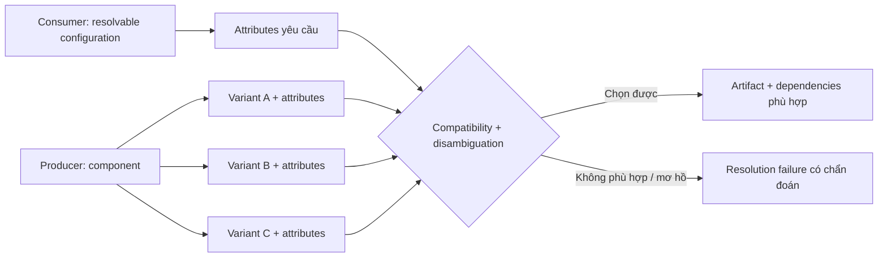
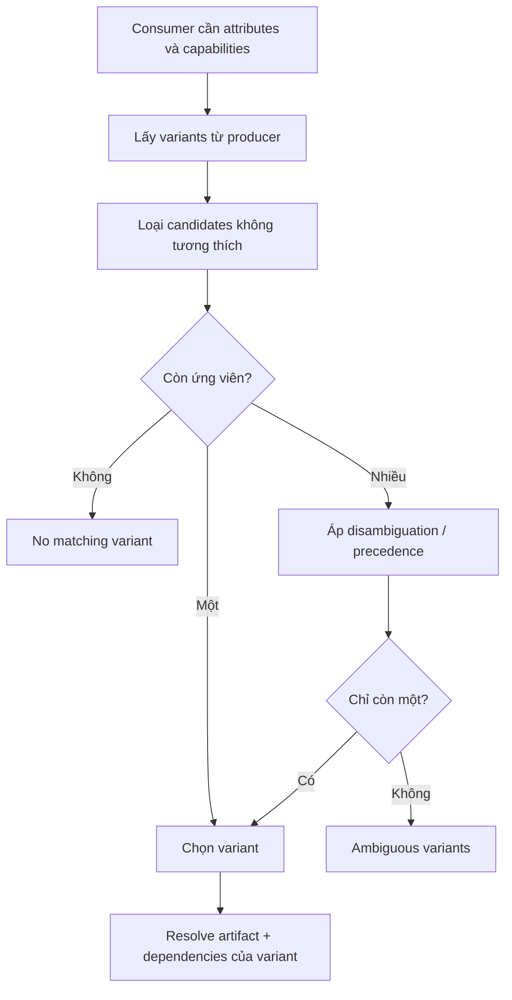

# Attributes, schema và quy tắc ghép producer với consumer trong Gradle

Khi một ứng dụng phụ thuộc vào một project hoặc module khác, Gradle không chỉ hỏi **“thư viện này có tồn tại không?”**. Nó còn phải hỏi **“trong các dạng mà thư viện cung cấp, dạng nào phù hợp với nhu cầu hiện tại?”**. Khi biên dịch Java, consumer cần API dùng cho compile classpath; khi chạy, consumer cần các thành phần runtime; với dự án nhiều nền tảng, nó có thể cần Android, JVM, Linux, Windows hoặc một biến thể được tạo cho một phiên bản Java nhất định.

Gradle giải quyết bằng **variant-aware dependency resolution**. Producer công bố **variants** cùng các **attributes** mô tả từng variant. Consumer công bố các attributes cần thiết trên **resolvable configuration**. Gradle đối chiếu theo **attribute schema**, các **compatibility rules**, **disambiguation rules** và thứ tự ưu tiên thuộc tính để chọn variant phù hợp — hoặc báo lỗi rõ ràng khi không thể chọn an toàn.

Bài học thuộc nhóm **Variant và capability** của Build Tool Gradle, tập trung đúng chủ đề **“Attributes, schema và quy tắc ghép producer với consumer”**. Nội dung bao gồm khái niệm, thuật toán chọn, các attribute chuẩn, cách viết schema/rules tùy chỉnh, ví dụ Java 17 chạy được và công cụ chẩn đoán.

## 1. Mô hình tối thiểu: component → variants → artifacts và dependencies

Một **component** (ví dụ `org.example:shared-lib:1.0` hoặc project `:lib`) có thể cung cấp nhiều **variant**. Mỗi variant thường mang:

- Một tập **attributes** để mô tả mục đích, môi trường, hình thức artifact.
- Một hoặc nhiều **artifacts** (JAR, thư mục classes, file tài liệu...).
- Các **dependencies** và dependency constraints tương ứng với variant.
- Một hoặc nhiều **capabilities** để cho biết chức năng mà component/variant cung cấp.

Ví dụ ý niệm của Java Library plugin:

```text
Component: :lib
├── variant apiElements
│   ├── org.gradle.category=library
│   ├── org.gradle.usage=java-api
│   ├── org.gradle.libraryelements=jar
│   ├── artifact: lib.jar
│   └── dependencies: phần cần cho API của consumer
│
└── variant runtimeElements
    ├── org.gradle.category=library
    ├── org.gradle.usage=java-runtime
    ├── org.gradle.libraryelements=jar
    ├── artifact: lib.jar
    └── dependencies: phần cần ở runtime
```

Cùng một JAR có thể xuất hiện ở hai variants, nhưng **dependency graph liên quan** không nhất thiết giống nhau. Ví dụ Java Library plugin phân biệt `api` và `implementation` để quyết định dependency nào được lộ trên compile classpath của consumer.

**Variant không phải version.** Một component phiên bản `1.0` có thể có nhiều variant. Chọn `runtimeElements` thay `apiElements` không có nghĩa nâng version của component từ `1.0` lên `2.0`.

**Variant cũng không đồng nghĩa một file.** Sau khi chọn variant để lập dependency graph, Gradle còn có bước chọn artifact, có thể sử dụng **secondary variants** như thư mục classes hoặc artifact transform phù hợp.

## 2. Producer và consumer là hai vai trò đối xứng

**Producer** là project/module **cung cấp** những gì có thể được tiêu thụ; **consumer** là project/configuration **yêu cầu** những gì nó cần.



Ví dụ thực tế:

- `:app` là consumer, có `compileClasspath` với `org.gradle.usage=java-api`.
- `:lib` là producer, công bố `apiElements` (`java-api`) và `runtimeElements` (`java-runtime`).
- Khi `:app:compileJava` cần classpath, Gradle chọn biến thể phù hợp để lấy API.
- Khi `:app:run` cần runtime classpath, Gradle chọn phần có mục đích chạy ứng dụng.
- Cùng một dependency declaration `implementation project(':lib')` có thể được giải quyết theo **những attributes khác nhau** ở compile và runtime.

Đây là lý do Gradle không yêu cầu bạn viết `project(path: ':lib', configuration: 'apiElements')` cho mọi tình huống. Consumer mô tả **nhu cầu**, producer mô tả **khả năng**, còn Gradle chọn theo quy tắc.

### Bảng vai trò configuration

| Vai trò | Cờ chính | Ví dụ | Chức năng |
| --- | --- | --- | --- |
| **Declarable / dependency scope** | `canBeDeclared=true` | `implementation`, `api` | Nơi khai báo dependency, không phải nơi resolve thành file. |
| **Resolvable** | `canBeResolved=true` | `compileClasspath`, `runtimeClasspath` | Consumer: có attributes yêu cầu; resolve dependencies ra kết quả cụ thể. |
| **Consumable** | `canBeConsumed=true` | `apiElements`, `runtimeElements` | Producer: công bố variant cho project/module khác. |

Trong thiết kế mới, một configuration thường nên giữ **một vai trò**: không biến nó vừa là kho khai báo, vừa là consumer, vừa là producer. Những phiên bản Gradle mới có factory như `configurations.dependencyScope(...)`, `configurations.resolvable(...)`, `configurations.consumable(...)`; với các phiên bản cũ hơn có thể phải thiết lập cờ `canBeDeclared`, `canBeResolved`, `canBeConsumed` thủ công.

**Tên configuration không phải tiêu chí ghép chính.** Gradle không mặc nhiên chọn `runtimeElements` vì consumer có chữ `runtime` trong tên. Nó ghép bằng attributes/capabilities theo mô hình resolution. Tên variant chủ yếu hữu ích để xem report và đọc thông báo lỗi.

## 3. Attribute là khóa có kiểu, không chỉ là chuỗi tùy ý

Mỗi attribute được nhận diện bằng một **tên** và một **kiểu giá trị**:

```groovy
// build.gradle — mảnh Groovy DSL
import org.gradle.api.attributes.Attribute

def TIER = Attribute.of('com.example.tier', String)
def LEVEL = Attribute.of('com.example.level', Integer)
```

Ở đây:

- `com.example.tier` là **tên attribute** dạng namespaced.
- `String` là **kiểu**; giá trị có thể là `'basic'`, `'premium'`...
- `com.example.level` nhận `Integer`, không thể âm thầm truyền một chuỗi `'17'` thay cho số nguyên `17`.
- Producer và consumer phải thống nhất **cả tên lẫn kiểu**. Chỉ trùng chữ tên nhưng khác kiểu không tạo ra một hợp đồng tương thích.

Gradle cũng có nhiều attribute với kiểu là một interface con của `Named`, như `Usage`, `Category`, `LibraryElements` và `Bundling`. Giá trị của các attribute kiểu `Named` nên được tạo qua `ObjectFactory`:

```groovy
// Mảnh cấu hình
def runtimeUsage = objects.named(Usage, Usage.JAVA_RUNTIME)
def libraryCategory = objects.named(Category, Category.LIBRARY)
```

Khi bạn thấy:

```text
org.gradle.usage = java-runtime
```

đó là **cách report hiển thị** tên giá trị. Trong API, khóa chuẩn thường là `Usage.USAGE_ATTRIBUTE`, có kiểu `Usage`; không nên thay nó bằng một attribute mới tên giống hệt nhưng kiểu `String`.

### Attribute container ở hai phía

Producer công bố khả năng:

```groovy
// Trong một consumable configuration, minh họa
attributes {
    attribute(TIER, 'premium')
}
```

Consumer công bố yêu cầu:

```groovy
// Trong một resolvable configuration, minh họa
attributes {
    attribute(TIER, 'premium')
}
```

Cả hai dùng cùng khóa `TIER`. Tuy nhiên, đặt `attribute` trên **dependency declaration** cũng có thể bổ sung yêu cầu riêng cho dependency ấy; do đó khi debug phải kiểm tra attributes của configuration **và** những overrides ở dependency/artifact view khi có.

## 4. Các attribute chuẩn nên biết trong hệ sinh thái Gradle

| Attribute | Kiểu/giá trị thường gặp | Diễn giải |
| --- | --- | --- |
| `org.gradle.usage` | `java-api`, `java-runtime` | Artifact/dependency dùng cho biên dịch hay chạy. |
| `org.gradle.category` | `library`, `platform`, `documentation`, `verification` | Đây là thư viện, nền tảng dependency, tài liệu hay kết quả kiểm tra. |
| `org.gradle.libraryelements` | `jar`, `classes`, `resources` | Kiểu thành phần thư viện mong nhận. |
| `org.gradle.dependency.bundling` | `external`, `embedded`, `shadowed` | Dependency được cung cấp riêng hay đã được nhúng/đóng gói. |
| `org.gradle.jvm.version` | Số nguyên như `8`, `11`, `17` | Phiên bản Java tối thiểu mà variant producer yêu cầu để chạy. |
| `org.gradle.jvm.environment` | `standard-jvm`, `android` | Môi trường JVM mà variant hướng đến. |
| `org.gradle.docstype` | `sources`, `javadoc` hoặc loại tài liệu khác | Phân biệt loại documentation artifact. |
| `org.gradle.plugin.api-version` | Version Gradle plugin API | Giúp plugin variant thể hiện mức tương thích với bản Gradle chạy. |

Các giá trị và quy tắc mặc định tùy hệ sinh thái/plugin. Trong JVM world, những quy tắc đáng nhớ là:

- `java-runtime` có thể **tương thích** khi consumer cần `java-api` trong một số trường hợp, nhưng chiều ngược lại không được suy ra. Nếu cả API và runtime variants phù hợp, Gradle ưu tiên theo **usage** được yêu cầu và quy tắc disambiguation.
- Với `org.gradle.jvm.version`, producer target Java **thấp hơn hoặc bằng** Java mà consumer có thể sử dụng thường là tương thích. Gradle có thể ưu tiên bản **cao nhất vẫn tương thích** khi nhiều variants đủ điều kiện.
- `org.gradle.libraryelements=jar` có thể tương thích với yêu cầu `classes` theo quy tắc JVM; việc cuối cùng consumer nhận JAR hay thư mục classes còn liên quan **artifact selection**.
- `org.gradle.category=library` không thay thế `category=platform` vô điều kiện; đây là hai loại component khác mục đích.
- Với `org.gradle.jvm.environment`, nhiều giá trị có thể tương thích và quy tắc ưu tiên giúp chọn biến thể phù hợp hơn.

**Không tự suy ra quy tắc chung từ tên giá trị.** Chẳng hạn, `premium` không tự động tương thích `basic` chỉ vì con người thấy “premium bao gồm basic”. Bạn phải mô tả quan hệ ấy bằng **compatibility rule** nếu Gradle chưa có.

### JVM version và Java toolchain

`JavaLanguageVersion.of(17)` trong `java.toolchain` giúp Gradle chọn compiler/toolchain Java 17 cho task; Java plugin còn công bố hoặc yêu cầu thông tin JVM variant theo cấu hình thích hợp. Trong trường hợp bạn quản lý bytecode bằng cách khác, cần bảo đảm `targetCompatibility` / `options.release` và metadata JVM được công bố nhất quán.

**Không đặt `org.gradle.jvm.version=8` bằng tay trên một JAR đã biên dịch ra class file đòi Java 17** chỉ để né lỗi resolution. Khi đó Gradle có thể chấp nhận variant nhưng JVM 8 thật sẽ báo `UnsupportedClassVersionError`. Metadata phải phản ánh khả năng thực tế.

## 5. Ghép variant diễn ra theo những bước nào?

Một cách mô tả dễ nhớ là:

1. **Tìm candidates:** producer có những variants nào có thể tiêu thụ?
2. **Compatibility:** so yêu cầu consumer với attributes producer. Giá trị bằng nhau thường tương thích; khác nhau có thể được rule cho phép hoặc bị loại.
3. **Disambiguation:** nếu còn nhiều candidates, chọn bản “tốt nhất” bằng rules và thứ tự ưu tiên attributes.
4. **Kết luận:** một variant phù hợp được chọn, hoặc Gradle báo không có/mơ hồ và cung cấp thông tin chẩn đoán.
5. **Artifact resolution:** sau graph selection, Gradle lựa chọn artifact/secondary variant hay transform để đáp ứng định dạng thực tế.

Đây là mô hình học tập; thuật toán thực tế có thêm bước xem số thuộc tính trùng khớp, sự vắng mặt của attribute, thuộc tính phụ và attribute precedence.



### 5.1. Compatibility rule trả lời câu hỏi gì?

**“Variant producer này có thể đáp ứng yêu cầu consumer không?”** Ví dụ consumer có thể chạy trên Java 17, producer cung cấp bytecode Java 11; thông thường có thể chấp nhận. Nhưng producer bytecode Java 21 không thể chạy trên môi trường chỉ Java 17, nên bị loại.

Một compatibility rule có thể cho phép **giá trị khác nhau** vẫn tương thích. Nó không nói “hãy luôn chọn variant này”. Nếu có nhiều candidates phù hợp, cần **disambiguation**.

### 5.2. Disambiguation rule trả lời câu hỏi gì?

**“Khi có nhiều variants đều tương thích, nên chọn cái nào?”**

Ví dụ producer cung cấp Java 8 và Java 11; consumer dùng Java 17. Cả hai có thể tương thích. Quy tắc JVM thường ưu tiên **Java 11** vì đó là bản cao nhất vẫn chạy trên Java 17, giả sử không có attribute/rule khác chi phối.

Một rule tùy chỉnh có thể ưu tiên `premium` thay `basic` trong nhóm candidates tương thích. Đó là chính sách riêng của hệ thống, **không phải quy tắc mặc định của Gradle** cho những tên đó.

### 5.3. Tại sao attribute thiếu không phải luôn bị loại?

Giả sử consumer yêu cầu attribute `com.example.tier=premium`, nhưng producer từ một metadata cũ không công bố attribute `com.example.tier`. Gradle có thể xem candidate **thiếu thông tin**, chứ không tự động coi nó mang giá trị `basic` hoặc chắc chắn không tương thích.

Việc thiếu attribute ảnh hưởng bước so khớp và bước phân giải mơ hồ; với nhiều candidates, các variant có giá trị rõ ràng hoặc tương thích cụ thể thường được phân biệt theo các quy tắc khác. Vì thế **không nên coi thiếu attribute là “tương đương wildcard”** khi thiết kế một ecosystem mới.

Khi mở rộng plugin hoặc module công bố ra bên ngoài, nên **khai báo attributes rõ ràng trên consumable variants**, kể cả khi chỉ có một variant, để người dùng không phải dựa vào fallback/legacy selection.

### 5.4. Thứ tự ưu tiên của attributes cũng quan trọng

Khi nhiều attributes đều có quy tắc disambiguation, thứ tự kiểm tra có thể quyết định candidate nào bị loại trước. Trong JVM ecosystem, `org.gradle.usage` được ưu tiên cao hơn `org.gradle.libraryelements`. Vì vậy đừng thiết kế logic dựa trên một thuộc tính đóng gói như `jar` mà quên nhu cầu chính `java-api` hay `java-runtime`.

Trong schema có thể định nghĩa **attribute precedence**, nhưng chỉ nên tùy chỉnh nếu bạn đang phát triển một ecosystem/plugin có chính sách rõ ràng và đã kiểm thử xung đột; không cần viết lại quy tắc Java chuẩn cho ứng dụng thông thường.

## 6. Minh họa: compileClasspath và runtimeClasspath chọn gì?

Giả sử một producer Java Library có:

| Variant | `org.gradle.usage` | `org.gradle.jvm.version` | Ý nghĩa |
| --- | --- | --- | --- |
| `apiElements` | `java-api` | `17` | API phục vụ biên dịch. |
| `runtimeElements` | `java-runtime` | `17` | Thành phần phục vụ chạy chương trình. |

Consumer Java 17 có hai configuration:

| Consumer | `org.gradle.usage` yêu cầu | Kết quả thông thường |
| --- | --- | --- |
| `compileClasspath` | `java-api` | Chọn **apiElements** cho resolution đồ thị dependency. |
| `runtimeClasspath` | `java-runtime` | Chọn **runtimeElements** cho resolution runtime. |

Khi compile, Java plugin có thể sử dụng secondary variant `classes` thay cho JAR nếu phù hợp. Điều này **không đổi sự phân biệt** giữa API/runtime graph: chọn variant để giải dependency và chọn file artifact là hai quyết định liên quan nhưng không đồng nhất.

Nếu một producer Java Library chỉ target Java 21, một consumer yêu cầu Java 17 có thể gặp:

```text
No matching variant of project :lib was found
...
Incompatible because this component declares a component compatible with Java 21
and the consumer needed Java 17
```

Đây là **dạng thông báo minh họa**; wording thực tế tùy phiên bản Gradle và attributes. Sửa đúng bằng cách dùng thư viện được build cho Java phù hợp, nâng runtime/toolchain có kiểm soát, hoặc xây variant riêng tương thích. Không làm giả metadata chỉ để ép Gradle chọn.

## 7. Ví dụ chạy được số 1: Java 17, producer `:lib` và consumer `:app`

Ví dụ này không dùng plugin bên ngoài, không cần Maven Central và nhằm minh họa **các variants Java chuẩn**. Chuẩn bị JDK 17 và Gradle Wrapper hỗ trợ JDK 17, ví dụ Gradle 8.10.2.

Cấu trúc project:

```text
gradle-variant-lab/
├── settings.gradle
├── build.gradle
├── gradlew
├── gradlew.bat
├── gradle/wrapper/
│   ├── gradle-wrapper.jar
│   └── gradle-wrapper.properties
├── lib/
│   ├── build.gradle
│   └── src/main/java/demo/lib/Greeter.java
└── app/
    ├── build.gradle
    └── src/main/java/demo/app/Main.java
```

Các file Wrapper là file được Gradle tạo, không nên tự điền nội dung giả. Nếu máy đã có Gradle phù hợp, tạo một lần từ root bằng:

```bash
gradle wrapper --gradle-version 8.10.2
```

Sau đó dùng `./gradlew` trên Linux/macOS, hoặc `gradlew.bat` trên Windows. Nếu nhóm đã có Wrapper, giữ nguyên bản đã duyệt.

**`settings.gradle`:**

```groovy
rootProject.name = 'gradle-variant-lab'
include 'lib', 'app'
```

**`build.gradle` (root):**

```groovy
// Root build để trống: mỗi subproject áp dụng plugin đúng vai trò.
```

**`lib/build.gradle` (producer):**

```groovy
plugins {
    id 'java-library'
}

group = 'demo.example'
version = '1.0.0'

java {
    toolchain {
        languageVersion = JavaLanguageVersion.of(17)
    }
}
```

**`lib/src/main/java/demo/lib/Greeter.java`:**

```java
package demo.lib;

public final class Greeter {
    private Greeter() {
    }

    public static String message(String name) {
        return "Hello, " + name + "!";
    }
}
```

**`app/build.gradle` (consumer):**

```groovy
plugins {
    id 'application'
}

java {
    toolchain {
        languageVersion = JavaLanguageVersion.of(17)
    }
}

dependencies {
    implementation project(':lib')
}

application {
    mainClass = 'demo.app.Main'
}
```

**`app/src/main/java/demo/app/Main.java`:**

```java
package demo.app;

import demo.lib.Greeter;

public final class Main {
    private Main() {
    }

    public static void main(String[] args) {
        System.out.println(Greeter.message("Gradle variants"));
    }
}
```

Chạy từ root:

```bash
./gradlew -q :app:run
```

Dòng stdout do ứng dụng Java in ra là:

```text
Hello, Gradle variants!
```

Giải thích từng giai đoạn:

1. `:lib` dùng `java-library`, Gradle tạo các **outgoing variants** mặc định như `apiElements` và `runtimeElements`.
2. `:app` dùng `application`, đồng thời có các **resolvable configurations** như `compileClasspath` và `runtimeClasspath`.
3. `implementation project(':lib')` khai báo một dependency vào component `:lib` chứ không chỉ định tên configuration producer.
4. Khi biên dịch `:app`, Gradle lựa chọn variant cho compile (usage `java-api`) và dựng classpath phù hợp.
5. Khi chạy `:app:run`, Gradle giải quyết runtime classpath với usage `java-runtime`.
6. `Greeter.message(...)` được biên dịch từ Java 17 và gọi thành công qua dependency project.

### 7.1. Tự kiểm chứng bằng Java compiler/runtime

Nếu muốn chạy Java 17 **không qua Gradle**, sau khi tạo đủ các file Java ở trên:

```bash
mkdir -p manual-lib manual-app
javac -d manual-lib lib/src/main/java/demo/lib/Greeter.java
javac -cp manual-lib -d manual-app app/src/main/java/demo/app/Main.java
java -cp manual-lib:manual-app demo.app.Main
```

Stdout vẫn là:

```text
Hello, Gradle variants!
```

Trên Windows, dấu phân cách classpath là `;` và lệnh cuối là:

```powershell
java -cp "manual-lib;manual-app" demo.app.Main
```

Đây là bước kiểm tra rằng **mã Java tự nó chạy được**. Nó không mô phỏng toàn bộ variant resolution của Gradle; phần variant nằm ở cấu hình build và các diagnostic tasks sau.

### 7.2. Xem outgoing variants của producer

```bash
./gradlew :lib:outgoingVariants -q
```

Các trường thông tin quan trọng cần tìm trong output:

```text
Variant apiElements
  ...
  org.gradle.usage = java-api

Variant runtimeElements
  ...
  org.gradle.usage = java-runtime
```

Đây là **trích đoạn diễn giải**, không phải stdout đầy đủ. Gradle còn hiển thị category, bundling, JVM version, library elements, capabilities, artifacts và secondary variants tùy phiên bản. Tên artifact ở root project lab có thể chứa `lib-1.0.0.jar`.

### 7.3. Xem yêu cầu của consumer

```bash
./gradlew :app:resolvableConfigurations -q
```

Tìm các configurations `compileClasspath` và `runtimeClasspath`; nhìn `org.gradle.usage`, `org.gradle.jvm.version`, `org.gradle.libraryelements`, `org.gradle.category`.

Có thể lọc lệnh theo API task của Gradle phiên bản đang dùng nếu cần, nhưng không nên suy diễn attributes từ mỗi tên configuration.

### 7.4. Đối chiếu dependency graph

```bash
./gradlew :app:dependencies --configuration compileClasspath
./gradlew :app:dependencies --configuration runtimeClasspath
./gradlew :app:dependencyInsight --configuration runtimeClasspath --dependency lib
```

Output phụ thuộc phiên bản Gradle, nhưng cần thấy dependency `project :lib` trong đồ thị và lựa chọn variant phù hợp với runtime. `dependencyInsight` đặc biệt hữu ích khi cần hiểu vì sao một variant/version được chọn.

## 8. Attribute schema: “luật chơi” chung cho một tên attribute

**Attribute schema** là tập các định nghĩa và quy tắc Gradle sử dụng để **so khớp** attributes trong dependency resolution. Nó không phải XML Schema, JSON Schema hay file cấu hình bắt buộc phải lưu ở đâu đó.

Tại build script hoặc plugin, API quan trọng là:

```groovy
import org.gradle.api.attributes.Attribute

def TIER = Attribute.of('com.example.tier', String)

dependencies.attributesSchema {
    attribute(TIER)
}
```

Đoạn này **đăng ký tên+kiểu attribute** vào schema của dependency handler hiện tại. Nhưng nó chưa mô tả rằng `'premium'` tương thích với `'basic'`; nếu chỉ có mặc định, hai giá trị khác nhau thường không tương thích cho custom String attribute.

Muốn thay đổi logic, thêm:

```groovy
dependencies.attributesSchema {
    attribute(TIER) {
        compatibilityRules.add(TierCompatibilityRule)
        disambiguationRules.add(TierDisambiguationRule)
    }
}
```

Đây là **mảnh khung**: bạn phải cung cấp hai class rule thật, ví dụ đầy đủ nằm ở mục 10. Không copy đoạn trên một mình khi class chưa được khai báo.

### Ai nên khai báo schema?

- **Plugin của ecosystem:** nên đăng ký custom attributes và rules của nó để mọi consumer/producer cùng hiểu semantics.
- **Producer project:** khai báo attributes mô tả variants mà nó phát hành; nên dùng key/kiểu chuẩn và schema nhất quán.
- **Consumer project:** phải áp dụng schema/rules phù hợp khi yêu cầu custom variant. Quy tắc của consumer đặc biệt quan trọng vì **việc chọn** diễn ra khi consumer resolve.
- **Project dùng plugin Gradle chuẩn:** thường **không cần tự viết** schema cho `Usage`, `Category`, `LibraryElements`, JVM version; core ecosystem plugin đã cung cấp nhiều quy tắc.

Khi publish custom variants thành thư viện cho tổ chức hoặc cộng đồng, bạn phải bảo đảm consumer cũng có cách hiểu attributes qua plugin hoặc convention chung. Công bố một attribute tùy chỉnh mà không công bố hợp đồng compatibility/disambiguation sẽ khiến người dùng khó giải quyết khi nhiều variants xuất hiện.

## 9. Viết compatibility và disambiguation rules đúng nghĩa

Hai interface quan trọng:

```groovy
import org.gradle.api.attributes.AttributeCompatibilityRule
import org.gradle.api.attributes.CompatibilityCheckDetails
import org.gradle.api.attributes.AttributeDisambiguationRule
import org.gradle.api.attributes.MultipleCandidatesDetails
```

### Compatibility rule

```groovy
// Mảnh class minh họa: premium consumer được chấp nhận basic producer.
class TierCompatibilityRule implements AttributeCompatibilityRule<String> {
    @Override
    void execute(CompatibilityCheckDetails<String> details) {
        if (details.consumerValue == 'premium' &&
                details.producerValue == 'basic') {
            details.compatible()
        }
    }
}
```

Rule này nói **có thể dùng basic khi consumer muốn premium** theo một hợp đồng giả định. Bạn phải tự quyết xem logic đó có thật sự đúng nghiệp vụ hay không; trong một sản phẩm thực tế, có thể chiều ngược lại mới hợp lý. Từ `compatible()` không có nghĩa “được ưu tiên hơn mọi variant khác”.

Khi viết rule:

- Đọc `consumerValue` và `producerValue` đúng chiều.
- Đặt điều kiện hẹp; không gọi `compatible()` cho mọi giá trị một cách vô điều kiện.
- Tránh đọc filesystem, gọi network hoặc thao tác side effect trong rule; rule cần ổn định và dễ kiểm thử.
- Đảm bảo rule không làm mất các ràng buộc bảo mật hoặc tương thích runtime thật.

### Disambiguation rule

```groovy
// Mảnh class minh họa: nếu có nhiều lựa chọn, ưu tiên premium.
class TierDisambiguationRule
        implements AttributeDisambiguationRule<String> {

    @Override
    void execute(MultipleCandidatesDetails<String> details) {
        if (details.candidateValues.contains('premium')) {
            details.closestMatch('premium')
        }
    }
}
```

`candidateValues` là các giá trị attribute của những candidates còn tương thích; `closestMatch(...)` chỉ giá trị ưu tiên trong số đó. Rule này **không tự biến** variant không tương thích thành tương thích. Nếu candidate premium đã bị loại vì một attribute khác, nó không thể “hồi sinh” bằng disambiguation.

Quan trọng: **không nên thay đổi rules của built-in `org.gradle.usage` hoặc JVM version** chỉ để làm lỗi biến mất. Trong Java ecosystem, điều đó có thể khiến compile classpath nhận runtime-only dependency hoặc chọn bytecode đòi JDK cao hơn máy chạy thực tế.

## 10. Ví dụ chạy được số 2: custom attribute + hai variants + hai rules

Ví dụ này **độc lập** với project Java 17 ở mục 7. Nó dùng hai file TXT có nội dung rõ ràng để bạn có thể quan sát **variant nào được chọn**, không cần tải dependency từ internet.

Mô hình:

```text
custom-tier-lab/
├── settings.gradle
├── build.gradle
├── gradlew
├── gradlew.bat
├── gradle/wrapper/
│   ├── gradle-wrapper.jar
│   └── gradle-wrapper.properties
├── assets/
│   ├── build.gradle
│   └── variants/
│       ├── basic.txt
│       └── premium.txt
└── consumer/
    └── build.gradle
```

**`settings.gradle`:**

```groovy
rootProject.name = 'custom-tier-lab'
include 'assets', 'consumer'
```

**`build.gradle` (root):**

```groovy
// Không cần plugin ở root cho ví dụ này.
```

**`assets/variants/basic.txt`:**

```text
BASIC
```

**`assets/variants/premium.txt`:**

```text
PREMIUM
```

**`assets/build.gradle` — producer:**

```groovy
import org.gradle.api.attributes.Attribute
import org.gradle.api.attributes.Category

def TIER = Attribute.of('com.example.tier', String)

dependencies.attributesSchema {
    attribute(TIER)
}

def docsCategory = objects.named(Category, Category.DOCUMENTATION)

// Hai consumable configurations = hai variants.
configurations {
    basicElements {
        canBeConsumed = true
        canBeResolved = false
        canBeDeclared = false
        attributes {
            attribute(Category.CATEGORY_ATTRIBUTE, docsCategory)
            attribute(TIER, 'basic')
        }
    }

    premiumElements {
        canBeConsumed = true
        canBeResolved = false
        canBeDeclared = false
        attributes {
            attribute(Category.CATEGORY_ATTRIBUTE, docsCategory)
            attribute(TIER, 'premium')
        }
    }
}

// File nguồn đã có sẵn trong repo; không cần task tạo ra nó.
artifacts {
    add('basicElements', file('variants/basic.txt'))
    add('premiumElements', file('variants/premium.txt'))
}
```

Hai variants khác nhau ở **`com.example.tier`**, trong khi cả hai đều là tài liệu (`Category.DOCUMENTATION`). `artifacts` gắn đúng file với configuration tương ứng. Trong build thật, nếu file là output được sinh ra bởi task, phải liên kết artifact với task/provider producer để Gradle biết task dependency; ở đây file được commit sẵn nên không cần producer task.

**`consumer/build.gradle` — consumer, schema và rules:**

```groovy
import org.gradle.api.attributes.Attribute
import org.gradle.api.attributes.Category
import org.gradle.api.attributes.AttributeCompatibilityRule
import org.gradle.api.attributes.CompatibilityCheckDetails
import org.gradle.api.attributes.AttributeDisambiguationRule
import org.gradle.api.attributes.MultipleCandidatesDetails

// Ví dụ giả định consumer hạng gold có thể dùng basic hoặc premium.
class GoldCompatibilityRule implements AttributeCompatibilityRule<String> {
    @Override
    void execute(CompatibilityCheckDetails<String> details) {
        if (details.consumerValue == 'gold' &&
                ['basic', 'premium'].contains(details.producerValue)) {
            details.compatible()
        }
    }
}

// Khi nhiều tier tương thích, ưu tiên premium.
class PreferPremiumRule implements AttributeDisambiguationRule<String> {
    @Override
    void execute(MultipleCandidatesDetails<String> details) {
        if (details.candidateValues.contains('premium')) {
            details.closestMatch('premium')
        }
    }
}

def TIER = Attribute.of('com.example.tier', String)
def docsCategory = objects.named(Category, Category.DOCUMENTATION)

// Rules được đăng ký ở bên CONSUMER đang giải quyết dependency.
dependencies.attributesSchema {
    attribute(TIER) {
        compatibilityRules.add(GoldCompatibilityRule)
        disambiguationRules.add(PreferPremiumRule)
    }
}

configurations {
    docsBasic {
        canBeResolved = true
        canBeConsumed = false
        canBeDeclared = false
        attributes {
            attribute(Category.CATEGORY_ATTRIBUTE, docsCategory)
            attribute(TIER, 'basic')
        }
    }

    docsGold {
        canBeResolved = true
        canBeConsumed = false
        canBeDeclared = false
        attributes {
            attribute(Category.CATEGORY_ATTRIBUTE, docsCategory)
            attribute(TIER, 'gold')
        }
    }
}

dependencies {
    docsBasic project(':assets')
    docsGold project(':assets')
}

// Task chẩn đoán: giải quyết hai resolvable configurations.
tasks.register('showSelected') {
    group = 'learning'
    doLast {
        println 'basic=' + configurations.docsBasic.singleFile.text.trim()
        println 'gold=' + configurations.docsGold.singleFile.text.trim()
    }
}
```

**Chạy:**

```bash
./gradlew -q :consumer:showSelected
```

Với hai file TXT và đúng quy tắc nêu trên, stdout của task là:

```text
basic=BASIC
gold=PREMIUM
```

Giải thích từng dòng:

1. `docsBasic` yêu cầu `tier=basic`. Producer có variant `basicElements` trùng khớp, còn `premiumElements` không được compatibility rule này chấp nhận cho yêu cầu `basic`. Kết quả là file `basic.txt`.
2. `docsGold` yêu cầu `tier=gold`, trong khi producer không có variant nào mang giá trị `gold`.
3. `GoldCompatibilityRule` cho phép **cả basic và premium** đáp ứng yêu cầu `gold`.
4. Vì còn **hai candidates tương thích**, `PreferPremiumRule` đánh dấu `premium` là gần yêu cầu nhất.
5. Gradle chọn `premiumElements`, và task đọc file `premium.txt`.

Không có “phép màu” nào ở tên `docsGold`: chính attributes và rules giải quyết biến thể, còn tên configuration chỉ giúp ta tổ chức cấu hình.

### 10.1. Thử bỏ compatibility rule

Nếu **chỉ** bỏ đăng ký `compatibilityRules.add(GoldCompatibilityRule)` ở consumer, `docsGold` yêu cầu `gold` nhưng producer chỉ có `basic` và `premium`. Với custom String attribute và không có rule cho quan hệ khác giá trị, Gradle không tìm thấy variant tương thích và báo **no matching variant**. `docsBasic` vẫn có thể resolve.

### 10.2. Thử bỏ disambiguation rule

Nếu giữ compatibility rule nhưng bỏ `disambiguationRules.add(PreferPremiumRule)`, `docsGold` có thể có **nhiều biến thể đều tương thích** mà không có cách chọn duy nhất; Gradle báo **ambiguous variants** thay vì tự coi `premium` cao cấp hơn theo tên. Điều đó minh họa disambiguation không phải phần trang trí.

### 10.3. Thử đổi consumer yêu cầu `premium`

Nếu đổi:

```groovy
attribute(TIER, 'premium')
```

trong `docsGold`, producer có một variant `premiumElements` **trùng giá trị**, nên không cần compatibility rule tùy chỉnh để cho phép `gold` nữa. Đây là lý do nên yêu cầu chính xác khi bạn biết rõ cần gì, và chỉ dùng fallback rule khi có hợp đồng tương thích.

### 10.4. Xem producer và consumer report

```bash
./gradlew :assets:outgoingVariants -q
./gradlew :consumer:resolvableConfigurations -q
```

Tìm:

- Phía producer: `basicElements` và `premiumElements`, cùng `org.gradle.category=documentation`, khác `com.example.tier`.
- Phía consumer: `docsBasic` và `docsGold`, cùng category, khác tier yêu cầu.
- Khi resolution xảy ra, rule từ schema ở consumer quyết định cách ghép.

Đây là một mô hình nhỏ có kiểm soát. Với Gradle/plugin phiên bản khác, định dạng report có thể khác; không nên kiểm tra bài bằng cách khớp nguyên văn toàn stdout của Gradle.

## 11. Viết ví dụ tương đương Kotlin DSL

Mô hình không phụ thuộc vào Groovy. Kotlin DSL sử dụng generic syntax và lambda khác:

**`assets/build.gradle.kts` (mảnh config):**

```kotlin
import org.gradle.api.attributes.Attribute
import org.gradle.api.attributes.Category

val tier = Attribute.of("com.example.tier", String::class.java)
dependencies.attributesSchema.attribute(tier)

val docsCategory = objects.named(Category::class.java, Category.DOCUMENTATION)

val basic = configurations.consumable("basicElements") {
    attributes {
        attribute(Category.CATEGORY_ATTRIBUTE, docsCategory)
        attribute(tier, "basic")
    }
    outgoing.artifact(file("variants/basic.txt"))
}

val premium = configurations.consumable("premiumElements") {
    attributes {
        attribute(Category.CATEGORY_ATTRIBUTE, docsCategory)
        attribute(tier, "premium")
    }
    outgoing.artifact(file("variants/premium.txt"))
}
```

Mảnh này dùng `configurations.consumable` trong Gradle hỗ trợ API đó (Gradle 8.4+); không trộn vào cùng một project đã tạo `basicElements`/`premiumElements` bằng Groovy DSL.

**`consumer/build.gradle.kts` (mảnh config):**

```kotlin
import org.gradle.api.attributes.Attribute
import org.gradle.api.attributes.Category

val tier = Attribute.of("com.example.tier", String::class.java)
val docsCategory = objects.named(Category::class.java, Category.DOCUMENTATION)

dependencies.attributesSchema.attribute(tier)

val docsBasic = configurations.resolvable("docsBasic") {
    attributes {
        attribute(Category.CATEGORY_ATTRIBUTE, docsCategory)
        attribute(tier, "basic")
    }
}

dependencies {
    add(docsBasic.name, project(":assets"))
}
```

Đoạn Kotlin chỉ minh họa **khai báo type-safe attributes và configuration roles**, chưa triển khai `GoldCompatibilityRule`/`PreferPremiumRule`. Để có hành vi `gold` như ví dụ Groovy, phải thêm các class Kotlin triển khai `AttributeCompatibilityRule<String>` và `AttributeDisambiguationRule<String>`, rồi đăng ký ở schema của consumer; không thể kỳ vọng Kotlin tự nội suy quan hệ `gold` với `premium`.

Tương đương phương thức đăng ký rule trong Kotlin:

```kotlin
dependencies.attributesSchema {
    attribute(tier) {
        compatibilityRules.add(GoldCompatibilityRule::class.java)
        disambiguationRules.add(PreferPremiumRule::class.java)
    }
}
```

Đây chỉ là **mảnh cú pháp**: hai class cần được cung cấp như trong một plugin/build logic Kotlin hợp lệ. Mục tiêu là không lẫn **cú pháp DSL** với **ngữ nghĩa matching**.

## 12. Đối chiếu giữa compatibility và disambiguation qua bảng

Giả định một producer có ba variants với attribute `tier`:

| Variant | `tier` |
| --- | --- |
| `basicElements` | `basic` |
| `premiumElements` | `premium` |
| `enterpriseElements` | `enterprise` |

Consumer muốn `gold`; schema chỉ chấp nhận basic/premium cho gold; disambiguation thích premium.

| Candidate | Có tương thích `gold`? | Lý do | Kết quả |
| --- | --- | --- | --- |
| `basicElements` | Có | Compatibility rule cho phép. | Vào vòng disambiguation. |
| `premiumElements` | Có | Compatibility rule cho phép. | **Được chọn** vì ưu tiên premium. |
| `enterpriseElements` | Không | Không có rule chấp nhận. | Bị loại trước khi chọn. |

**Khác biệt tư duy:**

- Compatibility làm thay đổi **tập candidates được phép xét**.
- Disambiguation chọn **một candidate trong tập còn lại**.
- Nếu không có candidate: **no matching variant**.
- Nếu vẫn còn nhiều candidate ngang nhau: **ambiguous variants**.
- Nếu chỉ có một candidate: không cần gọi disambiguation để chọn giữa nhiều cái nữa.

Trong project lab ở mục 10 chỉ tạo hai variants basic/premium nên không có enterprise; bảng trên là tình huống bổ sung để luyện suy luận.

## 13. Khác biệt giữa “mismatch attribute” và “không có capability”

Phạm vi bài này thuộc nhóm Variant và capability, nên cần biết **capability** có vai trò riêng.

- **Attribute:** mô tả *dạng* component mà consumer cần; ví dụ `usage=java-api`, `tier=premium`.
- **Capability:** mô tả *chức năng/identity* mà component/variant cung cấp; có thể dùng để yêu cầu một tính năng cụ thể hoặc phát hiện nhiều modules cung cấp cùng một capability.
- **Module/version:** mô tả *component nào và phiên bản nào* được yêu cầu.
- **Artifact:** file/dữ liệu thực tế được tải hoặc được task tạo.

Ví dụ producer có hai variants `debug` và `release` cùng cung cấp capability mặc định. Attributes giúp chọn debug/release theo nhu cầu. Một feature variant đặc biệt có thể công bố capability khác để consumer yêu cầu tính năng ấy. Khi hai modules khác nhau cùng công bố một capability, Gradle có thể phát hiện **capability conflict**: đó không phải lỗi “mismatch usage”.

Với Java Library plugin, default capability thường gắn với `group:name:version`. Custom configurations công bố như variants trong cùng project có thể cùng capability mặc định nếu bạn không khai báo khác.

**Không dùng custom attribute để che một capability conflict.** Trước tiên xác định đó là xung đột chức năng giữa các modules hay lỗi chọn dạng artifact trong cùng một component.

## 14. Gradle Module Metadata, Maven POM và giới hạn của thông tin variant

Gradle Module Metadata (file `.module`) có thể công bố thông tin **variants, attributes, dependencies, capabilities** chi tiết hơn metadata truyền thống của Maven POM.

Với Maven POM:

- POM có các dependency scopes và artifact coordinates, nhưng **không có mô hình variant phong phú nguyên bản như Gradle**.
- Gradle có thể **suy ra các variants** phù hợp từ thông tin POM để tích hợp vào variant-aware resolution.
- Nhưng những custom attributes không được publish/biểu diễn bằng metadata phù hợp có thể không đến được consumer như tác giả plugin kỳ vọng.

Vì thế, nếu một producer được publish ra Maven repository nhưng consumer không thấy `com.example.tier`, đừng mặc định Gradle hỏng. Kiểm tra:

1. Producer có công bố đúng consumable variants và attributes không?
2. Publication có gắn variants vào component được publish không?
3. Artifact có `.module` metadata không và repository có phục vụ file ấy không?
4. Consumer có chấp nhận Gradle Module Metadata trong repository configuration không?
5. Có rule thay đổi metadata hoặc version substitution không?
6. Consumer có cùng schema/attribute type/rule không?

**Không tự ghép file `.module` bằng tay để “chữa” mismatch** nếu chưa hiểu publish model; ưu tiên dùng plugin/publishing API của Gradle. Ví dụ project dependency trực tiếp giữa hai subprojects không yêu cầu publish để thấy variants của nhau.

## 15. Secondary variants và artifact transforms không phải cùng một phép chọn

Một Java Library có thể có `apiElements` và `runtimeElements` là **primary graph variants**; trong đó có secondary artifact variants như `classes` hoặc `resources`.

Quy trình khái niệm:

```text
Consumer compileClasspath
        │
        ▼
Chọn API graph variant (apiElements)
        │
        ▼
Chọn artifact phù hợp:
- JAR của library, hoặc
- classes directory nếu được hỗ trợ, hoặc
- artifact transform nếu có quy tắc chuyển đổi
```

Điểm quan trọng:

- Secondary variant thường phục vụ **artifact selection**, không nhất thiết mang dependency graph riêng như primary variant.
- Artifact transform có thể chuyển từ loại artifact đang có sang loại consumer cần; ví dụ từ JAR chưa xử lý sang JAR đã được instrument.
- Không có nghĩa Gradle “biên dịch lại dependency theo Java 17” khi thấy mismatched `org.gradle.jvm.version`.
- **Không sửa khả năng tương thích JVM thực tế** bằng artifact transform thông thường; đây là vấn đề target bytecode/API.

Khi debug lỗi `No matching variant`, phải xem nó xảy ra trong **graph selection** hay **artifact resolution**. Thông báo lỗi, attributes, biến thể sẵn có và transform chain sẽ cho manh mối khác nhau.

## 16. Debug bằng các report chính thức của Gradle

Các lệnh nên biết trong multi-project build:

```bash
# Producer cung cấp những variants nào?
./gradlew :lib:outgoingVariants -q

# Chỉ xem variant cụ thể (nếu Gradle hỗ trợ option này).
./gradlew :lib:outgoingVariants --variant apiElements

# Consumer yêu cầu những attributes nào?
./gradlew :app:resolvableConfigurations -q

# Xem graph dependency của một configuration.
./gradlew :app:dependencies --configuration runtimeClasspath

# Vì sao một dependency được chọn?
./gradlew :app:dependencyInsight --configuration runtimeClasspath --dependency lib

# Thêm thông tin khi lỗi resolution.
./gradlew :app:dependencies --configuration runtimeClasspath --info
./gradlew :app:dependencies --configuration runtimeClasspath --stacktrace
```

Chọn `compileClasspath` hoặc `runtimeClasspath` theo task thực sự thất bại. Các report in cả values từ producer và consumer; không nên chỉ nhìn một phía.

### Checklist đọc lỗi no matching variant

Với dạng lỗi:

```text
No matching variant of project :lib was found
...
The consumer was configured to find ...
...
Variant 'apiElements' ...
Variant 'runtimeElements' ...
```

Hãy kiểm tra theo trình tự:

1. Consumer yêu cầu **category** gì? `library`, `platform`, `documentation`?
2. Consumer yêu cầu **usage** gì? `java-api`, `java-runtime` hay usage của ecosystem khác?
3. Consumer yêu cầu **JVM version** bao nhiêu? Producer có bytecode tối thiểu phù hợp không?
4. Producer có outgoing variants/consumable configurations **thật** không?
5. Attributes của producer có **tên và kiểu** chính xác như consumer không?
6. Có custom compatibility rule để xử lý giá trị khác nhau khi điều đó hợp lệ không?
7. Có extra attribute làm ứng viên còn lại bị loại hay trở nên mơ hồ không?
8. Có capability yêu cầu mà producer không cung cấp không?
9. Module được publish có đầy đủ Gradle Module Metadata không?
10. Plugin/Gradle Wrapper có tương thích với metadata đang sử dụng không?

**Không chữa bằng cách gọi `compileClasspath.files` ở top-level build script rồi hard-code file**. Cách đó có thể ép dependency resolution quá sớm, làm mất tính lazy và che lỗi mô hình producer–consumer.

### Checklist đọc lỗi ambiguous variants

Nếu thông báo nói có nhiều variants đều phù hợp:

1. Xem **toàn bộ attributes** của các candidates, không chỉ tên variant.
2. Xác định giá trị nào consumer chưa yêu cầu, gây khó phân biệt.
3. Nếu consumer biết chính xác nhu cầu, **khai báo thêm attribute trên resolvable configuration**.
4. Nếu có policy fallback, tạo **disambiguation rule** rõ ràng.
5. Đảm bảo producer không công bố **hai consumable variants cùng bộ attributes và capabilities** mà không có cách phân biệt hợp lệ.
6. Viết test cho trường hợp một candidate, nhiều candidates và không candidate nào compatible.

Trong nhiều dự án, thêm **một attribute cụ thể** ở consumer dễ hiểu và an toàn hơn việc viết một rule toàn cục chọn theo tên.

## 17. Những sai lầm hay gặp

| Sai lầm | Hậu quả | Cách sửa |
| --- | --- | --- |
| Tưởng version `1.0` = một variant | Không hiểu API/runtime hoặc JVM variants của cùng module. | Phân biệt component version với variants. |
| Dùng tên `runtimeElements` làm điều kiện chọn | Phụ thuộc chi tiết nội bộ của producer. | Dùng attributes và capability phù hợp. |
| Tạo consumable configuration nhưng **không có attributes** | Consumer có thể không nhìn thấy variant trong variant-aware resolution. | Công bố ít nhất một attribute có ý nghĩa. |
| Hai consumable variants có cùng attributes/capabilities | Không có cách phân biệt và có thể bị Gradle từ chối/ báo mơ hồ. | Khai báo attributes phân biệt hoặc chỉnh mô hình variants. |
| Producer và consumer dùng cùng tên custom attribute nhưng **khác kiểu** | Schema/type mismatch. | Chia sẻ một định nghĩa `Attribute<T>` chuẩn trong plugin/convention. |
| Chỉ viết compatibility rule mà không dự trù trường hợp nhiều candidates | Ambiguous variants. | Thêm yêu cầu consumer hoặc disambiguation rule. |
| Chỉ viết disambiguation rule khi mọi candidate đã incompatible | Vẫn no matching variant. | Chỉnh yêu cầu/producer, chỉ dùng compatibility nếu thực sự hợp lệ. |
| Ghi `org.gradle.jvm.version=8` cho JAR Java 17 | Resolution có thể qua nhưng chạy trên Java 8 bị lỗi class version. | Build bytecode thật tương thích hoặc yêu cầu runtime đúng. |
| Tự đổi `Usage` của core Java plugin | Có thể chọn runtime-only dependency cho compile. | Dùng quy tắc chuẩn trước; chỉ mở rộng khi có lý do. |
| Nhầm `implementation` là resolvable configuration | Cố resolve không đúng scope. | Dùng `compileClasspath`/`runtimeClasspath` hoặc config resolvable đúng vai trò. |
| Quên dùng `dependencies.attributesSchema` cho custom matching | Rules không được đăng ký ở nơi resolution cần. | Áp dụng schema trên consumer/plugin. |
| Consumer yêu cầu variant mà producer không publish metadata | Project chạy được nhưng published module lỗi. | Cấu hình publication Gradle Module Metadata phù hợp. |
| Nhầm secondary classes artifact với một module version khác | Debug sai tầng resolution. | Phân biệt graph variant và artifact selection. |
| Xem lỗi capability như mismatch `Usage` | Sửa attribute không giải được conflict giữa modules. | Chẩn đoán capability requirements/conflicts riêng. |
| Dùng `--refresh-dependencies` để chữa mismatch JVM | Tải metadata lại nhưng vẫn không compatible. | Điều chỉnh thực tế Java target, plugin/consumer attributes. |

## 18. Thiết kế custom attributes cho hệ thống thật

Một plugin doanh nghiệp có thể xây dựng `com.company.distribution` với các giá trị `slim`, `full`, `offline`. Trước khi triển khai:

1. **Đặt namespace ổn định.** Tránh khóa chung như `flavor`; dùng `com.company.distribution` để không va với ecosystem khác.
2. **Chọn kiểu có chủ đích.** `String` đơn giản nhưng dễ sai chính tả. Dùng `Named` custom type khi cần một hợp đồng có type-safe names.
3. **Xác định semantics producer.** Mỗi variant phải thật sự cung cấp artifact/dependencies đúng attributes mà nó công bố.
4. **Xác định semantics consumer.** Nếu cần `offline`, một artifact `slim` có thực sự đáp ứng hay không?
5. **Định nghĩa compatibility theo nghiệp vụ.** Chỉ nới lỏng khi producer thực sự tương thích.
6. **Định nghĩa disambiguation cho trường hợp nhiều candidates.** Quy tắc phải dự đoán được và không đảo ưu tiên vô cớ.
7. **Kiểm thử những tổ hợp khó.** Một candidate đúng, nhiều candidates, thiếu attribute, sai kiểu, JVM version không tương thích, capability xung đột.
8. **Publish metadata hợp lệ.** Nếu consumer nhận module qua repository, đảm bảo variant metadata còn nguyên.
9. **Dùng Gradle TestKit hoặc integration test build nhỏ.** Kiểm tra selected files/attributes thay vì chỉ dựa vào việc build không báo lỗi.
10. **Ghi chính sách rõ ràng.** Consumer, producer và plugin triển khai cùng hợp đồng, tránh project A hiểu `premium` là “đòi nhiều” còn project B hiểu là “có thể dùng mọi thứ”.

**Tránh phụ thuộc cấu hình mutable không được công bố.** Nếu một rule cần đọc trạng thái môi trường hoặc file ngoài để quyết định compatibility, build có thể trở nên khó tái lập và khó hỗ trợ configuration cache. Giá trị attributes của variants nên chứa chính xác thông tin dùng để quyết định.

### Khi nào không cần custom schema?

- Chỉ có Java Library bình thường, không có variants ngoài `apiElements`/`runtimeElements`.
- Consumer Java plugin có `compileClasspath`/`runtimeClasspath` chuẩn.
- Việc phân biệt chỉ là **version** thay vì dạng component, ví dụ `commons-lang3:3.14` vs `3.15`; đó là version resolution/constraints, không nhất thiết cần custom attribute.
- Việc phân biệt là **dependency tự chọn có dùng hay không**, không phải variant khác của cùng component.
- Nhu cầu thật sự là **capability conflict resolution** chứ không phải thuộc tính phù hợp.

Viết ít rules hơn thường là tốt, vì rules càng nhiều càng khó dự đoán tương tác giữa các ecosystems.

## 19. Bài tập kiểm tra hiểu và đáp án

**Câu 1.** Một component `lib:1.0` có `apiElements` và `runtimeElements`. Chúng có phải hai version khác nhau không?

**Đáp án:** Không. Đó là hai variants của cùng component/version, có mục đích và tập dependencies khác nhau.

**Câu 2.** Consumer `compileClasspath` hỏi `Usage=java-api`. Producer cung cấp `apiElements=java-api` và `runtimeElements=java-runtime`. Thường chọn gì?

**Đáp án:** `apiElements`, vì đó là variant phù hợp nhất với usage compile; Java ecosystem còn có compatibility rules hỗ trợ một số fallback khi cần.

**Câu 3.** Consumer chạy Java 17, producer có variants target Java 8 và 11. Cả hai cùng runtime usage và các attributes khác tương thích. Gradle thường ưu tiên version nào?

**Đáp án:** Variant target Java **11**, vì cả hai chạy được trên 17 và quy tắc JVM ưu tiên **cao nhất vẫn tương thích**.

**Câu 4.** Producer chỉ có variant yêu cầu Java 21; consumer Java 17 có nên ép `TargetJvmVersion=17` trên producer cho xong không?

**Đáp án:** Không. Metadata phải phản ánh bytecode thật; cần build artifact tương thích hoặc nâng môi trường chạy phù hợp.

**Câu 5.** Tên configuration `superRuntime` của producer có làm Gradle luôn chọn nó cho runtime consumer không?

**Đáp án:** Không. Tên chủ yếu để báo cáo/diagnostics; matching dựa trên attributes/capabilities.

**Câu 6.** Compatibility rule khác disambiguation rule ở điểm cốt lõi nào?

**Đáp án:** Compatibility nói **candidates nào được chấp nhận**; disambiguation chọn **candidate tốt nhất trong những cái đã chấp nhận**.

**Câu 7.** Consumer yêu cầu `gold`; producer có `basic` và `premium`. Không có custom rule, Gradle có tự hiểu `gold` là cao hơn `premium` không?

**Đáp án:** Không. Với custom String attribute, tên giá trị không tự tạo thứ bậc; cần định nghĩa compatibility và disambiguation phù hợp.

**Câu 8.** Nếu compatibility cho phép cả basic và premium, nhưng không có disambiguation, điều gì có thể xảy ra?

**Đáp án:** Nhiều variants đều tương thích, resolution có thể thất bại do **ambiguous variants**.

**Câu 9.** Nếu không có candidate compatible, thêm disambiguation rule “ưu tiên premium” có tự sửa lỗi không?

**Đáp án:** Không. Disambiguation chỉ xét candidates còn lại sau compatibility.

**Câu 10.** Tại sao consumer nên khai báo `Category.CATEGORY_ATTRIBUTE` thay vì chỉ custom `tier`?

**Đáp án:** Để thể hiện cả **loại thành phần** mà consumer cần (ví dụ documentation), giúp giảm mơ hồ khi producer cung cấp library/platform/docs cùng lúc.

**Câu 11.** `implementation project(':lib')` có chỉ định trực tiếp tên `apiElements` không?

**Đáp án:** Không. Dependency tham chiếu component, còn configuration được resolve (`compileClasspath`, `runtimeClasspath`) mang attributes để Gradle chọn variant.

**Câu 12.** Cùng một Gradle module có thể cấp classes directory lúc compile và JAR lúc runtime không?

**Đáp án:** Có thể. Artifact selection/secondary variants có thể chọn file đầu ra phù hợp sau khi graph variant đã được chọn.

**Câu 13.** `Attribute.of('com.example.tier', String)` và `Attribute.of('com.example.tier', Integer)` có tương đương không?

**Đáp án:** Không. Attribute có tên và **kiểu**; producer/consumer phải thống nhất cả hai.

**Câu 14.** Với multi-project Java 17 ở mục 7, lệnh nào cho thấy producer có `apiElements` và `runtimeElements`?

**Đáp án:** `./gradlew :lib:outgoingVariants -q`.

**Câu 15.** Lệnh nào hiển thị các attributes mà consumer yêu cầu?

**Đáp án:** `./gradlew :app:resolvableConfigurations -q`, rồi xem `compileClasspath`/`runtimeClasspath`.

**Câu 16.** Lệnh nào hỗ trợ xem dependency cụ thể và lý do được chọn?

**Đáp án:** `./gradlew :app:dependencyInsight --configuration runtimeClasspath --dependency lib`, thay tên dependency nếu khác.

**Câu 17.** Khi công bố custom attribute `com.company.flavor` lên Maven repository, chỉ có POM có chắc mang đủ variant metadata không?

**Đáp án:** Không. Gradle Module Metadata có thể mang đầy đủ variants/attributes/capabilities; POM không có mô hình tương đương nguyên bản.

**Câu 18.** Một module được chọn rồi nhưng không có artifact đúng loại, có chắc sửa bằng compatibility rule ở graph là đủ không?

**Đáp án:** Không chắc. Có thể là vấn đề **artifact selection/secondary variants/transform**; cần đọc lỗi và các thuộc tính artifact thực tế.

## 20. Tài liệu gốc để đối chiếu

- [Gradle — Variant Selection and Attribute Matching](https://docs.gradle.org/current/userguide/variant_aware_resolution.html): component/variant model, thuật toán compatibility/disambiguation, primary và secondary variants, outgoing/resolvable reports.
- [Gradle — Variants and Attributes](https://docs.gradle.org/current/userguide/variant_attributes.html): built-in JVM attributes, custom `Attribute<T>`, attributes schema và ví dụ rule.
- [Gradle — Creating Dependency Configurations](https://docs.gradle.org/current/userguide/declaring_configurations.html): declarable/resolvable/consumable roles và các factory mới.
- [Gradle — Best Practices for Dependencies](https://docs.gradle.org/current/userguide/best_practices_dependencies.html): bắt buộc công bố attribute có ý nghĩa khi tạo custom variants, tránh chọn theo tên configuration.
- [Gradle — How to Share Artifacts Between Projects](https://docs.gradle.org/current/userguide/how_to_share_outputs_between_projects.html): custom outgoing variants và artifact producer–consumer.
- [Gradle — Artifact Transforms](https://docs.gradle.org/current/userguide/artifact_transforms.html): chọn artifact sau dependency graph và chuyển định dạng theo attributes.
- [Gradle — Capabilities](https://docs.gradle.org/current/userguide/component_capabilities.html): phân biệt khả năng cung cấp của component với attributes dùng để ghép variant.
- [Gradle — Java Library Plugin](https://docs.gradle.org/current/userguide/java_library_plugin.html): `api`, `implementation`, `apiElements`, `runtimeElements` và sự khác biệt compile/runtime classpath.

**Kết luận:** **Producer** công bố variants với **attributes + artifacts + dependencies + capabilities**; **consumer** yêu cầu attributes trên resolvable configuration; **schema** định nghĩa cách so sánh; **compatibility rules** xác định ứng viên chấp nhận được; **disambiguation rules** chọn giữa những ứng viên đó. Đọc được những thông tin này qua `outgoingVariants`, `resolvableConfigurations` và `dependencyInsight` là kỹ năng cốt lõi để sửa lỗi chọn dependency của Gradle mà không ép phiên bản Java, tên configuration hoặc file JAR một cách mù quáng.