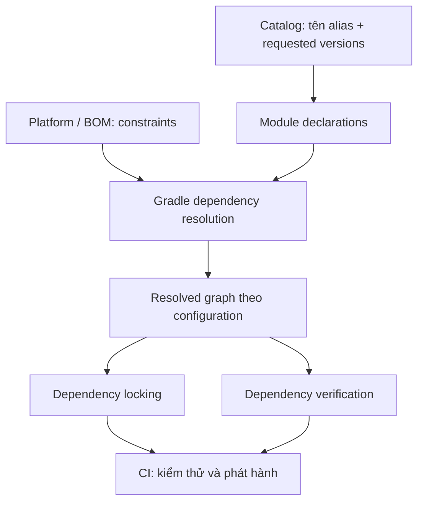

# Tổ chức chiến lược phiên bản cho hệ thống nhiều module trong Gradle

Một dự án chỉ có một module thường có vài chục dependency, nên việc ghi phiên bản trực tiếp vào `build.gradle` vẫn tương đối dễ theo dõi. Khi hệ thống phát triển thành hàng chục module (`:core`, `:api`, `:data`, `:service`, `:web`, các module test, các plugin build logic), chiến lược “mỗi module tự khai báo một version” nhanh chóng tạo ra các vấn đề: hai module dùng hai bản của cùng thư viện, một dependency bắc cầu nâng version ngoài ý muốn, plugin version trôi khác với thư viện, và CI không giải quyết được cùng một đồ thị dependency như máy cá nhân.

**Chiến lược phiên bản cho hệ thống nhiều module** không đơn thuần là chuyển toàn bộ chuỗi version vào một biến `ext`. Một thiết kế tốt phải trả lời những câu hỏi khác nhau:

- **Khai báo ở đâu?** Dùng **version catalog** (`gradle/libs.versions.toml`) để thống nhất tên thư viện, tọa độ và phiên bản đề xuất.
- **Giải quyết theo quy tắc nào?** Dùng **platform/BOM** và **dependency constraints** để định hướng những version được chọn trên dependency graph, kể cả dependency bắc cầu.
- **Khi nào cần đúng một phiên bản đã kiểm thử?** Dùng **dependency locking**, strict constraints hoặc chính sách phát hành có kiểm soát.
- **Ai quản lý plugin và kho tải?** Dùng `pluginManagement`, plugin aliases và `dependencyResolutionManagement.repositories` đúng phạm vi.
- **Làm sao nâng version an toàn?** Phân loại thay đổi, kiểm tra graph, test đa module, review lockfile và có cơ chế rollback.

Bài này thuộc nhóm **Catalog và platform** của **Build Tool Gradle**. Nội dung trình bày mô hình từ cơ bản đến thực hành **Gradle Wrapper + Java 17**, một hệ thống ba module có **version catalog làm nguồn khai báo** và **Java platform làm nguồn constraints**. Các ví dụ Groovy DSL là bản chạy chính; Kotlin DSL và các tình huống nâng cao được tách rõ.

## 1. Trước hết, phân biệt năm đối tượng thường bị gọi chung là “quản lý version”

| Cơ chế | Nhiệm vụ | Có ảnh hưởng dependency resolution không? | Có đủ để bảo đảm build tái lập không? |
| --- | --- | --- | --- |
| **Version catalog** | Đặt tên alias, tập trung tọa độ và phiên bản *được yêu cầu* | Chỉ khi alias được dùng trong `dependencies`; bản thân catalog không ép selected version | **Không**: conflict resolution vẫn có thể chọn bản khác. |
| **Platform/BOM** | Công bố các dependency constraints cho một nhóm module | **Có**, khi platform được đưa vào graph bằng `platform(...)` | Chưa tuyệt đối nếu constraints mềm hoặc artifact có thể bị publish lại. |
| **Rich version constraints** | Diễn đạt `prefer`, `require`, `strictly`, `reject` | **Có**; điều chỉnh bản được phép/ưu tiên | Chỉ khóa một phần chính sách, không khóa toàn graph hay byte artifact. |
| **Dependency locking** | Lưu các module/version đã resolve theo configuration | **Có**, kiểm soát kết quả resolution về sau | Giúp cố định version, nhưng không khóa byte của changing/SNAPSHOT artifact. |
| **Dependency verification** | Kiểm tra checksum/chữ ký của artifact đã tải | Không phải công cụ chọn version | Bảo vệ tính toàn vẹn theo metadata tin cậy, không thay thế locking. |

Một điểm then chốt: **requested version** và **selected version** có thể khác nhau.

```text
Module :app yêu cầu  com.example:client:1.0
  └── transitive yêu cầu org.example:codec:2.5

Module :service yêu cầu org.example:codec:2.6

Gradle resolve graph có thể chọn codec:2.6
(nếu không có constraints/rules khác ngăn cản)
```

Ngay cả khi catalog ghi `codec = "2.5"`, nếu có yêu cầu `2.6` trong cùng graph, catalog **không tự thắng**. Trường hợp này cần đọc `dependencyInsight`, quyết định chính sách version và đặt platform/constraint nếu cần.

## 2. Ba cấp quản trị: nguồn khai báo, quy tắc graph, trạng thái phát hành

Một kiến trúc dễ bảo trì có ba lớp riêng:



**Lớp khai báo** trả lời “module nào cần thư viện nào?”. Nơi đặt alias là version catalog; nơi khai báo sử dụng là `dependencies` của module.

**Lớp chính sách** trả lời “các modules cùng hệ thống cần dùng phiên bản nào và bản nào được chấp nhận?”. Nơi đặt có thể là platform project `java-platform`, external BOM hoặc convention plugin với constraints.

**Lớp kết quả/phát hành** trả lời “lần build này thực sự đã dùng những version/byte nào?”. Lockfile, verification metadata, CI evidence và quy trình publish giải quyết câu hỏi đó.

Một lỗi thường gặp là trộn cả ba thành một file `ext.versions` rồi nghĩ mọi module và transitive dependency sẽ tự động được khóa. Một map version chỉ là **dữ liệu**, không có tác động lên dependency graph cho tới khi bạn sử dụng dữ liệu ấy trong API Gradle phù hợp.

## 3. Version catalog: một ngôn ngữ chung cho các module

Gradle tự nhận file **`gradle/libs.versions.toml`** ở root của một build và tạo accessor **`libs`** cho các project trong build đó. Không phải khai báo thêm `versionCatalogs { create('libs') ... }` cho chính file mặc định ấy.

Ví dụ:

```toml
[versions]
commonsLang = "3.14.0"
guava = "33.2.1-jre"
junit = "5.10.2"

[libraries]
commons-lang3 = { module = "org.apache.commons:commons-lang3", version.ref = "commonsLang" }
guava = { module = "com.google.guava:guava", version.ref = "guava" }
junit-bom = { module = "org.junit:junit-bom", version.ref = "junit" }
junit-jupiter = { module = "org.junit.jupiter:junit-jupiter" }

[bundles]
core-utils = ["commons-lang3", "guava"]
```

Ý nghĩa:

- `[versions]`: tên logic cho số version. Có thể dùng nhiều aliases cùng một `version.ref` khi các module bắt buộc nâng theo một đợt.
- `[libraries]`: group/name và version selector. `junit-jupiter` không ghi version vì dự định lấy constraint từ JUnit BOM.
- `[bundles]`: viết ngắn gọn nhóm dependencies được khai báo cùng nhau. **Bundle không phải BOM**, không mang quy tắc alignment.
- `[plugins]` (chưa dùng ở ví dụ): quản lý plugin IDs/versions riêng, để gọi bằng `alias(libs.plugins.xyz)` từ build scripts thích hợp.

Dùng trong Groovy DSL:

```groovy
dependencies {
    implementation libs.commons.lang3
    implementation libs.guava
    testImplementation libs.junit.jupiter
}
```

Dùng trong Kotlin DSL:

```kotlin
dependencies {
    implementation(libs.commons.lang3)
    implementation(libs.guava)
    testImplementation(libs.junit.jupiter)
}
```

Alias `commons-lang3` được accessor phân tách thành `libs.commons.lang3`. Với alias có nhiều dấu phân tách, cách viết accessor do Gradle sinh ra; hãy kiểm tra IDE hoặc tài liệu thay vì tùy tiện đổi từ `-` sang dấu chấm.

### 3.1. Catalog không tự thêm thư viện vào classpath

Có một entry `guava` trong TOML **không làm mọi module phụ thuộc Guava**. Chỉ module khai báo `implementation(libs.guava)`, `api(libs.guava)` hoặc một API dependency thích hợp mới đưa module đó vào graph.

Cũng vậy, có alias trong `[bundles]` không tự thêm bundle vào tất cả subprojects. Khi sử dụng:

```groovy
dependencies {
    implementation libs.bundles.core.utils
}
```

bạn thêm các dependency của bundle đó vào configuration thích hợp. Đừng dùng bundle như cơ chế buộc mọi thư viện trong bundle cùng một số version.

### 3.2. Requested version không phải hard pin

```toml
[versions]
codec = "2.5.0"

[libraries]
codec = { module = "org.example:codec", version.ref = "codec" }
```

Với đoạn TOML minh họa trên, `implementation(libs.codec)` tương đương một **dependency request** cho `codec:2.5.0`. Một transitive dependency khác có thể yêu cầu `codec:2.6.0`; Gradle có thể chọn `2.6.0` nếu chính sách graph cho phép.

Khi review bug, đừng chỉ tìm `2.5.0` trong catalog; phải kiểm tra **selected version**:

```bash
./gradlew :app:dependencyInsight \
  --dependency codec \
  --configuration runtimeClasspath
```

Nếu dùng Windows, chạy một dòng hoặc dùng ký tự nối dòng phù hợp shell; dấu `\\` ở đây chỉ cách xuống dòng trong Bash.

## 4. Java platform: nơi công bố constraints cho cả dependency graph

Gradle có core plugin **`java-platform`**. Một project sử dụng plugin này công bố tập constraints thay vì source code Java thông thường. Consumer import bằng `platform(project(':versions-platform'))`.

**`versions-platform/build.gradle`:**

```groovy
plugins {
    id 'java-platform'
}

dependencies {
    constraints {
        api 'com.google.guava:guava:33.2.1-jre'
        api 'org.apache.commons:commons-lang3:3.14.0'
    }
}
```

**Một consumer:**

```groovy
dependencies {
    implementation platform(project(':versions-platform'))
    implementation 'com.google.guava:guava'
}
```

Ở đây, consumer **không cần viết version cho Guava** vì platform cung cấp constraint. Nhưng phải nhớ:

1. **Constraint không tự thêm module**. Chỉ import platform không khiến Guava xuất hiện trong classpath nếu không có dependency nào yêu cầu nó.
2. **Constraint thông thường không nhất thiết ép selected version chính xác**. Nếu graph có yêu cầu cao hơn, conflict resolution có thể chọn version khác.
3. **Platform là một thành phần trong dependency graph**: constraints có thể được áp dụng cho cả dependency trực tiếp và bắc cầu phù hợp.
4. **Version catalog chỉ là nơi khai báo**, còn platform là chính sách thực sự được tiêu thụ trong graph.

### 4.1. Làm thế nào tránh khai báo cùng version ở hai nơi?

Ví dụ platform phía trên viết version trực tiếp, còn catalog cũng có `guava = "33.2.1-jre"`. Nếu duy trì cả hai thủ công, bạn tạo **hai nguồn sự thật**.

Với bản Gradle hỗ trợ catalog provider notation trong constraints (Gradle 8.x phù hợp), hãy nối platform vào alias:

```groovy
plugins {
    id 'java-platform'
}

dependencies {
    constraints {
        api(libs.guava)
        api(libs.commons.lang3)
    }
}
```

Khi đó số version chỉ cần thay trong `gradle/libs.versions.toml`; platform lấy dependency coordinates và requested versions từ cùng catalog. Consumer có thể dùng alias có version hoặc dependency không ghi version; platform vẫn là phần đưa constraints vào graph.

**Đừng coi alias là một đối tượng được áp dụng tự động lên tất cả graph**: câu lệnh `api(libs.guava)` chỉ tác động vì nằm trong **`constraints` của platform được import**.

### 4.2. `platform(...)` khác `enforcedPlatform(...)`

```groovy
dependencies {
    implementation platform(project(':versions-platform'))
}
```

Dùng platform thường: constraints tham gia conflict resolution và có thể bị tác động bởi các yêu cầu/constraints khác.

```groovy
dependencies {
    implementation enforcedPlatform(project(':versions-platform'))
}
```

Dùng enforced platform: có tác động **cưỡng chế version** mạnh hơn, có thể ghi đè các yêu cầu khác trong graph. Nếu một thư viện được publish cùng dependency enforced platform, nó có thể áp quy tắc cưỡng chế **lên các consumer phía sau**, khiến việc sử dụng thư viện khó tương thích.

**Khuyến nghị:** ưu tiên `platform` và constraints có chủ đích. Chỉ dùng `enforcedPlatform` khi thực sự kiểm soát toàn bộ graph, đã hiểu tác động phát hành và muốn một tập version bị ép chặt. Không dùng chỉ vì thấy hai phiên bản đang xung đột mà chưa phân tích nguyên nhân.

## 5. BOM ngoài hệ thống: tái sử dụng tập version được publisher quản lý

Nhiều nhóm thư viện publish **Maven BOM**. Ví dụ JUnit phát hành BOM cho các module thuộc hệ sinh thái JUnit.

Groovy DSL:

```groovy
dependencies {
    testImplementation platform('org.junit:junit-bom:5.10.2')
    testImplementation 'org.junit.jupiter:junit-jupiter'
}
```

Kotlin DSL:

```kotlin
dependencies {
    testImplementation(platform("org.junit:junit-bom:5.10.2"))
    testImplementation("org.junit.jupiter:junit-jupiter")
}
```

Nhờ BOM, `junit-jupiter` không phải ghi version riêng. Trong catalog có thể cấu hình:

```toml
[versions]
junit = "5.10.2"

[libraries]
junit-bom = { module = "org.junit:junit-bom", version.ref = "junit" }
junit-jupiter = { module = "org.junit.jupiter:junit-jupiter" }
```

Và:

```groovy
dependencies {
    testImplementation platform(libs.junit.bom)
    testImplementation libs.junit.jupiter
}
```

Đây là **mảnh cấu hình**, không phải full test project. Muốn chạy JUnit 5 với Java plugin còn phải có test classes và cấu hình `tasks.withType(Test).configureEach { useJUnitPlatform() }` phù hợp.

### Khi nào nên chọn BOM có sẵn?

- Nhiều module thuộc một hệ sinh thái (JUnit, Jackson, Spring) cần được publisher xác nhận tương thích với nhau.
- Bạn không muốn tự duy trì danh sách hàng chục version con có liên hệ.
- BOM được publish đúng cách và bạn tin cậy nguồn, phiên bản, metadata của BOM đó.

**Không nên tạo platform nội bộ chỉ để lặp lại mọi version đã được một BOM chính thức quản lý tốt**, trừ khi bạn cần thêm chính sách doanh nghiệp (ràng buộc chung, dải được chấp nhận, bắt buộc phiên bản được phê duyệt).

### Platform của Gradle và Maven BOM khác nhau ra sao?

| Tiêu chí | Gradle `java-platform` | External Maven BOM |
| --- | --- | --- |
| Nơi quản lý | Một project trong build hoặc artifact platform được publish | Artifact BOM của publisher trên Maven repository |
| Cách sử dụng | `platform(project(':versions-platform'))` hoặc module GAV | `platform('group:bom:version')` |
| Thành phần chính | Dependency constraints, có thể dùng rich constraints | Dependency management được Gradle diễn giải thành constraints |
| Mô hình Gradle metadata | Có thể công bố metadata phong phú khi publish | Maven POM/BOM có biểu diễn ít tính năng Gradle hơn |
| Khi nên dùng | Quy tắc version của tổ chức/nhiều module nội bộ | Đồng bộ hệ thư viện đã có BOM chính thức |

Khi một build dùng **nhiều BOM/platform**, các constraints có thể tương tác, chứ không phải “BOM nào khai báo sau sẽ luôn thắng”. Luôn xem selected version bằng `dependencyInsight`.

## 6. Chiến lược xây hệ thống nhiều module: đặt ranh giới trách nhiệm

Một mô hình phổ biến:

```text
Root Gradle build
├── settings.gradle                # include modules, repos/policy
├── gradle/libs.versions.toml      # thư viện / plugin aliases
├── versions-platform/             # policy về dependency versions
│   └── build.gradle
├── lib/                           # Java library có API
│   ├── build.gradle
│   └── src/main/java/...
├── app/                           # Java application sử dụng lib
│   ├── build.gradle
│   └── src/main/java/...
└── build-logic/                    # optional: convention plugins riêng
```

Chúng ta giữ **ba nguồn có vai trò khác nhau**, không trộn lẫn:

- **Settings:** danh sách modules và repository policy, quy tắc tìm plugins.
- **Catalog:** danh mục tên/tọa độ và requested version.
- **Platform:** chính sách constraints thực sự ảnh hưởng quá trình chọn version.

Những module `lib` và `app` chỉ khai báo **nhu cầu thực tế**; không giữ bản sao version cho cùng thư viện trong từng file.

Cấu trúc này phù hợp khi hệ thống phát triển từ 2–3 modules lên vài chục modules. Với ít module và dependency rất đơn giản, có thể bắt đầu bằng catalog mà chưa cần một platform riêng; chỉ thêm lớp policy khi thực sự cần quản lý graph/alignment.

## 7. Thực hành runnable: Gradle Wrapper + Java 17 + catalog + platform

Đây là **một dự án đầy đủ**, khác những mảnh minh họa trước. Nó cho thấy catalog định nghĩa Guava và Commons Lang, platform chuyển chúng thành constraints, `:lib` dùng Commons Lang, còn `:app` dùng Guava và gọi `:lib`.

Yêu cầu:

- JDK 17 hoặc Java toolchain 17 được cấp cho Gradle.
- Gradle Wrapper 8.10.2 (hoặc bản 8.x/9.x tương thích).
- Mạng để tải thư viện từ Maven Central trong lần chạy đầu, hoặc cache đã có artifact đúng.
- Không cần plugin ngoài: `java-library`, `application`, `java-platform` đều là **core Gradle plugins**.

### 7.1. Tạo cây thư mục

```text
version-strategy-lab/
├── settings.gradle
├── gradle/
│   ├── libs.versions.toml
│   └── wrapper/
│       ├── gradle-wrapper.jar
│       └── gradle-wrapper.properties
├── gradlew
├── gradlew.bat
├── versions-platform/
│   └── build.gradle
├── lib/
│   ├── build.gradle
│   └── src/main/java/example/lib/Text.java
└── app/
    ├── build.gradle
    └── src/main/java/example/app/Main.java
```

Các file Wrapper là file thực do Gradle sinh; không tự tạo một `gradle-wrapper.jar` rỗng. Nếu máy đã cài Gradle tương thích, trong root có thể chạy:

```bash
gradle wrapper --gradle-version 8.10.2
```

Sau đó dùng `./gradlew` (Linux/macOS) hoặc `gradlew.bat` (Windows). Với dự án nhóm đang có Wrapper, không tự ý thay version mà chưa chạy kiểm thử tương thích.

### 7.2. `settings.gradle`: tập trung module và nơi tìm thư viện

```groovy
pluginManagement {
    repositories {
        gradlePluginPortal()
    }
}

dependencyResolutionManagement {
    repositoriesMode = RepositoriesMode.FAIL_ON_PROJECT_REPOS
    repositories {
        mavenCentral()
    }
}

rootProject.name = 'version-strategy-lab'
include 'versions-platform', 'lib', 'app'
```

Chọn `FAIL_ON_PROJECT_REPOS` vì ở đây **mọi project dùng chung Maven Central**. Do đó **không đặt block `repositories { mavenCentral() }` vào các `build.gradle` con**; khai báo ấy sẽ vi phạm policy, kể cả khi URL giống nhau.

`pluginManagement.repositories` chỉ điều khiển kho tìm **plugin qua `plugins {}`**. Core plugins của lab có sẵn cùng Gradle distribution nên không cần tải từ Plugin Portal. `dependencyResolutionManagement.repositories` là kho cho **application/library dependency**.

### 7.3. `gradle/libs.versions.toml`: nguồn phiên bản duy nhất

```toml
[versions]
commonsLang = "3.14.0"
guava = "33.2.1-jre"

[libraries]
commons-lang3 = { module = "org.apache.commons:commons-lang3", version.ref = "commonsLang" }
guava = { module = "com.google.guava:guava", version.ref = "guava" }
```

Gradle tự sinh `libs.commons.lang3` và `libs.guava`. Không cần khai báo lại catalog trong settings.

### 7.4. `versions-platform/build.gradle`: tập constraints

```groovy
plugins {
    id 'java-platform'
}

dependencies {
    constraints {
        // Cả hai constraints lấy version từ catalog.
        api(libs.commons.lang3)
        api(libs.guava)
    }
}
```

`java-platform` chỉ công bố **constraints**; nó không tạo classes Java hay tự thêm Commons/Guava vào runtime nếu một consumer không cần chúng. `api` trong platform công bố các constraints cho consumer.

**Tại sao không khai báo version cố định thêm một lần ở đây?** Vì các alias đã mang version. Khi nâng Guava trong TOML, constraint ở platform cũng đổi theo; tránh phải sửa hai nơi.

### 7.5. `lib/build.gradle`: library dùng version thống nhất

```groovy
plugins {
    id 'java-library'
}

java {
    toolchain {
        languageVersion = JavaLanguageVersion.of(17)
    }
}

dependencies {
    // api để consumers của lib cũng nhận platform constraints.
    api platform(project(':versions-platform'))

    // implementation vì Commons Lang chỉ dùng trong phần triển khai.
    implementation libs.commons.lang3
}
```

`java-library` cung cấp các configuration `api` và `implementation`. `api platform(...)` để platform trở thành một phần chính sách dependencies mà `:lib` công bố khi được tiêu thụ; nếu platform chỉ là chi tiết nội bộ, cần cân nhắc dùng `implementation platform(...)` thay vì `api`.

`implementation libs.commons.lang3` đưa Commons Lang vào compile/runtime classpath của `:lib` nhưng không tuyên bố các lớp Commons là API công khai của `:lib`. Ở ví dụ, public method chỉ trả về `String`, nên `implementation` là lựa chọn phù hợp.

### 7.6. `lib/src/main/java/example/lib/Text.java`

```java
package example.lib;

import org.apache.commons.lang3.StringUtils;

public final class Text {
    private Text() {
    }

    public static String greeting(String name) {
        return "Hello, " + StringUtils.capitalize(name) + "!";
    }
}
```

`Text.greeting("gradle")` trả về `"Hello, Gradle!"`. Lớp được compile bằng Java 17 và gọi phương thức `StringUtils` từ Commons Lang đã resolve qua dependency của module `:lib`.

### 7.7. `app/build.gradle`: application phụ thuộc library và platform

```groovy
plugins {
    id 'application'
}

java {
    toolchain {
        languageVersion = JavaLanguageVersion.of(17)
    }
}

dependencies {
    // Chính sách version rõ ràng trên classpath của app.
    implementation platform(project(':versions-platform'))

    // Source dependency là project trong cùng build.
    implementation project(':lib')

    // Requested version đến từ catalog; platform cung cấp constraint.
    implementation libs.guava
}

application {
    mainClass = 'example.app.Main'
}

// Chỉ phục vụ ví dụ chạy javac/java thủ công ở mục 7.10.
tasks.register('exportRuntimeLibraries', Copy) {
    from(configurations.runtimeClasspath)
    into(layout.buildDirectory.dir('runtime-libraries'))
}
```

Tại sao `:app` cũng import platform dù `:lib` đã dùng `api platform`? Vì việc mỗi consumer khai báo rõ policy giúp dễ hiểu và không phụ thuộc ngầm vào việc project trung gian export constraints. Trong nhiều hệ thống, convention plugin có thể tự thêm platform cho các project Java để giảm lặp; ở lab, viết tường minh để người học thấy rõ.

### 7.8. `app/src/main/java/example/app/Main.java`

```java
package example.app;

import com.google.common.base.Joiner;
import example.lib.Text;

public final class Main {
    private Main() {
    }

    public static void main(String[] args) {
        System.out.println(Text.greeting("gradle"));
        System.out.println(
            Joiner.on(" | ").join("catalog", "platform", "java17")
        );
    }
}
```

Ở đây:

- `example.lib.Text` đến từ project dependency `:lib`.
- `org.apache.commons.lang3.StringUtils` được `:lib` dùng trong triển khai.
- `com.google.common.base.Joiner` đến từ Guava được `:app` khai báo.
- Hai version library đến từ catalog và được mô hình hóa thành platform constraints.

### 7.9. Chạy bằng Gradle

Từ root của project:

```bash
./gradlew -q :app:run
```

Khi môi trường/Gradle/JDK/repository đáp ứng, stdout **do chương trình Java in** là:

```text
Hello, Gradle!
catalog | platform | java17
```

Đây là output của `Main.main`, không phải toàn bộ log Gradle. `-q` giảm bớt log nhưng vẫn hiển thị thông báo lỗi nếu dependency chưa resolve hoặc Java toolchain không có.

Chạy kiểm tra graph:

```bash
./gradlew :app:dependencies --configuration runtimeClasspath
./gradlew :app:dependencyInsight --dependency guava \
  --configuration runtimeClasspath
./gradlew :lib:dependencyInsight --dependency commons-lang3 \
  --configuration compileClasspath
```

Trong graph lab không có yêu cầu xung đột ngoài ý muốn, bạn kỳ vọng Guava `33.2.1-jre` và Commons Lang `3.14.0`. Nhưng **đừng lấy expectation thay cho inspection**: platform constraints thông thường vẫn tham gia conflict resolution, và transitive dependencies có thể ảnh hưởng kết quả.

### 7.10. Tự biên dịch/chạy Java 17 bằng `javac` và `java`

Nếu bạn muốn xác nhận Java code độc lập với task `run`, đầu tiên yêu cầu Gradle giải quyết dependency và copy JAR runtime:

```bash
./gradlew :app:exportRuntimeLibraries
```

Task Copy nhận `runtimeClasspath`, gồm các JAR của library project `:lib`, Guava, Commons Lang và các dependency runtime khác cần thiết. Nó không copy source Java và không bắt người học tự tìm thư mục cache của Gradle.

Từ root trên Linux/macOS:

```bash
mkdir -p manual-classes
javac -cp "app/build/runtime-libraries/*" \
  -d manual-classes \
  lib/src/main/java/example/lib/Text.java \
  app/src/main/java/example/app/Main.java
java -cp "manual-classes:app/build/runtime-libraries/*" example.app.Main
```

Kết quả chính xác:

```text
Hello, Gradle!
catalog | platform | java17
```

Trên Windows, dùng `gradlew.bat` và dấu **`;`** giữa các phần của classpath:

```powershell
.\gradlew.bat :app:exportRuntimeLibraries
mkdir manual-classes
javac -cp "app/build/runtime-libraries/*" -d manual-classes lib/src/main/java/example/lib/Text.java app/src/main/java/example/app/Main.java
java -cp "manual-classes;app/build/runtime-libraries/*" example.app.Main
```

Nếu thư mục `manual-classes` đã có, không cần tạo lại; trên shell khác, cú pháp tiếp tục dòng có thể khác. **Đừng gọi `javac Main.java` mà không có classpath**, vì `Main` cần cả `Text` và `Joiner`.

## 8. Cùng nguyên tắc bằng Kotlin DSL

Bạn có thể thay Groovy scripts bằng các file `.kts` tương đương. Các file source Java và TOML giữ nguyên, nhưng không nên đặt cả `settings.gradle` và `settings.gradle.kts` cùng vai trò trong một lab rồi mong cả hai cùng chạy.

**`settings.gradle.kts`:**

```kotlin
pluginManagement {
    repositories {
        gradlePluginPortal()
    }
}

dependencyResolutionManagement {
    repositoriesMode.set(RepositoriesMode.FAIL_ON_PROJECT_REPOS)
    repositories {
        mavenCentral()
    }
}

rootProject.name = "version-strategy-lab"
include("versions-platform", "lib", "app")
```

**`versions-platform/build.gradle.kts`:**

```kotlin
plugins {
    `java-platform`
}

dependencies {
    constraints {
        api(libs.commons.lang3)
        api(libs.guava)
    }
}
```

**`lib/build.gradle.kts`:**

```kotlin
plugins {
    `java-library`
}

java {
    toolchain {
        languageVersion.set(JavaLanguageVersion.of(17))
    }
}

dependencies {
    api(platform(project(":versions-platform")))
    implementation(libs.commons.lang3)
}
```

**`app/build.gradle.kts`:**

```kotlin
plugins {
    application
}

java {
    toolchain {
        languageVersion.set(JavaLanguageVersion.of(17))
    }
}

dependencies {
    implementation(platform(project(":versions-platform")))
    implementation(project(":lib"))
    implementation(libs.guava)
}

application {
    mainClass.set("example.app.Main")
}
```

Ở bản Kotlin, bạn có thể thêm `tasks.register<Copy>("exportRuntimeLibraries") { from(configurations.runtimeClasspath); into(layout.buildDirectory.dir("runtime-libraries")) }` nếu muốn chạy phần `javac` thủ công. Không có block này, lệnh `:app:exportRuntimeLibraries` của bản Groovy **không tồn tại**.

Khác biệt chính nằm ở cú pháp DSL: `api(platform(...))`, `languageVersion.set(...)`, plugin accessor ``java-library`` và generic typed tasks. Mô hình **catalog cung cấp requests, platform cung cấp constraints, Gradle giải quyết graph** không đổi.

## 9. Phân biệt phiên bản thư viện, phiên bản plugin và phiên bản Gradle

Một hệ thống nhiều module có **ít nhất ba loại version** không nên trộn chung:

| Version | Ví dụ | Đặt ở đâu? | Ảnh hưởng |
| --- | --- | --- | --- |
| **Library dependency version** | `guava 33.2.1-jre` | `libs.versions.toml`, platform/BOM, constraints | Compile/runtime/test graph. |
| **Build plugin version** | Plugin kiểm tra style, Kotlin/Android plugin | `[plugins]` của catalog, `pluginManagement.plugins`, plugin request | Logic xây dựng dự án. |
| **Gradle distribution version** | `8.10.2` trong Wrapper | `gradle/wrapper/gradle-wrapper.properties` | Hành vi/API của Gradle chạy build. |

Không có chuyện thêm `gradle = "8.10.2"` trong catalog là Wrapper tự nâng. Cần chủ động cập nhật Wrapper bằng cơ chế chính thức, kiểm tra plugin tương thích và commit các file Wrapper liên quan.

### 9.1. Plugin versions trong catalog

Một ví dụ minh họa **ngoài lab**:

```toml
[versions]
spotless = "6.25.0"

[plugins]
spotless = { id = "com.diffplug.spotless", version.ref = "spotless" }
```

Trong `build.gradle` một module thật:

```groovy
plugins {
    alias(libs.plugins.spotless)
}
```

Ở Kotlin DSL:

```kotlin
plugins {
    alias(libs.plugins.spotless)
}
```

Ví dụ này chỉ minh họa cú pháp, không bắt bạn thêm Spotless vào lab và không cam kết mọi plugin version phù hợp mọi Gradle version. Plugin alias được khai báo ở catalog **không làm plugin tự áp dụng**. Nếu module cần plugin, nó phải khai báo trong `plugins {}` hoặc được convention plugin áp dụng.

### 9.2. `pluginManagement` và catalog cùng tồn tại nhưng khác vai trò

`pluginManagement.repositories` trong settings quyết định **nơi tìm plugin**, còn `[plugins]` trong catalog diễn đạt **plugin request ID/version** cho build scripts. Không coi `dependencyResolutionManagement.repositories` là nơi tìm plugin ngoài. Không coi plugin alias trong TOML là tương đương một repository.

Một plugin có thể được yêu cầu bởi convention plugin hoặc plugin phát triển nội bộ trong included build, khi đó cần hiểu riêng **plugin resolution scope** của build đó. Một số settings scripts chạy trước khi catalog accessor sẵn sàng; vì vậy không mặc định `libs.plugins` có thể sử dụng trực tiếp trong mọi block settings/`pluginManagement`.

## 10. `api`, `implementation`, `runtimeOnly` và `testImplementation`: version chung không có nghĩa mọi module có cùng dependency

Trong nhiều module Java, **chỉ khai báo dependency ở module thật sự dùng nó**. Version alignment nói rằng “nếu một thư viện được yêu cầu trong graph, nó phải tuân theo chính sách version”, không phải “mọi module đều phải tải JAR đó”.

Ví dụ:

- `:lib` dùng Commons Lang để xử lý chuỗi, nhưng public API chỉ trả `String`: dùng `implementation(libs.commons.lang3)`.
- `:app` trực tiếp dùng Guava: dùng `implementation(libs.guava)`.
- Một library công khai kiểu của Guava trong public API: có thể phải dùng `api(libs.guava)`, nếu module áp dụng `java-library`, để consumer compile được chữ ký method.
- Thư viện chỉ cần lúc chạy: dùng `runtimeOnly`.
- Thư viện test: dùng `testImplementation` hoặc `testRuntimeOnly` theo nhu cầu.

Đừng giảm số dòng bằng cách đặt vào root:

```groovy
// Anti-pattern — không nên ép dependency lên mọi module.
subprojects {
    dependencies {
        implementation 'com.google.guava:guava:33.2.1-jre'
    }
}
```

Không phải project con nào cũng có configuration `implementation`; platform module cũng không giống Java module. Mô hình root ép dependency hàng loạt có thể khiến module không dùng thư viện vẫn mang dependency, tăng chi phí build và làm rối graph.

**Phân biệt “phổ cập chính sách” với “phổ cập sử dụng”.** Convention plugin có thể đảm bảo mọi Java project import platform; nhưng bản thân dependency chỉ nên được thêm khi module thực sự cần.

## 11. Rich version constraints: `prefer`, `require`, `strictly` dùng khi nào?

Platform tiêu chuẩn chứa những constraints như `api 'module:1.2.3'`. Gradle còn hỗ trợ **rich versions** để thể hiện yêu cầu chính xác hơn.

Ví dụ **snippet** trong một `java-platform` project:

```groovy
dependencies {
    constraints {
        api('org.apache.commons:commons-lang3') {
            version {
                strictly '3.14.0'
            }
            because 'Version này đã qua kiểm thử API/ABI của hệ thống'
        }
    }
}
```

Cần thay một constraint tương ứng trong platform; **không cộng thêm hai constraints khác nhau cho cùng module chỉ để thử** nếu chưa hiểu xung đột. `strictly` hạn chế lựa chọn version chặt chẽ hơn, nhưng nếu graph yêu cầu version không thể tương thích thì build có thể **thất bại** — đây thường là hành vi đúng khi có policy không được vi phạm.

Ý nghĩa khái quát:

| Cơ chế | Tư duy sử dụng |
| --- | --- |
| `prefer('1.2.3')` | Ưa thích version này khi có lựa chọn và không bị yêu cầu mạnh khác phủ định. |
| `require('1.2.3')` | Đưa ra yêu cầu version mạnh hơn `prefer` nhưng không nhất thiết là exact pin chống mọi nâng version. |
| `strictly('1.2.3')` | Chỉ chấp nhận version đáp ứng strict constraint; có thể fail khi conflict không hòa giải được. |
| `reject('1.2.4')` | Loại bỏ một version không được phép theo rich constraints. |

**Không dùng strict chỉ để im lặng hóa lỗi version conflict.** Cần xác định vì sao một transitive dependency yêu cầu version khác; ép bản thấp hơn có thể gây lỗi `NoSuchMethodError`, còn ép bản cao hơn có thể phá tương thích.

### `enforcedPlatform` và `strictly` không phải cùng một công cụ

- `strictly` biểu đạt constraint cho một hoặc nhiều module, có thể tạo conflict fail.
- `enforcedPlatform` cưỡng chế các versions platform cung cấp đối với graph và có tác động transitive mạnh hơn.
- Normal `platform` cho phép resolution điều hòa constraints theo rules.

Ưu tiên **giải quyết khác biệt có căn cứ**: review API, changelog, test integration. Không nên tạo một rule `force` toàn bộ module chỉ vì muốn file graph trông gọn.

## 12. Dependency locking cho release: đóng băng resolved versions theo configuration

Một catalog có thể khai báo `guava 33.2.1-jre`, platform cũng constrain số version này, nhưng **đồ thị còn có các dependency bắc cầu**. Locking lưu kết quả resolution để những lần build sau không âm thầm đổi version đã được chọn.

Ví dụ **snippet** thêm vào module Java muốn lock:

```groovy
dependencyLocking {
    lockAllConfigurations()
}
```

Kotlin DSL tương đương:

```kotlin
dependencyLocking {
    lockAllConfigurations()
}
```

`lockAllConfigurations()` kích hoạt locking đối với các configurations có thể resolve của **project áp dụng block đó**. Nó không tự khóa mọi project khác nếu bạn chỉ thêm vào `:app`.

Trong multi-project build, bạn có thể triển khai block tương tự bằng convention plugin cho những module cần lock hoặc thêm rõ từng project. Không cần khóa `java-platform` như một task runtime Java nếu nó không có resolvable configuration tương ứng.

### 12.1. Tạo lockfile đúng chỗ

Với `:app` đã bật locking, chạy:

```bash
./gradlew :app:dependencies --configuration runtimeClasspath --write-locks
```

Gradle tạo/cập nhật lock state cho **configurations thực sự được resolve** trong invocation, thường ở `app/gradle.lockfile`. Hãy kiểm tra file kết quả và commit vào version control.

Chỉ gọi `./gradlew dependencies --write-locks` ở root không tự đảm bảo lock state của mọi module đã được viết: task `dependencies` có scope theo project. Muốn lock hết `:lib` và `:app`, kích hoạt locking và resolve các configurations có liên quan ở từng project.

### 12.2. Nâng một dependency có kiểm soát

Sau khi muốn cập nhật một số thư viện:

1. Thay version trong catalog hoặc cập nhật BOM/platform tương ứng.
2. Chạy resolution và xem version được chọn.
3. Với locking, cập nhật state bằng `--write-locks` hoặc `--update-locks group:name` theo chiến lược của nhóm.
4. Review diff lockfile: cả dependency trực tiếp và bắc cầu có thể đổi.
5. Chạy test, integration test, static analysis và kiểm tra tương thích Java.
6. Chỉ merge khi graph mới được phê duyệt.

Ví dụ selective update trong `:app`:

```bash
./gradlew :app:dependencies \
  --configuration runtimeClasspath \
  --update-locks com.google.guava:guava
```

Đây là thao tác nâng version có kiểm soát; nó không có nghĩa cứ đổi catalog là mọi lockfile tự cập nhật. Nếu Gradle báo mismatch với lock state cũ, xử lý bằng quy trình update chính thức, không xóa lockfile hàng loạt theo phản xạ.

### 12.3. Không dùng locking để “đóng băng” SNAPSHOT

Một module như `com.example:client:1.0-SNAPSHOT` có thể đổi artifact mà vẫn giữ logical version. Lockfile chốt tọa độ/version nhưng **không đảm bảo byte artifact bất biến**. Gradle cảnh báo về changing dependencies trong lock state. Đối với release, ưu tiên artifact bất biến; có thể dùng dependency verification để tăng bảo vệ checksum/chữ ký.

## 13. Dependency verification bổ sung sự tin cậy, không phải bộ chọn phiên bản

**Dependency verification** kiểm tra checksum hoặc chữ ký của artifacts được resolve theo metadata được tin cậy. Khi nhiều module tải nhiều thư viện bắc cầu, cơ chế này giúp phát hiện artifact bị thay đổi ngoài dự kiến hoặc không khớp bằng chứng đã được review.

Đừng nhầm:

- **Catalog:** muốn yêu cầu version nào?
- **Platform/constraints:** version nào được phép/ưu tiên trong graph?
- **Lockfile:** lần build phát hành đã chọn những module/version nào?
- **Verification:** artifact nhận được có khớp checksum/signature đã được chấp nhận không?

Một dự án có thể dùng tất cả vì chúng giải quyết những bài toán khác nhau. Metadata verification cần được tạo và review từ nguồn tin cậy; **không vô điều kiện phê duyệt checksum mới chỉ vì build fail**. Khi dependency được cập nhật, nhóm review cả version và thay đổi verification metadata.

Cũng phải xác định scope: cơ chế kiểm tra Gradle không thay thế kiểm tra tính toàn vẹn của chính Gradle Wrapper, repository credentials hoặc nguồn code.

## 14. Version catalog và platform trong hệ thống có nhiều nhóm phát triển

Một hệ thống lớn có thể chia thành:

```text
platform-team:
    quản lý catalog, dependency policy, Gradle Wrapper

feature-teams:
    khai báo dependencies cho các module của mình

security-team:
    theo dõi CVE, xác nhận upgrades, duy trì policies

CI/release:
    xác nhận resolved graph, lock state, build/test và artifact
```

Không nhất thiết mỗi nhóm là một người/đội độc lập. Ý nghĩa là **trách nhiệm được ghi rõ**:

- Ai được nâng phiên bản Maven/JUnit/Spring/Android plugin?
- Khi dependency bắc cầu đổi, ai review?
- Khi hai modules yêu cầu các versions xung đột, ai có quyền thay platform?
- Release artifacts được publish ở kho nào và version có bất biến không?
- CI nào xác nhận Java toolchain, compile và integration tests trước khi merge?

Nên dùng PR chuyên trách cho cập nhật dependency, có diff dễ xem, changelog, test report và cơ chế rollback. Nếu cập nhật 30 thư viện độc lập cùng một PR, rất khó tìm nguyên nhân của lỗi phát sinh.

### 14.1. Gom version theo nhóm nâng cùng nhau, không gom chỉ vì cùng chữ

Không nên khai báo một version variable tên `javaLibsVersion` cho Guava, Commons Lang và JUnit chỉ vì tất cả đều là Java libraries. Chúng có lifecycle khác nhau.

Nên nhóm có chủ đích:

- Các modules của một platform/BOM có chính sách nâng cùng nhau.
- Một bộ plugin có ràng buộc tương thích chặt với Gradle Wrapper.
- Các artifacts nội bộ được phát hành cùng release train.
- Những thư viện không liên quan giữ version riêng dù cùng xuất hiện trong `:app`.

Mục tiêu **không phải tối thiểu hóa số khóa version bằng mọi giá**; mục tiêu là khóa nào đại diện đúng một quyết định nâng cấp.

### 14.2. Semantic versioning là tín hiệu, không phải đảm bảo

Nếu dependency đi từ `1.4.0` lên `1.5.0`, đó có thể là minor theo SemVer. Nhưng nhà phát hành có thể không tuân thủ SemVer chặt chẽ, thay đổi binary compatibility hoặc nâng yêu cầu JDK. Không tự động merge chỉ dựa vào ba con số.

Một checklist kiểm tra thực tế gồm Java toolchain, binary/API compatibility, transitive dependencies, thay đổi annotation processors, security issues và backward compatibility của data formats.

## 15. Quản lý module nội bộ: project dependency không phải GAV publish

Trong lab:

```groovy
dependencies {
    implementation project(':lib')
}
```

Đây là **project dependency** trong cùng build. Gradle sử dụng các outgoing variants của `:lib`, không phải tải `demo:lib:1.0.0` từ Maven Central. Dù project `:lib` có `version='1.0.0'`, version của project không tự quyết định một dependency được tải từ remote.

Khi publish `:lib` dưới GAV:

```text
com.example.platform:shared-lib:1.0.0
```

consumer bên ngoài lại cần một repository và version selector hoặc platform/BOM phù hợp. Điều đó tạo ra **hai bối cảnh khác nhau**:

1. **Mono-repo/multi-project:** modules có thể tiêu thụ nhau qua `project(':name')`, Gradle biết quan hệ source/build output.
2. **Đa repository/độc lập triển khai:** services/libraries được publish, consumer khai báo external GAV và cần version policy, metadata và compatibility rõ ràng.

Không nên chuyển toàn bộ project dependencies sang string GAV chỉ để “chuẩn hóa version” khi nhóm thực sự muốn build các modules cùng source. Ngược lại, nếu nhiều sản phẩm tiêu thụ library đã publish, cần **công bố platform/BOM hoặc version policy có thể tái sử dụng**, chứ không chỉ giữ TOML cục bộ.

### 15.1. Đồng bộ version của các module phát hành cùng một release train

Giả sử `core`, `api`, `client` là ba artifacts phát hành chung `2.4.0`. Bạn có thể:

- Đặt version của **producer projects** theo một release property đã thống nhất.
- Công bố một **platform/BOM nội bộ** mô tả những versions phù hợp cho các consumers bên ngoài.
- Tạo CI kiểm tra việc publish đúng version, metadata và các kiểm thử tích hợp.
- Khi phải hỗ trợ nhiều major lines, dùng platform/BOM khác nhau hoặc compatibility policy được ghi rõ.

Đừng dùng một root `allprojects { version = ... }` như toàn bộ chiến lược. Nó có thể hữu ích để gán version publish chung nhưng **không tự căn chỉnh mọi third-party transitive dependency**.

## 16. Platform khi publish ra Maven repository

Nếu một tổ chức muốn người dùng ngoài build nhập cùng tập version policy, nó có thể publish project `java-platform` như Maven BOM.

**Mảnh cấu hình bổ sung** cho platform project (không phải file `build.gradle` độc lập nếu chưa có constraints):

```groovy
plugins {
    id 'java-platform'
    id 'maven-publish'
}

group = 'com.example.build'
version = '1.0.0'

dependencies {
    constraints {
        api 'org.apache.commons:commons-lang3:3.14.0'
        api 'com.google.guava:guava:33.2.1-jre'
    }
}

publishing {
    publications {
        mavenJava(MavenPublication) {
            from components.javaPlatform
        }
    }
}
```

Đây là ví dụ **minh họa về publishing**. Nó chưa cấu hình endpoint, credentials hoặc task publish thực tế; bạn cần khai báo `publishing.repositories` theo chính sách và có quyền phát hành. `components.javaPlatform` cho Gradle tạo publication từ model Java platform.

Consumer bên ngoài có thể dùng:

```groovy
dependencies {
    implementation platform('com.example.build:versions-platform:1.0.0')
    implementation 'com.google.guava:guava'
}
```

Điều này chỉ resolve được nếu BOM/platform thật sự đã được publish với GAV khớp và repository consumer chứa nó. Cần phân biệt **publishing.repository** (đích upload) với **dependencyResolutionManagement.repositories** (nguồn tải).

### 16.1. Khi nào `javaPlatform { allowDependencies() }` cần thiết?

Java platform thông thường khai báo **constraints** mà không phụ thuộc một platform khác. Nếu platform nội bộ cần **import/compose** một platform/BOM khác như dependency, Gradle yêu cầu bật hỗ trợ dependencies cho platform:

```groovy
javaPlatform {
    allowDependencies()
}
```

Sau đó có thể khai báo `api platform('org.junit:junit-bom:5.10.2')` bên trong project platform theo API phù hợp. **Không cần `allowDependencies()` chỉ để viết `constraints { api(...) }`** như trong lab ở mục 7.

## 17. Multi-project và composite builds: catalog không tự chảy qua ranh giới build

Trong một **multi-project build** có cùng `settings.gradle`, catalog mặc định `libs` được các subprojects dùng chung.

Nhưng **included build** qua `includeBuild('build-logic')`, `buildSrc` và những build độc lập có **settings và vòng đời catalog riêng**. Đừng mặc định file `gradle/libs.versions.toml` của root tự được import qua mọi ranh giới ấy.

Ví dụ, nếu `build-logic` là included build riêng và bạn muốn dùng cùng TOML, trong **`build-logic/settings.gradle`** có thể khai báo:

```groovy
dependencyResolutionManagement {
    versionCatalogs {
        create('libs') {
            from(files('../gradle/libs.versions.toml'))
        }
    }
}
```

Đây là **snippet** chỉ có ý nghĩa khi đường dẫn `../gradle/libs.versions.toml` tồn tại theo cấu trúc dự án của bạn. Included build là build riêng, không phải project được `include 'build-logic'` như subproject bình thường.

**Điểm cần cân nhắc:** không phải version nào của application runtime cũng nên dùng cho build logic. Build logic có toolchain/plugin dependencies riêng và phải tương thích với Gradle/Java đang chạy build. Chia sẻ catalog giúp giảm lặp nhưng có thể khiến bạn vô tình ghép vòng đời dependency không liên quan.

### Convention plugins giúp tránh copy policy ở từng module

Một convention plugin có thể:

- Áp dụng `java-library` hoặc `application` cho module thích hợp.
- Cấu hình Java toolchain, compiler flags và test conventions.
- Tự thêm dependency vào platform version chung cho Java projects.
- Cấu hình dependency locking hoặc verification workflow theo chuẩn tổ chức.

Nhờ đó mỗi module chủ yếu khai báo **dependency thực sự sử dụng**, không copy 20 dòng setup. Tuy nhiên convention plugin nên được kiểm thử và tránh truy cập configuration sớm gây chậm build. Không cần viết một convention plugin phức tạp cho lab ba module chỉ để chứng minh nguyên tắc.

## 18. Phân loại cập nhật: phiên bản nào được nâng theo nhịp nào?

Một quy trình bền vững thường chia việc nâng dependency thành các nhóm:

| Loại thay đổi | Ví dụ | Độ rủi ro điển hình | Kiểm thử cần ưu tiên |
| --- | --- | --- | --- |
| Security fix | Thư viện có lỗ hổng đã xác nhận | Cao nếu không nâng, vẫn có thể có breaking changes khi nâng | SCA/CVE review, integration/regression, runtime. |
| Patch release | `1.4.2` → `1.4.3` | Thường thấp hơn major nhưng không bằng 0 | Unit/integration, API/ABI smoke tests. |
| Minor release | `1.4` → `1.5` | Tùy publisher và SemVer | Contract/integration tests, Java target. |
| Major release | `1.x` → `2.x` | Thường cần migration | Migration guide, compile/API, data formats, E2E. |
| Plugin/Gradle Wrapper | Bản Gradle/plugin mới | Có thể ảnh hưởng toàn build | Configuration cache, task graph, CI build, Android/Kotlin compatibility. |
| Release train/BOM | Nhiều modules của cùng hệ sinh thái | Có thể tác động hàng loạt transitive dependencies | Graph diff, smoke/integration, variant matching. |

Không nên đặt một cron nâng tất cả major versions rồi auto-merge. Tự động hóa hữu ích khi tạo PR có giải thích version, changelog, security context và test results; quyết định merge cần phản ánh khả năng khôi phục.

### 18.1. Một “quy trình thay version” cụ thể

Giả sử bạn muốn nâng Guava trong lab từ `33.2.1-jre` lên một bản đã xác minh:

1. Sửa đúng **một** giá trị `guava` ở `[versions]` trong TOML.
2. `:versions-platform` tự nhận constraint mới từ `api(libs.guava)`.
3. `:app` vẫn dùng `implementation(libs.guava)`, không sửa tọa độ.
4. Chạy `./gradlew :app:dependencyInsight --dependency guava --configuration runtimeClasspath`.
5. So sánh các transitive dependencies trước/sau; Guava có thể nâng các module như `failureaccess`, annotations...
6. Chạy `./gradlew :lib:build :app:build :app:run` và integration checks.
7. Nếu khóa dependencies, cập nhật/review lockfile của cấu hình liên quan.
8. Commit TOML, lock state, verification metadata nếu cần và evidence test trong cùng PR.

Đây là **thay đổi có kiểm soát, dễ review**, không cần search/replace version Guava trong mười lăm file build.

### 18.2. Tránh hai thái cực

- **Thả nổi toàn bộ bằng `+` hoặc `latest.release`:** build có thể chọn version khác khi cache hết TTL hoặc CI dùng repository metadata mới, làm khó tái lập.
- **Không nâng bất kỳ thư viện nào trong nhiều năm:** tăng rủi ro bảo mật và chi phí migration tích lũy.

Chiến lược tốt là **pin có chủ đích, cập nhật đều, kiểm thử trước merge**. Những pipeline chuyên theo dõi tương thích có thể dùng dynamic selector riêng, nhưng không nên làm thay release graph đã phê duyệt.

## 19. Chẩn đoán lệch version giữa module bằng công cụ Gradle

Khi một module `:app` chạy tốt nhưng `:service` thất bại, trước hết xác định **configuration thật sự liên quan**.

```bash
# Resolved graph của runtime app.
./gradlew :app:dependencies --configuration runtimeClasspath

# Xem thư viện cụ thể và lý do chọn version.
./gradlew :app:dependencyInsight \
  --dependency guava \
  --configuration runtimeClasspath

# Xem graph compile của library.
./gradlew :lib:dependencies --configuration compileClasspath

# Kiểm tra cấu hình/version Gradle đang chạy.
./gradlew --version
```

Đọc kết quả theo từng tầng:

- `requested`: version đến từ catalog/đoạn declaration/transitive dependency.
- `selected`: version Gradle cuối cùng chọn trong configuration.
- `constraint`: platform/BOM/rich constraint đang ảnh hưởng.
- `selection reason`: conflict resolution, constraint, forced version, lock state hoặc rule.
- `artifact`: file thực tế đã resolve; không suy ra byte bất biến chỉ từ version.

Các dòng có dấu `->` trong report thường cho thấy requested version bị thay bằng selected version. Đừng chỉ nhìn version catalog rồi khẳng định module đang dùng đúng số ghi trong TOML.

### 19.1. Lỗi `No matching variant` không nhất thiết là lỗi version

Nếu một thư viện được build cho Java 21 mà consumer cần Java 17, Gradle có thể báo **no matching variant** vì `org.gradle.jvm.version` hoặc attributes khác, dù platform yêu cầu đúng GAV.

Không sửa bằng cách ép version nhưng bỏ qua Java compatibility. Kiểm tra JVM target thực tế, metadata producer và các attributes mà consumer yêu cầu. Version policy phải đi kèm **compatibility policy**.

### 19.2. Thông báo không có version cho dependency

Ví dụ:

```text
Could not find org.apache.commons:commons-lang3:.
```

Nếu consumer viết `implementation 'org.apache.commons:commons-lang3'` mà **quên import platform** hoặc không có constraint tương ứng trong graph, Gradle có thể không biết cần version nào. Hãy thêm platform vào configuration liên quan, hoặc đưa version qua catalog alias; không sửa bằng `mavenLocal()` hay xóa cache.

### 19.3. Platform có constraint nhưng không thấy trong app

Kiểm tra:

1. Platform project có áp dụng `java-platform` không?
2. `constraints { api(...) }` có khai báo module đúng group:name không?
3. Consumer có `implementation platform(project(':versions-platform'))` ở đúng configuration không?
4. Có phải bạn đang xem `testRuntimeClasspath` thay vì `runtimeClasspath` hoặc ngược lại?
5. Version từ alias được thay trong TOML thật chưa?
6. Có một BOM/enforced platform khác đang tác động không?
7. Có lockfile cũ từ configuration được xem không?
8. Có thay đổi Gradle Module Metadata/variant khi module được publish không?

Đừng dựa vào việc “platform file có text đúng” rồi kết luận constraint đã được đưa vào graph. Dependency **phải thực sự được tiêu thụ**.

## 20. Những sai lầm phổ biến trong chiến lược phiên bản đa module

| Sai lầm | Hệ quả | Cách khắc phục |
| --- | --- | --- |
| Ghi version riêng trong mỗi `build.gradle` | Drift khi một module quên nâng. | Tập trung tọa độ/version vào catalog. |
| Nghĩ catalog “ép” selected version | Transitive conflict có thể chọn bản khác. | Dùng platform/constraints và kiểm tra graph. |
| Nghĩ bundle có chức năng BOM | Bundle chỉ là danh sách dependencies được thêm. | Dùng `platform(...)` để công bố version constraints. |
| Tạo platform nhưng không import | Constraints không tham gia resolution. | Thêm dependency `platform(project(...))` đúng module/configuration. |
| Viết version ở catalog và platform độc lập | Hai nguồn sự thật, nâng version thiếu đồng bộ. | Dùng alias trong platform constraints hoặc chọn một nguồn policy rõ ràng. |
| Dùng `enforcedPlatform` cho mọi build | Có thể ép version trái yêu cầu downstream, gây incompatibility. | Ưu tiên `platform` trừ khi cần cưỡng chế có kiểm chứng. |
| Đặt mọi dependency trong root `subprojects` | Module nào cũng mang lib không dùng; configuration có thể không tồn tại. | Module tự khai báo nhu cầu, convention plugin chia sẻ policy. |
| Không phân biệt `api` và `implementation` | Lộ dependency nội bộ hoặc thiếu type trong public API. | Chọn configuration theo hợp đồng API. |
| Dùng `latest.release` trong release CI | Graph đổi theo repository metadata/TTL. | Pin, lock và review nâng version. |
| Nghĩ version catalog là lockfile | Không khóa transitive dependencies. | Dùng dependency locking. |
| Nghĩ lockfile khóa byte SNAPSHOT | Artifact có thể bị publish lại cùng version. | Dùng immutable releases và verification. |
| Bật locking chỉ ở root, nghĩ áp cho mọi subproject | Một số module vẫn resolve không khóa. | Bật và resolve từng project/config cần khóa. |
| Thêm `repositories` ở module khi settings có `FAIL_ON_PROJECT_REPOS` | Build lỗi dù repository URL giống nhau. | Khai báo kho ở settings. |
| Gộp plugin và library versions vào một quy tắc force | Khác classpath và lifecycle, khó chẩn đoán. | Quản lý plugin aliases, dependency policy, Wrapper riêng. |
| Mong `buildSrc`/included build tự thấy catalog root | Scope build riêng. | Import/share catalog có chủ đích. |
| Một PR nâng hàng chục thư viện không liên quan | Khó tìm nguyên nhân regression/rollback. | Chia đợt theo hệ sinh thái và mức rủi ro. |

## 21. Bài tập tự kiểm tra có lời giải

**Câu 1.** `libs.versions.toml` đã ghi `guava=33.2.1-jre`. Liệu mọi module trong build tự có dependency Guava không?

**Đáp án:** Không. Catalog chỉ khai báo alias/version; module phải thêm dependency ở configuration phù hợp hoặc có dependency bắc cầu thực sự.

**Câu 2.** Alias `guava` yêu cầu `33.2.1-jre`, nhưng một transitive dependency yêu cầu phiên bản mới hơn. Gradle có chắc luôn dùng version ghi trong catalog không?

**Đáp án:** Không. Catalog không ép conflict resolution. Xem `dependencyInsight` và chính sách platform/constraints.

**Câu 3.** `constraints { api 'com.google.guava:guava:33.2.1-jre' }` trong platform có làm Guava tự xuất hiện trong mọi consumer không?

**Đáp án:** Không. Constraint cung cấp version policy khi module được yêu cầu; không tự thêm module.

**Câu 4.** Tại sao nên viết `api(libs.guava)` trong platform thay vì lặp version thủ công?

**Đáp án:** Để giữ một nguồn version trong catalog và tránh lệch version giữa TOML và platform constraints.

**Câu 5.** `implementation platform(project(':versions-platform'))` khác `implementation project(':versions-platform')` ở đâu?

**Đáp án:** `platform(...)` yêu cầu tiêu thụ platform variant và áp constraints; một dependency project thông thường không biểu diễn đúng mục tiêu ấy.

**Câu 6.** Khi consumer dùng JUnit 5, có thể import `platform('org.junit:junit-bom:5.10.2')` rồi không ghi version trên `junit-jupiter` không?

**Đáp án:** Có nếu BOM hợp lệ cung cấp constraint tương ứng, repository truy cập được và consumer đã khai báo JUnit dependency.

**Câu 7.** `enforcedPlatform` có phải lựa chọn mặc định tốt nhất vì “bắt buộc cùng version” không?

**Đáp án:** Không. Nó có tác động cưỡng chế mạnh, có thể ảnh hưởng downstream consumers; cần lý do rõ và kiểm thử.

**Câu 8.** `dependencyLocking { lockAllConfigurations() }` trong `:app` có tự sinh lockfile cho mọi module không?

**Đáp án:** Không. Locking theo project và những configurations được resolve; phải áp dụng/resolve đúng từng module.

**Câu 9.** Version catalog có khóa toàn bộ dependency graph như lockfile không?

**Đáp án:** Không. Catalog lưu requested coordinates/versions; lockfile lưu selected versions của graph/configuration được khóa.

**Câu 10.** Vì sao không thể tái lập byte artifact `1.0-SNAPSHOT` chỉ bằng lockfile?

**Đáp án:** Vì cùng logical version có thể publish lại artifact khác; cần immutable releases/verification phù hợp.

**Câu 11.** Khi `:lib` trả về `String` nhưng dùng Commons Lang nội bộ để xử lý, dùng `api` hay `implementation`?

**Đáp án:** `implementation`, vì thư viện không xuất hiện trong public API types và chỉ cần để compile/run nội bộ.

**Câu 12.** Nếu một module public API trả về kiểu từ Guava, `implementation` có luôn phù hợp không?

**Đáp án:** Không. Với `java-library`, có thể cần `api(libs.guava)` để consumer compile được public method signature.

**Câu 13.** Root build có catalog, vậy `build-logic` là included build có chắc tự nhận `libs` không?

**Đáp án:** Không. Included build có settings/catalog riêng; cần import/share bằng cấu hình rõ ràng.

**Câu 14.** `plugins { alias(libs.plugins.spotless) }` có tự nâng Gradle Wrapper không?

**Đáp án:** Không. Plugin alias/version và Gradle distribution version là hai phạm vi.

**Câu 15.** Một số dependency được thay đổi sau khi nâng BOM. Nên kiểm tra bằng lệnh gì?

**Đáp án:** `dependencies` để xem graph và `dependencyInsight --dependency ... --configuration ...` để thấy requested/selected version và nguyên nhân.

**Câu 16.** Có nên ghi cùng một version variable cho Guava, JUnit và Commons Lang chỉ vì đều là thư viện Java?

**Đáp án:** Không. Chỉ chia sẻ version khi các artifacts thực sự thuộc cùng release train/compatibility policy.

**Câu 17.** Consumer dùng Java 17, thư viện đòi Java 21. Thay platform version có chắc giải được `No matching variant`?

**Đáp án:** Không. Phải xem metadata JVM/bytecode thật, chọn một bản tương thích hoặc điều chỉnh môi trường chạy.

**Câu 18.** Trong lab, vì sao dùng `implementation platform(project(':versions-platform'))` ở `:app` dù `:lib` đã dùng `api platform`?

**Đáp án:** Để policy của app được thể hiện rõ trên runtime graph, không phụ thuộc việc thư viện trung gian export platform; nhiều dự án dùng convention plugin để thực hiện việc này nhất quán.

**Câu 19.** Sau khi thay version TOML, tại sao CI vẫn có thể fail do lock state?

**Đáp án:** Lockfile đang giữ selected versions trước đó; cần chủ động cập nhật, review và commit lock state cho các configurations liên quan.

**Câu 20.** Một thư viện ngoài không tồn tại trong Maven Central nhưng có alias trong catalog, Gradle có thể tải được không?

**Đáp án:** Không. Alias không thay thế repository. Cần nguồn có artifact thật và policy repository phù hợp.

## 22. Tài liệu Gradle chính thức

- [Gradle — Version Catalogs](https://docs.gradle.org/current/userguide/version_catalogs.html): cấu trúc `libs.versions.toml`, aliases, bundles, plugin aliases và phạm vi build.
- [Gradle — Using Catalogs with Platforms](https://docs.gradle.org/current/userguide/centralizing_catalog_platform.html): khác biệt giữa catalog và platform, cách sử dụng kết hợp.
- [Gradle — Platforms](https://docs.gradle.org/current/userguide/platforms.html): `java-platform`, BOM, dependency constraints, `platform` và `enforcedPlatform`.
- [Gradle — Rich Version Constraints](https://docs.gradle.org/current/userguide/rich_versions.html): `prefer`, `require`, `strictly`, `reject`.
- [Gradle — Dependency Locking](https://docs.gradle.org/current/userguide/dependency_locking.html): tạo/cập nhật lockfile, scope configuration, giới hạn với changing dependencies.
- [Gradle — Dependency Verification](https://docs.gradle.org/current/userguide/dependency_verification.html): kiểm tra checksum và chữ ký.
- [Gradle — Aligning Dependency Versions](https://docs.gradle.org/current/userguide/how_to_align_dependency_versions.html): alignment bằng published/virtual/custom platform.
- [Gradle — Centralizing Repository Declarations](https://docs.gradle.org/current/userguide/centralizing_repositories.html): `dependencyResolutionManagement` và repository modes.
- [Gradle — Java Library Plugin](https://docs.gradle.org/current/userguide/java_library_plugin.html): phân biệt `api`/`implementation`, compile/runtime variants.
- [Gradle — Viewing Dependencies](https://docs.gradle.org/current/userguide/viewing_debugging_dependencies.html): `dependencies` và `dependencyInsight`.

**Ghi nhớ:** một **version catalog** giúp các modules **khai báo cùng ngôn ngữ và cùng nguồn version**, một **platform/BOM** đưa **constraints vào dependency graph** để kiểm soát version được chọn, còn **locking/verification và CI** giúp phát hành một tập dependencies có thể kiểm chứng. Tổ chức tốt chiến lược phiên bản nghĩa là đặt đúng trách nhiệm vào từng lớp, tránh version drift và nâng cấp theo quy trình có kiểm thử — không chỉ đưa các số version vào cùng một file.