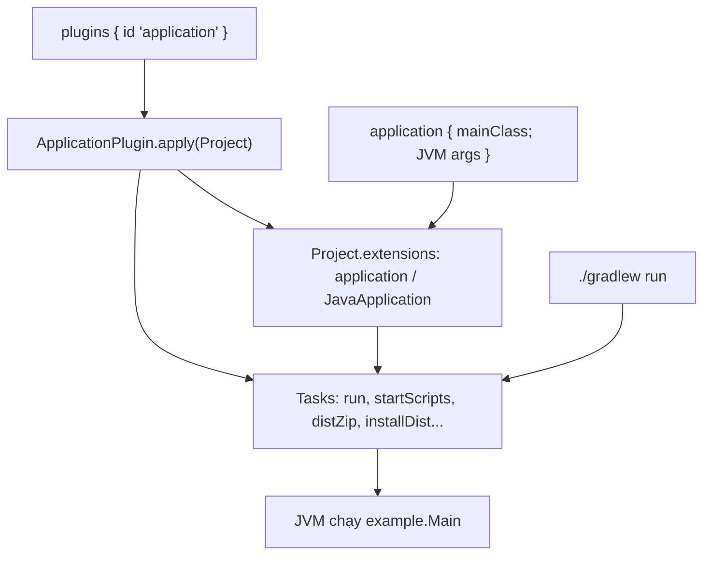

# Cấu hình extension do plugin cung cấp trong Gradle

Khi áp dụng một plugin Gradle, bạn thường thấy những block DSL như `java { ... }`, `application { ... }`, `jacoco { ... }`, `publishing { ... }`, `checkstyle { ... }` hoặc block của plugin nội bộ như `salutation { ... }`. Các block này không phải là cú pháp ngẫu nhiên của Groovy hay Kotlin: đa số chúng là **điểm cấu hình do plugin đăng ký với mô hình Gradle**, thường thông qua **extension object**.

Hiểu đúng extension giúp bạn trả lời các câu hỏi: Vì sao `application { mainClass = 'example.Main' }` chỉ dùng được sau khi áp dụng Application plugin? `mainClass` khác `tasks.named('run')` ở đâu? Làm sao đặt giá trị mặc định nhưng để từng module/CI thay đổi? Vì sao Kotlin DSL đôi khi báo `Unresolved reference: application` dù bạn đã gọi `apply(plugin = "application")`? Và plugin tác động lên task bằng cách nào mà không cần đợi `afterEvaluate`?

Bài thuộc nhóm **Sử dụng plugin** trong **Build Tool Gradle**, tập trung vào việc **cấu hình extension do plugin cung cấp** ở vai trò người sử dụng plugin, đồng thời giải thích đủ cơ chế bên trong để dùng plugin đúng cách.

Sau bài này, bạn có thể:

1. Phân biệt **plugin ID**, **Project extension**, **task**, **configuration**, **extra property** và **dependency**.
2. Đọc tài liệu DSL của plugin để tìm **extension name**, **type**, thuộc tính, giá trị mặc định và vòng đời.
3. Cấu hình extension trong **Groovy DSL** và **Kotlin DSL** bằng block DSL hoặc `ExtensionContainer`.
4. Dùng `Property<T>`, `Provider<T>`, `convention(...)` và `set(...)` đúng ngữ nghĩa lazy.
5. Chạy ví dụ **Java 17** sử dụng extension `java` và `application` với Gradle Wrapper.
6. Chạy ví dụ **plugin tùy chỉnh trong `buildSrc`** để xem extension được plugin tạo, cấu hình và nối tới task.
7. Xử lý lỗi plugin chưa áp dụng, cấu hình sai scope, sai tên thuộc tính, Kotlin không có type-safe accessor và lỗi do truy cập giá trị quá sớm.

## 1. Extension là gì?

**Gradle extension** là một đối tượng cấu hình được đăng ký vào `ExtensionContainer` của một đối tượng Gradle hỗ trợ extensions (thường là `Project`). Plugin tạo extension để công khai một **API cấu hình có tên**, thay vì buộc người dùng sửa trực tiếp những task hoặc chi tiết nội bộ của plugin.

Ví dụ:

```groovy
plugins {
    id 'application'
}

application {
    mainClass = 'example.Main'
    applicationDefaultJvmArgs = ['-Dexample.mode=learning']
}
```

Phân tích:

- `id 'application'` **áp dụng** Application plugin cho project hiện tại.
- Plugin đăng ký **extension tên `application`**, kiểu `JavaApplication`.
- `application { ... }` **cấu hình đối tượng extension**, không trực tiếp chạy ứng dụng.
- `mainClass` cho biết lớp Java có `public static void main(String[] args)` để plugin cấu hình task `run`, start scripts và distribution.
- `applicationDefaultJvmArgs` cung cấp đối số JVM mặc định; plugin sử dụng chúng khi cấu hình `run` và script khởi chạy của distribution.
- `./gradlew run` mới là thao tác **thực thi task** để chạy chương trình.

Nói ngắn gọn: **plugin cung cấp chức năng; extension cho người dùng điều chỉnh chức năng ấy; task thực hiện công việc**.

### Sơ đồ mối liên hệ



Đây là sơ đồ khái niệm: plugin có thể dùng Provider để nối extension với task ở thời điểm cấu hình. **Việc sửa extension không đồng nghĩa task action được chạy ngay**.

## 2. Extension khác những đối tượng nào?

| Thành phần | Ví dụ | Vai trò | Cách thao tác |
| --- | --- | --- | --- |
| **Plugin** | `id 'application'`, `id 'java'` | Thêm chức năng/mô hình vào project | `plugins {}`, `pluginManager.apply(...)` |
| **Extension** | `application`, `java`, `jacoco` | Đối tượng cấu hình mà plugin công bố | `application { ... }`, `extensions.configure(...)` |
| **Task** | `run`, `compileJava`, `test` | Công việc được thực thi theo task graph | `tasks.named('run') { ... }`, `./gradlew run` |
| **Configuration** | `implementation`, `runtimeClasspath` | Khai báo/giải quyết dependency theo vai trò | `dependencies {}`, `configurations.named(...)` |
| **Extra property** | `ext.releaseChannel = 'beta'` | Dữ liệu động được gán thêm cho Project | `project.ext`, `extensions.extraProperties` |
| **Project property** | `-PreleaseChannel=beta` | Tham số đầu vào của build | `providers.gradleProperty('releaseChannel')` |
| **Repository** | `mavenCentral()` | Nơi tải dependency/plugin theo phạm vi | `repositories {}`, `pluginManagement.repositories {}` |

Các tên trông giống nhau nhưng scope khác nhau. Ví dụ `java { ... }` là **extension** `JavaPluginExtension`, còn `tasks.named('compileJava')` là **TaskProvider** cho một task kiểu `JavaCompile`. Bạn thường cấu hình toolchain ở extension rồi tinh chỉnh options riêng cho task:

```groovy
plugins {
    id 'java'
}

java {
    toolchain {
        languageVersion = JavaLanguageVersion.of(17)
    }
}

tasks.named('compileJava', JavaCompile) {
    options.encoding = 'UTF-8'
}
```

Hai cấu hình phục vụ hai cấp:

- **Extension `java`:** chính sách chung của plugin Java trong project.
- **Task `compileJava`:** thuộc tính cụ thể của task biên dịch, thường kế thừa convention từ extension.

Không nên tạo extra property trùng tên `java` hay `application` để giả làm extension, vì có thể gây xung đột dynamic lookup trong Groovy DSL.

## 3. Plugin tạo extension vào lúc nào?

Khi một plugin được **áp dụng**, Gradle gọi logic `Plugin.apply(...)` của plugin. Plugin có thể tạo extension bằng API dạng:

```groovy
// Mảnh mã bên trong một Plugin<Project> (không phải build.gradle độc lập).
def extension = project.extensions.create(
    'salutation',
    SalutationExtension
)
```

Từ thời điểm đó, Project có một extension tên `salutation`. Trong Groovy DSL, extension có thể được cấu hình qua block tên tương ứng:

```groovy
salutation {
    recipient.set('Gradle')
}
```

**Điều kiện:** plugin thực sự đã đăng ký extension, đúng tên, đúng Project và đúng thời điểm. Nếu `salutation` chưa tồn tại, Gradle không thể tự đoán kiểu hay tạo nó chỉ vì bạn viết một block mang tên ấy.

### `plugins {}` làm cho thứ tự rõ ràng

Ví dụ tốt:

```groovy
plugins {
    id 'application'
}

application {
    mainClass = 'example.Main'
}
```

`plugins {}` là cơ chế khai báo plugin được Gradle xử lý ở giai đoạn phù hợp trước thân script. Điều đó giúp Gradle biết các extension, configurations và task do plugin tạo.

Ví dụ dễ gây lỗi:

```groovy
// Minh họa lỗi: plugin chưa được áp dụng.
application {
    mainClass = 'example.Main'
}
```

Trong một project không có plugin nào khác đã tạo extension `application`, Gradle có thể báo không tìm được method/property `application`. **Sửa bằng cách áp dụng plugin**, không phải tạo `def application = [:]` để né lỗi.

### `apply plugin:` có được không?

Groovy DSL hỗ trợ:

```groovy
apply plugin: 'application'

application {
    mainClass = 'example.Main'
}
```

Khi hai dòng chạy tuần tự, Application plugin đã được áp dụng trước khi cấu hình extension. Tuy nhiên **ưu tiên `plugins {}`** cho build hiện đại vì rõ ràng, dễ quản lý phiên bản plugin, thuận lợi cho IDE và Kotlin type-safe accessors.

Với Kotlin DSL, khác biệt này còn đặc biệt quan trọng; xem mục 8.

## 4. Đọc tài liệu plugin trước khi cấu hình

Một plugin có thể đăng ký một hoặc nhiều extensions. **Tên plugin ID không buộc phải bằng tên extension**.

Ví dụ core plugin:

| Plugin ID | Extension tiêu biểu | Một số cấu hình có ý nghĩa |
| --- | --- | --- |
| `java` | `java` | `toolchain.languageVersion`, source/target compatibility, source/javadoc jar. |
| `application` | `application` | `mainClass`, `mainModule`, `applicationDefaultJvmArgs`, `executableDir`. |
| `jacoco` | `jacoco` | `toolVersion`, đường dẫn reports cho JaCoCo. |
| `checkstyle` | `checkstyle` | `toolVersion`, `configDirectory`, reports/task policy tùy API. |
| `maven-publish` | `publishing` | `publications`, `repositories` dùng khi publish. |

Tên property/API có thể thay đổi theo phiên bản Gradle/plugin. Không bê nguyên một block `android {}`, `kotlin {}` hoặc `spotless {}` từ tutorial cũ vào dự án có phiên bản plugin mới mà không kiểm tra tài liệu DSL tương ứng.

Cách tiếp cận đúng:

1. Xác định **plugin ID**, phiên bản plugin và phiên bản Gradle Wrapper.
2. Xem plugin cung cấp **extension tên gì** và **kiểu nào**.
3. Xác định property có kiểu `Property<T>`, `DirectoryProperty`, `ListProperty<T>` hay JavaBean getter/setter truyền thống.
4. Đọc **default/convention** và các giá trị bắt buộc.
5. Kiểm tra property đó ảnh hưởng **task nào**, **configuration nào** và **thời điểm** nào.
6. Viết block cấu hình rồi chạy task nhỏ để kiểm chứng, không suy luận từ tên property.

Ví dụ `application.mainClass` là `Property<String>` trong Gradle hiện hành; `applicationDefaultJvmArgs` lại là một danh sách/Iterable thông qua getter/setter truyền thống. **Không giả định mọi property extension đều có `.set(...)`** chỉ vì nhiều API mới dùng Provider.

## 5. Ví dụ runnable 1: `application` và `java` extension với Java 17

Đây là ví dụ hoàn chỉnh sử dụng **core plugins**, không cần repository hoặc thư viện ngoài. Mục tiêu là thấy **một block extension làm thay đổi hành vi của task `run`**, nhưng phần Java vẫn là chương trình bình thường có thể biên dịch/chạy bằng `javac` và `java`.

### 5.1. Cấu trúc

```text
gradle-extension-lab/
├── settings.gradle
├── build.gradle
├── gradlew
├── gradlew.bat
├── gradle/
│   └── wrapper/
│       ├── gradle-wrapper.jar
│       └── gradle-wrapper.properties
└── src/
    └── main/
        └── java/
            └── example/
                └── Main.java
```

Bạn cần có JDK 17 để biên dịch/chạy Java 17. Dùng Gradle Wrapper 8.10.2 hoặc một phiên bản Gradle tương thích với Java 17. Nếu project chưa có Wrapper và trên máy đã cài Gradle tương thích, có thể tạo một lần:

```bash
gradle wrapper --gradle-version 8.10.2
```

Sau đó dùng `./gradlew` trên Linux/macOS hoặc `gradlew.bat` trên Windows. Các file Wrapper phải được tạo thật bằng Gradle; không tạo một `gradle-wrapper.jar` giả.

### 5.2. `settings.gradle`

```groovy
rootProject.name = 'gradle-extension-lab'
```

### 5.3. `build.gradle` đầy đủ, Groovy DSL

```groovy
plugins {
    id 'application'
}

// Plugin application tự áp dụng plugin java.
// Block này cấu hình JavaPluginExtension của project.
java {
    toolchain {
        languageVersion = JavaLanguageVersion.of(17)
    }
}

// Block này cấu hình JavaApplication extension.
application {
    mainClass = 'example.Main'
    applicationDefaultJvmArgs = ['-Dexample.mode=from-extension']
}
```

Bạn không cần gọi `tasks.register('run')`: Application plugin đã cung cấp task `run` (kiểu `JavaExec`). **Extension `application` là nơi khai báo main class và JVM arguments**, rồi plugin cấu hình các task liên quan.

### 5.4. `src/main/java/example/Main.java`

```java
package example;

import java.util.Locale;

public final class Main {
    private Main() {
    }

    public static void main(String[] args) {
        String mode = System.getProperty("example.mode", "missing");
        System.out.println("Mode=" + mode);
        System.out.println("Uppercase=" + "Gradle".toUpperCase(Locale.ROOT));
    }
}
```

Code dùng API Java chuẩn, không import bất kỳ class Gradle nào. Extension chỉ ảnh hưởng **cách Gradle biên dịch và khởi động** ứng dụng, không biến `Main.java` thành code Gradle.

### 5.5. Chạy bằng Wrapper

```bash
./gradlew -q run
```

Nếu dự án được tạo đúng và Java toolchain khả dụng, stdout **do ứng dụng Java in** là:

```text
Mode=from-extension
Uppercase=GRADLE
```

Diễn giải:

- `java.toolchain.languageVersion=17` làm Gradle chọn Java toolchain 17 cho những task Java phù hợp.
- `application.mainClass` cho `run` biết lớp cần chạy.
- `applicationDefaultJvmArgs` thêm `-Dexample.mode=from-extension` vào JVM ứng dụng.
- `Main.main` đọc system property bằng `System.getProperty` và in ra.
- Nếu bạn đổi extension thành `applicationDefaultJvmArgs = ['-Dexample.mode=changed']`, lần chạy sau (khi cấu hình được áp dụng) sẽ in `Mode=changed`.

Đây là **hành vi cấu hình của Application plugin**, không phải bằng chứng mọi `-D` bạn truyền vào `gradlew` đều tự được chuyển sang ứng dụng. `run` khởi động JVM cho chương trình; hệ thống property của JVM Gradle và JVM ứng dụng là hai scope khác nhau.

### 5.6. Chạy Java 17 không qua Gradle

Từ root trên Linux/macOS, nếu đã cài JDK 17:

```bash
mkdir -p manual-classes
javac -d manual-classes src/main/java/example/Main.java
java -Dexample.mode=manual -cp manual-classes example.Main
```

Stdout chính xác:

```text
Mode=manual
Uppercase=GRADLE
```

Trong lệnh `java` này, bạn **tự truyền** system property `-Dexample.mode=manual`. Nếu bỏ nó:

```bash
java -cp manual-classes example.Main
```

thì:

```text
Mode=missing
Uppercase=GRADLE
```

Không có Application plugin nào chạy trong trường hợp `java` trực tiếp, nên **extension không tự cấp JVM arguments cho lệnh Java thủ công**.

Trên Windows, chạy `gradlew.bat -q run`; lệnh `javac`/`java` tương đương với thư mục output đơn vẫn hợp lệ. Với classpath nhiều entries, dấu phân cách Windows là `;`, còn Unix thường là `:`.

### 5.7. Thử loại bỏ một extension setting

Bỏ `application { mainClass = 'example.Main' }` mà không cung cấp main class qua cơ chế khác rồi chạy `run` có thể gây lỗi vì Application plugin không biết điểm vào chương trình. Chỉ đăng ký task `compileJava` hay có file `Main.java` không bảo đảm Gradle tự đoán đúng main class.

Bỏ `applicationDefaultJvmArgs` mà giữ main class, chương trình vẫn có thể chạy nhưng `Mode=missing`, vì JVM không nhận giá trị default mà ứng dụng cần.

## 6. Một project có thể có nhiều extensions cùng lúc

Application plugin còn áp dụng Java plugin và Distribution plugin, vì vậy project có thể có extensions như `java`, `application`, `distributions`, `sourceSets`. Mỗi extension mô tả **một miền cấu hình**, không phải tất cả thuộc tính đều nằm trong `application`.

Ví dụ:

```groovy
plugins {
    id 'application'
}

java {
    toolchain {
        languageVersion = JavaLanguageVersion.of(17)
    }
}

application {
    mainClass = 'example.Main'
}

sourceSets {
    main {
        java.srcDir 'src/generated/java'
    }
}
```

Đây là **mảnh cấu hình bổ sung**, yêu cầu có source thật khi build cần biên dịch. `sourceSets` là một extension chứa các source sets mà Java plugin công bố; `sourceSets.main` là **một phần tử trong container**, không phải một extension Project mới tên `main`.

**Phân biệt root extension và nested configuration:**

```text
Project
├── extensions["java"]           -> JavaPluginExtension
│   └── toolchain                 -> JavaToolchainSpec
├── extensions["application"]    -> JavaApplication
│   └── mainClass                 -> Property<String>
├── extensions["sourceSets"]     -> SourceSetContainer
│   └── main                      -> SourceSet
└── tasks["run"]                  -> JavaExec Task
```

Bạn cần biết **đối tượng nào sở hữu property** để cấu hình đúng. Không dùng `java { mainClass = ... }`, vì main class thuộc Application extension. Không dùng `application { toolchain { ... } }` trong các API Java plugin hiện hành, vì toolchain thuộc Java extension.

## 7. Cấu hình bằng block DSL hoặc `ExtensionContainer`

Block Groovy như:

```groovy
application {
    mainClass = 'example.Main'
}
```

là cách đọc dễ nhất khi plugin hỗ trợ. Tuy nhiên Gradle cũng có API tường minh trên `Project.extensions`.

### 7.1. Tìm theo tên

```groovy
// Mảnh build.gradle: chỉ dùng sau khi áp dụng application plugin.
def appExt = extensions.getByName('application')
appExt.mainClass.set('example.Main')
```

- `getByName('application')` trả extension nếu có, **báo lỗi** nếu không có.
- `findByName('application')` trả `null` nếu không tồn tại.
- Dùng tên hữu ích khi bạn viết logic tổng quát hoặc cần kiểm tra một extension chưa chắc có.

Đừng viết `extensions.getByName('run')` để tìm task: `run` nằm trong **TaskContainer**, không phải ExtensionContainer.

### 7.2. Tìm theo kiểu

```groovy
import org.gradle.api.plugins.JavaApplication

plugins {
    id 'application'
}

def appExt = extensions.getByType(JavaApplication)
appExt.mainClass.set('example.Main')
```

Đây là ví dụ **thay thế** cho block `application { ... }`, không cần viết cả hai chỉ để đặt cùng một mainClass. Tìm theo kiểu tốt khi tên DSL khác nhau giữa các plugin/version nhưng API public type đã biết.

Các method thường dùng:

| Method | Khi tồn tại | Khi không tồn tại |
| --- | --- | --- |
| `extensions.getByName('application')` | Trả extension object | Báo lỗi không tìm thấy. |
| `extensions.findByName('application')` | Trả extension object | `null`. |
| `extensions.getByType(JavaApplication)` | Trả extension đúng kiểu | Báo lỗi nếu không có. |
| `extensions.findByType(JavaApplication)` | Trả extension đúng kiểu | `null`. |
| `extensions.configure('application') { ... }` | Cấu hình extension theo tên | Báo lỗi nếu thiếu. |
| `extensions.configure(JavaApplication) { ... }` | Cấu hình theo kiểu | Báo lỗi nếu thiếu. |

**Chú ý:** không tạo extension bằng `extensions.create('application', ...)` khi Application plugin đã tạo nó. Việc đăng ký tên trùng có thể báo lỗi và/hoặc gây mô hình plugin xung đột. Người **sử dụng** plugin thông thường chỉ **configure**, không tự tạo lại extension của plugin.

### 7.3. Cấu hình theo type

```groovy
import org.gradle.api.plugins.JavaPluginExtension

plugins {
    id 'java'
}

extensions.configure(JavaPluginExtension) { ext ->
    ext.toolchain.languageVersion.set(JavaLanguageVersion.of(17))
}
```

Đây là một cách tường minh tương đương:

```groovy
java {
    toolchain {
        languageVersion = JavaLanguageVersion.of(17)
    }
}
```

Chọn một cách thống nhất theo style của dự án. Nếu API của plugin chưa hỗ trợ block tên tự nhiên hoặc trong plugin/convention code không có type-safe accessor, `extensions.configure(Type, Action)` thường là lựa chọn rõ ràng.

## 8. Groovy DSL và Kotlin DSL: cùng API, khác cách truy cập

### 8.1. Kotlin DSL với plugin trong `plugins {}`

Với cùng ví dụ Java 17:

```kotlin
plugins {
    application
}

java {
    toolchain {
        languageVersion.set(JavaLanguageVersion.of(17))
    }
}

application {
    mainClass.set("example.Main")
    applicationDefaultJvmArgs = listOf("-Dexample.mode=from-extension")
}
```

Ở đây `application` và `java` là **type-safe model accessors** được Gradle tạo vì các extension tương ứng đã có sau `plugins {}`.

`mainClass.set(...)` cấu hình `Property<String>`. `applicationDefaultJvmArgs = listOf(...)` là setter kiểu danh sách; hai API khác kiểu nhưng đều hợp lệ theo JavaApplication DSL.

Trong Kotlin DSL mới, lazy assignment bằng `=` cũng được hỗ trợ cho nhiều properties, nhưng dùng `.set(...)` khi học và trong code cần tương thích rộng giúp người đọc nhận biết đây là một **Gradle Property**, không phải biến Kotlin thông thường.

### 8.2. Vì sao `apply(plugin = "application")` không luôn tạo accessor `application {}`?

Ví dụ Kotlin DSL dễ lỗi:

```kotlin
// Đoạn minh họa vấn đề type-safe accessors.
apply(plugin = "application")

application {
    mainClass.set("example.Main")
}
```

Type-safe accessors trong Kotlin DSL được tạo dựa trên mô hình được biết **ngay sau `plugins {}`**, trước khi thân script chạy. Plugin được áp dụng động trong script body có thể tạo extension **quá muộn đối với quá trình sinh accessor**. Vì thế `application {}` có thể không compile dù plugin được áp dụng trong cùng script.

Cách tốt nhất:

```kotlin
plugins {
    application
}

application {
    mainClass.set("example.Main")
}
```

Nếu không đổi được cơ chế áp dụng plugin, dùng API theo kiểu:

```kotlin
import org.gradle.api.plugins.JavaApplication

apply(plugin = "application")

configure<JavaApplication> {
    mainClass.set("example.Main")
}
```

`configure<JavaApplication>` dùng type thông qua Kotlin DSL/ExtensionContainer, không cần accessor được sinh cho tên `application`. Tương tự, với Java plugin bạn có thể dùng `configure<JavaPluginExtension> { ... }` sau khi plugin đã được áp dụng.

### 8.3. Xem type-safe accessors report

Khi Kotlin DSL báo `Unresolved reference` với tên một extension do plugin cung cấp:

```bash
./gradlew kotlinDslAccessorsReport
```

Lệnh này (trong Gradle hỗ trợ task) giúp xem những accessors được tạo ra cho model. Bạn cũng có thể đọc tài liệu plugin, tra type trong Javadoc/Kotlin API hoặc mở mã nguồn plugin khi thật sự cần.

**Đừng sửa `Unresolved reference` bằng cách thêm `val application = ...` tùy tiện**: điều đó có thể làm một biến Kotlin che extension nhưng không cấu hình đúng plugin.

## 9. `Property<T>`, `Provider<T>` và giá trị mặc định trong extension

Nhiều plugin hiện đại công bố extension thông qua các **Gradle-managed properties**:

- `Property<String>`: một giá trị `String` cấu hình được.
- `Property<Boolean>`: một giá trị `Boolean` có thể lấy lazily.
- `RegularFileProperty`: đường dẫn file có kiểu.
- `DirectoryProperty`: đường dẫn thư mục có kiểu.
- `ListProperty<T>`, `SetProperty<T>`, `MapProperty<K,V>`: collections cấu hình lazy.
- `Provider<T>`: chỉ cung cấp/biến đổi giá trị, không có quyền `set` như `Property`.

Tư duy:

```text
Provider/Project property/Environment
                 │
                 ▼
   Extension Property<T> (set/convention)
                 │
                 ▼
       Task Property<T> @Input
                 │
                 ▼
        @TaskAction khi cần giá trị
```

### `set(...)` khác `convention(...)`

```groovy
// Mảnh code bên trong plugin, sau khi có SalutationExtension.
extension.recipient.convention('Gradle')
extension.prefix.convention('Hello')
```

`convention` đặt **mặc định** khi người dùng chưa cung cấp giá trị. Consumer có thể thay đổi:

```groovy
salutation {
    recipient.set('Team')
    prefix.set('Xin chào')
}
```

Giá trị tường minh qua `set` có quyền ưu tiên so với convention. **Đặt convention không đồng nghĩa khóa property**; người dùng vẫn có thể cấu hình thêm theo hợp đồng của plugin.

Ví dụ sau lấy giá trị từ Gradle project property:

```groovy
// Trong Plugin<Project>, sau khi tạo extension.
extension.recipient.convention(
    project.providers.gradleProperty('salutationRecipient').orElse('Gradle')
)
```

Khi chạy `./gradlew sayHello -PsalutationRecipient=CI`, nếu user không gọi `recipient.set(...)` trong build script, extension có thể nhận `CI` qua Provider. Nếu user **đã set** recipient tường minh, giá trị explicit thường thay convention.

### Vì sao tránh `.get()` ở cấu hình?

```groovy
// Không nên trong plugin khi chỉ cần nối dữ liệu.
task.recipient.set(extension.recipient.get())
```

Lệnh này lấy value của extension **ngay tại thời điểm configuration action chạy**, có thể quá sớm khi người dùng còn định cấu hình extension. Nó cũng bỏ lợi ích nối lazy provider.

Ưu tiên:

```groovy
task.recipient.set(extension.recipient)
```

Bây giờ Task property lấy **Provider của extension**, thay vì giữ một chuỗi được chốt sớm. Với custom task có `@Input`, Gradle còn có đủ thông tin để fingerprint đầu vào và quyết định up-to-date theo điều kiện.

**Không phải `.get()` lúc nào cũng sai.** Trong `@TaskAction` hoặc khi API bắt buộc cần giá trị đã hoàn tất, `.get()` là hợp lý. Sai lầm là đọc giá trị khi chưa thật sự cần, nhất là trong plugin `apply(...)` hoặc top-level build script.

## 10. Ví dụ runnable 2: plugin do `buildSrc` cung cấp extension `salutation`

Ví dụ này đi sâu hơn cách sử dụng plugin: ta **tạo một plugin nhỏ**, cho nó công bố extension và nối extension với typed task, rồi **sử dụng plugin như bất kỳ plugin nào khác**. Nó giúp bạn biết tại sao câu `salutation { ... }` có hiệu lực.

Có thể làm ví dụ này **trong cùng `gradle-extension-lab` ở mục 5**, vì `buildSrc` là build logic được Gradle nạp cho project root. Không cần publish plugin lên mạng.

### 10.1. Mở rộng cây thư mục

```text
gradle-extension-lab/
├── settings.gradle
├── build.gradle
├── src/main/java/example/Main.java
├── gradlew
├── gradlew.bat
├── gradle/wrapper/...
└── buildSrc/
    ├── build.gradle
    └── src/main/groovy/example/gradle/
        ├── SalutationExtension.groovy
        ├── SalutationTask.groovy
        └── SalutationPlugin.groovy
```

`buildSrc` được Gradle build trước script chính và đưa output vào buildscript classpath. Tên plugin ID của ví dụ là `example.salutation`. Các class nằm trong package `example.gradle`; không nhầm chúng với Java application package `example`.

### 10.2. `buildSrc/build.gradle`

```groovy
plugins {
    id 'groovy'
    id 'java-gradle-plugin'
}

gradlePlugin {
    plugins {
        salutation {
            id = 'example.salutation'
            implementationClass = 'example.gradle.SalutationPlugin'
        }
    }
}
```

- `groovy` biên dịch class plugin viết bằng Groovy.
- `java-gradle-plugin` đăng ký plugin ID và tạo metadata/descriptor cần thiết.
- `implementationClass` trỏ tới class thực hiện `Plugin<Project>`.
- Đây là **file của buildSrc**, không phải block cần thêm vào `build.gradle` của app.
- Vì dùng Gradle API/Groovy đi kèm build tool, ví dụ không yêu cầu repository ngoài chỉ để tải thư viện cho chính plugin.

### 10.3. `SalutationExtension.groovy`

```groovy
package example.gradle

import org.gradle.api.provider.Property

abstract class SalutationExtension {
    abstract Property<String> getRecipient()
    abstract Property<String> getPrefix()
}
```

Đây là **extension type** có hai Gradle properties. Gradle có thể tạo implementation cho managed abstract class và khởi tạo các `Property<String>` mà không cần bạn tự viết trường mutable cùng setter.

Trong plugin sản xuất, có thể dùng interface hoặc abstract type có hợp đồng rõ, với validation cho giá trị rỗng và các quy tắc đặc thù. Trong lab, hai String đơn giản là đủ.

### 10.4. `SalutationTask.groovy`

```groovy
package example.gradle

import org.gradle.api.DefaultTask
import org.gradle.api.provider.Property
import org.gradle.api.tasks.Input
import org.gradle.api.tasks.TaskAction

abstract class SalutationTask extends DefaultTask {

    @Input
    abstract Property<String> getRecipient()

    @Input
    abstract Property<String> getPrefix()

    @TaskAction
    void sayHello() {
        println(prefix.get() + ', ' + recipient.get() + '!')
    }
}
```

Quan trọng:

- Hai task properties đều có `@Input` vì chúng ảnh hưởng output của action.
- `@TaskAction` thực hiện công việc **khi task được chạy**, không khi plugin apply.
- Task chỉ in ra console, không khai báo file output. Điều đó hợp với demo, nhưng không tự tạo artifact cacheable; nếu production task sinh file cần `@OutputFile`/`@OutputDirectory`.
- `prefix.get()` và `recipient.get()` nằm **trong task action**, khi các giá trị cần thiết đã được cấu hình.

### 10.5. `SalutationPlugin.groovy`

```groovy
package example.gradle

import org.gradle.api.Plugin
import org.gradle.api.Project

class SalutationPlugin implements Plugin<Project> {

    @Override
    void apply(Project project) {
        // Tạo extension thuộc project được áp dụng plugin.
        def extension = project.extensions.create(
            'salutation',
            SalutationExtension
        )

        // Mặc định có thể được người dùng override.
        extension.recipient.convention('Gradle')
        extension.prefix.convention('Hello')

        // Task được đăng ký lazy.
        project.tasks.register('sayHello', SalutationTask) { task ->
            task.group = 'learning'
            task.description = 'Print a configurable greeting'

            // Nối Provider chứ không gọi extension.get() quá sớm.
            task.recipient.set(extension.recipient)
            task.prefix.set(extension.prefix)
        }
    }
}
```

Chú ý ba hành động khác nhau trong `apply`:

1. `extensions.create('salutation', ...)`: **tạo đối tượng extension** có tên mà DSL sẽ dùng.
2. `.convention(...)`: **đặt giá trị mặc định**, không bắt người sử dụng phải cấu hình mọi field.
3. `tasks.register('sayHello', SalutationTask)`: **đăng ký TaskProvider** cho task; cấu hình task properties từ extension providers, tránh ép task realization chỉ để lấy value.

Không gọi `sayHello` khi plugin apply. Logic này thiết kế để **task `sayHello` sử dụng giá trị mới nhất phù hợp** đã được cung cấp qua extension trước lúc task chạy.

### 10.6. `build.gradle` của root sau khi thêm plugin (toàn bộ)

Thay `build.gradle` từ mục 5 bằng:

```groovy
plugins {
    id 'application'
    id 'example.salutation'
}

java {
    toolchain {
        languageVersion = JavaLanguageVersion.of(17)
    }
}

application {
    mainClass = 'example.Main'
    applicationDefaultJvmArgs = ['-Dexample.mode=from-extension']
}

// Chính người dùng cấu hình extension do plugin nội bộ cung cấp.
salutation {
    prefix.set('Xin chào')
    recipient.set('Gradle')
}
```

Đây là **một file hoàn chỉnh**, không nên giữ hai bản cấu hình `plugins {}` ở cùng file để rồi khai báo trùng plugin. Java source `Main.java` và `settings.gradle` giữ nguyên.

### 10.7. Chạy và so sánh hai task

```bash
./gradlew -q sayHello
```

Stdout chính xác của `SalutationTask`:

```text
Xin chào, Gradle!
```

Chạy Java Application:

```bash
./gradlew -q run
```

Stdout:

```text
Mode=from-extension
Uppercase=GRADLE
```

**Hai extension độc lập:** `salutation` điều khiển task `sayHello` của plugin nội bộ; `application` điều khiển task `run` của Application plugin. Cấu hình `salutation.prefix` không tự đổi `applicationDefaultJvmArgs`, trừ khi plugin chủ động nối hai thứ đó.

### 10.8. Thử mặc định với `convention`

Nếu bỏ toàn bộ block `salutation { ... }` mà vẫn áp dụng plugin, task `sayHello` sẽ dùng các conventions:

```text
Hello, Gradle!
```

Nếu chỉ cấu hình `recipient.set('Team')` và giữ prefix mặc định:

```text
Hello, Team!
```

Nếu muốn truyền từ command line và không ghi `recipient.set` tường minh vào script, plugin có thể thay convention theo đoạn ở mục 9:

```groovy
extension.recipient.convention(
    project.providers.gradleProperty('salutationRecipient').orElse('Gradle')
)
```

Sau đó:

```bash
./gradlew -q sayHello -PsalutationRecipient=CI
```

sẽ in `Hello, CI!` nếu bạn không override prefix và recipient ở nơi khác. Đây là **mảnh sửa code plugin**, không phải kết quả mặc định của bản plugin ở mục 10.5 — bản gốc cố ý không đọc `-P`.

## 11. Cách plugin nối extension vào task quan trọng thế nào?

Một plugin không nên ép người dùng cấu hình từng task khi các task cùng dùng một chính sách. Thiết kế thường gặp:

```text
Người dùng:
    salutation { prefix.set('Xin chào') }

Plugin:
    extension.prefix: Property<String>
         │
         └── task.prefix.set(extension.prefix)

Task:
    @Input Property<String> prefix
         │
         └── @TaskAction: println(prefix.get())
```

Khi giá trị extension là Provider hoặc Property, việc truyền Provider trực tiếp cho task property giúp giữ lại **lazy value wiring**. Đây cũng là nền tảng để Gradle theo dõi input của task thay vì plugin bí mật đọc biến toàn cục trong action.

### Không nên đọc property ngay lúc plugin apply

Anti-pattern:

```groovy
void apply(Project project) {
    def ext = project.extensions.create('salutation', SalutationExtension)
    def prefixNow = ext.prefix.get()  // Có thể chưa được gán.

    project.tasks.register('sayHello') {
        doLast { println prefixNow }
    }
}
```

Đây là **đoạn sai có chủ đích**, không phải bản plugin cần chạy. `prefix` có thể chưa được thiết lập và `.get()` ném lỗi “no value specified”; hoặc prefix đã có convention nhưng người dùng còn muốn đổi nó trong `build.gradle` sau khi plugin apply. Lấy sớm như vậy có thể dùng sai giá trị.

Cách đúng là **đặt convention**, **truyền provider**, rồi **đọc trong task action** hoặc API tiêu thụ cần giá trị.

### `afterEvaluate` có phải cách chữa không?

Trước đây một số plugin gọi:

```groovy
project.afterEvaluate {
    // Đọc extension sau khi build.gradle được đánh giá.
}
```

Nhưng đây **không phải mặc định tốt** cho plugin mới: phụ thuộc thứ tự callback, khó kết hợp nhiều plugin, có thể làm build logic khó tương thích với configuration cache và nhiều mô hình cấu hình lazy. Nếu mục tiêu chỉ là chờ user cấu hình extension, nối `Property`/Provider với task thường đơn giản hơn và an toàn hơn.

Dùng `afterEvaluate` chỉ khi API thật sự bắt buộc và đã hiểu các giới hạn; không dùng để “chặn” mọi lỗi do gọi `.get()` sớm.

## 12. Cấu hình extension khi plugin có thể được áp dụng bởi plugin khác

Trong build logic hoặc convention plugin, bạn có thể muốn cấu hình Java extension **chỉ khi Java plugin xuất hiện**, bất kể thứ tự apply. Đừng truy cập `extensions.getByType(JavaPluginExtension)` khi plugin còn chưa được áp dụng và hy vọng nó tự xuất hiện sau.

Trong Groovy plugin hoặc build script:

```groovy
import org.gradle.api.plugins.JavaPluginExtension

pluginManager.withPlugin('java') {
    extensions.configure(JavaPluginExtension) { javaExt ->
        javaExt.toolchain.languageVersion.set(JavaLanguageVersion.of(17))
    }
}
```

`pluginManager.withPlugin('java')` đăng ký action **chạy sau khi Java plugin được áp dụng**; nếu Java plugin đã được áp dụng, action có thể chạy ngay. Nó giúp phối hợp các plugin mà không phải dùng `afterEvaluate`.

**Đây là mảnh cấu hình:** nếu Java plugin không bao giờ được áp dụng trong project đó, action không chạy và Java extension không tự được tạo. Nếu mục tiêu là bắt buộc Java plugin, bạn có thể chủ động gọi `pluginManager.apply('java')` ở plugin hoặc khai báo `plugins { id 'java' }` ở project.

Tương đương Kotlin DSL, trong plugin/build logic có thể dùng:

```kotlin
pluginManager.withPlugin("java") {
    extensions.configure<JavaPluginExtension> {
        toolchain.languageVersion.set(JavaLanguageVersion.of(17))
    }
}
```

Đây là một **snippet**, cần import `org.gradle.api.plugins.JavaPluginExtension` và môi trường Kotlin DSL có extension `configure<T>()`. Trong binary plugin Kotlin viết theo Gradle API thuần, có thể dùng `project.extensions.configure(JavaPluginExtension::class.java) { ... }`.

### Nhiều plugin cùng cấu hình một extension

Giả sử một plugin đặt `java.toolchain.languageVersion` convention là 17, còn module yêu cầu Java 21. Một chính sách tốt:

- Convention plugin đặt **giá trị mặc định** qua `convention` khi thích hợp.
- Module đặt **giá trị explicit** qua `set` nếu được phép.
- Nếu tổ chức bắt buộc một target không thể đổi, hãy mô hình hóa policy và validation rõ ràng, thay vì gọi `set` nhiều lần với thứ tự phụ thuộc tình cờ.
- Tránh dùng `finalizeValue()` quá sớm; property đã finalized có thể không còn được sửa, gây lỗi khó hiểu khi plugin khác muốn cấu hình.

Không nên dựa vào câu “plugin A apply trước nên mọi property của A thắng B” như một quy luật chung: **semantics của từng property** (`convention`, `set`, `finalize`, container mutation) mới quyết định.

## 13. Extension scope trong multi-project build

Mỗi **Project** có `ExtensionContainer` của riêng nó. Nếu root có plugin `application`, không có nghĩa mọi subproject `:api`, `:lib`, `:app` đều tự có extension `application`.

Ví dụ:

```text
root/
├── settings.gradle
├── build.gradle
├── lib/build.gradle
└── app/build.gradle
```

```groovy
// root/build.gradle — chỉ là khai báo plugin sẵn sàng cho modules.
plugins {
    id 'application' apply false
}
```

Trong `app/build.gradle`:

```groovy
plugins {
    id 'application'
}

application {
    mainClass = 'example.app.Main'
}
```

Ở `:lib`, nếu chỉ áp dụng `java-library`, extension `application` **không tự tồn tại**; bạn nên cấu hình `java {}` và các extension đúng với plugin `java-library`.

**Lưu ý:** với core Gradle plugins, có thể không cần khai báo `id 'application' apply false` ở root chỉ để subproject sử dụng nó; đoạn này là minh họa quản lý plugin application scope, không phải yêu cầu phải có. Trong thực tế, đặt đúng plugin ở module cần dùng và giữ root tối giản.

### Tránh `subprojects { application { ... } }` một cách máy móc

```groovy
subprojects {
    application {
        mainClass = 'example.Main'
    }
}
```

Đoạn trên có thể thất bại với các module không áp dụng Application plugin. Ngoài ra, một main class duy nhất không phù hợp cho mọi project.

Giải pháp tốt hơn:

- Dùng **convention plugin** cho các project có cùng vai trò.
- Plugin kiểm tra và cấu hình extension theo type hoặc `pluginManager.withPlugin`.
- Mỗi module cấu hình thuộc tính đặc thù như `application.mainClass` của chính nó.
- Tránh cấu hình chéo Project từ root khi không cần thiết; nó làm tăng coupling và cản trở một số tối ưu của Gradle.

Với plugin nội bộ ở mục 10, `salutation` cũng được tạo **trên từng Project áp dụng `example.salutation`**. `:app` có thể có `salutation.prefix='Hello'`, còn `:lib` có `salutation.prefix='Hi'` mà không có xung đột nếu plugin được áp dụng ở cả hai project.

## 14. Cấu hình extension không phải cấu hình mọi task mà plugin cung cấp

Plugin có thể cung cấp extension và nhiều task. Một block extension thường đặt **default/chính sách chung**, nhưng bạn có thể cần cấu hình task riêng.

Ví dụ Java plugin:

```groovy
plugins {
    id 'java'
}

java {
    toolchain {
        languageVersion = JavaLanguageVersion.of(17)
    }
}

tasks.withType(JavaCompile).configureEach {
    options.encoding = 'UTF-8'
}
```

- `java.toolchain`: chọn Java toolchain cho các tác vụ phù hợp của plugin.
- `tasks.withType(JavaCompile).configureEach`: đặt encoding cho những Task kiểu JavaCompile.
- `configureEach` là API **lazy task configuration**, phù hợp cho build nhiều modules/tasks.

Cách này tốt hơn `tasks.all { ... }` hoặc `tasks.getByName(...)` chỉ để cấu hình các task không chắc cần khởi tạo.

Với plugin Application, `applicationDefaultJvmArgs` đặt defaults cho `run` và generated start scripts. Nếu muốn thêm một system property **chỉ cho task run**:

```groovy
tasks.named('run', JavaExec) {
    systemProperty 'example.onlyRun', 'true'
}
```

Đây là **mảnh cấu hình bổ sung** sau khi áp dụng Application plugin; nó không đồng nghĩa thay đổi `applicationDefaultJvmArgs` trên extension, vì script phân phối được tạo ra có semantics riêng.

**Không dùng `project.extensions.getByName('run')` để chỉnh task**; dùng TaskContainer.

## 15. Extension có container lồng nhau

Một số extension không chỉ có vài giá trị đơn giản mà còn công bố **named containers** hoặc nested DSL. Ví dụ `sourceSets` (của Java plugin), `publishing.publications` (của Maven Publish plugin) và `distributions`.

```groovy
plugins {
    id 'java'
}

sourceSets {
    main {
        java.srcDir 'src/custom/java'
        resources.srcDir 'src/custom/resources'
    }
}
```

`sourceSets` là một extension chứa các `SourceSet` có tên; `main` không phải extension Project mới. Nếu chỉ cần **cấu hình phần tử đã biết**, có thể viết:

```groovy
sourceSets.named('main') {
    java.srcDir 'src/custom/java'
}
```

Đoạn này giả định Java plugin đã tạo source set `main`, và source directory thực tế nên tồn tại khi task sử dụng.

Với `maven-publish`:

```groovy
plugins {
    id 'maven-publish'
}

publishing {
    publications {
        // Chỉ là vị trí cấu hình publication; cần component/artifact thật.
    }
    repositories {
        // Chỉ là vị trí khai báo destination khi publish.
    }
}
```

Đây **không phải build có thể publish ngay**; nó chỉ cho thấy extension `publishing` chứa các collections/blocks. Trong thực tế, cần định nghĩa publication, coordinates, artifact và repository hợp lệ. **Không nhầm `publishing.repositories` với kho resolve library của `dependencies`.**

Một plugin có thể dùng `NamedDomainObjectContainer<T>` để bạn cấu hình nhiều profile/target như `environments { development { ... }; production { ... } }`. Khi đó phải đọc tài liệu về việc **create/register/named** của container, không suy rằng nested object nào cũng luôn tồn tại.

## 16. Phân biệt extension với `ext` và project properties

Có một extension đặc biệt `ext` tên **ExtraPropertiesExtension**, cho phép gắn key-value linh hoạt:

```groovy
ext.releaseChannel = 'beta'
```

Đây không phải cùng loại với một extension do plugin cung cấp:

```groovy
application {
    mainClass = 'example.Main'
}
```

So sánh:

| Câu lệnh | Nguồn/cấp | Tác dụng |
| --- | --- | --- |
| `ext.releaseChannel = 'beta'` | Project ExtraPropertiesExtension | Tạo giá trị động trên Project, không có hợp đồng plugin tự động. |
| `-PreleaseChannel=stable` | Gradle project property đầu vào | Có thể đọc bằng `providers.gradleProperty('releaseChannel')`. |
| `application.mainClass.set('example.Main')` | JavaApplication extension của Application plugin | Plugin tiêu thụ để tạo hành vi task `run`/start scripts. |
| `tasks.named('run') { ... }` | TaskContainer | Cấu hình một Task đã đăng ký. |

Một plugin **có thể chủ động đọc** Gradle property và nối nó vào extension. Nhưng không có quy luật tự động rằng `-PmainClass=example.Main` sẽ đổi `application.mainClass`. Chỉ khi plugin/build script **viết mapping** tương ứng thì điều đó mới xảy ra.

Ví dụ mapping có chủ đích:

```groovy
plugins {
    id 'application'
}

application {
    mainClass = providers.gradleProperty('entryPoint')
        .orElse('example.Main')
}
```

Đây là **mảnh cấu hình** cho bản Gradle/Groovy hỗ trợ gán Provider vào `Property<String>`; dạng tường minh hơn là:

```groovy
application {
    mainClass.set(
        providers.gradleProperty('entryPoint').orElse('example.Main')
    )
}
```

Nếu chạy `./gradlew run -PentryPoint=example.Other`, Gradle sẽ cố chạy class `example.Other`; class này phải tồn tại và có `main` hợp lệ, nếu không task fail. Không dùng project property đầu vào để lách validation, chọn class tùy ý không có trong source.

## 17. Thứ tự cấu hình, `convention` và `finalize`: những bẫy dễ gặp

### 17.1. `set` sau convention

```groovy
extension.recipient.convention('Gradle')
extension.recipient.set('Team')
```

Kết quả tiêu thụ cuối thường là `Team`. `convention` cung cấp default, còn `set` định nghĩa giá trị explicit.

### 17.2. Hai nơi cùng `set` một property

Nếu module và convention plugin đều gọi `.set(...)` trên cùng một property khi nó còn mutable, giá trị sau có thể thay giá trị trước, tùy thứ tự thực tế. Điều này **không phải một chính sách quản trị ổn định**; cần ghi rõ ai sở hữu quyết định và dùng conventions/validation thay vì dựa vào thứ tự tình cờ.

### 17.3. Property bị finalized

Gradle có API như `finalizeValue()`, `finalizeValueOnRead()`, `disallowChanges()`. Khi property không còn cho phép sửa, cố `set` tiếp có thể báo lỗi.

Một plugin tốt chỉ finalize ở thời điểm hợp lý; người dùng phải cấu hình extension **trước khi giá trị bị chốt**. Đừng gọi `get()` hoặc API finalize trong một plugin quá sớm rồi yêu cầu plugin khác sửa tiếp.

### 17.4. `get()` khi chưa có giá trị

```groovy
// Minh họa lỗi: Property chưa có convention hoặc explicit value.
println extension.recipient.get()
```

Có thể báo lỗi rằng property chưa có value. Trong plugin production, đặt convention hợp lý hoặc dùng `orElse`/validation để đưa ra thông báo rõ. **Tránh dùng giá trị mặc định nguy hiểm** cho secret/path bắt buộc chỉ để né lỗi: những giá trị ấy cần được xác minh và cung cấp an toàn.

### 17.5. `orElse` khác `convention`

`providers.gradleProperty('foo').orElse('bar')` tạo **Provider** có fallback khi nguồn không có.

`extension.foo.convention(provider)` gắn Provider đó như **default của Property**. Người dùng có thể **override** extension với `.set(...)` theo hợp đồng.

`extension.foo.set(provider)` lại gắn Provider như **giá trị explicit** cho property. Hai cách có hệ quả khác nhau nếu module muốn thay đổi property sau đó.

## 18. Cấu hình external plugin và API thay đổi theo phiên bản

Core plugins (`java`, `application`) có tài liệu đi cùng bản Gradle Wrapper. Plugin ngoài có **vòng đời phiên bản riêng**; một block DSL có thể đổi field/method giữa các major releases.

Mẫu phân biệt:

```groovy
plugins {
    id 'java'
    id 'com.example.quality' version '1.0.0'
}

// Chỉ minh họa: extension tên quality và version/plugin ở đây giả định.
quality {
    // Kiểu, property và nested blocks phải xem tài liệu plugin thật.
}
```

**Đây là mẫu giả định, không phải code chạy độc lập**: plugin `com.example.quality:1.0.0` và extension `quality` chỉ được dùng để giải thích nguyên tắc. Một plugin ngoài chỉ được cấu hình theo **extension name/API thực tế mà nó công bố**, không suy luận từ plugin ID.

### Plugin được tải từ đâu?

- Plugin yêu cầu qua `plugins { id ... version ... }` thường được resolve theo `pluginManagement.repositories` trong `settings.gradle(.kts)`.
- `repositories { mavenCentral() }` của Project phục vụ **project dependencies**, không mặc định là kho plugin DSL.
- Không khắc phục lỗi extension chưa tồn tại bằng cách thêm `implementation 'plugin:...'` vào Java application classpath.
- Đối với plugin nội bộ trong `buildSrc`, plugin có ID được buildSrc đăng ký có thể dùng từ build script chính mà không cần publish lên Gradle Plugin Portal.

Nếu plugin báo `Plugin ... was not found`, chưa tới giai đoạn cấu hình extension. Nếu plugin resolve/apply thành công nhưng báo `Could not find method ...`, hãy tập trung vào **extension name, property, scope, thứ tự và DSL** thay vì luôn đổ lỗi cho repository.

## 19. Cấu hình extension của plugin ngoài trong multi-module build

Một mẫu root build:

```groovy
// root/build.gradle — minh họa plugin ngoài, không phải project chạy độc lập.
plugins {
    id 'com.example.quality' version '1.0.0' apply false
}
```

Một module:

```groovy
// module/build.gradle — mẫu giả định
plugins {
    id 'com.example.quality'
}

// Chỉ dùng block thực tế được plugin tài liệu hóa.
```

`apply false` cho phép khai báo plugin/version ở root nhưng **không áp dụng plugin vào Project root**; do đó root **chưa chắc có extension do plugin ấy tạo**. Module cần áp dụng plugin thì extension được tạo **trên module**, và block cấu hình phải nằm trong scope đó.

Đây là tình huống gây lỗi thường gặp:

1. Root khai báo plugin `apply false`.
2. Root viết block cấu hình extension như thể plugin đã được apply.
3. Gradle báo không tìm được method/extension.
4. Tác giả thêm `ext.foo = [:]` để né lỗi.
5. Build âm thầm bỏ qua chính sách plugin cần có.

Cách sửa là xác định **project nào thật sự áp dụng plugin** rồi cấu hình tại project đó, hoặc dùng một convention plugin áp dụng và cấu hình nó cho module tương ứng.

## 20. Extension và configuration cache

**Configuration cache** có thể tái sử dụng trạng thái cấu hình giữa các lần chạy. Để tương thích tốt, plugin/task nên:

- Cấu hình task từ `Property`/Provider thay vì lấy giá trị quá sớm.
- Tránh gọi `project`, `extensions`, `configurations` từ `@TaskAction` khi Gradle yêu cầu tách biệt giai đoạn cấu hình và thực thi.
- Khai báo inputs/outputs của task rõ ràng.
- Không dùng `afterEvaluate` làm phương thức đồng bộ tất cả plugin.
- Tránh filesystem I/O, network call và logging secret ngay trong block cấu hình nếu không cần.
- Kiểm tra bằng `./gradlew <task> --configuration-cache` trong phiên bản Gradle phù hợp.

Ví dụ plugin ở mục 10 **tách extension khỏi task**: task chỉ đọc hai `@Input Property<String>` của chính nó trong `@TaskAction`, không gọi lại `project.extensions.getByName('salutation')`. Đây là hướng thiết kế phù hợp hơn việc trực tiếp truy cập Project model trong task action.

### Không bắt chước anti-pattern sau trong `@TaskAction`

```groovy
// Minh họa sai: trong custom Task action.
void doWork() {
    def ext = project.extensions.getByName('salutation')
    println ext.recipient.get()
}
```

Đoạn trên trộn **Project configuration model** vào **execution logic**. Nó có thể dẫn tới cảnh báo/lỗi configuration cache hoặc coupling giữa task và script. Thay bằng `@Input Property<String> recipient` được nối từ extension lúc cấu hình rồi chỉ đọc property đó trong action.

**Một lưu ý:** sử dụng `Property` không tự làm mọi task cacheable. Task chỉ in console như `sayHello` không có output file được khai báo; up-to-date và build cache có điều kiện khác. Nếu task thực sự tạo báo cáo, khai báo `RegularFileProperty` có `@OutputFile` và inputs đầy đủ.

## 21. Cách kiểm tra extension có tồn tại và cấu hình có hiệu lực

Các lệnh hữu ích:

```bash
# Xem Gradle/JVM phiên bản nào đang chạy.
./gradlew --version

# Xem task do plugin/application tạo.
./gradlew tasks --all

# Xem thông tin task run.
./gradlew help --task run

# Kotlin DSL: xem type-safe accessors.
./gradlew kotlinDslAccessorsReport

# Chạy task của plugin nội bộ.
./gradlew -q sayHello

# Chạy ứng dụng Java.
./gradlew -q run
```

Không có một lệnh core Gradle đơn giản nào in **toàn bộ extension values** của mọi plugin với bảo đảm an toàn. `./gradlew properties` có thể cho thấy một số Project/dynamic properties, nhưng không được dùng làm bằng chứng đầy đủ về cấu hình plugin và **không nên đăng log chứa secrets**.

Để kiểm tra extension một cách có mục tiêu, có thể thêm task chẩn đoán **chỉ trong lab**:

```groovy
import org.gradle.api.plugins.JavaApplication

tasks.register('checkAppExtension') {
    def mainClassValue = extensions.getByType(JavaApplication).mainClass

    doLast {
        println 'configuredMain=' + mainClassValue.get()
    }
}
```

Đây là **mảnh bổ sung** vào `build.gradle` đã áp dụng Application plugin. `mainClassValue` là `Property<String>`, được lấy khi task đang được cấu hình; action chỉ đọc value, không tìm lại Project/extension qua task action. Trong lab mục 5, `./gradlew -q checkAppExtension` in:

```text
configuredMain=example.Main
```

Trong plugin production, tốt hơn có **task type có `@Input` tường minh** để Gradle biết dữ liệu ảnh hưởng action. Không dùng diagnostic task để in token/password hoặc URL chứa credentials.

## 22. Bảng lỗi thường gặp và cách xử lý

| Hiện tượng | Nguyên nhân có thể | Hướng sửa |
| --- | --- | --- |
| `Could not find method application()` | Chưa áp dụng Application plugin hoặc cấu hình sai Project | Áp dụng `plugins { id 'application' }` ở đúng module. |
| Kotlin `Unresolved reference: application` | Plugin áp dụng bằng `apply(plugin=...)` sau khi accessors được sinh | Dùng `plugins {}` hoặc `configure<JavaApplication> { ... }`. |
| `UnknownDomainObjectException` ở `extensions.getByName` | Extension chưa được đăng ký hoặc tên sai | Kiểm tra plugin ID, tên extension, thứ tự áp dụng, API docs. |
| Cấu hình ở root không ảnh hưởng `:app` | Mỗi Project có ExtensionContainer riêng | Áp dụng/cấu hình plugin trong `:app`, hoặc convention plugin đúng scope. |
| `java { mainClass = ... }` không hoạt động | `mainClass` thuộc `application`, không thuộc `java` | Cấu hình đúng extension. |
| Chỉnh `application.mainClass` nhưng `Main` không chạy | Class/package sai, code chưa compile hoặc Java toolchain thiếu | Kiểm tra đường dẫn `src/main/java`, package, `main`, JDK 17 và task `run`. |
| `No value has been specified` cho Property | Property bắt buộc chưa có `set` hay `convention` | Cung cấp giá trị hoặc validation/default hợp lý. |
| `Cannot change the value ...` | Property đã finalized hoặc disallow changes | Cấu hình trước thời điểm chốt; tránh plugin finalize quá sớm. |
| `-Pfoo=bar` không đổi extension | Plugin không tự map project property `foo` sang extension | Dùng `providers.gradleProperty('foo')` để nối tường minh. |
| Task dùng giá trị mặc định dù build script override | Plugin đã gọi `.get()` rồi chốt chuỗi quá sớm | Nối `Property`/Provider tới task property thay vì lấy giá trị ngay. |
| `salutation {}` báo unknown | Plugin nội bộ chưa được apply, ID sai hoặc buildSrc chưa build hợp lệ | Kiểm tra `buildSrc`, `gradlePlugin` registration, plugin ID, lỗi compilation. |
| Task `sayHello` không tồn tại | Plugin chưa áp dụng hoặc registration lỗi | Kiểm tra `plugins {}`, `./gradlew tasks --all`, output `buildSrc`. |
| `mainClass` sai kiểu trong Kotlin DSL | Dùng cú pháp Groovy hoặc sai API property | Dùng `mainClass.set("example.Main")` hoặc assignment hợp lệ theo Gradle version. |
| Cấu hình external plugin báo property không có | Plugin/version thay đổi DSL | Tra đúng version plugin, extension type, migration guide. |
| Cấu hình extension không làm chạy task | Nhầm configuration với execution | Chạy task qua Wrapper hoặc nối task graph phù hợp. |
| Configuration cache cảnh báo đọc Project lúc execution | Task action truy cập `project.extensions` | Đưa giá trị vào task `@Input Property<T>` từ giai đoạn configuration. |

### Chẩn đoán có hệ thống

Nếu bạn gặp một lỗi extension, hãy kiểm tra lần lượt:

1. **Plugin đã được apply thành công chưa?** Đừng nhầm `apply false` với áp dụng thật.
2. **Đúng project chưa?** Root và subproject không tự chia sẻ extensions.
3. **Đúng extension name/type chưa?** Plugin ID không phải lời hứa về tên block.
4. **Đúng thứ tự chưa?** Tránh truy cập trước `pluginManager.withPlugin`.
5. **Đúng cú pháp DSL chưa?** Groovy dynamic và Kotlin type-safe accessors khác nhau.
6. **Đúng loại property chưa?** `Property<T>` dùng `.set`, JavaBean/list có API khác.
7. **Có default/convention chưa?** Property `.get()` có thể fail nếu thiếu value.
8. **Có plugin khác ghi đè/finalize không?** Xem chủ sở hữu cấu hình và thứ tự quyết định.
9. **Task có tiêu thụ extension không?** Đôi khi plugin chỉ đọc giá trị ở một task cụ thể.
10. **Có test thực tế chưa?** Chạy task nhỏ, so stdout/output với giá trị đã cấu hình.

**Đừng giải quyết bằng cách copy/paste `afterEvaluate` hoặc xóa Gradle cache** nếu không có bằng chứng về thời điểm hoặc artifact cache. Nhiều lỗi extension hoàn toàn là lỗi DSL/scope, không liên quan download.

## 23. Quy tắc thiết kế khi nhiều plugin cùng hoạt động

Trong một dự án thật, Java plugin, Application plugin, testing/report plugins và các convention plugins có thể cùng tồn tại. Thiết kế tốt:

- **Mỗi plugin có một trách nhiệm rõ.** Extension là API cấu hình của trách nhiệm đó.
- **Đặt mặc định bằng convention.** Cho module quyền override nếu chính sách cho phép.
- **Dùng Provider API cho dữ liệu phụ thuộc env/Gradle properties.** Tránh biến động không được theo dõi.
- **Áp dụng plugin theo scope thực tế.** Không mặc định root extension ảnh hưởng subproject.
- **Để task tiêu thụ giá trị qua typed properties.** Điều này hỗ trợ lazy configuration và task input tracking.
- **Cấu hình task bằng `tasks.named` / `configureEach`** thay cho eager lookups.
- **Tránh extension name collisions.** Không đăng ký trùng tên trên cùng Project.
- **Không ẩn secret trong extension log.** Credentials phải được lấy từ nguồn an toàn và chuyển vào nơi tiêu thụ thích hợp.
- **Ưu tiên API public, không dựa vào internal Gradle classes.** Plugin ngoài có thể thay đổi implementation giữa các phiên bản.
- **Viết kiểm thử build logic.** Với plugin tự phát triển, dùng Gradle TestKit để xác nhận default, override và task output trên nhiều Gradle versions phù hợp.

Nếu nhiều module cần cùng Java 17 toolchain hoặc cùng quy tắc compiler, **convention plugin** có thể áp dụng Java plugin (hoặc phản ứng bằng `withPlugin`), cấu hình Java extension và đăng ký task cần thiết. Mỗi module giữ code build gọn, chỉ khai báo những tùy chọn đặc thù.

## 24. Bài tập tự kiểm tra và đáp án

**Câu 1.** `plugins { id 'application' }` có nghĩa `application { ... }` là một task không?

**Đáp án:** Không. `application` là extension của Project; `run` là task do plugin cung cấp để chạy chương trình.

**Câu 2.** Trong một build Java, `java { toolchain { languageVersion = JavaLanguageVersion.of(17) } }` đang cấu hình đối tượng nào?

**Đáp án:** `JavaPluginExtension` của project, không trực tiếp gọi `javac` hoặc chạy task.

**Câu 3.** `application { mainClass = 'example.Main' }` có tự thực thi `Main.main` không?

**Đáp án:** Không. Nó chỉ cấu hình. Task `run` hoặc launch script có thể chạy `Main` sau đó.

**Câu 4.** Vì sao `application {}` có thể không có trong Kotlin DSL khi plugin được `apply(plugin = "application")` ở thân script?

**Đáp án:** Type-safe accessors được sinh trước phần thân script, ngay sau `plugins {}`; plugin áp dụng động quá muộn để có accessor. Dùng `plugins { application }` hoặc `configure<JavaApplication> { ... }`.

**Câu 5.** `extensions.getByName('application')` khác `extensions.findByName('application')` ra sao?

**Đáp án:** `getByName` báo lỗi nếu thiếu extension; `findByName` trả `null`.

**Câu 6.** Muốn tìm extension JavaApplication theo kiểu thay vì tên, dùng gì?

**Đáp án:** `extensions.getByType(JavaApplication)`, sau khi plugin đã được áp dụng.

**Câu 7.** Tại sao `project.ext.application = [:]` không thay thế được Application plugin?

**Đáp án:** `ext` chỉ tạo extra property; nó không đăng ký extension JavaApplication đúng type, task `run` hay logic Application plugin.

**Câu 8.** Plugin tạo `extension.prefix.convention('Hello')`, user gọi `prefix.set('Hi')`. Task nhận gì nếu nối `task.prefix.set(extension.prefix)`?

**Đáp án:** `Hi`, vì explicit set override convention và task đọc Provider từ extension.

**Câu 9.** Vì sao `task.prefix.set(extension.prefix.get())` thường kém hơn `task.prefix.set(extension.prefix)`?

**Đáp án:** Cách đầu lấy/chốt giá trị sớm; cách sau nối Provider, cho phép extension được cấu hình mà không cần đọc ngay.

**Câu 10.** Task `sayHello` từ plugin nội bộ ở ví dụ mục 10 được tạo bằng API nào?

**Đáp án:** `tasks.register('sayHello', SalutationTask)`. Nó đăng ký task lazy và truyền extension properties vào task inputs.

**Câu 11.** Nếu không có block `salutation {}`, ví dụ plugin sẽ in gì khi chạy `sayHello`?

**Đáp án:** `Hello, Gradle!` vì `convention` cung cấp giá trị mặc định.

**Câu 12.** Nếu config `salutation { prefix.set('Xin chào'); recipient.set('Gradle') }`, stdout là gì?

**Đáp án:** `Xin chào, Gradle!`.

**Câu 13.** `pluginManager.withPlugin('java')` có tự apply Java plugin không?

**Đáp án:** Không. Nó đăng ký hành động chạy sau khi Java plugin xuất hiện; nếu plugin không bao giờ apply, callback không chạy.

**Câu 14.** Root có `id 'application' apply false` thì root đã có JavaApplication extension chưa?

**Đáp án:** Không chỉ vì dòng ấy. `apply false` không áp dụng plugin vào root Project.

**Câu 15.** Nên đặt `applicationDefaultJvmArgs` hay `tasks.named('run') { systemProperty ... }` nếu muốn tham số JVM mặc định vào cả start scripts?

**Đáp án:** Dùng `applicationDefaultJvmArgs` của Application extension; cấu hình riêng task `run` không tự thay generated start scripts.

**Câu 16.** Một `Property<String>` chưa có value được `.get()` trong plugin apply thì có an toàn không?

**Đáp án:** Không. Nó có thể báo thiếu giá trị hoặc đọc quá sớm; đặt convention và nối Provider để task đọc khi cần.

**Câu 17.** Tại sao không nên đăng ký extension tên `application` khi Application plugin đã cung cấp extension đó?

**Đáp án:** Tên trùng trong ExtensionContainer có thể gây lỗi/xung đột mô hình, và không cần tạo mới để chỉnh cấu hình. Dùng `configure` hoặc block DSL.

**Câu 18.** Tại sao extension name không nhất thiết giống plugin ID?

**Đáp án:** Plugin có quyền đăng ký một hoặc nhiều extension với tên/type riêng; tên và API phải đọc từ tài liệu plugin.

**Câu 19.** Nếu task action cần một giá trị từ plugin extension, có nên gọi `project.extensions.getByName` ngay trong `@TaskAction` không?

**Đáp án:** Không nên. Nối giá trị vào `@Input Property<T>` của task trong configuration rồi đọc property đó trong action sẽ tách execution khỏi Project model tốt hơn.

**Câu 20.** Lệnh nào giúp kiểm tra các Kotlin type-safe accessors mà Gradle đã tạo?

**Đáp án:** `./gradlew kotlinDslAccessorsReport` trong môi trường Gradle hỗ trợ.

## 25. Tài liệu gốc nên đọc

- [Gradle User Manual — Working with Plugins](https://docs.gradle.org/current/userguide/plugins_intermediate.html): cách áp dụng plugin, plugin ID, `plugins {}` và việc cấu hình plugins.
- [Gradle User Manual — Application Plugin](https://docs.gradle.org/current/userguide/application_plugin.html): `application` extension, `mainClass`, `applicationDefaultJvmArgs` và task `run`.
- [Gradle API — JavaApplication](https://docs.gradle.org/current/javadoc/org/gradle/api/plugins/JavaApplication.html): loại extension và property types của Application plugin.
- [Gradle API — ExtensionContainer](https://docs.gradle.org/current/javadoc/org/gradle/api/plugins/ExtensionContainer.html): `create`, `getByName`, `getByType`, `configure`.
- [Gradle User Manual — Gradle Kotlin DSL Primer](https://docs.gradle.org/current/userguide/kotlin_dsl.html): type-safe accessors, thời điểm sinh accessors, `configure<T>()`.
- [Gradle User Manual — Properties and Providers](https://docs.gradle.org/current/userguide/properties_providers.html): lazy properties, Provider, `set`, `convention`.
- [Gradle User Manual — Precompiled Script Plugins](https://docs.gradle.org/current/userguide/implementing_gradle_plugins_precompiled.html): plugin extensions, conventions và cách nối property với task.
- [Gradle User Manual — Part 2: Add an Extension](https://docs.gradle.org/current/userguide/part2_add_extension.html): cách tạo extension trong plugin.
- [Gradle User Manual — Convention Plugins](https://docs.gradle.org/current/userguide/implementing_gradle_plugins_convention.html): dùng plugins để chia sẻ chính sách giữa nhiều projects.
- [Gradle User Manual — Configuration Cache Requirements](https://docs.gradle.org/current/userguide/configuration_cache_requirements.html): tách Project extension khỏi task execution.
- [Gradle User Manual — Using Java Toolchains](https://docs.gradle.org/current/userguide/toolchains.html): cấu hình Java toolchain thông qua Java extension.
- [Gradle API — PluginManager](https://docs.gradle.org/current/javadoc/org/gradle/api/plugins/PluginManager.html): `withPlugin` và thời điểm áp dụng plugin.

**Ghi nhớ:** plugin khi được áp dụng có thể tạo **extension object** để người dùng cấu hình qua block DSL, ví dụ `application {}`, `java {}` hoặc `salutation {}`. Cấu hình extension không tự chạy task; plugin thường chuyển các giá trị của extension qua **Provider/Property** cho những task phù hợp. Trong Groovy DSL bạn có thể dùng block tên động; trong Kotlin DSL, type-safe accessor phụ thuộc **thời điểm plugin được áp dụng**. Khi nắm rõ extension name, type, scope, default/convention và cách task tiêu thụ giá trị, bạn có thể điều khiển plugin đúng ý mà không cần override task bừa bãi, gọi `.get()` quá sớm hay dựa vào `afterEvaluate`.