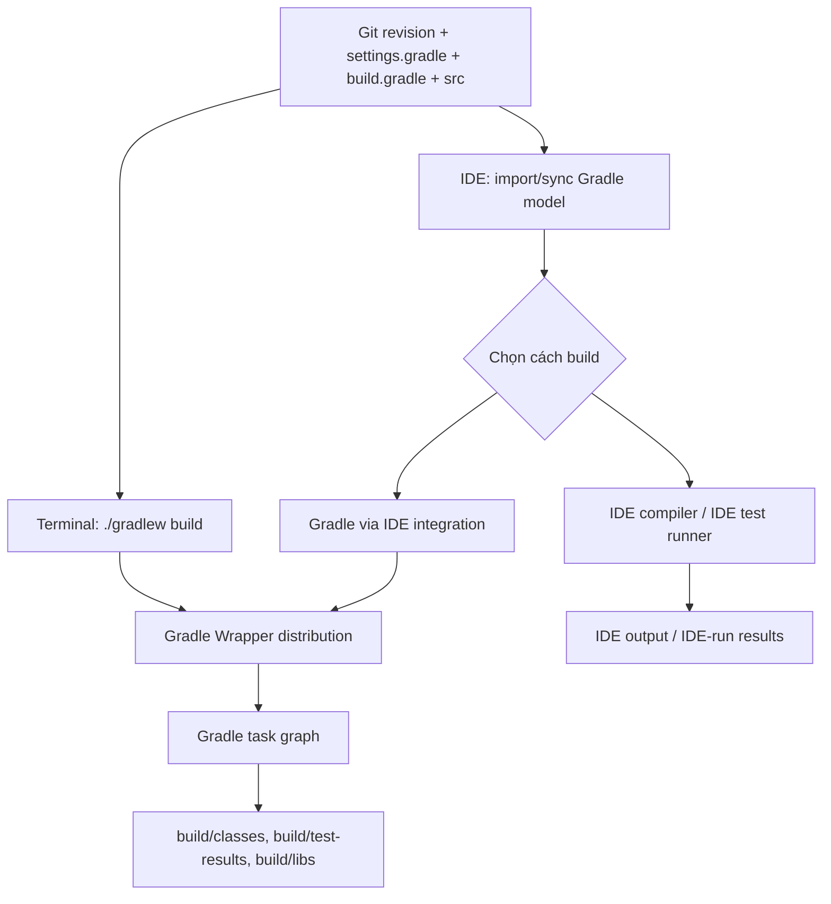
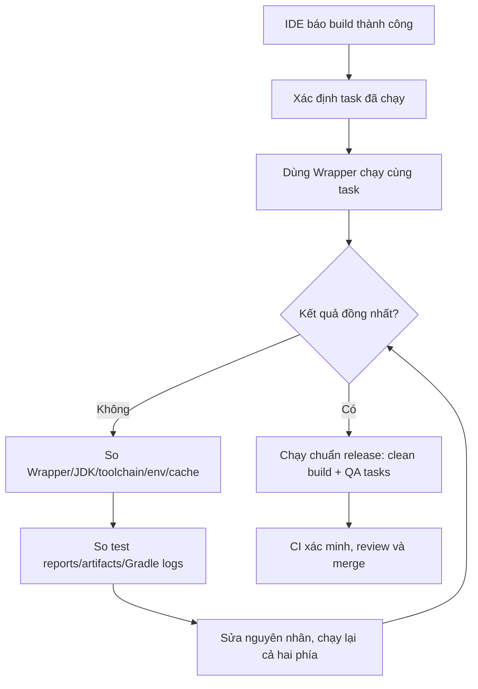

# Đối chiếu build trong IDE với build bằng Wrapper

Một dự án Java có thể **chạy và biên dịch thành công trong IntelliJ IDEA, Eclipse hoặc Visual Studio Code** nhưng lại thất bại khi chạy `./gradlew build` trên terminal/CI. Chiều ngược lại cũng phổ biến: Gradle Wrapper build thành công nhưng IDE hiển thị import đỏ, không nhận dependency hoặc báo lỗi JDK.

Điều này **không chứng minh Gradle hay IDE sai**. Hai phía có thể đang thực hiện **những thao tác khác nhau**: IDE biên dịch bằng compiler tích hợp, chạy một test bằng test runner của nó, hoặc chỉ gọi Gradle task `classes`; trong khi Wrapper chạy chính xác task `build`, bao gồm compilation, test, packaging và các verification task được nối vào graph.

Bài thuộc nhóm **Dự án Java** của **Build Tool Gradle**, đi vào chủ đề **“Đối chiếu build trong IDE với build bằng Wrapper”**. Mục tiêu là có một quy trình đo được, lặp lại được và phù hợp cho cả lập trình viên lẫn CI.

Sau bài học, bạn sẽ biết:

1. Gradle Wrapper, một Gradle distribution cài sẵn, Gradle Tooling API và compiler nội bộ của IDE khác nhau thế nào.
2. Phân biệt **import/sync**, **compile**, **test**, **build**, **run** và **package** khi so sánh kết quả.
3. Căn chỉnh **Gradle version**, **Gradle JVM/Daemon JVM**, **Java toolchain**, **Project SDK** và **IDE test runner**.
4. Thiết lập IntelliJ IDEA, Eclipse Buildship và VS Code Gradle for Java để chạy **cùng Gradle tasks** như CLI.
5. Chạy lab Gradle Wrapper + **Java 17** + **JUnit 5** với stdout và file đầu ra xác định được.
6. Chẩn đoán khác biệt về dependency, repositories, annotation processing, resources, generated code, environment, caches, multi-module và test reports.
7. Thiết kế một checklist đối chiếu có thể đưa vào pull request và CI.

**Nguyên tắc đầu tiên:** muốn kết luận hai build giống nhau, phải so sánh **cùng source revision + cùng build definition + cùng Gradle distribution + cùng task/arguments + cùng yêu cầu JDK/toolchain + điều kiện dependency/environment tương đương**. Chỉ nhấn “Build Project” trong IDE và thấy màu xanh chưa đủ.

## 1. “Build trong IDE” có ít nhất ba nghĩa

Trong IDE, nút **Build**, **Run**, **Test** có thể làm một trong các việc:

- **IDE-native compile/build**: IDE tự dùng Java compiler và hệ thống incremental build riêng để biên dịch project model mà nó đã import. Thao tác này có thể bỏ qua các task Gradle tùy chỉnh.
- **Delegated Gradle build**: IDE chuyển yêu cầu cho Gradle thông qua tích hợp/Tooling API, để Gradle thực hiện các task tương ứng. *Task tương ứng* không nhất thiết là `build`.
- **Gradle task được chạy tường minh**: bạn chọn task `build`, `test`, `run`, `jar`, `distZip`... trong Gradle tool window/task view hoặc một Gradle run configuration. Đây là cách dễ đối chiếu nhất với `./gradlew <task>`.

Ngược lại, **Gradle Wrapper** chạy bằng script `gradlew` hoặc `gradlew.bat` của repository; script ấy tải/sử dụng phiên bản Gradle đã cấu hình trong `gradle/wrapper/gradle-wrapper.properties`.

| Thao tác bạn thấy | Có chắc chạy Gradle không? | Có chắc bằng `./gradlew build` không? |
| --- | --- | --- |
| IDE hiển thị lỗi/không lỗi trong editor | Không; thường là language server / project model | Không. |
| IDE **Build Project** dùng compiler nội bộ | Không | Không. |
| IDE **Build Project** được delegate sang Gradle | Có | **Không chắc**: có thể gọi `classes`, không gọi `test` hay đóng gói. |
| IDE **Run Main** bằng Java run configuration | Có thể không | Không; thường chỉ chạy một `main`. |
| IDE **Run tests** bằng IDE runner | Không nhất thiết | Không; có thể chỉ chạy một test/một lớp. |
| IDE chạy Gradle task `test` | Có | Tương đương CLI `./gradlew test` khi môi trường và tham số tương đương, **không phải toàn bộ `build`**. |
| IDE chạy Gradle task `build` | Có | Đây mới là phép so sánh sát nhất với `./gradlew build`. |
| Terminal trong IDE chạy `./gradlew build` | Có | Chính là Wrapper CLI, miễn working directory và môi trường đúng. |

**Quan trọng:** tên nút, task mapping và tùy chọn có thể thay đổi theo bản IDE hoặc plugin. Luôn xem **console thực tế** để biết command/task nào đã được chạy.

## 2. Sơ đồ toàn bộ: một build definition, nhiều đường thực thi



Điểm chính:

- **IDE import/sync model** không đồng nghĩa thực thi mọi task build. Nó giúp IDE hiểu source sets, dependencies, compiler options, task list.
- **Compiler nội bộ của IDE** có thể cho kết quả biên dịch khác vì chưa chạy code-generation hoặc task setup.
- **IDE delegate sang Gradle** có cơ hội dùng chung logic build; nhưng phải **chọn cùng tasks** và so sánh môi trường.
- **Wrapper** tiêu chuẩn hóa **Gradle distribution**, không tự bảo đảm Java version, credentials, môi trường, OS, timezone và mọi nguồn dữ liệu cũng giống nhau.

## 3. Wrapper là nguồn sự thật về Gradle version

Một project Gradle nên commit đủ bốn phần Wrapper:

```text
project-root/
├── gradlew
├── gradlew.bat
└── gradle/
    └── wrapper/
        ├── gradle-wrapper.jar
        └── gradle-wrapper.properties
```

Vai trò:

- `gradlew`: script cho Linux/macOS/shell tương thích.
- `gradlew.bat`: script cho Windows.
- `gradle-wrapper.jar`: chương trình bootstrap Wrapper.
- `gradle-wrapper.properties`: chứa `distributionUrl` và các thiết lập Wrapper.

Một `gradle-wrapper.properties` có thể chứa:

```properties
distributionUrl=https\://services.gradle.org/distributions/gradle-8.10.2-bin.zip
```

Đó là **mẫu minh họa**. File thật do task `wrapper` tạo/cập nhật, có thể chứa khóa bổ sung và dùng đường dẫn escape. Khi dùng lệnh `./gradlew build`, Wrapper lấy distribution đã khai báo, tải về nếu chưa có trong cache và gọi Gradle ấy; máy **không cần cài Gradle toàn hệ thống** cho các invocation tiếp theo.

### `gradle` khác `./gradlew`

```bash
gradle --version
./gradlew --version
```

Hai lệnh **có thể cho Gradle version khác nhau**:

- `gradle`: Gradle cài trên `PATH` của máy.
- `./gradlew`: Gradle theo `distributionUrl` của project.

Một IDE đang đặt **Specified location** cho Gradle distribution có thể dùng bản cài tay; điều đó dễ làm IDE và CLI Wrapper lệch phiên bản. Với IntelliJ IDEA, lựa chọn **Distribution → gradle-wrapper.properties file** là cách phù hợp để dùng Wrapper đã commit.

**Đừng tự sửa `distributionUrl` theo cảm tính** để làm một lỗi biến mất. Nâng Gradle version cần kiểm tra plugin compatibility và update Wrapper bằng task `wrapper`, rồi commit các file liên quan.

### Tạo Wrapper nếu dự án mới chưa có

Khi máy đã cài một Gradle tương thích:

```bash
gradle wrapper --gradle-version 8.10.2 --distribution-type bin
```

Đây là lệnh **khởi tạo Wrapper**, không phải cách nhóm nên dùng để tạo lại Wrapper ở mọi lần build. Trong dự án đang tồn tại, dùng Wrapper được version control quản lý. Với project multi-module, Wrapper nằm ở **root**; terminal đứng trong module con cần gọi đường dẫn tương đối tới script root.

### Giới hạn của Wrapper

Wrapper không bảo đảm:

1. Máy dùng cùng **JDK để chạy Gradle Daemon**.
2. Task Java dùng cùng **compiler** khi không có toolchain.
3. Cùng repository metadata/cache tại cùng thời điểm.
4. Cùng biến môi trường và secret.
5. Cùng source code đã được lưu/commit.
6. Cùng task selection — `classes` không bằng `build`.
7. Cùng OS, filesystem encoding/line endings, locale hoặc timezone.
8. Cùng versions của plugin ngoài nếu build dùng dynamic selectors hoặc mutable artifacts.

Vì thế Wrapper là **điểm xuất phát rất quan trọng**, nhưng không đủ để tuyên bố build byte-for-byte tái lập.

## 4. Tách rõ các giai đoạn: sync, compile, test, package, run

| Nhu cầu | Gradle task tiêu biểu | Kết quả chính | IDE action có thể tương ứng |
| --- | --- | --- | --- |
| Đọc lại mô hình project | Gradle Tooling API import/sync | IDE cập nhật project model | Reload/Sync Gradle Project |
| Biên dịch Java production | `compileJava` | `build/classes/java/main` | Compile Module, Build Project có thể gọi task này |
| Biên dịch và copy resources | `classes` | class files + processed resources | Build Project khi delegate |
| Biên dịch test | `testClasses` | `build/classes/java/test` và test resources | Prepare/Compile tests |
| Chạy bộ test Gradle | `test` | XML/HTML test reports, status | Run tests using Gradle |
| Đóng gói JAR chuẩn | `jar` | `build/libs/<name>-<version>.jar` | Explicit Gradle task |
| Verification lifecycle | `check` | Các verification tasks được nối vào check | Không phải mọi nút IDE đều gọi |
| Build lifecycle | `build` | Thường bao gồm assemble + check/test | Explicit Gradle task `build` |
| Chạy ứng dụng Java | `run` (Application plugin) | JVM chạy `mainClass` | Gradle run configuration |
| Tạo distribution | `distZip`, `installDist` | ZIP và thư mục distribution | Explicit Gradle task |

Một **Java plugin** tạo các lifecycle tasks và output conventions; việc plugin khác bổ sung task có thể làm graph thay đổi. Bảng trên mô tả dự án Java thông thường, **không phải cam kết mọi project đều có mọi task**: `run` cần Application plugin; `distZip` cũng thuộc Application/Distribution plugin.

**Đặc biệt:** Gradle task `build` thông thường gồm **`assemble` + `check`**, và `check` của Java plugin chạy tests. Nhưng `build` **không mặc nhiên gọi mọi task** của mọi plugin, ví dụ `distZip` có thể phải được yêu cầu riêng. Đừng coi một nút “Build” của IDE tương đương với `build distZip`.

## 5. Cần đối chiếu ít nhất bốn loại JVM/JDK

Trong một IDE dùng Gradle, các khái niệm sau có thể **khác nhau**:

| JVM/JDK | Dùng để làm gì? | Ví dụ nơi cấu hình |
| --- | --- | --- |
| **IDE runtime** | Chạy chính ứng dụng IntelliJ/Eclipse/VS Code hoặc Java language server | Runtime/bundled JDK của IDE, setting của extension |
| **Gradle JVM / Daemon JVM** | Chạy Gradle daemon và logic build/plugin | IntelliJ **Gradle JVM**, Eclipse **Gradle JDK**, `JAVA_HOME`, daemon JVM criteria |
| **Java toolchain** | Chạy `javac`, `java`, `javadoc` cho tasks Java theo build definition | `java { toolchain { languageVersion = JavaLanguageVersion.of(17) } }` |
| **Project SDK / IDE language level** | IDE hiểu Java source, code completion, native compiler | IntelliJ Project SDK, Eclipse JRE/Compiler compliance, VS Code Java runtime settings |

Ví dụ bạn có:

```text
IDE chạy bằng JDK 21
Gradle Daemon chạy trên JDK 17
Java toolchain biên dịch bằng JDK 17
Editor đang gắn Project SDK 21
```

Project vẫn có thể build **đúng Java 17 bằng Wrapper**, nhưng IDE internal compiler có thể cho phép API Java 21 nếu Project SDK/language level cấu hình sai. Một ứng dụng compile trong IDE nhưng fail ở `./gradlew compileJava` có thể do lý do này.

### `java.toolchain` và `options.release`

Mảnh cấu hình Java 17:

```groovy
java {
    toolchain {
        languageVersion = JavaLanguageVersion.of(17)
    }
}

tasks.withType(JavaCompile).configureEach {
    options.release = 17
}
```

- **Toolchain** chọn bộ công cụ JDK 17 cho Java tasks được Gradle quản lý.
- **`--release 17`** giới hạn language level, bytecode target và JDK API mà `javac` được phép biên dịch sử dụng.
- Hai thiết lập bổ sung nhau; `--release` không thay thế việc chọn compiler cụ thể.
- Một JDK 21 có thể chạy Gradle và dùng JDK 17 để compile khi toolchain được thiết lập đúng và JDK 17 có sẵn (hoặc được provision qua resolver cấu hình).
- Java toolchain **không bảo đảm luôn tự tải JDK**. Cơ chế provisioning phụ thuộc Gradle version và toolchain download repositories/resolver được cấu hình; máy offline cần toolchain sẵn.

### Ba lệnh cần nhớ

```bash
java -version
./gradlew --version
./gradlew javaToolchains
```

Giải thích:

- `java -version` dùng `java` trên `PATH` của shell.
- `./gradlew --version` báo phiên bản Gradle và JVM mà invocation dùng theo môi trường/daemon setup.
- `./gradlew javaToolchains` giúp xem các Java installations/toolchains Gradle phát hiện, khi task hỗ trợ trong bản Gradle đang dùng.

Trong IntelliJ, **Gradle JVM** có thể khác với `java` trên terminal; khi IDE cung cấp JDK khác, chỉnh setting hoặc dùng daemon criteria phù hợp. Không ép IDE runtime, Gradle JVM và toolchain phải **cùng một phiên bản** nếu thiết kế build chủ động cho phép chúng khác nhau; cái cần thống nhất là **hợp đồng build**.

## 6. Ví dụ runnable: dự án Java 17 có test JUnit 5

Đây là bài thực hành chính. Ta tạo **một project Gradle độc lập** có:

- Java 17, dùng **record** để kiểm chứng compiler thực sự hỗ trợ ngôn ngữ Java 17.
- Application plugin để có `run`.
- JUnit Jupiter 5.10.2 và JUnit Platform launcher 1.10.2 cho task `test`.
- Task `build` tạo outputs trong `build/`.
- Stdout do Java in ra có thể đối chiếu giữa Wrapper CLI và IDE Gradle task.
- Các lệnh `javac`/`java` độc lập để phân biệt phần Java với phần Gradle.

### 6.1. Cây thư mục

```text
ide-wrapper-lab/
├── settings.gradle
├── build.gradle
├── gradlew
├── gradlew.bat
├── gradle/
│   └── wrapper/
│       ├── gradle-wrapper.jar
│       └── gradle-wrapper.properties
└── src/
    ├── main/
    │   └── java/demo/Main.java
    └── test/
        └── java/demo/MainTest.java
```

**Điều kiện chạy:**

- JDK 17 cài sẵn hoặc Java toolchain 17 được provision hợp lệ.
- Gradle Wrapper 8.10.2 (hoặc bản tương thích với Java 17 và dependency versions nêu trong bài).
- Có kết nối Maven Central cho lần resolve JUnit đầu tiên, trừ khi dependency đã được cache.
- Có thể mở project bằng IntelliJ, Eclipse Buildship hoặc VS Code với Gradle for Java.

Nếu chưa có Wrapper, tạo một lần bằng Gradle cài sẵn theo mục 3 và commit cả bốn file Wrapper. Không viết một file `gradle-wrapper.jar` giả để “đủ cấu trúc”.

### 6.2. `settings.gradle`

```groovy
rootProject.name = 'ide-wrapper-lab'
```

### 6.3. `build.gradle` — bản Groovy DSL hoàn chỉnh

```groovy
plugins {
    id 'application'
}

group = 'example'
version = '1.0.0'

repositories {
    mavenCentral()
}

java {
    toolchain {
        languageVersion = JavaLanguageVersion.of(17)
    }
}

tasks.withType(JavaCompile).configureEach {
    options.encoding = 'UTF-8'
    options.release = 17
}

application {
    mainClass = 'demo.Main'
}

dependencies {
    testImplementation 'org.junit.jupiter:junit-jupiter:5.10.2'
    testRuntimeOnly 'org.junit.platform:junit-platform-launcher:1.10.2'
}

tasks.named('test', Test) {
    useJUnitPlatform()
}
```

Điểm cần hiểu:

1. `application` áp dụng các chức năng Java cần thiết; không cần thêm `id 'java'` lần nữa chỉ để có `compileJava`.
2. `mavenCentral()` phục vụ tải JUnit; nếu không chạy tests và đã compile Java source không dùng thư viện ngoài thì `run` vẫn có thể không cần JUnit runtime.
3. `java.toolchain=17` và `options.release=17` quy định compiler/language API; đây là dữ liệu **của build**, không chỉ setting của IDE.
4. `application.mainClass` quy định điểm vào `demo.Main` khi gọi `run`.
5. JUnit 5 cần `useJUnitPlatform()` trên `test`; `testRuntimeOnly` cung cấp launcher thích hợp.
6. Test dependency chỉ cần cho **test classpath**, không kéo JUnit vào runtime classpath của ứng dụng sản xuất.

### 6.4. `src/main/java/demo/Main.java`

```java
package demo;

import java.util.List;

public final class Main {
    private Main() {
    }

    private record Greeting(String name) {
        String render() {
            return "Hello, " + name + "!";
        }
    }

    public static String greeting(String name) {
        return new Greeting(name).render();
    }

    public static void main(String[] args) {
        System.out.println(greeting("Gradle & IDE"));
        System.out.println("Items=" + List.of("compile", "test").size());
    }
}
```

Lớp `Greeting` là **Java record**, một tính năng được hỗ trợ chính thức trong Java 17. `Main.greeting(...)` là phương thức có thể kiểm thử độc lập; `Main.main` chỉ in kết quả.

### 6.5. `src/test/java/demo/MainTest.java`

```java
package demo;

import org.junit.jupiter.api.Test;

import static org.junit.jupiter.api.Assertions.assertEquals;

class MainTest {

    @Test
    void formatsGreeting() {
        assertEquals("Hello, Gradle & IDE!", Main.greeting("Gradle & IDE"));
    }

    @Test
    void formatsAnotherName() {
        assertEquals("Hello, Team!", Main.greeting("Team"));
    }
}
```

Lớp test dùng JUnit Jupiter. Nó chứa **hai test methods**, cả hai kỳ vọng pass. Nếu IDE không import JUnit dependencies, editor có thể báo thiếu `org.junit.jupiter.api.Test`, trong khi Wrapper CLI vẫn resolve và chạy test được.

### 6.6. Chạy baseline bằng Wrapper

Trên Linux/macOS, tại root:

```bash
./gradlew --version
./gradlew clean build --console=plain
./gradlew -q run
```

Trên Windows PowerShell/CMD, thay script:

```powershell
.\gradlew.bat --version
.\gradlew.bat clean build --console=plain
.\gradlew.bat -q run
```

**Stdout chính xác của `Main.main`** khi gọi `run` là:

```text
Hello, Gradle & IDE!
Items=2
```

Đó là **stdout của ứng dụng**, không phải toàn bộ console Gradle. Dòng `BUILD SUCCESSFUL`, `UP-TO-DATE`, thời gian và số lượng task trong Gradle log phụ thuộc máy, cache, daemon và Gradle version; đừng hard-code chúng làm expectation của bài.

Với `clean build`, Gradle thông thường sẽ:

1. Xóa output `build/` của project từ `clean`.
2. Compile Java source với JDK 17.
3. Compile test source với JUnit classpath.
4. Chạy task `test` qua JUnit Platform.
5. Tạo JAR chuẩn của Java plugin.
6. Chạy verification/lifecycle graph phù hợp để kết thúc task `build`.

**`./gradlew -q run` không chạy toàn bộ JUnit test suite** chỉ vì nó biên dịch Main. Nếu mục tiêu là parity của test, so sánh **`test` với `test`**.

### 6.7. Kiểm tra artifacts và test report

Sau baseline thành công, các vị trí thường có:

```text
build/
├── classes/
│   └── java/
│       ├── main/demo/Main.class
│       ├── main/demo/Main$Greeting.class
│       └── test/demo/MainTest.class
├── libs/
│   └── ide-wrapper-lab-1.0.0.jar
├── reports/
│   └── tests/test/index.html
└── test-results/
    └── test/
        └── TEST-demo.MainTest.xml
```

`Main$Greeting.class` là class file của nested record trong cùng source file; cách đặt tên binary thường theo quy tắc Java. Một số file metadata, report hoặc thư mục bổ sung có thể xuất hiện; cấu trúc trên chỉ giữ những output có giá trị so sánh.

- **JUnit XML report** thể hiện kết quả `test` theo cấu hình Gradle.
- **HTML report** giúp đọc test details trong trình duyệt.
- **JAR** xác nhận task đóng gói chạy.
- **`build/classes`** cho biết Gradle `compileJava` đã tạo class ở đầu ra chuẩn.

**Không mặc định `java -jar build/libs/ide-wrapper-lab-1.0.0.jar` chạy được**: JAR chuẩn của Java plugin không nhất thiết chứa `Main-Class` manifest. Sử dụng `./gradlew run` hoặc cấu hình manifest/start scripts theo yêu cầu.

### 6.8. Chạy từng task để biết nút IDE tương ứng

```bash
./gradlew clean classes
./gradlew testClasses
./gradlew test
./gradlew jar
./gradlew build
./gradlew distZip
```

Diễn giải:

- `classes`: main source + resources, **chưa chạy JUnit tests**.
- `testClasses`: compile test source/resources, **chưa thực thi tests**.
- `test`: thực thi JUnit suite; tạo test reports khi chạy.
- `jar`: đóng gói main classes/resources.
- `build`: lifecycle tổng hợp; trong lab sẽ test.
- `distZip`: do Application/Distribution plugin cung cấp, tạo ZIP distribution có scripts và các runtime libraries.

Nếu IDE “Build Project” chỉ tương ứng với `classes` thì nó có thể xanh dù `./gradlew build` fail ở test. Muốn kiểm chứng bằng nhau, chạy **Gradle `build`** ở IDE, không chỉ nhấn “Build Project”.

### 6.9. Tự chạy Java 17 bằng `javac` và `java`

Vì Main không phụ thuộc thư viện ngoài tại runtime, ta có thể biên dịch và chạy thủ công mà không cần Gradle:

```bash
mkdir -p manual-classes
javac --release 17 -d manual-classes src/main/java/demo/Main.java
java -cp manual-classes demo.Main
```

Stdout:

```text
Hello, Gradle & IDE!
Items=2
```

Khi chạy bằng `javac`:

- Không cần Maven Central/JUnit để **biên dịch Main**.
- Không biên dịch/chạy `MainTest.java` vì phần test cần JUnit jars.
- Không gọi task `compileJava`, `jar`, `test` hoặc các custom Gradle tasks.
- Cấu hình `java.toolchain` không tự áp dụng lên `javac` đã chọn từ `PATH`. Bạn phải xác nhận đó là compiler/JDK phù hợp.

Vì vậy **`javac` thành công chỉ chứng minh mã Java được biên dịch trong điều kiện bạn cung cấp**, không chứng minh toàn bộ Gradle build/test/dependency graph của dự án thành công.

### 6.10. Biên dịch ra bytecode nào?

Sau `./gradlew compileJava`, có thể dùng:

```bash
javap -verbose build/classes/java/main/demo/Main.class
```

Tìm `major version: 61`. Java 17 class file version là **61**. `javap` được gọi từ JDK phù hợp với class file.

Đây là một phép kiểm tra hữu ích khi IDE dùng language level 21 nhưng build definition mong Java 17. Nếu Gradle và IDE-native output có bytecode khác nhau, cần xem compiler setting và cách delegate.

## 7. Bản Kotlin DSL của lab (tương đương, không dùng đồng thời)

Nếu dự án chọn Kotlin DSL, thay `settings.gradle` bằng `settings.gradle.kts`, và `build.gradle` bằng `build.gradle.kts`. Java source và JUnit test giữ nguyên.

**`settings.gradle.kts`:**

```kotlin
rootProject.name = "ide-wrapper-lab"
```

**`build.gradle.kts`:**

```kotlin
plugins {
    application
}

group = "example"
version = "1.0.0"

repositories {
    mavenCentral()
}

java {
    toolchain {
        languageVersion.set(JavaLanguageVersion.of(17))
    }
}

tasks.withType<JavaCompile>().configureEach {
    options.encoding = "UTF-8"
    options.release.set(17)
}

application {
    mainClass.set("demo.Main")
}

dependencies {
    testImplementation("org.junit.jupiter:junit-jupiter:5.10.2")
    testRuntimeOnly("org.junit.platform:junit-platform-launcher:1.10.2")
}

tasks.test {
    useJUnitPlatform()
}
```

`options.release.set(17)` nhắm cùng mục tiêu với `options.release = 17` trong Groovy DSL. `application.mainClass.set(...)` là cú pháp type-safe cho `Property<String>`.

**Không giữ hai bộ scripts cạnh nhau với kỳ vọng Gradle trộn chúng**. Chọn một DSL của từng file và kiểm tra lại Gradle project import sau khi đổi.

## 8. IntelliJ IDEA: tạo phép đối chiếu đúng cách

IntelliJ IDEA có tích hợp Gradle và có thể dùng **Gradle làm build/test runner** hoặc **IDE-native compiler/test runner**. Giao diện có thể thay đổi theo phiên bản, nhưng đường đi thường là:

**Settings/Preferences → Build, Execution, Deployment → Build Tools → Gradle**

Với linked Gradle project, tìm và kiểm tra:

1. **Distribution:** chọn **gradle-wrapper.properties file** để IDE dùng Gradle version của repository; tránh tùy tiện chọn local Gradle installation.
2. **Gradle JVM:** chọn JDK mà Gradle distribution/plugin của project hỗ trợ. Nếu nhóm dùng Gradle Daemon JVM criteria, hiểu và tuân thủ policy đó.
3. **Build and run using:** chọn **Gradle** khi muốn delegate build/run cho Gradle. Nếu chọn **IntelliJ IDEA**, IDE có thể sử dụng compiler nội bộ.
4. **Run tests using:** chọn **Gradle** khi muốn kết quả test khớp Gradle CI; nếu chọn **IntelliJ IDEA**, test runner khác có thể thực hiện.
5. **Gradle user home / offline mode:** xác nhận có đang dùng cache/repositories giống môi trường CLI cần so sánh không.
6. **Reload/Sync:** sau khi sửa build script, settings hoặc dependencies, reload Gradle project để cập nhật model.

**Đặc biệt quan trọng:** tài liệu IntelliJ giải thích khi chọn **Build and run using Gradle**, thao tác **Build → Build Project** có thể chạy Gradle task `classes` (hoặc những task biên dịch tương ứng), **không có nghĩa chạy `build` lifecycle có tests**. Muốn đối chiếu `./gradlew build` với IDE, hãy chạy **Gradle task `build` từ Gradle tool window hoặc Gradle run configuration**, và xem console có đúng task không.

### 8.1. Thao tác thực hành trong IntelliJ

1. Mở **thư mục root `ide-wrapper-lab`**, không mở nhầm `src/main/java` như một project Java rời.
2. Chọn import/open như **Gradle project**. IDE sẽ đọc `settings.gradle`, `build.gradle`, Wrapper và source sets.
3. Chọn Gradle distribution là Wrapper và thiết lập Gradle JVM tương thích.
4. Reload Gradle project; kiểm tra JUnit dependency và Java 17 language support trong model.
5. Trong Gradle tool window, tìm **Tasks → build → build** và chạy.
6. Đọc Gradle console/task graph. So sánh với `./gradlew clean build --console=plain` ở terminal.
7. Chạy Gradle task **`run`** để so hai dòng stdout Java.
8. Kiểm tra `build/test-results/test` và `build/reports/tests/test`.

Khi cần kết quả rõ từ sạch, chạy task set `clean build` trong Gradle run configuration, hoặc trước đó chạy `clean`. **Không dùng nút “Rebuild Project” của compiler nội bộ như bằng chứng nó chắc chắn thực hiện `./gradlew clean build`**.

### 8.2. IDE Run Configuration khác Gradle Run Configuration

IntelliJ có thể tạo một **Application run configuration** để trực tiếp chạy `demo.Main` bằng IDE-provided classpath, và một **Gradle run configuration** chạy task `run`. Hai cấu hình đều có thể in:

```text
Hello, Gradle & IDE!
Items=2
```

Nhưng:

- Application configuration có thể **không chạy** custom Gradle task trước đó.
- Gradle `run` tiêu thụ các properties và dependencies được cấu hình cho Gradle task.
- Classpath và working directory có thể khác nhau.
- JVM arguments, environment variables và debugger options có thể được thiết lập ở hai nơi độc lập.

**Không suy ra toàn bộ build parity chỉ vì Main in cùng stdout.** Phải tiếp tục so test, artifacts và input/task graph liên quan.

### 8.3. “Unresolved import” dù Wrapper build thành công

Sau khi thêm JUnit dependency, IntelliJ có thể chưa reload Gradle model nên editor còn đánh dấu `org.junit.jupiter` là thiếu. CLI Wrapper đã resolve dependency thành công vì build script hiện tại đúng.

Cách xử lý trước khi sửa build:

1. Save `build.gradle`/`settings.gradle` và Java source.
2. Reload Gradle project.
3. Kiểm tra IDE không bật offline mode khi dependency còn chưa cache.
4. Kiểm tra Gradle JVM/toolchain và vị trí repository.
5. Xem **Gradle sync log** thay vì dựa vào màu gạch chân trong editor.
6. Nếu CLI thật sự build thành công mà IDE model không cập nhật, kiểm tra lỗi integration/cache của IDE; **không thêm dependency trùng** chỉ để màu đỏ biến mất.

## 9. Eclipse: Buildship import/refresh khác Eclipse incremental build

Eclipse tích hợp Gradle thông qua **Buildship**. Với một Gradle project:

1. Dùng chức năng **Import → Gradle → Existing Gradle Project** (tên menu tùy Eclipse/Buildship version).
2. Chọn **root chứa `settings.gradle` và Wrapper**.
3. Chọn Gradle distribution sử dụng Wrapper nếu được cung cấp trong tùy chọn import.
4. Chọn **Gradle JDK** phù hợp với Gradle distribution; không nhầm JRE của Eclipse với toolchain Java 17 cho task.
5. Import project; Buildship nạp source sets/dependencies từ mô hình Gradle.
6. Khi sửa build scripts hoặc dependency declarations, dùng **Gradle → Refresh Gradle Project** theo UI version.
7. Mở **Gradle Tasks** view và chạy task `build`, `test` hoặc `run` để so với Wrapper CLI.

Eclipse cũng có **Java Development Tools (JDT)** và incremental compiler/builder riêng. Lệnh **Project → Build Project/Build Automatically** có thể biên dịch theo JDT workspace model, **không bắt buộc chạy `./gradlew build`** và không chắc chạy test hoặc task Gradle tùy chỉnh.

Vì vậy so sánh đúng gồm hai nhánh:

- **Eclipse workspace build:** hữu ích cho phản hồi nhanh về lỗi Java và compile trong IDE.
- **Buildship Gradle task `build`:** dùng Gradle task graph chính thức của project, gần với CI Wrapper.

Nếu Gradle CLI báo `No matching toolchains found` nhưng Eclipse editor biên dịch được, khả năng cao **Eclipse JDK/JRE** và Gradle Java toolchain chưa thống nhất. Nếu CLI thành công nhưng Eclipse editor không thấy JUnit imports, hãy refresh Gradle model và kiểm tra **Java Build Path / classpath container** trước khi thêm JAR thủ công.

**Không dùng `.classpath` hoặc `.project` do Eclipse sinh ra làm nguồn sự thật thay `build.gradle`**. Với Gradle project, dependency và source sets chủ yếu nên được khai báo trong build definition.

## 10. Visual Studio Code: Gradle for Java và Java language server

VS Code có **Gradle for Java extension** và bộ Java extensions. Theo tài liệu VS Code, Gradle for Java hỗ trợ nhập mô hình, xem tasks/dependencies và chạy Gradle tasks, trong khi Java language tooling có thể có build/test workflow riêng.

Quy trình:

1. Mở **workspace ở root `ide-wrapper-lab`**.
2. Cài **Gradle for Java** và các Java extensions cần thiết, phù hợp với phiên bản VS Code/JDK của bạn.
3. Để extension nhận diện `gradlew`/`settings.gradle`/`build.gradle` và import project.
4. Trong **Gradle Projects/Tasks view**, chạy tường minh `build`, `test`, `run`; đây là các lệnh để so với Wrapper.
5. Xem **Build Server for Gradle** output/log nếu dùng Gradle Build Server (tên channel có thể khác theo phiên bản).
6. Nếu dùng Testing Explorer, kiểm tra test profile đang chạy **Gradle test** hay Java Test Runner.
7. Cấu hình JDK của Java tooling và Gradle execution một cách có chủ đích; terminal `java -version` có thể không phải JDK mà extension dùng.

Ở các phiên bản VS Code Gradle for Java hỗ trợ, thiết lập `java.gradle.buildServer.enabled` điều khiển Gradle Build Server. **Không thay đổi setting này chỉ vì một lần sync lỗi**; hãy xem log và yêu cầu tích hợp trước.

**Điểm cần phân biệt:** bấm nút Run trên `main()` có thể dùng Java debugger/launcher của VS Code, khác với chạy task `run` trong Gradle Tasks view. Đối chiếu đúng là **cùng task `run`**; nếu cần debug ứng dụng qua IDE-native launcher, hãy kiểm tra classpath và working directory riêng.

## 11. So sánh có kiểm soát: IDE Build Project vs `./gradlew build`

Mở lab mục 6 trong IDE và thực hiện ba lượt:

### Lượt A — CLI chuẩn

```bash
./gradlew clean build --console=plain
./gradlew -q run
```

Lưu lại: Gradle version/JVM, các task đã chạy, kết quả test, JAR và stdout Java.

### Lượt B — IDE native build (nếu IDE hỗ trợ lựa chọn này)

- Chọn compiler/build runner nội bộ của IDE.
- Chạy chức năng **Build Project** hoặc incremental build.
- Quan sát console: **có task `test` và `jar` của Gradle được gọi không?**
- Quan sát output: có `build/test-results/test` mới, `build/libs` mới không?
- Xem compiler bytecode/language level có bám Java 17 không.

Nếu không có Gradle tasks, không nên gọi đây là “Wrapper build thất bại nhưng IDE build thành công” theo nghĩa cùng một phép thử. Đó là **hai phép thử khác nhau**.

### Lượt C — IDE delegate task Gradle chính xác

- Chọn Wrapper distribution trong IDE.
- Chọn Gradle JVM tương thích.
- Chạy **Gradle task `clean build`**, không chỉ nút Build Project.
- Chạy **Gradle task `run`**.
- Kiểm tra output cùng các file `build/libs`, `build/test-results`.
- So với CLI ở lượt A.

Nếu C và A khác nhau dù cùng source/task/version, xét đến **Gradle JVM, User Home, env vars, system properties, project properties, working directory, caches và init scripts**.

### Bảng đối chiếu

| Phép so | Có thể mong đợi điều gì? | Không nên kỳ vọng |
| --- | --- | --- |
| CLI `compileJava` ↔ IDE native Java compiler | Cùng Java semantics nếu compiler/options phù hợp | Tự chạy toàn bộ custom code-generation tasks. |
| CLI `classes` ↔ IDE delegated Build Project | Cùng khả năng compile/processed resources theo graph IDE dùng | Tự động có kết quả JUnit tests mới. |
| CLI `test` ↔ IDE Gradle task `test` | Cùng JUnit task configuration khi env tương đương | Cùng với IDE-native test runner trong mọi chi tiết. |
| CLI `build` ↔ IDE Gradle task `build` | Cùng task graph và build logic | Luôn cùng thời gian chạy hoặc trạng thái `UP-TO-DATE`. |
| CLI `run` ↔ IDE Gradle task `run` | Cùng mainClass, classpath, JVM args của task | IDE-native Application launcher tự giống Gradle. |
| CLI `distZip` ↔ IDE Gradle `distZip` | Cùng logic tạo distribution | ZIP bytes tuyệt đối giống nếu timestamps/OS và input chưa được chuẩn hóa. |

## 12. Đừng nhầm `BUILD SUCCESSFUL` với “mọi kiểm tra đã chạy”

Một command như:

```bash
./gradlew classes
```

có thể hiển thị `BUILD SUCCESSFUL` dù tests **chưa chạy**. Tương tự, `./gradlew test` có thể thành công trong khi các quality gates của custom `check` task (SpotBugs, Checkstyle, coverage threshold...) chưa được gọi nếu build cấu hình chúng trong một task khác.

Muốn biết điều gì đã chạy, xem **task graph**. Ví dụ:

```bash
./gradlew build --dry-run
```

`--dry-run` cho biết task nào được lên kế hoạch mà không thực thi actions thông thường; nó **không phải** bằng chứng tests đã pass.

Để thực thi verification:

```bash
./gradlew clean build --console=plain
```

Và nếu CI thực tế chạy `./gradlew check integrationTest`, IDE phải chạy **chính tập tasks đó** để đánh giá parity. Không suy luận từ tên task **`build`** rằng nó luôn chạy một custom `integrationTest` nếu task chưa được nối vào `check`.

## 13. So sánh đầu ra: class files, test reports, JAR và distribution

Một quy trình đối chiếu tốt không chỉ nhìn console màu xanh:

| Dữ liệu | CLI dùng lệnh nào tạo? | Vị trí mặc định | Câu hỏi cần xác nhận |
| --- | --- | --- | --- |
| Main classes | `compileJava` / `classes` | `build/classes/java/main` | Class bytecode/JDK 17 có đúng không? |
| Test classes | `compileTestJava` / `testClasses` | `build/classes/java/test` | IDE đã import/compile tests chưa? |
| Test XML | `test` | `build/test-results/test` | Số tests/failures/skipped có khớp không? |
| Test HTML | `test` | `build/reports/tests/test` | Có error bị che vì chỉ compile không? |
| Main JAR | `jar` | `build/libs` | JAR có chứa classes/resources cần thiết? |
| Distribution ZIP | `distZip` | `build/distributions` | Có scripts/runtime libraries đúng? |
| IDE-native output | IDE compiler | Có thể là `out/`, `bin/`, `build/` tùy IDE/delegation | Có thực sự được Gradle tạo không? |

**Đừng tuyệt đối hóa tên thư mục** nếu project đã tùy chỉnh `layout.buildDirectory`, artifact names hoặc test output directories.

### 13.1. Kiểm tra JAR có class không

```bash
./gradlew jar
jar tf build/libs/ide-wrapper-lab-1.0.0.jar
```

Tìm ít nhất:

```text
demo/Main.class
demo/Main$Greeting.class
```

Đây là các **entry kỳ vọng**, không phải stdout đầy đủ của `jar tf`. Nếu IDEA chỉ build ra `out/production` mà chưa chạy Gradle task `jar`, bạn có thể không thấy JAR mới trong `build/libs`.

### 13.2. So sánh checksum có giới hạn

Trên Unix có thể dùng:

```bash
sha256sum build/libs/ide-wrapper-lab-1.0.0.jar
```

Trên Windows PowerShell:

```powershell
Get-FileHash build/libs/ide-wrapper-lab-1.0.0.jar -Algorithm SHA256
```

Checksum giúp phát hiện file khác byte, nhưng một khác biệt checksum **chưa xác định được nguyên nhân**: JAR có thể chứa timestamps, thứ tự entries, metadata hoặc đầu vào khác nếu build chưa cấu hình reproducible archives. Để so sánh nghiêm ngặt, xác nhận archive normalization và build reproducibility, rồi đối chiếu nội dung thật khi hash khác.

Đừng xóa artifacts bằng tay chỉ để kết luận build “sạch” nếu một task có output ở nơi khác ngoài `build/`.

## 14. Vì sao dependency resolution trong IDE và CLI có thể khác nhau?

Một dự án có:

```groovy
repositories {
    mavenCentral()
}

dependencies {
    testImplementation 'org.junit.jupiter:junit-jupiter:5.10.2'
}
```

CLI và IDE cùng đọc script nhưng có thể khác ở:

- **Gradle distribution version** nếu IDE không dùng Wrapper.
- **Gradle User Home** khác, dẫn đến cache, init scripts, credentials khác.
- **Offline mode**: IDE có thể đang offline nhưng CLI có mạng.
- **Proxy/DNS/TLS certificate** hoặc VPN: IDE JVM khác shell/CI.
- **Environment variables/Gradle properties** cấp secrets hoặc URL mirror khác.
- **Dynamic version selectors** như `+` hay `latest.release`: hai caches có thể nhìn thấy metadata ở thời điểm khác.
- **Changing/SNAPSHOT modules**: cùng logical version nhưng artifact có thể được publish lại.
- **Repository policies**: `dependencyResolutionManagement`, `pluginManagement`, `repositoriesMode`.
- **Project import chưa refresh**: IDE vẫn dùng model cũ khi build script đã đổi.

### 14.1. Gradle User Home cần đối chiếu

Mặc định Gradle User Home thường nằm ở `~/.gradle`, nhưng có thể thay qua:

```bash
echo "$GRADLE_USER_HOME"
```

Trên PowerShell:

```powershell
$env:GRADLE_USER_HOME
```

Giá trị rỗng nghĩa là biến môi trường chưa set, **không có nghĩa Gradle không có User Home**. IDE có thể cấu hình một đường dẫn khác trong Gradle settings.

Trong User Home có thể có:

- Cached Gradle distributions và dependency artifacts.
- `gradle.properties` chứa các settings cho người dùng.
- `init.gradle` hoặc `init.d/*.gradle` chỉnh repository/plugin policy.
- Daemon logs và các cache kỹ thuật.

**Không đăng công khai `gradle.properties` hay `--info` logs nếu có secrets**. Khi cần gửi log chẩn đoán, phải xóa tokens, mật khẩu, đường dẫn cá nhân nhạy cảm và URL có credentials.

### 14.2. Lệnh xem dependency graph

```bash
./gradlew dependencies --configuration testRuntimeClasspath
./gradlew dependencyInsight --dependency junit-jupiter --configuration testRuntimeClasspath
```

Với lab mục 6, Gradle sẽ resolve JUnit và dependency liên quan từ Maven Central khi cần test. Dùng `dependencyInsight` để thấy requested/selected version; đừng chỉ nhìn `build.gradle` hoặc thư viện trong IDE External Libraries tree.

Nếu dependency resolve được với CLI nhưng IDE sync fail, xem **IDE Gradle sync log** và cùng repository policy. Nếu CLI fail mà IDE editor vẫn không đỏ, có thể IDE đang dùng **cached model cũ**, không chứng minh kho remote đang hoạt động.

## 15. Annotation processing và generated sources: lỗi lệch IDE/Wrapper điển hình

Giả sử một dự án có annotation processor (Lombok, MapStruct, Dagger...), code generation task hoặc protoc/OpenAPI generator. Gradle build có thể khai báo:

```groovy
dependencies {
    annotationProcessor 'group:processor:version'
    compileOnly 'group:annotations:version'
}
```

Đây là **snippet minh họa**, `group:processor:version` không phải artifact thật nên không chạy được nếu copy nguyên.

Khi dùng Gradle, dependency `annotationProcessor` được cấu hình cho processor path của JavaCompile. Nhưng IDE-native compiler cần **cấu hình annotation processing tương thích** hoặc delegate compile cho Gradle để sinh code đúng. Nếu IDE chỉ import model chứ không chạy generator, lớp được tạo ra có thể thiếu.

Quy trình kiểm tra:

1. Xác định task nào sinh source, ví dụ `generateApi` hoặc annotation processor của `compileJava`.
2. Xác nhận task được **nối vào `compileJava` bằng Provider/source directory/task dependency đúng**, không chỉ tồn tại ở root.
3. Chạy `./gradlew clean compileJava` để biết Gradle có tái tạo được nguồn từ sạch không.
4. Trong IDE, chọn delegate build sang Gradle hoặc cấu hình annotation processing theo tài liệu plugin/IDE.
5. Refresh Gradle model để IDE nhận source directories được plugin tạo.
6. Đảm bảo IDE không phụ thuộc vào **file generated từ lần build cũ** chưa được khai báo.
7. Chạy `./gradlew clean build` trên CI để xác nhận release không cần IDE.

**Không commit thư mục `build/generated` để che lỗi task wiring** trừ khi dự án có một chính sách generated source thật sự cần version control và đã được duyệt.

## 16. Resources và encoding: compile pass nhưng runtime khác

Java application thường có:

```text
src/main/java/
src/main/resources/
src/test/java/
src/test/resources/
```

Gradle Java plugin quản lý `processResources`, `processTestResources`, `classes` và `testClasses`. IDE cũng có một mô hình resource root và output directory riêng.

Nếu một file `config.properties` nằm trong `src/main/resources`, nó có thể được đặt vào output classpath của Gradle nhờ `processResources`. Nhưng nếu IDE đánh dấu thư mục khác hoặc chỉ chạy một class bằng classpath tự tạo, `ClassLoader.getResourceAsStream("config.properties")` có thể trả `null`.

Để chẩn đoán:

```bash
./gradlew clean classes
```

Sau đó xem file đã vào output classpath chưa. Không nhất thiết phải hard-code absolute path tới `src/main/resources` trong Java code, vì khi đóng gói JAR, resource nên được đọc qua classpath.

### Encoding

Dù Gradle JavaCompile có `options.encoding='UTF-8'`, IDE-native compiler có thể sử dụng encoding khác nếu workspace setting không đúng. Trong lab chúng ta đặt encoding UTF-8 rõ ràng; một IDE build ngoài Gradle cần cấu hình tương thích.

**Không chỉ so text output có dấu tiếng Việt** rồi kết luận bytecode khác do compiler: console encoding, font và terminal code page cũng có thể ảnh hưởng hiển thị stdout.

## 17. Test runner: JUnit 5 trong Gradle khác test runner của IDE ra sao?

Trong lab:

```groovy
dependencies {
    testImplementation 'org.junit.jupiter:junit-jupiter:5.10.2'
    testRuntimeOnly 'org.junit.platform:junit-platform-launcher:1.10.2'
}

tasks.named('test', Test) {
    useJUnitPlatform()
}
```

Khi gọi `./gradlew test`:

- Gradle xác định **testRuntimeClasspath**.
- Gradle Test task dùng JUnit Platform.
- Hai `@Test` trong `MainTest` được phát hiện/chạy.
- Gradle ghi XML/HTML test reports theo cấu hình.
- Task behavior bao gồm system properties, JVM args, test filters, maxParallelForks, test logging, working directory và những đầu vào khác.

IDE-native runner có thể chạy JUnit Jupiter với dependency đã import, nhưng:

- Có thể chỉ chạy một test method do bạn chọn từ gutter.
- Có thể bỏ qua các filter/config cụ thể của Gradle Test task.
- Có thể dùng classpath/working directory/JVM args khác.
- Có thể hiển thị kết quả trong IDE nhưng không tạo **Gradle XML/HTML report**.
- Có thể dùng JDK khác với `java.toolchain`.

Muốn đối chiếu CI, dùng **IDE Gradle runner cho test** hoặc **run Gradle task `test` tường minh**.

### 17.1. “No tests found” nhưng IDE chạy test được

Kiểm tra:

1. `MainTest.java` có nằm trong `src/test/java` hoặc source set được Gradle khai báo không?
2. Dependency JUnit Jupiter có trong **`testImplementation`** không?
3. `test { useJUnitPlatform() }` có trong đúng Gradle task không?
4. `testRuntimeOnly` có cung cấp launcher theo thiết lập của Gradle/JUnit version không?
5. Có `filter`, `include`, `exclude`, `--tests` hoặc custom test task đang loại test không?
6. Class/method có annotation `org.junit.jupiter.api.Test` đúng không, không trộn với JUnit 4 một cách ngầm?
7. Nếu multi-project, có đang chạy `:app:test` trong khi test nằm ở `:lib` không?
8. Có IDE-only run configuration đang chạy test khác với Gradle source set không?

Thử:

```bash
./gradlew clean test --info
```

Không cần thêm một test runner mới hoặc sửa `src/test/java` thành `src/main/java` chỉ để test được phát hiện.

### 17.2. Test pass ở IDE nhưng fail trên CI

Ngoài runner, kiểm tra:

- Timezone, locale, file separator, case-sensitive filesystem.
- File/resources từ working directory.
- Environment variables và test system properties.
- Thứ tự thực thi và trạng thái dùng chung giữa tests.
- Parallel execution, tests phụ thuộc network/clock.
- File tạm hoặc database được giữ từ lần chạy trước.
- JDK version/vendor khác với yêu cầu toolchain.

Dùng test data deterministic, temp directories theo JUnit, đóng kết nối và không dựa vào thứ tự tests nếu không có hợp đồng. Đừng vá bằng cách bỏ `test` khỏi `build`.

## 18. Build cache, incremental build và `UP-TO-DATE` gây hiểu nhầm gì?

Gradle có nhiều cơ chế tối ưu:

- **Incremental compilation:** chỉ xử lý phần source cần thiết theo khả năng.
- **Task up-to-date checks:** bỏ qua action khi inputs/outputs khớp snapshot.
- **Build cache:** tái sử dụng output hợp lệ của task cacheable.
- **Configuration cache:** tái sử dụng trạng thái configuration của build khi phù hợp.
- **IDE internal incremental builder:** tối ưu riêng của IDE, không đồng nghĩa Gradle build cache.

Vì thế một Gradle invocation có thể in:

```text
> Task :compileJava UP-TO-DATE
> Task :test UP-TO-DATE
```

Đây là **ví dụ trạng thái khả dĩ**, không phải stdout cố định của lab. Task không chạy lại action trong trường hợp đó vì Gradle kết luận outputs/inputs phù hợp. Điều này **không có nghĩa Gradle bỏ qua chính sách**; nhưng cũng không phải bằng chứng một môi trường sạch sẽ build thành công.

### Các chế độ kiểm tra có chủ đích

```bash
# Baseline sạch output của project:
./gradlew clean build --console=plain

# Không dùng build cache cho lần gọi này:
./gradlew clean build --no-build-cache --console=plain

# Yêu cầu chạy lại actions, hữu ích khi điều tra:
./gradlew build --rerun-tasks --console=plain

# Dùng nhiều logging hơn để xem quyết định build:
./gradlew build --info --console=plain
```

**Đừng dùng `clean` hay `--rerun-tasks` ở mọi lượt build hằng ngày**. Chúng loại bỏ lợi ích incremental/caching, tốn thời gian và chưa chắc sửa được sai source/model. Dùng chúng trong bước chẩn đoán có kiểm soát, rồi quay lại build bình thường.

`--no-build-cache` không có nghĩa “vô hiệu hóa mọi cache”: dependency cache, daemon, configuration cache và up-to-date checks vẫn có semantics riêng. Nếu debug dependency version/mirror, xem thêm `--refresh-dependencies`, nhưng không mặc định tải lại mọi byte.

## 19. Gradle properties, environment và working directory

Cùng Wrapper vẫn có thể tạo kết quả khác nếu môi trường khác. Xem một ví dụ thiết kế build:

```groovy
// Snippet — chỉ để minh họa mapping project property.
def buildMode = providers.gradleProperty('buildMode').orElse('local')

tasks.register('printBuildMode') {
    def mode = buildMode
    doLast {
        println 'buildMode=' + mode.get()
    }
}
```

Đây là một **task snippet** để thêm vào `build.gradle` của lab, không phải chương trình độc lập. Với task này:

```bash
./gradlew -q printBuildMode -PbuildMode=cli
```

Stdout:

```text
buildMode=cli
```

Trong IDE Gradle run configuration, nếu bạn **không truyền `-PbuildMode=cli`**, task có thể in:

```text
buildMode=local
```

Khác biệt không phải bug Gradle: **một phía đã truyền tham số, phía kia chưa**.

### `-P` và `-D` không đồng nghĩa

- `-PbuildMode=ci`: project property; đọc bằng `providers.gradleProperty('buildMode')`.
- `-Ddemo.mode=ci`: system property của JVM Gradle (hoặc cách Gradle xử lý CLI system properties), không tự chuyển sang JVM của Application `run`/JUnit `test`.
- Application `run` có JVM riêng; cần cấu hình `applicationDefaultJvmArgs` hoặc `tasks.named('run', JavaExec) { systemProperty ... }` để truyền vào ứng dụng.
- JUnit `test` cũng có JVM fork riêng; cần cấu hình `Test.systemProperty` nếu ứng dụng test đọc giá trị đó.

Không suy đoán một biến môi trường IDE có sẵn trong terminal mới, hoặc ngược lại. Xem run configuration và task/Gradle JVM env một cách trực tiếp; tuyệt đối không in password/token.

### Working directory

Một Java program dùng:

```java
Path.of("data/input.txt")
```

sẽ giải đường dẫn tương đối theo **working directory của JVM đang chạy**. IDE-native run configuration có thể đặt working directory khác với Gradle `run`/test task. Nếu tài nguyên thuộc classpath, nên dùng classpath resource API; nếu dữ liệu thuộc project, tốt hơn truyền đường dẫn qua task input/property thay vì dựa vào CWD ngầm.

Khi đối chiếu, ghi lại **root thực thi Gradle task**, **project path** và **working directory của Java process**. Cần nhất quán cả hai nếu chương trình thật sự phụ thuộc CWD.

## 20. Multi-project: chọn sai module cũng tạo “build khác nhau”

Trong dự án nhiều module:

```text
root/
├── settings.gradle
├── lib/build.gradle
└── app/build.gradle
```

Bạn có thể chạy:

```bash
./gradlew build
./gradlew :app:build
./gradlew :lib:test
```

Đây **không phải luôn cùng một tập tasks**:

- `./gradlew build` từ root có thể áp dụng task name matching trên các project có task `build`, tùy cách Gradle resolve task name.
- `./gradlew :app:build` chỉ định đúng task `build` của module `:app` cùng dependencies trong task graph của nó.
- `./gradlew :lib:test` yêu cầu test của riêng `:lib`.

IDE có thể mở `:app` như project độc lập hoặc chỉ chạy Run Configuration của `:app`, nên một “Build Project” của IDE chưa chắc đồng nghĩa toàn repo `build`. Khi báo lỗi, luôn ghi **task path đầy đủ** `:module:task`.

### Composite/included builds

Nếu build dùng `includeBuild('build-logic')`, Gradle có nhiều build scopes. Một IDE import có thể nhận diện từng build, nhưng task view, working directory và settings của included build cần được hiểu riêng. Đừng nhầm root Gradle Wrapper với Wrapper có thể tồn tại trong một build độc lập khác.

## 21. Các sai khác của annotation/code-generation và plugin tasks

Khi một plugin Gradle cung cấp custom task như:

```text
generateOpenApiSources
compileJava
processResources
test
checkstyleMain
jacocoTestReport
shadowJar
```

IDE-native compiler có thể không gọi mọi task ấy. Một IDE import thường biết Gradle source sets, nhưng **không có cam kết IDE Build Project sẽ tái hiện toàn bộ build lifecycle của custom plugin**.

Muốn parity, cần:

1. Task generator được nối vào downstream tasks bằng Provider/inputs/outputs đúng.
2. `./gradlew clean build` chứng minh source được sinh lại từ sạch.
3. IDE delegate thích hợp hoặc người dùng chạy Gradle task cụ thể.
4. Không dựa vào generated files còn sót trong workspace.
5. Không lưu thư viện tùy tiện vào IDE-specific classpath mà quên khai báo `dependencies` trong Gradle.

Một ví dụ lỗi rất phổ biến: `compileJava` trong Gradle chạy được vì generator sinh class `GeneratedApi`; IntelliJ native builder báo thiếu class dù Gradle `build` pass. Đây là dấu hiệu cần xem source roots/generator integration/delegation chứ không phải kết luận `GeneratedApi.java` bị lỗi.

## 22. Quy trình phân tích chênh lệch theo từng bước

Khi ai đó báo “IDE xanh, CLI đỏ” hoặc “CLI xanh, IDE đỏ”, hãy làm theo quy trình sau thay vì xóa cache ngay.

### Bước 1: xác nhận cùng source

- Kiểm tra cùng Git commit/branch và worktree đã save.
- Xem build scripts, `settings.gradle(.kts)`, TOML catalog, `gradle.properties`, Wrapper files.
- Kiểm tra editor có Java file **chưa lưu** không.
- Nếu CI chạy từ checkout sạch, local có file không version control mà build đang đọc hay không.

### Bước 2: ghi lại công việc thực sự được chạy

- CLI: `./gradlew :app:build --console=plain`.
- IDE: xem Gradle run configuration/task view và console; có thật `:app:build` không?
- Không so `Build Project` với `build` nếu nó chỉ gọi `classes`.
- Không so một test IDE với tất cả JUnit tests trong Gradle `test`.

### Bước 3: xác nhận Gradle distribution

- `./gradlew --version` trên terminal.
- IDE Distribution chọn Wrapper, không chọn bản Gradle cài tay.
- Xem file `gradle/wrapper/gradle-wrapper.properties` đã commit.

### Bước 4: so JDK và toolchain

- `java -version`, `./gradlew --version`, `./gradlew javaToolchains`.
- IDE Gradle JVM/Gradle JDK.
- Project SDK/Java language level của IDE.
- `java.toolchain`, `options.release` trong build.
- Nếu dùng daemon criteria, đối chiếu file/toolchain criteria đúng scope.

### Bước 5: so dependencies và repositories

- `./gradlew dependencies --configuration testRuntimeClasspath`.
- IDE đang offline hay thiếu proxy credentials?
- Cùng Gradle User Home/init scripts/gradle.properties hay không?
- Có version động/changing module hoặc dependency lockfile không?

### Bước 6: so test and artifacts

- Java stdout khi chạy **Gradle task `run`**.
- Số tests/failures/skipped trong Gradle XML.
- Class bytecode target bằng `javap`.
- JAR/distribution tasks có thực sự chạy không?
- Có generated source/resource bị bỏ sót không?

### Bước 7: chỉ làm sạch khi có lý do

- `clean` khi nghi output cũ gây sai lệch.
- Reload Gradle model khi IDE mới sửa build scripts.
- `--refresh-dependencies` khi nghi metadata/dependency cache stale.
- `--rerun-tasks` khi muốn ép Gradle thực hiện actions để chẩn đoán.
- Không xóa hết `~/.gradle` hoặc `.idea` theo phản xạ; chúng có thể chứa cấu hình, cache và dữ liệu không nên mất.

### Bước 8: tạo một case tái hiện tối thiểu

Ghi lại **command exact**, Gradle/JDK versions, OS, task path, source commit và log đã loại secrets. Nếu một máy chạy được và máy khác không, so các giá trị đó trước khi đổi code Java.

## 23. Bảng “triệu chứng → nguyên nhân → hướng sửa”

| Triệu chứng | Nguyên nhân thường gặp | Hướng kiểm tra/sửa |
| --- | --- | --- |
| IDE Build Project pass, Wrapper `build` fail ở test | IDE chỉ compile/không chạy JUnit suite | Chạy cùng Gradle `test` hoặc `build` trong IDE. |
| IntelliJ `Build Project` pass nhưng không có JAR mới | Delegated action chỉ gọi `classes` hoặc IDE compiler | Chạy Gradle task `jar`/`build` tường minh. |
| IDE run Main pass, CI fail ở generated source | IDE dùng file generated cũ hoặc khác task graph | Kiểm tra generator được nối vào `compileJava`; chạy `clean build`. |
| CLI `./gradlew build` pass, IDE editor báo thiếu JUnit | IDE chưa reload model hoặc import thiếu dependency | Reload Gradle Project, xem sync log, không thêm JAR IDE-only. |
| IDE báo `Unsupported class file major version` | Gradle/plugin/IDE JVM không hỗ trợ class bytecode đã tải | Kiểm tra Gradle distribution, JVM và plugin compatibility. |
| Gradle báo thiếu Java 17 toolchain | Không có JDK 17 hoặc resolver không được cấu hình | Cài/provision JDK 17 đúng cách; dùng `javaToolchains`. |
| IDE compile Java 21 API nhưng Gradle lỗi | IDE project SDK khác toolchain/`--release` | Đồng bộ IDE language level hoặc delegate build sang Gradle. |
| CLI test pass nhưng IDE-native test fail | Runner classpath, JVM args, working dir, filters khác | Dùng Gradle test runner hoặc cấu hình IDE runner đồng nhất. |
| CLI resolve JUnit, IDE sync không được | Offline mode, proxy/certs, User Home, Gradle JVM | Xem IDE Gradle sync logs, repository settings, credentials. |
| IDE đúng nhưng CI thiếu environment variable | Run configuration cấp env riêng cho máy cá nhân | Khai báo CI secrets/env có kiểm soát và validate trước khi chạy. |
| Gradle `UP-TO-DATE`, IDE đã biên dịch lại | Cơ chế cache/incremental khác nhau | So input/output/task graph; không coi thông báo đó là lỗi. |
| Resource file chỉ tìm được khi chạy IDE | Working directory khác hoặc resource không ở sourceSet đúng | Dùng classpath resource hoặc khai báo task input/path rõ. |
| Java test trong IDE xanh, Gradle báo `No tests found` | Khác runner/source sets/filter/`useJUnitPlatform` | Kiểm tra Test task, JUnit deps, package, file placement. |
| Gradle Wrapper version khác Gradle task IDE | IDE dùng local distribution | Chọn Wrapper trong IDE, kiểm tra settings/log. |
| `gradle build` pass nhưng `./gradlew build` fail | Global Gradle version khác wrapper | Dùng Wrapper làm baseline, kiểm tra deprecations/plugin compatibility. |
| Windows fail nhưng macOS pass | Path separator, line endings, case sensitivity | Không hard-code `:` trong classpath Windows, dùng Gradle file APIs. |
| IDE mở module con và thiếu project dependencies | Không import root multi-project `settings.gradle` | Mở root build, reload model, dùng task path đúng. |
| `java -jar app.jar` fail sau Gradle build pass | JAR không có Main-Class manifest hoặc thiếu runtime deps | Dùng `run`, `installDist`, hoặc cấu hình packaging phù hợp. |

**Nguyên tắc sửa:** thay đổi **nguyên nhân đã chứng minh**, không thêm một bản sao dependency vào IDE hoặc bỏ tests khỏi CI chỉ để cả hai hiển thị màu xanh.

## 24. Đặt Wrapper làm hợp đồng build của nhóm

Một quy ước tốt cho dự án Java:

1. **Commit đủ Wrapper files**, gồm `gradle-wrapper.jar`; duyệt version và xác thực nguồn.
2. **Ghi Java toolchain** trong build definition, không phụ thuộc JDK bất kỳ trong IDE.
3. **Pin dependency/plugin versions** hoặc dùng catalog/BOM/locking có kiểm soát.
4. **Quản lý repository policy** tại settings nếu nhiều module; không phụ thuộc `mavenLocal()` của một cá nhân.
5. **Định nghĩa một lệnh build chuẩn** trong README, ví dụ `./gradlew clean build` cho xác thực từ sạch.
6. **CI chạy chính lệnh chuẩn** (hoặc task set được ghi rõ), không “build bằng IDE” trong pipeline.
7. **IDE import từ Gradle**, dùng Wrapper và JDK thích hợp, delegate tasks quan trọng khi cần parity.
8. **Task có inputs/outputs và dependencies đúng**, để code generation và resource processing có thể tái lập.
9. **Test runner, locale/timezone, env và working directory** được cấu hình đúng cho tests nhạy với môi trường.
10. **Review artifacts và test reports**, không chỉ `BUILD SUCCESSFUL`.

Bảo mật của Wrapper cũng quan trọng: `gradle-wrapper.jar` là mã được thực thi trong build. Nên kiểm tra checksum/integrity của Wrapper JAR và dùng `distributionSha256Sum` trong Wrapper properties khi chính sách dự án yêu cầu xác thực distribution. Không bỏ qua TLS/checksum chỉ để chạy nhanh.

### Một lệnh CI mẫu

Trên một runner đã cung cấp JDK theo chính sách:

```bash
./gradlew --version
./gradlew clean build --console=plain
```

Trong thực tế nên lưu test reports, JUnit XML và JAR artifacts thành CI outputs. Nếu nhóm muốn checkstyle/integrationTest/coverage ngoài `build`, phải nối chúng vào `check` hoặc ghi rõ thêm trong lệnh CI:

```bash
./gradlew clean build integrationTest --console=plain
```

**Lệnh `integrationTest` chỉ chạy được nếu project đã định nghĩa task đó.** Nó là ví dụ về chính sách CI mở rộng, không phải task Gradle Java mặc định.

## 25. Quy trình đối chiếu trong một pull request

Một PR báo “IDE xanh, Gradle đỏ” nên có mẫu thông tin:

```text
Source revision:       commit / branch cụ thể
Root build:            đường dẫn root chứa settings.gradle
Wrapper Gradle:        ./gradlew --version
Gradle JVM:            JDK được dùng bởi daemon
Java toolchain:        17, qua ./gradlew javaToolchains
CLI task:              ./gradlew clean build --console=plain
IDE:                   IntelliJ / Eclipse / VS Code + phiên bản
IDE distribution:      Wrapper / local installation
IDE build runner:      Gradle / IDE-native
IDE test runner:       Gradle / IDE-native
IDE task thực chạy:    build / classes / test / run ...
Khác biệt:             test/JAR/bytecode/dependency/error cụ thể
Bằng chứng:            log đã xóa secrets + test reports
```

Mẫu này làm bug reproducible thay vì chỉ chụp “Build succeeded” trong IDE. **Không cần tiết lộ token, mật khẩu, địa chỉ riêng hoặc nguyên đường dẫn người dùng** nếu chúng không liên quan chẩn đoán.

### Một quy trình kiểm tra trước merge



## 26. Bài tập tự kiểm tra có đáp án

**Câu 1.** Vì sao IntelliJ IDEA **Build Project** xanh không có nghĩa `./gradlew build` xanh?

**Đáp án:** Build Project có thể dùng compiler nội bộ hoặc chạy Gradle `classes`; task `build` còn có verification/test và các task được nối vào graph.

**Câu 2.** `gradle build` và `./gradlew build` có bảo đảm cùng Gradle version không?

**Đáp án:** Không. `gradle` là distribution cài trên PATH; Wrapper dùng version do project khai báo.

**Câu 3.** Wrapper có tự bảo đảm Java compiler là JDK 17 không?

**Đáp án:** Không. Wrapper pin Gradle distribution; dùng `java.toolchain` hoặc cấu hình JavaCompile phù hợp để chọn JDK/language target.

**Câu 4.** IDE Gradle JVM 21 còn `java.toolchain=17` có mâu thuẫn chắc chắn không?

**Đáp án:** Không. Daemon có thể chạy trên JDK 21 còn JavaCompile dùng JDK 17 nếu Gradle/Java toolchain hỗ trợ và có sẵn.

**Câu 5.** Trong lab, command nào thực sự chạy hai JUnit test methods?

**Đáp án:** `./gradlew test` hoặc `./gradlew build` khi Java plugin nối `test` vào `check`, với JUnit Platform và dependencies đã cấu hình.

**Câu 6.** `./gradlew classes` báo `BUILD SUCCESSFUL`. Hai test methods đã pass chưa?

**Đáp án:** Chưa thể kết luận; `classes` không phải `test` task.

**Câu 7.** Trong lab, stdout Java khi `./gradlew -q run` là gì?

**Đáp án:**

```text
Hello, Gradle & IDE!
Items=2
```

**Câu 8.** Lệnh `javac --release 17` tự resolve JUnit dependency trong `build.gradle` không?

**Đáp án:** Không. `javac` độc lập không tự đọc Gradle build definition; cần classpath thích hợp nếu compile test Java.

**Câu 9.** Sau `./gradlew build`, JAR không chạy bằng `java -jar`. Build Gradle chắc chắn lỗi?

**Đáp án:** Không. JAR chuẩn có thể thiếu `Main-Class` manifest hoặc runtime dependencies; `run`/distribution cung cấp cách khởi chạy khác.

**Câu 10.** IntelliJ/VS Code Run Main từ editor có tương đương Gradle task `run` không?

**Đáp án:** Không mặc nhiên. Nó có thể dùng IDE-native classpath/JDK/working directory; phải kiểm tra run configuration.

**Câu 11.** Eclipse Project Build pass nhưng Buildship Gradle task `build` fail. Nên tin kết quả nào cho CI?

**Đáp án:** CI dùng Gradle Wrapper/task chính thức; cần sửa lỗi trên Gradle task, đồng thời đối chiếu IDE compiler setup.

**Câu 12.** Tại sao IDE import JUnit màu đỏ dù CLI `./gradlew test` pass?

**Đáp án:** Có thể IDE model chưa refresh, offline mode, Gradle JVM/repository/certificates hoặc cache khác; cần xem sync log.

**Câu 13.** Khi so kết quả test, chỉ nhìn IDE green check đủ chưa?

**Đáp án:** Chưa. Cần xem số tests thực thi, test runner, filters, JVM args và Gradle XML/HTML reports.

**Câu 14.** `--rerun-tasks` và `--refresh-dependencies` có cùng mục đích không?

**Đáp án:** Không. `--rerun-tasks` ép chạy lại task actions; `--refresh-dependencies` yêu cầu kiểm tra lại dependency metadata/artifacts theo repository.

**Câu 15.** `--no-build-cache` có vô hiệu hóa tất cả cache của Gradle không?

**Đáp án:** Không. Nó tập trung vào build cache; up-to-date checks, dependency cache và configuration cache có cơ chế riêng.

**Câu 16.** Sau khi thêm task `generateSources`, IDE native build thiếu class được tạo ra. Có nên commit `build/generated` ngay không?

**Đáp án:** Không. Kiểm tra task producer–consumer wiring, source sets, sync và Gradle delegation trước.

**Câu 17.** `options.release=17` và Project SDK 21 khác nhau có thể gây lỗi gì?

**Đáp án:** IDE-native compiler có thể cho phép API Java mới hơn, trong khi Gradle `javac --release 17` từ chối. Đồng bộ language level hoặc delegate sang Gradle.

**Câu 18.** Tại sao một CI runner có thể fail trong khi terminal IDE thành công dù cùng Wrapper?

**Đáp án:** Source commit, environment, proxy, credentials, JDK/toolchain, User Home, OS, cache hoặc working directory có thể khác; cần so điều kiện thực tế.

**Câu 19.** Muốn kiểm tra Gradle thực sự chọn Java toolchain nào, dùng lệnh gì?

**Đáp án:** `./gradlew javaToolchains` để xem toolchain installations được Gradle phát hiện; kết hợp `compileJava --info` và build configuration để xác định compiler sử dụng.

**Câu 20.** So sánh chính xác với `./gradlew :app:build` trong multi-project IDE thì nên chạy gì?

**Đáp án:** Chạy **Gradle task `:app:build`** trong IDE qua Wrapper, với cùng arguments và environment, không phải một nút “Build Workspace” không rõ task scope.

## 27. Tài liệu tham khảo chính thức

- [Gradle — The Gradle Wrapper](https://docs.gradle.org/current/userguide/gradle_wrapper.html): Wrapper files, pin Gradle version, chạy trên Linux/Windows, integrity verification.
- [Gradle — Gradle in IDEs](https://docs.gradle.org/current/userguide/gradle_ides.html): tích hợp IntelliJ IDEA, Eclipse Buildship, VS Code và các IDE khác.
- [Gradle — Java Toolchains](https://docs.gradle.org/current/userguide/toolchains.html): JDK của Gradle daemon, Java compiler/toolchain, `--release`, cấu hình IDE.
- [Gradle — Java Plugin](https://docs.gradle.org/current/userguide/java_plugin.html): `compileJava`, `classes`, `test`, `jar`, `build`, output conventions.
- [Gradle — Application Plugin](https://docs.gradle.org/current/userguide/application_plugin.html): `run`, distributions, main class.
- [Gradle — Testing in Java & JVM Projects](https://docs.gradle.org/current/userguide/java_testing.html): `Test` task, JUnit Platform, test reports và filters.
- [Gradle — Build Cache](https://docs.gradle.org/current/userguide/build_cache.html): cache output, khác biệt với task up-to-date.
- [Gradle — Incremental Builds](https://docs.gradle.org/current/userguide/incremental_build.html): input/output tracking và up-to-date.
- [Gradle — Configuration Cache](https://docs.gradle.org/current/userguide/configuration_cache.html): reuse cấu hình, yêu cầu tương thích.
- [IntelliJ IDEA — Gradle settings](https://www.jetbrains.com/help/idea/gradle-settings.html): Distribution=Wrapper, Gradle JVM, Build and run using, Run tests using.
- [IntelliJ IDEA — Testing in Gradle](https://www.jetbrains.com/help/idea/work-with-tests-in-gradle.html): test runner Gradle so với IntelliJ.
- [Visual Studio Code — Java build tools](https://code.visualstudio.com/docs/java/java-build): Gradle for Java, Gradle Build Server, Gradle Tasks và test delegation.
- [Eclipse Buildship](https://projects.eclipse.org/projects/tools.buildship): import/refresh Gradle project, kết nối Eclipse với Gradle.

**Kết luận:** **IDE build thành công** chỉ có giá trị khi bạn biết nó đã chạy **compiler nào, test runner nào, Gradle distribution/JDK nào và task nào**. **Gradle Wrapper** là baseline phù hợp cho CI và nhóm vì cố định Gradle distribution qua file trong repository, nhưng cần kết hợp **Java 17 toolchain**, **cùng task graph**, **cùng dependency/environment policy** và **so sánh artifacts/test reports thực tế**. Cách đối chiếu đáng tin nhất là chạy **đúng cùng Gradle task qua Wrapper** ở terminal và IDE, sau đó điều tra khác biệt còn lại theo dữ liệu thay vì chỉ nhìn một dấu kiểm màu xanh.