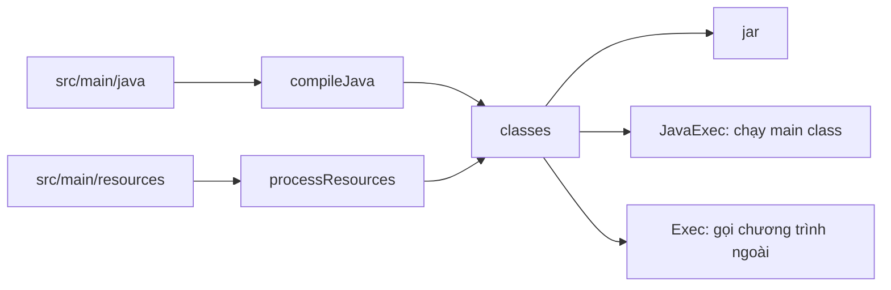

# Cấu hình JavaExec, Exec và công cụ bên ngoài trong Gradle

Một build Java không chỉ biên dịch `.java` thành `.class`. Dự án có thể cần chạy một chương trình Java để kiểm tra dữ liệu, gọi bộ sinh mã, thực thi công cụ phân tích, chuyển đổi tài nguyên, tạo tài liệu hoặc chạy một chương trình dòng lệnh không viết bằng Java. Gradle cung cấp hai task type quan trọng cho nhóm việc này:

- **`JavaExec`**: khởi chạy **một JVM mới** để chạy main class/module Java, với Java runtime classpath, JVM arguments, system properties và Java toolchain.
- **`Exec`**: khởi chạy **một executable bất kỳ** của hệ điều hành, ví dụ `git`, `node`, `protoc`, `javac`, `java` hoặc chương trình nội bộ. Gradle không tự biết main class, classpath hoặc Java toolchain của chương trình đó.

Hai task đều **thực thi chương trình bên ngoài Gradle daemon**, nhưng cấu hình và trách nhiệm khác nhau. Đặt sai classpath, đọc biến môi trường khác, dùng JDK từ `PATH` thay vì toolchain hoặc chạy process ngay trong configuration phase có thể khiến build chỉ chạy được trên một máy.

Bài Knowledge này nằm trong nhóm **Biên dịch và tài nguyên** của **Build Tool Gradle**, tập trung vào “**Cấu hình JavaExec, Exec và công cụ bên ngoài**”. Bạn sẽ học cách cấu hình command line, Java runtime, working directory, environment, streams, exit status và task wiring; hiểu các tác động với JavaCompile, source sets, resources, incremental build, configuration cache và bảo mật; rồi thực hành một chương trình **Java 17** được chạy bằng **cả JavaExec lẫn Exec** để đối chiếu đầu ra.

## 1. Trước tiên phân biệt compile, package và execute

Trong một dự án Java điển hình:



- **`compileJava`** dùng Java compiler để biên dịch mã nguồn. Nó **không** có nhiệm vụ chạy `main(String[])`.
- **`processResources`** copy/xử lý tài nguyên của main source set tới thư mục output tương ứng.
- **`classes`** là lifecycle task tổng hợp việc chuẩn bị main classes và resources.
- **`jar`** đóng gói output thành JAR. Một JAR chuẩn không nhất thiết chạy được qua `java -jar` nếu thiếu `Main-Class` hoặc runtime dependencies.
- **`JavaExec`** chạy một Java main class bằng JVM mới; không tự biên dịch Java chỉ vì bạn khai báo `mainClass`.
- **`Exec`** chạy executable được chỉ rõ; nếu executable là `java`, bạn phải tự cung cấp `-cp`, main class và JVM flags qua `args`.
- **`application` plugin** tạo sẵn task `run` kiểu `JavaExec`, dùng cấu hình từ extension `application`. Không cần tạo task mới nếu mục tiêu chỉ là chạy main class của ứng dụng với đúng mặc định của Application plugin.

**Bài học quan trọng:** JavaExec và Exec không thay thế `compileJava` hoặc `processResources`; chúng là **consumer** của classes/resources được tạo sẵn, hoặc producer của một artifact mới nếu bạn thực sự thiết kế chúng cho mục đích sinh dữ liệu.

## 2. So sánh JavaExec, Exec và những API liên quan

| Mục tiêu | Công cụ phù hợp | Điều cần cung cấp |
| --- | --- | --- |
| Chạy `demo.Tool.main` với classpath của main source set | `tasks.register('...', JavaExec)` | `mainClass`, `classpath`, có thể `javaLauncher`, `args`, `jvmArgs`. |
| Chạy một CLI độc lập như `git --version` | `tasks.register('...', Exec)` | `executable`/ `commandLine`, arguments, working directory, environment. |
| Chạy Java application bình thường | Application plugin và `run` | `application.mainClass`, runtime classpath và cấu hình Java toolchain. |
| Gọi process từ bên trong `@TaskAction` của custom task | Dịch vụ **`ExecOperations`** được inject | `exec { ... }` hoặc `javaexec { ... }`, khai báo inputs/outputs task riêng. |
| Chạy `javac` để compile source set Java tiêu chuẩn | `JavaCompile` do Java plugin tạo | `java.toolchain`, compiler options, source/classpath. |
| Chỉ copy/lọc resource | `Copy`/`ProcessResources` hoặc Provider/file API | File collections, input/output directories; không nhất thiết spawn process. |

**Đừng nhầm ba tên gần giống:**

1. **Task `JavaExec`**: một Gradle task type trong `org.gradle.api.tasks.JavaExec`.
2. **Task `Exec`**: một Gradle task type trong `org.gradle.api.tasks.Exec`.
3. **`ExecOperations`**: service để custom task hoặc plugin thực thi process **trong action**, không phải một task được đăng ký tự động.

`project.exec { ... }` và `project.javaexec { ... }` thường thấy trong tutorial cũ, nhưng các API này đã bị deprecate trong Gradle hiện đại; với custom task nên dùng **injected `ExecOperations`**, còn với build script thông thường nên dùng **task `Exec`/`JavaExec` đã đăng ký**. Không gọi external process ngay tại top-level của `build.gradle` chỉ để “thử tool”, vì khi đó cả `./gradlew help` cũng có thể spawn process trong configuration phase.

## 3. Các thành phần chung của một lệnh ngoài

Một tiến trình được mô tả bởi:

```text
executable / JVM launcher
        + arguments
        + working directory
        + environment variables
        + standard input
        + standard output
        + standard error
        + exit code
```

Những yếu tố này có thể quyết định kết quả ngay cả khi source code không đổi.

### `executable` và `args`

Với Exec:

```groovy
tasks.register('showGitVersion', Exec) {
    commandLine 'git', '--version'
}
```

Lệnh yêu cầu tìm `git` theo cơ chế OS/`PATH` và truyền đúng **một argument** `--version`. Đây là ví dụ **chỉ chạy được khi Git đã được cài và nằm trên PATH**. Stdout chứa version Git phụ thuộc máy; không thể cam kết một dòng version cố định.

Tương đương:

```groovy
tasks.register('showGitVersion', Exec) {
    executable = 'git'
    args '--version'
}
```

Cần nhớ:

- `executable` là **tên hoặc đường dẫn đến chương trình**, không phải toàn bộ dòng lệnh đã nối thành một chuỗi.
- `args` được chuyển thành **danh sách arguments**. Một phần tử như `'hello world'` vẫn là **một argument**, không tự chia thành hai.
- Dùng `commandLine 'git', '--version'` là đúng; dùng `commandLine 'git --version'` có thể làm Gradle tìm một executable tên **`git --version`**, dẫn đến lỗi.
- JavaExec đã có cơ chế chọn executable Java qua `javaLauncher`; trong nhiều trường hợp bạn không cần cấu hình trực tiếp đường dẫn `java.exe`.

### Working directory

Đường dẫn tương đối trong chương trình con thường được giải theo **working directory** của process, không nhất thiết theo thư mục bạn đang đứng trong terminal.

```groovy
tasks.register('showGitStatus', Exec) {
    workingDir = layout.projectDirectory.asFile
    executable = 'git'
    args 'status', '--short'
}
```

Ví dụ chỉ hợp lệ nếu thư mục project nằm trong một Git working tree và Git có sẵn. **Không coi stdout trống là lỗi**: `git status --short` có thể không in gì khi working tree sạch.

`workingDir` không tự tạo thư mục; nếu chỉ tới thư mục không tồn tại, process có thể không khởi chạy được. Trong multi-project, `project.projectDir`, `rootProject.projectDir` và current shell directory có thể là ba vị trí khác nhau.

### Environment

```groovy
tasks.register('showEnvironment', Exec) {
    executable = 'git'
    args '--version'
    environment 'TOOL_MODE', 'validation'
}
```

`environment` gắn biến môi trường cho **child process**. Nó không biến `TOOL_MODE` thành một Gradle project property và không buộc Gradle daemon cũng có biến đó.

Không sửa trực tiếp toàn bộ OS environment map theo cách tùy tiện chỉ để đặt một biến. Với CI, cần làm rõ biến nào được phép truyền xuống process, biến nào chứa secret và biến nào cần được đọc qua Provider để Gradle nhận biết input của task.

### Standard streams và exit code

Một process có:

- **stdin** (`standardInput`): dữ liệu gửi vào chương trình.
- **stdout** (`standardOutput`): kết quả chuẩn.
- **stderr** (`errorOutput`): kênh chẩn đoán/lỗi.
- **exit code**: `0` thường là thành công; nonzero theo hợp đồng của từng tool.

Việc tool in ra stderr **không tự bảo đảm** exit code khác 0. Một compiler có thể in warning qua stderr mà vẫn thành công. Ngược lại, một CLI có thể trả exit code nonzero dù không in nhiều nội dung.

Mặc định `Exec` và `JavaExec` thường làm task **thất bại khi process trả nonzero exit code** (`ignoreExitValue=false`). Chỉ dùng `ignoreExitValue=true` khi bạn **chủ động kiểm tra và xử lý** exit status theo hợp đồng; không dùng nó để “biến build đỏ thành xanh”.

## 4. JavaExec: task chạy Java main class

Cấu hình JavaExec thường gồm:

```groovy
plugins {
    id 'java'
}

java {
    toolchain {
        languageVersion = JavaLanguageVersion.of(17)
    }
}

tasks.register('runTool', JavaExec) {
    dependsOn tasks.named('classes')

    mainClass = 'demo.Tool'
    classpath = sourceSets.main.runtimeClasspath

    args 'one', 'two'
    systemProperty 'demo.label', 'lab'
    jvmArgs '-Xmx128m'

    workingDir = layout.projectDirectory.asFile
}
```

Đây là **mảnh build script minh họa**; nó chỉ chạy được khi project có `src/main/java/demo/Tool.java` và class `demo.Tool` có `public static void main(String[])`. Ví dụ đầy đủ có cả source, resource và outputs sẽ được trình bày ở mục 8.

Phân tích từng dòng:

1. `plugins { id 'java' }`: thêm Java source sets, configurations và compile tasks.
2. `java.toolchain`: yêu cầu bộ công cụ Java 17 cho Java tasks liên quan.
3. `tasks.register('runTool', JavaExec)`: **đăng ký task lazily**, không khởi chạy JVM ngay.
4. `dependsOn tasks.named('classes')`: đảm bảo main classes/resources đã được chuẩn bị trước lúc chạy.
5. `mainClass = 'demo.Tool'`: tên class đầy đủ, bao gồm package.
6. `classpath = sourceSets.main.runtimeClasspath`: classpath có output của main source set và runtime dependencies.
7. `args`: application arguments trong `String[] args` của `main`.
8. `systemProperty`: một JVM system property của **JVM ứng dụng**, đọc bằng `System.getProperty`.
9. `jvmArgs`: JVM flags (ví dụ heap).
10. `workingDir`: thư mục làm việc của JVM chạy child process.

**Chỉ ghi `classpath = sourceSets.main.output`** có thể thiếu runtime libraries mà chương trình sử dụng. Trong project có `implementation 'group:artifact:version'`, `sourceSets.main.runtimeClasspath` thường là cấu hình phù hợp hơn cho công cụ Java cần đủ dependencies lúc chạy.

### JavaExec và Java toolchain

JavaExec có property **`javaLauncher`** để chọn Java executable cụ thể theo toolchain, tránh phụ thuộc ngẫu nhiên vào `java` trên `PATH`:

```groovy
def java17 = javaToolchains.launcherFor {
    languageVersion = JavaLanguageVersion.of(17)
}

tasks.register('runTool', JavaExec) {
    javaLauncher.set(java17)
    mainClass = 'demo.Tool'
    classpath = sourceSets.main.runtimeClasspath
    args 'one', 'two'
}
```

`javaToolchains` được Java plugin cung cấp. Khi gắn `javaLauncher.set(java17)`, JavaExec dùng executable từ **Provider của JavaLauncher**, đồng nhất với hợp đồng Java 17. JavaExec có thể có convention launcher phù hợp từ Java plugin/toolchain; việc đặt tường minh trong bài giúp bạn thấy chính xác Java được chọn từ đâu.

**Không nhầm JavaLauncher với JavaCompiler.** JavaCompile dùng compiler/toolchain; JavaExec chạy JVM. Cùng Java 17 toolchain thường giúp source/bytecode và runtime phù hợp, nhưng nếu một chương trình yêu cầu runtime khác, hãy ghi rõ điều đó.

### JavaExec không phải chạy Java trong Gradle daemon

Khi JavaExec được thực thi, Gradle khởi chạy **process Java riêng**. `System.exit(7)` trong main class làm JVM child thoát với mã 7; nó không nên được dùng để “thoát Gradle daemon”. Gradle nhận exit status và quyết định task thành công/thất bại theo cấu hình.

Đây là khác biệt lớn so với một task `doLast { SomeJavaClass.main(...) }` chạy trực tiếp trong Gradle daemon: cách gọi trực tiếp ấy chia sẻ classloader/process state, có thể gây tác dụng phụ và không cung cấp cách ly tương tự.

## 5. Exec: task chạy công cụ bất kỳ của hệ điều hành

```groovy
tasks.register('checkGit', Exec) {
    group = 'verification'
    description = 'Check that Git is available'

    executable = 'git'
    args '--version'
    workingDir = layout.projectDirectory.asFile
}
```

Task trên:

- Không cần Java source set.
- Phụ thuộc vào việc Git có thể được tìm thấy ở máy chạy Gradle.
- Không có output deterministic về số phiên bản Git, vì version được cài ở mỗi máy khác nhau.
- Trả về exit status của child process cho Gradle.

Một trường hợp khác: chạy một Java main class bằng Exec.

```groovy
tasks.register('runJavaManually', Exec) {
    dependsOn tasks.named('classes')

    executable = 'java'
    args(
        '-cp',
        sourceSets.main.runtimeClasspath.asPath,
        'demo.Tool',
        'one',
        'two'
    )
}
```

Đây là **mảnh minh họa không độc lập**. Nó giả định `java` trên `PATH` đúng phiên bản, class `demo.Tool` tồn tại và `classes` được cấu hình. So với JavaExec, bạn đang tự xây dựng lệnh `java -cp ...` bằng tay.

**Rủi ro:** khi Gradle JavaCompile dùng toolchain Java 17 nhưng `PATH` trỏ `java` của JDK 11, Exec có thể fail với `UnsupportedClassVersionError`. Đây không phải lỗi của Java 17 source hay Gradle compiler; nó là lỗi **runtime Java khác compiler**.

### `Exec` không có `mainClass`, `classpath` và `javaLauncher` như JavaExec

Không viết:

```groovy
// Anti-pattern: Exec không cung cấp DSL JavaExec.
tasks.register('badExample', Exec) {
    mainClass = 'demo.Tool'
    classpath = sourceSets.main.runtimeClasspath
}
```

`Exec` chỉ biết executable + arguments. Muốn chạy Java, chọn JavaExec hoặc tự truyền `-cp` và main class như arguments của executable `java`. Với task Exec dùng Java, vẫn có thể **lấy đường dẫn Java từ Java toolchain** bằng `javaToolchains.launcherFor(...).get().executablePath`; đây là cách được dùng trong lab đầy đủ.

## 6. Khi nào nên dùng `application` plugin thay vì tạo JavaExec mới?

Nếu dự án chỉ cần chạy ứng dụng có main class tiêu chuẩn, Application plugin là lựa chọn tự nhiên:

```groovy
plugins {
    id 'application'
}

application {
    mainClass = 'demo.Main'
    applicationDefaultJvmArgs = ['-Ddemo.mode=normal']
}
```

Sau đó:

```bash
./gradlew run
./gradlew installDist
./gradlew distZip
```

- `run` là task **JavaExec** do Application plugin tạo.
- `installDist` tạo layout cài đặt với start scripts/runtime libraries.
- `distZip` đóng gói distribution.
- `applicationDefaultJvmArgs` ảnh hưởng cấu hình mặc định của application/start scripts theo plugin.

Nên tạo **custom JavaExec task** khi bạn muốn chạy một **main class khác** (ví dụ tool kiểm tra schema), chạy thêm một mode riêng, hoặc tổ chức task pipeline rõ ràng mà không biến công cụ nội bộ thành main application.

Ví dụ:

```groovy
tasks.register('checkSchema', JavaExec) {
    mainClass = 'demo.SchemaChecker'
    classpath = sourceSets.main.runtimeClasspath
    args 'config/schema.json'
}
```

Mảnh này chỉ chạy được nếu `demo.SchemaChecker` tồn tại và file `config/schema.json` được cung cấp. Đừng kết luận rằng `run` và `checkSchema` có cùng role: một task phục vụ người dùng cuối, task kia phục vụ build/verification.

## 7. Java 17, JVM của Gradle và executable của Exec là ba thứ có thể khác nhau

Một build có thể có:

```text
Gradle daemon JVM:       JDK 21
JavaCompile compiler:    JDK 17 qua toolchain
JavaExec child JVM:      JDK 17 qua javaLauncher
Exec gọi "java":         JDK 11 từ PATH nếu không cấu hình
```

Wrapper cố định **Gradle distribution**; nó **không cố định tự động Java executable** mà mọi task Exec gọi. Java toolchain cố định cách Gradle chọn compiler/launcher cho Java tasks; nó không tự sửa `PATH` của mọi lệnh CLI.

Cách kiểm tra:

```bash
./gradlew --version
./gradlew javaToolchains
java -version
```

- `./gradlew --version` cho biết Gradle version và môi trường JVM chạy invocation/daemon theo thông tin Gradle phiên bản tương ứng.
- `javaToolchains` liệt kê Java installations Gradle phát hiện, giúp tìm JDK 17.
- `java -version` chạy lệnh `java` trên shell `PATH` đang có, không nhất thiết trùng với toolchain.
- Trong CI, có thể dùng một JDK tương thích để chạy Gradle daemon và JDK 17 dành cho JavaCompile/JavaExec.

**Đừng giả định Gradle tự tải JDK 17.** Toolchain auto-download chỉ hoạt động khi có **toolchain resolver/provisioning hợp lệ** cho phiên bản Gradle đang dùng. Trong lab này, bạn có thể cài JDK 17 sẵn để tránh phụ thuộc vào cơ chế tải toolchain.

## 8. Lab chạy được: cùng một Java 17 tool qua JavaExec và Exec

Mục tiêu: chạy một chương trình có **Java record** (xác nhận Java 17), đọc resource từ classpath, đọc application arguments, JVM system property và environment variable. Sau đó cấu hình **hai Gradle tasks** để đầu ra giống hệt nhau.

Điều kiện:

- JDK 17 đã được Gradle phát hiện.
- Gradle Wrapper tương thích Java 17; ví dụ **Gradle 8.10.2**.
- Không cần Maven Central vì ví dụ chỉ dùng Java/Gradle core APIs.
- Dùng `./gradlew` trên Linux/macOS, `gradlew.bat` trên Windows.
- Thư mục root chứa đủ các file bên dưới.

### 8.1. Cây thư mục

```text
external-tool-lab/
├── settings.gradle
├── build.gradle
├── gradlew
├── gradlew.bat
├── gradle/
│   └── wrapper/
│       ├── gradle-wrapper.jar
│       └── gradle-wrapper.properties
└── src/
    └── main/
        ├── java/
        │   └── demo/
        │       └── Tool.java
        └── resources/
            └── demo/
                └── banner.txt
```

Các file Wrapper phải là file thật do Gradle tạo, không tự giả lập file `gradle-wrapper.jar`. Nếu là project mới chưa có Wrapper và máy đã cài Gradle tương thích:

```bash
gradle wrapper --gradle-version 8.10.2 --distribution-type bin
```

Chạy lệnh này **một lần** và commit Wrapper vào version control; với dự án nhóm đã có Wrapper, không tự nâng/hạ Gradle version khi chưa xác minh tương thích.

### 8.2. `settings.gradle`

```groovy
rootProject.name = 'external-tool-lab'
```

### 8.3. `build.gradle` — toàn bộ Groovy DSL

```groovy
plugins {
    id 'java'
}

java {
    toolchain {
        languageVersion = JavaLanguageVersion.of(17)
    }
}

tasks.withType(JavaCompile).configureEach {
    options.encoding = 'UTF-8'
    options.release = 17
}

// Provider cho cùng một Java 17 launcher.
def java17 = javaToolchains.launcherFor {
    languageVersion = JavaLanguageVersion.of(17)
}

tasks.register('runViaJavaExec', JavaExec) {
    group = 'learning'
    description = 'Run demo.Tool with JavaExec'

    dependsOn tasks.named('classes')
    mainClass = 'demo.Tool'
    classpath = sourceSets.main.runtimeClasspath
    javaLauncher.set(java17)

    args 'one', 'two'
    systemProperty 'demo.label', 'lab'
    environment 'GRADLE_LESSON_CHANNEL', 'training'
    workingDir = layout.projectDirectory.asFile
}

tasks.register('runViaExec', Exec) {
    group = 'learning'
    description = 'Run the same Java main through a generic Exec task'

    dependsOn tasks.named('classes')

    // Exec tự nó không biết Java toolchain.
    // Lấy executable từ cùng JavaLauncher dùng bởi JavaExec.
    executable = java17.get().executablePath.asFile.absolutePath

    // Tự xây dựng java -D... -cp ... MainClass appArgs
    args(
        '-Ddemo.label=lab',
        '-cp',
        sourceSets.main.runtimeClasspath.asPath,
        'demo.Tool',
        'one',
        'two'
    )
    environment 'GRADLE_LESSON_CHANNEL', 'training'
    workingDir = layout.projectDirectory.asFile
}
```

Giải thích:

- `java` plugin cung cấp `sourceSets`, `compileJava`, `processResources` và `classes`.
- `java.toolchain` và `options.release` hướng quá trình biên dịch tới Java 17.
- `java17` là **Provider<JavaLauncher>**; hai task đều dùng launcher của JDK 17.
- `runViaJavaExec` dùng `mainClass`, `classpath`, `systemProperty` và `args` có semantics Java.
- `runViaExec` phải tự xây `java -Ddemo.label=lab -cp <classpath> demo.Tool one two` dưới dạng danh sách arguments.
- `sourceSets.main.runtimeClasspath.asPath` tạo chuỗi classpath với dấu phân cách phù hợp OS (ví dụ `:` trên Unix và `;` trên Windows).
- `dependsOn classes` bảo đảm `Tool.class` và resource đã được chuẩn bị trước khi process chạy.
- `java17.get()` nằm **trong configuration action của Exec task** để lấy đường dẫn executable khi task được cấu hình. Với workflow rất lớn hoặc yêu cầu lazy tối đa, có thể thiết kế typed custom task có JavaLauncher `@Internal`/Provider và thực thi qua `ExecOperations` ở task action; không được chuyển lệnh gọi executable sang top-level lúc mọi Gradle invocation.

**Lưu ý kỹ thuật:** file `Tool.java` có resource dependency, vì vậy classpath không được chỉ là file `Tool.class`; Gradle `runtimeClasspath` cùng `classes` sẽ làm resource có sẵn trên runtime classpath.

### 8.4. `src/main/java/demo/Tool.java`

```java
package demo;

import java.io.IOException;
import java.io.InputStream;
import java.nio.charset.StandardCharsets;
import java.util.Arrays;

public final class Tool {
    private Tool() {
    }

    private record Context(String label, String channel) {
        String summary() {
            return "label=" + label + ";channel=" + channel;
        }
    }

    public static void main(String[] args) throws IOException {
        if (Arrays.asList(args).contains("--fail")) {
            System.err.println("tool-error=simulated");
            System.exit(7);
        }

        String banner;
        try (InputStream in =
                Tool.class.getResourceAsStream("/demo/banner.txt")) {
            if (in == null) {
                throw new IllegalStateException("Missing demo/banner.txt");
            }
            banner = new String(in.readAllBytes(), StandardCharsets.UTF_8)
                    .trim();
        }

        Context context = new Context(
                System.getProperty("demo.label", "unset"),
                System.getenv().getOrDefault(
                        "GRADLE_LESSON_CHANNEL", "unset")
        );

        System.out.println("banner=" + banner);
        System.out.println(context.summary());
        System.out.println("args=" + String.join(",", args));
        System.out.println("javaFeature=" + Runtime.version().feature());
    }
}
```

Đây là mã Java 17 hợp lệ:

- **`record Context`** dùng syntax chính thức của Java 17.
- Resource `/demo/banner.txt` được đọc **từ classpath**, không phụ thuộc working directory.
- `demo.label` là **JVM system property**, truyền bằng `systemProperty` trong JavaExec hoặc `-Ddemo.label=lab` trong Exec.
- `GRADLE_LESSON_CHANNEL` là **environment variable** của process.
- `args` là application arguments.
- `Runtime.version().feature()` cho biết **phiên bản major của JVM đang thực thi Java main**, khác với Gradle daemon JVM.
- `--fail` là nhánh thử nghiệm có chủ đích; trong lần chạy bình thường task không có argument này.

### 8.5. `src/main/resources/demo/banner.txt`

Nội dung file chính xác:

```text
gradle-resource
```

File có thể có newline ở cuối; Java code dùng `.trim()` nên stdout vẫn ổn định. Hãy lưu file bằng UTF-8.

### 8.6. Chạy hai task qua Wrapper

```bash
./gradlew -q runViaJavaExec
./gradlew -q runViaExec
```

**Stdout do Java main in ra** trong **cả hai lệnh** là:

```text
banner=gradle-resource
label=lab;channel=training
args=one,two
javaFeature=17
```

Nếu bạn chạy **cả hai task trong cùng một invocation**:

```bash
./gradlew -q runViaJavaExec runViaExec
```

thì hai đoạn output có thể xuất hiện liên tiếp, mỗi task in **bốn dòng** như trên. Không cần coi task JavaExec và Exec đang chạy song song; Gradle quyết định execution order theo task graph và các quy tắc scheduling. Nếu muốn thứ tự tường minh cho task tích hợp, hãy dùng dependency/ordering relationship có lý do thay vì dựa vào thứ tự liệt kê mọi tình huống.

Với Windows PowerShell:

```powershell
.\gradlew.bat -q runViaJavaExec
.\gradlew.bat -q runViaExec
```

**Không dùng `java -cp src/main/java demo.Tool`** để giả vờ chạy class đã biên dịch. Java source cần được biên dịch; Gradle đặt `.class` trong `build/classes/java/main` và resources trong output của `processResources`.

### 8.7. Mã Java chạy độc lập bằng `javac`/`java`

Để phân biệt Gradle orchestration với Java compiler/runtime, trên Linux/macOS:

```bash
mkdir -p manual-classes/demo
javac --release 17 -d manual-classes src/main/java/demo/Tool.java
cp src/main/resources/demo/banner.txt manual-classes/demo/banner.txt
java -Ddemo.label=manual -cp manual-classes demo.Tool one two
```

**Nếu** máy đang dùng Java 17 và biến môi trường `GRADLE_LESSON_CHANNEL` không được thiết lập trong shell, Java in:

```text
banner=gradle-resource
label=manual;channel=unset
args=one,two
javaFeature=17
```

Lần chạy trực tiếp **không tự kế thừa** `environment 'GRADLE_LESSON_CHANNEL', 'training'` của Gradle task. Giá trị `manual` cũng do chính bạn truyền qua `-Ddemo.label=manual`, không lấy từ `build.gradle`.

Trên Windows PowerShell:

```powershell
New-Item -ItemType Directory -Force manual-classes/demo | Out-Null
javac --release 17 -d manual-classes src/main/java/demo/Tool.java
Copy-Item src/main/resources/demo/banner.txt manual-classes/demo/banner.txt
java -Ddemo.label=manual -cp manual-classes demo.Tool one two
```

Với lệnh thủ công, phải đảm bảo `javac`/`java` trên `PATH` đều là JDK 17 tương ứng. Tác vụ Gradle ở mục 8.3 đã chọn JavaLauncher riêng nên không phụ thuộc lựa chọn đó của terminal.

### 8.8. Kiểm chứng bước processResources

```bash
./gradlew clean classes
```

Các output chính cần tìm:

```text
build/classes/java/main/demo/Tool.class
build/classes/java/main/demo/Tool$Context.class
build/resources/main/demo/banner.txt
```

Đây là **đường dẫn đầu ra kỳ vọng** của Java plugin khi chưa tùy chỉnh build layout. `Tool$Context.class` là nested record class. `classes` đảm bảo cả Java compilation lẫn resource processing phù hợp của main source set.

Nếu bạn xóa `banner.txt` khỏi `src/main/resources/demo`, Java vẫn có thể biên dịch thành công vì class không cần tài nguyên ở compile time. Nhưng khi chạy JavaExec/Exec, ứng dụng sẽ ném `IllegalStateException("Missing demo/banner.txt")` và Gradle task thất bại. Đây là minh họa rõ **compile thành công không đảm bảo runtime resources đã đầy đủ**.

## 9. Bản Kotlin DSL của lab

Thay **`settings.gradle`** bằng **`settings.gradle.kts`**:

```kotlin
rootProject.name = "external-tool-lab"
```

Thay **`build.gradle`** bằng **`build.gradle.kts`**:

```kotlin
plugins {
    java
}

java {
    toolchain {
        languageVersion.set(JavaLanguageVersion.of(17))
    }
}

tasks.withType<JavaCompile>().configureEach {
    options.encoding = "UTF-8"
    options.release.set(17)
}

val java17 = javaToolchains.launcherFor {
    languageVersion.set(JavaLanguageVersion.of(17))
}

tasks.register<JavaExec>("runViaJavaExec") {
    group = "learning"
    description = "Run demo.Tool with JavaExec"

    dependsOn(tasks.named("classes"))
    mainClass.set("demo.Tool")
    classpath = sourceSets.main.get().runtimeClasspath
    javaLauncher.set(java17)

    args("one", "two")
    systemProperty("demo.label", "lab")
    environment("GRADLE_LESSON_CHANNEL", "training")
    workingDir = layout.projectDirectory.asFile
}

tasks.register<Exec>("runViaExec") {
    group = "learning"
    description = "Run demo.Tool through Exec"

    dependsOn(tasks.named("classes"))
    executable = java17.get().executablePath.asFile.absolutePath
    args(
        "-Ddemo.label=lab",
        "-cp",
        sourceSets.main.get().runtimeClasspath.asPath,
        "demo.Tool",
        "one",
        "two"
    )
    environment("GRADLE_LESSON_CHANNEL", "training")
    workingDir = layout.projectDirectory.asFile
}
```

Kotlin có khác biệt cú pháp:

- `tasks.register<JavaExec>(...)` và `tasks.register<Exec>(...)` dùng generic type.
- `sourceSets.main.get().runtimeClasspath` lấy FileCollection từ main SourceSet.
- `mainClass.set("demo.Tool")` và `javaLauncher.set(java17)` dùng Property/Provider API.
- `options.release.set(17)` dùng Gradle Property trong Kotlin DSL.
- `args(...)`, `environment(...)`, `systemProperty(...)` truyền nhiều tham số bằng call cú pháp Kotlin.

Java source và file resource **không đổi**. Với JDK/toolchain 17, stdout kỳ vọng của hai task vẫn là đúng bốn dòng trong mục 8.6.

Không giữ hai bản Groovy/Kotlin build script với kỳ vọng Gradle sẽ trộn cấu hình. Hãy chọn một DSL cho lab hoặc tạo hai bản copy riêng nếu cần so sánh.

## 10. `args`, `jvmArgs`, system properties: ba loại tham số khác nhau

Giả sử ứng dụng Java đọc:

```java
System.getProperty("demo.label")
System.getenv("GRADLE_LESSON_CHANNEL")
// Và nhận String[] args trong main(String[] args)
```

Với **JavaExec**:

```groovy
tasks.register('demo', JavaExec) {
    mainClass = 'demo.Tool'
    classpath = sourceSets.main.runtimeClasspath

    jvmArgs '-Xmx256m'
    systemProperty 'demo.label', 'lab'
    args 'one', 'two'
    environment 'GRADLE_LESSON_CHANNEL', 'training'
}
```

Với **Exec** gọi Java:

```groovy
tasks.register('demoExec', Exec) {
    executable = 'java'
    args '-Xmx256m',
         '-Ddemo.label=lab',
         '-cp', sourceSets.main.runtimeClasspath.asPath,
         'demo.Tool',
         'one', 'two'
    environment 'GRADLE_LESSON_CHANNEL', 'training'
}
```

Hai snippet này **không độc lập**: cần `java` plugin, class `demo.Tool` và `classes` được tạo. Với Exec, không dùng `jvmArgs` như thể nó là JavaExec; tham số `-Xmx` và `-D` phải là **arguments đứng trước tên main class** trong lệnh `java`.

### Vị trí của JVM flags quan trọng

Lệnh đúng:

```bash
java -Xmx256m -Ddemo.label=lab -cp build/classes/java/main demo.Tool one two
```

Lệnh này để JVM xử lý `-Xmx`, `-D`, `-cp`, rồi truyền `one`, `two` cho `main`.

Nếu đặt `-Ddemo.label=lab` **sau** `demo.Tool`:

```bash
java -cp build/classes/java/main demo.Tool -Ddemo.label=lab
```

thì `-Ddemo.label=lab` thường trở thành **argument của ứng dụng**, không đặt system property cho JVM. Trong code lab, `System.getProperty("demo.label","unset")` sẽ nhận `unset` nếu không có thiết lập khác.

### Gradle command-line `-D` không tự cấp property cho JVM ứng dụng

```bash
./gradlew runViaJavaExec -Ddemo.label=from-gradle
```

Tùy cách Gradle xử lý command-line system properties, flag trên hướng tới **Gradle invocation/JVM**, không tự override `systemProperty 'demo.label','lab'` đã đặt trên JavaExec. Muốn truyền giá trị vào child JVM, hãy map có chủ đích:

```groovy
tasks.register('runWithInput', JavaExec) {
    mainClass = 'demo.Tool'
    classpath = sourceSets.main.runtimeClasspath
    systemProperty(
        'demo.label',
        providers.gradleProperty('toolLabel').orElse('lab').get()
    )
}
```

Snippet này cho thấy nguồn `-PtoolLabel=...`; nó không là project lab đầy đủ và `.get()` trong configuration action đọc giá trị sớm hơn nhu cầu lý tưởng. Trong custom task hiện đại, **ưu tiên Provider wiring** và thực hiện mapping khi task cần giá trị, nhưng bất kể cách nào phải định nghĩa rõ input là `toolLabel`, không dựa vào việc `-D` từ Gradle truyền đi ngầm.

## 11. JavaExec với Java modules, main class và classpath

Với Java 9+ module system, ngoài `mainClass`, JavaExec có thể cần `mainModule`, module-path và các options liên quan khi project sử dụng **JPMS**. Ví dụ khái niệm:

```groovy
tasks.register('runModularTool', JavaExec) {
    mainModule = 'com.example.tool'
    mainClass = 'com.example.tool.Main'
    classpath = sourceSets.main.runtimeClasspath
}
```

Đây là **mảnh minh họa**; muốn chạy cần có `module-info.java` khai báo module tương ứng và cấu hình module path/runtime phù hợp. Đừng tự thêm `mainModule` vào project classpath thông thường chỉ để chữa lỗi `ClassNotFoundException`.

### Main class và package phải khớp

Nếu file:

```text
src/main/java/demo/Tool.java
```

có:

```java
package demo;
public class Tool {
    public static void main(String[] args) {}
}
```

thì tên dùng trong `mainClass` là **`demo.Tool`**, không phải `Tool`, `demo/Tool` hay đường dẫn tới `.java`. `JavaExec` không tự suy diễn package nếu bạn chỉ cung cấp file source.

### Classpath và resource classpath

`classpath = sourceSets.main.runtimeClasspath` thường cung cấp:

- `build/classes/java/main` đã biên dịch.
- `build/resources/main` sau processResources.
- Các runtime library dependencies của main source set.

Nếu tự chuyển nó thành một danh sách đường dẫn hoặc một file JAR duy nhất, bạn có nguy cơ bỏ sót resources/transitive dependencies. Với `Exec`, việc chuyển FileCollection thành `.asPath` là một thao tác vì `java` executable nhận **chuỗi classpath** sau `-cp`.

## 12. Thực thi công cụ ngoài không phải Java

Ví dụ chương trình phổ biến: Git, Node, Python, protoc, OpenAPI generator. Gradle `Exec` có thể chạy chúng, nhưng **không bảo đảm chúng đã được cài**:

```groovy
tasks.register('gitVersion', Exec) {
    executable = 'git'
    args '--version'
}
```

```groovy
tasks.register('nodeVersion', Exec) {
    executable = 'node'
    args '--version'
}
```

Các ví dụ này là **task hợp lệ về cú pháp** khi tool tồn tại trên PATH. Output version thay đổi theo máy nên không ghi một stdout cố định. Nếu công cụ là compiler/protoc được package bằng một plugin Gradle chuyên dụng, hãy cân nhắc **plugin của hệ sinh thái** thay vì tự ghép command line thủ công: plugin có thể quản lý downloads, task dependencies, inputs/outputs và tương thích nhiều hệ điều hành tốt hơn.

### “Tool ở PATH” không phải hợp đồng tái lập

Khi hai lập trình viên có:

```text
Machine A: protoc 25.x
Machine B: protoc 27.x
CI:        protoc chưa cài
```

cùng `tasks.register('generateProto', Exec) { executable = 'protoc' }` có thể tạo output khác hoặc không chạy được.

Các lựa chọn:

1. Cài và pin tool version trong môi trường được quản lý.
2. Dùng container image có toolchain cố định.
3. Dùng plugin Gradle có cơ chế provisioning tool theo version.
4. Tải tool từ dependency configuration có metadata/checksum đáng tin, rồi trỏ executable tới file đã resolve.
5. Ghi rõ yêu cầu OS/architecture và kiểm tra `--version` trước khi build release.

**Đừng tự động tải và thực thi một file nhị phân lạ từ URL bất kỳ trong `doLast`.** Việc chạy chương trình ngoài là bề mặt supply-chain: cần nguồn tin cậy, xác thực nội dung và phân quyền phù hợp.

## 13. Hệ điều hành, quoting và shell khác nhau

Gradle Exec **không tự mở shell** để xử lý pipe, wildcard, redirection hoặc các toán tử shell nếu bạn chỉ truyền executable và arguments.

Ví dụ sai:

```groovy
tasks.register('badGit', Exec) {
    commandLine 'git status --short'
}
```

Gradle có thể cố tìm executable với tên chứa cả dấu cách. Ví dụ đúng:

```groovy
tasks.register('goodGit', Exec) {
    executable = 'git'
    args 'status', '--short'
}
```

Ví dụ khác:

```groovy
args 'a file with spaces.txt'
```

Đây là **một argument**, Gradle không tách phần tử thành từng từ. Bạn không cần tự thêm dấu ngoặc kép bên trong argument `'"a file with spaces.txt"'`; dấu quote lúc ấy có thể trở thành **ký tự của giá trị** được truyền tới tool.

### Chỉ dùng shell khi thật sự cần shell syntax

Một script như:

```bash
echo hello | tr a-z A-Z
```

dùng **pipe** của shell, không phải một executable riêng. Nếu phải dùng Bash trên hệ Unix, bạn có thể gọi `bash` với `-c`, còn Windows sẽ cần cơ chế shell khác. Nhưng đây là **đoạn phụ thuộc môi trường**, không có bảo đảm chạy chéo nền tảng.

**Ưu tiên** tách thành task/process có input và output rõ, hoặc dùng Java/file APIs thay cho shell pipe khi công việc đơn giản. Tránh ghép command `bash -c` từ dữ liệu người dùng: nếu input không được quote/validate đúng, có thể gây **command injection**.

### Windows và Unix khác gì?

| Vấn đề | Linux/macOS | Windows |
| --- | --- | --- |
| Wrapper script | `./gradlew` | `gradlew.bat`, trong PowerShell thường `.\gradlew.bat` |
| Phân cách classpath | `:` | `;` |
| Shell syntax | `sh`/`bash` | `cmd.exe`/`PowerShell` |
| Executable extension | Thường không có `.exe` | Thường có `.exe`/`.bat` |
| Path case-sensitivity | Thường phân biệt hoa/thường | Thường không, tùy filesystem |
| Permissions | File executable cần bit quyền phù hợp | Thường cơ chế quyền khác |

Trong lab Java 17, `java17.get().executablePath.asFile.absolutePath` trả executable Java của **toolchain trên OS hiện tại**, còn `sourceSets.main.runtimeClasspath.asPath` dùng dấu phân cách classpath tương ứng. Vì vậy dùng Provider/FileCollection phù hợp thường ít lỗi hơn tự dựng `bin/java` hoặc dấu `:` cứng.

## 14. Input/output streams: khi tool cần stdin hoặc phải capture stdout

Một số tools đọc input từ stdin. Gradle `Exec`/`JavaExec` có thể cấu hình `standardInput`, `standardOutput` và `errorOutput`. Với tác vụ không tương tác, cần biết chính xác tool đọc dữ liệu từ đâu và trả dữ liệu về đâu.

**Không phụ thuộc stdin tương tác của terminal** trong CI. Nếu tool chờ người dùng gõ password hoặc Enter, pipeline có thể bị treo hoặc thất bại.

Một ví dụ ở **bên trong custom task action** dùng `ExecOperations` để capture output:

```groovy
import org.gradle.api.DefaultTask
import org.gradle.api.GradleException
import org.gradle.api.tasks.TaskAction
import org.gradle.process.ExecOperations
import javax.inject.Inject

abstract class ProbeGitTask extends DefaultTask {
    @Inject
    abstract ExecOperations getExecOperations()

    @TaskAction
    void probe() {
        def stdout = new ByteArrayOutputStream()
        def stderr = new ByteArrayOutputStream()

        def result = execOperations.exec {
            executable = 'git'
            args '--version'
            standardOutput = stdout
            errorOutput = stderr
            ignoreExitValue = true
        }

        if (result.exitValue != 0) {
            throw new GradleException(
                'git --version failed: ' + stderr.toString('UTF-8').trim()
            )
        }

        println stdout.toString('UTF-8').trim()
    }
}

tasks.register('probeGit', ProbeGitTask)
```

Đây là **snippet** có thể thêm vào một `build.gradle` của project có Gradle phù hợp và Git trong PATH; nó không cần Java source từ lab. Stdout chứa version Git thật trên máy, vì vậy **không có expected version cố định**.

Điểm đáng học:

- `ExecOperations` được Gradle **inject** vào custom task.
- Process được chạy trong `@TaskAction`, không ở configuration phase.
- `standardOutput` và `errorOutput` được capture riêng bằng streams trong action.
- `ignoreExitValue=true` **chỉ để inspect** `result.exitValue`; task vẫn fail nếu code khác 0 vì custom task ném `GradleException`.
- Với tool in quá nhiều dữ liệu, capture toàn bộ vào `ByteArrayOutputStream` có thể tốn RAM. Nên stream tới file output/stream được quản lý khi phù hợp.
- Không log stdout/stderr vô điều kiện nếu tool có khả năng in secret/token.

Trong task kiểm chứng định kỳ, việc chỉ in version Git không tạo một file output cacheable. Task vẫn có thể chạy mỗi lần được yêu cầu; không nên tuyên bố task `probeGit` là cacheable chỉ vì có `ExecOperations`.

### Cấu hình stdin

Nếu tool hỗ trợ đọc qua stdin, bạn có thể cung cấp một `InputStream`. Với Gradle task mạnh về incremental build, hãy quản lý dữ liệu đó như **input của task** và khởi tạo stream ở execution time, đảm bảo stream được đóng đúng cách. Tránh mở `FileInputStream` cho dữ liệu lớn ở top-level script rồi giữ nó qua configuration cache hoặc nhiều invocation.

Cách an toàn thường dễ hơn là **truyền đường dẫn file qua `args`**, để Gradle/Custom Task theo dõi file input bằng `@InputFile` và tool tự mở file.

## 15. Exit code: không che lỗi process

Lab có nhánh `--fail` được thiết kế trả mã 7:

```java
if (Arrays.asList(args).contains("--fail")) {
    System.err.println("tool-error=simulated");
    System.exit(7);
}
```

Bạn có thể thêm vào **`build.gradle` của lab** một task kiểm thử thất bại:

```groovy
tasks.register('runExpectedFailure', Exec) {
    dependsOn tasks.named('classes')
    executable = java17.get().executablePath.asFile.absolutePath
    args(
        '-cp',
        sourceSets.main.runtimeClasspath.asPath,
        'demo.Tool',
        '--fail'
    )
}
```

Khi chạy:

```bash
./gradlew runExpectedFailure
```

Child Java in trên stderr:

```text
tool-error=simulated
```

Sau đó Gradle **đánh dấu task thất bại** vì process exit code 7. **Không coi `BUILD FAILED` là stdout cố định của Java**, vì đó là thông báo của Gradle, còn Java chỉ in dòng `tool-error=simulated`.

### `ignoreExitValue` dùng khi nào?

Giả sử một tool được thiết kế trả:

- `0`: kiểm tra đạt.
- `1`: tìm thấy chênh lệch hợp lệ để báo cáo.
- `2`: lỗi nhập liệu không hợp lệ.

Trong trường hợp ấy, bạn có thể bật `ignoreExitValue=true`, lấy `ExecResult.exitValue`, rồi phân loại chính xác trong custom task. Nhưng đó phải là hợp đồng **có tài liệu** của tool; không thể áp dụng cho mọi CLI.

Nếu lệnh build thực sự bị lỗi như Java compile fail hoặc security scanner không chạy được, **đừng sửa bằng `ignoreExitValue=true` rồi để build xanh**. Điều đó tạo CI false positive.

### Process không khởi chạy được khác process trả nonzero

- **Không tìm thấy executable / permission denied / working dir sai:** process chưa chạy thành công; đây là lỗi **khởi chạy**.
- **Executable chạy rồi trả exit code 7:** process đã chạy và tự báo thất bại.
- **Tool treo:** process chưa thoát; cần xem interactive stdin, network hoặc timeout policy.
- **Tool exit 0 nhưng kết quả sai:** cần kiểm tra artifact/output/semantic validation, không chỉ return code.

Khi lỗi, nên ghi lại command **đã loại secrets**, tool version, working directory, exit status, stdout/stderr và task dependencies để chẩn đoán.

## 16. Task dependencies: chỉ chạy tool sau khi đủ đầu vào

Lệnh JavaExec cần classpath có classes/resources, vì vậy lab dùng:

```groovy
dependsOn tasks.named('classes')
```

Một cách khác là dùng FileCollection/Provider có **task dependencies được suy luận**, nhưng bạn phải biết rõ loại provider nào mang thông tin producer. Nếu bạn chuyển output task thành chuỗi đường dẫn quá sớm, Gradle có thể không suy ra dependency đó như mong đợi.

**Không suy từ việc “tôi đã chạy `./gradlew compileJava` hôm qua”** rằng task tool luôn có đầy đủ input. CI sạch hoặc developer khác có thể chưa có `build/classes` hay `build/resources`.

### `dependsOn` và `mustRunAfter` khác nhau

```groovy
tasks.named('runViaJavaExec') {
    dependsOn tasks.named('classes')
}
```

`dependsOn` **thêm task dependency**: khi chạy `runViaJavaExec`, Gradle sẽ đưa `classes` vào graph.

```groovy
tasks.named('runViaJavaExec') {
    mustRunAfter tasks.named('classes')
}
```

`mustRunAfter` chỉ quy định **thứ tự khi cả hai tasks đã có trong graph**; nó **không tự thêm `classes`**. Vì thế thay `dependsOn` bằng `mustRunAfter` có thể khiến build sạch không chuẩn bị resources cần thiết.

`finalizedBy` dùng cho cleanup khi một task cần hành động kết thúc; nó cũng không phải thay thế cho producer–consumer dependency của classes.

### Task tools sinh output nên khai báo đúng artifact

Một CLI được gọi bằng Exec có thể ghi file:

```text
build/generated/config.json
```

Muốn Gradle incremental/caching hoạt động có căn cứ, cần mô hình:

- **Input files**: khai báo bằng `@InputFile`, `@InputFiles` hoặc `inputs.file(...)` phù hợp.
- **Input parameters**: khai báo bằng `@Input` hoặc `inputs.property(...)`.
- **Output file/dir**: khai báo bằng `@OutputFile`, `@OutputDirectory` hoặc `outputs.file(...)`/`outputs.dir(...)`.
- **Task dependencies**: downstream task tiêu thụ **Provider của output producer**, không chỉ hard-code đường dẫn.
- **Working directory/env/tools**: nếu ảnh hưởng output, đưa vào hợp đồng input hoặc cơ chế quản lý tool/version phù hợp.

**Lưu ý:** một task Exec chỉ in console thường **không có output file** để Gradle kết luận là UP-TO-DATE; không cần ép caching cho tác vụ luôn muốn chạy, chẳng hạn sanity check.

## 17. Tránh vòng lặp khi dùng JavaExec để sinh source/resources của cùng source set

Một lỗi thiết kế tinh vi:

1. Bạn đặt Java generator ở `src/main/java`.
2. Task `generateResources` kiểu JavaExec **phụ thuộc `classes`** để chạy generator.
3. Bạn cấu hình `processResources` phụ thuộc `generateResources` vì muốn copy file do generator tạo.
4. Nhưng `classes` vốn phụ thuộc `processResources`.

Bạn vừa tạo vòng:

```text
classes -> processResources -> generateResources -> classes
```

Gradle có thể báo **circular dependency**. Không sửa bằng cách vô hiệu hóa task checks; mô hình task graph đang sai.

Các hướng thiết kế đúng:

- **Tách generator thành source set riêng** (`codegen`) và chỉ compile generator source độc lập, rồi generate output cho main resources.
- **Tách generator thành included build/plugin/tool artifact độc lập** đã được build trước đó.
- **Dùng Copy/Sync/ProcessResources** khi mục tiêu chỉ là biến đổi/copy tệp, không cần chạy Java.
- **Gắn generated output directory theo Provider** vào source sets/downstream tasks, để Gradle biết ai tạo file và khi nào.
- **Không cho generator phụ thuộc vào chính resources mà nó đang sản xuất**.

Trong lab ở mục 8, JavaExec/Exec chỉ **đọc** classpath đã có, không được nối làm producer của `processResources`, nên không xuất hiện vòng dependency ấy.

### Nhúng tools vào compile pipeline có kiểm soát

Một generator tốt thường có chuỗi:

```text
generator sources / tool artifact
        ↓
compile generator (nếu là Java)
        ↓
generateResource (JavaExec/Exec, @InputFiles, @OutputDirectory)
        ↓
processResources hoặc sourceSet consumer
        ↓
classes / jar
```

Nếu generator cần chính main classes để chạy, hãy xem lại kiến trúc: có thể cần hai giai đoạn xây dựng khác nhau, hoặc generator không nên tạo ra thứ mà main classes cần trong cùng một chu kỳ.

## 18. `ExecOperations` trong custom tasks và plugin hiện đại

Khi phát triển plugin, bạn thường không muốn người dùng cấu hình một `Exec` task trực tiếp mà muốn tạo **typed task** có inputs/outputs rõ và gọi tool bên trong `@TaskAction`.

Mô hình tiêu biểu:

```groovy
import org.gradle.api.DefaultTask
import org.gradle.api.provider.Property
import org.gradle.api.tasks.Input
import org.gradle.api.tasks.TaskAction
import org.gradle.process.ExecOperations
import javax.inject.Inject

abstract class ExternalToolTask extends DefaultTask {

    @Input
    abstract Property<String> getToolArgument()

    @Inject
    abstract ExecOperations getExecOperations()

    @TaskAction
    void runTool() {
        execOperations.exec {
            executable = 'git'
            args '--version'
        }
    }
}
```

Đây là **mảnh minh họa API**, không phải plugin hoàn chỉnh: property `toolArgument` chưa được chuyển thành argument thực tế và chưa được set/convention; không được copy rồi cho rằng Gradle đã theo dõi đúng input của lệnh. Ví dụ hoàn chỉnh hơn về việc gọi Git và xử lý result nằm ở mục 14.

**Với custom task production**, cần bảo đảm:

1. Các properties ảnh hưởng invocation đều được khai báo và sử dụng thực sự.
2. Task action đọc **task properties**, không truy cập `project.extensions` hoặc cấu hình Project lúc execution.
3. Tool version/executable path có quản lý rõ.
4. File inputs/outputs có annotations tương ứng, không có file output bị bỏ ngoài snapshot.
5. Không capture Project/Configuration/Gradle model tùy tiện trong action.
6. Kiểm thử configuration cache và task up-to-date/build cache phù hợp.
7. Nếu tool tạo outputs phụ thuộc OS/locale, phản ánh giới hạn cache portability.

### ExecOperations.javaexec

Service này còn có phương thức **`javaexec`** với `JavaExecSpec`, giúp gọi Java process **từ task action** khi bạn đang thiết kế custom task, thay vì dùng task `JavaExec` riêng. Nó không tự biến action thành JavaExec task; bạn vẫn phải khai báo inputs/outputs và dependencies của custom task.

**Không tạo process ngay trong constructor của task** hay trong plugin `apply(Project)` chỉ vì service có sẵn. Thao tác tốn tài nguyên phải nằm trong execution phase, trừ khi công việc cấu hình thật sự có căn cứ và không vi phạm các yêu cầu hiệu năng/cache.

## 19. Configuration cache: ưu tiên task actions, Provider và API chuẩn

Một anti-pattern:

```groovy
// Không nên: process bị chạy ngay trong configuration phase.
def externalVersion = "git --version".execute().text
println externalVersion
```

Lúc Gradle evaluate `build.gradle`, lệnh ngoài đã chạy — kể cả bạn chỉ gọi `./gradlew help`. Điều này làm build chậm, khó tái lập và khó tương thích với configuration cache vì filesystem/environment/process state bị đọc ngoài mô hình task inputs.

Một anti-pattern khác:

```groovy
tasks.register('badProbe') {
    doLast {
        // Dễ vi phạm configuration-cache restrictions nếu truy cập Project.
        project.exec {
            commandLine 'git', '--version'
        }
    }
}
```

Ngoài việc `project.exec` bị deprecate trong Gradle hiện đại, `project` model truy cập trong action có thể gây vấn đề configuration cache. **Dùng typed task + injected `ExecOperations`**, hoặc đăng ký `Exec` task ngay từ đầu.

### Các nguyên tắc hữu ích

- **Không chạy process khi apply plugin hoặc evaluate build script** nếu không bắt buộc.
- **Không đọc ngay Provider bằng `.get()` ở top-level** chỉ để hiển thị một version của external tool. Trong lab, Exec lấy JavaLauncher ở configuration action khi task được realized; không cố gắng biến nó thành full lazy task implementation.
- **Dùng `tasks.register`** thay vì eager `tasks.create` khi có thể.
- **Dùng `javaLauncher`** cho JavaExec, `ExecOperations` cho custom tasks.
- **Khai báo task inputs/outputs** để Gradle quản lý incremental behavior.
- **Không lưu mật khẩu vào arguments/logs** hoặc snapshot inputs mà không có chính sách bảo mật.
- **Kiểm thử bằng `./gradlew <task> --configuration-cache`** và đọc lỗi thực tế thay vì mặc định mọi API đều an toàn.

`Exec` và `JavaExec` **không tự làm mọi invocation cacheable**. Gradle có thể thực thi chúng mỗi lần vì thiếu output, hoặc up-to-date checks khi bạn thiết kế đầy đủ inputs/outputs; build cache còn yêu cầu task action/output có thể tái lập và cacheability phù hợp.

## 20. Performance và testability của external tools

External process có chi phí:

1. Spawn process và khởi tạo runtime (Java JVM startup có thể đắt).
2. Đọc files/classpath; có thể tải artifacts từ repository nếu tool nằm trong dependency graph.
3. Tiêu thụ CPU/RAM ngoài Gradle daemon.
4. Có thể chờ network hoặc file locks.
5. Có thể tạo output không deterministic.

Không phải mọi thao tác đơn giản đều nên tạo một process:

- Copy file: dùng `Copy` hoặc `Sync`.
- Xóa/copy/move file cơ bản: dùng API file của Gradle với task type phù hợp, tránh shell.
- Compile Java: dùng Java plugin/`JavaCompile`.
- Chạy Java CLI thực thụ: dùng `JavaExec`.
- Gọi executable thật sự ngoài JVM: dùng `Exec` hoặc `ExecOperations`.

### Khi nào dùng worker API thay cho Exec?

Gradle Worker API được thiết kế để chạy công việc cô lập và song song hóa theo mô hình của Gradle (classloader/process isolation tùy lựa chọn). Nó không thay thế mọi CLI: nếu bạn đã có executable cụ thể, `Exec` là lựa chọn trực tiếp.

Nếu bạn phát triển custom Gradle plugin với hàng nghìn file cần xử lý bằng code Java/Kotlin của mình, hãy cân nhắc Worker API để tận dụng scheduling/isolation phù hợp. Đừng gọi Worker API chỉ để kiểm tra một `git --version`.

### Giảm sự khác nhau giữa local và CI

- Pin Gradle Wrapper.
- Pin Java toolchain cho JavaExec.
- Pin tool versions và nguồn cài đặt cho Exec.
- Sử dụng classpath/workingDir/args/environment rõ ràng.
- Định nghĩa inputs/outputs, task dependencies và các task dành cho verification.
- Dùng stdout/exit code làm **bằng chứng**, không chỉ lệnh “có chạy”.
- Dùng `--info` khi cần log diagnostic nhưng kiểm tra secrets trước khi chia sẻ.

## 21. Bảo mật khi gọi executable ngoài

Process có thể truy cập filesystem/network bằng quyền của người chạy Gradle. Vì vậy Gradle Exec là **quyền thực thi code thực**, không chỉ là thao tác cấu hình vô hại.

### Tránh command injection

Đừng ghép dữ liệu chưa kiểm soát vào shell command:

```groovy
// Anti-pattern: commandLine là chuỗi shell ghép input tùy ý.
def untrusted = providers.gradleProperty('filename').orNull
// Không đưa untrusted trực tiếp vào "sh -c" dưới dạng nội suy.
```

Đoạn trên chỉ nhắc tình huống; nguyên tắc là:

- Ưu tiên `executable` + **danh sách `args`**; không cần shell để chuyển arguments tới executable.
- Validate file paths, option names và giá trị người dùng cung cấp.
- Chỉ dùng shell khi cú pháp pipe/redirect/glob là yêu cầu thật, và có quoting/escaping phù hợp OS.
- Không cho người dùng tùy tiện quyết định executable có thể chạy trong build CI nếu không có policy.

Dùng list arguments **giảm rủi ro shell injection**, nhưng không tự ngăn mọi hành vi nguy hiểm nếu executable nhận các flags nhạy cảm hoặc input file paths không đáng tin.

### Secrets và logging

- Tránh truyền password trực tiếp trong CLI arguments nếu tool hỗ trợ secret file/credential store hoặc stdin an toàn hơn; arguments có thể xuất hiện trong process listing/log.
- Cẩn trọng với `--info`, `--debug` và exception của process launch; đường dẫn và arguments có thể bị ghi vào log.
- Không in toàn bộ environment variables khi troubleshooting.
- Dùng CI secrets/Gradle properties với policy rõ và không đưa token vào version control.
- Kiểm tra quyền của executable/script bên ngoài; không chạy file tải từ nguồn không xác thực.

### Output file và đường dẫn

Không nhận đường dẫn output bất kỳ từ input không tin cậy rồi cho phép tool ghi đè file trong source repo hoặc credentials. Dùng `layout.buildDirectory` cho output generated, validate path và khai báo `@OutputFile`/`@OutputDirectory`. Khi dọn dẹp, chỉ xóa đúng output của task, không dùng shell delete đệ quy trên đường dẫn được ghép từ input chưa kiểm tra.

## 22. Lỗi thường gặp: từ triệu chứng đến nguyên nhân

| Triệu chứng | Nguyên nhân điển hình | Hướng xử lý |
| --- | --- | --- |
| `Could not find or load main class demo.Tool` | Sai `mainClass`/package hoặc classpath thiếu `build/classes` | Kiểm tra package, task `classes`, `sourceSets.main.runtimeClasspath`. |
| `NoClassDefFoundError` | Có main class nhưng runtime classpath thiếu thư viện | Dùng runtimeClasspath, không chỉ classes directory. |
| `UnsupportedClassVersionError` | Exec chạy JDK thấp hơn bytecode được compile | Dùng JavaExec `javaLauncher` hoặc Exec executable từ JDK đúng. |
| `No matching toolchains found` | Thiếu JDK/toolchain resolver phù hợp | Cài hoặc provision JDK đúng cách, kiểm tra `javaToolchains`. |
| `A problem occurred starting process` | Executable không tồn tại/không executable, PATH hoặc workingDir sai | Kiểm tra absolute path, file permissions, OS và workingDir. |
| `finished with non-zero exit value` | Tool đã chạy và báo lỗi | Đọc stdout/stderr/exit status, không bật ignoreExitValue vô điều kiện. |
| `Could not find method mainClass()` trên Exec | Dùng JavaExec DSL trong task Exec | Đổi sang JavaExec hoặc truyền `java -cp ... Main` qua args. |
| JavaExec chạy nhưng resource missing | Chỉ phụ thuộc compileJava hoặc classpath thiếu `processResources` | Dùng `classes` và main runtimeClasspath. |
| Task `generate` bị circular dependency | Generator cần main classes nhưng tạo input cho processResources | Tách generator source set/build độc lập, mô hình Producer/Consumer đúng. |
| `git` chạy trên laptop nhưng fail ở CI | CLI chưa cài/PATH khác/tool version khác | Pin tool, cài trong runner hoặc dùng plugin provisioning. |
| Tool nhận `-Ddemo.label=lab` như app arg | Đặt `-D` sau main class trong Exec args | Đưa JVM flags trước main class hoặc dùng `systemProperty` trong JavaExec. |
| Tool đọc sai file | Working directory khác root mong đợi | Đặt `workingDir` và dùng Gradle file APIs/absolute paths phù hợp. |
| File có dấu cách làm lệnh fail | Tự thêm quote/tách args sai | Dùng danh sách arguments, một item cho mỗi argument. |
| Windows không tìm được `sh` | Lệnh phụ thuộc shell Unix | Dùng executable đa nền tảng hoặc command theo OS có kiểm soát. |
| `--fail` trả exit 7 nhưng task lại xanh | `ignoreExitValue=true` mà không kiểm tra result | Đặt fail policy đúng, xử lý ExecResult tường minh. |
| Gradle CLI khác IDE run | IDE dùng Java PATH/working dir/classpath khác | Chạy cùng Gradle task qua Wrapper, kiểm tra JavaLauncher và env. |
| Task chạy mỗi lần dù files không đổi | Task không có output/input tracking có ý nghĩa | Khai báo input/output thực hoặc chấp nhận task intentionally always-run. |
| Configuration cache báo lỗi ở task action | Truy cập `project` model/`project.exec` khi execution | Dùng injected ExecOperations, typed task properties. |
| Tool chạy khi `./gradlew help` | Lệnh ngoài được gọi ở configuration time | Chuyển vào `Exec` task hoặc `@TaskAction`. |
| CI treo chờ input | CLI tương tác nhưng stdin không được cấp | Chạy chế độ non-interactive hoặc cung cấp input được quản lý. |

### Một checklist chẩn đoán ngắn

1. **Tool có khởi chạy được không?** Kiểm tra executable, permissions và workingDir.
2. **Đúng phiên bản tool/JDK không?** Kiểm tra Wrapper/Gradle JVM/JavaLauncher/PATH.
3. **Arguments có đúng ranh giới không?** Đối chiếu danh sách args, không chỉ một chuỗi ghép.
4. **Đúng classpath/resources không?** Xem Java source sets, `classes`, runtimeClasspath.
5. **Task dependencies đúng không?** Có run tool trước producer files?
6. **Environment và JVM properties có ở đúng process không?** `-P`, `-D`, `systemProperty` và `environment` khác scope.
7. **Child exit code là gì?** Đừng chỉ nhìn stderr.
8. **Task có inputs/outputs đúng không?** Kiểm tra stale generated output.
9. **Có process ở configuration phase không?** Nếu có, chuyển sang task execution.
10. **Có khác biệt OS hoặc CI không?** Dùng Provider/file path và tool provisioning có kiểm soát.

## 23. Quy trình kiểm tra từng tầng bằng Gradle Wrapper

Trong lab mục 8:

```bash
./gradlew --version
./gradlew javaToolchains
./gradlew tasks --group learning
./gradlew classes --dry-run
./gradlew clean classes
./gradlew -q runViaJavaExec
./gradlew -q runViaExec
```

Những gì cần quan sát:

- `--version`: Gradle distribution và JVM.
- `javaToolchains`: JDK 17 đã được phát hiện chưa.
- `tasks --group learning`: hai tasks được Gradle đăng ký.
- `classes --dry-run`: task graph dự kiến, nhưng **không thực thi actions**.
- `clean classes`: tạo classes/resources từ source sạch.
- `runViaJavaExec`: chương trình chạy bằng JavaExec.
- `runViaExec`: chương trình chạy bằng Exec và launcher cùng toolchain.

Để xem thêm logging:

```bash
./gradlew runViaExec --info --console=plain
./gradlew runViaJavaExec --stacktrace --console=plain
```

`--info` có thể giúp xem command/executable, nhưng phải **xóa secrets khi chia sẻ log**. `--stacktrace` hữu ích khi task failing do Gradle configuration hoặc process return status. Đừng hard-code số lượng tasks, thời gian build và các dòng trạng thái vì chúng thay đổi theo cache và Gradle version.

### Khi nào dùng `--rerun-tasks`?

```bash
./gradlew runViaJavaExec --rerun-tasks
```

Lệnh yêu cầu chạy lại task actions thay vì dùng các quyết định up-to-date bình thường; nó không giúp tìm tool thiếu trên PATH hoặc tự sửa classpath. Khi muốn xác định liệu cache có che dữ liệu cũ, có thể dùng trong chẩn đoán, nhưng không chạy mọi lần theo phản xạ.

`--refresh-dependencies` chỉ liên quan đến **dependency metadata/artifact resolution** khi tool hoặc project dependencies thay đổi; nó không đảm bảo download lại executable `git` hoặc sửa file permission.

## 24. Mẫu thiết kế một workflow external tool có thể bảo trì

Một tác vụ production không nên chỉ là:

```groovy
tasks.register('generate', Exec) {
    commandLine 'some-tool', '--input', 'input.json', '--output', 'out.json'
}
```

Đây là **anti-pattern minh họa** với tool giả; không copy để chạy. Nó thiếu version policy, declared inputs/outputs, thư mục output được quản lý và cách đảm bảo tool hiện diện trên CI.

Một workflow được thiết kế tốt cần:

1. **Tool được pin version** hoặc đóng gói/phân phối theo cơ chế tin cậy.
2. **Input nằm ở đường dẫn có nghĩa** và được Gradle theo dõi.
3. **Output nằm dưới `layout.buildDirectory`**, được task khai báo.
4. **Executable/arguments được cấu hình theo Gradle Provider/Property** và không ghép shell tùy tiện.
5. **Task consumer dùng Provider của producer output** thay vì đọc một file chưa biết đã được tạo chưa.
6. **Nếu tool là Java**, chọn JavaExec và JavaLauncher; nếu không, chọn Exec/ExecOperations.
7. **Tool exit policy rõ ràng**, không che lỗi.
8. **CI chạy cùng Wrapper/task** và có môi trường chứa tool phù hợp.
9. **Logs không lộ secrets**, không chạy untrusted binaries.
10. **Có test task nhỏ** dùng fixture cố định, so output file hoặc stdout mà không phụ thuộc thời gian, OS hay network tùy tiện.

Trong ứng dụng Java lớn, nhu cầu này thường thuộc về một plugin/convention plugin: một nơi định nghĩa tool inputs/outputs/versions, nhiều modules chỉ khai báo file cần xử lý. Điều đó dễ bảo trì hơn việc mỗi module copy một `commandLine` và tự thêm `dependsOn` khác nhau.

## 25. Bài tập tự kiểm tra có đáp án

**Câu 1.** `JavaExec` khác `Exec` ở điểm cốt lõi nào?

**Đáp án:** JavaExec chuyên chạy JVM main class, có `mainClass`, `classpath`, `javaLauncher`, `jvmArgs`. Exec chạy một executable bất kỳ và nhận arguments; khi gọi `java` bằng Exec phải tự truyền classpath/main class.

**Câu 2.** `./gradlew compileJava` thành công có nghĩa `./gradlew runViaJavaExec` chắc chắn chạy được không?

**Đáp án:** Không. Runtime có thể thiếu resource, runtime library, main class hoặc JavaLauncher phù hợp. Cần đầy đủ classpath và task dependencies.

**Câu 3.** Vì sao lab dùng `dependsOn tasks.named('classes')` thay vì chỉ biết compileJava?

**Đáp án:** `classes` bao gồm chuẩn bị main classes và resources, giúp Tool đọc được `demo/banner.txt` từ classpath.

**Câu 4.** Có thể cấu hình `JavaExec` với `sourceSets.main.runtimeClasspath` để sử dụng JAR transitive dependencies không?

**Đáp án:** Có. RuntimeClasspath bao gồm output main source set và các runtime dependencies được resolve phù hợp.

**Câu 5.** Khi Exec chạy Java, `javaLauncher` có phải property sẵn của Exec giống JavaExec không?

**Đáp án:** Không. Exec có executable/args; muốn dùng đúng JDK thì lấy đường dẫn từ toolchain JavaLauncher hoặc chọn cách triển khai custom phù hợp.

**Câu 6.** Lệnh nào ổn định hơn khi gọi Java 17 từ Exec: `executable='java'` hay đường dẫn từ `javaToolchains.launcherFor(...)`?

**Đáp án:** Đường dẫn JavaLauncher từ toolchain, vì `java` trên PATH có thể trỏ JDK khác.

**Câu 7.** Vì sao `commandLine 'git --version'` có thể sai?

**Đáp án:** Nó có thể bị hiểu là tên một executable có khoảng trắng; đúng là `commandLine 'git', '--version'` hoặc `executable='git'; args '--version'`.

**Câu 8.** `args 'hello world'` là một argument hay hai arguments?

**Đáp án:** Một argument chứa khoảng trắng; Gradle truyền danh sách arguments chứ không tự tách chuỗi theo whitespace như một shell parser.

**Câu 9.** `jvmArgs '-Xmx256m'` dùng cho JavaExec hay Exec?

**Đáp án:** JavaExec. Với Exec gọi `java`, truyền `-Xmx256m` là một argument của executable, đặt trước main class.

**Câu 10.** Nếu Exec đặt `-Ddemo.label=lab` sau `demo.Tool`, Java main nhận điều gì?

**Đáp án:** Nó thường trở thành application argument thay vì JVM system property; để thiết lập property phải đặt `-D` trước main class.

**Câu 11.** Gradle daemon đang dùng JDK 21 có bắt buộc JavaExec cũng chạy JDK 21 không?

**Đáp án:** Không. JavaExec có thể dùng JavaLauncher JDK 17; Gradle daemon JVM và child JVM là các process riêng.

**Câu 12.** Output chuẩn của lab `runViaJavaExec` và `runViaExec` giống nhau gồm những gì?

**Đáp án:**

```text
banner=gradle-resource
label=lab;channel=training
args=one,two
javaFeature=17
```

**Câu 13.** Vì sao `runViaExec` không tự động biết `demo.Tool`?

**Đáp án:** Exec không hiểu Java classpath/main class; build script phải tự truyền `-cp`, runtimeClasspath và tên main class qua arguments.

**Câu 14.** `workingDir` của Exec có tác dụng gì?

**Đáp án:** Đặt working directory của child process; những file paths tương đối mà tool dùng có thể được giải từ đây.

**Câu 15.** `environment 'GRADLE_LESSON_CHANNEL','training'` có biến `GRADLE_LESSON_CHANNEL` thành Gradle project property không?

**Đáp án:** Không. Nó chỉ cấu hình environment của child process; project properties được đọc bằng cơ chế khác như `providers.gradleProperty`.

**Câu 16.** Process trả exit code 7, vì sao Gradle task thường fail?

**Đáp án:** Mặc định `ignoreExitValue=false` làm Gradle báo nonzero exit status là lỗi. Đây là hành vi mong muốn khi tool thất bại.

**Câu 17.** Có nên bật `ignoreExitValue=true` để CI luôn xanh không?

**Đáp án:** Không. Chỉ bật nếu bạn đọc/kiểm tra `ExecResult.exitValue` và phân loại status đúng theo hợp đồng tool.

**Câu 18.** Một CLI chỉ in `git --version`, có thể cam kết stdout luôn là `git version 2.50.0` không?

**Đáp án:** Không. Output phụ thuộc Git version/OS đang cài; phải ghi rõ đó là stdout động.

**Câu 19.** Tại sao chạy `"git --version".execute()` ngay ở top-level build.gradle là anti-pattern?

**Đáp án:** Process chạy trong configuration phase, kể cả khi chỉ gọi `help`; làm build chậm, khó theo dõi task inputs và dễ không tương thích configuration cache.

**Câu 20.** Custom task cần gọi process tại `@TaskAction`, API nào thường thích hợp?

**Đáp án:** Inject `ExecOperations` rồi gọi `exec { ... }` hoặc `javaexec { ... }`, cùng task inputs/outputs phù hợp.

**Câu 21.** `mustRunAfter(classes)` có thay được `dependsOn(classes)` để chắc chắn đã biên dịch không?

**Đáp án:** Không. `mustRunAfter` không tự đưa `classes` vào task graph, còn `dependsOn` thì có.

**Câu 22.** Vì sao generator JavaExec phụ thuộc `classes` mà lại là prerequisite của `processResources` có thể lỗi?

**Đáp án:** Nó tạo vòng `classes → processResources → generateResources → classes`; cần tách generator source set/build hoặc thay thiết kế pipeline.

**Câu 23.** Nếu external tool dùng source file để tạo report, khai báo `outputs.file` thôi đã đủ cho incremental build đúng không?

**Đáp án:** Chưa. Cần khai báo inputs, parameters, tool version/semantics và task dependencies đúng; output phải thực sự do tool tạo.

**Câu 24.** `--refresh-dependencies` có tự tải lại chương trình `git` trên PATH không?

**Đáp án:** Không. Nó kiểm tra dependency metadata/artifacts mà Gradle resolve, không sửa executable bên ngoài.

**Câu 25.** Để debug `UnsupportedClassVersionError` ở Exec gọi Java, cần so gì?

**Đáp án:** Java bytecode target/JDK compile, executable Java của Exec và JavaLauncher/toolchain. Không mặc định lỗi thuộc source code.

## 26. Nguồn tài liệu Gradle chính thức

- [Gradle — JavaExec DSL](https://docs.gradle.org/current/dsl/org.gradle.api.tasks.JavaExec.html): `mainClass`, `classpath`, `args`, `jvmArgs`, `javaLauncher`, system properties và streams.
- [Gradle — Exec DSL](https://docs.gradle.org/current/dsl/org.gradle.api.tasks.Exec.html): `executable`, `commandLine`, `args`, `workingDir`, `environment`, `standardInput`, `standardOutput`, `errorOutput`, `ignoreExitValue`.
- [Gradle API — ExecOperations](https://docs.gradle.org/current/javadoc/org/gradle/process/ExecOperations.html): cách gọi `exec` và `javaexec` qua injected service.
- [Gradle — Java Plugin](https://docs.gradle.org/current/userguide/java_plugin.html): source sets, `compileJava`, `processResources`, `classes`, `runtimeClasspath`.
- [Gradle — Java Toolchains](https://docs.gradle.org/current/userguide/toolchains.html): `JavaToolchainService`, JavaLauncher và phân biệt Gradle JVM với Java toolchain.
- [Gradle — Application Plugin](https://docs.gradle.org/current/userguide/application_plugin.html): task `run` kiểu JavaExec và application distributions.
- [Gradle — Writing Custom Tasks](https://docs.gradle.org/current/userguide/implementing_custom_tasks.html): `@TaskAction`, task properties, Gradle services.
- [Gradle — Incremental Builds](https://docs.gradle.org/current/userguide/incremental_build.html): task inputs/outputs, up-to-date checks và task wiring.
- [Gradle — Properties and Providers](https://docs.gradle.org/current/userguide/properties_providers.html): Provider API, file properties và lazy configuration.
- [Gradle — Configuration Cache Requirements](https://docs.gradle.org/current/userguide/configuration_cache_requirements.html): tách task execution khỏi Project model và các API không phù hợp trong task action.
- [Gradle — Gradle Wrapper](https://docs.gradle.org/current/userguide/gradle_wrapper.html): chạy cùng Gradle distribution ở local/CI.
- [Gradle — Sharing Outputs Between Projects](https://docs.gradle.org/current/userguide/how_to_share_outputs_between_projects.html): mô hình producer task và consumer Provider thay vì hard-code output paths.

**Ghi nhớ cuối bài:** **JavaExec** là task chạy JVM main class với classpath/toolchain; **Exec** là task chạy executable bất kỳ với danh sách arguments, environment và working directory; **ExecOperations** là dịch vụ giúp custom task chạy process trong execution phase. Để các công cụ này hoạt động đáng tin trong một dự án Java, cần **chọn đúng Java launcher/tool version**, **nối `classes` và resources đúng thứ tự**, **khai báo input/output của công việc sinh file**, **xử lý exit code có chủ đích** và **tránh side effects ở configuration phase**. Dùng Wrapper và Java 17 toolchain để giảm khác biệt giữa IDE, terminal và CI; không thay sự an toàn/tái lập bằng một command string dài không được kiểm chứng.