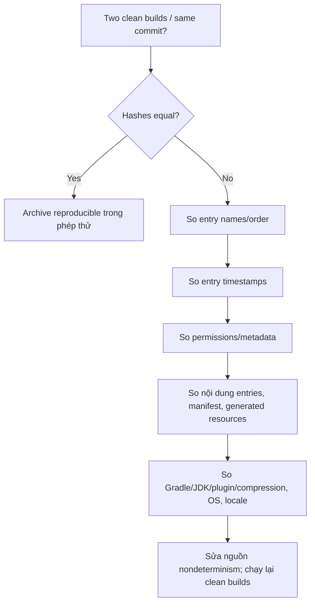

# Giữ archive ổn định về thứ tự tệp và timestamp trong Gradle

Cùng một phiên bản mã nguồn Java được build hai lần nhưng thu được hai file `.jar` hoặc `.zip` có **SHA-256 khác nhau** là một tình huống đáng điều tra. Có khi class Java và resource bên trong giống nhau, nhưng **thứ tự các entry** trong archive khác nhau hoặc mỗi entry mang **timestamp của file nguồn** tại thời điểm đóng gói. Khi đó checksum thay đổi dù hành vi chương trình không đổi.

Trong Gradle, đây là bài toán **reproducible archives**: tạo ra JAR/ZIP/TAR/WAR/EAR có cấu trúc và metadata ổn định khi đầu vào thực chất không đổi. Hai công tắc cốt lõi là:

- `reproducibleFileOrder = true`: duyệt tệp đầu vào theo thứ tự xác định, không phụ thuộc thứ tự liệt kê của filesystem.
- `preserveFileTimestamps = false`: không sao chép thời điểm sửa đổi tệp nguồn vào metadata archive; Gradle sử dụng timestamp chuẩn hóa theo loại archive.

**Lưu ý quan trọng về phiên bản:** bắt đầu từ **Gradle 9.0**, các archive task kế thừa `AbstractArchiveTask` mặc định có file order tái lập, timestamp cố định và permissions chuẩn hóa. Với Gradle **8.x** hoặc khi muốn chính sách thể hiện rõ trong build script dùng chung nhiều phiên bản, nên cấu hình hai flag trên **tường minh**; permissions cũng có thể cần được chuẩn hóa. Chính sách này được nêu trong tài liệu Gradle “Reproducible archives” và hướng dẫn nâng cấp Gradle 9.

Bài thuộc nhóm **Đóng gói** của **Build Tool Gradle**, có tiêu đề **“Giữ archive ổn định về thứ tự tệp và timestamp”**. Phần thực hành sử dụng **Java 17, Gradle Wrapper, Jar và Zip**, xây hai lần từ source giống nhau, so sánh **byte-for-byte**, thứ tự entry, timestamp entry bằng chương trình Java có thể chạy trực tiếp với `javac`/`java`.

Sau bài học, bạn sẽ có thể:

1. Phân biệt **tệp trong archive**, **thứ tự entry**, **entry timestamp**, **permissions**, **nội dung file** và **checksum archive**.
2. Cấu hình đúng `AbstractArchiveTask` cho Gradle 8.x/9.x, trong Groovy DSL và Kotlin DSL.
3. Xác minh kết quả bằng **hai lần clean build**, so sánh hash và metadata bằng Java 17.
4. Hiểu vì sao chỉ sửa hai flag chưa đủ nếu manifest, file generated, JDK, compression hay nội dung dependency thay đổi.
5. Giữ ổn định archive trên CI và nhiều hệ điều hành, tránh xóa metadata có ý nghĩa nghiệp vụ hoặc làm hỏng quyền thực thi script.
6. Chẩn đoán JAR khác hash theo từng tầng thay vì vô hiệu hóa cache hoặc cố sửa timestamp của JAR bên ngoài.

## 1. Tại sao “build thành công” chưa có nghĩa archive tái lập được?

Giả sử hai máy biên dịch cùng mã nguồn:

```text
Máy A (10:00):
  build/libs/app-1.0.jar
  sha256: X...

Máy B (16:00):
  build/libs/app-1.0.jar
  sha256: Y...
```

Hai file có thể cùng chứa `demo/Main.class`, `config.properties`, `META-INF/MANIFEST.MF` nhưng ZIP/JAR lưu **metadata và thứ tự entry** trong cấu trúc nhị phân. Chỉ cần thay đổi một số byte ở metadata, toàn bộ file archive đã khác checksum.

Điều đó gây tác động thực tế:

- **Kiểm chứng phát hành:** khó xác nhận artifact tải từ repository được build từ source và công cụ đã công bố.
- **Supply-chain security:** việc tái tạo một artifact để so hash khó hơn khi metadata phụ thuộc thời điểm build.
- **Cache và deduplication:** cùng một nội dung logic nhưng hash archive khác làm giảm hiệu quả của cache theo content hash.
- **Release comparison:** không phân biệt được byte khác vì code thay đổi hay vì hệ thống tạo ZIP ghi mtime khác.
- **Điều tra sự cố:** hai pipeline được báo “cùng commit” nhưng tạo hai JAR khác byte.

Tuy nhiên **reproducible archive không đồng nghĩa toàn bộ build đã reproducible**. Còn rất nhiều đầu vào khác: Java compiler/JDK patch version, ký tự xuống dòng, encoding, nội dung phụ thuộc, plugin versions, locale/timezone, danh sách files được chọn, native binaries và dữ liệu có tính thời gian.

## 2. Archive thực sự chứa những gì?

Một file JAR là một dạng ZIP, còn WAR/EAR cũng dùng cấu trúc ZIP. TAR là định dạng khác nhưng cùng quan tâm đến thứ tự, timestamp và permission metadata.

Một archive có thể chứa:

```text
demo-1.0.jar
├── META-INF/
│   └── MANIFEST.MF
├── demo/
│   ├── Main.class
│   └── ArchiveVerifier.class
└── config/
    └── app.properties
```

Mỗi **entry** có thể có nhiều thông tin:

| Trường | Ví dụ | Có thể làm checksum khác? |
| --- | --- | --- |
| **Tên/đường dẫn entry** | `demo/Main.class` | Có, tên và encoding của tên nằm trong archive. |
| **Nội dung entry** | Bytecode Java hoặc UTF-8 text | Có; đây là thay đổi ngữ nghĩa thường quan trọng nhất. |
| **Thứ tự entry** | `META-INF/` trước `demo/` | Có; cùng set file nhưng trình tự ghi ZIP bytes khác. |
| **Modification time** | Thời điểm sửa đổi của file nguồn | Có; entry metadata có thể khác. |
| **Unix permissions/mode** | `0644` hoặc `0755` | Có với archive định dạng lưu metadata này. |
| **Compression/extra fields** | DEFLATE, level, ZIP header | Có; khác implementation/options có thể tạo bytes khác. |
| **Directory entries** | `demo/` | Có nếu archive tạo/bỏ entry directory khác nhau. |
| **Manifest/metadata** | `Created-By`, `Implementation-Version` | Có nếu giá trị đổi theo máy/thời gian. |

Một file `demo/Main.class` có mtime hiện tại trên ổ đĩa không nhất thiết làm JAR thay đổi khi archive task **không preserve** timestamp. Gradle sẽ dùng timestamp có thể dự đoán trong archive thay vì mtime của file đầu vào.

### Hai khái niệm dễ nhầm

**Thứ tự trên filesystem** là thứ tự OS trả về khi liệt kê thư mục; nó không phải bảo đảm rằng `alpha.txt` luôn được đọc trước `beta.txt`. `reproducibleFileOrder=true` làm **Gradle duyệt nguồn theo thứ tự ổn định**, nhưng không bắt buộc toàn bộ entry hiển thị trong ZIP phải là một danh sách sort tuyệt đối theo tên từ đầu đến cuối, nhất là khi có nhiều CopySpec, manifest và directory entries.

**Timestamp bên trong archive** khác **mtime của chính file archive** trong hệ điều hành. Sau hai clean build, file `build/libs/app.jar` có thể được OS gán hai mtime khác nhau vì được tạo ở hai thời điểm khác, nhưng **các bytes bên trong vẫn có thể giống hệt**. Kiểm chứng đúng dùng SHA-256 hoặc byte comparison, không so mtime của file JAR bên ngoài.

## 3. Cơ chế hai flag của Gradle

### 3.1. `reproducibleFileOrder`

```groovy
tasks.withType(AbstractArchiveTask).configureEach {
    reproducibleFileOrder = true
}
```

Flag này yêu cầu Gradle **duyệt các tệp từ thư mục nguồn theo thứ tự có thể tái lập**, tránh phụ thuộc vào thứ tự filesystem trả về. Nó áp dụng cho những task kế thừa `AbstractArchiveTask`, chẳng hạn `Jar`, `Zip`, `Tar`, `War`, `Ear` khi được đăng ký trong build.

Flag **không**:

- Tự sort một file CSV do task khác sinh ra.
- Đảm bảo generator tạo file theo cùng cách trên mọi máy.
- Loại bỏ timestamps/nội dung động bên trong từng entry.
- Ép một plugin đã tự ghi ZIP bằng thư viện khác tuân theo Gradle `AbstractArchiveTask`.

Nếu plugin dùng `ZipOutputStream` của Java hoặc một công cụ CLI ngoài để tự tạo ZIP, cần kiểm tra **API riêng của nó**; flag Gradle không tự điều khiển mọi archive writer bên ngoài.

### 3.2. `preserveFileTimestamps`

```groovy
tasks.withType(AbstractArchiveTask).configureEach {
    preserveFileTimestamps = false
}
```

Khi `false`, Gradle **không sao chép mtime của tệp nguồn** sang từng entry. Nó ghi timestamp được chuẩn hóa, theo quy tắc của từng định dạng. Từ Gradle 9.0, đây là mặc định; với Gradle 8.x cần đặt tường minh nếu muốn ổn định.

Khi `true`, archive có thể lưu thời điểm sửa đổi trên filesystem. Chẳng hạn, hai developer checkout source ở hai thời điểm hoặc một task compiler tạo class mới sẽ có timestamps khác nhau, khiến archive byte khác dù nội dung Java cùng nghĩa.

**Không nên sửa mtime từng file bằng `touch` hay command shell để chữa output khác hash**: bạn chỉ chuyển vấn đề sang một bước thủ công dễ bị lệch theo OS/timezone. Hãy cấu hình archive task ở đúng cấp.

### 3.3. Default thay đổi ở Gradle 9.0

| Hành vi của archive task | Gradle 8.x khi không cấu hình | Gradle 9.0+ khi không override |
| --- | --- | --- |
| Thứ tự file trong archive | Không bảo đảm reproducible; thường phụ thuộc thứ tự nguồn/filesystem | Reproducible by default. |
| Timestamp mỗi entry | Thường preserve source timestamps | Fixed/reproducible timestamps. |
| Permissions | Có thể theo filesystem/source metadata | File `0644`, directory `0755` mặc định. |
| Cấu hình nên ghi | Đặt flags rõ và cân nhắc permissions | Có thể giữ defaults, hoặc đặt flags để nói rõ chính sách. |

Các thuộc tính order/timestamp đã tồn tại từ Gradle **3.4**, nhưng chỉ tới Gradle **9.0.0** Gradle mới mặc định bật reproducible archive behavior. Vì thế tài liệu/tutorial Gradle 7/8 cũ có thể khuyên thêm hai flag, còn tutorial Gradle 9 mới bảo không cần.

**Không áp dụng một hướng dẫn version-agnostic mù quáng.** Với build hỗ trợ nhiều Gradle versions, đặt flags tường minh vẫn là lựa chọn rõ ràng. Với Gradle 9+, việc giữ default giúp ít cấu hình hơn nhưng bạn phải chắc plugin khác không đổi chúng.

## 4. Cấu hình một chính sách chung cho mọi archive tasks

Đây là mẫu **Groovy DSL** được dùng phổ biến khi project có nhiều JAR/ZIP/WAR:

```groovy
tasks.withType(AbstractArchiveTask).configureEach {
    preserveFileTimestamps = false
    reproducibleFileOrder = true
}
```

Đặt trong `build.gradle` của project phù hợp sau khi Gradle có task container. `configureEach` giúp cấu hình các task hiện có và task được đăng ký sau đó mà không bắt buộc hiện thực hóa tất cả task ngay lập tức.

**Kotlin DSL**:

```kotlin
import org.gradle.api.tasks.bundling.AbstractArchiveTask

tasks.withType<AbstractArchiveTask>().configureEach {
    isPreserveFileTimestamps = false
    isReproducibleFileOrder = true
}
```

Lưu ý chữ **`is`** ở Kotlin DSL: đây là boolean properties được Java/Gradle API expose theo Kotlin naming; Groovy thường gán `preserveFileTimestamps` và `reproducibleFileOrder`.

### Nên đặt ở cấp nào?

- **Một project:** đặt block ở `build.gradle(.kts)` của chính project.
- **Multi-project:** dùng **convention plugin** cho các project tạo archives, hoặc cấu hình riêng từng project phù hợp.
- **Plugin nội bộ:** định nghĩa chính sách trong plugin/convention được áp dụng vào module cần đóng gói.
- **Build dùng included builds:** chú ý mỗi included build có cấu hình riêng; root project block không tự điều khiển archive tasks của tất cả independent builds.
- **Distribution do plugin tạo:** xem task type thực tế. Nếu là `Zip`/`Tar` thì `withType(AbstractArchiveTask)` thường bao phủ; nếu plugin gọi external packaging tool, phải xử lý riêng.

**Tránh** đặt cùng block ở root mà kỳ vọng mọi child project đương nhiên được cấu hình. Gradle không tự kế thừa task configuration từ root Project sang các subprojects. Dùng convention plugin được áp dụng cho từng project để tránh root cross-project configuration khó bảo trì.

## 5. Permissions cũng ảnh hưởng khả năng tái lập

Gradle 9.0+ dùng permissions mặc định ổn định:

- Directory entries: `0755` (`rwxr-xr-x`).
- File entries: `0644` (`rw-r--r--`).

Ở các bản cũ hơn, permissions từ filesystem/source có thể được giữ lại và ảnh hưởng metadata archive. Với Gradle 8.10.2 trong lab, chúng ta chuẩn hóa tường minh qua CopySpec API có sẵn từ Gradle 8.3:

```groovy
tasks.withType(AbstractArchiveTask).configureEach {
    preserveFileTimestamps = false
    reproducibleFileOrder = true

    filePermissions {
        unix('644')
    }
    dirPermissions {
        unix('755')
    }
}
```

**Nhưng permissions phải phù hợp mục đích.** Nếu archive chứa `bin/start.sh` cần executable bit, ép `0644` cho mọi file có thể khiến script không chạy trực tiếp sau khi giải nén. Khi đó hãy chỉ định permission **ổn định nhưng đúng nghĩa** cho script đó (ví dụ `0755`), thay vì bảo toàn `chmod` ngẫu nhiên của máy người build.

Một ví dụ kiểm soát khi đóng gói distribution:

```groovy
tasks.register('scriptsZip', Zip) {
    archiveFileName = 'scripts.zip'
    destinationDirectory = layout.buildDirectory.dir('distributions')
    from('scripts') {
        filePermissions { unix('755') }
    }
    preserveFileTimestamps = false
    reproducibleFileOrder = true
}
```

Đây là **snippet**, chỉ có tác dụng khi thư mục `scripts` và các script thật sự tồn tại. Nếu thư mục chứa cả tài liệu không cần executable, hãy tách CopySpec riêng cho scripts và docs để đặt permission chính xác.

Ở Gradle 9, có API `useFileSystemPermissions()` để chủ động quay về permissions của nguồn, và `org.gradle.archives.use-file-system-permissions=true` để thay đổi chính sách. Chỉ bật khi metadata permissions **là một yêu cầu thật** và được quản lý ổn định bằng version control/OS policy, không dùng vô điều kiện trong CI đa nền tảng.

## 6. Lab Java 17: tạo JAR và ZIP từ cùng source cố định

Bài thực hành tạo:

- **JAR**: mã Java 17 + resource của Java source set.
- **ZIP**: một package gồm output Java đã biên dịch và hai file text của `payload/`.
- **Java `ArchiveVerifier`**: mở hai archives bằng `ZipFile`, so sánh **bytes**, **entry order** và **entry timestamps**.
- **Hai lần clean build**: tạo `first.jar`/`second.jar` và `first.zip`/`second.zip` bên ngoài `build/`, rồi chạy verifier.

Điều kiện:

1. JDK **17** được Gradle nhận biết; nếu không có, cần cài Java toolchain 17 hoặc cấu hình resolver hợp lệ.
2. Có Gradle Wrapper **8.10.2** hoặc bản 8.10.x/9.x tương thích; vì policy được đặt tường minh, ví dụ có thể dùng ở cả hai dòng, lưu ý APIs/behavior bổ sung của các phiên bản mới hơn.
3. Dự án không cần tải external libraries vì chỉ dùng `java` plugin và Java Standard Library.
4. Giữ nguyên nội dung các file trong hai lần build, cùng Gradle/JDK và môi trường chính để quan sát kết quả mong đợi.

### 6.1. Cây thư mục

```text
reproducible-archive-lab/
├── settings.gradle
├── build.gradle
├── gradlew
├── gradlew.bat
├── gradle/
│   └── wrapper/
│       ├── gradle-wrapper.jar
│       └── gradle-wrapper.properties
├── payload/
│   ├── alpha.txt
│   └── nested/
│       └── beta.txt
└── src/
    └── main/
        ├── java/
        │   └── demo/
        │       ├── Main.java
        │       └── ArchiveVerifier.java
        └── resources/
            └── config/
                └── app.properties
```

Hai thư mục `archive-snapshots/` và `manual-classes/` sẽ được tạo trong bước kiểm chứng, **không phải source được commit vào JAR**.

Các file Wrapper phải được tạo thật; nếu chưa có và máy có Gradle tương thích:

```bash
gradle wrapper --gradle-version 8.10.2
```

Chỉ dùng lệnh này để **khởi tạo hoặc nâng Wrapper có chủ đích**, không phải ở mọi build. Các bản phân phối Gradle có thể yêu cầu JDK phù hợp để chạy daemon; lab yêu cầu toolchain Java 17 cho JavaCompile.

### 6.2. `settings.gradle`

```groovy
rootProject.name = 'reproducible-archive-lab'
```

### 6.3. `build.gradle` hoàn chỉnh, Groovy DSL

```groovy
plugins {
    id 'java'
}

group = 'demo.example'
version = '1.0.0'

java {
    toolchain {
        languageVersion = JavaLanguageVersion.of(17)
    }
}

tasks.withType(JavaCompile).configureEach {
    options.encoding = 'UTF-8'
    options.release = 17
}

// Chính sách cho tất cả Jar, Zip, Tar... thuộc AbstractArchiveTask.
tasks.withType(AbstractArchiveTask).configureEach {
    preserveFileTimestamps = false
    reproducibleFileOrder = true

    // Gradle 9 đã có defaults tương đương.
    // Đặt rõ để lab Gradle 8.10.2 không phụ thuộc chmod nguồn.
    filePermissions {
        unix('644')
    }
    dirPermissions {
        unix('755')
    }
}

// Nội dung manifest được xác định bởi thông tin ổn định.
tasks.named('jar', Jar) {
    manifest {
        attributes(
            'Implementation-Title': 'Reproducible Archive Lab',
            'Implementation-Version': '1.0.0'
        )
    }
}

// ZIP độc lập chứa payload và output Java đã biên dịch.
tasks.register('bundleZip', Zip) {
    group = 'distribution'
    description = 'Bundle Java classes/resources and fixed payload'

    archiveBaseName = 'demo-bundle'
    archiveVersion = '1.0.0'
    destinationDirectory = layout.buildDirectory.dir('distributions')

    dependsOn tasks.named('classes')

    from('payload') {
        into('payload')
    }
    from(sourceSets.main.output) {
        into('app')
    }
}
```

**Tại sao dùng `tasks.withType(AbstractArchiveTask).configureEach`?**

- `Jar` và `Zip` đều nằm trong họ `AbstractArchiveTask`.
- Tạo một chính sách thay vì copy hai flag vào từng task.
- Cấu hình áp dụng cả cho `jar` được Java plugin cung cấp và `bundleZip` được đăng ký sau đó.
- Không ép eager realization của những archive tasks chưa cần chạy.

**Tại sao `bundleZip` có `dependsOn classes`?**

`sourceSets.main.output` chứa compiled classes/resource outputs, nhưng một clean workspace cần task producer chạy trước khi ZIP đọc file. `dependsOn tasks.named('classes')` làm quan hệ rõ ràng cho người học: JavaCompile + ProcessResources chuẩn bị đầu vào, Zip đóng gói sau.

**Tại sao `archiveVersion` và manifest cố định?**

Tên artifact có version dễ nhận diện; `1.0.0` là version đã chọn cho lab. Trong project thật, version lấy từ release policy đã chốt. Tránh tạo manifest chứa `new Date()` hoặc build time chỉ để có dòng thông tin trông “hữu ích” vì nó làm byte archive thay đổi.

**Phạm vi của file permissions:** chuẩn hóa `0644` và `0755` phù hợp ở lab này vì không có file shell script cần chạy. Khi đóng gói distribution thực, những entry cần executable bit phải được xử lý riêng và ổn định.

### 6.4. `src/main/java/demo/Main.java`

```java
package demo;

import java.nio.charset.StandardCharsets;
import java.io.IOException;
import java.io.InputStream;

public final class Main {
    private Main() {
    }

    public static void main(String[] args) throws IOException {
        try (InputStream in =
                Main.class.getResourceAsStream("/config/app.properties")) {
            if (in == null) {
                throw new IllegalStateException("Missing app.properties");
            }
            String value = new String(
                    in.readAllBytes(), StandardCharsets.UTF_8).trim();
            System.out.println("resource=" + value);
        }
        System.out.println("Hello, reproducible archive!");
    }
}
```

Resource được đọc từ **Java classpath**, không đọc qua đường dẫn tuyệt đối của một máy. Chương trình dùng API có trong Java 17 (mặc dù một số API cũng tồn tại ở những phiên bản Java trước).

### 6.5. `src/main/resources/config/app.properties`

```properties
mode=stable
```

Để stdout không lẫn comment/timestamp do generator tạo, ta sử dụng **file text tĩnh**. `Main.main` đọc toàn bộ file và `.trim()`, vì vậy kết quả là `resource=mode=stable` kể cả khi file có newline ở cuối.

### 6.6. File `payload/alpha.txt`

```text
alpha
```

### 6.7. File `payload/nested/beta.txt`

```text
beta
```

Hai file giúp bài kiểm tra có ít nhất một thư mục lồng, thuận lợi để quan sát entry order và directory metadata của ZIP. File nguồn có thể được copy/touch giữa hai lần build trong bài kiểm chứng nâng cao, nhưng **không được thay bytes nội dung** nếu muốn yêu cầu output giống hệt.

## 7. Chương trình Java 17 đọc ZIP/JAR và so sánh ba điều

Ta không chỉ dùng hash (điều này cho biết **có khác byte hay không**) mà còn so **entry order** và **entry timestamps** để biết hai nguồn gây khác biệt thường gặp.

### 7.1. `src/main/java/demo/ArchiveVerifier.java`

```java
package demo;

import java.io.IOException;
import java.nio.file.Files;
import java.nio.file.Path;
import java.util.ArrayList;
import java.util.Enumeration;
import java.util.List;
import java.util.zip.ZipEntry;
import java.util.zip.ZipFile;

public final class ArchiveVerifier {
    private ArchiveVerifier() {
    }

    private record Snapshot(
            List<String> names,
            List<Long> timestamps) {
    }

    private static Snapshot inspect(Path path) throws IOException {
        List<String> names = new ArrayList<>();
        List<Long> timestamps = new ArrayList<>();

        try (ZipFile zip = new ZipFile(path.toFile())) {
            Enumeration<? extends ZipEntry> entries = zip.entries();
            while (entries.hasMoreElements()) {
                ZipEntry entry = entries.nextElement();
                names.add(entry.getName());
                timestamps.add(entry.getTime());
            }
        }

        return new Snapshot(
                List.copyOf(names),
                List.copyOf(timestamps)
        );
    }

    public static void main(String[] args) throws IOException {
        if (args.length != 2) {
            throw new IllegalArgumentException(
                    "Usage: ArchiveVerifier first.zip second.zip"
            );
        }

        Path first = Path.of(args[0]);
        Path second = Path.of(args[1]);

        Snapshot a = inspect(first);
        Snapshot b = inspect(second);

        // Files.mismatch == -1 nghĩa là toàn bộ bytes giống nhau.
        System.out.println(
                "sameBytes=" + (Files.mismatch(first, second) == -1L)
        );
        System.out.println(
                "sameEntryOrder=" + a.names().equals(b.names())
        );
        System.out.println(
                "sameEntryTimestamps=" +
                        a.timestamps().equals(b.timestamps())
        );
    }
}
```

**Tại sao chương trình này chạy được với cả JAR và ZIP?** `java.util.zip.ZipFile` đọc được cấu trúc ZIP; JAR cũng là dạng ZIP. Hai file `.zip` và `.jar` trong lab đều có cấu trúc ZIP hợp lệ. `ArchiveVerifier` dùng **Java record** (`Snapshot`), phù hợp Java 17.

**Tại sao dùng `Files.mismatch` thay vì đọc toàn bộ file vào RAM?** API này so sánh hai files và trả `-1` khi bằng nhau, tránh tự nạp cả archive lớn vào hai byte arrays. Cách viết cần Java 12+; Java 17 đáp ứng.

**Giới hạn của chương trình:**

- `sameEntryOrder=true` chỉ xác nhận **danh sách tên entry theo thứ tự** giống nhau giữa hai archives. Nó không bắt buộc thứ tự là alphabetical.
- `sameEntryTimestamps=true` chỉ xác nhận **danh sách timestamp** theo thứ tự đã duyệt giống nhau. Nếu tên files khác nhưng timestamp ngẫu nhiên trùng nhau, giá trị này có thể vẫn `true`; cần xem kết hợp với entry order và bytes.
- `sameBytes=true` là phép kiểm tra mạnh nhất ở **hai file cụ thể**: mọi metadata, compression bytes, contents... đều khớp.
- Chương trình không tự chứng minh hai máy có cùng JDK/Gradle/plugin versions; những đầu vào ấy cần được kiểm soát trong phép thử cross-environment.

### 7.2. Biên dịch và chạy chương trình Java độc lập

Từ root lab, dùng **JDK 17 trên PATH**:

```bash
mkdir -p manual-classes
javac --release 17 -d manual-classes \
    src/main/java/demo/Main.java \
    src/main/java/demo/ArchiveVerifier.java
```

Có thể chạy `Main` thủ công, nhưng phải copy resource vào đúng classpath:

```bash
mkdir -p manual-classes/config
cp src/main/resources/config/app.properties \
   manual-classes/config/app.properties
java -cp manual-classes demo.Main
```

Stdout của `Main`:

```text
resource=mode=stable
Hello, reproducible archive!
```

Khi lệnh Java thuần chạy, **Gradle không tham gia**; vì vậy thao tác này xác nhận source Java/resource chạy được, nhưng không thay thế build ZIP/JAR và phép đối chiếu archive.

Trên Windows PowerShell, tương đương:

```powershell
New-Item -ItemType Directory -Force manual-classes/config | Out-Null
javac --release 17 -d manual-classes src/main/java/demo/Main.java src/main/java/demo/ArchiveVerifier.java
Copy-Item src/main/resources/config/app.properties manual-classes/config/app.properties
java -cp manual-classes demo.Main
```

## 8. Hai lần clean build: so file cùng nguồn với thời gian khác

Bây giờ thực hiện phép thử chính. Thư mục `archive-snapshots/` được tạo **bên ngoài `build/`** để task `clean` không xóa những file chụp ở lần build thứ nhất.

### 8.1. Lần build thứ nhất

Trên Linux/macOS:

```bash
./gradlew clean jar bundleZip
mkdir -p archive-snapshots
cp build/libs/reproducible-archive-lab-1.0.0.jar \
   archive-snapshots/first.jar
cp build/distributions/demo-bundle-1.0.0.zip \
   archive-snapshots/first.zip
```

Gradle làm việc sau:

1. `clean` xóa output cũ trong `build/`.
2. `compileJava` tạo class files từ `Main.java` và `ArchiveVerifier.java` bằng Java 17 toolchain.
3. `processResources` đưa `config/app.properties` vào `build/resources/main`.
4. `jar` đóng gói main classes/resources cùng manifest ổn định.
5. `bundleZip` đóng gói `payload/` và main output dưới `app/`.
6. Cấu hình `AbstractArchiveTask` kiểm soát thứ tự, timestamps và permissions của hai archives.

**Chú ý:** tên artifact ở đây xuất phát từ `rootProject.name`, `version`, `archiveBaseName`. Nếu bạn tùy chỉnh `archiveFileName` hoặc project name, đường dẫn phải đổi theo kết quả thực tế.

### 8.2. Lần build thứ hai

Không thay source/build scripts/Java toolchain:

```bash
./gradlew clean jar bundleZip
cp build/libs/reproducible-archive-lab-1.0.0.jar \
   archive-snapshots/second.jar
cp build/distributions/demo-bundle-1.0.0.zip \
   archive-snapshots/second.zip
```

Bạn có thể thực hiện hai lần ở những thời điểm cách nhau vài phút, hoặc trên cùng máy sau một lần restart. Không cần chỉnh mtime thủ công; `clean` khiến các output classes được tạo lại và có thể có mtime filesystem mới.

### 8.3. Chạy Java verifier trên hai file JAR

```bash
java -cp manual-classes demo.ArchiveVerifier \
    archive-snapshots/first.jar \
    archive-snapshots/second.jar
```

Khi inputs, Gradle/JDK/plugin version và môi trường có liên quan không đổi, stdout kỳ vọng:

```text
sameBytes=true
sameEntryOrder=true
sameEntryTimestamps=true
```

### 8.4. Chạy Java verifier trên hai file ZIP

```bash
java -cp manual-classes demo.ArchiveVerifier \
    archive-snapshots/first.zip \
    archive-snapshots/second.zip
```

Stdout kỳ vọng **tương tự**:

```text
sameBytes=true
sameEntryOrder=true
sameEntryTimestamps=true
```

Nếu nhận `sameBytes=false` nhưng hai trường kia `true`, điều đó chỉ có nghĩa entry names và timestamps trùng nhau; **nội dung entry, compression bytes, permissions hoặc metadata khác** vẫn có thể khác. Hãy phân tích sâu hơn bằng `jar tf`, giải nén/sơ đồ file, so binary entry và plugin/compiler versions.

Nếu nhận `sameEntryOrder=false`, hãy kiểm tra order reproducibility, danh sách inputs và các plugin can thiệp thứ tự. Nếu nhận `sameEntryTimestamps=false`, kiểm tra `preserveFileTimestamps` ở **task thực sự tạo file** và các entries được tạo bởi tool ngoài.

### 8.5. Lệnh tương đương trên Windows PowerShell

```powershell
.\gradlew.bat clean jar bundleZip
New-Item -ItemType Directory -Force archive-snapshots | Out-Null
Copy-Item build/libs/reproducible-archive-lab-1.0.0.jar archive-snapshots/first.jar
Copy-Item build/distributions/demo-bundle-1.0.0.zip archive-snapshots/first.zip

.\gradlew.bat clean jar bundleZip
Copy-Item build/libs/reproducible-archive-lab-1.0.0.jar archive-snapshots/second.jar
Copy-Item build/distributions/demo-bundle-1.0.0.zip archive-snapshots/second.zip

java -cp manual-classes demo.ArchiveVerifier archive-snapshots/first.jar archive-snapshots/second.jar
java -cp manual-classes demo.ArchiveVerifier archive-snapshots/first.zip archive-snapshots/second.zip
```

Trước khi chạy verifier trên Windows, bạn phải biên dịch Java như ở mục 7.2; file `manual-classes/demo/ArchiveVerifier.class` không tự xuất hiện từ một task Gradle vì chúng ta đang chạy `java -cp manual-classes` thủ công. Bạn cũng có thể chạy chương trình từ `build/classes/java/main` sau Gradle `classes`, nhưng cách dùng `manual-classes` làm phép kiểm tra độc lập minh bạch.

### 8.6. Dùng checksum OS để đối chiếu bổ sung

Linux/macOS khi có `sha256sum`:

```bash
sha256sum archive-snapshots/first.jar
sha256sum archive-snapshots/second.jar
sha256sum archive-snapshots/first.zip
sha256sum archive-snapshots/second.zip
```

macOS có thể có `shasum -a 256` thay cho `sha256sum`. Trong PowerShell:

```powershell
Get-FileHash archive-snapshots/first.jar -Algorithm SHA256
Get-FileHash archive-snapshots/second.jar -Algorithm SHA256
Get-FileHash archive-snapshots/first.zip -Algorithm SHA256
Get-FileHash archive-snapshots/second.zip -Algorithm SHA256
```

**Không bịa một giá trị SHA-256 cố định.** Hash thực tế phụ thuộc toàn bộ file: JDK/Gradle/OS/plugin versions và cấu hình cụ thể. Điều cần đối chiếu ở lab là **hash của first.jar bằng hash của second.jar**, tương tự cặp ZIP, trong điều kiện đã kiểm soát.

## 9. Kotlin DSL tương đương cho lab

Nếu dùng Kotlin DSL, thay `settings.gradle` bằng `settings.gradle.kts`, và `build.gradle` bằng `build.gradle.kts`. Java sources và payload/resources giữ nguyên.

**`settings.gradle.kts`:**

```kotlin
rootProject.name = "reproducible-archive-lab"
```

**`build.gradle.kts`:**

```kotlin
import org.gradle.api.tasks.bundling.AbstractArchiveTask
import org.gradle.api.tasks.bundling.Jar
import org.gradle.api.tasks.bundling.Zip

plugins {
    java
}

group = "demo.example"
version = "1.0.0"

java {
    toolchain {
        languageVersion.set(JavaLanguageVersion.of(17))
    }
}

tasks.withType<JavaCompile>().configureEach {
    options.encoding = "UTF-8"
    options.release.set(17)
}

tasks.withType<AbstractArchiveTask>().configureEach {
    isPreserveFileTimestamps = false
    isReproducibleFileOrder = true

    filePermissions {
        unix("644")
    }
    dirPermissions {
        unix("755")
    }
}

tasks.named<Jar>("jar") {
    manifest {
        attributes(
            "Implementation-Title" to "Reproducible Archive Lab",
            "Implementation-Version" to "1.0.0"
        )
    }
}

tasks.register<Zip>("bundleZip") {
    group = "distribution"
    description = "Bundle Java classes/resources and fixed payload"

    archiveBaseName.set("demo-bundle")
    archiveVersion.set("1.0.0")
    destinationDirectory.set(layout.buildDirectory.dir("distributions"))

    dependsOn(tasks.named("classes"))

    from("payload") {
        into("payload")
    }
    from(sourceSets.main.get().output) {
        into("app")
    }
}
```

Điểm cần nắm:

- Kotlin DSL dùng `tasks.withType<AbstractArchiveTask>().configureEach { ... }`.
- Boolean properties thường có `isPreserveFileTimestamps`, `isReproducibleFileOrder`.
- Các file/archive destinations có Provider/Property, dùng `.set(...)`.
- `sourceSets.main.get().output` lấy `SourceSetOutput` theo accessor của Java plugin.
- Manifest attributes ở Kotlin là các pairs `"key" to "value"`.
- `filePermissions { unix("644") }` và `dirPermissions { unix("755") }` áp dụng chính sách permission ổn định cho mọi archives.

Với cùng Gradle 8.10.2, Java 17 và cấu trúc đầu vào, **kết quả đối chiếu first/second** vẫn kỳ vọng ba dòng `true` cho từng cặp archive. Nếu đổi đồng thời DSL và Gradle version rồi so hash xuyên hai môi trường, đó **không còn là phép thử cùng điều kiện**; cần xét metadata và toolchain.

## 10. Kiểm tra thứ tự entry, không chỉ tên tệp hiện diện

Dùng:

```bash
jar tf archive-snapshots/first.jar
jar tf archive-snapshots/second.jar
jar tf archive-snapshots/first.zip
jar tf archive-snapshots/second.zip
```

`jar tf` liệt kê các entry được lưu trong archive. Không nên hard-code một danh sách đầy đủ cho mọi Gradle version vì JAR có thể có manifest/directories; lab còn chứa `ArchiveVerifier.class` và nested record `ArchiveVerifier$Snapshot.class` nếu compiler tạo class tương ứng.

Một số entry có ý nghĩa cần tìm:

```text
META-INF/MANIFEST.MF
demo/Main.class
demo/ArchiveVerifier.class
config/app.properties
```

Đây là **các entry kỳ vọng của JAR**, không phải stdout đầy đủ và không cố khẳng định chúng xuất hiện đúng theo thứ tự viết ở trên.

Với ZIP:

```text
payload/alpha.txt
payload/nested/beta.txt
app/demo/Main.class
app/config/app.properties
```

Đây là những đường dẫn ZIP kỳ vọng, không phải thứ tự tuyệt đối cần copy. Điều cần chứng minh là **hai lần build liệt kê cùng danh sách theo cùng trình tự**.

Một ZIP có thể bao gồm directory entries `payload/`, `app/`, `app/demo/` tùy CopySpec/writer; đừng cho rằng việc có hoặc không directory entries là lỗi. Nhưng nếu hai lần build cùng input mà directory entry set thay đổi, checksum sẽ khác và cần điều tra nguồn thêm/xóa directory.

### Vì sao `sort filenames` không phải là tất cả?

Một file JAR có manifest được plugin tạo, có thể ghi manifest trước rồi đến classes/resources; Zip task có nhiều CopySpecs với thứ tự đã được đăng ký. `reproducibleFileOrder` **không hứa mọi entry đứng theo sort toàn cục ký tự**; nó hứa cách duyệt file từ directories độc lập với filesystem order. Đừng viết một test kiểm tra `entries.equals(entries.sorted())` làm điều kiện bắt buộc nếu build không có hợp đồng đó.

**Thứ tự có thể dự đoán được** là điều cần, không nhất thiết phải là **một kiểu sort do bạn tự đặt ra**.

## 11. Timestamp bên trong archive và timestamp bên ngoài archive

Hãy phân biệt ba tầng:

1. **mtime của file nguồn**: khi `src/main/resources/config/app.properties` hoặc `build/classes/java/main/demo/Main.class` được tạo/sửa trên filesystem.
2. **timestamp của entry trong JAR/ZIP**: metadata được archive writer ghi vào ZIP central directory/local records theo format.
3. **mtime của file JAR/ZIP bên ngoài**: lúc OS tạo hoặc sửa `build/libs/....jar`.

`preserveFileTimestamps=false` tác động trực tiếp lên **tầng 2**; nó không xóa mtime ở tầng 1 hoặc 3.

Trong lab, sau khi chạy:

```bash
./gradlew clean jar
```

file `build/libs/reproducible-archive-lab-1.0.0.jar` sẽ có mtime mới trên filesystem. Điều đó **không làm** `sameBytes` phải `false`, vì mtime **bên ngoài JAR** không được lưu thành một entry trong chính file JAR.

### ZIP time resolution và giá trị chuẩn hóa

ZIP có cách biểu diễn timestamp với độ phân giải/giới hạn riêng; không thể tùy ý lưu mọi mốc thời gian và mọi timezone giống nhau. TAR cũng có quy tắc khác.

Trong Gradle hiện đại, timestamp chuẩn hóa cho mỗi định dạng có thể khác nhau. **Đừng viết test bắt buộc tất cả JAR entry phải có `1970-01-01T00:00:00Z`**. Tài liệu Gradle hiện hành nêu giới hạn tối thiểu của timestamp ZIP là **1980-02-01 00:00**, còn TAR là **1970-01-02T00:00:00Z** khi dùng cơ chế `reproducibleFileTimestamp` mới; cũng có các khác biệt về độ phân giải theo archive format.

**Test an toàn nhất ở bài này**: so timestamp cùng vị trí entry của **hai lần build** từ cùng đầu vào và cùng công cụ, thay vì hard-code một con số timestamp của ZIP reader. Một số CLI `unzip -l` hiển thị thời gian theo múi giờ, nên chỉ nhìn text hiển thị có thể gây hiểu nhầm.

## 12. Tùy chọn timestamp do bạn chọn ở Gradle mới

Ngoài việc dùng timestamp chuẩn hóa mặc định, các phiên bản Gradle mới có API **`reproducibleFileTimestamp`** cho `AbstractArchiveTask`. Theo API Gradle, property này xuất hiện **từ Gradle 9.7.0**, có trạng thái **incubating** khi được tài liệu hóa.

Nó cho phép chọn một mốc **có ý nghĩa nhưng ổn định**, ví dụ timestamp lấy từ `SOURCE_DATE_EPOCH` của release, thay vì timestamp cố định mặc định.

**Đây là snippet chỉ dành cho Gradle 9.7+; không thêm vào lab Gradle 8.10.2**:

```groovy
tasks.withType(AbstractArchiveTask).configureEach {
    preserveFileTimestamps = false
    reproducibleFileOrder = true

    reproducibleFileTimestamp =
        providers.environmentVariable('SOURCE_DATE_EPOCH').map {
            java.time.Instant.ofEpochSecond(it.toLong()).toEpochMilli()
        }
}
```

Kotlin DSL tương đương, cũng chỉ trên API phiên bản hỗ trợ:

```kotlin
import java.time.Instant

tasks.withType<AbstractArchiveTask>().configureEach {
    isPreserveFileTimestamps = false
    isReproducibleFileOrder = true

    reproducibleFileTimestamp.set(
        providers.environmentVariable("SOURCE_DATE_EPOCH").map {
            Instant.ofEpochSecond(it.toLong()).toEpochMilli()
        }
    )
}
```

**Vì sao cần chuyển đổi?** `SOURCE_DATE_EPOCH` phổ biến biểu diễn **giây từ Unix epoch**, còn Gradle property nhận **mili giây**. `Instant.ofEpochSecond(...).toEpochMilli()` thực hiện phép chuyển đúng đơn vị.

Điều kiện quan trọng:

- `preserveFileTimestamps` phải là **`false`** khi thiết lập custom reproducible timestamp; nếu không, Gradle có thể fail.
- `SOURCE_DATE_EPOCH` cần được đặt bởi pipeline/release policy và ổn định với cùng source revision.
- API này **không có trong Gradle 8.10.2**; không copy vào build cũ rồi kết luận Gradle không hỗ trợ reproducible archive.
- Mốc thời gian có thể bị ràng buộc bởi archive format: ZIP có min/max và độ phân giải riêng; TAR cũng vậy.
- Không đọc thời gian hiện tại để gán cho `SOURCE_DATE_EPOCH` mỗi lần build; như thế bạn chỉ chuyển nondeterminism từ filesystem mtime sang một biến environment mới.

### Khi nào nên dùng `SOURCE_DATE_EPOCH`?

Có thể hữu ích khi muốn archive entries mang **một thời điểm release hoặc commit đã xác định**, phục vụ provenance/auditing. Nhưng nếu mục tiêu chỉ là **hai build có cùng bytes**, dùng timestamp chuẩn hóa mặc định thường đơn giản và ít rủi ro hơn.

Một điểm cần kiểm chứng: ngay cả khi bạn đặt timestamp này cho Gradle archive, **các file content do task khác sinh ra** có thể vẫn chứa timestamp, như `BuildInfo.java` với `Instant.now()`. Property chỉ kiểm soát **metadata của archive entries**, không chỉnh nội dung những file đó.

## 13. Generated files: nguồn phổ biến khiến hash vẫn khác

Giả sử một task tạo file `build/generated/build-info.properties`:

```properties
build.time=2026-11-09T09:00:00Z
```

Nếu mỗi build ghi thời gian chạy thật, file nội dung sẽ đổi. Khi archive copy file đó vào JAR:

- `preserveFileTimestamps=false` chỉ chuẩn hóa **mtime entry**.
- `reproducibleFileOrder=true` chỉ chuẩn hóa **thứ tự entry**.
- Nhưng nội dung `build.time=...` khác, nên **archive bytes vẫn khác**.

Không sửa bằng cách gọi `tasks.jar { ... }` để bỏ qua metadata không mong muốn mà không xem file thực tế. Hãy đặt policy:

1. Những file mô tả build phải chỉ phụ thuộc **đầu vào ổn định** như version đã chọn, commit hash hoặc `SOURCE_DATE_EPOCH` có provenance rõ.
2. Nếu không cần timestamp trong artifact, **đừng tạo nó**.
3. Nếu cần timestamp để audit runtime, cân nhắc giữ nó **ngoài artifact**, ví dụ trong release manifest/SBOM/provenance riêng, hoặc chấp nhận artifact không tái lập theo chính sách đã ghi.
4. Các task generator cần **inputs/outputs** đúng, tránh đọc đồng hồ, random seed hoặc network mà không được kiểm soát.
5. Không build từ thư mục chứa file ngoài version control mà mỗi máy có nội dung khác nhau.

### Tình huống `java.util.Properties.store()`

Java `Properties.store(OutputStream, comments)` có thể thêm một dòng comment chứa thời gian, khiến file khác byte qua các lần chạy dù các cặp key/value giống nhau. Nếu đó là file input của archive, hai flags không thể sửa được.

Gradle có task **`WriteProperties`** với cơ chế tạo output tái lập hơn (không thêm timestamp comment và sắp xếp properties theo quy tắc của task). Nếu cần tạo properties trong build, dùng API/typed task phù hợp và xác nhận byte output của producer trước khi so JAR.

## 14. Manifest: nội dung nhỏ nhưng ảnh hưởng toàn bộ JAR

JAR thường chứa `META-INF/MANIFEST.MF`. Một manifest có thể có các thuộc tính:

```text
Manifest-Version: 1.0
Implementation-Title: Reproducible Archive Lab
Implementation-Version: 1.0.0
```

Đây là **ví dụ nội dung**, không phải cam kết exact byte order/line wrapping của manifest ở mọi phiên bản tool.

Nếu bạn thêm:

```groovy
tasks.named('jar', Jar) {
    manifest {
        attributes 'Build-Time': new Date().toString()
    }
}
```

đây là **anti-pattern cố ý**: build time thay đổi từng lần. Dù entry timestamp của `META-INF/MANIFEST.MF` đã fixed, **bytes bên trong manifest** vẫn khác và kéo hash JAR khác.

Mẫu hợp lý hơn:

```groovy
tasks.named('jar', Jar) {
    manifest {
        attributes(
            'Implementation-Version': project.version.toString()
        )
    }
}
```

Mảnh này chỉ tái lập nếu `project.version` cũng là input ổn định, ví dụ version release được version control/CI cấp nhất quán. Nếu `project.version` lấy từ `-Pversion=` hoặc môi trường và mỗi lần một giá trị, artifact có lý do thực sự để khác.

### Các metadata cần chú ý

- `Created-By`, `Build-Jdk`, `Build-User` nếu plugin tự thêm theo môi trường.
- File `git.properties` do plugin ngoài sinh.
- Build number/time trong manifest.
- SBOM/provenance được nhúng vào archive.
- Generated source file có chú thích timestamp.
- Services registration files (`META-INF/services`) được ghép với thứ tự không xác định.

**Không mặc định mọi plugin thêm những trường trên.** Hãy mở JAR/manifest thực tế, kiểm tra byte content và plugin documentation trước khi kết luận nguyên nhân.

## 15. Thư mục, trùng tên và thứ tự của CopySpec

Archive tasks kế thừa các mô hình **CopySpec**:

```groovy
tasks.register('assetsZip', Zip) {
    destinationDirectory = layout.buildDirectory.dir('distributions')
    archiveFileName = 'assets.zip'

    from('assets/images') {
        into('images')
    }
    from('assets/config') {
        into('config')
    }

    preserveFileTimestamps = false
    reproducibleFileOrder = true
}
```

Đây là snippet chỉ dùng được khi các thư mục nguồn tồn tại. Thứ tự khai báo các CopySpecs là một phần của build definition. **Cố định thứ tự duyệt tệp** không đồng nghĩa Gradle tự quyết định thứ tự giữa hai CopySpecs theo tên path một cách độc lập với script; bản thân cấu hình script cũng phải ổn định.

### Trùng entry name

Giả sử bạn thêm từ hai nguồn khác nhau cùng entry `config/app.properties`. Có thể sinh ra duplicate ZIP entries hoặc lỗi tùy `duplicatesStrategy` và Gradle/plugin defaults. Điều này gây rắc rối:

- Một số ZIP/JAR readers có thể chọn bản entry đầu tiên.
- Reader khác có thể chọn bản sau.
- So hash có thể vẫn bằng nhau dù archive chứa duplicate không mong muốn, khiến behavior runtime sai.

Nếu bạn **không chủ đích cho duplicate**, nên cấu hình rõ:

```groovy
import org.gradle.api.file.DuplicatesStrategy

tasks.named('assetsZip', Zip) {
    duplicatesStrategy = DuplicatesStrategy.FAIL
}
```

Đây là **snippet bổ sung** cho task `assetsZip` ở trên. Nó yêu cầu fail khi gặp duplicate path, giúp phát hiện packaging lỗi sớm. Không dùng `EXCLUDE` để âm thầm che hai file khác nội dung trùng tên nếu không hiểu thứ tự chọn file.

**Không dùng `reproducibleFileOrder` để “sửa” duplicate content**, vì flag chỉ quyết định thứ tự, không chọn nội dung đúng.

### Empty directories

Một số archive writer lưu directory entries; cấu hình `includeEmptyDirs`/CopySpec có thể ảnh hưởng việc tạo các entries rỗng. Nếu source tree có thư mục rỗng khác nhau ở hai môi trường (một máy có file bị ẩn/untracked), ZIP bytes có thể khác dù files có nội dung giống.

Với release artifact, chọn rõ policy có cần empty dirs không; tránh vô tình đóng gói `.DS_Store`, `Thumbs.db`, file tạm editor hoặc output của lần build trước.

### Tránh đóng gói `build/` ngược vào chính ZIP

Đoạn sau nguy hiểm:

```groovy
tasks.register('badZip', Zip) {
    from('.')
    destinationDirectory = layout.buildDirectory.dir('distributions')
}
```

Nó có thể bao gồm cả `build/`, output cũ, archive đang tạo, `.gradle`, IDE config hoặc secrets tùy thư mục. Điều đó làm inputs phình to, nondeterministic và có thể tự tham chiếu. **Chỉ định những thư mục/Provider thực sự là đầu vào**, như `from('payload')` hoặc `sourceSets.main.output`.

## 16. Ổn định filenames, encoding và line endings

Reproducible file order chưa đủ nếu **tên file** hoặc **nội dung text** thay đổi theo hệ điều hành.

### File name encoding

Một ZIP/JAR có thể chứa entry tên Unicode. Khi nhiều tool/platform xử lý tên tệp không thống nhất encoding, archive bytes có thể khác. Giữ tên path rõ ràng, tránh phụ thuộc default charset của OS khi plugin tự ghi ZIP. Gradle có các API như `metadataCharset` trên ZIP-related tasks cho những trường hợp cần kiểm soát encoding tên tệp.

Không dùng một tên file chứa dấu tiếng Việt làm test cross-platform đầu tiên nếu môi trường có filesystem normalization khác nhau; bắt đầu bằng fixture ASCII, sau đó mới kiểm thử Unicode như một yêu cầu riêng.

### Line endings

File text có thể dùng `LF` hoặc `CRLF`, và Git checkout/config của nhóm có thể chuyển đổi giữa OS. Nếu `payload/alpha.txt` trên Linux có bytes `alpha\\n`, còn trên Windows có `alpha\\r\\n`, archive chắc chắn khác **content**, không phải lỗi file order/timestamp.

Có thể quản lý line endings bằng `.gitattributes` hoặc bước normalization có chủ đích. Nếu chỉ muốn minh họa cách sửa trong Java/Gradle, phải chỉ rõ output encoding và newline; đừng chỉnh file text khi bản thực thi không cần.

Một ví dụ ý niệm `.gitattributes` của repository:

```gitattributes
*.java text eol=lf
*.properties text eol=lf
*.txt text eol=lf
```

Đây là **ví dụ chính sách**, không phải file mà bài lab bắt buộc phải tạo. Đối với một số tài nguyên binary hoặc script Windows, cần quy tắc khác phù hợp. Không đổi toàn bộ repo sang LF mà chưa kiểm tra điều kiện của các công cụ.

### Path separator

Trong archive, tên entry thường dùng dấu `/` theo ZIP convention. Dùng Gradle File APIs/`CopySpec` thay vì tự ghép `C:\\...\\folder` thành tên entry. Nếu cần paths từ user input, validate để tránh `../` hoặc absolute path được đưa vào archive.

## 17. JDK/compiler/toolchains là nguồn sai khác khác với timestamp

Nếu cùng `Main.java` nhưng một máy dùng `javac` của JDK 17 và máy khác dùng JDK 21, class files **có thể khác** ngay cả khi bạn cố giữ source/target compatibility. Những khác biệt có thể đến từ compiler implementation, patch release hoặc mặc định đã thay đổi.

Lab đặt:

```groovy
java {
    toolchain {
        languageVersion = JavaLanguageVersion.of(17)
    }
}

tasks.withType(JavaCompile).configureEach {
    options.release = 17
}
```

Đây là một hợp đồng:

- `java.toolchain` chọn Java compiler version theo chính sách.
- `options.release=17` yêu cầu compiler phát ra bytecode/API target Java 17.
- Dùng cùng JDK distribution/vendor/patch level trong phép thử **byte-for-byte cross-machine** khi cần độ tin cậy cao, không chỉ cùng major 17.

**Đừng nhầm Java toolchain với Gradle JVM.** Gradle daemon có thể chạy JDK khác trong phạm vi tương thích, còn JavaCompile dùng toolchain Java 17. Tuy vậy Gradle/plugins và compression implementations cũng cần được pin/kiểm thử nếu muốn hai archives giống byte trên máy khác OS.

### Đừng kỳ vọng `--release 17` chuẩn hóa mọi metadata của task khác

`--release` điều chỉnh JavaCompile. Nó không thay timestamp do plugin generator đưa vào resource, không sửa manifest từ một WAR plugin và không điều khiển compression library của một ZIP tool ngoài.

## 18. Compression, ZIP format và phiên bản công cụ

Hai archive có thể chứa cùng các entry bytes, tên và timestamp nhưng file ZIP tổng thể vẫn khác. Vì sao?

- **Compression algorithm/level** có thể khác.
- **ZIP extra fields** hoặc ZIP64 settings có thể khác.
- **Archive writer implementation** thay đổi giữa các phiên bản Gradle/JDK/third-party plugin.
- **Permissions/owner/group metadata** khác.
- **Directory entries** và flag bits khác.
- **TAR headers** hoặc gzip wrapper metadata khác, nếu build `.tar.gz`.

Vì vậy **sameEntryOrder=true + sameEntryTimestamps=true không đủ** để chứng minh full reproducibility. `sameBytes=true` mới xác nhận hai file archive **đang so sánh** giống byte-for-byte.

### `ZipEntryCompression`

Gradle `Zip`/`Jar` có thể cấu hình compression theo API tương ứng, chẳng hạn sử dụng DEFLATED hoặc STORED trong các trường hợp phù hợp. Hãy pin các lựa chọn compression nếu sản phẩm của bạn cần hỗ trợ nhiều công cụ giải nén và chính sách byte-level; đừng đổi compression chỉ để đuổi theo một checksum khi chưa kiểm tra nguyên nhân.

### Zip64

`zip64` cho phép ZIP chứa file lớn hoặc rất nhiều entries vượt giới hạn ZIP cổ điển. Bật/tắt Zip64 có thể thay cách ghi headers/extra fields. Không bật Zip64 nếu không cần và consumer không hỗ trợ; cũng không coi Zip64 là cơ chế ổn định timestamp.

### TAR và `.tar.gz`

TAR lưu metadata khác ZIP: filename, mode, mtime và có thể owner/group. Nếu dùng `Tar` rồi gzip, **gzip header** cũng có thể chứa thông tin thay đổi nếu một tool ngoài tự tạo compression. Kiểm chứng cả file `.tar.gz` cuối, không chỉ TAR bên trong. Gradle `AbstractArchiveTask` flags điều chỉnh những phần thuộc trách nhiệm của Gradle; custom compression pipeline cần xem từng công đoạn.

## 19. Thứ tự entry có ảnh hưởng runtime không?

Trong đa số JAR đơn giản, thay thứ tự các class entries không thay Java program behavior. Tuy nhiên không nên xem thứ tự entry hoàn toàn vô nghĩa:

- Một số công cụ đọc entries tuần tự và xử lý theo thứ tự xuất hiện.
- Service loader resources hoặc duplicate paths có thể có vấn đề nếu packaging không được định nghĩa rõ.
- JAR signing/verification cần cấu trúc metadata phù hợp.
- ZIP consumers có thể quan tâm directory entries, entry order hoặc compression layout.

**Reproducible file order không phải API cam kết class-loading order của Java.** Nếu ứng dụng dựa vào thứ tự entries để chọn một resource “đầu tiên”, thiết kế đó mong manh; nên chọn theo tên/metadata rõ ràng.

Khi định nghĩa một package format có consumers nhạy với order, cần **bài kiểm thử compatibility của consumer** và policy packaging cụ thể. Không tự sort lại một JAR đã được ký hoặc một ZIP phát hành bằng tool ngẫu nhiên sau khi build, vì điều đó có thể phá signature hoặc metadata xác thực.

## 20. Incremental build, build cache và reproducibility

Ba khái niệm thường bị trộn lẫn:

| Cơ chế | Mục tiêu | Có chứng minh byte reproducible không? |
| --- | --- | --- |
| **UP-TO-DATE check** | Không chạy task nếu inputs/outputs khớp snapshot theo Gradle | **Không**; task có thể bị bỏ qua. |
| **Build cache** | Tái sử dụng outputs của task cacheable khi inputs giống nhau | **Không tự chứng minh** output build sạch sẽ giống nhau. |
| **Reproducible archive** | Giữ output archive ổn định khi inputs/build policy tương đương | Là một phần quan trọng nhưng chưa bao phủ mọi generated input. |
| **Two clean builds + byte/hash compare** | Kiểm tra hai artifact được xây độc lập dưới điều kiện đã kiểm soát | Bằng chứng trực tiếp cho hai lần build cụ thể. |

Nếu chỉ chạy:

```bash
./gradlew jar
./gradlew jar
```

lần thứ hai có thể in `UP-TO-DATE`: Gradle không xây lại archive nên bạn đang so **cùng file**, chứ không thử một lần tái tạo độc lập.

Bài lab dùng `clean` giữa hai lần để buộc tạo lại outputs. Khi nghi build cache vẫn phục hồi artifact, có thể chạy một lần điều tra:

```bash
./gradlew clean jar bundleZip --no-build-cache --console=plain
```

Cần nhớ `--no-build-cache` **không tắt mọi cơ chế cache** (ví dụ dependency cache, configuration cache), và `clean` không sửa một nguồn nondeterminism thực sự. Dùng chúng để **kiểm tra**, không biến mọi build developer thành clean build tốn thời gian.

### Khi nào dùng `--rerun-tasks`?

```bash
./gradlew jar bundleZip --rerun-tasks
```

`--rerun-tasks` yêu cầu chạy lại actions thay vì dùng kết quả up-to-date bình thường, hữu ích khi điều tra. Nhưng hai lần clean build với snapshots riêng thường trực quan hơn để minh họa reproducibility.

**Lưu ý:** không nên tạo task Gradle tự gọi `gradle clean jar` bằng Exec bên trong cùng build một cách tùy tiện: có thể gây nested builds, deadlock hoặc xóa output mà task graph khác cần. Việc chụp hai artifacts trong lab được thực hiện **ngoài** một invocation, minh bạch hơn.

## 21. Chẩn đoán khi hai JAR khác checksum

Đừng mở đầu bằng cách xóa sạch `~/.gradle`. Hãy so theo **tầng**:



Quy trình thực tế:

1. **Cùng Git commit?** Xác nhận `settings.gradle`, build scripts, plugin versions, source files và resources không khác.
2. **Cùng Wrapper?** Chạy `./gradlew --version`, so `gradle-wrapper.properties`.
3. **Cùng Java toolchain?** Chạy `./gradlew javaToolchains` và xem JDK được JavaCompile sử dụng.
4. **Cùng source lists?** Loại trừ untracked files, OS hidden files, generated outputs cũ và folder được `from('.')` quá rộng.
5. **Order có khác?** Chạy `jar tf` hoặc chương trình `ArchiveVerifier`.
6. **Timestamps có khác?** Xem flags ở task thực sự tạo archive; đừng chỉ xem một block chưa được apply.
7. **Nội dung có khác?** Giải nén vào hai thư mục tạm rồi hash các entries, hoặc dùng công cụ diff ZIP an toàn.
8. **Manifest có gì động?** Tìm build time, username, hostname, commit date không được chuẩn hóa.
9. **Generated files có thời gian/random/network?** Sửa producer task trước khi sửa archive.
10. **Permissions/compression/Zip64 có khác?** Xem archive metadata và bản Gradle/plugin.
11. **Có JAR signing, shading hoặc post-processing?** Xem giai đoạn nào thật sự làm bytes khác.
12. **Sau sửa:** chạy hai clean builds mới, so byte/hash và lưu kết quả.

Nếu `sameEntryOrder=true` nhưng `sameEntryTimestamps=false`, khả năng đầu tiên là `preserveFileTimestamps` chưa đặt ở **đúng task tạo archive** hoặc ZIP được tạo bởi một tool khác; không tự thêm `reproducibleFileOrder` lần nữa để sửa lỗi timestamp.

Nếu **nội dung entries khác**, chỉnh `preserveFileTimestamps` không thể biến `Main.class` hoặc `build-info.properties` khác byte thành giống nhau.

## 22. Tình huống thường gặp với các plugin đóng gói

### Shadow/Fat JAR

Plugin tạo fat JAR thường gom nhiều dependency JAR vào một archive. Khác biệt bytes có thể đến từ:

- Version/byte của transitive dependency.
- Entry order khi merge JAR.
- Duplicate resources và cách chọn bản giữ lại.
- Merge service files.
- Metadata từ các JAR nguồn.
- Plugin's own manifest handling.

Nếu task đóng gói là một subtype của `AbstractArchiveTask`, có thể hưởng các flags. Nhưng **không chắc** mọi transform/shading stage tái lập được chỉ nhờ chúng. Hãy kiểm chứng **file fat JAR cuối cùng**, không chỉ `jar` của module.

### Spring Boot `bootJar`

Một executable JAR có layout và metadata do Boot plugin quản lý, chứa nhiều nested libraries. Một số phần sử dụng Gradle archive task infrastructure, nhưng nested dependencies, build-info, layers và launch scripts cũng cần được kiểm tra. Đừng cho rằng chỉ vì `jar` tái lập được, `bootJar` chắc chắn có hash giống nhau.

### WAR/EAR

WAR/EAR đóng gói web resources, descriptors, thư viện và đôi khi generated metadata. Nếu tạo bằng Gradle archive tasks, hai flags về order/timestamp là điểm khởi đầu. Kiểm tra `web.xml`, filtered resources và plugin logic. Tệp được copy từ output của task bên ngoài vẫn có thể mang nội dung thay đổi.

### Android APK/AAB

APK/AAB sử dụng Android Gradle Plugin và các công cụ đóng gói/signing riêng, **không thể suy ra** behavior toàn package từ `tasks.withType(AbstractArchiveTask)` trong Java/Zip lab. Cần tài liệu AGP và kiểm chứng artifact cuối cùng.

### npm/Node distribution, Docker image, native archive

Dù được Gradle điều phối, các output do external tools tạo có thể có policy timestamp, tar layer, mtimes và compression khác. Tái lập được `Zip` task không tự làm Docker image reproducible. Mỗi bước packaging phải được kiểm soát theo công cụ thực sự sử dụng.

## 23. CI và kiểm chứng xuyên môi trường

Một pipeline build đáng tin thường có:

1. Source revision được khóa (commit SHA cụ thể).
2. **Gradle Wrapper** đã review, không dùng phiên bản cài sẵn ngẫu nhiên.
3. Java toolchain/JDK distribution và patch level được kiểm soát khi so byte.
4. Version catalog/BOM/dependency lock nếu có third-party libraries.
5. Plugins và nguồn tải được pin/kiểm chứng.
6. Build input không phụ thuộc clock, username, random seed hoặc file không kiểm soát.
7. Archive tasks áp dụng `reproducibleFileOrder=true` và `preserveFileTimestamps=false`; permissions theo policy.
8. Artifact cuối cùng được kiểm bằng SHA-256 và có metadata provenance.
9. Nếu dùng `SOURCE_DATE_EPOCH`, giá trị được xác định bởi release/commit, không lấy `now()`.
10. Tối thiểu có một phép thử **hai clean builds** từ cùng source trong môi trường đã biết; nâng cao hơn là tái tạo trên máy khác.

### Một quy trình CI tối thiểu

```bash
./gradlew --version
./gradlew clean jar bundleZip --no-build-cache --console=plain
sha256sum build/libs/reproducible-archive-lab-1.0.0.jar
sha256sum build/distributions/demo-bundle-1.0.0.zip
```

Đó là **một lần build và đo hash**, chưa phải phép thử hai lần. Để chứng minh byte-for-byte cùng điều kiện, hãy xây lần thứ hai ở workspace/build directory sạch, lưu output từ lần thứ nhất riêng, rồi chạy `ArchiveVerifier`.

Nếu CI có artifact upload, tránh ghi đè file của lần build thứ nhất trước khi so. Đừng upload `archive-snapshots/` lên public CI nếu project chứa thông tin proprietary hoặc credentials trong archive.

### Reproducible across machines: tiêu chuẩn mạnh hơn

Tái tạo **trên cùng máy hai lần** kiểm tra được ảnh hưởng của timestamp hiện tại, order và output generated khác thời điểm. Nhưng **không chứng minh** archive sẽ giống byte trên Windows và Linux hay trên hai JDK vendors.

Để kiểm tra mạnh hơn:

- Dùng source tarball/version control snapshot được kiểm soát.
- Cùng Gradle Wrapper/plugin/JDK distribution.
- Cùng line endings và source resource bytes.
- Cùng repository artifacts đã được verification hoặc pin.
- Cùng locale/timezone hoặc output độc lập với chúng.
- Kiểm tra native binaries hay archive permissions.
- So SHA-256 từ hai môi trường riêng, không chỉ `sameEntryOrder`.

Nếu hashes khác, đó là dữ liệu để debug, không phải lý do tự động ép artifacts thành giống bằng cách xóa/ghi lại ZIP metadata sau build.

## 24. Tính năng liên quan nhưng không thay thế reproducible archives

| Công cụ/chính sách | Làm gì? | Có thay thế hai archive flags không? |
| --- | --- | --- |
| **Gradle Wrapper** | Cố định Gradle distribution | Không; bản cũ vẫn cần flags tường minh. |
| **Java toolchain** | Chọn Java compiler/runtime thích hợp | Không; không thay ZIP timestamps. |
| **Dependency locking** | Kiểm soát selected versions trong graph | Không; bytes metadata của archive vẫn có thể đổi. |
| **Dependency verification** | Xác thực checksums/signatures của dependency artifacts | Không; không điều khiển JAR mới đang build. |
| **Build cache** | Tái sử dụng output khi inputs match | Không; có thể che task không deterministic khi không clean rebuild. |
| **`SOURCE_DATE_EPOCH`** | Mốc thời gian có thể tái lập theo release policy | Không; còn order và content. |
| **Reproducible file order** | Ổn định cách duyệt files | Không; cần xử lý timestamps/content. |
| **No preserved timestamps** | Chuẩn hóa entry timestamps | Không; còn order/content/permissions. |
| **SHA-256 comparison** | Phát hiện files khác byte | Không sửa nguyên nhân; nó là phép kiểm chứng. |
| **Reproducible Build plugin/tool** | Tùy ecosystem kiểm soát thêm metadata | Phải đọc API và kiểm thử output cụ thể. |

**Không có công tắc duy nhất** bảo đảm mọi JAR, Docker image, APK và ZIP từ một repository đều byte-for-byte reproducible.

## 25. Lỗi phổ biến và cách sửa

| Triệu chứng | Nguyên nhân có thể | Cách kiểm tra và sửa |
| --- | --- | --- |
| JAR khác hash dù class source không đổi | Entry timestamps preserve theo filesystem | Đặt `preserveFileTimestamps=false` trên đúng `Jar`/`AbstractArchiveTask`. |
| Hai clean builds có entry order khác | File traversal phụ thuộc OS/filesystem hoặc tool ngoài | Đặt `reproducibleFileOrder=true`; kiểm tra plugin writer. |
| ZIP entries cùng order/time nhưng bytes khác | Entry content, permissions, compression metadata | So từng entry, manifest, metadata, Gradle/JDK versions. |
| Hash đổi khi tăng build number | Build number nhúng trong manifest/filename/content | Quy định release version ổn định; thay đổi có chủ đích thì hash đổi là đúng. |
| Java `.class` khác byte giữa hai máy | JDK compiler/vendor/patch options khác | Pin Java toolchain và compiler options; so class files. |
| Resource `.properties` có dòng thời gian | Producer dùng `Properties.store` hoặc ghi clock | Dùng `WriteProperties`/generator deterministic. |
| ZIP chứa `.DS_Store` hoặc output cũ | `from('.')` quá rộng | Giới hạn thư mục input, exclude files không thuộc artifact. |
| Script trong distribution không chạy sau giải nén | Ép permission `0644` cho script executable | Đặt permission `0755` có chủ đích cho scripts. |
| `reproducibleFileTimestamp` không tồn tại | Dùng Gradle trước 9.7 | Dùng default normalized timestamps, không thêm API mới vào Gradle 8. |
| File mới có mtime khác dù checksum bằng nhau | Nhầm mtime của artifact bên ngoài với entry metadata | So bytes/hash và entry timestamps, không so filesystem mtime của JAR. |
| Archive order đổi sau thêm CopySpec mới | Build definition/input thay đổi thực sự | Review CopySpecs và bản phát hành; kỳ vọng hash thay khi cấu trúc khác. |
| Bản phát hành bị fail vì duplicates | Hai nguồn tạo cùng entry path | Chỉnh CopySpec hoặc đặt `DuplicatesStrategy.FAIL` và sửa nguồn. |
| FAT JAR khác hash dù thin JAR ổn định | Shading/dependency merge/build-info khác | Kiểm tra task fat jar và nested metadata. |
| CI hash khác local dù hai flags đúng | Toolchains, line endings, dependencies, OS/permissions khác | Đồng bộ inputs và build environments trước. |
| Thêm `touch` vào build để “cố định” timestamps | Cách làm không portable/đúng tầng | Dùng Gradle archive properties, không sửa mtime thủ công. |
| Chỉ có một lần `jar` thành công | Không có bằng chứng tái lập | Làm hai clean builds và byte compare. |
| `UP-TO-DATE` xuất hiện lần 2 | Gradle reuse output, không xây độc lập | Dùng `clean` hoặc kiểm soát `--rerun-tasks` khi thử. |
| Signed JAR khác dù unsigned JAR giống | Signing metadata/time/randomness | Kiểm tra signing tool/policy; không tự thay đổi JAR đã ký. |
| `jar tf` hiển thị order không alphabetic | Hiểu sai nghĩa của reproducible order | So entry sequence qua hai lần build; không bắt buộc global sort. |
| Bản Gradle 9.0 output khác Gradle 8.x | Defaults/implementation đổi | Pin Wrapper khi so; hiểu upgrade behavior và test lại. |

## 26. Bài tập tự kiểm tra và đáp án

**Câu 1.** Hai JAR chứa cùng class entries nhưng SHA-256 khác nhau, có chắc Java code khác không?

**Đáp án:** Không. Thứ tự entry, timestamps, permissions, compression hoặc manifest metadata có thể khác dù nội dung class cùng nghĩa.

**Câu 2.** `reproducibleFileOrder=true` làm gì?

**Đáp án:** Yêu cầu Gradle duyệt source files trong archive task theo thứ tự ổn định, tránh phụ thuộc thứ tự filesystem.

**Câu 3.** `preserveFileTimestamps=false` có xóa mtime của file Java trên ổ đĩa không?

**Đáp án:** Không. Nó điều chỉnh timestamp metadata của **archive entry**, không sửa mtime nguồn hay mtime JAR bên ngoài.

**Câu 4.** Từ Gradle version nào archives mặc định reproducible theo docs chính thức?

**Đáp án:** **Gradle 9.0.0**.

**Câu 5.** Với Gradle 8.10.2, hai flags cần khai báo cụ thể là gì?

**Đáp án:** `reproducibleFileOrder = true` và `preserveFileTimestamps = false`, thường qua `tasks.withType(AbstractArchiveTask).configureEach`.

**Câu 6.** `AbstractArchiveTask` bao phủ những task thông dụng nào?

**Đáp án:** `Jar`, `Zip`, `Tar` và các dạng archive task như `War`, `Ear` kế thừa type đó; không tự bao phủ mọi external ZIP writer.

**Câu 7.** `sameBytes=true` trong `ArchiveVerifier` có nghĩa gì?

**Đáp án:** Hai file archive được kiểm tra **giống byte-for-byte**, bao gồm entries, metadata và compression output.

**Câu 8.** Nếu `sameEntryOrder=true` và `sameEntryTimestamps=true`, có chắc `sameBytes=true`?

**Đáp án:** Không. Nội dung file, compression, permissions, extra fields hoặc manifest vẫn có thể khác.

**Câu 9.** Cần làm gì để tránh so hai lần task `UP-TO-DATE` mà không thực sự rebuild?

**Đáp án:** Chạy hai clean builds (hoặc dùng cơ chế kiểm soát re-execution), lưu hai bản artifact riêng và so bytes/hash.

**Câu 10.** Vì sao snapshot archives nên đặt ngoài `build/` trong lab?

**Đáp án:** Task `clean` xóa build outputs; nếu đặt first.jar trong `build/`, nó có thể bị xóa trước khi có second.jar.

**Câu 11.** Stdout kỳ vọng của chương trình `demo.Main` sau khi copy resource vào classpath?

**Đáp án:**

```text
resource=mode=stable
Hello, reproducible archive!
```

**Câu 12.** Java `ArchiveVerifier` dùng API nào để so full bytes mà không tự load cả ZIP vào RAM?

**Đáp án:** `Files.mismatch(Path, Path)`, trả `-1` khi hai file giống byte-for-byte.

**Câu 13.** Vì sao không nên kiểm tra mọi entry ZIP theo `entries.sorted()`?

**Đáp án:** Reproducible traversal không hứa global alphabetical sorting; CopySpecs, manifest và directory entries có thứ tự riêng nhưng có thể **ổn định** qua builds.

**Câu 14.** Điều gì xảy ra nếu manifest có `Build-Time: new Date()`?

**Đáp án:** Nội dung `META-INF/MANIFEST.MF` thay đổi mỗi build; hash JAR đổi dù timestamps entry được chuẩn hóa.

**Câu 15.** Vì sao trên Windows và Linux cùng `payload/alpha.txt` vẫn có thể khác bytes?

**Đáp án:** Line endings `CRLF`/`LF` hoặc encoding có thể khác nếu checkout/filter policy không thống nhất.

**Câu 16.** File permission `0644` có phù hợp với shell script cần được chạy trực tiếp sau khi giải nén không?

**Đáp án:** Không. Script cần executable bit, ví dụ permission `0755`; phải chuẩn hóa đúng theo loại file.

**Câu 17.** `reproducibleFileTimestamp` dùng từ Gradle version nào theo API mới?

**Đáp án:** **Gradle 9.7.0**, là API incubating ở tài liệu hiện hành; không dùng trong Gradle 8.10.2.

**Câu 18.** `SOURCE_DATE_EPOCH` thường dùng đơn vị nào, còn Gradle reproducibleFileTimestamp nhận đơn vị nào?

**Đáp án:** `SOURCE_DATE_EPOCH` thường là **giây** từ Unix epoch, còn Gradle property nhận **mili giây**.

**Câu 19.** Nếu một plugin ngoài tự sinh ZIP bằng CLI riêng, block `tasks.withType(AbstractArchiveTask)` có tự điều chỉnh ZIP đó không?

**Đáp án:** Không. Cần kiểm tra task/CLI thật sự tạo archive và cấu hình reproducibility của công cụ ấy.

**Câu 20.** Tại sao dùng cùng Gradle Wrapper vẫn có thể cho checksum khác trên hai máy?

**Đáp án:** JDK/compiler, dependency bytes, source line endings, permissions, locale, ZIP compression implementation, generated data hoặc environment vẫn có thể khác.

**Câu 21.** Archive reproducible có nghĩa nội dung `Instant.now()` trong generated resource được tự sửa không?

**Đáp án:** Không. Flags của archive không sửa nội dung file; phải sửa generator hoặc release metadata policy.

**Câu 22.** Có nên đặt `duplicatesStrategy=EXCLUDE` để tránh lỗi mà không xem nguồn trùng không?

**Đáp án:** Không. Nó có thể che một packaging conflict; nên hiểu nguồn và chọn policy minh bạch, thường fail với duplicate không mong muốn.

**Câu 23.** Trong một multi-project build, đặt flags ở root `build.gradle` có đảm bảo mọi subproject Jar/Zip hưởng không?

**Đáp án:** Không tự động. Cấu hình theo project/convention plugin được áp dụng cho đúng modules.

**Câu 24.** Có nên sửa ZIP/JAR đã ký sau khi build để đổi timestamp rồi publish không?

**Đáp án:** Không tùy tiện. Việc chỉnh bytes có thể làm mất hiệu lực chữ ký và provenance; sửa reproducibility trong pipeline tạo artifact và signing policy.

**Câu 25.** Nếu `first.jar` và `second.jar` có `sameBytes=true`, điều này chứng minh gì và chưa chứng minh gì?

**Đáp án:** Chứng minh **hai files trong phép thử giống byte hoàn toàn**. Nó chưa chứng minh mọi máy, mọi thời điểm, mọi OS/plugin/JDK đều tạo được cùng artifact nếu chưa thử trong các môi trường đó.

## 27. Nguồn tham khảo chính thức

- [Gradle — Working With Files: Reproducible Archives](https://docs.gradle.org/current/userguide/working_with_files.html): cơ chế order/timestamp/permissions cho archive tasks, khác biệt phiên bản, CopySpec và tùy chọn mới.
- [Gradle — Upgrading to 9.0: Reproducible Archive Tasks](https://docs.gradle.org/current/userguide/upgrading_major_version_9.html): thay đổi defaults từ Gradle 9.0.0 và cách opt out.
- [Gradle — AbstractArchiveTask API](https://docs.gradle.org/current/javadoc/org/gradle/api/tasks/bundling/AbstractArchiveTask.html): `preserveFileTimestamps`, `reproducibleFileOrder`, `reproducibleFileTimestamp` và semantics.
- [Gradle — Zip DSL](https://docs.gradle.org/current/dsl/org.gradle.api.tasks.bundling.Zip.html): destination, archive name, CopySpec, compression và Zip64.
- [Gradle — Jar DSL](https://docs.gradle.org/current/dsl/org.gradle.jvm.tasks.Jar.html): JAR manifest, CopySpec, timestamp/order flags.
- [Gradle — Best Practices: Build Output Should Be Byte-for-Byte Reproducible](https://docs.gradle.org/current/userguide/best_practices_security.html): compiler/toolchain, timestamps, order và supply-chain rationale.
- [Gradle — Working with Files: Permissions](https://docs.gradle.org/current/userguide/working_with_files.html#sec:file_permissions): `filePermissions`, `dirPermissions`, Unix modes và ảnh hưởng khi copy/archive.
- [Gradle — Java Plugin](https://docs.gradle.org/current/userguide/java_plugin.html): `compileJava`, `processResources`, `jar`, source sets và output.
- [Gradle — Java Toolchains](https://docs.gradle.org/current/userguide/toolchains.html): cố định Java compiler/version dùng build.
- [Gradle — Incremental Builds](https://docs.gradle.org/current/userguide/incremental_build.html): input/output tracking và up-to-date checks.
- [Gradle — Build Cache](https://docs.gradle.org/current/userguide/build_cache.html): vì sao output tái lập hữu ích cho cache.
- [Reproducible Builds](https://reproducible-builds.org/docs/): nguyên tắc reproducible software artifacts, thời gian build và metadata.

**Kết luận:** để giữ archive ổn định, hãy **cố định thứ tự duyệt tệp** (`reproducibleFileOrder=true`) và **chuẩn hóa timestamps của entries** (`preserveFileTimestamps=false`); với Gradle 9.0+ đây là mặc định cùng permissions ổn định, còn Gradle 8.x nên khai báo tường minh. Nhưng một build chỉ thật sự có khả năng tái lập khi **nội dung nguồn, generated files, manifest, permissions, toolchain, dependencies và công cụ đóng gói** cũng được kiểm soát. Kiểm chứng bằng **hai lần clean build và so byte/hash**, không chỉ dựa vào `BUILD SUCCESSFUL`, mtime của file JAR ngoài filesystem hay hai flags đặt trên một task không thực sự tạo artifact cuối.