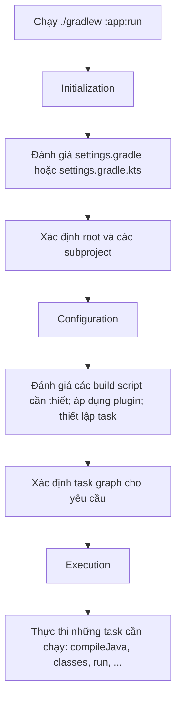

# Vai trò của settings.gradle, build.gradle và các biến thể .kts

Trong một dự án Gradle, hai nhóm file dễ bị nhầm nhất là **`settings.gradle` / `settings.gradle.kts`** và **`build.gradle` / `build.gradle.kts`**. Cả hai đều là script cấu hình Gradle, nhưng chúng chạy trong **ngữ cảnh khác nhau** và trả lời **những câu hỏi khác nhau**:

- **Settings script**: *Build này gồm những project nào, chúng nằm ở đâu, và các nguồn tìm plugin/dependency dùng chung được thiết lập ra sao?*
- **Build script**: *Từng project áp dụng plugin nào, cần dependency nào, tạo task nào và được biên dịch/kiểm thử/đóng gói như thế nào?*
- **Đuôi `.gradle` hay `.gradle.kts`**: chỉ **ngôn ngữ DSL** dùng để viết các script tương ứng, lần lượt là Groovy DSL và Kotlin DSL. Đổi đuôi không làm thay đổi vai trò của file.

Bài này tập trung vào cấu trúc dự án Java/Gradle, vòng đời đọc cấu hình, hai DSL và một ví dụ chạy được. Các khái niệm áp dụng cho Gradle nói chung; ví dụ sử dụng **Java 17** và cú pháp thông dụng của **Gradle 8.5+**.

## 1. Bản đồ nhanh: file nào làm việc gì?

| File | Phạm vi | Trách nhiệm điển hình | Ví dụ lệnh/cấu hình |
| --- | --- | --- | --- |
| `settings.gradle` | Toàn **build**; Groovy DSL | Đặt tên root project, đăng ký các subproject, thiết lập plugin/dependency repository ở cấp settings, ghép composite build khi cần. | `rootProject.name = 'demo'`, `include 'app', 'core'` |
| `settings.gradle.kts` | Toàn **build**; Kotlin DSL | Giống `settings.gradle`, khác cú pháp và hỗ trợ biên dịch/type checking của Kotlin DSL. | `rootProject.name = "demo"`, `include("app", "core")` |
| `build.gradle` | **Một project**; Groovy DSL | Áp dụng plugin, khai báo dependencies, task, cấu hình Java/toolchain, test, artifact. | `plugins { id 'java' }` |
| `build.gradle.kts` | **Một project**; Kotlin DSL | Giống `build.gradle`, khác cú pháp DSL. | `plugins { id("java") }` |
| `gradle.properties` | Properties cấp build/project hoặc Gradle user home, tùy vị trí | Chứa các cặp `key=value` để điều khiển Gradle hoặc cung cấp thuộc tính cho build. | `org.gradle.parallel=true` |
| `gradle/wrapper/gradle-wrapper.properties` | Wrapper của build | Chọn Gradle distribution mà `gradlew` tải/sử dụng. | `distributionUrl=...` |
| `gradle/libs.versions.toml` | Version catalog mặc định, nếu có | Khai báo alias/version dependency và plugin dùng cho các script build. | `[libraries]` và `[plugins]` |

**Không đồng nhất “build” với “project”.** Một lần chạy Gradle có thể quản lý một **multi-project build** gồm root project và nhiều subproject. Khi đó thường có **một** settings script ở thư mục gốc của build, trong khi **mỗi project có thể có** build script riêng. Build script của root và build script của module đều là **project build script**; không phải settings script.

Ví dụ:

```text
shop/
├── settings.gradle.kts            ← định nghĩa cấu trúc toàn build
├── build.gradle.kts               ← cấu hình riêng của root project (có thể rất ít)
├── gradle.properties              ← thuộc tính Gradle, nếu cần
├── gradlew                        ← Gradle Wrapper trên Linux/macOS
├── gradlew.bat                    ← Gradle Wrapper trên Windows
├── gradle/
│   ├── wrapper/
│   │   ├── gradle-wrapper.jar
│   │   └── gradle-wrapper.properties
│   └── libs.versions.toml         ← tùy chọn
├── app/
│   ├── build.gradle.kts           ← cấu hình riêng của :app
│   └── src/main/java/...
└── core/
    ├── build.gradle.kts           ← cấu hình riêng của :core
    └── src/main/java/...
```

Đối với dự án chỉ có một project, có thể chỉ có settings script tại root và một build script tại root. Trong một số tình huống Gradle vẫn chấp nhận single-project build không có settings script, nhưng khai báo `rootProject.name` rõ ràng là lựa chọn tốt cho dự án được quản lý lâu dài.

## 2. `settings.gradle` hoặc `settings.gradle.kts`: xác định thành phần của build

**Settings script được Gradle đánh giá trong giai đoạn initialization.** Nó cấu hình đối tượng `Settings`, tạo mô hình các project thuộc build và cung cấp một số chính sách chung trước khi Gradle cấu hình project cụ thể.

### 2.1. Đặt tên root project

Groovy DSL:

```groovy
// settings.gradle
rootProject.name = 'shop'
```

Kotlin DSL:

```kotlin
// settings.gradle.kts
rootProject.name = "shop"
```

Tên này được dùng trong nhận diện root project và các kết quả hiển thị của Gradle. Nó không tự đặt `group`, `version`, tên package Java hay tên lớp `main`. Các giá trị ấy là những cấu hình khác.

### 2.2. Đăng ký các subproject bằng `include`

Groovy:

```groovy
rootProject.name = 'shop'
include 'app', 'core'
```

Kotlin:

```kotlin
rootProject.name = "shop"
include("app", "core")
```

Gradle tạo các đường dẫn project **`:`** (root), **`:app`** và **`:core`**. Từ đó có thể nhắm task cụ thể bằng `./gradlew :app:build` hoặc khai báo dependency nội bộ `implementation(project(":core"))`.

Việc `include` **đăng ký project**, không tự áp dụng plugin Java, không tự tạo mã nguồn và không tự chạy task. Thư mục tương ứng cần tồn tại và có cấu trúc phù hợp với phiên bản Gradle đang dùng; một module chưa áp dụng Java plugin sẽ chưa có các task Java mà bạn mong đợi.

**Đường dẫn logic và thư mục vật lý khác nhau.** Mặc định `:app` thường ánh xạ tới thư mục `app/`, nhưng settings có thể đổi thư mục:

```kotlin
// settings.gradle.kts
rootProject.name = "shop"
include("app")
project(":app").projectDir = file("services/application")
```

Ở đây project logic vẫn là `:app`, còn script/source nằm dưới `services/application/`. Điều này hữu ích trong monorepo, nhưng không nên đổi đường dẫn chỉ để làm tên thư mục trông đẹp hơn; mọi thành viên cần hiểu cách ánh xạ này.

### 2.3. Tách kho tìm plugin và kho tìm library

Một settings script có thể tập trung nơi Gradle tìm **plugin** và **dependency**.

```kotlin
// settings.gradle.kts
pluginManagement {
    repositories {
        gradlePluginPortal()
    }
}

dependencyResolutionManagement {
    repositories {
        mavenCentral()
    }
}

rootProject.name = "shop"
include("app", "core")
```

- `pluginManagement.repositories`: nơi Gradle tìm plugin sử dụng qua Plugin DSL khi cần phân giải plugin ngoài. Plugin tích hợp như `java`, `application`, `java-library` không cần tải từ plugin portal.
- `dependencyResolutionManagement.repositories`: nơi Gradle tìm **thư viện của project**, ví dụ JUnit hoặc Jackson. Đây không phải repository dành cho plugin theo mặc định.
- `rootProject.name` và `include`: khai báo cấu trúc build.

**Thứ tự cú pháp:** nếu có `pluginManagement { ... }` trong settings script, hãy đặt nó ở đầu script theo quy định của Gradle. Không đặt một câu lệnh tùy ý trước block này rồi kỳ vọng Gradle xử lý như bình thường.

Trong Gradle có thể thiết lập thêm `repositoriesMode` để ưu tiên hoặc cấm repository khai báo ở từng project. Khi chọn chế độ `FAIL_ON_PROJECT_REPOS`, khai báo `repositories { ... }` không phù hợp trong build script sẽ gây lỗi. Vì vậy phải kiểm tra chính sách ở settings trước khi “sửa nhanh” lỗi tải dependency bằng cách thêm repository vào build script.

### 2.4. Những khả năng khác của settings

Settings script còn có thể khai báo `includeBuild("...")` để ghép **composite builds**, cấu hình version catalogs và một số plugin ở scope `Settings`. Cần phân biệt:

- `include("core")` thêm **subproject vào cùng multi-project build**; đường dẫn thường là `:core`.
- `includeBuild("../shared-build")` ghép **một build độc lập** vào composite build; build đó có settings và tập project riêng, không đơn giản trở thành `:shared-build`.

Đây là lựa chọn kiến trúc. Với một ứng dụng có các module liên hệ chặt chẽ, `include` thường là điểm xuất phát rõ ràng hơn. Chỉ dùng composite build khi thực sự cần quan hệ giữa nhiều build độc lập.

## 3. `build.gradle` hoặc `build.gradle.kts`: định nghĩa cách xây dựng từng project

**Build script cấu hình đối tượng `Project`.** Root project có build script riêng; mỗi subproject được khai báo cũng có thể có build script riêng. Những cấu hình thường gặp là:

1. **Plugins:** bổ sung các convention, extension, configuration và task, ví dụ `java`, `java-library`, `application`.
2. **Dependencies:** khai báo thư viện ngoài hoặc quan hệ với project khác.
3. **Compilation/toolchain:** chọn Java version, encoding và cài đặt compiler.
4. **Testing:** chọn test engine/framework, chỉnh task `test`.
5. **Tasks/outputs:** đăng ký các việc như tạo báo cáo, chạy ứng dụng hoặc đóng gói artifact.

Ví dụ Kotlin DSL trong **`app/build.gradle.kts`**:

```kotlin
plugins {
    id("application")
}

java {
    toolchain {
        languageVersion.set(JavaLanguageVersion.of(17))
    }
}

dependencies {
    implementation(project(":core"))
}

application {
    mainClass.set("demo.app.App")
}
```

Ví dụ này **chỉ là build script của `:app`**, không thể tự đăng ký `:core`. Muốn `project(":core")` tồn tại thì settings script phải `include("core")` (hoặc có cơ chế cấu hình tương đương). Nếu viết `include("core")` trực tiếp vào build script của app sẽ sai phạm vi API.

Bộ plugin `application` thêm cấu hình `application` và task như `run`; `implementation(project(":core"))` thêm `:core` vào dependency classpath. JavaCompile sẽ dùng compiler được chọn qua JDK/toolchain để biên dịch source. **Build script mô tả hoạt động; bản thân file không phải compiler và không phải chương trình Java của ứng dụng.**

Ở `core/build.gradle.kts` có thể dùng `java-library` thay vì `application`, vì `:core` cung cấp mã thư viện và không nhất thiết cần `main`. Việc chọn plugin quyết định task và DSL extension có sẵn; ví dụ `application { ... }` chỉ có ý nghĩa khi plugin tương ứng được áp dụng.

### Root build script khác settings script ra sao?

`build.gradle.kts` nằm ở root cấu hình **root project**. Nó có thể đăng ký task chung hoặc cấu hình convention, nhưng không vì nằm ở root mà tự trở thành nơi khai báo cấu trúc module. Ví dụ:

```kotlin
// build.gradle.kts tại root
tasks.register("aboutBuild") {
    doLast {
        println("Build: " + rootProject.name)
    }
}
```

Task này thuộc root project. Nó chỉ được thực thi khi được yêu cầu hoặc được task khác phụ thuộc; đoạn `doLast` không chạy ngay khi Gradle đánh giá script.

Không bắt buộc phải dồn toàn bộ dependencies của `:app` và `:core` vào root script. Trong dự án lớn, các plugin convention có thể giúp chia sẻ cấu hình nhất quán mà vẫn giữ ranh giới từng module.

## 4. Đuôi `.kts`: Kotlin DSL so với Groovy DSL

Gradle cung cấp hai DSL chính trên cùng mô hình `Settings`/`Project`:

| Ý định | Groovy DSL (`.gradle`) | Kotlin DSL (`.gradle.kts`) |
| --- | --- | --- |
| Đặt tên build | `rootProject.name = 'demo'` | `rootProject.name = "demo"` |
| Include project | `include 'app', 'core'` | `include("app", "core")` |
| Áp dụng Java plugin | `id 'java'` trong `plugins` | `id("java")` trong `plugins` |
| Dependency thư viện | `implementation 'com.example:lib:1.0'` | `implementation("com.example:lib:1.0")` |
| Dependency nội bộ | `implementation project(':core')` | `implementation(project(":core"))` |
| Đăng ký task | `tasks.register('hello') { ... }` | `tasks.register("hello") { ... }` |
| Java toolchain 17 | `languageVersion = JavaLanguageVersion.of(17)` | `languageVersion.set(JavaLanguageVersion.of(17))` |

Trong bảng, các dòng `id`/ `implementation` là đoạn **bên trong** block tương ứng, không phải chương trình độc lập.

**Groovy DSL** có cú pháp ngắn, linh hoạt và được dùng trong nhiều dự án lâu năm. **Kotlin DSL** cho phép kiểm tra kiểu ở thời điểm biên dịch script và thường có gợi ý/refactor tốt với IDE. Vì kiểu và cách truy cập khác nhau, không thể đổi tên `build.gradle` thành `build.gradle.kts` rồi giữ nguyên mọi cú pháp Groovy.

Ví dụ một task tương đương:

```groovy
// build.gradle
tasks.register('hello') {
    doLast {
        println 'Hello from Gradle'
    }
}
```

```kotlin
// build.gradle.kts
tasks.register("hello") {
    doLast {
        println("Hello from Gradle")
    }
}
```

Lệnh `./gradlew -q hello` với một trong hai cấu hình in:

```text
Hello from Gradle
```

**Có thể trộn DSL giữa các project:** ví dụ settings dùng Groovy còn `:app` dùng Kotlin DSL. Mỗi file được xử lý theo đuôi của chính nó. Tuy nhiên, để nhóm dễ bảo trì, nên chọn quy ước rõ ràng. **Tránh giữ cả `build.gradle` và `build.gradle.kts` cùng vai trò trong một thư mục** rồi kỳ vọng hai file cùng cấu hình một project; tương tự với hai settings script. Hãy chuyển đổi có chủ đích và xác nhận file Gradle thực sự đang sử dụng.

Đặc biệt, tên chính xác của Kotlin DSL là **`settings.gradle.kts`** và **`build.gradle.kts`**, không phải `settings.kts` hoặc `build.kts`.

### Vì sao Kotlin DSL đôi khi báo `Unresolved reference`?

Kotlin DSL có **type-safe accessors** cho nhiều extension/configuration do plugin khai báo. Chúng được tạo dựa trên các plugin đã biết trong quá trình cấu hình script, đặc biệt khi plugin được khai báo trong `plugins { ... }`.

Ví dụ:

```kotlin
plugins {
    id("java")
}

dependencies {
    testImplementation("org.junit.jupiter:junit-jupiter:5.10.2")
}
```

Nếu bỏ Java plugin đi, accessor `testImplementation` trong ví dụ có thể không tồn tại. Vì vậy cần kiểm tra **plugin đã được áp dụng ở script/phase thích hợp chưa**, thay vì cho rằng `.kts` không hỗ trợ khai báo dependency. Với plugin được áp dụng theo cách động như `apply(plugin = "...")`, một số accessor tĩnh không xuất hiện đúng như `plugins` DSL; khi đó cần dùng API cấu hình rõ ràng phù hợp.

## 5. Gradle đọc các file theo giai đoạn nào?

Mô hình phổ biến của một lần chạy Gradle có ba giai đoạn:



1. **Initialization:** Gradle xác định build, đánh giá settings script và danh sách project. Những plugin/chính sách khai báo trong settings được xử lý theo phạm vi của chúng.
2. **Configuration:** Gradle cấu hình các project thích hợp, áp dụng plugin và đánh giá build script. Giai đoạn này chủ yếu **tạo/cấu hình task** chứ không chạy các action của task.
3. **Execution:** Gradle thực hiện những task nằm trong task graph, xét dependency task, trạng thái up-to-date và cache khi phù hợp.

Tùy phiên bản Gradle, cấu hình và cơ chế như configuration cache hoặc isolated projects, phạm vi công việc cấu hình có thể được tối ưu. Đây là mô hình lý giải trách nhiệm, không phải cam kết rằng Gradle luôn đọc mọi script y hệt cùng một thứ tự.

Hãy phân biệt rõ:

- `tasks.register("hello") { doLast { println("Hi") } }`: cấu hình **đăng ký** task; `println` trong `doLast` chạy khi task được thực thi.
- `println("Configuring")` đặt trực tiếp ở đầu build script: xuất hiện trong thời gian cấu hình nếu script được đánh giá; không phải cách tốt để định nghĩa tác vụ build có thể cache/tái lập.
- `include("app")` trong settings: làm Gradle biết project `:app`; không phải lệnh yêu cầu build project ấy ngay lập tức.

## 6. Ví dụ hoàn chỉnh với Kotlin DSL: một ứng dụng phụ thuộc thư viện nội bộ

Mục tiêu: root có hai project **`:core`** (thư viện Java) và **`:app`** (ứng dụng Java). Khi chạy `:app:run`, ứng dụng gọi lớp trong `:core` và in một dòng cố định.

Cấu trúc:

```text
gradle-structure-demo/
├── settings.gradle.kts
├── build.gradle.kts
├── core/
│   ├── build.gradle.kts
│   └── src/main/java/demo/core/Message.java
└── app/
    ├── build.gradle.kts
    └── src/main/java/demo/app/App.java
```

Để lặp lại ví dụ trên các máy, hãy thêm các file Wrapper bằng `gradle wrapper --gradle-version 8.5` khi có sẵn Gradle tương thích, rồi commit script/JAR/properties của Wrapper. Có JDK 17 tương thích với toolchain đã khai báo. Các lệnh dưới đây giả định Wrapper đã tồn tại.

**File 1 — `settings.gradle.kts` tại root:**

```kotlin
pluginManagement {
    repositories {
        gradlePluginPortal()
    }
}

dependencyResolutionManagement {
    repositories {
        mavenCentral()
    }
}

rootProject.name = "gradle-structure-demo"
include("core", "app")
```

Đây là nơi khai báo project tree. Mặc dù demo không tải thư viện ngoài, `mavenCentral()` thể hiện nơi có thể tìm dependency trong trường hợp dự án mở rộng. Các plugin `java-library`/`application` là plugin tích hợp.

**File 2 — `build.gradle.kts` tại root:**

```kotlin
tasks.register("aboutBuild") {
    doLast {
        println("Build: " + rootProject.name)
    }
}
```

Root không tự mang Java source, nên không cần áp dụng Java plugin chỉ để có task `aboutBuild`.

**File 3 — `core/build.gradle.kts`:**

```kotlin
plugins {
    id("java-library")
}

java {
    toolchain {
        languageVersion.set(JavaLanguageVersion.of(17))
    }
}
```

**File 4 — `app/build.gradle.kts`:**

```kotlin
plugins {
    id("application")
}

java {
    toolchain {
        languageVersion.set(JavaLanguageVersion.of(17))
    }
}

dependencies {
    implementation(project(":core"))
}

application {
    mainClass.set("demo.app.App")
}
```

**File 5 — `core/src/main/java/demo/core/Message.java`:**

```java
package demo.core;

public final class Message {
    private Message() {
    }

    public static String text() {
        return "Hello from core";
    }
}
```

**File 6 — `app/src/main/java/demo/app/App.java`:**

```java
package demo.app;

import demo.core.Message;

public final class App {
    private App() {
    }

    public static void main(String[] args) {
        System.out.println(Message.text());
    }
}
```

Hai file Java trên là chương trình hoàn chỉnh. `App` được biên dịch với `:core` trên classpath vì `implementation(project(":core"))`. Khi chạy ứng dụng bằng task `run`, plugin `application` đặt runtime classpath thích hợp.

Từ thư mục root, trên Linux/macOS:

```bash
./gradlew -q aboutBuild
./gradlew projects
./gradlew :app:run
./gradlew :core:jar
```

Trên Windows, dùng `gradlew.bat` thay `./gradlew`. Kết quả của **riêng task** `aboutBuild` khi chạy với `-q`:

```text
Build: gradle-structure-demo
```

Khi chạy `./gradlew :app:run` thành công, **dòng output của chương trình Java** là:

```text
Hello from core
```

Log Gradle, số task chạy và trạng thái cache tùy phiên bản/môi trường; không coi những dòng log đó là stdout cố định. `:core:jar` tạo JAR thư viện tại `core/build/libs/` theo quy ước; nó không tự tạo ứng dụng chạy bằng `java -jar`.

Điều mà ví dụ cho thấy:

- `settings.gradle.kts` **tạo đường dẫn project** `:core` và `:app`.
- Root `build.gradle.kts` **khai báo task** `aboutBuild` của root.
- `core/build.gradle.kts` **chọn plugin thư viện và JDK** cho `:core`.
- `app/build.gradle.kts` **chọn plugin ứng dụng, phụ thuộc nội bộ và main class** cho `:app`.
- Lệnh `./gradlew :app:run` yêu cầu Gradle **thực thi task**; phụ thuộc `:core` khiến Gradle xây dựng đầu ra cần thiết của `:core` trước khi chạy `:app`.

Nếu bỏ `include("core")` trong settings mà vẫn giữ `implementation(project(":core"))`, Gradle không nhận diện `:core` như project trong build và sẽ báo lỗi resolution project dependency. Nếu bỏ plugin `application` của `:app`, task `:app:run` và extension `application` trong ví dụ không còn được cung cấp bởi plugin đó.

## 7. Cùng ví dụ đó khi dùng Groovy DSL

Có thể giữ nguyên **hai file Java** ở mục 6 và chỉ thay **bốn file cấu hình Gradle** bằng các file `.gradle` tương ứng. Dưới đây là một bộ cấu hình **thay thế** cho bộ Kotlin DSL, không phải bốn file bổ sung đặt song song.

**`settings.gradle`:**

```groovy
pluginManagement {
    repositories {
        gradlePluginPortal()
    }
}

dependencyResolutionManagement {
    repositories {
        mavenCentral()
    }
}

rootProject.name = 'gradle-structure-demo'
include 'core', 'app'
```

**`build.gradle` tại root:**

```groovy
tasks.register('aboutBuild') {
    doLast {
        println 'Build: ' + rootProject.name
    }
}
```

**`core/build.gradle`:**

```groovy
plugins {
    id 'java-library'
}

java {
    toolchain {
        languageVersion = JavaLanguageVersion.of(17)
    }
}
```

**`app/build.gradle`:**

```groovy
plugins {
    id 'application'
}

java {
    toolchain {
        languageVersion = JavaLanguageVersion.of(17)
    }
}

dependencies {
    implementation project(':core')
}

application {
    mainClass = 'demo.app.App'
}
```

Chạy các lệnh `./gradlew -q aboutBuild` và `./gradlew :app:run` như ở mục 6 sẽ có cùng kết quả chức năng. **Gradle vẫn cùng một build system**; khác biệt nằm ở cách biểu diễn cấu hình bằng Groovy/Kotlin DSL.

Lưu ý: khi chuyển đổi script hiện có, không chỉ thay dấu nháy và thêm ngoặc. Cách dùng property, closure/lambda, type-safe accessor, phương thức plugin, cấu hình task và cả plugin code tùy biến có thể cần chỉnh. Hãy chuyển từng file, chạy các task kiểm tra tương ứng và loại bỏ file cũ khi đã xác nhận kết quả.

## 8. Phạm vi các cấu hình: đặt ở đâu cho đúng?

| Nhu cầu | Nơi phù hợp | Lý do |
| --- | --- | --- |
| Đổi tên root project | Settings script | Đối tượng `Settings` quản lý tên/đường dẫn project khi initialization. |
| Thêm project `:reports` | Settings script bằng `include` | Build phải biết project tồn tại trước khi cấu hình nó. |
| Project `:app` dùng Java 17 | `app/build.gradle(.kts)` | Toolchain thuộc cấu hình của project chạy Java task. |
| `:app` dùng `:core` | `app/build.gradle(.kts)` với `implementation(project(":core"))` | Đây là dependency giữa các project, không phải thao tác đăng ký project. |
| Tải JUnit 5 từ Maven Central | Repository thường tập trung trong settings; `testImplementation` trong build script của project dùng JUnit | Vị trí nguồn artifact khác nơi khai báo project cần artifact. |
| Tìm plugin từ Gradle Plugin Portal | `pluginManagement` ở settings | Đây là kho/chiến lược resolution plugin. |
| Chọn plugin `application` | `plugins` ở build script của project ứng dụng | Plugin tạo task và extension phù hợp với project đó. |
| Đặt version Gradle dùng cho nhóm/CI | `gradle/wrapper/gradle-wrapper.properties` | Wrapper quản lý Gradle distribution; không phải cấu hình project tree. |
| Đặt thuộc tính như `org.gradle.caching=true` | `gradle.properties` phù hợp | Đây là Gradle property, không phải DSL cấu hình task. |
| Chia sẻ version alias | `gradle/libs.versions.toml` hoặc catalog cấu hình ở settings | Catalog quản lý tên/phiên bản; project vẫn khai báo nơi tiêu thụ dependency. |

Một ví dụ khi đã có version catalog:

```kotlin
// app/build.gradle.kts
dependencies {
    // 'libs' là accessor của version catalog đã được tạo.
    // Viết đúng alias và scope theo catalog thực tế của dự án.
}
```

Đoạn này minh họa **vị trí** của dependency declaration, không phải đoạn mã độc lập để biên dịch. Đừng nhầm `libs.versions.toml` với chính dependency manager: Gradle vẫn thực hiện resolution và lập classpath.

## 9. Đọc lỗi dựa trên ranh giới file

**Lỗi: Gradle không thấy `:core`.** Kiểm tra `include("core")`, tên project path, `projectDir` nếu đã tùy chỉnh và thư mục thực tế trong settings trước. Không thêm `implementation(project(":core"))` lặp lại để “tạo module”.

**Lỗi: `Unresolved reference: implementation` trong Kotlin DSL.** Kiểm tra plugin Java/`application`/`java-library` đã được áp dụng trong build script thích hợp chưa, cách và thời điểm áp dụng plugin. Cũng cần xem script đang được biên dịch bằng Kotlin DSL thật hay không.

**Lỗi: `Could not find method include()` hoặc `include` không hợp lệ trong build script.** Lệnh này thuộc ngữ cảnh `Settings`, không phải `Project`. Chuyển phần đăng ký project sang `settings.gradle(.kts)`.

**Lỗi: `Plugin ... was not found`.** Xem plugin ID, version và `pluginManagement.repositories`; phân biệt plugin tích hợp với plugin ngoài. Chỉ thêm `mavenCentral()` cho library dependency chưa chắc giải quyết được lỗi phân giải plugin.

**Lỗi: `Could not resolve ...` khi tải thư viện.** Xem repository dành cho dependency, tọa độ `group:name:version`, khả năng truy cập mạng, credential và chính sách `repositoriesMode`. Plugin repository và project dependency repository có thể khác nhau.

**Lỗi: `Task 'run' not found in project ':app'`.** Kiểm tra plugin `application` có thực sự áp dụng trong `app/build.gradle(.kts)` hay không. Chỉ có file `App.java` hoặc settings `include("app")` không làm Gradle tự thêm task `run`.

**Lỗi: IDE hiển thị cấu hình sai sau khi đổi `.gradle` sang `.gradle.kts`.** Xác nhận tên file, cú pháp đúng DSL, plugin/accessor tương thích và reload/sync Gradle; không để hai bản cấu hình cùng vai trò gây hiểu nhầm. Khi cần, chạy lệnh Wrapper ở terminal để có lỗi cấu hình gốc thay vì chỉ dựa vào gợi ý IDE.

### Lệnh khảo sát không sửa mã nguồn

```bash
./gradlew projects
./gradlew tasks --all
./gradlew :app:tasks --all
./gradlew :app:dependencies --configuration runtimeClasspath
./gradlew help --stacktrace
```

- `projects` kiểm tra Gradle nhận diện các project nào.
- `tasks` cho biết những task đã đăng ký trong phạm vi yêu cầu; `:app:tasks` tập trung vào một project.
- `dependencies` xem đồ thị phụ thuộc của một configuration, khi configuration đó tồn tại.
- `help --stacktrace` hữu ích khi lỗi xảy ra ngay trong initialization/configuration.

Một số lệnh sẽ cần tải plugin/dependency hoặc tạo cache Gradle nếu chưa có; chúng không được dùng để suy ra rằng file settings/build đã được áp dụng đúng khi log báo ngược lại.

## 10. Tự thực hành và câu hỏi kiểm tra

1. Tạo một single-project build với `settings.gradle.kts` đặt `rootProject.name = "my-app"` và `build.gradle.kts` áp dụng `java`. Chạy `./gradlew projects`; kiểm tra root project nhận tên dự kiến.
2. Thêm thư mục `utils/` và `utils/build.gradle.kts` áp dụng `java-library`. Thêm `include("utils")` vào settings, rồi chạy `./gradlew projects` và `./gradlew :utils:tasks`. Giải thích vì sao chỉ tạo thư mục không đủ để đăng ký project.
3. Tạo `:app` và khai báo `implementation(project(":utils"))` sau khi áp dụng plugin phù hợp. Xác định vị trí cấu hình **đăng ký project**, **chọn plugin** và **dependency**.
4. Viết lại một `plugins { id 'java' }` Groovy DSL sang Kotlin DSL: **`plugins { id("java") }`**. Chỉ ra vì sao thay đuôi file không tự chuyển đổi cú pháp.
5. Nếu `./gradlew :app:run` báo không có task `run`, bạn kiểm tra file nào trước? **Build script của `:app` và plugin `application`**. Nếu `:app` không tồn tại, kiểm tra **settings script**.
6. Nếu plugin bên ngoài không tải được nhưng dependency JAR vẫn tải được, có thể cần kiểm tra cấu hình nào? **`pluginManagement.repositories` và cách khai báo/version của plugin**, thay vì chỉ xem `dependencyResolutionManagement.repositories`.

**Ghi nhớ cách phân việc:** `settings.gradle(.kts)` định nghĩa **ai thuộc build và một số quy tắc resolution ở cấp build**; `build.gradle(.kts)` định nghĩa **mỗi project được build như thế nào**; `.gradle` và `.gradle.kts` là **hai DSL biểu diễn cùng các trách nhiệm đó**. Khi hiểu đúng phạm vi của từng file, bạn sẽ biết đặt cấu hình ở đâu, giải thích được task của subproject và tìm ra nguyên nhân lỗi nhanh hơn.