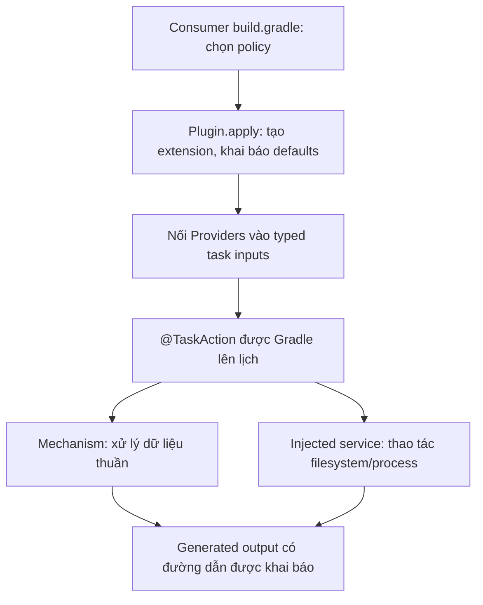
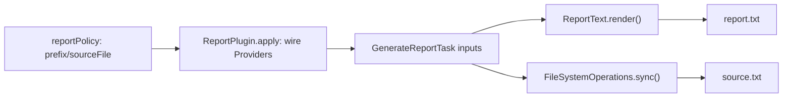

# Tách chính sách, cơ chế, dịch vụ và tác dụng phụ của task khi phát triển Gradle plugin

Một Gradle plugin có thể bắt đầu bằng vài dòng `tasks.register("generateReport") { doLast { ... } }`. Nhưng khi task phải đọc file, áp quy tắc của tổ chức, dùng một công cụ bên ngoài, tạo output, tương thích build cache và chạy được trong CI, cách dồn mọi thứ vào một closure trở nên khó kiểm thử và khó bảo trì. Lỗi thường gặp là xử lý cả bốn việc trong cùng một chỗ: quyết định policy, tính dữ liệu, gọi hạ tầng và ghi trạng thái bên ngoài.

Bài Knowledge này thuộc nhóm **Phát triển plugin** của **Build Tool Gradle**, với đề mục **“Tách chính sách, cơ chế, dịch vụ và tác dụng phụ của task”**. Mục tiêu là thiết kế một plugin theo các ranh giới trách nhiệm có thể kiểm chứng, không chỉ thay một `doLast` dài bằng một class dài.

Bốn khái niệm cốt lõi:

1. **Chính sách (policy):** Điều tổ chức hoặc người dùng muốn — prefix, target Java, tiêu chuẩn định dạng, nguồn input, output convention, giá trị nào được override.
2. **Cơ chế (mechanism):** Quy tắc biến input thành kết quả. Một hàm thuần như `render("Policy", "delta")` trả `"Policy: delta"` không cần Gradle, filesystem hay network.
3. **Dịch vụ (services):** Năng lực hạ tầng do Gradle quản lý, ví dụ `FileSystemOperations`, `ExecOperations`, `WorkerExecutor`, `ProviderFactory`, `ObjectFactory` và `BuildService`.
4. **Tác dụng phụ (side effects):** Đọc/ghi file, spawn process, gửi network request, publish artifact, cập nhật trạng thái bên ngoài. Với task tạo file, công việc thực tế diễn ra trong **execution phase**, thường qua `@TaskAction`, dựa trên input/output properties đã khai báo.

Kết quả thực hành là một **binary Gradle plugin viết bằng Java 17**, được build trong included build `build-logic`. Plugin tạo báo cáo từ một file text. Chính sách nằm trong typed extension; mechanism là Java 17 record; task inject `FileSystemOperations` và ghi output duy nhất trong action; plugin `apply(Project)` chỉ đăng ký và nối các Provider. Bài có Groovy/Kotlin DSL, cách chạy `javac`/`java`, stdout, bài kiểm tra cache và cách tránh side effects nguy hiểm.

## 1. Phân biệt bốn phần bằng trách nhiệm

| Phần | Câu hỏi chính | Nơi thường đặt | Có được gây tác dụng phụ khi cấu hình? |
| --- | --- | --- | --- |
| **Policy** | Muốn điều gì? Giới hạn/ngoại lệ nào? | Extension, conventions, settings policy | Không |
| **Mechanism** | Dữ liệu biến đổi theo thuật toán nào? | Hàm/class thuần, parser, formatter | Không |
| **Services** | Năng lực filesystem/process/worker đến từ đâu? | Gradle-injected services | Chỉ inject chưa tạo side effect |
| **Side effects** | Khi nào đọc/ghi/call/publish? | Typed task action, worker action hoặc task chuyên trách | Có, đúng lifecycle và scope |

Luồng thiết kế:



**Không bắt buộc một task phải có đúng bốn class.** Đây là bốn mối quan tâm, không phải khuôn tạo file. Với task chỉ in chuỗi chào, một `tasks.register` là đủ; với plugin dùng trong hàng chục modules hoặc có custom task phức tạp, việc tách sẽ đem lại lợi ích rõ rệt.

### Định nghĩa tốt hơn bằng sự thay đổi

- Nếu đổi **prefix** từ `Policy` sang `Audit` mà không sửa thuật toán đọc/ghi: policy đã tách.
- Nếu đổi dấu phân cách `:` sang ` - ` mà không sửa Gradle extension: mechanism đã tách.
- Nếu chuyển từ copy file sang gọi một CLI mà không bắt code thuần hiểu đường dẫn executable: service boundary đã rõ.
- Nếu chạy `./gradlew help` không tạo report vì task chưa được yêu cầu: side effect đã đặt đúng execution boundary.

## 2. Configuration phase khác execution phase

Gradle khởi động build, đánh giá settings rồi cấu hình project/task model trước khi thực thi task graph. Trong **configuration phase**, plugin nên đăng ký tasks, khai báo inputs/outputs, đặt defaults và nối Providers. Trong **execution phase**, Gradle quyết định task actions có chạy hay bị bỏ qua do UP-TO-DATE/FROM-CACHE hoặc điều kiện khác.

Ví dụ sai, đặt trong `build.gradle`:

```groovy
// Anti-pattern: thao tác file ngay khi evaluate build script.
def source = file('src/report/input.txt').text
def rendered = 'Policy: ' + source.trim()
file('build/generated/report/report.txt').text = rendered
```

Đoạn đó có thể đọc/ghi file ngay cả khi chỉ chạy:

```bash
./gradlew help
```

Những vấn đề:

- Không có một task với `@InputFile`/`@OutputFile` để Gradle fingerprint I/O.
- Configuration cache khó tái sử dụng an toàn khi configuration code gây side effects.
- IDE sync có thể làm thay files trong workspace ngoài ý muốn.
- Build fail vì input file thiếu dù task đó không hề được yêu cầu.
- Không thể phân biệt task UP-TO-DATE với việc script đã bí mật chạy trước task graph.

Mô hình tốt hơn:

```text
CONFIGURATION
  Plugin.apply(Project):
    create extension
    set conventions
    tasks.register(...)
    wire Providers -> task properties
    declare task inputs / outputs

EXECUTION
  Gradle selects generateReport
    validate inputs
    check up-to-date / build cache
    if work required:
      task @TaskAction:
        read sourceFile
        call pure ReportText.render(...)
        use FileSystemOperations.sync(...)
        write report.txt
```

`@TaskAction` không có nghĩa action **chắc chắn chạy mỗi invocation**. Nếu Gradle đánh giá task UP-TO-DATE hoặc phục hồi output từ cache, action có thể không chạy; đây là behavior mong muốn của một deterministic file generator.

## 3. Chính sách: cấu hình cái gì, không tự làm việc đó

Trong plugin, một policy có thể gồm:

```text
reportPolicy.prefix       = "Policy"
reportPolicy.sourceFile   = src/report/input.txt
task.outputDirectory     = build/generated/report/
output encoding          = UTF-8
report line ending       = LF
```

Những dòng này mô tả **hợp đồng** chứ không yêu cầu mở file ngay. Một plugin có thể cung cấp extension với managed properties:

```java
public abstract class ReportPolicyExtension {
    public abstract Property<String> getPrefix();
    public abstract RegularFileProperty getSourceFile();
}
```

Đây là snippet về ý tưởng; bản Java đầy đủ có package/import ở lab. Một module consumer chọn:

```groovy
reportPolicy {
    prefix.set('Policy')
    sourceFile.set(layout.projectDirectory.file('src/report/input.txt'))
}
```

Ở đó chưa có việc ghi output. Thay `prefix` chỉ là thay **giá trị input** đi tới task.

### Convention không tự là enforcement

- `property.convention(valueOrProvider)`: cung cấp default nếu consumer chưa set explicit value.
- `property.set(valueOrProvider)`: thiết lập value hoặc Provider cụ thể.
- `property.get()`: lấy giá trị, tốt nhất thực hiện khi thật sự cần, không đọc tất cả quá sớm.
- `finalizeValue()`/`disallowChanges()`: quản lý vòng đời và khả năng đổi property trong những policy yêu cầu, nhưng không nên khóa mọi API vô cớ.

Nếu tổ chức có quy định bắt buộc Java 17, việc plugin đặt convention Java 17 **không tự bảo đảm** mọi module không thể override. Enforcement cần tests/validation và cách xét ngoại lệ. Policy có chủ sở hữu, phạm vi áp dụng và điều kiện thay đổi; không chỉ là một string default.

### Chính sách ở đúng scope

- Project-specific report settings: extension của `Plugin<Project>`.
- Plugin resolution repositories: `pluginManagement` trong settings.
- External dependency repositories: `dependencyResolutionManagement` trong settings.
- Gradle distribution: Wrapper.
- Java compiler version của Java modules: Java toolchain/compile task conventions.

Đừng mang settings-level policy vào một Project plugin rồi mong sửa được settings đã được evaluate.

## 4. Cơ chế: thuần để dễ kiểm thử và tái sử dụng

Một mechanism phù hợp bài lab nhận **hai chuỗi**:

```text
render(prefix, input) -> output String
```

Ví dụ:

```java
public record ReportText(String prefix, String content) {
    public String render() {
        return prefix.strip() + ": " + content.strip();
    }
}
```

Đây là snippet cơ chế, chưa có validation/package; mã hoàn chỉnh được đưa ở mục 11. `record` là Java feature phù hợp Java 17.

Một mechanism tốt:

1. Nhận mọi dữ liệu có ảnh hưởng tới kết quả qua parameters.
2. Không gọi `project.getExtensions()` hoặc Gradle task model.
3. Không đọc `System.getenv()`, current clock hoặc static global state nếu chúng không được chuyển thành inputs rõ.
4. Không ghi filesystem, không mở network, không tự spawn process.
5. Kết quả ổn định với cùng inputs.
6. Ném exception có ý nghĩa khi input sai.
7. Được test bằng JUnit hoặc Java main độc lập với Gradle.

**Không nhất thiết mọi helper đều thuần.** Parser cần streaming input, compiler phải đọc source files và generator rất lớn có thể viết trực tiếp để tránh dùng hàng GB RAM. Khi đó vẫn nên tách một phần thuật toán/validation thuần khỏi adapter I/O khi có giá trị, thay vì gọi một helper gây side effect là “pure”.

## 5. Dịch vụ: sử dụng Gradle-managed capability

| Service/API | Vai trò | Chú ý |
| --- | --- | --- |
| `FileSystemOperations` | Copy, sync, delete files và directories | Chỉ thao tác trong phạm vi task sở hữu, đặc biệt với sync/delete. |
| `ExecOperations` | Chạy executable/process ngoài, kể cả Java process | Cần policy executable/version/args/env/exit code. |
| `WorkerExecutor` | WorkAction có isolation/parallelism | WorkerParameters phải mô hình hóa input độc lập, không capture Project. |
| `ObjectFactory` | Tạo managed types/properties/objects | Dùng cho extension/task model. |
| `ProviderFactory` | Lazy Gradle/environment/system properties | Input tracking/lazy values theo lifecycle. |
| `ArchiveOperations` | Đọc/extract ZIP/TAR archives | Không thay một archive task producer. |
| `BuildService` | Quản lý tài nguyên/state chia sẻ có giới hạn | Cần thread safety, registration và lifecycle thích hợp. |

Gradle hỗ trợ **service injection**:

```java
@Inject
protected abstract FileSystemOperations getFileSystemOperations();
```

Đây là một getter có annotation `javax.inject.Inject` trong abstract task do Gradle khởi tạo. **Bạn không tự `new FileSystemOperations()`** và không nên dùng static singleton giữ `Project` để các task chia sẻ state.

Chỉ khi task action thực sự gọi:

```java
getFileSystemOperations().sync(spec -> {
    spec.from(source);
    spec.into(output.toFile());
});
```

thì việc đồng bộ file mới diễn ra. **Inject service khác với gây side effect.**

Một service có thể giúp I/O đúng lifecycle, nhưng **không thay thế annotations**. Nếu task không khai báo input/output file, Gradle vẫn không có contract đầy đủ để đánh giá caching.

## 6. Side effects: hoạt động thực tế phải có ownership

Một task có thể đọc/ghi file, gọi process, gửi HTTP, publish artifact hoặc cập nhật trạng thái bên ngoài. Cần phân biệt:

| Tác vụ | Side effect | Có nên cache theo output file không? |
| --- | --- | --- |
| Sinh report deterministic | Ghi files dưới `build/generated` | Có thể, nếu mọi inputs/outputs được khai báo. |
| Chạy code generator | Ghi generated sources | Có thể, nếu tool/version/inputs ổn định. |
| Chạy scanner | Đọc source, tạo report và status | Tùy semantics; cần theo dõi inputs và outputs đúng. |
| Publish Maven artifact | Đẩy file tới repository | Không gắn `@CacheableTask` theo phản xạ; side effect ngoài build. |
| Deploy | Đổi trạng thái server | Cần idempotency/retry/credentials riêng. |
| Gửi notification | HTTP request | Không thể coi việc gửi đã xảy ra chỉ vì output từ cache. |

**Tác dụng phụ không phải lúc nào cũng xấu.** Build tool tồn tại để biến inputs thành outputs. Vấn đề là side effect không được khai báo, chạy sai giai đoạn, ghi ngoài phạm vi cho phép hoặc bị vô hiệu hóa không chủ đích bởi cache.

### Vì sao `sync` cần đặc biệt cẩn thận?

`FileSystemOperations.sync` đồng bộ destination theo tập files nguồn và có thể **xóa entries đích không nằm trong nguồn**. Chỉ dùng nó cho **directory output riêng do task sở hữu**, ví dụ `build/generated/report`. Không sync vào `src/`, root repository, home directory hoặc một output folder dùng chung của nhiều task.

## 7. Thiết kế task contract trước khi viết @TaskAction

Task của lab sẽ có:

```text
INPUTS
  prefix:         Property<String>        @Input
  sourceFile:     RegularFileProperty     @InputFile

OUTPUTS
  outputDirectory: DirectoryProperty     @OutputDirectory
    ├── source.txt
    └── report.txt

INFRASTRUCTURE
  FileSystemOperations                   @Inject
```

Annotations quan trọng:

- `@Input` cho giá trị đơn giản như `String`/`boolean`.
- `@InputFile` cho một file đầu vào, snapshot được nội dung.
- `@InputFiles`/`@InputDirectory` cho tập file hoặc directory input.
- `@OutputFile`/`@OutputDirectory` cho outputs thực sự do task tạo.
- `@PathSensitive` để xác định cách path của file input ảnh hưởng cache key.
- `@CacheableTask` đánh dấu task type **cho phép cache outputs** khi behavior phù hợp.
- `@TaskAction` đánh dấu phương thức thực thi.

**Đừng chỉ khai báo `@Input String` chứa đường dẫn file** nếu nội dung file mới là dữ liệu ảnh hưởng output; Gradle có thể chỉ thấy path string không đổi khi file content đổi.

### PathSensitivity được chọn theo behavior

Ở lab, task luôn đổi tên file input thành `source.txt` trong output và mechanism không biết tên file gốc. Vì vậy có thể dùng:

```java
@InputFile
@PathSensitive(PathSensitivity.NONE)
public abstract RegularFileProperty getSourceFile();
```

`NONE` để Gradle tập trung vào nội dung file, không dùng đường dẫn làm fingerprint. Nếu đổi task để copy file với **tên gốc** hoặc nhúng tên file vào report, `NONE` có thể không còn đúng — dùng `NAME_ONLY` hoặc khai báo tên như `@Input`. Với directory trees, `RELATIVE` thường là lựa chọn hợp lý vì các paths con có thể ảnh hưởng generated layout.

Một task có đủ annotations vẫn phải **có đầu ra deterministic** mới đáng cache. Hidden network responses, current time hoặc OS locale vẫn làm kết quả sai nếu không được mô hình hóa.

## 8. Phân vai giữa extension, task type, mechanism và plugin

Ta sẽ có bốn Java classes:

| File | Mục tiêu | Gradle-aware? | Có I/O? |
| --- | --- | --- | --- |
| `ReportPolicyExtension.java` | API cấu hình policy: prefix/sourceFile | Có, Property APIs | Không |
| `ReportText.java` | Thuần: render text | Không | Không |
| `GenerateReportTask.java` | Typed inputs/outputs, inject service, task action | Có | Có, trong action |
| `ReportPlugin.java` | Compose: create extension/register task/wire Providers | Có | Không ghi file |

Sơ đồ data flow:



Phạm vi tách biệt có thể được kiểm chứng: `ReportText` chạy được bằng `javac`/`java` không cần Gradle, trong khi plugin/task classes phải được biên dịch với Gradle API.

## 9. Lab: Java 17 binary plugin trong included build

### Điều kiện

- Gradle Wrapper **8.10.2** hoặc bản tương thích.
- JDK **17** sẵn có cho Gradle daemon và Java compiler/toolchain. Vì plugin code chứa Java 17 record, Gradle phải chạy trên JVM đủ mới để load plugin class.
- Không cần Maven Central hay thư viện ngoài: `java-gradle-plugin` là core Gradle plugin.
- Filesystem writable ở thư mục build outputs.
- Dùng Wrapper đã commit trên CI; không tạo `gradle-wrapper.jar` bằng tay.

### Cây thư mục

```text
policy-mechanism-lab/
├── settings.gradle
├── build.gradle
├── gradlew
├── gradlew.bat
├── gradle/
│   └── wrapper/
│       ├── gradle-wrapper.jar
│       └── gradle-wrapper.properties
├── src/
│   └── report/
│       └── input.txt
└── build-logic/
    ├── settings.gradle
    ├── build.gradle
    └── src/
        └── main/
            └── java/
                └── demo/
                    └── buildlogic/
                        ├── ReportPolicyExtension.java
                        ├── ReportText.java
                        ├── GenerateReportTask.java
                        └── ReportPlugin.java
```

`build-logic` là **independent included build**, không phải subproject thường `:build-logic`. Nó có settings, compilation và plugin registration riêng.

### 9.1. Root settings.gradle

```groovy
pluginManagement {
    includeBuild('build-logic')
}

rootProject.name = 'policy-mechanism-lab'
```

`pluginManagement.includeBuild` cho root `plugins {}` resolve plugin ID từ included build. Đừng khai báo `include ':build-logic'` rồi nghĩ đó là cùng một cơ chế.

### 9.2. Root build.gradle

```groovy
plugins {
    id 'demo.report-conventions'
}

reportPolicy {
    prefix.set('Policy')
    sourceFile.set(
        layout.projectDirectory.file('src/report/input.txt')
    )
}
```

Chỉ có **cấu hình policy**. Không đọc input hay ghi output trong script. `ReportPlugin` sẽ tạo task `generateReport`.

### 9.3. src/report/input.txt

```text
delta
```

Lưu bằng UTF-8; newline cuối file không ảnh hưởng nội dung report vì mechanism dùng `strip()`. Bản copy `source.txt` giữ nguyên bytes của input.

### 9.4. build-logic/settings.gradle

```groovy
rootProject.name = 'build-logic'
```

### 9.5. build-logic/build.gradle

```groovy
plugins {
    id 'java-gradle-plugin'
}

java {
    toolchain {
        languageVersion = JavaLanguageVersion.of(17)
    }
}

tasks.withType(JavaCompile).configureEach {
    options.encoding = 'UTF-8'
    options.release = 17
}

gradlePlugin {
    plugins {
        reportPlugin {
            id = 'demo.report-conventions'
            implementationClass = 'demo.buildlogic.ReportPlugin'
        }
    }
}
```

`java-gradle-plugin` giúp build binary plugin, cung cấp Gradle API classpath/descriptor registration và DSL `gradlePlugin`. `implementationClass` cần khớp Java package. Nếu plugin dùng thư viện ngoài, thêm repositories/dependencies tại **build-logic**, vì included build không tự kế thừa repository/catal​og của root.

### 9.6. Chính sách: ReportPolicyExtension.java

Đường dẫn: `build-logic/src/main/java/demo/buildlogic/ReportPolicyExtension.java`.

```java
package demo.buildlogic;

import org.gradle.api.file.RegularFileProperty;
import org.gradle.api.provider.Property;

public abstract class ReportPolicyExtension {
    public abstract Property<String> getPrefix();
    public abstract RegularFileProperty getSourceFile();
}
```

Gradle có thể tạo managed abstract extension qua `extensions.create`. Extension này không tự làm filesystem I/O, không biết `build/generated/report` và không quyết định lúc nào task chạy. Nó mô tả **điểm tùy biến** cho consumer.

### 9.7. Cơ chế: ReportText.java

Đường dẫn: `build-logic/src/main/java/demo/buildlogic/ReportText.java`.

```java
package demo.buildlogic;

import java.util.Objects;

public record ReportText(String prefix, String content) {
    public String render() {
        String p = Objects.requireNonNull(prefix, "prefix").strip();
        String c = Objects.requireNonNull(content, "content").strip();
        if (p.isEmpty() || c.isEmpty()) {
            throw new IllegalArgumentException(
                "Prefix and content must not be blank"
            );
        }
        return p + ": " + c;
    }

    public static void main(String[] args) {
        if (args.length != 2) {
            throw new IllegalArgumentException(
                "Expected two arguments: prefix content"
            );
        }
        System.out.println(
            new ReportText(args[0], args[1]).render()
        );
    }
}
```

Điểm đáng chú ý:

- `record` chứng minh đây là Java 17+ source.
- `render()` không import `org.gradle.*`.
- Không đọc `Project`, `Task`, `System.getenv()`, filesystem, clock hoặc network.
- Logic validation cho null/blank values ở core.
- `main` chỉ là entry point minh họa để chạy Java độc lập; khi production có thể thay bằng JUnit tests.

Nếu đổi dấu phân cách từ `": "` thành `" - "`, chỉ sửa `ReportText.render()`, không thay interface của Gradle service.

### 9.8. Typed task: GenerateReportTask.java

Đường dẫn: `build-logic/src/main/java/demo/buildlogic/GenerateReportTask.java`.

```java
package demo.buildlogic;

import java.io.File;
import java.io.IOException;
import java.nio.charset.StandardCharsets;
import java.nio.file.Files;
import java.nio.file.Path;

import javax.inject.Inject;

import org.gradle.api.DefaultTask;
import org.gradle.api.file.DirectoryProperty;
import org.gradle.api.file.FileSystemOperations;
import org.gradle.api.file.RegularFileProperty;
import org.gradle.api.provider.Property;
import org.gradle.api.tasks.CacheableTask;
import org.gradle.api.tasks.Input;
import org.gradle.api.tasks.InputFile;
import org.gradle.api.tasks.OutputDirectory;
import org.gradle.api.tasks.PathSensitive;
import org.gradle.api.tasks.PathSensitivity;
import org.gradle.api.tasks.TaskAction;

@CacheableTask
public abstract class GenerateReportTask extends DefaultTask {

    @Input
    public abstract Property<String> getPrefix();

    @InputFile
    @PathSensitive(PathSensitivity.NONE)
    public abstract RegularFileProperty getSourceFile();

    @OutputDirectory
    public abstract DirectoryProperty getOutputDirectory();

    @Inject
    protected abstract FileSystemOperations getFileSystemOperations();

    @TaskAction
    public void generate() throws IOException {
        File source = getSourceFile().get().getAsFile();
        Path output = getOutputDirectory().get().getAsFile().toPath();

        String content = Files.readString(
            source.toPath(), StandardCharsets.UTF_8
        );
        String rendered = new ReportText(
            getPrefix().get(), content
        ).render();

        Files.createDirectories(output);

        // Destination chỉ là output riêng của task.
        // Input filename được chuẩn hóa thành source.txt.
        getFileSystemOperations().sync(spec -> {
            spec.from(source);
            spec.into(output.toFile());
            spec.rename("^.*$", "source.txt");
        });

        Files.writeString(
            output.resolve("report.txt"),
            rendered + "\n",
            StandardCharsets.UTF_8
        );
    }
}
```

Hãy phân tích theo lớp:

**Task model:**

- `@Input Property<String> prefix`: policy value được Gradle theo dõi.
- `@InputFile RegularFileProperty sourceFile`: nội dung file được snapshot.
- `@PathSensitive(NONE)`: tên/đường dẫn nguồn không được đưa vào output semantics vì bản sao luôn đổi tên thành `source.txt` và report chỉ đọc content.
- `@OutputDirectory outputDirectory`: task sở hữu toàn bộ directory output.
- `@CacheableTask`: cho phép tham gia build cache khi full contract deterministic.

**Services:**

- `@Inject FileSystemOperations` cho thao tác copy/sync do Gradle quản lý.
- Không tạo service bằng `new`.
- Service getter chỉ được gọi từ action.

**Mechanism:**

- `new ReportText(prefix, content).render()` xử lý chuỗi, không biết Gradle.

**Side effects:**

- `Files.readString` đọc declared input khi action chạy.
- `FileSystemOperations.sync` đồng bộ output directory.
- `Files.writeString` tạo `report.txt` bằng UTF-8, LF cố định.
- Không có lời gọi `project.getExtensions()` hoặc mutable Gradle Project model trong execution.

### Vì sao sync trước writeString?

`sync` làm output directory chỉ còn bản `source.txt`, xóa những file dư từ lần tạo trước khi action được chạy; sau đó `report.txt` được ghi. Cách này phù hợp vì **toàn bộ `build/generated/report` thuộc về đúng task này**. Nếu nhiều task cùng dùng output folder, `sync` có thể xóa file của task khác; cần chia output ownership rõ ràng thay vì copy mẫu mà không xét scope.

### Một điều kiện để dùng @CacheableTask

Nếu task thêm lệnh in current time, đọc biến môi trường không khai báo hoặc lấy nội dung HTTP chưa được model hóa thành input, `@CacheableTask` sẽ nguy hiểm vì Gradle có thể xem hai lần chạy là cùng inputs nhưng output thật khác. Annotation là một **cam kết về deterministic output**, không phải phép màu làm code deterministic.

### 9.9. Orchestration: ReportPlugin.java

Đường dẫn: `build-logic/src/main/java/demo/buildlogic/ReportPlugin.java`.

```java
package demo.buildlogic;

import org.gradle.api.Plugin;
import org.gradle.api.Project;

public final class ReportPlugin implements Plugin<Project> {

    @Override
    public void apply(Project project) {
        ReportPolicyExtension extension =
            project.getExtensions().create(
                "reportPolicy", ReportPolicyExtension.class
            );

        extension.getPrefix().convention("Policy");
        extension.getSourceFile().convention(
            project.getLayout().getProjectDirectory()
                .file("src/report/input.txt")
        );

        project.getTasks().register(
            "generateReport", GenerateReportTask.class,
            task -> {
                task.setGroup("documentation");
                task.setDescription(
                    "Generate a deterministic text report"
                );

                task.getPrefix().set(extension.getPrefix());
                task.getSourceFile().set(extension.getSourceFile());
                task.getOutputDirectory().set(
                    project.getLayout().getBuildDirectory()
                        .dir("generated/report")
                );
            }
        );
    }
}
```

`Plugin.apply(Project)` được chạy trong quá trình cấu hình plugin. Nó **có thể dùng Project API ở configuration phase** để tạo extension và register task; vấn đề là **không mang Project model vào task action**. Task nhận giá trị qua Gradle Providers đã nối sẵn, nên không cần quay lại extension lúc thực thi.

`tasks.register` là lazy task registration, khác với việc gọi `task.generate()` hoặc tạo output ngay trong `apply`. `layout.buildDirectory.dir("generated/report")` là Provider-based path theo project consumer, không là absolute path gắn với máy riêng.

### 9.10. Vì sao tên plugin ID phải khai báo?

`java-gradle-plugin` sinh thông tin plugin marker/descriptor theo `gradlePlugin { plugins { ... } }`. Root build áp dụng:

```groovy
plugins {
    id 'demo.report-conventions'
}
```

Nếu typo ID, khác `implementationClass` hoặc root settings quên `pluginManagement.includeBuild`, Gradle có thể báo plugin not found hoặc class load error. Kiểm tra registration/build logic trước khi thêm một repository ngẫu nhiên vào root.

## 10. Chạy lab bằng Gradle Wrapper

### 10.1. Khởi tạo Wrapper nếu chưa có

Máy có Gradle tương thích có thể tạo Wrapper một lần:

```bash
gradle wrapper --gradle-version 8.10.2 --distribution-type bin
```

Sau đó commit các file Wrapper thật và luôn chạy `./gradlew` hoặc `gradlew.bat`. Không tạo `gradle-wrapper.jar` giả và không tùy tiện nâng version giữa hai lần kiểm chứng.

### 10.2. Linux/macOS

```bash
./gradlew help
./gradlew generateReport --console=plain
cat build/generated/report/source.txt
cat build/generated/report/report.txt
```

Nội dung `source.txt`:

```text
delta
```

Nội dung `report.txt`:

```text
Policy: delta
```

Chú ý hai dòng trên là **nội dung các files khi đọc bằng cat**, **không phải stdout do Gradle task in trực tiếp**. `GenerateReportTask.generate()` không có lệnh `println` nào; log Gradle còn có task status/summary tùy môi trường.

### 10.3. Windows PowerShell

```powershell
.\gradlew.bat help
.\gradlew.bat generateReport --console=plain
Get-Content build/generated/report/source.txt
Get-Content build/generated/report/report.txt
```

Đầu ra hiển thị từ hai lệnh `Get-Content` vẫn là `delta` và `Policy: delta`. Nội dung file `report.txt` có newline LF do `"\n"` trong Java, dù PowerShell có cách hiển thị newline khác.

### 10.4. Đổi chính sách mà không đổi mechanism

Thay **giá trị prefix** trong root `build.gradle`:

```groovy
reportPolicy {
    prefix.set('Audit')
    sourceFile.set(layout.projectDirectory.file('src/report/input.txt'))
}
```

Chạy lại `./gradlew generateReport`, nội dung `report.txt` kỳ vọng:

```text
Audit: delta
```

Vì `prefix` được task khai báo `@Input`, Gradle có thể nhận biết giá trị mới và cập nhật output. Đây là **thay thế** block cũ, không thêm một block cùng mục đích rồi phụ thuộc vào thứ tự override.

### 10.5. Thay sourceFile

Nếu nội dung `src/report/input.txt` thành:

```text
omega
```

và prefix vẫn là `Audit`, nội dung report tiếp theo:

```text
Audit: omega
```

Bản sao `source.txt` sẽ chứa input mới. Không phải thay đường dẫn hay Java source để chuyển từ delta sang omega: đó là **input data**.

### 10.6. Trường hợp input không hợp lệ

Nếu input file thiếu, Gradle có thể báo validation error cho required `@InputFile`. Nếu file có nội dung toàn khoảng trắng hoặc prefix blank, `ReportText.render()` ném `IllegalArgumentException`. Đây là lỗi có chủ đích, không phải lý do để trả về report rỗng rồi đánh dấu task successful.

## 11. Chạy mechanism bằng javac/java, không cần Gradle

`ReportText.java` không chứa Gradle API, nên có thể biên dịch độc lập với JDK 17 trên PATH:

Linux/macOS:

```bash
mkdir -p manual-classes
javac --release 17 -encoding UTF-8 -d manual-classes \
    build-logic/src/main/java/demo/buildlogic/ReportText.java
java -cp manual-classes demo.buildlogic.ReportText Policy delta
```

Windows PowerShell:

```powershell
New-Item -ItemType Directory -Force manual-classes | Out-Null
javac --release 17 -encoding UTF-8 -d manual-classes build-logic/src/main/java/demo/buildlogic/ReportText.java
java -cp manual-classes demo.buildlogic.ReportText Policy delta
```

**Stdout chính xác**:

```text
Policy: delta
```

Đây là bằng chứng mechanism thuần chạy được, nhưng **chưa chứng minh Gradle plugin/task wiring đúng**. Muốn test service injection, task execution và build cache, phải chạy Wrapper build hoặc Gradle TestKit.

Đừng lấy riêng `GenerateReportTask.java` đưa vào `javac` với classpath chỉ có Java Standard Library rồi kỳ vọng compile: class này dùng `org.gradle.api.*`, phải có Gradle API classpath do `java-gradle-plugin` cung cấp.

## 12. Kotlin DSL cũng dùng được cùng Java binary plugin

Giữ nguyên bốn Java source files. Nếu project dùng Kotlin DSL, thay script files tương ứng:

Root `settings.gradle.kts`:

```kotlin
pluginManagement {
    includeBuild("build-logic")
}

rootProject.name = "policy-mechanism-lab"
```

Root `build.gradle.kts`:

```kotlin
plugins {
    id("demo.report-conventions")
}

reportPolicy {
    prefix.set("Policy")
    sourceFile.set(
        layout.projectDirectory.file("src/report/input.txt")
    )
}
```

`build-logic/settings.gradle.kts`:

```kotlin
rootProject.name = "build-logic"
```

`build-logic/build.gradle.kts`:

```kotlin
plugins {
    `java-gradle-plugin`
}

java {
    toolchain {
        languageVersion.set(JavaLanguageVersion.of(17))
    }
}

tasks.withType<JavaCompile>().configureEach {
    options.encoding = "UTF-8"
    options.release.set(17)
}

gradlePlugin {
    plugins {
        create("reportPlugin") {
            id = "demo.report-conventions"
            implementationClass = "demo.buildlogic.ReportPlugin"
        }
    }
}
```

Giữ `src/report/input.txt` và source Java không đổi. Bản Groovy hay Kotlin DSL đều phải cho report chứa `Policy: delta` nếu plugin được resolve, JDK 17 có sẵn và task chạy thành công.

**Không giữ đồng thời cả `settings.gradle` lẫn `settings.gradle.kts` rồi mong Gradle trộn cấu hình**; chọn một nguồn sự thật cho mỗi build. Java binary plugin có thể được consumer dùng từ Groovy hoặc Kotlin DSL mà không cần nhân đôi mechanism.

## 13. Provider wiring thay vì đọc Project từ @TaskAction

Một data path tốt:

```text
Consumer:
  reportPolicy.prefix.set("Policy")
          ↓
Plugin.apply:
  task.getPrefix().set(extension.getPrefix())
          ↓
Task:
  @Input Property<String> getPrefix()
          ↓
@TaskAction:
  getPrefix().get()
          ↓
ReportText.render(...)
```

`Property.set(Provider)` nối giá trị theo Gradle Provider API. Plugin không cần gọi `extension.getPrefix().get()` quá sớm rồi giữ một mutable static field.

Anti-pattern minh họa:

```java
@TaskAction
public void runBadly() {
    // Không dùng trong lab: lấy mutable Project model ở execution.
    var extension = getProject()
        .getExtensions()
        .getByType(ReportPolicyExtension.class);
}
```

Đây là snippet, không phải class độc lập. Configuration cache có thể không hỗ trợ loại Project model access này trong task action. Đúng hơn là tạo input property ở task và cấu hình nó **trong `Plugin.apply`**.

### Project được sử dụng khi nào?

`Project` hoàn toàn hợp lệ trong `Plugin.apply(Project)` để đăng ký extension/tasks và lấy `layout`. Vấn đề không phải “không bao giờ được dùng Project”, mà là **không mang mutable Project model vào task execution/worker action**. Context của phase quyết định API nào nên dùng.

## 14. Configuration cache và build cache là hai thứ khác

| Cơ chế | Cache gì? | Mục tiêu |
| --- | --- | --- |
| **Configuration cache** | Kết quả cấu hình build model phù hợp | Giảm chi phí settings/build-script configuration ở các invocation sau. |
| **Task output build cache** | Output của task cacheable cho một input/implementation fingerprint | Không phải chạy lại action khi có output tương đương. |
| **UP-TO-DATE** | So snapshot inputs/outputs ở execution history | Bỏ qua action khi không cần tái tạo trên workspace. |

Thử configuration cache:

```bash
./gradlew generateReport --configuration-cache --console=plain
./gradlew generateReport --configuration-cache --console=plain
```

Nếu configuration cache được hỗ trợ và configuration inputs không đổi, Gradle có thể tái sử dụng cached configuration. Không hard-code log summary cố định: phụ thuộc Gradle version, cache validity và plugins khác.

Thử build cache:

```bash
./gradlew clean generateReport --build-cache --console=plain
./gradlew clean generateReport --build-cache --info --console=plain
```

Lần thứ hai **có thể** `FROM-CACHE` nếu cache entry hợp lệ có sẵn; nếu không, task có thể thực thi. Quan sát report file để bảo đảm artifact đúng, đừng lấy một dòng `FROM-CACHE` làm bằng chứng rằng code không có hidden inputs.

### Vì sao @CacheableTask hợp lý trong lab?

- Prefix là `@Input`.
- Source content là `@InputFile`.
- Output directory được khai báo.
- Mechanism deterministic, không đọc network/clock/random.
- Output file sử dụng UTF-8, LF cố định.
- Service thao tác trong output directory mà task sở hữu.

Nhưng `@CacheableTask` **không phù hợp** với task gửi email, deploy hoặc publish chỉ vì chúng có `@Input`. Những tác vụ này mutate state bên ngoài, nếu bị skip vì cache có thể gây sai behavior.

## 15. Tránh hidden inputs và overlapping outputs

Một hidden input là thứ làm output thay đổi nhưng Gradle không biết, ví dụ:

```java
String stamp = java.time.Instant.now().toString();
String env = System.getenv("REPORT_MODE");
```

Nếu task nhúng chúng vào report mà không khai báo, cùng Gradle task inputs có thể tạo output khác. Muốn output reproducible, hãy tránh hoặc mô hình hóa chúng thành Provider/task inputs rõ ràng. Nếu data lấy từ network và luôn thay đổi, đó không còn là deterministic file task đơn giản.

Overlapping outputs:

```text
task A -> build/generated/report/
task B -> build/generated/report/
```

Nếu cả hai đều khai báo `@OutputDirectory` trùng và task A dùng `sync`, A có thể xóa outputs của B. Cần tách:

```text
task A -> build/generated/report-a/
task B -> build/generated/report-b/
```

Rồi wiring downstream consumer qua Providers của producer, không hard-code đường dẫn được tạo chưa chắc tồn tại.

## 16. Khi input do một task khác tạo

Trong pipeline thực, report có thể đọc schema do `generateSchema` sinh. Về kiến trúc:

```text
generateSchemaTask
  @OutputFile -> Provider<RegularFile> schema.json
                          ↓
generateReportTask
  @InputFile <- provider của schema.json
                          ↓
  @OutputDirectory report/
```

Khi task input kết nối với output Provider có metadata producer, Gradle có thể suy luận task dependencies thích hợp. Nếu biến Provider thành một absolute-path string quá sớm, có thể làm mất thông tin producer–consumer.

Một snippet tường minh:

```groovy
tasks.named('generateReport') {
    dependsOn tasks.named('prepareReportInput')
}
```

Chỉ dùng khi task `prepareReportInput` thật sự tồn tại. `dependsOn` thêm task vào graph; `mustRunAfter` chỉ ràng buộc thứ tự khi cả hai tasks đã có trong graph và không thay thế producer dependency.

## 17. ExecOperations khi side effect là process

Nếu task cần chạy một tool ngoài thay vì thao tác file thuần, có thể inject:

```java
@Inject
protected abstract org.gradle.process.ExecOperations getExecOperations();
```

Ví dụ gọi từ một `@TaskAction` phù hợp:

```java
getExecOperations().exec(spec -> {
    spec.executable("git");
    spec.args("--version");
});
```

Đây là **snippet**, chỉ chạy khi Git có trên PATH. Stdout version thay đổi theo môi trường; không được ghi một version cố định. Một task production còn cần working directory, tool version/provisioning, args validation, stdout/stderr handling và exit status.

Không gọi external tool ngay trong `Plugin.apply(Project)` để lấy version rồi ghi static global field; làm như vậy khiến `./gradlew help` cũng có thể spawn process.

### Chọn JavaExec khi chạy Java main class

Nếu plugin muốn chạy Java main class đã có classpath/toolchain, dùng `JavaExec` task type hoặc `ExecOperations.javaexec` từ custom task action. Đừng xây một câu lệnh shell dài từ chuỗi không tin cậy. CLI arguments nên là danh sách, không phải ghép tùy ý rồi gửi vào `sh -c`/`cmd /c`.

## 18. WorkerExecutor cho công việc lớn và BuildService cho tài nguyên chung

`WorkerExecutor` hữu ích khi task xử lý hàng nghìn file có work items độc lập, muốn Gradle quản lý isolation/parallel execution. Mỗi WorkerAction nhận `WorkParameters` có typed values/file properties phù hợp; **không** chuyển cả mutable `Project` object hoặc `Configuration` vào WorkerParameters.

`BuildService` phù hợp khi nhiều tasks cần chia sẻ pool kết nối, giới hạn parallel usage hoặc tài nguyên có lifecycle quản lý. Nhưng:

- Shared state phải thread-safe.
- Task vẫn cần input/output contract.
- Service không tự làm external state deterministic.
- Đừng dùng static singleton để thay Gradle-managed service chỉ vì dễ tham chiếu trong nhiều tasks.

Với report một file như lab, **không cần WorkerExecutor hay BuildService**. Đây là một lựa chọn thiết kế: sử dụng khả năng vừa đủ, tránh phức tạp hóa plugin chỉ để minh họa mọi API.

## 19. Testing theo ranh giới

| Cấp test | Mục tiêu | Gợi ý |
| --- | --- | --- |
| Pure unit | `ReportText.render()` từ `Policy` + `delta` cho `Policy: delta` | JUnit hoặc `javac`/`java`. |
| Extension/provider | Default policy và override truyền đúng | Gradle TestKit fixture. |
| Task output | Có `source.txt`, `report.txt` đúng directory/nội dung | TestKit/Gradle command + file assertions. |
| Configuration cache | Không truy cập mutable Project model trong action | Chạy `--configuration-cache` hai lần. |
| Build cache | Task output có thể restore đúng khi inputs unchanged | `--build-cache` và clean rebuild. |
| Security | Không xóa ngoài output dir, không log secret | Fixture với đường dẫn kiểm soát. |
| Cross-platform | Đường dẫn, Java 17, UTF-8/LF, permissions | CI Linux/Windows nếu dự án yêu cầu. |

**Gradle TestKit** cho phép test plugin bằng GradleRunner với project fixture: tạo settings/build scripts tạm, apply plugin, chạy task rồi assert filesystem outputs. Đây là bước phù hợp khi plugin được share qua nhiều projects.

Đừng chỉ unit-test mechanism rồi tuyên bố plugin hoàn chỉnh: plugin registration sai ID, Provider wiring sai hoặc task annotation thiếu vẫn có thể fail khi chạy thực tế.

### Một bộ lệnh smoke test

```bash
./gradlew --version
./gradlew help --configuration-cache
./gradlew generateReport
./gradlew generateReport --configuration-cache
./gradlew clean generateReport --build-cache
```

Với input `delta` và prefix `Policy`, phải kiểm tra nội dung file đầu ra là `Policy: delta`. Task log có thể khác giữa các lần theo UP-TO-DATE/cache, không nên hard-code tất cả task statuses.

## 20. Các lỗi thiết kế thường gặp

| Lỗi | Hậu quả | Cách sửa |
| --- | --- | --- |
| Ghi file trong `apply(Project)` | `help`/IDE sync cũng gây side effect | Chuyển I/O sang task action. |
| `@TaskAction` đọc `getProject().getExtensions()` | Phụ thuộc Project model trong execution, rủi ro configuration cache | Nối extension Provider vào typed `@Input`. |
| Dùng `new FileSystemOperations()` | Service là Gradle-managed, không tự tạo | Inject service qua `@Inject`. |
| Ghi output bên ngoài `@OutputFile/Directory` | Gradle không biết file cần theo dõi | Khai báo đúng output property. |
| Đọc file source nhưng khai báo path string `@Input` | Input content thay đổi mà cache key không đúng | Dùng `RegularFileProperty` + `@InputFile`. |
| Dùng `PathSensitivity.NONE` dù output giữ filename | Cache key bỏ qua input ảnh hưởng output | Đổi sensitivity hoặc chuẩn hóa output name. |
| Hai tasks share một output directory | Xung đột files, sync có thể xóa output task khác | Chia ownership rõ. |
| Gắn `@CacheableTask` cho deploy | External state không được cập nhật khi task skip | Thiết kế execution/idempotency policy riêng. |
| Hidden `Instant.now()` hoặc env read trong action | Output thay đổi mà Gradle không có input | Tránh hoặc khai báo input. |
| Plugin ID không được resolve | Included build/registration/package sai | Kiểm tra `pluginManagement.includeBuild` và `gradlePlugin`. |
| `javac` thuần báo thiếu `org.gradle.*` | Chưa có Gradle API classpath | Compile plugin bằng Gradle `java-gradle-plugin`. |
| Task code Java 17 trên daemon Java 11 | Plugin class version không tương thích | Dùng Gradle/JDK tương thích. |
| Test chỉ kiểm tra task in một message | Không chứng minh file output đúng | Assert file contents và task behavior. |
| Gọi `project.exec` trong task action | API cũ/mutable Project access, vấn đề cache | Inject `ExecOperations`. |
| Tạo task eager trong plugin | Chậm configuration, realize task không cần | `tasks.register` và `configureEach`. |
| Sync vào root/src | Có thể xóa source/data | Chỉ sync output do task sở hữu. |
| Dùng global static state | Race/cross-build contamination | Provider/BuildService có lifecycle đúng. |
| Plugin chung quá lớn | Khó cô lập policy và test | Chia extension/capabilities theo role, không chia máy móc. |

## 21. Quy trình refactor một task lẫn nhiều trách nhiệm

Giả sử một task cũ:

```groovy
tasks.register('legacyReport') {
    doLast {
        def prefix = project.findProperty('reportPrefix') ?: 'Policy'
        def source = file('src/report/input.txt').text.trim()
        new File('build/report.txt').text = prefix + ': ' + source
    }
}
```

Đây là **anti-pattern minh họa**, không nên sử dụng làm lab chính vì trong action nó đọc Project model, input file không được annotate và output không theo Gradle property APIs.

### Bước 1 — vẽ hợp đồng

```text
policy: reportPrefix
inputFile: src/report/input.txt
outputFile: build/report.txt
mechanism: normalize + concat
side effect: read source + write result
```

### Bước 2 — đưa policy ra extension

Tạo managed property `prefix` với default và làm rõ nơi consumer override. Không viết logic ghi file trong extension.

### Bước 3 — trích pure mechanism

Viết hàm nhận `String prefix` và `String input`, trả về `String report`. Có unit test cho empty/null inputs.

### Bước 4 — xây typed task

Tạo `@Input`, `@InputFile` và `@OutputFile/Directory`. Task action chỉ đọc getters đã khai báo, gọi pure mechanism, thao tác output trong phạm vi sở hữu.

### Bước 5 — inject infrastructure

Nếu chỉ tạo text file, Java `Files.writeString` có thể đủ; nếu cần sync/copy/delete, inject `FileSystemOperations`. Nếu gọi CLI, inject `ExecOperations`. Không inject mọi service chỉ vì plugin lớn.

### Bước 6 — wire Providers trong plugin

`Plugin.apply` tạo extension, đặt conventions và `tasks.register`. Không gọi `.get()` sớm để capture mọi value thành static constant hoặc đọc file.

### Bước 7 — test behavior trước và sau

So content, output paths, task dependencies, UP-TO-DATE/cache/configuration cache, không chỉ số dòng code. Đảm bảo không có file bị ghi khi chỉ chạy `help`.

## 22. Rủi ro bảo mật trong side effects

Một Gradle plugin có quyền chạy code với tài khoản developer hoặc CI. Vì vậy:

- Không đưa secrets vào CLI arguments hoặc log.
- Không tải và chạy executable từ URL không xác thực.
- Không chạy shell command ghép từ input người dùng nếu chưa được validate/escape.
- Không dùng `FileSystemOperations.delete` hoặc `sync` trên đường dẫn không thuộc output owner.
- Không ghi secrets ra output của task cacheable, vì chúng có thể đi vào local/remote build cache.
- Không lén publish/deploy trong task được dự kiến là file generator.
- Không mở network lúc configuration chỉ để “kiểm tra version”.
- Khi cần process, kiểm soát executable path, args, environment, exit status và stderr.
- Khi cần remote API, thiết kế idempotency key, timeout, retry, audit và access control.
- Khi dùng shared services/Worker API, tránh static mutable state và data races.

Tách cơ chế thuần khỏi side effects còn giúp security review dễ hơn: code thuần không thể bất ngờ xóa file hoặc gọi network; các hành động hạ tầng tập trung vào task/worker boundaries có thể kiểm thử.

## 23. Checklist review trước khi merge

1. **Policy** có owner/scope rõ, defaults/overrides được document?
2. Extension có dùng `Property`/file properties thay vì mutable fields khó track?
3. Mechanism có được test độc lập, không cần Gradle Project?
4. Dữ liệu từ environment/clock/network ảnh hưởng output có được kiểm soát?
5. Task có `@Input`/`@InputFile`/`@OutputFile` hoặc `@OutputDirectory` đúng?
6. PathSensitivity có phản ánh việc filename/path ảnh hưởng output?
7. Từng output directory có task owner duy nhất?
8. Dịch vụ dùng Gradle `@Inject` đúng lifecycle?
9. `Plugin.apply` chỉ configure/register, không chạy I/O ngoài ý muốn?
10. `@TaskAction` tránh mutable Project model access?
11. `@CacheableTask` có đúng với semantics và determinism của task?
12. Task dependencies có được nối qua Providers hoặc `dependsOn` cần thiết?
13. Đã kiểm tra `--configuration-cache` và `--build-cache`?
14. Java bytecode/toolchain tương thích Gradle JVM và plugin consumers?
15. Có TestKit/CI clean build và kiểm tra artifact content?
16. Tác vụ có thể vô tình xóa source hoặc lộ secrets không?
17. Có tài liệu phân biệt file output content với Gradle stdout không?

## 24. Bài tập tự kiểm tra có đáp án

**Câu 1.** Policy khác mechanism ở điểm nào?

**Đáp án:** Policy mô tả giá trị/quy tắc cần áp dụng; mechanism biến dữ liệu đầu vào thành kết quả mà không cần quyết định lại policy.

**Câu 2.** Vì sao không nên tạo report trong `Plugin.apply(Project)`?

**Đáp án:** `apply` chạy trong configuration phase; việc ghi file có thể xảy ra cả khi chỉ chạy `help`, không theo task inputs/outputs.

**Câu 3.** Annotation nào mô tả prefix là task input?

**Đáp án:** `@Input` trên getter `Property<String>`.

**Câu 4.** File nguồn nên dùng loại property nào?

**Đáp án:** `RegularFileProperty` với `@InputFile` và PathSensitivity phù hợp.

**Câu 5.** Khi dùng `@Inject FileSystemOperations`, file đã được copy chưa?

**Đáp án:** Chưa. Injection cung cấp service; side effect xảy ra khi `@TaskAction` gọi `sync`/`copy`.

**Câu 6.** Tại sao `ReportText.java` chạy được bằng javac thuần?

**Đáp án:** Nó chỉ dùng Java Standard Library và record, không import Gradle APIs.

**Câu 7.** Stdout lệnh `java -cp manual-classes demo.buildlogic.ReportText Policy delta`?

**Đáp án:**

```text
Policy: delta
```

**Câu 8.** `generateReport` có in `Policy: delta` trực tiếp không?

**Đáp án:** Không. Task ghi vào `report.txt`; `cat`/`Get-Content` mới hiển thị nội dung file.

**Câu 9.** Vì sao `sync` phải dùng output directory riêng?

**Đáp án:** `sync` có thể xóa entries không thuộc nguồn copy; nếu destination là `src/` hoặc folder chung sẽ làm mất file ngoài ý muốn.

**Câu 10.** `@CacheableTask` có bảo đảm luôn `FROM-CACHE`?

**Đáp án:** Không. Cache phải bật, có entry phù hợp và mọi inputs/implementation fingerprints hợp lệ.

**Câu 11.** Configuration cache có lưu output file như build cache không?

**Đáp án:** Không. Configuration cache lưu model cấu hình; build cache lưu outputs của cacheable tasks.

**Câu 12.** Vì sao không đọc extension qua `getProject()` trong `@TaskAction`?

**Đáp án:** Nó phụ thuộc mutable Project model ở execution, dễ không tương thích configuration cache; nên dùng typed task properties.

**Câu 13.** Dùng `PathSensitivity.NONE` khi output chứa source filename có chắc đúng?

**Đáp án:** Không. Filename ảnh hưởng output nên phải được tính vào task input semantics.

**Câu 14.** File input được sinh bởi task khác nên nối thế nào?

**Đáp án:** Qua output Provider của producer hoặc task dependency tường minh khi phù hợp, không dựa vào file cũ còn trên disk.

**Câu 15.** `ReportPlugin` cần khai báo gì trong Gradle plugin build?

**Đáp án:** Plugin ID và implementation class qua `gradlePlugin { plugins { ... } }` của `java-gradle-plugin`.

**Câu 16.** Root resolve plugin từ build-logic như thế nào?

**Đáp án:** `pluginManagement { includeBuild('build-logic') }` trong settings.

**Câu 17.** Khi cần chạy executable ngoài, dịch vụ nào phù hợp?

**Đáp án:** `ExecOperations`, hoặc dùng task `Exec`/`JavaExec` tùy trường hợp.

**Câu 18.** Một task report 1 KB có nhất thiết cần WorkerExecutor không?

**Đáp án:** Không. WorkerExecutor hữu ích khi có nhiều work items hoặc cần isolation/parallelism.

**Câu 19.** Tại sao task deploy không nên gắn `@CacheableTask` chỉ vì có input?

**Đáp án:** Deploy thay đổi external state; việc action bị bỏ qua vì cache có thể bỏ lỡ hành động nghiệp vụ.

**Câu 20.** Dấu hiệu đã tách bốn mối quan tâm tốt nhất là gì?

**Đáp án:** Đổi policy không cần sửa mechanism, pure mechanism test bằng Java, injected service có trách nhiệm hạ tầng và side effects chỉ trong execution có inputs/outputs rõ.

## 25. Tài liệu tham khảo chính thức

- [Gradle — Implementing Custom Tasks](https://docs.gradle.org/current/userguide/implementing_custom_tasks.html): configuration vs execution, typed task và `@TaskAction`.
- [Gradle — Services and Service Injection](https://docs.gradle.org/current/userguide/service_injection.html): `FileSystemOperations`, `ExecOperations`, `WorkerExecutor` và `@Inject`.
- [Gradle — Incremental Builds](https://docs.gradle.org/current/userguide/incremental_build.html): task inputs/outputs, up-to-date checks và producer/consumer.
- [Gradle — Best Practices for Tasks](https://docs.gradle.org/current/userguide/best_practices_tasks.html): file sensitivity, task modeling, deterministic tasks.
- [Gradle — Build Cache](https://docs.gradle.org/current/userguide/build_cache.html): `@CacheableTask`, cache key và output caching.
- [Gradle — Configuration Cache Requirements](https://docs.gradle.org/current/userguide/configuration_cache_requirements.html): tránh Project model access trong task action.
- [Gradle — Properties and Providers](https://docs.gradle.org/current/userguide/properties_providers.html): managed properties, lazy values, Provider wiring.
- [Gradle — Implementing Gradle Plugins](https://docs.gradle.org/current/userguide/implementing_gradle_plugins.html): binary plugin lifecycle.
- [Gradle — Java Gradle Plugin](https://docs.gradle.org/current/userguide/java_gradle_plugin.html): `java-gradle-plugin` và registration.
- [Gradle — Composite Builds](https://docs.gradle.org/current/userguide/composite_builds.html): plugin resolution từ included build.
- [Gradle — Best Practices for Structuring Builds](https://docs.gradle.org/current/userguide/best_practices_structuring_builds.html): tổ chức `build-logic`.
- [Gradle — TestKit](https://docs.gradle.org/current/userguide/test_kit.html): functional tests cho custom plugins.
- [Gradle — Gradle Wrapper](https://docs.gradle.org/current/userguide/gradle_wrapper.html): pin distribution ở local/CI.

**Kết luận:** Trong Gradle plugin, **extension/conventions thể hiện chính sách**, **class/hàm thuần thực hiện cơ chế**, **dịch vụ do Gradle inject cung cấp năng lực**, còn **task action thực hiện tác dụng phụ** trong phạm vi input/output đã khai báo. Plugin `apply` nên tập trung tạo model và nối Provider, không làm filesystem/network I/O. Tách đúng trách nhiệm giúp task được kiểm thử độc lập, tương thích hơn với configuration cache, build cache và CI, giảm rủi ro chạy process/xóa file sai scope, và làm rõ nguyên nhân khi policy hoặc behavior thay đổi.